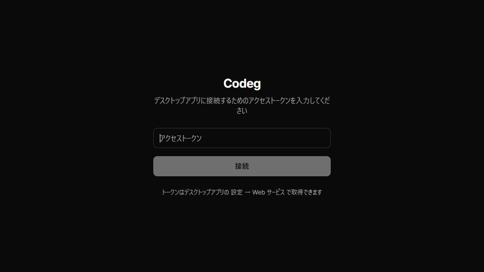
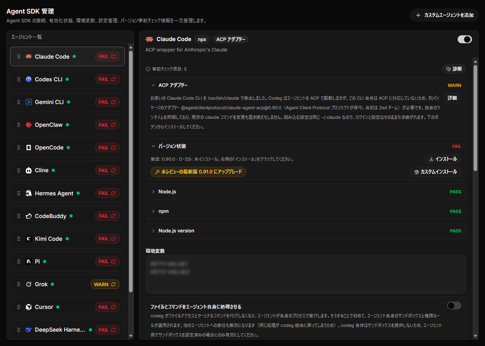
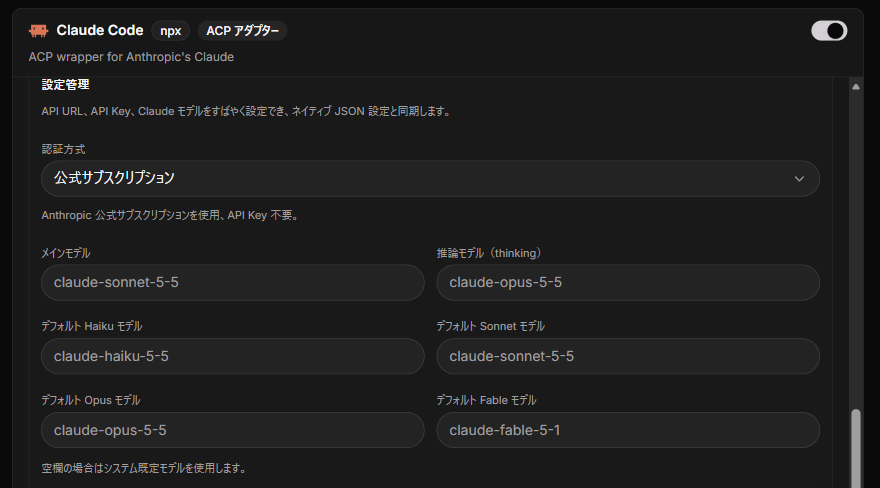
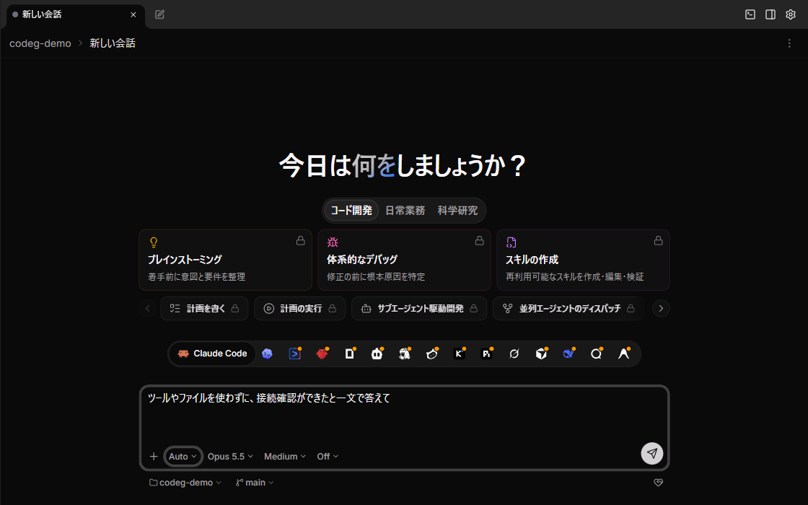
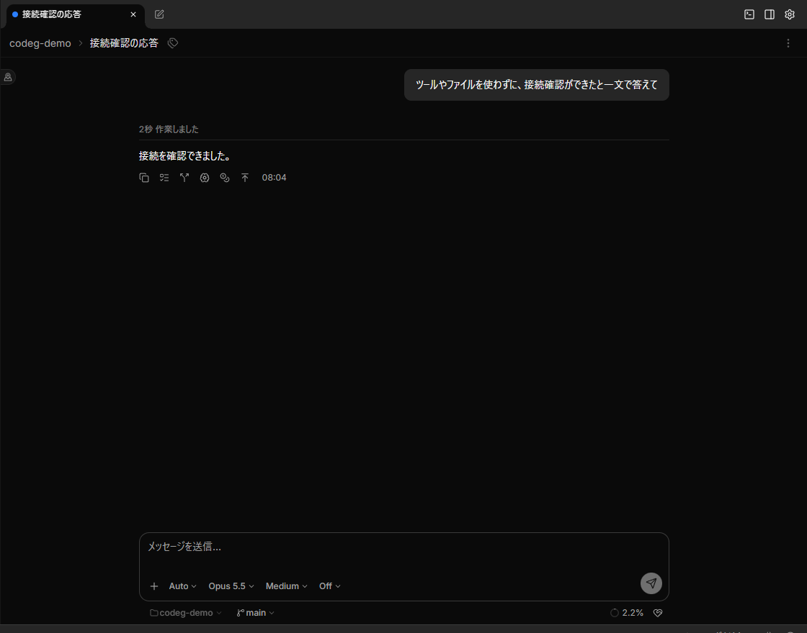
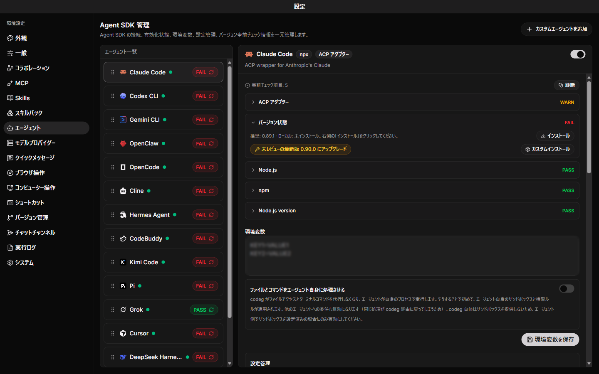
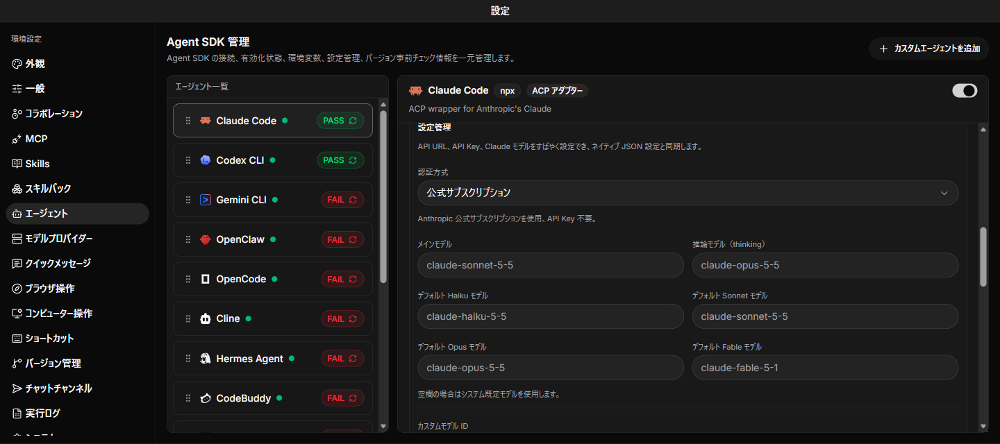
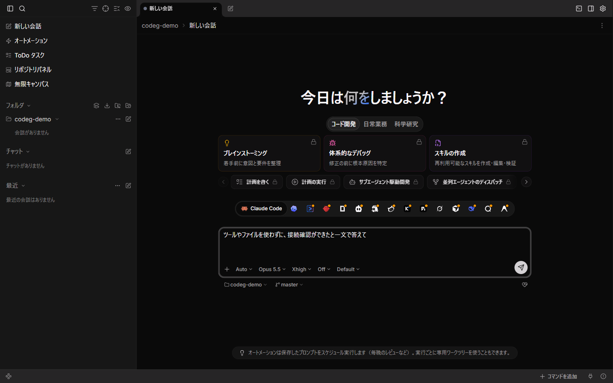
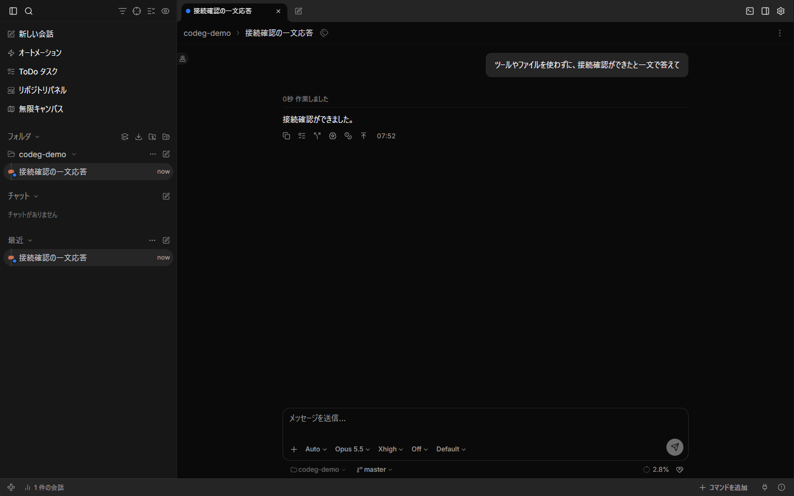

# AI コーディングエージェントのセットアップ（AlmaLinux 10・Windows 11）

## AlmaLinux 10 で使う

- 対象: AlmaLinux 10。Windows 11 は[Windows 11 で使う](#windows-11-で使う)から始める
- [検証記録](https://github.com/ryo-aoki-pc/setup-notes-verification/blob/main/docs/verification/ai-agents.md)・[参考資料](reference/ai-agents.md)・[ロールバックと注意点](extra/ai-agents.md)

> [!IMPORTANT]
> - 前提: [AlmaLinux 10 のセットアップ](almalinux-setup.md)の初期設定の項を、少なくとも[ログインと sudo](almalinux-setup.md#ログインと-sudo)から[yazi](almalinux-setup.md#yazi)まで通してあること
> - AI エージェントのアカウントを用意する。Claude Code は Pro / Max / Team / Enterprise か Console（無料の claude.ai プラン不可）
> - Codex は Codex を利用できる ChatGPT アカウント（API キーは従量課金）、Grok は利用対象の grok.com アカウント。Grok の現在の対象は xAI の案内で確認する。Antigravity CLI は個人の Google アカウント
> - **GNOME にログインした、インストール時の管理者ユーザー（`wheel`）の bash で行う**。`sudo -i`・`su -` のシェルでは行わない
> - **[Grok Build](#grok-build)の手順 2 は、共通設定とは別に `~/.bashrc` へ PATH と補完を足す**（[配置の説明](reference/almalinux-setup.md#grok-build--手順-2-補足-インストーラーが置くものと-bashrc)）
> - **[Antigravity CLI](#antigravity-cli)の手順 2 は、`~/.bashrc` と `~/.bash_profile` に PATH の行を足す**。同じ項の手順 4・5 で外す（[理由](reference/ai-agents.md#almalinux-10-で使う--antigravity-cli--手順-4-補足-path-の行を外す理由)）

- 必要な項を上から順に通す
- 貼った後は、反転表示の「確認」から後ろの出力を箇条書きで確かめる
- 新しい端末では、使う項の変数の手順を貼り直す
- 任意の構成（tmux の中で動かす・GNOME 操作・共同作業・ブラウザ操作）は後ろの節。Remote Control の節は Windows 11 のもの。以後は[AlmaLinux 10 の更新](#almalinux-10-の更新)を通す

### Claude Code

1. 変数を設定する。

   ```bash
   CC_CHANNEL=latest               # 追従するチャンネル。latest（出た版をすぐ配る）か stable（約 1 週間遅れ）。<CC_CHANNEL>
   printf '\n\033[7m 確認 \033[0m\n'
   printf 'CC_CHANNEL = %s\n' "${CC_CHANNEL}"
   ```

   - **編集が必須の変数は無い**。既定の `latest`（最新版）でよければ、そのまま貼る
   - 大きな不具合のある版を避けたいなら `stable`（1 週間ほど遅れて、そうした版を飛ばすチャンネル）にする
   - 最後に値を読み戻して確かめる
   - `latest` か `stable` 以外が入っていたら、ここで止めて直す
   - **新しいシェルを開いたら**（SSH を張り直したあとも）、先にこのブロックを貼り直す

1. リポジトリを追加する。

   ```bash
   if [ -z "${CC_CHANNEL}" ]; then echo '中断: 「Claude Code」の手順 1 の CC_CHANNEL が空のまま。値を入れて貼り直す' >&2; else
     sudo tee /etc/yum.repos.d/claude-code.repo >/dev/null <<EOF
   [claude-code]
   name=Claude Code
   baseurl=https://downloads.claude.ai/claude-code/rpm/${CC_CHANNEL:?「Claude Code」の手順 1 の CC_CHANNEL が空のまま。値を入れて貼り直す}
   enabled=1
   gpgcheck=1
   gpgkey=https://downloads.claude.ai/keys/claude-code.asc
   EOF
     printf '\n\033[7m 確認 \033[0m\n'
     cat /etc/yum.repos.d/claude-code.repo
   fi
   ```

   - `baseurl` の末尾がこの項の手順 1 で選んだチャンネル（既定なら `latest`）になっていることを確認する
   - `中断:` と出たら、何も書いていない

1. Claude Code をインストールする。

   ```bash
   sudo dnf install claude-code
   ```

   - トランザクション表で `claude-code` の版（既定の `latest` なら、その日の最新版）を確かめて `y` と答える
   - 初回は続けて署名鍵の取り込みを聞かれる
   - 表示される fingerprint が `31DD DE24 DDFA B679 F42D 7BD2 BAA9 29FF 1A7E CACE` であることを**目で確かめてから** `y` と答える
   - 違っていれば `N` で中断する
   - **次の手順は、答えてから貼る**（続けて貼ると答えとして食われる）

1. インストールできたか確かめる。

   ```bash
   printf '\n\033[7m 確認 \033[0m\n'
   dnf -q repoquery --installed --qf '%{name} %{version}-%{release} %{from_repo}' claude-code
   dnf -q repoquery --available --latest-limit 1 --qf '%{name} %{version}-%{release} %{reponame}' claude-code
   claude --version
   rpm -ql claude-code
   ```

   - 1 行目（入っている版）と 2 行目（チャンネルにある一番新しい版）が同じなら、そのチャンネルの最新版が入っている
   - `2.1.283 (Claude Code)` のようにバージョンが出れば動く
   - 入るファイルは実行ファイル 1 つとライセンスだけ（[完了時点の状態](https://github.com/ryo-aoki-pc/setup-notes-verification/blob/main/docs/verification/almalinux-setup.md#claude-code-完了時点の状態)）

1. 確認用のディレクトリで `claude` を起動し、ブラウザでログインする。

   ```bash
   mkdir -p ~/claude-sandbox
   cd ~/claude-sandbox
   claude
   ```

   - 初めての起動では、テーマの選択と、ログインの方法の選択（`Select login method:`）が先に出る
   - フォルダーを信頼するか聞かれたら、`claude-sandbox` であることを確かめて信頼する
   - 画面の案内に従ってブラウザでログインする
   - Pro / Max / Team / Enterprise か Console のアカウントが要る（無料の claude.ai プランでは使えない）
   - `ANTHROPIC_API_KEY` を設定している場合は、ブラウザではなくその鍵を使ってよいか 1 度だけ聞かれる
   - **認証情報（トークン・API キー）はこの文書に載せない**
   - `/exit` で終える
   - **次の手順は、`/exit` で Claude Code を終えてシェルのプロンプトに戻ってから貼る**（続けて貼ると Claude Code への入力として食われる）

### Codex CLI

1. 既存の Codex が入っていないか確かめる。

   ```bash
   command -v codex
   ```

   - 前提: Codex を利用できる ChatGPT アカウント。API キーを使う場合は API 側の従量課金
   - 新規の PC なら何も出ず、終了コードは 1 になる
   - パスが出たら、元の導入方法を確認してから進める。npm・Homebrew・standalone を重ねて入れない
   - `CODEX_HOME`・`CODEX_INSTALL_DIR`・`CODEX_RELEASE` は変えない。導入と撤去は既定の場所を使う
   - 入れるのは端末で使う Codex CLI。デスクトップアプリとエディタの拡張機能は別に入れる

1. インストーラーが使う道具を入れる。

   ```bash
   sudo dnf install -y curl-minimal ca-certificates tar gzip
   ```

   - `curl` が既に入っているときは、`パッケージ curl-… は既にインストールされています。` と出て終わる
   - `curl` が既に入っていて `curl-minimal` と競合するときは、`curl-minimal` を外して実行する

1. 公式の standalone インストーラーで Codex CLI を入れる。

   ```bash
   curl -fsSL https://chatgpt.com/codex/install.sh | sh
   ```

   - `Codex CLI … installed successfully.` を確認する
   - `Start Codex now?` と聞かれたら `n` で答える
   - **次の手順は、インストーラーが終わり、シェルのプロンプトに戻ってから貼る**

1. 今の端末の PATH を通し、実行ファイルと版を確かめる。

   ```bash
   export PATH="$HOME/.local/bin:$PATH"
   hash -r
   printf '\n\033[7m 確認 \033[0m\n'
   command -v codex
   codex --version
   ```

   - 自分のホームの `.local/bin/codex` と `codex-cli …` が出る
   - 新しく開いた端末でも `codex --version` が通ることを確認する

1. ChatGPT でのログインを始める。

   ```bash
   codex login
   ```

   - ブラウザが開く。自動で開かなければ、端末に出た URL を同じ PC のブラウザで開く
   - コマンドはログインが完了するまで待つ
   - ブラウザの無いホストでは、この項の手順 5・6 の代わりに[Codex CLI をブラウザの無いホストでログインする](#codex-cli-をブラウザの無いホストでログインする)を通す

1. ブラウザで ChatGPT にログインし、Codex との接続を承認する。

   - 利用するアカウント・ワークスペースを選ぶ
   - **次の手順は、端末でログインの成功を確認し、シェルのプロンプトに戻ってから貼る**

1. ログイン状態を確かめる。

   ```bash
   codex login status
   ```

   - ChatGPT でログイン済みであることを確認する
   - ログイン情報のファイルの中身を表示・共有する必要は無い

1. 確認用のディレクトリで Codex を起動する。

   ```bash
   mkdir -p ~/codex-sandbox
   cd ~/codex-sandbox
   git init
   codex
   ```

   - 作業場所の確認が出たら、`codex-sandbox` であることを確認する
   - 入力欄に「このディレクトリの状態を説明してください。ファイルは変更しないでください」と入力し、応答を確認する
   - 終了するときは `/quit` を入力する
   - **次の手順は、Codex を終了してシェルのプロンプトに戻ってから貼る**

### Grok Build

1. 既存の Grok と、同じ名前のコマンドが無いか確かめる。

   ```bash
   printf '\n\033[7m 確認 \033[0m\n'
   command -v grok agent curl
   ls -ld ~/.grok
   ```

   - 新規の PC なら `curl` のパスだけが出て、`ls` は `ls: '/home/<USER>/.grok' にアクセスできません: そのようなファイルやディレクトリはありません` になる
   - `curl` のパスが出なければ、`sudo dnf install -y curl-minimal` で入れてから進む
   - `grok` や `~/.grok` があれば、元の導入方法を確かめる。同名の非公式 grok-cli は先に外す
   - `agent` が見つかれば用途を確かめる。`~/.local/bin/agent` はインストーラーで置き換わることがある（[注意点](extra/ai-agents.md#注意点)）

1. 公式のインストーラーで Grok Build を入れる。

   ```bash
   curl -fsSL https://x.ai/cli/install.sh | bash
   ```

   - `Grok … installed to /home/<USER>/.grok/bin/grok` を確かめる
   - `Updated ... in PATH in .../.bashrc.` を確かめる。PATH・補完のブロックが末尾に追加され、初回は `~/.bashrc.bak.<数字>` に控えられる
   - `~/.local/bin` が PATH にあれば、`Symlinked .../grok -> …` と `…/agent -> …` も出る
   - 質問は出ない

1. 今の端末の PATH を通し、実行ファイルと版を確かめる。

   ```bash
   export PATH="$HOME/.grok/bin:$PATH"
   hash -r
   printf '\n\033[7m 確認 \033[0m\n'
   command -v grok
   grok --version
   ```

   - 自分のホームの `.grok/bin/grok` と `grok 1.0.50 (…)` のような版が出る
   - 新しく開いた端末でも `grok --version` が通ることを確かめる

1. ブラウザでのログインを始める。

   ```bash
   grok login
   ```

   - ブラウザが開く。開かなければ、端末に出た `https://accounts.x.ai/oauth2/device?user_code=…` の URL を同じ PC のブラウザで開く
   - 端末に確認用のコード（`XXXX-XXXX` の形）が出て、`Waiting for authorization...` のまま待つ
   - ブラウザの無いホストでは、この項の手順 4・5 の代わりに[Grok Build をブラウザの無いホストでログインする](#grok-build-をブラウザの無いホストでログインする)を通す

1. ブラウザで grok.com のアカウントにログインし、Grok Build との接続を承認する。

   - ブラウザに出たコードが、端末のコードと同じであることを確かめてから承認する
   - **次の手順は、端末でログインの成功を確かめ、シェルのプロンプトに戻ってから貼る**

1. ログインを確かめる。

   ```bash
   grok models
   ```

   - `You are not authenticated.` が出なければ、ログインできている
   - ログインしていなくても終了コードは 0 で、モデルの一覧は出る。終了コードでは判定しない
   - ログインの情報は `~/.grok/auth.json` に入る。中身を表示・共有しない

1. 確認用のディレクトリで Grok を起動する。

   ```bash
   mkdir -p ~/grok-sandbox
   cd ~/grok-sandbox
   git init
   grok
   ```

   - `Approve in your browser to finish signing in.` と確認用のコードが出たら、ログインできていない。Ctrl+Q で抜けて（画面に `ctrl+q quit` と出る）、この項の手順 4 からやり直す
   - フォルダーを信頼するか聞かれたら、`grok-sandbox` であることを確かめて信頼する
   - 入力欄に「このディレクトリの状態を説明してください。ファイルは変更しないでください」と入力し、応答を確かめる
   - 終了するときは `/quit` を入力する
   - **次の手順は、Grok を終了してシェルのプロンプトに戻ってから貼る**

### Antigravity CLI

1. 既存の Antigravity と、インストーラーが使う `curl` を確かめる。

   ```bash
   printf '\n\033[7m 確認 \033[0m\n'
   command -v agy antigravity curl
   ls -ld ~/.local/bin/agy ~/.gemini
   ```

   - 新規の PC なら `curl` のパスだけが出て、`ls` は 2 つとも、そのようなファイルやディレクトリは無いと出る
   - `curl` のパスが出なければ、`sudo dnf install -y curl-minimal` で入れてから進む
   - `agy` か `~/.local/bin/agy` があれば、元の導入方法を確かめてから進める（Antigravity の IDE が入れた `agy`・`antigravity` は、エディターを開くだけのコマンドで、この CLI ではない）
   - `~/.gemini` だけがあれば、ほかのツール（Gemini CLI など）のデータ。消さずに進める

1. 公式のインストーラーで Antigravity CLI を入れる。

   ```bash
   curl -fsSL https://antigravity.google/cli/install.sh | bash
   ```

   - `✓ Download complete and checksum verified.` と `✅ Antigravity CLI installed successfully at /home/<USER>/.local/bin/agy` を確かめる
   - `Appending PATH export to profile` の行が、`~/.bashrc` と `~/.bash_profile` の 2 つ出る。足された行は、この項の手順 4・5 で外す
   - `ERROR: logging before google.Init: I…` の行は、`I` で始まる情報の行で、エラーではない
   - `Security Halt: …` が出たら、入っていない。進まない
   - `Notice: 'agy' is already installed at …` が出たら、既に入っていて、何も変わっていない。この項の手順 1 の分岐を確かめる
   - 質問は出ない

1. 実行ファイルと版を確かめる。

   ```bash
   printf '\n\033[7m 確認 \033[0m\n'
   command -v agy
   agy --version
   ```

   - 自分のホームの `.local/bin/agy` と、`1.3.5` のような版が出る
   - `MmapAligned() failed` と出て止まったら、進まない（[補足](reference/ai-agents.md#almalinux-10-で使う--antigravity-cli--手順-3-補足-仮想アドレスが-39-ビットの-arm64)）。[Antigravity CLI を消す](extra/ai-agents.md#antigravity-cli-を消す)で消す
   - `command -v agy` が何も出さなければ、`~/.local/bin` が PATH に無い。この項の手順 4・5 は飛ばし、新しく開いた端末で `agy --version` を確かめる。この項の手順 6 からは、その端末に貼る

1. この項の手順 3 で `agy` が見つかったときだけ、インストーラーが足した PATH の行をエディタで消す。

   - `~/.bashrc` と `~/.bash_profile` の末尾の、`# Added by Antigravity CLI installer` の行と、次の `export PATH="/home/<USER>/.local/bin:$PATH"` の行を消す
   - その 2 行の前に足された空行 2 つも消す
   - ほかの PATH の行（既定の `~/.bashrc` が `~/.local/bin` を足す行など）は消さない
   - **次の手順は、2 つのファイルを保存してエディタを閉じてから貼る**

1. この項の手順 4 を行ったときだけ、PATH の行が外れたことを確かめる。

   ```bash
   printf '\n\033[7m 確認 \033[0m\n'
   grep -cF -e 'Antigravity CLI installer' -e "export PATH=\"$HOME/.local/bin:\$PATH\"" ~/.bashrc ~/.bash_profile
   ```

   - 2 行とも、末尾が `:0` ならよい。`:1` 以上なら、コメントか `export PATH=…` の行が残っている。この項の手順 4 に戻る
   - 同じ `export PATH=…` の行を自分で書いていれば、その数も出る。その行は残す
   - 新しく開いた端末でも `agy --version` が通ることを確かめる

1. 確認用のディレクトリで Antigravity CLI を起動し、ログインを始める。

   ```bash
   mkdir -p ~/agy-sandbox
   cd ~/agy-sandbox
   git init
   agy
   ```

   - `You are currently not signed in.` と `Select login method:` が出たら、`1. Google OAuth` を選んで Enter を押す
   - ブラウザが開く。開かなければ、端末に出た URL を同じ PC のブラウザで開く

1. ブラウザで個人の Google アカウントにログインし、Antigravity CLI を承認する。

   - 使うアカウントと、許可する内容を確かめてから承認する
   - 端末の起動画面に `Antigravity CLI 1.3.5` のような版、ログインしたアカウントとプラン、モデル名が出ればよい
   - フォルダーを信頼するか聞かれたら、`agy-sandbox` であることを確かめて信頼する

1. Antigravity の入力欄で `/config` を開き、設定を確かめてから終了する。

   - `Enable Telemetry`（利用データの送信）を確かめ、送らないなら `off` にする
   - `Tool Permission` が `request-review`、`Non-Workspace Access` が `off` であることを確かめる（[Antigravity CLI の設定ファイル](#antigravity-cli-の設定ファイル)）
   - `Esc` で設定を閉じ、`/quit` で終了する
   - **次の手順は、Antigravity を終了してシェルのプロンプトに戻ってから貼る**

1. ログインと、1 回だけの実行（`-p`）を確かめる。

   ```bash
   printf '\n\033[7m 確認 \033[0m\n'
   agy models
   agy -p 'ツールやファイルを使わずに、接続確認ができたと一文で答えてください。' --output-format json --print-timeout 300s
   ```

   - モデルの一覧（`gemini-3.8-flash-high` など）が出れば、ログインできている
   - JSON の `"status":"SUCCESS"` と、`"response"` に一文が出ればよい
   - JSON が `"status":"ERROR"` で `Individual quota reached` なら、ログインはできていて、`--model` を付けないときのモデルの上限。`agy -p /quota` で残りを確かめる
   - ログインの情報は `~/.gemini/antigravity-cli/antigravity-oauth-token` に入る。中身を表示・共有しない

### Codex・Grok のプラグイン

1. Node.js と bubblewrap を入れる（プラグインと sandbox が使う）。

   ```bash
   {
     sudo dnf install -y nodejs bubblewrap
     printf '\n\033[7m 確認 \033[0m\n'
     node --version
     bwrap --version
   }
   ```

   - `v22.…` と `bubblewrap 0.…` が出ればよい（プラグインは Node.js 18.18 以上が要る）
   - 導入済みの Node.js の `Package nodejs-… is already installed.` は正常
   - Grok の sandbox は Landlock が有効なカーネルも必要（[条件とエラー](extra/ai-agents.md#注意点)）
   - 導入済みの bubblewrap の `Package bubblewrap-… is already installed.` は正常

1. Claude Code に、OpenAI の Codex のプラグインと xAI の Grok Build のプラグインを入れる。

   ```bash
   printf '\n\033[7m 確認 \033[0m\n'
   claude plugin marketplace add openai/codex-plugin-cc
   claude plugin marketplace add xai-org/grok-build-plugin-cc
   claude plugin install codex@openai-codex
   claude plugin install grok-build@xai-grok-build
   claude plugin list
   ```

   - `✔ Successfully added marketplace: openai-codex` と `xai-grok-build`、`✔ Successfully installed plugin: …（scope: user）` が 2 つ出る
   - 最後の一覧に、`codex@openai-codex` と `grok-build@xai-grok-build` が `Status: ✔ enabled` で出る
   - 動いている Claude Code には、起動し直すまで効かない

---

## Windows 11 で使う

- 対象: Windows 11。AlmaLinux 10 は[AlmaLinux 10 で使う](#almalinux-10-で使う)から始める
- [検証記録](https://github.com/ryo-aoki-pc/setup-notes-verification/blob/main/docs/verification/ai-agents.md)・[参考資料](reference/ai-agents.md)・[ロールバックと注意点](extra/ai-agents.md#windows-11-のロールバック)

> [!IMPORTANT]
> - 前提: [Windows 11 のセットアップ](windows-setup.md)の実施手順を、少なくとも[yazi](windows-setup.md#yazi)まで通してあること
> - AI エージェントのアカウントは、[AlmaLinux 10 で使う](#almalinux-10-で使う)のリードと同じ（Antigravity CLI は個人の Google アカウント）
> - **この PC のデスクトップで行う**。SSH のセッションには貼らない
> - PowerShell のブロックは、管理者ではない **Windows PowerShell 5.1** に貼る（窓の開き方は、[Windows 11 のセットアップの「WSL の AlmaLinux 10 と自動サインイン」](windows-setup.md#wsl-の-almalinux-10-と自動サインイン)の手順 1）

- 上から順にコードブロックを貼る。[Windows 11 で Claude Code を入れる](#windows-11-で-claude-code-を入れる)の手順 1 の変数は、その項の中で新しい窓を開いたら貼り直す
- 貼った後は、反転表示の「確認」から後ろの出力を箇条書きで確かめる
- GitHub のコピーボタンでコピーしたブロックは末尾に改行が無いので、貼った後に Enter を押す
- Google の Antigravity CLI（`agy`）は、[Windows 11 で Antigravity CLI を入れる](#windows-11-で-antigravity-cli-を入れる)で入れる（AlmaLinux 10 は[Antigravity CLI](#antigravity-cli)）
- Codeg で使う Antigravity は別の製品（ACP サーバー）でログインも別なので、[Windows 11 で Antigravity を使う](#codeg-windows-11-で-antigravity-を使う)で入れる
- デスクトップアプリをブラウザから使うときは、[Antigravity アプリの Remote Control](#antigravity-アプリの-remote-control任意)を通す

### Windows 11 で Claude Code を入れる

1. 変数を設定する。

   ```powershell
   $CC_CHANNEL = 'latest'                # 追従するチャンネル。latest（出た版をすぐ配る）か stable（約 1 週間遅れ）。<CC_CHANNEL>
   "`n$([char]27)[7m 確認 $([char]27)[0m"
   'CC_CHANNEL = {0}' -f $CC_CHANNEL
   ```

   - **編集が必須の変数は無い**。既定の `latest`（最新版）でよければ、そのまま貼る
   - 大きな不具合のある版を避けたいなら `stable` にする（[AlmaLinux 10 の「Claude Code」](#claude-code)の手順 1 の `CC_CHANNEL` と同じ意味）
   - 最後に値を読み戻して確かめる
   - 変数はその PowerShell の中だけで有効。使うのはこの項の手順 3 だけ

1. Claude Code と Git for Windows があるか、64 ビットの PowerShell かを確かめる。

   ```powershell
   "`n$([char]27)[7m 確認 $([char]27)[0m"
   [Environment]::Is64BitProcess
   Get-Command claude -All -ErrorAction SilentlyContinue | Format-Table Source
   Test-Path "$env:USERPROFILE\.local\bin\claude.exe"
   Get-Command git -ErrorAction SilentlyContinue | Format-Table Source
   Test-Path 'C:\Program Files\Git\bin\bash.exe'
   ```

   - `True`、（claude は何も出ずに）`False`、`C:\Program Files\Git\cmd\git.exe`、`True` の順に出ればよい
   - 最初が `False` なら窓を閉じ、[WSL の AlmaLinux 10 と自動サインイン](windows-setup.md#wsl-の-almalinux-10-と自動サインイン)の手順 1 で開き直す。x86 版は使わない
   - claude の場所が `C:\Users\<WIN_USER>\.local\bin\claude.exe` だけで、3 つ目が `True` なら導入済み。この項の手順 3 は設定・ログインを残して入れ直す
   - claude の行にほかの場所（WinGet・npm・scoop で入れたものなど）が出たら、そちらを先に外す（[注意点](extra/ai-agents.md#注意点)）
   - `WindowsApps` の `Claude.exe` が出たら、古い Claude Desktop が `claude` の名前を取っている。Claude Desktop を最新にする（公式の Troubleshoot installation）
   - git が出ず、最後が `False` なら、Git for Windows が無い。先に [Git for Windows](windows-setup.md#git-for-windows)を通す

1. Claude Code を公式の native installer で入れる。

   ```powershell
   if (-not $CC_CHANNEL) {
     Write-Error 'この項の手順 1 の $CC_CHANNEL が空'
   } else {
     "`n$([char]27)[7m 確認 $([char]27)[0m"
     & ([scriptblock]::Create((Invoke-RestMethod -Uri https://claude.ai/install.ps1))) $CC_CHANNEL
   }
   ```

   - `Claude Code successfully installed!` と版（`Version: 2.1.288` など）の後に、最後に `Installation complete!`（前に絵文字の ✅ が付く）が出ればよい
   - `Setup notes:` に PATH 不足が出ても、この項の手順 4 で足す。ここでは何もしない
   - 赤いエラー（`Checksum verification failed`、`Failed to download binary` など）が出たら、そこで止まっている。[注意点](extra/ai-agents.md#注意点)と公式の [Troubleshoot installation](https://code.claude.com/docs/en/troubleshoot-install) を見る

1. 自分のユーザーの PATH に `%USERPROFILE%\.local\bin` が無ければ足す。

   ```powershell
   & {
     $bin = "$env:USERPROFILE\.local\bin"
     $entries = @([Environment]::GetEnvironmentVariable('Path', 'User') -split ';' | Where-Object { $_ })
     if (-not (Test-Path -LiteralPath "$bin\claude.exe")) { Write-Error "中断: $bin\claude.exe が無い（この項の手順 3 で入っていない）"; return }
     "`n$([char]27)[7m 確認 $([char]27)[0m"
     if ($entries | Where-Object { $_.TrimEnd('\') -eq $bin }) {
       "PATH に $bin はもうある"
     } else {
       [Environment]::SetEnvironmentVariable('Path', (($entries + $bin) -join ';'), 'User')
       "PATH に $bin を足した"
     }
     [Environment]::GetEnvironmentVariable('Path', 'User') -split ';'
   }
   ```

   - `足した` または `はもうある` と出て、PATH の一覧に `C:\Users\<WIN_USER>\.local\bin` があればよい
   - 何度貼ってもよい（あれば足さない）

1. 開いている Windows PowerShell を閉じ、新しく開き直す。

   - ウィンドウを閉じ（`exit` と打ってもよい）、[WSL の AlmaLinux 10 と自動サインイン](windows-setup.md#wsl-の-almalinux-10-と自動サインイン)の手順 1 と同じように、管理者ではない Windows PowerShell を開く（「Windows PowerShell (x86)」は開かない）
   - この項の手順 1 の変数は、この後は使わない
   - **次の手順は、開き直した PowerShell に貼る**（前の PowerShell の `PATH` には、`.local\bin` が無いことがある）

1. Claude Code の場所・版・署名と、導入の状態を確かめる。

   ```powershell
   "`n$([char]27)[7m 確認 $([char]27)[0m"
   Get-Command claude -All | Format-Table Source
   claude --version
   $sig = Get-AuthenticodeSignature -LiteralPath "$env:USERPROFILE\.local\bin\claude.exe"
   '{0}  {1}' -f $sig.Status, $sig.SignerCertificate.Subject
   claude doctor
   ```

   - `claude` の場所は `C:\Users\<WIN_USER>\.local\bin\claude.exe` の 1 行だけ
   - `2.1.288 (Claude Code)` のように版が出る（`stable` を選んだら、`latest` より古い版）
   - 署名の行が `Valid  CN="Anthropic, PBC", O="Anthropic, PBC", ...` で始まればよい。`Valid` でなければ使わずに、ロールバックの Claude Code の手順で消す
   - `claude doctor` に `Running: native (...)`・`Auto-updates: enabled`・`Auto-update channel: latest`（`stable` を選んだら `stable`）・`No installation issues found.` が出ればよい

1. `claude` を起動し、最初の設定とブラウザでのログインを行う。

   ```powershell
   claude
   ```

   - 文字の色の組み合わせ（`Choose the text style that looks best with your terminal`）を選んで Enter
   - `Select login method:` で `Claude account with subscription`（Pro / Max / Team / Enterprise）を選ぶ。Console のアカウントなら `Anthropic Console account`
   - 既定のブラウザ（Firefox）が開くので、claude.ai にログインして承認する。ブラウザが開かなければ、`c` で URL をコピーしてブラウザに貼る
   - ブラウザにコードが出たら、端末の `Paste code here if prompted >` に貼る
   - 端末に `Login successful` が出たら Enter。続く案内とフォルダーの信頼の確認（↓ で `Yes, I trust this folder`）に答えると、セッションが始まる
   - ログイン済みなら質問は出ない。別のアカウントにするなら、セッション内で `/login`
   - `/exit` で終える
   - **認証情報（トークン・コード）はこの文書に載せない**
   - **次の手順は、`/exit` で Claude Code を終えてから貼る**（続けて貼ると Claude Code への入力として食われる）

1. ログインしたかを確かめる。

   ```powershell
   claude auth status --text
   ```

   - `Login method: Claude Max account` のように、プランの行が出ればよい（ほかにメールアドレスと組織の行も出る）
   - `Not logged in. Run claude auth login to authenticate.` なら、ログインしていない。この項の手順 7 をやり直す
   - このコマンドの後ろに、別のコマンドを続けて貼らない

### Windows 11 で Codex CLI を入れる

1. 既存の Codex が入っていないか確かめる。

   ```powershell
   Get-Command codex -All -ErrorAction SilentlyContinue
   ```

   - 新規の PC なら何も出ない
   - パスが出たら、元の導入方法を確認してから進める
   - `CODEX_HOME`・`CODEX_INSTALL_DIR`・`CODEX_RELEASE` は変えない。導入・ロールバックは既定の場所を使う

1. 公式の standalone インストーラーで Codex CLI を入れる。

   ```powershell
   & ([scriptblock]::Create((Invoke-RestMethod -Uri 'https://chatgpt.com/codex/install.ps1')))
   ```

   - `Codex CLI … installed successfully.` を確認する
   - `Start Codex now?` と聞かれたら `n` で答える
   - **次の手順は、インストーラーが終わり、PowerShell のプロンプトに戻ってから貼る**

1. 実行ファイルと版を確かめる。

   ```powershell
   "`n$([char]27)[7m 確認 $([char]27)[0m"
   Get-Command codex -All
   codex --version
   ```

   - `Source` がこの項の手順 2 の場所で、`codex-cli …` が出ることを確認する

1. 開いている Windows PowerShell を閉じ、新しく開き直す。

   - [WSL の AlmaLinux 10 と自動サインイン](windows-setup.md#wsl-の-almalinux-10-と自動サインイン)の手順 1と同じように、管理者ではない Windows PowerShell（5.1）を開く
   - 新しい窓でも `codex --version` が通ることを確認する
   - 見つからない場合は、Windows Terminal など親のアプリも閉じて開き直す

1. ChatGPT でのログインを始める。

   ```powershell
   codex login
   ```

   - ブラウザが開く。自動で開かなければ、端末に出た URL を同じ PC のブラウザで開く
   - ブラウザの無いホストでは、この項の手順 5・6 の代わりに[Codex CLI をブラウザの無いホストでログインする](#codex-cli-をブラウザの無いホストでログインする)を通す（同じコマンドを PowerShell に貼る）

1. ブラウザで ChatGPT にログインし、Codex との接続を承認する。

   - 利用するアカウント・ワークスペースを選ぶ
   - **次の手順は、端末でログインの成功を確認し、PowerShell のプロンプトに戻ってから貼る**

1. ログイン状態を確かめる。

   ```powershell
   codex login status
   ```

   - ChatGPT でログイン済みであることを確認する

1. 確認用のディレクトリで Codex を起動する。

   ```powershell
   New-Item -ItemType Directory -Path "$env:USERPROFILE\codex-sandbox" -Force | Out-Null
   Set-Location "$env:USERPROFILE\codex-sandbox"
   git init
   codex
   ```

   - 作業場所の確認が出たら、`codex-sandbox` であることを確認する
   - Windows sandbox の設定を求められたら案内に従う。推奨の `elevated` sandbox の初回設定には管理者の承認が必要（普段の Codex は通常のユーザーで動かす）
   - 入力欄に「このディレクトリの状態を説明してください。ファイルは変更しないでください」と入力し、応答を確認する
   - 終了するときは `/quit` を入力する
   - **次の手順は、Codex を終了して PowerShell のプロンプトに戻ってから貼る**

### Windows 11 で Grok Build を入れる

1. 既存の Grok が入っていないか確かめる。

   ```powershell
   "`n$([char]27)[7m 確認 $([char]27)[0m"
   Get-Command grok, agent -All -ErrorAction SilentlyContinue
   Test-Path "$env:USERPROFILE\.grok"
   ```

   - 新規の PC なら、`False` だけが出る
   - パスか `True` が出たら、元の導入方法を確かめてから進める（WinGet の `xAI.GrokBuild` で入れた Grok なら、WinGet で更新する）

1. 公式のインストーラーで Grok Build を入れる。

   ```powershell
   & ([scriptblock]::Create((Invoke-RestMethod -Uri 'https://x.ai/cli/install.ps1')))
   ```

   - `Grok … installed to C:\Users\<WIN_USER>\.grok\bin\grok.exe` を確かめる
   - 初回は `Added C:\Users\<WIN_USER>\.grok\bin to your User PATH.` も出る
   - **次の手順は、インストーラーが終わり、PowerShell のプロンプトに戻ってから貼る**

1. 実行ファイルと版を確かめる。

   ```powershell
   "`n$([char]27)[7m 確認 $([char]27)[0m"
   Get-Command grok -All
   grok --version
   ```

   - `Source` がこの項の手順 2 の場所で、`grok …` の版が出ることを確かめる

1. 開いている Windows PowerShell を閉じ、新しく開き直す。

   - [WSL の AlmaLinux 10 と自動サインイン](windows-setup.md#wsl-の-almalinux-10-と自動サインイン)の手順 1と同じように、管理者ではない Windows PowerShell（5.1）を開く
   - 新しい窓でも `grok --version` が通ることを確かめる
   - 見つからない場合は、Windows Terminal など親のアプリも閉じて開き直す

1. ブラウザでのログインを始める。

   ```powershell
   grok login
   ```

   - ブラウザが開く。開かなければ、端末に出た URL を同じ PC のブラウザで開く
   - ブラウザの無いホストでは、この項の手順 5・6 の代わりに[Grok Build をブラウザの無いホストでログインする](#grok-build-をブラウザの無いホストでログインする)を通す（同じコマンドを PowerShell に貼る）

1. ブラウザで grok.com のアカウントにログインし、Grok Build との接続を承認する。

   - ブラウザに出たコードが、端末のコードと同じであることを確かめてから承認する
   - **次の手順は、端末でログインの成功を確かめ、PowerShell のプロンプトに戻ってから貼る**

1. ログインを確かめる。

   ```powershell
   grok models
   ```

   - `You are not authenticated.` が出なければ、ログインできている

1. 確認用のディレクトリで Grok を起動する。

   ```powershell
   New-Item -ItemType Directory -Path "$env:USERPROFILE\grok-sandbox" -Force | Out-Null
   Set-Location "$env:USERPROFILE\grok-sandbox"
   git init
   grok
   ```

   - フォルダーを信頼するか聞かれたら、`grok-sandbox` であることを確かめて信頼する
   - 入力欄に「このディレクトリの状態を説明してください。ファイルは変更しないでください」と入力し、応答を確かめる
   - 終了するときは `/quit` を入力する
   - **次の手順は、Grok を終了して PowerShell のプロンプトに戻ってから貼る**

### Windows 11 で Antigravity CLI を入れる

1. 既存の Antigravity が入っていないか確かめる。

   ```powershell
   "`n$([char]27)[7m 確認 $([char]27)[0m"
   Get-Command agy, antigravity -All -ErrorAction SilentlyContinue
   Test-Path "$env:LOCALAPPDATA\agy"
   Test-Path "$env:USERPROFILE\.gemini"
   ```

   - 新規の PC なら、`False` だけが出る
   - パスか `True` が出たら、元の導入方法を確かめてから進める（Antigravity の IDE が入れた `agy`・`antigravity` は、エディターを開くだけのコマンドで、この CLI ではない）
   - [Antigravity アプリ](#antigravity-アプリの-remote-control任意)を先に入れた PC では、`%USERPROFILE%\.gemini` が `True` になる。アプリは `agy`・`antigravity` を足さないので、アプリのデータを残して進める

1. 公式のインストーラーで Antigravity CLI を入れる。

   ```powershell
   & ([scriptblock]::Create((Invoke-RestMethod -Uri 'https://antigravity.google/cli/install.ps1')))
   ```

   - `✅ Antigravity CLI binary placed successfully at C:\Users\<WIN_USER>\AppData\Local\agy\bin\agy.exe` を確かめる
   - 初回は `Successfully added %LOCALAPPDATA%\agy\bin to User PATH registry variable.` も出る
   - `ERROR: logging before google.Init: I…` の行は、`I` で始まる情報の行で、エラーではない
   - `Security Halt: Checksum verification failed.` が出たら、入っていない。進まない
   - `Notice: 'agy.exe' is already installed at …` が出たら、既に入っていて、何も変わっていない。この項の手順 1 の分岐を確かめる
   - **次の手順は、インストーラーが終わり、PowerShell のプロンプトに戻ってから貼る**

1. インストーラーが残した一時ファイルを消し、実行ファイルと版を確かめる。

   ```powershell
   Remove-Item -LiteralPath "$env:LOCALAPPDATA\antigravity\staging\agy.exe" -ErrorAction SilentlyContinue
   "`n$([char]27)[7m 確認 $([char]27)[0m"
   Get-Command "$env:LOCALAPPDATA\agy\bin\agy.exe"
   & "$env:LOCALAPPDATA\agy\bin\agy.exe" --version
   ```

   - `Source` がこの項の手順 2 の場所で、`1.3.5` のような版が出ることを確かめる

1. 開いている Windows PowerShell を閉じ、新しく開き直す。

   - [WSL の AlmaLinux 10 と自動サインイン](windows-setup.md#wsl-の-almalinux-10-と自動サインイン)の手順 1 と同じように、管理者ではない Windows PowerShell（5.1）を開く
   - 新しい窓でも `agy --version` が通ることを確かめる
   - 見つからない場合は、Windows Terminal など親のアプリも閉じて開き直す
   - **次の手順は、開き直した PowerShell に貼る**

1. 確認用のディレクトリで Antigravity CLI を起動し、ログインを始める。

   ```powershell
   New-Item -ItemType Directory -Path "$env:USERPROFILE\agy-sandbox" -Force | Out-Null
   Set-Location "$env:USERPROFILE\agy-sandbox"
   git init
   agy
   ```

   - `You are currently not signed in.` と `Select login method:` が出たら、`1. Google OAuth` を選んで Enter を押す
   - ブラウザが開く。開かなければ、端末に出た URL を同じ PC のブラウザで開く

1. ブラウザで個人の Google アカウントにログインし、Antigravity CLI を承認する。

   - 使うアカウントと、許可する内容を確かめてから承認する
   - 端末の起動画面に `Antigravity CLI 1.3.5` のような版、ログインしたアカウントとプラン、モデル名が出ればよい
   - フォルダーを信頼するか聞かれたら、`agy-sandbox` であることを確かめて信頼する

1. Antigravity の入力欄で `/config` を開き、設定を確かめてから終了する。

   - `Enable Telemetry`（利用データの送信）を確かめ、送らないなら `off` にする
   - `Tool Permission` が `request-review`、`Non-Workspace Access` が `off` であることを確かめる（`off` でも、1 回だけの実行は `%TEMP%` に書ける。[Antigravity CLI の設定ファイル](#antigravity-cli-の設定ファイル)）
   - `Esc` で設定を閉じ、`/quit` で終了する
   - **次の手順は、Antigravity を終了して PowerShell のプロンプトに戻ってから貼る**

1. ログインと、1 回だけの実行（`-p`）を確かめる。

   ```powershell
   "`n$([char]27)[7m 確認 $([char]27)[0m"
   agy models
   agy -p 'ツールやファイルを使わずに、接続確認ができたと一文で答えてください。' --output-format json --print-timeout 300s
   ```

   - モデルの一覧（`gemini-3.8-flash-high` など）が出れば、ログインできている
   - JSON の `"status":"SUCCESS"` と、`"response"` に一文が出ればよい
   - JSON が `"status":"ERROR"` で `Individual quota reached` なら、ログインはできていて、`--model` を付けないときのモデルの上限。`agy -p /quota` で残りを確かめる
   - 日本語の応答が化けて読めなければ、`[Console]::OutputEncoding = [Text.Encoding]::UTF8` を貼ってから、このブロックを貼り直す

### Windows 11 で Codex・Grok のプラグインを入れる

1. Node.js 18.18 以上があるか確かめ、無いときだけ scoop で入れる（プラグインが使う）。

   ```powershell
   & {
     "`n$([char]27)[7m 確認 $([char]27)[0m"
     $node = Get-Command node -ErrorAction SilentlyContinue
     if ($node -and [version]((node --version) -replace '^v', '') -ge [version]'18.18') {
       'Node.js がある: {0}（{1}）' -f (node --version), $node.Source
     } else {
       scoop install nodejs-lts
     }
   }
   ```

   - `Node.js がある:` と版・場所が出たら導入済み。この項の手順 2 は飛ばす
   - 入れたときは、`'nodejs-lts' (…) was installed successfully!` が出ればよい

1. この項の手順 1 で nodejs-lts を入れたときだけ、PowerShell を閉じ、スタートメニューから開き直す。

   - 開き直した窓で `node --version` が通ることを確かめる
   - **次の手順は、開き直した PowerShell に貼る**

1. Claude Code に、OpenAI の Codex のプラグインと xAI の Grok Build のプラグインを入れる。

   ```powershell
   "`n$([char]27)[7m 確認 $([char]27)[0m"
   claude plugin marketplace add openai/codex-plugin-cc
   claude plugin marketplace add xai-org/grok-build-plugin-cc
   claude plugin install codex@openai-codex
   claude plugin install grok-build@xai-grok-build
   claude plugin list
   ```

   - 見方は、[AlmaLinux 10 の「Codex・Grok のプラグイン」](#codexgrok-のプラグイン)の手順 2 と同じ

---

## Claude Code の使い方の基本

- 対象: 両 OS
- 全部のオプションとサブコマンドは `claude --help`（サブコマンドの中は `claude mcp --help` など）。`--max-turns` のように `--help` に出ないものもある
- SSH を切っても動かす場合は[tmux の任意節](#claude-code-を-tmux-の中で動かす任意)を通す。Windows 11 は[Remote Control](#claude-code-の-remote-control-windows-11-で使う)（タスク スケジューラと WezTerm）

| コマンド | すること |
|---|---|
| `claude` | 今のディレクトリで、対話のセッションを始める |
| `claude "<最初の指示>"` | 最初の指示を渡して、対話のセッションを始める |
| `claude -c` | 今のディレクトリの、いちばん最近の会話を続ける |
| `claude -r` | 会話の一覧から選んで再開する |
| `claude -r <名前か ID>` | `-n` で付けた名前か、セッションの ID の会話を再開する |
| `claude -n <名前>` | セッションに名前を付けて始める（`/resume` の一覧と端末のタイトルに出る） |
| `claude --model <別名>` | モデルを選んで始める（`opus`・`sonnet`・`haiku` などの別名か、モデルの正式な名前） |
| `claude --permission-mode plan` | 計画だけを立てるモード（ファイルを変えない）で始める。ほかに `acceptEdits`・`auto` など |
| `claude --add-dir <ディレクトリ>` | 今のディレクトリのほかに、読み書きしてよいディレクトリを足す |

- [Windows 11 で Claude Code を入れる](#windows-11-で-claude-code-を入れる)で入れた `claude` にも、同じコマンドを Windows PowerShell で打つ

**セッションの中の操作**（公式ドキュメントの [Interactive mode](https://code.claude.com/docs/en/interactive-mode) と [Commands](https://code.claude.com/docs/en/commands) から）

| 操作 | すること |
|---|---|
| `Esc` | 今の応答やツールの実行を止める（ダイアログなら閉じる） |
| `Esc` を 2 回 | 入力があれば消す。空なら、前の時点に戻すメニューを開く |
| `Shift+Tab` | 許可のモードを順に切り替える（`default` → `acceptEdits` → `plan` …） |
| `Ctrl+C` | 動いているものを止める。何も動いていなければ 1 回目で入力を消し、2 回目で終わる |
| `Ctrl+J` | 改行する（どの端末でも。Shift+Enter は WezTerm などでだけ） |
| `!` で始める | Claude を通さずにシェルのコマンドを実行し、結果を会話に入れる |
| `@` | ファイルのパスを補完して、会話で指す |
| `Ctrl+R` | 入力の履歴をさかのぼって探す |
| `Ctrl+B` | 動いているコマンドを裏へ回す（tmux の中では 2 回押す） |
| `/help` | ヘルプとコマンドの一覧 |
| `/resume` | 会話の一覧から再開する |
| `/clear` | 会話を空にして始め直す |
| `/compact` | ここまでの会話を要約して、文脈を空ける |
| `/model` | モデルを変える |
| `/permissions` | 許可の規則を見る・変える |
| `/status` | 版・モデル・アカウント・接続の状態 |
| `/usage` | 使った量とプランの上限 |
| `/init` | このディレクトリの `CLAUDE.md` を作る |
| `/memory` | `CLAUDE.md` を編集する |
| `/remote-control` | このセッションを Remote Control につなぐ（`/rc`） |
| `/exit` | 終わる |

**非対話（`-p`）**（1 回答えて終わる。スクリプトやパイプで使う）

| コマンド | すること |
|---|---|
| `claude -p "<指示>"` | 答えだけを標準出力に出して終わる |
| `<コマンド> \| claude -p "<指示>"` | 標準入力の中身を、指示と一緒に渡す |
| `claude -p --output-format json "<指示>" \| jq -r .result` | 結果を JSON で受け取る（`result`・`session_id`・`is_error`・`num_turns`・`total_cost_usd` など） |
| `claude -p --allowedTools "Bash(touch *)" "<指示>"` | 聞かずに使ってよいツールを足す。`-p` では許可を聞けないので、無いと断られて `permission_denials` に残る |
| `claude -p --max-turns <数> "<指示>"` | ターンの数の上限。超えると `error_max_turns` で、終了コードは 1 |
| `claude -c -p "<指示>"` | 今のディレクトリのいちばん最近の会話に続けて、1 回答える |
| `claude -r <名前か ID> -p "<指示>"` | その会話に続けて、1 回答える |

- **`-p` はディレクトリの信頼の確認を飛ばす**（`claude --help`）。信頼できるディレクトリでだけ使う
- `date` のように読むだけのコマンドは、`--allowedTools` が無くても聞かずに動いた
- **Windows PowerShell 5.1 では、日本語の指示は引数で渡す**。パイプの `$OutputEncoding` の既定は ASCII（[仕様](https://learn.microsoft.com/en-us/powershell/module/microsoft.powershell.core/about/about_preference_variables?view=powershell-5.1)）

**管理のサブコマンド**

| コマンド | すること |
|---|---|
| `claude --version` | 版を出す |
| `claude doctor` | 導入の状態を診る（読むだけ）。`Remote Control` の段に、使えるかと、使えない理由が出る |
| `claude auth status --text` | ログインしているかを出す（していなければ `Not logged in.` で、終了コードは 1） |
| `claude mcp add <名前> -- <コマンド> [<引数>…]` | 標準入出力でつなぐ MCP サーバーを足す（既定は `local`: このディレクトリで、自分だけ） |
| `claude mcp add -s user …` / `-s project …` | `user` はどのディレクトリでも使う。`project` はこのディレクトリの `.mcp.json` に書いて共有する |
| `claude mcp add --transport http <名前> <URL>` | HTTP でつなぐ MCP サーバーを足す |
| `claude mcp list` | MCP サーバーの一覧（つながるかも確かめる） |
| `claude mcp get <名前>` | 1 つの MCP サーバーの詳細とスコープ |
| `claude mcp remove <名前> -s <スコープ>` | MCP サーバーを消す |
| `claude update` | dnf で入れた版では更新しない（`Claude is managed by a package manager.`）。[AlmaLinux 10 の更新](#almalinux-10-の更新)の `sudo dnf upgrade claude-code` を使う。native installer の版（Windows 11）は、すぐに更新する（[Windows 11 の更新](#windows-11-の更新)） |
| `claude remote-control --name <名前> --spawn same-dir` | Remote Control のサーバーを始める（[Claude Code を tmux の中で動かす（任意）](#claude-code-を-tmux-の中で動かす任意)。Windows は [Claude Code の Remote Control](#claude-code-の-remote-control-windows-11-で使う)） |

- `local` と `user` の MCP サーバーは `~/.claude.json`（Windows では `%USERPROFILE%\.claude.json`）に書かれる（`local` はディレクトリごとの欄）
- **`claude auth status` は、端末に残った後ろの行を読んで捨てる**: ブラケットペースト無しで、ほかのコマンドと続けて貼るときは最後に置く（`claude --version` と `claude doctor` では捨てなかった）

---

## Codex CLI をブラウザの無いホストでログインする

- 対象: 両 OS
- [Codex CLI](#codex-cli)の手順 5・6（`codex login`）の代わりに行う。ここにある 2 つのコマンドは bash と PowerShell で共通なので、Windows ではそのまま PowerShell に貼る

1. 手元のブラウザで、デバイスコードによるログインを有効にする。

   - 個人アカウントは ChatGPT のセキュリティ設定、管理されたワークスペースは管理者の権限設定で許可する

1. Codex を入れたホストでデバイスコード認証を始める。

   ```bash
   codex login --device-auth
   ```

   - 端末に URL とワンタイムコードが出る

1. 手元のブラウザで表示された URL を開き、コードを入力する。

   - 自分で始めたログインのコードだけを入力する
   - **次の手順は、Codex を入れたホストでログインの成功を確認してから貼る**

1. Codex を入れたホストでログイン状態を確かめる。

   ```bash
   codex login status
   ```

   - 成功したら、[Codex CLI](#codex-cli)の手順 8 へ進む（Windows 11 は、[Windows 11 で Codex CLI を入れる](#windows-11-で-codex-cli-を入れる)の手順 8）

---

## Codex CLI の設定ファイル

- 対象: 両 OS

| 用途 | AlmaLinux 10 | Windows 11 |
|---|---|---|
| ユーザー設定 | `~/.codex/config.toml` | `%USERPROFILE%\.codex\config.toml` |
| standalone の配布物 | `~/.codex/packages/standalone/` | `%USERPROFILE%\.codex\packages\standalone\` |
| ファイル保存の場合の認証情報 | `~/.codex/auth.json` | `%USERPROFILE%\.codex\auth.json` |

- 認証情報は OS の資格情報ストアに保存される場合もある。`auth.json` が無いだけで未ログインとは判断しない
- `auth.json` はパスワードと同じ扱いにし、Git・共有フォルダー・チャットへ載せない
- 初回導入のために `config.toml` を作る必要は無い

---

## Grok Build をブラウザの無いホストでログインする

- 対象: 両 OS
- [Grok Build](#grok-build)の手順 4・5（`grok login`）の代わりに行う。ここにある 2 つのコマンドは bash と PowerShell で共通なので、Windows ではそのまま PowerShell に貼る

1. Grok を入れたホストで、デバイスコードでのログインを始める。

   ```bash
   grok login --device-auth
   ```

   - 端末に URL（`https://accounts.x.ai/oauth2/device?user_code=…`）と確認用のコードが出て、`Waiting for authorization...` のまま待つ

1. 手元のブラウザで表示された URL を開き、コードを確かめて承認する。

   - 自分で始めたログインのコードだけを承認する
   - **次の手順は、Grok を入れたホストでログインの成功を確かめてから貼る**

1. Grok を入れたホストでログインを確かめる。

   ```bash
   grok models
   ```

   - `You are not authenticated.` が出なければ、[Grok Build](#grok-build)の手順 7 へ進む（Windows 11 は、[Windows 11 で Grok Build を入れる](#windows-11-で-grok-build-を入れる)の手順 8）

---

## Grok Build の設定ファイル

- 対象: 両 OS

| 用途 | AlmaLinux 10 | Windows 11 |
|---|---|---|
| ユーザー設定 | `~/.grok/config.toml` | `%USERPROFILE%\.grok\config.toml` |
| 実行ファイル | `~/.grok/bin/grok`（`~/.grok/downloads/` の配布物へのリンク） | `%USERPROFILE%\.grok\bin\grok.exe` |
| ログイン情報 | `~/.grok/auth.json` | `%USERPROFILE%\.grok\auth.json` |
| 会話の記録 | `~/.grok/sessions/` | `%USERPROFILE%\.grok\sessions\` |
| 信頼したフォルダー | `~/.grok/trusted_folders.toml` | `%USERPROFILE%\.grok\trusted_folders.toml` |
| プロジェクトの設定 | `<プロジェクト>/.grok/config.toml`（MCP サーバー・プラグイン・許可の規則） | 同じ |

- `auth.json` はパスワードと同じ扱いにし、Git・共有フォルダー・チャットへ載せない
- そのディレクトリで読まれる設定・指示書（AGENTS.md など）・MCP サーバーは、`grok inspect` で見られる（ログインしていなくても動く）
- 初回の導入のために `config.toml` を書く必要は無い（インストーラーが `[cli]` の 2 行を書く）
- 自動の更新を止めるときは、`config.toml` の `[cli]` の下に `auto_update = false` の行を足す。止めたら、[AlmaLinux 10 の更新](#almalinux-10-の更新)の手順 4 で上げる

---

## Antigravity CLI の設定ファイル

- 対象: 両 OS

| 用途 | AlmaLinux 10 | Windows 11 |
|---|---|---|
| 実行ファイル | `~/.local/bin/agy` | `%LOCALAPPDATA%\agy\bin\agy.exe` |
| ユーザー設定（`/config` の値・信頼したフォルダー `trustedWorkspaces`・許可の規則 `permissions`） | `~/.gemini/antigravity-cli/settings.json` | `%USERPROFILE%\.gemini\antigravity-cli\settings.json` |
| 共有の設定（MCP サーバーなど） | `~/.gemini/config/`（`mcp_config.json`） | `%USERPROFILE%\.gemini\config\`（`mcp_config.json`） |
| ログイン情報 | `~/.gemini/antigravity-cli/antigravity-oauth-token` | Windows の資格情報マネージャーの `gemini:antigravity` |
| 会話の記録とログ | `~/.gemini/antigravity-cli/conversations/`・`log/` | `%USERPROFILE%\.gemini\antigravity-cli\conversations\`・`log\` |
| 自動の更新の状態 | `~/.gemini/antigravity-cli/updater/` | `%USERPROFILE%\.gemini\antigravity-cli\updater\` |
| インストーラーの一時ファイル | `~/.cache/antigravity/staging/`（空のフォルダーが残る） | `%LOCALAPPDATA%\antigravity\staging\` |
| すべてのフォルダーに効く指示書 | `~/.gemini/AGENTS.md`・`GEMINI.md`（初めは無い） | `%USERPROFILE%\.gemini\AGENTS.md`・`GEMINI.md`（初めは無い） |
| Codeg の Antigravity（別の製品） | 仮想アドレスが 39 ビットの arm64 では ACP サーバー 1.4.0 は使えない（[AlmaLinux 10 で Antigravity を使う](#codeg-almalinux-10-で-antigravity-を使う)） | `%USERPROFILE%\.gemini\antigravity-acp\`（[Windows 11 で Antigravity を使う](#codeg-windows-11-で-antigravity-を使う)） |

- `antigravity-oauth-token` と資格情報マネージャーの値はパスワードと同じ扱いにし、表示させない・載せない
- 作業フォルダーの `AGENTS.md` と `GEMINI.md` を、どちらも指示として読む
- 初回の導入のために `settings.json` を書く必要は無い（フォルダーを信頼すると `trustedWorkspaces` が書かれる）
- Windows 11 の 1 回だけの実行（`agy -p`）は、作業フォルダーの中の読み書きと `%TEMP%` の中への書き込みを確認なしで行い、シェルのコマンドと、それ以外の場所の読み書きは拒む
- AlmaLinux 10 の `agy -p` は、作業フォルダーの中を読むことと `/tmp` の中への書き込みを確認なしで行う。作業フォルダーの中への書き込み（信頼したフォルダーでも）、それ以外の場所の読み書き、シェルのコマンドは拒む
- 拒んでも終了コードは 0 で、JSON の `denied_actions` と stderr の `jetski: no output produced` に出る
- `--dangerously-skip-permissions`・`--mode accept-edits`・`--mode auto` は使わない。`--mode plan` も、読み取り専用の境界には使わない（[参考資料](reference/coding-agents.md#windows-11-の-4-つ目のエージェントと読み取り専用の境界)）

---

## Claude Code を stable チャンネルに切り替える（任意）

- 対象: AlmaLinux 10
- `latest` で不具合に当たったときに、1 週間ほど遅れて大きな不具合のある版を飛ばす `stable` へ移る
- `stable` の版は `latest` より古いので、`dnf upgrade` では下がらない（`Nothing to do.`）。この節の手順 2 の `distro-sync` で下げる
- repo ファイルの `baseurl` の末尾を書き換えるだけで、`dnf clean` は要らない
- [Claude Code](#claude-code)の手順 1 で `stable` を選んで入れた後に `latest` へ移るときは、この節の手順 4 だけを行う
- この節は AlmaLinux 10 の dnf のもの。Windows 11 でチャンネルを変えるときは、[Windows 11 で Claude Code を入れる](#windows-11-で-claude-code-を入れる)の手順 1 の補足

1. repo ファイルの `baseurl` を `stable` に書き換える。

   ```bash
   {
     sudo sed -i 's|/rpm/latest$|/rpm/stable|' /etc/yum.repos.d/claude-code.repo
     printf '\n\033[7m 確認 \033[0m\n'
     grep '^baseurl=' /etc/yum.repos.d/claude-code.repo
   }
   ```

   - `baseurl` の末尾が `stable` になっていることを確認する

1. 入っている版を `stable` の最新に合わせる。

   ```bash
   sudo dnf distro-sync claude-code
   ```

   - `stable` がすでに同じ版まで追いついていれば `Nothing to do.` で終わる
   - **次の手順は、答えてから貼る**（続けて貼ると答えとして食われる）

1. 入っている版を確かめる。

   ```bash
   printf '\n\033[7m 確認 \033[0m\n'
   dnf -q repoquery --installed --qf '%{name} %{version}-%{release} %{from_repo}' claude-code
   dnf -q repoquery --available --latest-limit 1 --qf '%{name} %{version}-%{release} %{reponame}' claude-code
   claude --version
   ```

   - 1 行目と 2 行目が同じ版なら、`stable` の最新版に揃っている

1. 元に戻すときは、`baseurl` を `latest` に戻して最新版へ上げる。

   ```bash
   {
     sudo sed -i 's|/rpm/stable$|/rpm/latest|' /etc/yum.repos.d/claude-code.repo
     printf '\n\033[7m 確認 \033[0m\n'
     grep '^baseurl=' /etc/yum.repos.d/claude-code.repo
     sudo dnf upgrade claude-code
   }
   ```

   - `baseurl` の末尾が `latest` に戻ったことを確認する
   - トランザクション表が `Upgrading:` になっていることを確かめて `y` と答える
   - 答えた後、[Claude Code](#claude-code)の手順 4 のコマンドで版を確かめる

---

## Claude Code を tmux の中で動かす（任意）

- 対象: AlmaLinux 10
- SSH でログインしたシェルから、tmux の中で Claude Code を動かすと、SSH を切っても Claude Code が動き続ける
- Remote Control（`claude remote-control`）で始めると、SSH を切った後も、スマートフォンの Claude のアプリや claude.ai/code のブラウザから続けて使える
- 前提: [Claude Code](#claude-code)で入れ、`claude` で claude.ai のアカウント（Pro / Max / Team / Enterprise）にログインしてあること。API キーでは Remote Control を使えない（公式ドキュメント）
- **この節の手順 4 には対話入力がある**（ディレクトリの信頼と、初回の Remote Control の確認）
- Windows の PC は [Claude Code の Remote Control（Windows）](#claude-code-の-remote-control-windows-11-で使う)（Windows には tmux が無いので、タスク スケジューラと WezTerm を使う）
- Remote Control でなく、対話の `claude` を動かし続けるときは、この節の手順 4 で `claude` だけを打つ。別の SSH から `tmux attach -t claude` で戻れる

1. Claude Code と tmux が使えることと、ログインを確かめる。

   ```bash
   printf '\n\033[7m 確認 \033[0m\n'
   claude --version
   tmux -V
   claude auth status --text
   ```

   - `claude` の版、`tmux 3.7c`、`Login method: …` の行が出ればよい
   - `Not logged in. Run claude auth login to authenticate.` なら、[Claude Code](#claude-code)の手順 5 でログインしてから続ける
   - `claude doctor` の `Remote Control` の段にも、使えないときは理由が出る（ログインしていないと `Not signed in to claude.ai` など）

1. Claude Code を動かすディレクトリに移る。

   - `cd <PROJECT_DIR>` で、Remote Control で作業させたいディレクトリ（プロジェクト）に移る
   - ホームそのものは選ばない

1. tmux のセッションを作って入る。

   ```bash
   tmux new-session -A -s claude
   ```

   - 左下に `[claude]` が出る。新規セッションのシェルは、この節の手順 2 のディレクトリから始まる
   - 同じ名前のセッションがあれば、そこで動いていたコマンドと作業場所のまま戻る（`-A`）。Claude Code がすでに動いているなら、この節の手順 4 は飛ばしてその画面を使う
   - シェルに戻っている場合は、中で `pwd` を確かめ、必要なら `cd <PROJECT_DIR>` で作業場所へ移る。ほかのコマンドが動いていれば、そこへこの節の手順 4 を貼らない
   - **次の手順は、tmux の中のシェルで作業場所を確かめてから貼る**（動いているアプリへ貼ると、その入力として食われる）

1. tmux の中で Remote Control を始める。

   ```bash
   claude remote-control --name "$(basename "$PWD")" --spawn same-dir
   ```

   - 信頼のダイアログ（`Is this a project you created or one you trust?`）が出たら、**↓ で `Yes, I trust this folder` を選び Enter**（既定は `No, exit`）
   - 初めて Remote Control を使うときは `Enable Remote Control? (y/n)` が出る。`y`
   - `https://claude.ai/code/<SESSION_ID>` の URL と `space to show QR code` が出れば、始まっている
   - **`Ctrl+b` → `d` でデタッチする**（`Ctrl+C` を押すと Remote Control が止まる）
   - `Error: You must be logged in to use Remote Control.` で終わったら、`exit` で tmux を閉じて、この節の手順 1 からやり直す
   - **次の手順は、デタッチしてシェルに戻ってから貼る**（続けて貼ると、Claude Code への入力として食われる）

1. Remote Control が動いていることを確かめる。

   ```bash
   printf '\n\033[7m 確認 \033[0m\n'
   tmux ls
   pgrep -af 'claude remote-control'
   ```

   - `claude: 1 windows (created …)` と、`<PID> claude remote-control --name <名前> --spawn same-dir` が出ればよい
   - 2 行目が何も出なければ、`claude` は止まっている。`tmux attach -t claude` で中の表示を見る

1. SSH の接続を切る。

   ```bash
   exit
   ```

   - クライアントのプロンプトに戻る

1. スマートフォンかブラウザから使う。

   - claude.ai/code か、Claude のアプリの **Code** の一覧に、この節の手順 2 のディレクトリの名前のセッションが出る
   - 開いてメッセージを送ると、このホストのそのディレクトリで Claude Code が動いて返事が来る
   - 返事が来なければ、この節の手順 8 でログインし直して、中の表示を見る
   - **次の手順は、SSH でログインし直してから貼る**

1. SSH でログインし直し、tmux のセッションに戻る。

   ```bash
   tmux attach -t claude
   ```

   - この節の手順 4 の画面に戻る
   - 動かし続けるなら、`Ctrl+b` → `d` で離れる
   - 止めるなら `Ctrl+C`。シェルに戻ったら `exit` で tmux のセッションも閉じる

---

## Claude Code の Remote Control（任意）

- 対象: Windows 11
- この節だけを実施するときは、各項の前提・実行場所・権限を先に確認する
- [検証記録](https://github.com/ryo-aoki-pc/setup-notes-verification/blob/main/docs/verification/windows-claude-remote-control.md)・[参考資料](reference/windows-claude-remote-control.md)
- [ロールバックと注意点](extra/windows-claude-remote-control.md)

### Claude Code の Remote Control: Windows 11 で使う

> [!IMPORTANT]
> - **すべて、SSH でログインした Windows で行う**。この項の手順 1 で起動する Windows PowerShell 5.1 に貼る。停止・ロールバックも同じ窓を使い、デスクトップの PowerShell には貼らない
> - **Administrators のユーザーでログインする**。タスク登録に管理者の権限が要る。SSH のセッションは UAC 無しで管理者の権限を持つ
> - 前提: [OpenSSH サーバー](windows-setup.md#openssh-サーバー)で SSH ログインでき、[Claude Code](#windows-11-で-claude-code-を入れる)を公式の native installer で入れてある
> - `claude` の `/login` で claude.ai（Pro / Max / Team / Enterprise）にログイン済み。API キーでは Remote Control を使えない
> - [WezTerm](shell-terminal.md#windows-11-で-wezterm-を入れる)は `C:\Program Files\WezTerm` に入れ、[貼り付けの設定](windows-setup.md#貼り付けの設定)の手順 1〜5 を通す。SSH の PowerShell も同じプロファイルを読む
> - **デスクトップにログインしたままにする**。タスクはそのセッションで WezTerm を開くので、ログオフすると動かない（[注意点](extra/windows-claude-remote-control.md#注意点)）
> - 再起動後の自動サインインは[WSL の AlmaLinux 10 と自動サインイン](windows-setup.md#wsl-の-almalinux-10-と自動サインイン)の手順 5 で設定する
> - **手順 4 には対話入力がある**（ディレクトリの信頼のダイアログと、初回の Remote Control の確認。URL が出たら Ctrl+C）

- 上から順にコードブロックを貼る。手順 2 で変数を設定した PowerShell に貼る
- 貼った後は、反転表示の「確認」から後ろの出力を箇条書きで確かめる

> [!WARNING]
> **Remote Control をつなぐと、この claude.ai のアカウントで入れる人が、スマートフォンやブラウザからこの PC の `<PROJECT_DIR>` で、このユーザーとして Claude Code を動かせる**（ファイルの読み書きとコマンドの実行。SSH のセッションから登録するので、タスクは管理者の権限を持ちうる）。会話の転写（メッセージ・応答・ツールの動き）は Anthropic のサーバーに保存される（[注意点](extra/windows-claude-remote-control.md#注意点)）。タスクが開く WezTerm の窓はデスクトップに見える。窓を閉じる・中で Ctrl+C すると Claude Code が止まる。

1. クライアントの PC から Windows に SSH でログインし、Windows PowerShell を起動する。

   - `ssh <WIN_USER>@<WIN_HOST>` でログインする（[Windows 11 の初期設定の「SSH でログインを確かめる」の手順 5](windows-setup.md#ssh-でログインを確かめる)と同じ。スマートフォンの SSH のアプリでもよい）
   - ログインした先のシェルが Git Bash でも cmd でも、`powershell` と打つ
   - プロンプトが `PS C:\Users\<WIN_USER>>` になる
   - **次の手順は、このプロンプトが出てから貼る**（続けて貼ると、ログインした先のシェルへの入力として食われる）

1. 変数を設定する（`PROJECT_DIR` は必ず値を入れる）。

   ```powershell
   $PROJECT_DIR = ''                     # ← Remote Control のセッションを動かすディレクトリ（プロジェクト）を書く。<PROJECT_DIR>
   ```

   ```powershell
   $RC_NAME = if ($PROJECT_DIR) { Split-Path $PROJECT_DIR -Leaf }   # claude.ai/code とアプリに出るセッション名（既定はディレクトリ名）。<RC_NAME>
   "`n$([char]27)[7m 確認 $([char]27)[0m"
   'PROJECT_DIR = {0}' -f $PROJECT_DIR
   'RC_NAME     = {0}' -f $RC_NAME
   ```

   - 最後に値を読み戻して確かめる
   - `PROJECT_DIR` は、`C:\Users\<WIN_USER>\src\myproject` のような、存在するプロジェクトのディレクトリの絶対パス。ホームそのもの（`C:\Users\<WIN_USER>`）は使えない
   - **新しい PowerShell を開いたら**、手順 2 のブロックを貼り直してから先へ進む

1. Claude Code・WezTerm・ログインと、デスクトップのセッションを確かめる。

   ```powershell
   "`n$([char]27)[7m 確認 $([char]27)[0m"
   claude --version
   claude auth status --text
   & 'C:\Program Files\WezTerm\wezterm.exe' --version
   quser
   ```

   - `claude` の版と、ログイン済みを示す行、`wezterm 2026…` が出ればよい
   - `quser` に、自分のユーザーの `console` の行が `Active` で出ること。出なければ、この PC にログインしてから続ける
   - RDP で使った後にふつうに切断していると、自分の行のセッション名が空で、状態が `Disc`（切断）になる。RDP でつなぎ直し、[RDP をロックせずに切断する手順](windows-setup.md#rdp-をロックせずに切断)で切ると `console` に戻る
   - `claude remote-control --help` は貼らない

1. 初回だけ、対話で起動して信頼と Remote Control の確認に答え、URL が出たら止める。

   ```powershell
   if (-not $PROJECT_DIR) {
     Write-Error '手順 2 の $PROJECT_DIR が空'
   } elseif (-not (Test-Path -LiteralPath $PROJECT_DIR -PathType Container)) {
     Write-Error '中断: $PROJECT_DIR は存在するディレクトリではない'
   } else {
     Set-Location -LiteralPath $PROJECT_DIR -ErrorAction Stop
     claude remote-control --name $RC_NAME --spawn same-dir
   }
   ```

   - ディレクトリが無い、ファイルを指定した、または移動できない場合は起動しない。手順 2 の値とディレクトリへのアクセスを確かめてから貼り直す
   - 信頼のダイアログ（`Is this a project you created or one you trust?`）が出たら、**↓ で `Yes, I trust this folder` を選び Enter**（既定は `No, exit`）
   - 初めて Remote Control を使うときは `Enable Remote Control? (y/n)` が出る。`y`
   - `https://claude.ai/code/<SESSION_ID>` の URL と `space to show QR code` が出れば、起動できている
   - **Ctrl+C** で止める
   - **次の手順は、Ctrl+C で止めてプロンプトに戻ってから貼る**（続けて貼ると Claude Code への入力として食われる）

1. タスクを登録する（WezTerm で `claude remote-control` を起動するタスク）。

   ```powershell
   if (-not $PROJECT_DIR) {
     Write-Error '手順 2 の $PROJECT_DIR が空'
   } elseif (-not (Test-Path -LiteralPath $PROJECT_DIR -PathType Container)) {
     Write-Error '中断: $PROJECT_DIR は存在するディレクトリではない'
   } else {
     $me = [System.Security.Principal.WindowsIdentity]::GetCurrent().Name
     $wt = 'C:\Program Files\WezTerm\wezterm.exe'
     $arg = 'start --cwd "{0}" -- claude remote-control --name "{1}" --spawn same-dir' -f $PROJECT_DIR, $RC_NAME
     $action = New-ScheduledTaskAction -Execute $wt -Argument $arg
     $principal = New-ScheduledTaskPrincipal -UserId $me -LogonType Interactive
     $settings = New-ScheduledTaskSettingsSet -ExecutionTimeLimit (New-TimeSpan) -AllowStartIfOnBatteries -DontStopIfGoingOnBatteries -MultipleInstances IgnoreNew
     "`n$([char]27)[7m 確認 $([char]27)[0m"
     Register-ScheduledTask -TaskName 'claude-remote-control' -Action $action -Principal $principal -Settings $settings -Force | Format-List TaskName, State
   }
   ```

   - `State : Ready` が出ればよい

1. タスクを開始し、動いていることを確かめる。

   ```powershell
   Start-ScheduledTask -TaskName 'claude-remote-control'
   Start-Sleep -Seconds 8
   "`n$([char]27)[7m 確認 $([char]27)[0m"
   (Get-ScheduledTask -TaskName 'claude-remote-control').State
   Get-CimInstance Win32_Process -Filter "Name='claude.exe'" | Where-Object CommandLine -like '*--spawn same-dir*' | Select-Object ProcessId, ParentProcessId | Format-Table -AutoSize
   ```

   - `Running` と、`claude.exe` のプロセスが出ればよい（親は WezTerm）
   - デスクトップには WezTerm の窓が開き、中で Claude Code が動く
   - 数十秒で claude.ai/code の一覧に `<RC_NAME>` が出る（手順 8 で確かめる）

1. SSH の接続を切る。

   ```powershell
   exit
   ```

   - ログインした先のシェルに戻る（Git Bash なら `<WIN_USER>@<HOSTNAME> MINGW64 ~`、cmd なら `C:\Users\<WIN_USER>>`）
   - そこでもう 1 度 `exit` と打つと、SSH が切れてクライアントのプロンプトに戻る。SSH のアプリで接続を閉じてもよい
   - タスクで起動した WezTerm と Claude Code は、デスクトップのセッションに残る

1. 切断した後も、スマートフォンかブラウザからセッションが使えることを確かめる。

   - claude.ai/code か、Claude のアプリの **Code** の一覧に `<RC_NAME>` が、コンピューターのアイコンと緑の点付きで出る
   - 開いてメッセージを送ると、この PC の `<PROJECT_DIR>` で Claude Code が動いて返事が来る
   - 返事が来なければ、手順 9 でログインし直して確かめる

1. 必要なら SSH でログインし直し、タスクとプロセスが残っていることを確かめる。

   ```powershell
   "`n$([char]27)[7m 確認 $([char]27)[0m"
   (Get-ScheduledTask -TaskName 'claude-remote-control').State
   Get-CimInstance Win32_Process -Filter "Name='claude.exe'" | Where-Object CommandLine -like '*--spawn same-dir*' | Select-Object ProcessId | Format-Table -AutoSize
   ```

   - `Running` と、手順 6 と同じプロセスが残っている
   - 手順 2 の変数は要らない

---

### Claude Code の Remote Control: 止める・もう一度始める

- この節は、SSH でログインした PowerShell に貼る（変数は要らない）
- 止めるのはこの項の手順 1、もう一度始めるのは手順 2

1. セッションを止める。

   ```powershell
   Stop-ScheduledTask -TaskName 'claude-remote-control'
   "`n$([char]27)[7m 確認 $([char]27)[0m"
   Get-CimInstance Win32_Process -Filter "Name='claude.exe'" | Where-Object CommandLine -like '*--spawn same-dir*' | Select-Object ProcessId | Format-Table -AutoSize
   ```

   - `claude.exe` のプロセスが消える（デスクトップで別に動かしている分は残る）
   - WezTerm の窓も閉じる

1. もう一度始めるときは、タスクを開始する。

   ```powershell
   Start-ScheduledTask -TaskName 'claude-remote-control'
   ```

   - 止めてから約 4 時間以内なら、claude.ai/code の同じセッションが戻る（それを過ぎると新しいセッションになる。公式ドキュメント）
   - ネットワークが約 10 分切れると、Claude Code のサーバーは自分で終わり WezTerm の窓が閉じる（公式ドキュメント）。そのときもこの手順で始め直す


---

## Antigravity アプリの Remote Control（任意）

- 対象: Windows 11
- この節だけを実施するときは、次の前提と実行場所を先に確認する。Antigravity CLI の導入は要らない
- 前提: x64 の PC。個人の Google アカウント。[Git for Windows](windows-setup.md#git-for-windows)（試験用のリポジトリを作るのに使う）
- 実行場所: PC のデスクトップの、自分のユーザーの管理者ではない Windows PowerShell 5.1。アプリとブラウザの画面の操作がある
- [検証記録](https://github.com/ryo-aoki-pc/setup-notes-verification/blob/main/docs/verification/ai-agents.md#付録-windows-11-の-antigravity-アプリの-remote-control2026-10-15-jst)・[参考資料](reference/ai-agents.md#windows-11-の-antigravity-アプリの-remote-control)
- [ロールバック](extra/ai-agents.md#windows-11-で-antigravity-アプリを消す)・[注意点](extra/ai-agents.md#注意点)
- 貼った後は、反転表示の「確認」から後ろの出力を箇条書きで確かめる。折りたたまれたブロックは、開いてからコピーボタンで写す

> [!WARNING]
> - この Google アカウントで入れる人は、ブラウザからこの PC のフォルダーを辿ってプロジェクトにできる
> - プロジェクトの中のファイルは確認なしで書き換わり、承認したコマンドはこのユーザーとして実行される。「常に許可」を選ぶと、選んだ範囲では以後の確認が無くなる
> - アプリを開いている間はつながり、窓を閉じてもトレイで動いている間はつながる

### Antigravity アプリの Remote Control: Windows 11 で使う

1. 既存のアプリと CLI のコマンドを確かめ、導入前の状態を控える。

   ```powershell
   $AG_APP_AGY_BEFORE = @(Get-Command agy -All -ErrorAction SilentlyContinue | Select-Object -ExpandProperty Source)
   $AG_APP_AGY_HASH_BEFORE = if (Test-Path -LiteralPath "$env:LOCALAPPDATA\agy\bin\agy.exe") { (Get-FileHash -LiteralPath "$env:LOCALAPPDATA\agy\bin\agy.exe" -Algorithm SHA256).Hash }
   "`n$([char]27)[7m 確認 $([char]27)[0m"
   Get-Command agy, antigravity -All -ErrorAction SilentlyContinue
   Test-Path -LiteralPath "$env:LOCALAPPDATA\Programs\antigravity"
   $AG_APP_AGY_HASH_BEFORE
   ```

   - アプリが無ければ、`False` が出る。CLI が無くても進める
   - CLI があるなら、`agy` が `%LOCALAPPDATA%\agy\bin\agy.exe` だけを指すことを確かめる。別の場所のコマンドが出たら、元の導入方法を確かめるまで進まない
   - アプリが既に入っていて `True` が出たら、この項の手順 2〜4 を飛ばし、この項の手順 5 から設定する
   - この項の手順 1〜4 は、同じ PowerShell に貼る。窓を開き直したら、この項の手順 1 からやり直す

1. 公式のインストーラーを一時フォルダーに取り、署名と版を確かめる。

   ```powershell
   if (-not $env:TEMP) {
     Write-Error '中断: TEMP が空'
   } else {
     $AG_APP_DOWNLOAD_DIR = Join-Path $env:TEMP ('antigravity-app-' + [guid]::NewGuid().ToString('N'))
     New-Item -ItemType Directory -Path $AG_APP_DOWNLOAD_DIR -ErrorAction Stop | Out-Null
     $AG_APP_INSTALLER = Join-Path $AG_APP_DOWNLOAD_DIR 'Antigravity-x64.exe'
     & { $ProgressPreference = 'SilentlyContinue'; Invoke-WebRequest -Uri 'https://storage.googleapis.com/antigravity-public/antigravity-hub/2.23.1-6348059836284928/windows-x64/Antigravity-x64.exe' -OutFile $AG_APP_INSTALLER -UseBasicParsing -ErrorAction Stop }
     $AG_APP_SIGNATURE = Get-AuthenticodeSignature -LiteralPath $AG_APP_INSTALLER
     "`n$([char]27)[7m 確認 $([char]27)[0m"
     $AG_APP_SIGNATURE | Select-Object Status, @{Name='Signer'; Expression={$_.SignerCertificate.Subject}} | Format-List
     (Get-Item -LiteralPath $AG_APP_INSTALLER).VersionInfo | Format-List ProductName, ProductVersion, CompanyName, FileDescription
     if ($AG_APP_SIGNATURE.Status -ne 'Valid' -or $AG_APP_SIGNATURE.SignerCertificate.Subject -notlike 'CN=Google LLC*') {
       throw '中断: 署名が Valid でないか、署名者が Google LLC ではない'
     }
   }
   ```

   - 終わるまで数分かかることがある（約 157 MiB）
   - `Status` が `Valid`、`Signer` が `CN=Google LLC` で始まることを確かめる。違うときは中断し、実行しない
   - `ProductName` が `Antigravity`、`ProductVersion` が `2.23.1`、`CompanyName` が `Google`、`FileDescription` が `Antigravity - Agentic Desktop Application` であることを確かめる。違うときは進まない
   - 新しい版が出たら、[公式のダウンロードのページ](https://antigravity.google/download)で Windows x64 の Antigravity app の URL を取り直し、`ProductVersion` の確認も選んだ版に合わせる。新しい版は未検証
   - 別の製品の Antigravity IDE は選ばない
   - **次の手順は、ダウンロードが終わり、署名と版を確かめてから貼る**

1. 署名を確かめたインストーラーで、アプリを入れる。

   ```powershell
   if (-not $AG_APP_INSTALLER) {
     Write-Error '中断: この項の手順 2 の AG_APP_INSTALLER が空'
   } else {
     Start-Process -FilePath $AG_APP_INSTALLER -PassThru | Wait-Process
   }
   ```

   - 画面での選択は無く、1 分ほどで終わる。終わるとアプリが自動で起動する
   - **次の手順は、インストーラーが終わり、PowerShell のプロンプトに戻ってから貼る**

1. 導入先・登録・CLI の状態を確かめ、ダウンロードしたファイルを消す。

   <details>
     <summary>貼るコマンド（PowerShell・23 行）</summary>

   ```powershell
   if (-not $AG_APP_INSTALLER -or -not $AG_APP_DOWNLOAD_DIR) {
     Write-Error '中断: この項の手順 2 の一時ファイルの変数が空'
   } elseif (-not (Test-Path -LiteralPath "$env:LOCALAPPDATA\Programs\antigravity\Antigravity.exe")) {
     Write-Error '中断: アプリが入っていない。ダウンロードしたファイルは消さずに残した'
   } else {
     "`n$([char]27)[7m 確認 $([char]27)[0m"
     Get-Item -LiteralPath "$env:LOCALAPPDATA\Programs\antigravity\Antigravity.exe" | Select-Object FullName
     Get-ItemProperty -Path 'HKCU:\Software\Microsoft\Windows\CurrentVersion\Uninstall\*' |
       Where-Object DisplayName -like 'Antigravity *' |
       Select-Object DisplayName, DisplayVersion, Publisher, UninstallString, QuietUninstallString | Format-List
     Get-Command agy, antigravity -All -ErrorAction SilentlyContinue
     $AG_APP_AGY_AFTER = @(Get-Command agy -All -ErrorAction SilentlyContinue | Select-Object -ExpandProperty Source)
     $AG_APP_AGY_HASH_AFTER = if (Test-Path -LiteralPath "$env:LOCALAPPDATA\agy\bin\agy.exe") {
       (Get-FileHash -LiteralPath "$env:LOCALAPPDATA\agy\bin\agy.exe" -Algorithm SHA256).Hash
     }
     [pscustomobject]@{
       AgyCommandUnchanged = ($AG_APP_AGY_BEFORE -join "`n") -eq ($AG_APP_AGY_AFTER -join "`n")
       AgyHashUnchanged = $AG_APP_AGY_HASH_BEFORE -eq $AG_APP_AGY_HASH_AFTER
     } | Format-List
     Remove-Item -LiteralPath $AG_APP_INSTALLER -Force
     Remove-Item -LiteralPath $AG_APP_DOWNLOAD_DIR -Recurse -Force
     Test-Path -LiteralPath $AG_APP_INSTALLER
   }
   ```

   </details>

   - `FullName` が `%LOCALAPPDATA%\Programs\antigravity\Antigravity.exe` に相当し、アンインストールの登録に `Antigravity 2.23.1`・`Google` が出ることを確かめる
   - `AgyCommandUnchanged` と `AgyHashUnchanged` が `True` で、`antigravity` のコマンドが増えていないことを確かめる。違うときは進まない
   - 最後の `Test-Path` が `False` なら、ダウンロードしたファイルは消えている
   - `中断: アプリが入っていない` が出たら、この項の手順 3 のインストーラーの画面とエラーを確かめ、この項の手順 3 からやり直す

1. 起動したアプリで、個人の Google アカウントにログインする。

   - CLI を使っていても、アプリで別にログインする
   - 使うアカウントを確かめてログインする

1. PC のアプリの設定で、バックグラウンド動作と Remote Control を有効にする。

   - `Ctrl+,` → `Application` → `Remote Control` をオンにする
   - 同じ `Application` の `General` で、`Keep In Menu Bar`（窓を閉じても動かす）と `Prevent Sleep`（スリープを防ぐ）をオンにする。PC の画面の項目名は未確認で、オンになったかはこの項の手順 7 のファイルの値で確かめる
   - **次の手順は、PC のアプリで設定を終えてから PowerShell に貼る**

1. 設定ファイルから、Remote Control と動作設定の 4 つの値だけを確かめる。

   ```powershell
   $AG_APP_SETTINGS = (Get-Content -LiteralPath "$env:USERPROFILE\.gemini\config\config.json" -Raw -Encoding UTF8 | ConvertFrom-Json).userSettings
   $AG_APP_STORAGE = Get-Content -LiteralPath "$env:APPDATA\Antigravity\app_storage.json" -Raw -Encoding UTF8 | ConvertFrom-Json
   "`n$([char]27)[7m 確認 $([char]27)[0m"
   [pscustomobject]@{
     remoteControlEnabled = $AG_APP_SETTINGS.remoteControlEnabled
     remoteControlHostname = $AG_APP_SETTINGS.remoteControlHostname
     runInBackground = $AG_APP_STORAGE.runInBackground
     keepComputerAwake = $AG_APP_STORAGE.keepComputerAwake
   } | Format-List
   ```

   - `remoteControlEnabled` が `True`、`runInBackground` と `keepComputerAwake` が `true` であることを確かめる。違うときは、この項の手順 6 の設定をやり直す
   - `remoteControlHostname` の名前（`<RC_NAME>`）を控え、この項の手順 10 で選ぶ。空なら、この項の手順 6 の設定を確かめ、先へ進まない
   - 設定ファイルにはログインしたアカウントなども入る。ファイル全体を表示・共有しない

1. ログオン時に起動するよう、スタートアップにショートカットを置く。

   ```powershell
   $lnk = Join-Path ([Environment]::GetFolderPath('Startup')) 'Antigravity.lnk'
   $exe = "$env:LOCALAPPDATA\Programs\antigravity\Antigravity.exe"
   $ws = New-Object -ComObject WScript.Shell
   $s = $ws.CreateShortcut($lnk)
   $s.TargetPath = $exe
   $s.WorkingDirectory = Split-Path -LiteralPath $exe
   $s.Save()
   "`n$([char]27)[7m 確認 $([char]27)[0m"
   $ws.CreateShortcut($lnk).TargetPath
   ```

   - `TargetPath` が `%LOCALAPPDATA%\Programs\antigravity\Antigravity.exe` に相当することを確かめる
   - サインアウト・再起動の後に自動で起動して `Online` になることは未検証

1. ブラウザから試す、使い捨てのリポジトリを作る。

   ```powershell
   New-Item -ItemType Directory -Path "$env:USERPROFILE\agy-rc-test" -Force | Out-Null
   git -C "$env:USERPROFILE\agy-rc-test" init -q
   Set-Content -LiteralPath "$env:USERPROFILE\agy-rc-test\README.md" -Value '# agy-rc-test'
   "`n$([char]27)[7m 確認 $([char]27)[0m"
   git -C "$env:USERPROFILE\agy-rc-test" status --short --branch
   ```

   - `## No commits yet on master`（既定のブランチの名前を変えていれば、その名前）と `?? README.md` が出ればよい

1. PC のブラウザで、Remote Control に接続する。

   - [antigravity.google.com](https://antigravity.google.com) を開き、アプリと同じ Google アカウントでサインインする
   - `Remote Control Instances` に、この項の手順 7 の `<RC_NAME>` が `Online` で出ることを確かめ、`Connect` を押す
   - 初回の `Security Notice & Data Use` では、注意を読む。データの提供をしないなら、初めは空のチェックボックスにチェックを入れず、`Accept and continue` を押す
   - `Remote control is not enabled for your account.` が出たら、アカウントで機能が有効になっていない。接続を中断する
   - スマートフォンからの接続は未検証

1. ブラウザで PC の試験用フォルダーをプロジェクトにし、会話を確かめる。

   - `Projects` の `Create New Project` → `New Project` で、この項の手順 9 のパス（`C:\Users\<WIN_USER>\agy-rc-test`）を入れ、`OK` を押す
   - 「ツールやファイルを使わずに、接続確認ができたと日本語で一文で答えてください。」と送り、返事が来ることを確かめる
   - PC のフォルダーを一覧で辿れる。プロジェクトにする場所を確かめ、ホーム全体を選ばない

1. ブラウザからコマンドを頼み、承認と実行を確かめる。

   - 「ターミナルで `git status --short --branch` を 1 回だけ実行してください。」と送る
   - 承認カードのコマンドを読み、次の 5 つの選択肢から `Yes, allow this time` を選んで `Submit` を押す
     - `Yes, allow this time`
     - `Yes, and always allow '<コマンド>' in this conversation`
     - `Yes, and always allow '<コマンド>' in this project`
     - `Yes, and always allow '<コマンド>'`
     - `No (tell the agent what to do instead)`
   - PC の試験用リポジトリの状態が返ることを確かめる。「常に許可」は選ばない

1. 拒否も確かめるときは、ブラウザから別のコマンドを頼んで拒否する。

   - 「ターミナルで `New-Item -ItemType File deny-test.txt` を 1 回だけ実行してください。」と送り、承認カードで `No` を選ぶ
   - `No` を選ぶと指示を書く欄になる。「実行しないでください。拒まれたとだけ答えてください。」と書いて `Submit` を押し、拒まれたとの返事を確かめる。指示が空のままでは `Submit` を押せない

---

### Antigravity アプリの Remote Control: 止める・もう一度始める

1. 一時的に止めるときは、PC のアプリで Remote Control をオフにする。

   - `Ctrl+,` → `Application` → `Remote Control` をオフにする
   - ブラウザの一覧は `Offline` になり、項目は残る

1. 一時停止から戻すときは、PC のアプリで Remote Control をオンにする。

   - `Ctrl+,` → `Application` → `Remote Control` をオンにする
   - ブラウザの一覧が `Online` に戻ることを確かめる

1. アプリごと止めるときは、タスクトレイから終了する。

   - タスクトレイの Antigravity のアイコンからアプリを終了する
   - ブラウザの一覧が `Offline` になることを確かめる。窓を閉じるだけでは止まらない
   - **次の手順は、アプリが終わってから貼る**

1. アプリをもう一度始めるときは、スタートアップのショートカットで起動する。

   ```powershell
   Start-Process -FilePath (Join-Path ([Environment]::GetFolderPath('Startup')) 'Antigravity.lnk')
   ```

   - 窓が開き、ブラウザの一覧が同じ名前で `Online` に戻ることを確かめる
   - スタートメニューの `Antigravity` からの起動は確かめていない

1. ログオン時の自動起動をやめるときは、ショートカットを消す。

   ```powershell
   Remove-Item -LiteralPath (Join-Path ([Environment]::GetFolderPath('Startup')) 'Antigravity.lnk') -ErrorAction SilentlyContinue
   "`n$([char]27)[7m 確認 $([char]27)[0m"
   Test-Path -LiteralPath (Join-Path ([Environment]::GetFolderPath('Startup')) 'Antigravity.lnk')
   ```

   - `False` が出ればよい
   - 自動起動を戻すときは、[Antigravity アプリの Remote Control: Windows 11 で使う](#antigravity-アプリの-remote-control-windows-11-で使う)の手順 8 を通す

---

### Antigravity アプリの Remote Control: 設定ファイル

| 用途 | Windows 11 |
|---|---|
| アプリの本体・アンインストーラー | `%LOCALAPPDATA%\Programs\antigravity\` |
| アプリの動作設定・ユーザーデータ | `%APPDATA%\Antigravity\`（`app_storage.json` の `runInBackground`・`keepComputerAwake`） |
| アップデーターのファイル | `%LOCALAPPDATA%\antigravity-updater\`（`installer.exe`。更新の動作は未検証） |
| アプリの状態・会話の記録など | `%USERPROFILE%\.gemini\antigravity\` |
| アプリの導入時に複写されたデータ | `%USERPROFILE%\.gemini\antigravity-backup\`・`%USERPROFILE%\.gemini\antigravity-ide\` |
| CLI と共有の設定 | `%USERPROFILE%\.gemini\config\config.json`（`userSettings.remoteControlEnabled`・`remoteControlHostname`） |
| ログオン時の起動 | `%APPDATA%\Microsoft\Windows\Start Menu\Programs\Startup\Antigravity.lnk` |

- 共有の `config.json` で、アプリの名前は `remoteControlHostname`、CLI デーモンの名前は別のキーの `cliRemoteControlHostname`
- `app_storage.json` にはログインしたアカウントも入る。設定ファイル全体を表示・共有しない

---

## AlmaLinux 10 の更新

- 対象: AlmaLinux 10。Windows 11 は[Windows 11 の更新](#windows-11-の更新)
- dnf のリポジトリから入れた Claude Code は、[AlmaLinux 10 のセットアップの「更新」](almalinux-setup.md#更新)で OS を更新すると上がる。1 つだけ上げるなら、`sudo dnf upgrade claude-code` のように名前を指定する
  - **dnf 版の Claude Code は `claude update` では上がらない**。[Claude Code](#claude-code)の手順 4 で版を確かめる
- Codex に `Update available!` が出たら `1. Update now` を選ぶ。`Update ran successfully! Please restart Codex.` の後に `codex` を起動し直す
- Grok は起動時に自動更新し、次の起動から新しい版を使う。手動更新は `grok update`。更新では `~/.bashrc` は変わらない
- Antigravity CLI は、インストーラーの案内では、ふだんの実行の間にバックグラウンドで自分で上がる（AlmaLinux 10 では、自動の更新も止める設定も確かめていない）。待たずに上げるときは、この節の手順 6
- この節の手順は、[シェルと端末のセットアップの「シェルのツール」](shell-terminal.md#シェルのツール)の手順 2 と同じ、開き直した端末に貼る

1. 起動中の Codex・Grok・Antigravity CLI を終了する。

   - 端末の Codex・Grok・Antigravity CLI は `/quit` で閉じる
   - 知らせを待たずに上げるときだけ、この節の手順 1〜4 と手順 6 を行う（Antigravity CLI を入れていなければ、手順 6 は飛ばす）

1. 公式インストーラーをもう一度実行して、Codex CLI を上げる。

   ```bash
   curl -fsSL https://chatgpt.com/codex/install.sh | sh
   ```

   - `Start Codex now?` は `n` で答える
   - **次の手順は、シェルのプロンプトに戻ってから貼る**

1. Codex CLI の更新後の版を確かめる。

   ```bash
   codex --version
   ```

1. Grok Build の新しい版を入れ、版を確かめる。

   ```bash
   printf '\n\033[7m 確認 \033[0m\n'
   grok update
   grok --version
   ```

   - 新しい版が無ければ `Already up to date (…)` と出る
   - 確かめるだけなら `grok update --check`（`(latest: …)` に最新の版が出る）

1. 2 つのプラグインのマーケットプレイスとプラグインを上げる。

   ```bash
   printf '\n\033[7m 確認 \033[0m\n'
   claude plugin marketplace update openai-codex
   claude plugin marketplace update xai-grok-build
   claude plugin update codex@openai-codex
   claude plugin update grok-build@xai-grok-build
   claude plugin list
   ```

   - `✔ Successfully updated marketplace: …` が 2 つと、`✔ … updated …` か `✔ … is already at the latest version (…)` が 2 つ出る
   - 上がったプラグインは、Claude Code を起動し直すまで効かない（Remote Control も止めてから始め直す）

1. Antigravity CLI を入れたときだけ、新しい版を入れて版を確かめる。

   ```bash
   printf '\n\033[7m 確認 \033[0m\n'
   agy update
   agy --version
   ```

   - 新しい版が無ければ `✓ You are already on the latest version.` と出る
   - `~/.bashrc` か `~/.bash_profile` に `# Added by Antigravity CLI installer` の行が戻ったら、[Antigravity CLI](#antigravity-cli)の手順 4・5 で外す

---

## Windows 11 の更新

- 対象: Windows 11。通常（管理者ではない）の Windows PowerShell 5.1 に貼る
- Claude Code・Codex・Grok Build・Antigravity CLI は、自分で新しい版に上がる。待たずに上げるときだけ、[AI エージェントとプラグインを上げる](#ai-エージェントとプラグインを上げる)の手順を行う
  - Claude Code は起動時・起動中に更新を取得し、次の起動から新しい版になる。追うチャンネルは[Windows 11 で Claude Code を入れる](#windows-11-で-claude-code-を入れる)の手順 1 で選ぶ
  - Codex は、起動したときに `Update available!` と出たら、`1. Update now` のまま Enter を押すと上がる（Windows 用の公式インストーラーが動く）
  - Grok Build は、対話の画面（`grok`）を起動したときに新しい版を確かめ、自分で上がる
  - Antigravity CLI は、バックグラウンドで自分で上がる（止める設定は確かめていない）
  - Antigravity アプリ（[Antigravity アプリの Remote Control](#antigravity-アプリの-remote-control任意)）の更新の動きは確かめていない。`%LOCALAPPDATA%\antigravity-updater` はあるが、上げる手順は置かない
  - Codeg の Antigravity（ACP サーバー）は自分では上がらない。[Windows 11 で Antigravity を使う](#codeg-windows-11-で-antigravity-を使う)の版のまま使う

### AI エージェントとプラグインを上げる

1. Claude Code をすぐに上げる。

   ```powershell
   "`n$([char]27)[7m 確認 $([char]27)[0m"
   claude update
   claude --version
   ```

   - 新しい版があれば `Successfully updated from <古い版> to version <新しい版>`、無ければ `Claude Code is up to date (2.1.288)` のように出る
   - 更新の後に `claude` が見つからなくなったら、[注意点](extra/ai-agents.md#注意点)の `claude.exe.old.*` の項を見る

1. 起動中の Codex・Grok・Antigravity CLI を終了する。

   - 端末の Codex・Grok・Antigravity CLI は `/quit` で閉じる
   - 知らせを待たずに上げるときだけ、この項の手順 2〜5 を行う（Antigravity CLI を入れていなければ、手順 5 は飛ばす）

1. 公式インストーラーをもう一度実行して、Codex CLI を上げる。

   ```powershell
   & ([scriptblock]::Create((Invoke-RestMethod -Uri 'https://chatgpt.com/codex/install.ps1')))
   ```

   - `Start Codex now?` は `n` で答える
   - **次の手順は、PowerShell のプロンプトに戻ってから貼る**
   - 上げた後の版は、`codex --version` で確かめる

1. Grok Build の新しい版を入れ、版を確かめる。

   ```powershell
   "`n$([char]27)[7m 確認 $([char]27)[0m"
   grok update
   grok --version
   ```

   - 新しい版が無ければ `Already up to date (…)` と出る

1. Antigravity CLI を入れたときだけ、新しい版を入れて版を確かめる。

   ```powershell
   "`n$([char]27)[7m 確認 $([char]27)[0m"
   agy update
   agy --version
   ```

   - 新しい版が無ければ `✓ You are already on the latest version.` と出る

1. 2 つのプラグインのマーケットプレイスとプラグインを上げる。

   ```powershell
   "`n$([char]27)[7m 確認 $([char]27)[0m"
   claude plugin marketplace update openai-codex
   claude plugin marketplace update xai-grok-build
   claude plugin update codex@openai-codex
   claude plugin update grok-build@xai-grok-build
   claude plugin list
   ```

   - 見方は、[AlmaLinux 10 の更新](#almalinux-10-の更新)の手順 5 と同じ

---

## Claude Code の GNOME 操作（任意）

- 対象: AlmaLinux 10
- 折りたたまれたコードブロックは、「貼るコマンド」を開いてからコピーボタンで写す
- この節だけを実施するときは、各項の前提・実行場所・権限を先に確認する
- [検証記録](https://github.com/ryo-aoki-pc/setup-notes-verification/blob/main/docs/verification/claude-code-gui.md)・[参考資料](reference/claude-code-gui.md)・[ロールバックと注意点](extra/claude-code-gui.md)

### Claude Code の GNOME 操作: AlmaLinux 10 で使う


> [!IMPORTANT]
> - **Claude Code が動くユーザー本人のシェル（SSH でよい）で貼る**。`sudo -i` / `su -` したシェルでは貼らない
> - 前提: [ヘッドレスセッション](gnome-remote.md#gnome-のヘッドレスセッション)の手順 1・2。RDP の設定は不要
> - [画面ロックを止める](almalinux-setup.md#画面オフ画面ロック自動サスペンドを止める)の手順 1・2 も通す。Claude Code は画面ロックを解除できない
> - このリポジトリの [`scripts/gnome-gui.py`](../scripts/gnome-gui.py) を使う。clone した場所を手順 1 の `REPO` に入れる

- 手順 1 で変数を設定したシェルで、上から順にコードブロックを貼る
- 貼った後は、反転表示の「確認」から後ろの出力を箇条書きで確かめる

1. 変数を設定する。

   ```bash
   REPO=~/setup-notes                  # このリポジトリを clone した場所（scripts/gnome-gui.py を使う）。<REPO>
   VIRTUAL_MONITOR=1920x1080           # 仮想モニターの大きさ（幅x高さ）。<VIRTUAL_MONITOR>
   printf '\n\033[7m 確認 \033[0m\n'
   for v in USER REPO VIRTUAL_MONITOR; do
     printf '%-16s = %s\n' "$v" "${!v}"
   done
   ```

   - **編集が必須の変数は無い**。clone した場所が `~/setup-notes` なら、既定のままでよい
   - 最後に値を読み戻して確かめる
   - `USER` が `root` なら、ここで止めて、Claude Code が動くユーザーのシェルで貼り直す
   - **新しいシェルを開いたら**、手順 1 のブロックを貼り直してから先へ進む

1. gnome-shell に仮想モニターを付けるドロップインを置く。

   ```bash
   if [ -z "${VIRTUAL_MONITOR}" ]; then echo '中断: 手順 1 の VIRTUAL_MONITOR が空のまま。手順 1 を貼り直す' >&2; else
   mkdir -p ~/.config/systemd/user/org.gnome.Shell@wayland.service.d
   cat > ~/.config/systemd/user/org.gnome.Shell@wayland.service.d/virtual-monitor.conf <<EOF
   [Service]
   ExecStart=
   ExecStart=/usr/bin/gnome-shell --virtual-monitor ${VIRTUAL_MONITOR}
   EOF
   systemctl --user daemon-reload
   printf '\n\033[7m 確認 \033[0m\n'
   systemctl --user cat org.gnome.Shell@wayland.service | grep '^ExecStart'
   fi
   ```

   - `ExecStart=/usr/bin/gnome-shell`（元の行）・`ExecStart=`・`ExecStart=/usr/bin/gnome-shell --virtual-monitor <VIRTUAL_MONITOR>` の 3 行が出ればよい

1. セッションを止め、終わるのを待って起動し直し、仮想モニターの付いたセッションができたかを確かめる。

   ```bash
   if [ -z "${USER}" ] || [ "${USER}" = root ]; then echo '中断: USER が空か root。セッションを使うユーザーのシェルで貼り直す' >&2
   else
     sudo systemctl stop "gnome-headless-session@${USER}.service"
     for i in $(seq 1 30); do [ -z "$(loginctl list-sessions --no-legend | awk -v u="${USER}" '$3 == u && $7 == "headless"')" ] && break; sleep 1; done
     sleep 3
     sudo systemctl start "gnome-headless-session@${USER}.service"
     for i in $(seq 1 30); do
       busctl --user status org.gnome.Mutter.ScreenCast >/dev/null 2>&1 &&
         [ -n "$(loginctl list-sessions --no-legend | awk -v u="${USER}" '$3 == u && $7 == "headless"')" ] && break
       sleep 1
     done
     printf '\n\033[7m 確認 \033[0m\n'
     loginctl list-sessions --no-legend | awk -v u="${USER}" '$3 == u && $7 == "headless"'
     pgrep -a -u "${USER}" -x gnome-shell
   fi
   ```

   - `stop` と `start` は何も出さない。動いていたアプリは閉じる
   - `<SESSION_ID> <UID> <USER> - <PID> user headless no -` の形の行と、`<PID> /usr/bin/gnome-shell --virtual-monitor <VIRTUAL_MONITOR>` が出ればよい
   - `systemctl restart` は使わない

1. 画面を撮って、大きさを確かめる。

   ```bash
   if [ -z "${REPO}" ]; then echo '中断: 手順 1 の REPO が空のまま。手順 1 を貼り直す' >&2; else
   printf '\n\033[7m 確認 \033[0m\n'
   if "${REPO}/scripts/gnome-gui.py" shot ~/gnome-gui-test.png &&
      file --mime-type ~/gnome-gui-test.png | grep -q 'image/png'; then
     file ~/gnome-gui-test.png
   else
     echo '中断: 正常な PNG を撮れていない。セッションの状態を確かめて、この手順を貼り直す' >&2
   fi
   fi
   ```

   - PNG のパスと、`/home/<USER>/gnome-gui-test.png: PNG image data, <幅> x <高さ>, 8-bit/color RGBA, non-interlaced` の 2 行が出ればよい（大きさは `VIRTUAL_MONITOR`）
   - **この 2 行と、PNG の画面を確かめてから次へ進む**。`中断:` や `empty` の場合は進まない
   - 起動直後は最初の映像がまだ届かず、`15 秒以内に PipeWire のストリームから 1 コマも届かなかった` と出ることがある。少し待って同じブロックを貼り直し、正常な PNG が撮れたことを確かめる。繰り返しても撮れなければ、手順 3 のサービスの状態とログを見る
   - Claude Code は、この PNG を Read で開いて画面を見る。人が見るなら、scp などで手元に持ってきて開く
   - セッションを始めた直後の画面は、上に検索欄のあるアクティビティ画面（手順 5 の最初の `key Escape` で閉じる）
   - クリーンインストール後の最初のセッションでは「AlmaLinux へようこそ」の案内が重なることがある。そのときは先に `key Escape` → `sleep 1` → `shot` で案内を閉じたことを確かめてから、手順 5 へ進む。案内を閉じてもアクティビティ画面は残る

1. 電卓を起動して、キーボードの入力が届くかを確かめる。

   <details>
     <summary>貼るコマンド（bash・21 行）</summary>

   ```bash
   if [ -z "${REPO}" ]; then echo '中断: 手順 1 の REPO が空のまま。手順 1 を貼り直す' >&2; else
   "${REPO}/scripts/gnome-gui.py" key Escape
   sleep 1
   printf '\n\033[7m 確認 \033[0m\n'
   "${REPO}/scripts/gnome-gui.py" shot ~/gnome-gui-desktop.png
   "${REPO}/scripts/gnome-gui.py" launch org.gnome.Calculator
   for i in $(seq 1 30); do
     "${REPO}/scripts/gnome-gui.py" windows | grep -q '^gnome-calculator' && break
     sleep 1
   done
   if "${REPO}/scripts/gnome-gui.py" windows | grep -q '^gnome-calculator'; then
     "${REPO}/scripts/gnome-gui.py" shot ~/gnome-gui-calc-ready.png
     "${REPO}/scripts/gnome-gui.py" windows
     "${REPO}/scripts/gnome-gui.py" type '12*34'
     "${REPO}/scripts/gnome-gui.py" shot ~/gnome-gui-calc-input.png
     "${REPO}/scripts/gnome-gui.py" key Return
     "${REPO}/scripts/gnome-gui.py" shot ~/gnome-gui-calc.png
   else
     echo '中断: 電卓の窓が出ない。画面と起動した unit のログを確かめる' >&2
   fi
   fi
   ```

   </details>

   - `gnome-gui-org.gnome.Calculator-<PID>`、`gnome-calculator` と `Calculator`（日本語 UI は「電卓」）の行（間はタブ）、PNG のパスが出ればよい
   - `~/gnome-gui-calc.png` に、電卓の窓と `12×34 = 408` が写っていればよい

1. ポインタの入力が届くかを確かめて、電卓を閉じる。

   ```bash
   if [ -z "${REPO}" ]; then echo '中断: 手順 1 の REPO が空のまま。手順 1 を貼り直す' >&2; else
   "${REPO}/scripts/gnome-gui.py" click 70 15
   printf '\n\033[7m 確認 \033[0m\n'
   "${REPO}/scripts/gnome-gui.py" shot ~/gnome-gui-overview.png
   "${REPO}/scripts/gnome-gui.py" key Escape
   sleep 1
   "${REPO}/scripts/gnome-gui.py" key ctrl+q
   sleep 1
   "${REPO}/scripts/gnome-gui.py" windows
   fi
   ```

   - `~/gnome-gui-overview.png` が、アクティビティ画面（上に検索欄、真ん中に電卓の窓）になっていればよい
   - 最後の `windows` が何も出さなければ、電卓は閉じた
   - 確かめ用の PNG は、要らなければ `rm ~/gnome-gui-*.png` で消す

- **GDM を再起動すると、このセッションが消えることがある**: `sudo systemctl start gnome-headless-session@<USER>.service` で起動し直す（[注意点](extra/gnome-headless-session.md#注意点)）
---

### Claude Code の GNOME 操作: 使い方の基本

Claude Code は、リポジトリの直下で `scripts/gnome-gui.py` を呼び、撮った PNG を Read で見て、次の操作を決める。

| コマンド | すること |
|---|---|
| `scripts/gnome-gui.py shot FILE.png [--no-cursor]` | 画面を PNG にする（既定ではポインタも写す） |
| `scripts/gnome-gui.py windows` | アプリの名前と窓のタイトルを出す |
| `scripts/gnome-gui.py launch DESKTOP_ID [ARG...]` | アプリを起動する（`/usr/share/applications` の `.desktop` の名前。例: `org.gnome.TextEditor`） |
| `scripts/gnome-gui.py key KEY...` | キーを押して離す（`Return`・`Escape`・`Tab`・`F1`・`ctrl+l`・`super` など。`+` でつなぐと同時押し。文字キーは小文字で書く。大文字は Shift も付く） |
| `scripts/gnome-gui.py type TEXT` | 文字を打つ（キー配列にある文字だけ。改行は `Return`） |
| `scripts/gnome-gui.py move X Y` | ポインタを動かす |
| `scripts/gnome-gui.py click X Y [left\|middle\|right] [--double]` | クリックする |
| `scripts/gnome-gui.py scroll X Y STEPS` | ホイールを回す（正で下、負で上） |

- 操作の後は `shot` で撮り直して、効いたかを確かめる
- アクティビティ画面が開いているとき（セッションを始めた直後も）に `launch` した窓には、フォーカスが移らず、`type` の文字は検索欄に入る。先に `key Escape` で閉じる
- 画面が動くキー（アクティビティ画面を閉じる `Escape`・開く `super` など）の後は、`sleep 1` を挟んでから次のキーを送る。動いている間に送ったキーは捨てられた
- `scroll` と `click` は、ポインタの下にあるものに効く。デスクトップの上で `scroll` すると、ワークスペースが切り替わった
- `windows` は、同じ窓を 2 行出すことがある（Text Editor で見た）
- 撮った PNG を利用者に見せるときは、リモートコントロールのチャットに送る
- アプリを閉じるのは、アプリのキー（`ctrl+q` など）か、`systemctl --user stop gnome-gui-<名前>-<PID>`（`launch` が出した unit の名前）

---

### Claude Code の GNOME 操作: 仮想モニターの大きさを変える（任意）

- 大きさの値は、[AlmaLinux 10 で使う](#claude-code-の-gnome-操作-almalinux-10-で使う)の手順 1 の `VIRTUAL_MONITOR` だけに置く（この項で別に設定しない）

> [!WARNING]
> **この節の手順 1 は、セッションを起動し直す**。動いているアプリは閉じ、保存していない内容は失われる。

1. [手順 1](#claude-code-の-gnome-操作-almalinux-10-で使う) の `VIRTUAL_MONITOR` を新しい大きさに書き換えて、[手順 1〜3](#claude-code-の-gnome-操作-almalinux-10-で使う) のブロックを貼り直す。

   - 手順 1 の読み戻しに新しい大きさが出て、手順 2 の最後の行が `ExecStart=/usr/bin/gnome-shell --virtual-monitor <VIRTUAL_MONITOR>`（新しい大きさ）になればよい
   - **次の手順は、[手順 3](#claude-code-の-gnome-操作-almalinux-10-で使う) が終わってから貼る**（手順 3 の `sudo` が、続けて貼った行を読んで捨てる）

1. 新しい大きさで撮れるかを確かめる。

   ```bash
   if [ -z "${REPO}" ]; then echo '中断: 手順 1 の REPO が空のまま。手順 1 を貼り直す' >&2; else
   for i in $(seq 1 30); do busctl --user status org.gnome.Mutter.ScreenCast >/dev/null 2>&1 && break; sleep 1; done
   printf '\n\033[7m 確認 \033[0m\n'
   if "${REPO}/scripts/gnome-gui.py" shot ~/gnome-gui-test.png &&
      file --mime-type ~/gnome-gui-test.png | grep -q 'image/png'; then
     file ~/gnome-gui-test.png
   else
     echo '中断: 正常な PNG を撮れていない。セッションの状態を確かめて、この手順を貼り直す' >&2
   fi
   fi
   ```

   - `PNG image data, <幅> x <高さ>` が新しい大きさになっていればよい
   - PNG の画面も開いて確かめてから使う。撮れなかったときの再試行は[AlmaLinux 10 で使う](#claude-code-の-gnome-操作-almalinux-10-で使う)の手順 4 と同じ


---

## コーディングエージェントの共同作業（任意）

- 対象: 両 OS。AlmaLinux 10 は[AlmaLinux 10 で使う](#コーディングエージェントの共同作業-almalinux-10-で使う)、Windows 11 は[Windows 11 で使う](#コーディングエージェントの共同作業-windows-11-で使う)から始める
- 折りたたまれたコードブロックは、「貼るコマンド」を開いてからコピーボタンで写す
- この節だけを実施するときは、各項の前提・実行場所・権限を先に確認する
- [検証記録](https://github.com/ryo-aoki-pc/setup-notes-verification/blob/main/docs/verification/coding-agents.md)・[参考資料](reference/coding-agents.md)・[ロールバックと注意点](extra/coding-agents.md)

### コーディングエージェントの共同作業: AlmaLinux 10 で使う

- 対象: AlmaLinux 10
- [検証記録](https://github.com/ryo-aoki-pc/setup-notes-verification/blob/main/docs/verification/coding-agents.md)・[参考資料](reference/coding-agents.md)・[ロールバックと注意点](extra/coding-agents.md)（方法の比較と、この形を選んだ理由）

> [!IMPORTANT]
> - **Windows 11 は、[Windows 11 で使う](#コーディングエージェントの共同作業-windows-11-で使う)から始める**
> - この節は AlmaLinux 10 の bash に、自分のユーザーで貼る
> - 前提: [Git](almalinux-setup.md#git)と、[Claude Code](#claude-code)から[Codex・Grok のプラグイン](#codexgrok-のプラグイン)までを通し（[Antigravity CLI](#antigravity-cli)を含む）、4 つ（Claude Code・Codex・Grok Build・Antigravity CLI）にログインしてある
> - `init.defaultBranch` は `main`。2 つのプラグインと Node.js・bubblewrap も導入済み
> - 前提: 共同作業させるプロジェクトが git のリポジトリで、基準のブランチが `main`（ほかの名前のときの読み替えは[参考資料](reference/coding-agents.md#main-でないブランチを基準にするとき)）
> - 前提: リモートがあるなら、そこへ push できる認証と、Pull Request を作る道具がある（GitHub は、[AlmaLinux 10 の初期設定の「GitHub CLI」](almalinux-setup.md#github-cli)の gh でログインしてある）
> - **手順 9 には対話入力がある**（Claude Code の画面でのフォルダーの信頼と、2 つのプラグインの確かめ）

- 上から順に貼る。手順 1 で変数を設定したシェルに貼る
- 貼った後は、反転表示の「確認」から後ろの出力を箇条書きで確かめる
- 人は `main`、各エージェントは自分の worktree とブランチで作業し、共通の AGENTS.md を読む
- エージェントは自分のブランチを push して Pull Request を作り、取り込んでよい（リモートがある場合。merge commit にする）。手元での取り込みとブランチの削除は人が行う
- Claude Code の公式プラグインから Codex と Grok にレビューや作業を頼める
- AlmaLinux 10 でも、4 つ目の Antigravity CLI（`agy`）を使う。Antigravity には、読み取り専用のレビューと調べものだけを[AlmaLinux 10 で Antigravity に読み取り専用で頼む](#コーディングエージェントの共同作業-almalinux-10-で-antigravity-に読み取り専用で頼む)で頼む

1. 変数を設定する（`PROJECT_DIR` は必ず値を入れる）。

   ```bash
   PROJECT_DIR=''                  # ← 共同作業させるリポジトリ（git のルート）の絶対パスを書く。<PROJECT_DIR>
   ```

   ```bash
   AGY_MODEL=''                    # ← 空のままなら、版がいちばん新しい Gemini の Flash（High）を使う。ほかのモデルにするときは agy models の ID を書く。<AGY_MODEL>
   ```

   ```bash
   WT_ROOT="${PROJECT_DIR%/}.worktrees"   # 4 つの worktree を置くディレクトリ（プロジェクトの隣）。<WT_ROOT>
   printf '\n\033[7m 確認 \033[0m\n'
   printf 'PROJECT_DIR = %s\nAGY_MODEL   = %s\nWT_ROOT     = %s\n' "${PROJECT_DIR}" "${AGY_MODEL}" "${WT_ROOT}"
   ```

   - 最後に値を読み戻して確かめる
   - `PROJECT_DIR` は、`/home/<USER>/src/myproject` のような、git のリポジトリのルートの絶対パス
   - `WT_ROOT` の既定は、プロジェクトと同じ階層の `<プロジェクト名>.worktrees`。プロジェクトの中には置かない
   - **新しいシェルを開いたら**（SSH を張り直したあとも）、先にこの 3 つのブロックを貼り直す

1. 4 つの CLI の版とログインを確かめる。

   ```bash
   printf '\n\033[7m 確認 \033[0m\n'
   claude --version
   codex --version
   grok --version
   agy --version
   codex login status
   grok models
   agy models
   claude auth status --text
   ```

   - 4 つの版が出る
   - `codex login status` が ChatGPT でログイン済みを示す（`Not logged in` なら [「Codex CLI」の手順 5](#codex-cli) から）
   - `grok models` に `You are not authenticated.` が出ない（出たら [「Grok Build」の手順 4](#grok-build) から）
   - `agy models` にモデルの一覧（`gemini-3.8-flash-high` など）が出る（出なければ [「Antigravity CLI」の手順 6](#antigravity-cli) から）
   - `claude auth status --text` に `Login method: …` の行が出る（`Not logged in.` なら [「Claude Code」の手順 5](#claude-code)）

1. プロジェクトの状態と、すでにある指示書を確かめる。

   ```bash
   if [ -z "${PROJECT_DIR}" ]; then echo '中断: 手順 1 の PROJECT_DIR が空のまま。値を入れて貼り直す' >&2; else
     printf '\n\033[7m 確認 \033[0m\n'
     git -C "${PROJECT_DIR}" rev-parse --show-toplevel
     git -C "${PROJECT_DIR}" status --short --branch
     for f in AGENTS.md AGENTS.override.md CLAUDE.md CLAUDE.local.md GEMINI.md; do
       if [ -e "${PROJECT_DIR}/${f}" ]; then echo "${f}"; fi
     done
     ls -d "${WT_ROOT}"
   fi
   ```

   - 1 行目に `PROJECT_DIR` と同じパスが出る。違えば、`PROJECT_DIR` をリポジトリのルートに直して手順 1 から貼り直す
   - 2 行目が `## main`（追跡先があれば `## main...origin/main`）で、その後に何も出ない（変更が無い）。ほかのブランチなら `git switch main`、変更があればコミットしてから進む
   - `AGENTS.override.md` が出たら、中身を AGENTS.md に移して消してから進む
   - `GEMINI.md` が出たら、Antigravity は AGENTS.md と一緒にそれも読む。中身が共同作業の規則とぶつからないか確かめる
   - 最後に `No such file or directory` が出ればよい。`WT_ROOT` がすでにあれば、中身を確かめる（別の場所にするなら、手順 1 の `WT_ROOT` を変える）

1. AGENTS.md に共同作業の規則を足す（無ければ作る）。

   <details>
     <summary>貼るコマンド（bash・26 行）</summary>

   ```bash
   if [ -z "${PROJECT_DIR}" ]; then echo '中断: 手順 1 の PROJECT_DIR が空のまま。値を入れて貼り直す' >&2
   elif grep -qx '## 共同作業の規則' "${PROJECT_DIR}/AGENTS.md" 2>/dev/null; then echo '中断: AGENTS.md に「## 共同作業の規則」がもうある。中身を確かめる' >&2
   else
     if [ -s "${PROJECT_DIR}/AGENTS.md" ]; then
       if [ -n "$(tail -c 1 "${PROJECT_DIR}/AGENTS.md")" ]; then echo >> "${PROJECT_DIR}/AGENTS.md"; fi
       echo >> "${PROJECT_DIR}/AGENTS.md"
     fi
     cat >> "${PROJECT_DIR}/AGENTS.md" <<'EOF'
   ## 共同作業の規則

   このリポジトリでは、Claude Code・Codex・Grok Build・Antigravity CLI が同じ規則で作業する。分担は人が決める。

   - 起動された worktree（作業ディレクトリ）の中だけでファイルを変える。ほかの worktree のファイルは変えない
   - 今のブランチにだけコミットする。`main` にはコミットも push もしない
   - 頼まれた範囲のファイルだけを変える。範囲の外を変えるときは、変える前に理由を書いて確かめる
   - 終わったら、テストとリンターを通してから、目的ごとにコミットする。通らなければコミットせずに、結果を報告する
   - コミットしたら、リモートがあれば今のブランチを push し、`main` への Pull Request を作る（既にあれば足す）。今のブランチに `main` を取り込むのは、頼まれたときと、Pull Request が競合したときだけ
   - リモートがあれば、Pull Request をエージェントが取り込んでよい（`gh pr merge --merge` などの merge commit。squash と rebase にしない）。リモートが無いときの取り込み（「main に取り込む」の手順）と、ブランチの削除は人が行う
   - Pull Request は、テストとリンターが通り、競合していないときに取り込む。利用者が取り込まないよう頼んだときは取り込まず、そのことを報告する
   - 秘密情報（`.env`・鍵・トークン・パスワード）を読まない・書かない・出力しない
   - レビューを頼まれたら、ファイルを変えずに、指摘を「重大度・場所（ファイル:行）・理由・直し方」で挙げる
   - ほかの担当の変更は、`git diff main...agent/codex` のように git で読む（ほかの worktree へ移らない）
   EOF
     printf '\n\033[7m 確認 \033[0m\n'
     cat "${PROJECT_DIR}/AGENTS.md"
   fi
   ```

   </details>

   - AGENTS.md の中身が出て、最後に「## 共同作業の規則」の節がある
   - `中断:` が出たら、何も書いていない
   - テストとリンターのコマンドが AGENTS.md に無ければ、後でエディタで足す

1. CLAUDE.md に `@AGENTS.md` の 1 行を足す（無ければ作る）。

   ```bash
   if [ -z "${PROJECT_DIR}" ]; then echo '中断: 手順 1 の PROJECT_DIR が空のまま。値を入れて貼り直す' >&2
   elif grep -qx '@AGENTS.md' "${PROJECT_DIR}/CLAUDE.md" 2>/dev/null; then echo 'CLAUDE.md に @AGENTS.md はもうある'
   else
     if [ -s "${PROJECT_DIR}/CLAUDE.md" ] && [ -n "$(tail -c 1 "${PROJECT_DIR}/CLAUDE.md")" ]; then echo >> "${PROJECT_DIR}/CLAUDE.md"; fi
     echo '@AGENTS.md' >> "${PROJECT_DIR}/CLAUDE.md"
     printf '\n\033[7m 確認 \033[0m\n'
     tail -n 3 "${PROJECT_DIR}/CLAUDE.md"
   fi
   ```

   - 最後の行に `@AGENTS.md` が出る

1. 2 つのファイルを `main` にコミットする。

   ```bash
   if [ -z "${PROJECT_DIR}" ]; then echo '中断: 手順 1 の PROJECT_DIR が空のまま。値を入れて貼り直す' >&2; else
     printf '\n\033[7m 確認 \033[0m\n'
     git -C "${PROJECT_DIR}" add AGENTS.md CLAUDE.md
     git -C "${PROJECT_DIR}" commit -m 'Claude Code・Codex・Grok Build・Antigravity CLI の共同作業の規則を足す'
     git -C "${PROJECT_DIR}" log --oneline -1
   fi
   ```

   - 最後に、今のコミットが出る
   - `The following paths are ignored by one of your .gitignore files` と出たら、`.gitignore` で除いている。`.gitignore` から外してから貼り直す

1. 4 つの worktree とブランチを作る。

   ```bash
   if [ -z "${PROJECT_DIR}" ]; then echo '中断: 手順 1 の PROJECT_DIR が空のまま。値を入れて貼り直す' >&2; else
     printf '\n\033[7m 確認 \033[0m\n'
     for a in claude codex grok antigravity; do
       git -C "${PROJECT_DIR}" worktree add -b "agent/${a}" "${WT_ROOT}/${a}" main
     done
     git -C "${PROJECT_DIR}" worktree list
   fi
   ```

   - `Preparing worktree (new branch 'agent/<名前>')` が 4 回出る
   - 一覧は `[main]` と、`[agent/antigravity]`・`[agent/claude]`・`[agent/codex]`・`[agent/grok]` の 5 行
   - `already exists` と出たら、前に作ったブランチか worktree が残っている。[AlmaLinux 10 のロールバック](extra/coding-agents.md#almalinux-10-のロールバック)の手順 2・3 で片付けてから貼り直す

1. 4 つが規則を読むことを確かめる。

   ```bash
   if [ -z "${PROJECT_DIR}" ]; then echo '中断: 手順 1 の PROJECT_DIR が空のまま。値を入れて貼り直す' >&2; else
     printf '\n\033[7m 確認 \033[0m\n'
     (cd "${WT_ROOT}/claude" && claude -p --permission-mode plan 'ファイルやツールを使わずに、読み込まれている指示だけから答えて: 共同作業の規則で、ファイルを変えてよい場所はどこか。1 行で')
     codex exec -C "${WT_ROOT}/codex" 'ファイルやツールを使わずに、読み込まれている指示だけから答えて: 共同作業の規則で、ファイルを変えてよい場所はどこか。1 行で'
     (cd "${WT_ROOT}/grok" && grok --trust inspect | grep -e 'Project trusted' -e 'AGENTS.md' -e 'CLAUDE.md')
     m="${AGY_MODEL:-$(agy models | awk '$1 ~ /^gemini-[0-9]+(\.[0-9]+)*-flash-high$/ { print $1 }' | sort -V | tail -n 1)}"
     if [ -z "${m}" ]; then echo '中断: agy models に Gemini の Flash（High）が無いので、Antigravity の行を飛ばした。ログインと agy models の一覧を確かめ、使う ID を手順 1 の AGY_MODEL に書き、手順 8 を貼り直す' >&2; else (cd "${WT_ROOT}/antigravity" && agy -p 'ファイルやツールを使わずに、読み込まれている指示だけから答えて: 共同作業の規則で、ファイルを変えてよい場所はどこか。1 行で' --model "${m}" --print-timeout 300s); fi
   fi
   ```

   - Claude と Codex が、「起動された worktree の中だけ」という趣旨の 1 行を答える。「分からない」と答えたら、手順 4・5 のファイルと手順 6 のコミットを確かめる
   - Grok は `Project trusted: yes` と、`AGENTS.md (project, …)`・`CLAUDE.md (project, …)` の行が出る
   - Antigravity も、最後の行で「起動された worktree（作業ディレクトリ）の中だけ」のように答えればよい
   - Antigravity の行が `Individual quota reached` で答えなかったら、そのモデルの上限。`agy -p /quota` で残りを確かめる
     - この項の手順 1 の `AGY_MODEL` のブロックだけを、ほかのモデルの ID を書いて貼り直し、この項の手順 8 を貼り直すか、戻るまで待つ
   - `中断: agy models に Gemini の Flash（High）が無い` が出たら、Antigravity の行は流れていない。ログインと `agy models` の一覧を確かめ、使う ID をこの項の手順 1 の `AGY_MODEL` に書いて、この項の手順 8 を貼り直す
   - Antigravity の行は、規則を読むことの確かめだけ。ファイルを変えさせない頼み方は、[AlmaLinux 10 で Antigravity に読み取り専用で頼む](#コーディングエージェントの共同作業-almalinux-10-で-antigravity-に読み取り専用で頼む)
   - Codex の `could not find bubblewrap on PATH` は、同梱のものを使えるため正常。[プラグイン](#codexgrok-のプラグイン)の手順 1 で bubblewrap を入れると出なくなる

1. Claude の worktree で Claude Code を起動し、2 つのプラグインの準備を確かめる。

   ```bash
   if [ -z "${PROJECT_DIR}" ]; then echo '中断: 手順 1 の PROJECT_DIR が空のまま。値を入れて貼り直す' >&2; else cd "${WT_ROOT}/claude" && claude; fi
   ```

   - 信頼のダイアログが出たら、`claude` の worktree であることを確かめて信頼する
   - `/codex:setup` で版と `loggedIn: true` を確認する
   - npm での導入を聞かれたら `Skip for now` を選ぶ。[Codex CLI](#codex-cli)が PATH に無いので、Claude Code を終えて手順 2 から確かめる
   - `/codex:setup --enable-review-gate`（終わるたびに Codex のレビューを待つ設定）は使わない（[注意点](extra/coding-agents.md#注意点)）
   - `/grok-build:check` と入力する。Node と `grok` の版が出る。**ログインしていなくても ready と出る**ので、Grok のログインは手順 2 の `grok models` で確かめる
   - `/exit` で終える
   - **[分担して作業する](#コーディングエージェントの共同作業-分担して作業する)より後のコマンドは、Claude Code を終えてシェルのプロンプトに戻ってから貼る**（次の「Windows 11 で使う」は、AlmaLinux 10 では飛ばす）

---

### コーディングエージェントの共同作業: Windows 11 で使う

> [!IMPORTANT]
> - 自分のユーザーの **管理者ではない Windows PowerShell 5.1** で行う
> - 前提: [Git for Windows](windows-setup.md#git-for-windows)・[Git Bash と WezTerm の設定](shell-terminal.md#git-bash-と-wezterm-の設定)を通してある
> - [Windows 11 で Claude Code を入れる](#windows-11-で-claude-code-を入れる)から[Windows 11 で Codex・Grok のプラグインを入れる](#windows-11-で-codexgrok-のプラグインを入れる)までも通してある（[Windows 11 で Antigravity CLI を入れる](#windows-11-で-antigravity-cli-を入れる)を含む）
> - 4 つのエージェントにログイン済み。[貼り付けの設定](windows-setup.md#貼り付けの設定)の手順 1〜5 と[アプリを入れる](windows-setup.md#アプリを入れる)の手順 2・3（scoop）も必要
> - リモートがあるなら、push の認証と PR を作る道具も必要。GitHub は[GitHub CLI](windows-setup.md#github-cli)でログインしておく
> - **この項の手順 9 には対話入力がある**（Claude Code の画面でのフォルダーの信頼と、2 つのプラグインの確かめ）

- 上から順に貼る。手順 1 で変数を設定した PowerShell に貼る
- 貼った後は、反転表示の「確認」から後ろの出力を箇条書きで確かめる
- 手順の後は、両 OS 共通の[使い方の基本](#コーディングエージェントの共同作業-使い方の基本)から、分担・レビュー・取り込み・スマートフォンでの操作へ進む
- 書くファイル（AGENTS.md・CLAUDE.md）は、BOM の無い UTF-8 と LF の改行にする（AlmaLinux 10 で書いたものと同じ形）
- Windows 11 でも、4 つ目の Antigravity CLI（`agy`）を使う。Antigravity には、読み取り専用のレビューと調べものだけを[Windows 11 で Antigravity に読み取り専用で頼む](#コーディングエージェントの共同作業-windows-11-で-antigravity-に読み取り専用で頼む)で頼む

1. 変数を設定する（`PROJECT_DIR` は必ず値を入れる）。

   ```powershell
   $PROJECT_DIR = ''                     # ← 共同作業させるリポジトリ（git のルート）の絶対パスを書く。<PROJECT_DIR>
   ```

   ```powershell
   $AGY_MODEL = ''                       # ← 空のままなら、版がいちばん新しい Gemini の Flash（High）を使う。ほかのモデルにするときは agy models の ID を書く。<AGY_MODEL>
   ```

   ```powershell
   $WT_ROOT = if ($PROJECT_DIR) { $PROJECT_DIR.TrimEnd('\') + '.worktrees' }   # 4 つの worktree を置くディレクトリ（プロジェクトの隣）。<WT_ROOT>
   "`n$([char]27)[7m 確認 $([char]27)[0m"
   'PROJECT_DIR = {0}' -f $PROJECT_DIR
   'AGY_MODEL   = {0}' -f $AGY_MODEL
   'WT_ROOT     = {0}' -f $WT_ROOT
   ```

   - 最後に値を読み戻して確かめる
   - `PROJECT_DIR` は、`C:\Users\<WIN_USER>\src\myproject` のような、git のリポジトリのルートの絶対パス
   - **新しい PowerShell を開いたら**、この 3 つのブロックを貼り直してから先へ進む

1. 4 つの CLI の版とログインを確かめる。

   ```powershell
   "`n$([char]27)[7m 確認 $([char]27)[0m"
   claude --version
   codex --version
   grok --version
   agy --version
   codex login status
   grok models
   claude auth status --text
   agy models
   ```

   - 確かめることは、[AlmaLinux 10 で使う](#コーディングエージェントの共同作業-almalinux-10-で使う)の手順 2 と同じ。ただし版は 4 行（最後が `1.3.5` のような Antigravity CLI の版）
   - Antigravity は、最後にモデルの一覧（`gemini-3.8-flash-high` など）が出れば、ログインできている

1. プロジェクトの状態と、すでにある指示書を確かめる。

   ```powershell
   if (-not $PROJECT_DIR) { Write-Error '中断: 手順 1 の $PROJECT_DIR が空のまま。値を入れて貼り直す' } else {
     "`n$([char]27)[7m 確認 $([char]27)[0m"
     git -C $PROJECT_DIR rev-parse --show-toplevel
     git -C $PROJECT_DIR status --short --branch
     Get-ChildItem -LiteralPath $PROJECT_DIR -Force -Name | Where-Object { $_ -in 'AGENTS.md', 'AGENTS.override.md', 'CLAUDE.md', 'CLAUDE.local.md', 'GEMINI.md' }
     Test-Path -LiteralPath $WT_ROOT
   }
   ```

   - 1 行目は `C:/Users/<WIN_USER>/src/myproject` のように `/` で出る（`PROJECT_DIR` と同じ場所ならよい）
   - 2 行目以降と指示書のファイルの名前の見方は、[AlmaLinux 10 で使う](#コーディングエージェントの共同作業-almalinux-10-で使う)の手順 3 と同じ
   - `GEMINI.md` が出たら、Antigravity は AGENTS.md と一緒にそれも読む。中身が共同作業の規則とぶつからないか確かめる
   - 最後に `False` が出ればよい

1. AGENTS.md に共同作業の規則を足す（無ければ作る）。

   <details>
     <summary>貼るコマンド（PowerShell・26 行）</summary>

   ```powershell
   & {
     if (-not $PROJECT_DIR) { Write-Error '中断: 手順 1 の $PROJECT_DIR が空のまま。値を入れて貼り直す'; return }
     $path = Join-Path $PROJECT_DIR 'AGENTS.md'
     $old = if (Test-Path -LiteralPath $path) { [IO.File]::ReadAllText($path) } else { '' }
     if ($old -match '(?m)^## 共同作業の規則\r?$') { Write-Error '中断: AGENTS.md に「## 共同作業の規則」がもうある。中身を確かめる'; return }
     $text = @'
   ## 共同作業の規則

   このリポジトリでは、Claude Code・Codex・Grok Build・Antigravity CLI が同じ規則で作業する。分担は人が決める。

   - 起動された worktree（作業ディレクトリ）の中だけでファイルを変える。ほかの worktree のファイルは変えない
   - 今のブランチにだけコミットする。`main` にはコミットも push もしない
   - 頼まれた範囲のファイルだけを変える。範囲の外を変えるときは、変える前に理由を書いて確かめる
   - 終わったら、テストとリンターを通してから、目的ごとにコミットする。通らなければコミットせずに、結果を報告する
   - コミットしたら、リモートがあれば今のブランチを push し、`main` への Pull Request を作る（既にあれば足す）。今のブランチに `main` を取り込むのは、頼まれたときと、Pull Request が競合したときだけ
   - リモートがあれば、Pull Request をエージェントが取り込んでよい（`gh pr merge --merge` などの merge commit。squash と rebase にしない）。リモートが無いときの取り込み（「main に取り込む」の手順）と、ブランチの削除は人が行う
   - Pull Request は、テストとリンターが通り、競合していないときに取り込む。利用者が取り込まないよう頼んだときは取り込まず、そのことを報告する
   - 秘密情報（`.env`・鍵・トークン・パスワード）を読まない・書かない・出力しない
   - レビューを頼まれたら、ファイルを変えずに、指摘を「重大度・場所（ファイル:行）・理由・直し方」で挙げる
   - ほかの担当の変更は、`git diff main...agent/codex` のように git で読む（ほかの worktree へ移らない）
   '@
     $prefix = if ($old.Length -eq 0) { '' } elseif ($old.EndsWith("`n")) { "`n" } else { "`n`n" }
     [IO.File]::AppendAllText($path, $prefix + ($text -replace "`r`n", "`n") + "`n", (New-Object Text.UTF8Encoding $false))
     "`n$([char]27)[7m 確認 $([char]27)[0m"
     Get-Content -LiteralPath $path -Encoding UTF8
   }
   ```

   </details>

   - AGENTS.md の中身が出て、最後に「## 共同作業の規則」の節がある
   - `中断:` が出たら、何も書いていない

1. CLAUDE.md に `@AGENTS.md` の 1 行を足す（無ければ作る）。

   ```powershell
   & {
     if (-not $PROJECT_DIR) { Write-Error '中断: 手順 1 の $PROJECT_DIR が空のまま。値を入れて貼り直す'; return }
     $path = Join-Path $PROJECT_DIR 'CLAUDE.md'
     $old = if (Test-Path -LiteralPath $path) { [IO.File]::ReadAllText($path) } else { '' }
     if ($old -match '(?m)^@AGENTS\.md\r?$') { 'CLAUDE.md に @AGENTS.md はもうある'; return }
     $prefix = if ($old.Length -eq 0 -or $old.EndsWith("`n")) { '' } else { "`n" }
     [IO.File]::AppendAllText($path, $prefix + "@AGENTS.md`n", (New-Object Text.UTF8Encoding $false))
     "`n$([char]27)[7m 確認 $([char]27)[0m"
     Get-Content -LiteralPath $path -Encoding UTF8 | Select-Object -Last 3
   }
   ```

   - 最後の行に `@AGENTS.md` が出る

1. 2 つのファイルを `main` にコミットする。

   ```powershell
   if (-not $PROJECT_DIR) { Write-Error '中断: 手順 1 の $PROJECT_DIR が空のまま。値を入れて貼り直す' } else {
     "`n$([char]27)[7m 確認 $([char]27)[0m"
     git -C $PROJECT_DIR add AGENTS.md CLAUDE.md
     git -C $PROJECT_DIR commit -m 'Claude Code・Codex・Grok Build・Antigravity CLI の共同作業の規則を足す'
     git -C $PROJECT_DIR log --oneline -1
   }
   ```

   - 見方は、[AlmaLinux 10 で使う](#コーディングエージェントの共同作業-almalinux-10-で使う)の手順 6 と同じ

1. 4 つの worktree とブランチを作る。

   ```powershell
   if (-not $PROJECT_DIR) { Write-Error '中断: 手順 1 の $PROJECT_DIR が空のまま。値を入れて貼り直す' } else {
     "`n$([char]27)[7m 確認 $([char]27)[0m"
     foreach ($a in 'claude', 'codex', 'grok', 'antigravity') { git -C $PROJECT_DIR worktree add -b "agent/$a" "$WT_ROOT\$a" main }
     git -C $PROJECT_DIR worktree list
   }
   ```

   - `Preparing worktree (new branch 'agent/<名前>')` が 4 回出る
   - 一覧は `[main]` と、`[agent/antigravity]`・`[agent/claude]`・`[agent/codex]`・`[agent/grok]` の 5 行
   - そのほかの見方は、[AlmaLinux 10 で使う](#コーディングエージェントの共同作業-almalinux-10-で使う)の手順 7 と同じ

1. 4 つが規則を読むことを確かめる。

   ```powershell
   if (-not $PROJECT_DIR) { Write-Error '中断: 手順 1 の $PROJECT_DIR が空のまま。値を入れて貼り直す' } else {
     "`n$([char]27)[7m 確認 $([char]27)[0m"
     Push-Location -LiteralPath "$WT_ROOT\claude"; claude -p --permission-mode plan 'ファイルやツールを使わずに、読み込まれている指示だけから答えて: 共同作業の規則で、ファイルを変えてよい場所はどこか。1 行で'; Pop-Location
     codex exec -C "$WT_ROOT\codex" 'ファイルやツールを使わずに、読み込まれている指示だけから答えて: 共同作業の規則で、ファイルを変えてよい場所はどこか。1 行で'
     Push-Location -LiteralPath "$WT_ROOT\grok"; grok --trust inspect | Select-String -SimpleMatch -Pattern 'Project trusted', 'AGENTS.md', 'CLAUDE.md'; Pop-Location
     $m = if ($AGY_MODEL) { $AGY_MODEL } else { agy models | ForEach-Object { if ($_ -match '^(gemini-(\d+(?:\.\d+)*)-flash-high)(?:\s|$)') { [pscustomobject]@{ Id = $Matches[1]; Ver = [version]($Matches[2] -replace '^\d+$', '$0.0') } } } | Sort-Object Ver -Descending | Select-Object -First 1 -ExpandProperty Id }
     if (-not $m) { Write-Error '中断: agy models に Gemini の Flash（High）が無いので、Antigravity の行を飛ばした。ログインと agy models の一覧を確かめ、使う ID を手順 1 の $AGY_MODEL に書き、手順 8 を貼り直す' } else { Push-Location -LiteralPath "$WT_ROOT\antigravity"; agy -p 'ファイルやツールを使わずに、読み込まれている指示だけから答えて: 共同作業の規則で、ファイルを変えてよい場所はどこか。1 行で' --model $m --print-timeout 300s; Pop-Location }
   }
   ```

   - 見方は、[AlmaLinux 10 で使う](#コーディングエージェントの共同作業-almalinux-10-で使う)の手順 8 と同じ
   - Antigravity も、最後の行で「起動された worktree（作業ディレクトリ）の中だけ」のように答えればよい
   - Antigravity の行が `Individual quota reached` で答えなかったら、そのモデルの上限。`agy -p /quota` で残りを確かめる
     - この項の手順 1 の `AGY_MODEL` のブロックだけを、ほかのモデルの ID を書いて貼り直し、この項の手順 8 を貼り直すか、戻るまで待つ
   - `中断: agy models に Gemini の Flash（High）が無い` が出たら、Antigravity の行は流れていない。ログインと `agy models` の一覧を確かめ、使う ID をこの項の手順 1 の `AGY_MODEL` に書いて、この項の手順 8 を貼り直す
   - Antigravity の行は、規則を読むことの確かめだけ。ファイルを変えさせない頼み方は、[Windows 11 で Antigravity に読み取り専用で頼む](#コーディングエージェントの共同作業-windows-11-で-antigravity-に読み取り専用で頼む)
   - 日本語の答えが化けて読めなければ、`[Console]::OutputEncoding = [Text.Encoding]::UTF8` を貼ってから、このブロックを貼り直す

1. Claude の worktree で Claude Code を起動し、2 つのプラグインの準備を確かめる。

   ```powershell
   if (-not $PROJECT_DIR) { Write-Error '中断: 手順 1 の $PROJECT_DIR が空のまま。値を入れて貼り直す' } else { Set-Location -LiteralPath "$WT_ROOT\claude"; claude }
   ```

   - 確かめることは、[AlmaLinux 10 で使う](#コーディングエージェントの共同作業-almalinux-10-で使う)の手順 9 と同じ
   - `/codex:setup` が `node` を見つけられなければ、Git for Windows の入れ直しか、[Windows 11 で Codex・Grok のプラグインを入れる](#windows-11-で-codexgrok-のプラグインを入れる)の手順 1・2 を確かめる
   - **[分担して作業する](#コーディングエージェントの共同作業-分担して作業する)より後のコマンドは、Claude Code を終えて PowerShell のプロンプトに戻ってから貼る**

---

### コーディングエージェントの共同作業: 使い方の基本

- 対象: 両 OS
- 役割は、この手順書の既定。入れ替えてよい（AGENTS.md の規則は、どの役割でも同じ）
- AGENTS.md に `## 既定の分担` があるプロジェクトでは、利用者が Claude Code に分担を言わずに頼むと、下の表ではなく[既定で分担する](#コーディングエージェントの共同作業-既定で分担する)の分担になる（Codex が下書きし、Claude Code が確かめて `agent/claude` にコミットする。Grok と Antigravity は読み取り専用のレビュー）

| だれ | 主な役割 | 作業する場所 | ブランチ |
|---|---|---|---|
| 人 | 分担を決める・テスト・手元での `main` への取り込み・`main` の push・ブランチの削除（Pull Request のマージは、エージェントが行ってよい） | `<PROJECT_DIR>` | `main` |
| Claude Code | 実装の主担当。Codex と Grok にレビューと作業を頼む窓口（スマートフォンからの入口も） | `<WT_ROOT>/claude` | `agent/claude` |
| Codex | レビュー、別の実装 | `<WT_ROOT>/codex` | `agent/codex` |
| Grok Build | 調べもの（Web の検索）、別の目のレビュー、別の実装 | `<WT_ROOT>/grok` | `agent/grok` |
| Antigravity CLI | 読み取り専用のレビューと調べもの（書かせない） | 使い捨てのフォルダー（`<WT_ROOT>/antigravity` は規則の確かめだけ） | `agent/antigravity`（コミットしない） |

- 変更を担当する 3 つのエージェント（Claude Code・Codex・Grok Build）は、コミットしたら自分のブランチ（`agent/<名前>`）を push し、`main` への Pull Request を作る（AGENTS.md の規則。リモートがあるとき）
- その Pull Request は、テストとリンターが通り、競合していなければ、エージェントが merge commit で取り込んでよい。利用者が止めたときは取り込まない

**Claude Code の画面（スマートフォンからも）で打つプラグインのコマンド**

| コマンド | すること |
|---|---|
| `/codex:review --base main --wait` | Codex が、今のブランチの `main` との差分をレビューする（ファイルは変えない） |
| `/codex:adversarial-review --base main <疑う観点>` | 設計の判断を疑う観点で、Codex がレビューする |
| `/codex:rescue <頼むこと>` | Codex に調査や修正を任せる（Claude の worktree のファイルを変える） |
| `/codex:status`・`/codex:result`・`/codex:cancel` | 裏で動く Codex の作業の状況・結果・取り消し |
| `/grok-build:review --base main --wait` | Grok が、今のブランチの `main` との差分をレビューする（ファイルは変えない） |
| `/grok-build:critique --base main <疑う観点>` | 設計の判断を疑う観点で、Grok がレビューする |
| `/grok-build:delegate <頼むこと>` | Grok に調査や修正を任せる（Claude の worktree のファイルを変える） |
| `/grok-build:runs`・`/grok-build:show`・`/grok-build:stop` | 裏で動く Grok の作業の一覧・結果・停止 |

- `--wait` の代わりに `--background` を付けると、裏で動かして待たない（終わったら状況と結果のコマンドで見る）
- 2 つの `review` は、Claude が自分からは呼ばない（打つ必要がある）。`rescue`・`delegate` は、「Codex に任せて」「Grok に調べさせて」と頼むと、Claude が呼ぶことがある
- `--model` は付けない（プラグインの README にある `spark`・`gpt-5.4-mini` などは、引退したモデル）

**端末で、そのブランチの worktree の中から 1 回だけ頼むレビュー**（どれもファイルを変えない）

| コマンド | すること |
|---|---|
| `codex review --base main` | Codex が、今のブランチの `main` との差分をレビューする |
| `claude -p --permission-mode plan "main との差分（git diff main...HEAD）をレビューして。ファイルは変えない"` | Claude がレビューする |
| `grok --trust -p "main との差分（git diff main...HEAD）をレビューして。ファイルは変えない" --sandbox read-only --always-approve` | Grok がレビューする（AlmaLinux 10 だけ。読むだけの sandbox の中で、確認を聞かずに動く。Landlock が有効なカーネルと bubblewrap が要る） |

- Windows には Grok の sandbox が無い（公式の文書は Linux と macOS だけ）ので、`--always-approve` を付けない。`grok` を起動して同じ文で頼み、確認には自分で答える

**スマートフォンから Claude に送る文の例**（[スマートフォンから指示する](#コーディングエージェントの共同作業-スマートフォンから指示する)）

| 送る文 | 起きること |
|---|---|
| 「ログインの画面の入力チェックを足して。テストを通して、コミットして」 | Claude が自分の worktree で実装し、`agent/claude` にコミットし、push して Pull Request を作る |
| `/codex:review --base main --wait` | Codex が Claude の変更をレビューし、結果が会話に出る |
| `/grok-build:review --base main --wait` | Grok が同じ変更をレビューする |
| 「Codex の指摘のうち、重大なものだけ直してコミットして」 | Claude が指摘を直す |
| 「Grok に、このライブラリの最新の版と既知の不具合を調べさせて」 | Claude が Grok に調べものを任せる（`/grok-build:delegate`） |
| 「`codex review --base main` を実行して、結果をまとめて」 | Claude が端末のコマンドで Codex のレビューを動かす（プラグインのコマンドが使えないときの代わり） |

---

### コーディングエージェントの共同作業: 分担して作業する

- 人が分担を決め、3 つがそれぞれの worktree で並べて作業する
- 両 OS で同じ流れ。この節の手順 1 は AlmaLinux 10、手順 2 は Windows 11 だけ。手順 4 から後は、bash でも PowerShell でも同じコマンドを貼る

> [!WARNING]
> **Grok Build は既定で sandbox が無く、許可すれば worktree の外のファイルも変えられる**（AGENTS.md の規則で止めるだけ）。この節の手順 6 で、確認の画面には中身を読んでから答える。AlmaLinux 10 では `grok --sandbox workspace` で起動すると、書ける場所を worktree・`~/.grok`・一時ディレクトリに絞れる（Landlock が有効なカーネルと bubblewrap が要る。その場合、コミットは人が行う）。

1. AlmaLinux 10 のときだけ、tmux に 4 つのウィンドウを作って入る。

   ```bash
   if [ -z "${PROJECT_DIR}" ]; then echo '中断: 「コーディングエージェントの共同作業: AlmaLinux 10 で使う」の手順 1 の PROJECT_DIR が空のまま。値を入れて貼り直す' >&2
   elif tmux has-session -t agents 2>/dev/null; then tmux attach -t agents
   else
     tmux new-session -d -s agents -n main -c "${PROJECT_DIR}"
     for a in claude codex grok; do tmux new-window -t agents -n "${a}" -c "${WT_ROOT}/${a}"; done
     tmux attach -t agents
   fi
   ```

   - 下の行に `0:main`・`1:claude`・`2:codex`・`3:grok` のウィンドウが出る。`Ctrl+b` → 数字で切り替える（tmux のキーは [シェルと端末のセットアップの「tmux の使い方の基本」](shell-terminal.md#tmux-の使い方の基本)）
   - 各ウィンドウのシェルは、それぞれの worktree（`main` はプロジェクト）から始まる
   - SSH を切っても残る。スマートフォンの SSH のアプリからも `tmux attach -t agents` で戻れる
   - **次の手順からは、tmux の中の、手順に書いたウィンドウに貼る**

1. Windows 11 のときだけ、4 つの PowerShell の窓を開く。

   ```powershell
   if (-not $PROJECT_DIR) { Write-Error '中断: 「コーディングエージェントの共同作業: Windows 11 で使う」の手順 1 の $PROJECT_DIR が空のまま。値を入れて貼り直す' } else {
     foreach ($d in $PROJECT_DIR, "$WT_ROOT\claude", "$WT_ROOT\codex", "$WT_ROOT\grok") { Start-Process powershell.exe -WorkingDirectory $d }
   }
   ```

   - 4 つの窓が開き、それぞれの場所（プロジェクトと 3 つの worktree）から始まる。どの窓かは `Get-Location` で確かめる
   - **次の手順からは、手順に書いた場所の窓に貼る**

1. 人が分担を決める。

   - 3 つに同じファイルを触らせない（モジュールやディレクトリで分ける）
   - 頼む文には、終わりの条件（通すテスト）と、終わったら自分のブランチにコミットし、push して Pull Request を作ることを書く。取り込みまで頼むなら、merge commit で取り込むことも書く
   - 振り方の目安は、[使い方の基本](#コーディングエージェントの共同作業-使い方の基本)の役割の表

1. `claude` の worktree の窓で Claude Code を起動し、担当の作業を頼む。

   ```bash
   claude
   ```

   - 初めての worktree では信頼のダイアログが出る（[AlmaLinux 10 で使う](#コーディングエージェントの共同作業-almalinux-10-で使う)の手順 9、Windows 11 は[Windows 11 で使う](#コーディングエージェントの共同作業-windows-11-で使う)の手順 9 で信頼してあれば出ない）
   - 頼んだら、その窓は Claude Code に任せる。Claude Code の確認の画面（ファイルの変更・コマンドの実行）には、中身を読んでから答える

1. `codex` の worktree の窓で Codex を起動し、担当の作業を頼む。

   ```bash
   codex
   ```

   - 初めての worktree では作業場所の確認が出る。`codex` の worktree であることを確かめて進む
   - **Codex は sandbox の中では `git add` も `git commit` もできない**。sandbox の外での実行の承認を求められたら、コマンドを確かめて許可する。許可しないなら、終わった後に人がその窓でコミットする
   - push と Pull Request の作成も、sandbox の外での実行の承認を求められたら、コマンドを確かめて許可する

1. `grok` の worktree の窓で Grok を起動し、担当の作業を頼む。

   ```bash
   grok
   ```

   - [AlmaLinux 10 で使う](#コーディングエージェントの共同作業-almalinux-10-で使う)の手順 8（Windows 11 は[Windows 11 で使う](#コーディングエージェントの共同作業-windows-11-で使う)の手順 8）の `--trust` で信頼してあるので、信頼は聞かれない
   - 確認の画面（ファイルの変更・コマンドの実行）には、中身を読んでから答える（この節のリードの `[!WARNING]`）

1. 3 つが終わったら、それぞれの worktree の窓で、コミットと残りの変更を確かめる。

   ```bash
   printf '\n\033[7m 確認 \033[0m\n'
   git log --oneline main..HEAD
   git status --short
   ```

   - エージェントを終えてから貼る（Claude Code は `/exit`、Codex と Grok は `/quit`）
   - 1 つ目のコマンドに、この作業のコミットが出る。2 つ目は何も出ない
   - 2 つ目に何か出たら、コミットされていない変更が残っている。エージェントにコミットさせるか、人がコミットする
   - リモートがあれば、ホスティングの画面に、それぞれのブランチの Pull Request が出る
   - Pull Request が無ければ、担当のエージェントに作らせるか、人が作る

---

### コーディングエージェントの共同作業: 相互にレビューする

- 対象: 両 OS
- 書いたものとは別のモデルに、新しい会話でレビューさせる（どれもファイルを変えない）
- 各ブランチを、ほかの 2 つがレビューする。指摘は人が選んで、担当に直させる
- Antigravity にも読み取り専用でレビューを頼める（[AlmaLinux 10 で Antigravity に読み取り専用で頼む](#コーディングエージェントの共同作業-almalinux-10-で-antigravity-に読み取り専用で頼む)・[Windows 11 で Antigravity に読み取り専用で頼む](#コーディングエージェントの共同作業-windows-11-で-antigravity-に読み取り専用で頼む)）
- 頼む前に、レビューされる側の変更が自分のブランチにコミットしてあること（[分担して作業する](#コーディングエージェントの共同作業-分担して作業する)の手順 7）
- Grok の sandbox が起動しなければ、Grok のレビューは未実行と記録し、Claude・Codex のレビューを使う
- sandbox とソケットの権限は緩めない。Landlock と親ディレクトリの検索権限を確かめ、対応するカーネルで再試行する

1. `claude` の窓の Claude Code で、Claude のブランチを Codex と Grok にレビューさせる。

   - `claude` で Claude Code を起動し、`/codex:review --base main --wait` と入力する
   - 続けて `/grok-build:review --base main --wait` と入力する
   - 指摘は、重大度・場所・理由・直し方で会話に出る（AGENTS.md の規則）

1. `codex` の worktree の窓で、Codex のブランチを Claude と Grok にレビューさせる。

   ```bash
   claude -p --permission-mode plan "main との差分（git diff main...HEAD）をレビューして。ファイルは変えない"
   grok --trust -p "main との差分（git diff main...HEAD）をレビューして。ファイルは変えない" --sandbox read-only --always-approve
   ```

   - Codex を `/quit` で終えてから貼る
   - Windows 11 では、2 行目を貼らずに `grok` を起動し、同じ文で頼む

1. `grok` の worktree の窓で、Grok のブランチを Codex と Claude にレビューさせる。

   ```bash
   codex review --base main
   claude -p --permission-mode plan "main との差分（git diff main...HEAD）をレビューして。ファイルは変えない"
   ```

   - Grok を `/quit` で終えてから貼る

1. 人が指摘を選び、担当のエージェントに直させる。

   - 直させる指摘だけを、担当の窓のエージェントに渡す。Claude Code は `claude -c`、Codex は `codex resume --last`、Grok は `grok -c` で、同じ worktree の前の会話に戻れる
   - 直したら、この節の手順でもう一度レビューさせる

---

### コーディングエージェントの共同作業: AlmaLinux 10 で Antigravity に読み取り専用で頼む

- 対象: AlmaLinux 10
- 前提: [AlmaLinux 10 で使う](#コーディングエージェントの共同作業-almalinux-10-で使う)を通してある
- 実行場所: AlmaLinux 10 の bash に、自分のユーザーで貼る
- Antigravity にはファイルを書かせない。レビューするブランチの中身と差分を、使い捨てのフォルダー（`~/.cache/agy-review-<時刻>`）にコピーし、そこを作業フォルダーにして 1 回だけ実行（`agy -p`）する。`/tmp` の下には置かない
- 1 回だけの実行は、作業フォルダーの中と `/tmp` の中を読み、`/tmp` の中へ書くことを確認なしで行う。作業フォルダーの中への書き込み、ホームのほかの場所の読み取り、シェルのコマンドは拒み、拒んだところで応答なしで終わる。使い捨てのフォルダーの前後のハッシュを比べ、拒んだ操作を読む
- ハッシュで分かるのは使い捨てのフォルダーの中だけ。`/tmp` への書き込みは、確認なしで通り、ハッシュにも出ない
- `--dangerously-skip-permissions`・`--mode accept-edits`・`--mode auto` は付けない。`--mode plan` も境界には使わない
- ブランチの中身は、Antigravity（Google のモデル）に渡る。秘密情報をコミットしたブランチには使わない
- 頼む前に、レビューされる側の変更がそのブランチにコミットしてあること
- 使うモデルは、頼むたびに `agy models` から選ぶ版がいちばん新しい Gemini の Flash（High）。ほかのモデルにするときだけ、この項の手順 1 の `AGY_MODEL` に ID を書く
- 折りたたまれたブロックは、「貼るコマンド」を開いてからコピーボタンで写す

1. 変数を設定する（`PROJECT_DIR` と `BRANCH` は必ず値を入れる）。

   ```bash
   PROJECT_DIR=''                  # ← 共同作業させるリポジトリ（git のルート）の絶対パスを書く。<PROJECT_DIR>
   ```

   ```bash
   BRANCH=''                       # ← レビューさせるブランチを書く（例: agent/claude）。<BRANCH>
   ```

   ```bash
   AGY_MODEL=''                    # ← 空のままなら、版がいちばん新しい Gemini の Flash（High）を使う。ほかのモデルにするときは agy models の ID を書く。<AGY_MODEL>
   ```

   ```bash
   REVIEW_DIR="${HOME}/.cache/agy-review-$(date +%Y%m%d-%H%M%S)"   # 使い捨てのフォルダー（/tmp の下には置かない）。<REVIEW_DIR>
   printf '\n\033[7m 確認 \033[0m\n'
   printf 'PROJECT_DIR = %s\nBRANCH      = %s\nAGY_MODEL   = %s\nREVIEW_DIR  = %s\n' "${PROJECT_DIR}" "${BRANCH}" "${AGY_MODEL}" "${REVIEW_DIR}"
   ```

   - 最後に値を読み戻して確かめる
   - `PROJECT_DIR` は、[AlmaLinux 10 で使う](#コーディングエージェントの共同作業-almalinux-10-で使う)の手順 1 と同じ値
   - **新しいシェルを開いたら**（SSH を張り直したあとも）、この 4 つのブロックを貼り直す（`REVIEW_DIR` は新しいフォルダーになる）

1. 使い捨てのフォルダーに、ブランチの中身と `main` との差分を書き出す。

   ```bash
   if [ -z "${PROJECT_DIR}" ] || [ -z "${BRANCH}" ] || [ -z "${REVIEW_DIR}" ]; then echo '中断: 手順 1 の PROJECT_DIR・BRANCH・REVIEW_DIR のどれかが空のまま。手順 1 を貼り直す' >&2; else
     mkdir -p "${REVIEW_DIR}/src"
     git -C "${PROJECT_DIR}" archive "${BRANCH}" | tar -x -C "${REVIEW_DIR}/src"
     git -C "${PROJECT_DIR}" diff --output="${REVIEW_DIR}/review.diff" "main...${BRANCH}"
     printf '\n\033[7m 確認 \033[0m\n'
     git -C "${PROJECT_DIR}" diff --stat "main...${BRANCH}"
     ls "${REVIEW_DIR}"
   fi
   ```

   - 変わったファイルの一覧と、最後に `review.diff` と `src` が出ればよい
   - 差分の一覧が空なら、ブランチ名と、変更がコミットしてあるかを確かめる
   - `中断:` が出たら、何も書き出していない。この項の手順 1 の値を入れて貼り直す

1. モデルを選んで Antigravity にレビューを頼み、変わったファイルと拒んだ操作を確かめる。

   <details>
     <summary>貼るコマンド（bash・24 行）</summary>

   ```bash
   if [ ! -f "${REVIEW_DIR}/review.diff" ]; then echo '中断: 手順 2 の差分が無い。手順 2 を貼り直す' >&2; else
     model="${AGY_MODEL:-$(agy models | awk '$1 ~ /^gemini-[0-9]+(\.[0-9]+)*-flash-high$/ { print $1 }' | sort -V | tail -n 1)}"
     if [ -z "${model}" ]; then echo '中断: agy models に Gemini の Flash（High）が無い。ログインと agy models の一覧を確かめ、使う ID を手順 1 の AGY_MODEL に書き、手順 3 を貼り直す' >&2; else
       before=$(cd "${REVIEW_DIR}" && find . -type f -exec sha256sum {} + | sort)
       out=$(cd "${REVIEW_DIR}" && agy -p 'このフォルダーの review.diff は、src にあるリポジトリの main との差分です。差分をレビューし、指摘を「重大度・場所（ファイル:行）・理由・直し方」で日本語で挙げてください。ファイルは変えず、シェルのコマンドは使わず、このフォルダーの外は読まないでください。' --model "${model}" --output-format json --print-timeout 1800s)
       after=$(cd "${REVIEW_DIR}" && find . -type f -exec sha256sum {} + | sort)
       changed=$(diff <(printf '%s\n' "${before}") <(printf '%s\n' "${after}") | sed -n 's/^[<>] [0-9a-f]*  //p' | sort -u | paste -sd ' ')
       printf '\n\033[7m 確認 \033[0m\n'
       printf '%s' "${out}" | MODEL="${model}" CHANGED="${changed}" python3 -c '
   import json, os, sys
   text = sys.stdin.read()
   try:
       res = json.loads(text) if text.strip() else {}
   except ValueError:
       res = {"error": text.strip()}
   print("model          =", os.environ["MODEL"])
   print("status         =", res.get("status", ""))
   print("error          =", res.get("error") or "")
   print("denied_actions =", ", ".join(d.get("action", "") for d in res.get("denied_actions") or []))
   print("changed files  =", os.environ["CHANGED"])
   print()
   print(res.get("response") or "")'
     fi
   fi
   ```

   </details>

   - 終わるまで数分かかる（30 分で打ち切る）
   - `model` に、使ったモデルの ID（`gemini-3.8-flash-high` など）が出る
   - `status = SUCCESS` で、`changed files` が空なら、使い捨てのフォルダーの中は変わっていない
   - `denied_actions` に出た操作（`command`・`read_file` など）は拒まれた。レビューに要るものが拒まれていたら、そのファイルを手順 2 のフォルダーに足して、この手順を貼り直す
   - `changed files` に何か出たら、指摘を使う前に、そのファイルと内容を確かめる
   - 拒まれると `response` が空になり、stderr に `jetski: no output produced` が出て、その場で応答なしで終わる。`status = SUCCESS` でも、`denied_actions` に何か出ていれば先へ進まず、拒まれた操作を確かめる
   - 最後に、指摘が「重大度・場所・理由・直し方」で出る
   - `status = ERROR` で `error` に `Individual quota reached` が出たら、そのモデルの上限。`agy -p /quota` で残りと戻る時刻（UTC）を確かめる
     - この項の手順 1 の `AGY_MODEL` のブロックだけを、ほかのモデルの ID を書いて貼り直し、この項の手順 3 を貼り直すか、戻るまで待つ
   - `status` が空で、`error` に `agy` の出力がそのまま出たら、`agy` が JSON を返さずに終わった。出た文を確かめてから、この手順を貼り直す
   - `中断:` が出たら、レビューは流れていない。メッセージに示された手順を貼り直す
   - `error` に `is not recognized as a known model` が出たら、`AGY_MODEL` の ID が一覧に無い。この項の手順 1 の ID を `agy models` の ID に直して貼り直し、この項の手順 3 を貼り直す

1. 人が指摘を選び、担当のエージェントに直させる。

   - 直させる指摘だけを、担当の窓のエージェントに渡す（[相互にレビューする](#コーディングエージェントの共同作業-相互にレビューする)の手順 4 と同じ）
   - 指摘は、ほかのレビューと同じく、実物（テスト・実行）で確かめてから直させる

1. 使い捨てのフォルダーを消す。

   ```bash
   if ! [[ "${REVIEW_DIR}" =~ ^"${HOME}"/\.cache/agy-review-[0-9]{8}-[0-9]{6}$ ]]; then echo '中断: 手順 1 の REVIEW_DIR が想定と違う。貼り直す' >&2; else
     rm -rf -- "${REVIEW_DIR}"
     printf '\n\033[7m 確認 \033[0m\n'
     ls -d "${REVIEW_DIR}"
   fi
   ```

   - `No such file or directory` が出ればよい
   - `中断:` が出たら、何も消していない。この項の手順 1 の `REVIEW_DIR` を確かめる

---

### コーディングエージェントの共同作業: Windows 11 で Antigravity に読み取り専用で頼む

- 対象: Windows 11
- 前提: [Windows 11 で使う](#コーディングエージェントの共同作業-windows-11-で使う)を通してある
- 実行場所: 自分のユーザーの、管理者ではない Windows PowerShell 5.1
- Antigravity にはファイルを書かせない。レビューするブランチの中身と差分を、使い捨てのフォルダー（`%TEMP%` の下）にコピーし、そこを作業フォルダーにして 1 回だけ実行（`agy -p`）する
- 1 回だけの実行は、作業フォルダーの中の読み書きと `%TEMP%` への書き込みを確認なしで行い、シェルのコマンドと、それ以外の場所の読み書きを拒む。使い捨てのフォルダーの前後のハッシュを比べ、拒んだ操作を読む
- ハッシュで分かるのは使い捨てのフォルダーの中だけ。`%TEMP%` のほかの場所への書き込みは、確認なしで通り、ハッシュにも出ない
- `--dangerously-skip-permissions`・`--mode accept-edits`・`--mode auto` は付けない。`--mode plan` も境界には使わない
- ブランチの中身は、Antigravity（Google のモデル）に渡る。秘密情報をコミットしたブランチには使わない
- 頼む前に、レビューされる側の変更がそのブランチにコミットしてあること
- 使うモデルは、頼むたびに `agy models` から選ぶ版がいちばん新しい Gemini の Flash（High）。ほかのモデルにするときだけ、この項の手順 1 の `AGY_MODEL` に ID を書く

1. 変数を設定する（`PROJECT_DIR` と `BRANCH` は必ず値を入れる）。

   ```powershell
   $PROJECT_DIR = ''                     # ← 共同作業させるリポジトリ（git のルート）の絶対パスを書く。<PROJECT_DIR>
   ```

   ```powershell
   $BRANCH = ''                          # ← レビューさせるブランチを書く（例: agent/claude）。<BRANCH>
   ```

   ```powershell
   $AGY_MODEL = ''                       # ← 空のままなら、版がいちばん新しい Gemini の Flash（High）を使う。ほかのモデルにするときは agy models の ID を書く。<AGY_MODEL>
   ```

   ```powershell
   $REVIEW_DIR = Join-Path $env:TEMP ('agy-review-' + (Get-Date -Format 'yyyyMMdd-HHmmss'))   # 使い捨てのフォルダー。<REVIEW_DIR>
   "`n$([char]27)[7m 確認 $([char]27)[0m"
   'PROJECT_DIR = {0}' -f $PROJECT_DIR
   'BRANCH      = {0}' -f $BRANCH
   'AGY_MODEL   = {0}' -f $AGY_MODEL
   'REVIEW_DIR  = {0}' -f $REVIEW_DIR
   ```

   - 最後に値を読み戻して確かめる
   - `PROJECT_DIR` は、[Windows 11 で使う](#コーディングエージェントの共同作業-windows-11-で使う)の手順 1 と同じ値
   - **新しい PowerShell を開いたら**、この 4 つのブロックを貼り直す（`REVIEW_DIR` は新しいフォルダーになる）

1. 使い捨てのフォルダーに、ブランチの中身と `main` との差分を書き出す。

   ```powershell
   if (-not $PROJECT_DIR -or -not $BRANCH) { Write-Error '中断: 手順 1 の $PROJECT_DIR か $BRANCH が空のまま。値を入れて貼り直す' } else {
     New-Item -ItemType Directory -Path $REVIEW_DIR -Force | Out-Null
     git -C $PROJECT_DIR archive --format=zip --output="$REVIEW_DIR.zip" $BRANCH
     Expand-Archive -LiteralPath "$REVIEW_DIR.zip" -DestinationPath "$REVIEW_DIR\src"
     Remove-Item -LiteralPath "$REVIEW_DIR.zip"
     git -C $PROJECT_DIR diff --output="$REVIEW_DIR\review.diff" "main...$BRANCH"
     "`n$([char]27)[7m 確認 $([char]27)[0m"
     git -C $PROJECT_DIR diff --stat "main...$BRANCH"
     Get-ChildItem -LiteralPath $REVIEW_DIR -Name
   }
   ```

   - 変わったファイルの一覧と、最後に `review.diff` と `src` が出ればよい
   - 差分の一覧が空なら、ブランチ名と、変更がコミットしてあるかを確かめる

1. モデルを選んで Antigravity にレビューを頼み、変わったファイルと拒んだ操作を確かめる。

   <details>
     <summary>貼るコマンド（PowerShell・20 行）</summary>

   ```powershell
   & {
     if (-not (Test-Path -LiteralPath "$REVIEW_DIR\review.diff")) { Write-Error '中断: 手順 2 の差分が無い。手順 2 を貼り直す'; return }
     $model = if ($AGY_MODEL) { $AGY_MODEL } else { agy models | ForEach-Object { if ($_ -match '^(gemini-(\d+(?:\.\d+)*)-flash-high)(?:\s|$)') { [pscustomobject]@{ Id = $Matches[1]; Ver = [version]($Matches[2] -replace '^\d+$', '$0.0') } } } | Sort-Object Ver -Descending | Select-Object -First 1 -ExpandProperty Id }
     if (-not $model) { Write-Error '中断: agy models に Gemini の Flash（High）が無い。ログインと agy models の一覧を確かめ、使う ID を手順 1 の $AGY_MODEL に書き、手順 3 を貼り直す'; return }
     [Console]::OutputEncoding = [Text.Encoding]::UTF8
     $hash = { Get-ChildItem -LiteralPath $REVIEW_DIR -Recurse -File | Get-FileHash -Algorithm SHA256 | ForEach-Object { '{0} {1}' -f $_.Hash, $_.Path } }
     $before = & $hash
     Push-Location -LiteralPath $REVIEW_DIR
     try { $out = agy -p 'このフォルダーの review.diff は、src にあるリポジトリの main との差分です。差分をレビューし、指摘を「重大度・場所（ファイル:行）・理由・直し方」で日本語で挙げてください。ファイルは変えず、シェルのコマンドは使わず、このフォルダーの外は読まないでください。' --model $model --output-format json --print-timeout 1800s } finally { Pop-Location }
     $res = ($out -join "`n") | ConvertFrom-Json
     $changed = Compare-Object @($before) @(& $hash) | ForEach-Object { $_.InputObject }
     "`n$([char]27)[7m 確認 $([char]27)[0m"
     'model          = {0}' -f $model
     'status         = {0}' -f $res.status
     'error          = {0}' -f $res.error
     'denied_actions = {0}' -f (@($res.denied_actions | ForEach-Object { $_.action }) -join ', ')
     'changed files  = {0}' -f (@($changed) -join ', ')
     ''
     $res.response
   }
   ```

   </details>

   - 終わるまで数分かかる（30 分で打ち切る）
   - `model` に、使ったモデルの ID（`gemini-3.8-flash-high` など）が出る
   - `status = SUCCESS` で、`changed files` が空なら、使い捨てのフォルダーの中は変わっていない
   - `denied_actions` に出た操作（`command`・`read_file` など）は拒まれた。レビューに要るものが拒まれていたら、そのファイルを手順 2 のフォルダーに足して、この手順を貼り直す
   - `changed files` に何か出たら、指摘を使う前に、そのファイルと内容を確かめる
   - 最後に、指摘が「重大度・場所・理由・直し方」で出る
   - `status = ERROR` で `error` に `Individual quota reached` が出たら、そのモデルの上限。`agy -p /quota` で残りと戻る時刻（UTC）を確かめる
     - この項の手順 1 の `AGY_MODEL` のブロックだけを、ほかのモデルの ID を書いて貼り直し、この項の手順 3 を貼り直すか、戻るまで待つ
   - `error` に `is not recognized as a known model` が出たら、`AGY_MODEL` の ID が一覧に無い。この項の手順 1 の ID を `agy models` の ID に直して貼り直し、この項の手順 3 を貼り直す

1. 人が指摘を選び、担当のエージェントに直させる。

   - 直させる指摘だけを、担当の窓のエージェントに渡す（[相互にレビューする](#コーディングエージェントの共同作業-相互にレビューする)の手順 4 と同じ）
   - 指摘は、ほかのレビューと同じく、実物（テスト・実行）で確かめてから直させる

1. 使い捨てのフォルダーを消す。

   ```powershell
   if ($REVIEW_DIR -notlike "$env:TEMP\agy-review-*") { Write-Error '中断: 手順 1 の $REVIEW_DIR が想定と違う。貼り直す' } else {
     Remove-Item -LiteralPath $REVIEW_DIR -Recurse -Force
     "`n$([char]27)[7m 確認 $([char]27)[0m"
     Test-Path -LiteralPath $REVIEW_DIR
   }
   ```

   - `False` が出ればよい

---

### コーディングエージェントの共同作業: 既定で分担する

- 対象: Windows 11
- AGENTS.md の末尾に `## 既定の分担` を足し、利用者が Claude Code に分担を言わずにファイルを変える作業を頼んでも、Claude Code が取りまとめて 4 つで分担するようにする。質問への答え・ファイルを変えない調べもの・1 つのファイルの数行で振る舞いを変えない直しは、分担しない
- 前提: [Windows 11 で使う](#コーディングエージェントの共同作業-windows-11-で使う)を通してある
- 実行場所: 自分のユーザーの、管理者ではない Windows PowerShell 5.1
- `PROJECT_DIR` は `main` をチェックアウトしたリポジトリを指す。始める前に、4 つのエージェントの作業を終え、4 つの `agent/<名前>` のブランチのコミットを `main` に取り込み、変更とステージしたものが無い状態にする
- 上から順に貼る。貼った後は、反転表示の「確認」から後ろの出力を箇条書きで確かめる
- 追記する文は BOM の無い UTF-8 と LF の改行にする。折りたたまれたブロックは、「貼るコマンド」を開いてからコピーボタンで写す
- Claude Code が 3 つに頼む形（コマンド・変更の移し方・後片付け）と、方針と役割の理由は[参考資料の「既定の分担」](reference/coding-agents.md#既定の分担)
- AlmaLinux 10 でも、AGENTS.md の節は同じ文にする。この項の手順は Windows 11 用。AlmaLinux 10 で節を足す手順と、Codex・Grok への頼み方は、確かめるまでこの項に書かない
- AlmaLinux 10 で Antigravity に頼むときは、[AlmaLinux 10 で Antigravity に読み取り専用で頼む](#コーディングエージェントの共同作業-almalinux-10-で-antigravity-に読み取り専用で頼む)
- 既定の分担をやめるとき・文を替えるときは、[Windows 11 で既定の分担をやめる](extra/coding-agents.md#windows-11-で既定の分担をやめる)
- この項の手順 6（対話で実際に分担する流れ）は未確認

> [!WARNING]
> この項の手順 6 で Claude Code が依頼するときも、Grok に `--always-approve` を付けない。呼ぶ前に `~/.grok/config.toml` の `permission_mode` を確かめる。Antigravity に `--dangerously-skip-permissions`・`--mode` を付けない。

1. 変数を設定する（`PROJECT_DIR` は必ず値を入れる）。

   ```powershell
   $PROJECT_DIR = ''                     # ← 共同作業させるリポジトリ（git のルート）の絶対パスを書く。<PROJECT_DIR>
   ```

   ```powershell
   $AGY_MODEL = ''                       # ← 空のままなら、版がいちばん新しい Gemini の Flash（High）を使う。ほかのモデルにするときは agy models の ID を書く。<AGY_MODEL>
   ```

   ```powershell
   $WT_ROOT = if ($PROJECT_DIR) { $PROJECT_DIR.TrimEnd('\') + '.worktrees' }   # 4 つの worktree を置くディレクトリ（プロジェクトの隣）。<WT_ROOT>
   "`n$([char]27)[7m 確認 $([char]27)[0m"
   'PROJECT_DIR = {0}' -f $PROJECT_DIR
   'AGY_MODEL   = {0}' -f $AGY_MODEL
   'WT_ROOT     = {0}' -f $WT_ROOT
   ```

   - 最後に値を読み戻して確かめる
   - `PROJECT_DIR` は、`C:\Users\<WIN_USER>\src\myproject` のような、git のリポジトリのルートの絶対パス
   - **新しい PowerShell を開いたら**、この 3 つのブロックを貼り直してから先へ進む

1. AGENTS.md の末尾に既定の分担を足す。

   <details>
     <summary>貼るコマンド（PowerShell・26 行）</summary>

   ```powershell
   & {
     if (-not $PROJECT_DIR) { Write-Error '中断: 手順 1 の $PROJECT_DIR が空のまま。値を入れて貼り直す'; return }
     if ((git -C $PROJECT_DIR branch --show-current) -ne 'main') { Write-Error '中断: PROJECT_DIR のブランチが main ではない。main に切り替えてから貼り直す'; return }
     $path = Join-Path $PROJECT_DIR 'AGENTS.md'
     $old = if (Test-Path -LiteralPath $path) { [IO.File]::ReadAllText($path) } else { '' }
     if ($old -match '(?m)^## 既定の分担\r?$') { Write-Error '中断: AGENTS.md に「## 既定の分担」がもうある。中身を確かめる'; return }
     $text = @'
   ## 既定の分担

   利用者が Claude Code に、分担を指定せずにファイルを変える作業を頼んだときは、Claude Code が取りまとめて次の 4 つで分担する。「共同作業の規則」の「分担は人が決める」で、人が分担を決めていないときの既定にする。利用者がほかのエージェントに直接頼んだときは、この節は使わず「共同作業の規則」に従う。

   - Claude Code だけで行うもの: 利用者の質問への答え、ファイルを変えない調べもの、1 つのファイルの数行で振る舞いを変えない直し（誤字・リンク・値の直しなど）
   - Claude Code: 計画・実機での確かめ・ほかの 3 つへの依頼・指摘の確かめ・統合・コミットと Pull Request・取り込み
   - Codex: 実装と下書き。Claude Code が用意した別の clone か worktree の中だけで書く。この分担で頼まれたときは、「共同作業の規則」のコミット・push・Pull Request・取り込みを行わず、変更を残して報告する（Claude Code が確かめ、自分の worktree に移してからコミットする）
   - Grok Build: 差分の読み取り専用のレビュー。ファイルを変えない（Windows 11 では、Claude Code は `--always-approve` を付けずに頼む）
   - Antigravity CLI: 差分の読み取り専用のレビューと、その作業のための調べもの。ファイルを変えない（Claude Code は、入力を写した使い捨てのフォルダーで 1 回だけ実行し、`--dangerously-skip-permissions`・`--mode` を付けない）
   - Claude Code から頼まれたエージェントは、上の自分の役割の範囲で作業する
   - レビューの指摘は、実物で確かめてから採る。採らなかった指摘は、理由を付けて報告する
   - 使えないエージェント（入っていない・ログインが切れた）は飛ばし、そのことを報告する
   - 頼み方は、[setup-notes](https://github.com/ryo-aoki-pc/setup-notes) の `docs/ai-agents.md` の「コーディングエージェントの共同作業: 既定で分担する」と、`docs/reference/coding-agents.md` の「既定の分担」
   '@
     $prefix = if ($old.Length -eq 0) { '' } elseif ($old.EndsWith("`n")) { "`n" } else { "`n`n" }
     [IO.File]::AppendAllText($path, $prefix + ($text -replace "`r`n", "`n") + "`n", (New-Object Text.UTF8Encoding $false))
     "`n$([char]27)[7m 確認 $([char]27)[0m"
     Get-Content -LiteralPath $path -Encoding UTF8
   }
   ```

   </details>

   - AGENTS.md の中身が出て、最後に「## 既定の分担」の節がある
   - `中断:` が出たら、何も書いていない。この項の手順 3 へ進まず、変数・ブランチ・既にある節を確かめる
   - 既にある節の文を替えるときは、[Windows 11 で既定の分担をやめる](extra/coding-agents.md#windows-11-で既定の分担をやめる)で外してから、この項の手順 1 からやり直す

1. AGENTS.md を `main` にコミットする。

   ```powershell
   if (-not $PROJECT_DIR) { Write-Error '中断: 手順 1 の $PROJECT_DIR が空のまま。値を入れて貼り直す' } elseif ((git -C $PROJECT_DIR branch --show-current) -ne 'main') { Write-Error '中断: PROJECT_DIR のブランチが main ではない。main に切り替えてから貼り直す' } else {
     "`n$([char]27)[7m 確認 $([char]27)[0m"
     git -C $PROJECT_DIR add AGENTS.md
     git -C $PROJECT_DIR commit -m '既定の分担を足す'
     git -C $PROJECT_DIR log --oneline -1
   }
   ```

   - 最後に、コミットメッセージが「既定の分担を足す」のコミットが出る
   - コミットに失敗したら、この項の手順 4 へ進まない
   - `The following paths are ignored by one of your .gitignore files` と出たら、AGENTS.md を `.gitignore` から外して、この項の手順 3 を貼り直す

1. 4 つの worktree を `main` にそろえる。

   ```powershell
   if (-not $PROJECT_DIR) { Write-Error '中断: 手順 1 の $PROJECT_DIR が空のまま。値を入れて貼り直す' } else {
     "`n$([char]27)[7m 確認 $([char]27)[0m"
     foreach ($a in 'claude', 'codex', 'grok', 'antigravity') { "[$a]"; git -C "$WT_ROOT\$a" merge --ff-only main }
   }
   ```

   - 4 つの worktree で動いているエージェントを終えてから貼る
   - `[claude]`・`[codex]`・`[grok]`・`[antigravity]` の後ろに、それぞれ `Fast-forward` か `Already up to date.` が出ればよい（[main に取り込む](#コーディングエージェントの共同作業-main-に取り込む)の手順 7 と同じ）
   - `Not possible to fast-forward` が出た worktree には、`main` に取り込んでいないコミットがある。この項の手順 5 へ進まず、[main に取り込む](#コーディングエージェントの共同作業-main-に取り込む)の手順 3〜5 で取り込んでから、この項の手順 4 を貼り直す
   - `[antigravity]` で出たときは、Antigravity にはコミットさせないので、`agent/antigravity` のコミットは人か別の作業が作ったもの。`git -C <PROJECT_DIR> log --oneline main..agent/antigravity` で中身を確かめ、取り込むか捨てるかを人が決める

1. 4 つが既定の分担を読むことを確かめる。

   ```powershell
   if (-not $PROJECT_DIR) { Write-Error '中断: 手順 1 の $PROJECT_DIR が空のまま。値を入れて貼り直す' } else {
     "`n$([char]27)[7m 確認 $([char]27)[0m"
     Push-Location -LiteralPath "$WT_ROOT\claude"; claude -p --permission-mode plan 'ファイルやツールを使わずに、読み込まれている指示だけから答えて: 既定の分担で、ファイルを変える依頼の実装と下書きはだれが担当するか。1 行で'; Pop-Location
     codex exec --sandbox read-only -C "$WT_ROOT\codex" 'ファイルやツールを使わずに、読み込まれている指示だけから答えて: 既定の分担で、ファイルを変える依頼の実装と下書きはだれが担当するか。1 行で'
     Push-Location -LiteralPath "$WT_ROOT\grok"; grok --trust inspect | Select-String -SimpleMatch -Pattern 'Project trusted', 'AGENTS.md', 'CLAUDE.md'; Pop-Location
     $m = if ($AGY_MODEL) { $AGY_MODEL } else { agy models | ForEach-Object { if ($_ -match '^(gemini-(\d+(?:\.\d+)*)-flash-high)(?:\s|$)') { [pscustomobject]@{ Id = $Matches[1]; Ver = [version]($Matches[2] -replace '^\d+$', '$0.0') } } } | Sort-Object Ver -Descending | Select-Object -First 1 -ExpandProperty Id }
     if (-not $m) { Write-Error '中断: agy models に Gemini の Flash（High）が無いので、Antigravity の行を飛ばした。ログインと agy models の一覧を確かめ、使う ID を手順 1 の $AGY_MODEL に書き、手順 5 を貼り直す' } else { Push-Location -LiteralPath "$WT_ROOT\antigravity"; agy -p 'ファイルやツールを使わずに、読み込まれている指示だけから答えて: 既定の分担で、Antigravity CLI が担当する役割は何か。1 行で' --model $m --print-timeout 300s; Pop-Location }
     git -C "$WT_ROOT\antigravity" status --short
   }
   ```

   - Claude Code と Codex が、実装と下書きの担当を `Codex` と答える
   - Antigravity が、自分の役割を「読み取り専用のレビューと調べもの」と答える
   - Antigravity の行が `Individual quota reached` で答えなかったら、そのモデルの上限。`agy -p /quota` で残りを確かめる
     - この項の手順 1 の `AGY_MODEL` のブロックだけを、ほかのモデルの ID を書いて貼り直し、この項の手順 5 を貼り直すか、戻るまで待つ
   - `中断: agy models に Gemini の Flash（High）が無い` が出たら、Antigravity の行は流れていない。ログインと `agy models` の一覧を確かめ、使う ID をこの項の手順 1 の `AGY_MODEL` に書いて、この項の手順 5 を貼り直す
   - `分からない` や違う役割を答えたら、この項の手順 2 の追記・手順 3 のコミット・手順 4 の同期を確かめ、先へ進まない
   - Grok は `Project trusted: yes` と、AGENTS.md・CLAUDE.md の `(project, …)` の行が出る（名前は `Agents.md`・`Claude.md` のように出ることがある）。AGENTS.md の行が出なければ、先へ進まない
   - 最後の `git status --short` に何も出なければ、Antigravity は antigravity の worktree を変えていない。何か出たら、中身を確かめてから消す
   - Antigravity の行は、規則を読むことの確かめだけ。レビューと調べものは、[Windows 11 で Antigravity に読み取り専用で頼む](#コーディングエージェントの共同作業-windows-11-で-antigravity-に読み取り専用で頼む)の手順を使う
   - 日本語の答えが化けて読めなければ、`[Console]::OutputEncoding = [Text.Encoding]::UTF8` を貼ってから、この項の手順 5 を貼り直す

1. Claude Code の worktree で、分担を言わずにファイルを変える依頼をする。

   - `<WT_ROOT>\claude` で Claude Code を起動し、質問や数行の小さな直しに当たらない変更を頼む
   - Claude Code が Codex に実装と下書きを頼み、Grok と Antigravity に読み取り専用のレビューを頼む流れになることを確かめる
   - Claude Code が指摘を実物で確かめ、採らなかった指摘は理由とともに報告することを確かめる
   - 使えないエージェントがあれば、飛ばした相手と理由の報告を確かめる
   - この項の手順 6 の対話での流れは未確認

---

### コーディングエージェントの共同作業: main に取り込む

- 手元で取り込むこの節の手順は人が行う。エージェントは手元の `main` にコミットも push もしない（AGENTS.md の規則）
- 両 OS で同じコマンド。この節の手順 2〜6 は `main` の窓（プロジェクト）、手順 7 は各 worktree の窓に貼る
- Pull Request は、GitHub などの画面や `gh pr merge --merge` でエージェントが取り込んでよい
- Pull Request を取り込むときは、merge commit にする（`gh pr merge --merge`。squash と rebase にしない。この節の手順 7 の `--ff-only` が通らなくなる）
- Pull Request を取り込んだときは、この節の手順 2〜6 の代わりに、`main` の窓で `git pull --ff-only` する

1. それぞれの worktree の窓で、プロジェクトのテストを通す。

   - エージェントを終えてから、そのプロジェクトのテストのコマンドを打つ
   - 通らないブランチは取り込まない。担当のエージェントに直させる

1. `main` の窓で、取り込む前の状態を確かめる。

   ```bash
   printf '\n\033[7m 確認 \033[0m\n'
   git status --short --branch
   git log --oneline --decorate main..agent/claude
   git log --oneline --decorate main..agent/codex
   git log --oneline --decorate main..agent/grok
   ```

   - 1 行目が `## main`（追跡先があれば `## main...origin/main`）で、その後に何も出ない
   - それぞれのブランチの、`main` に入っていないコミットが出る（一番新しいものに `(agent/…)` が付く）。何も出ないブランチは、取り込むものが無い

1. `main` の窓で、Claude のブランチを取り込む。

   ```bash
   git merge --no-ff --no-edit agent/claude
   ```

   - `Merge made by the 'ort' strategy.` か `Already up to date.` が出ればよい
   - `CONFLICT` と出たら、この節の手順 6 へ進む

1. `main` の窓で、Codex のブランチを取り込む。

   ```bash
   git merge --no-ff --no-edit agent/codex
   ```

   - 出るものと分かれ方は、この節の手順 3 と同じ

1. `main` の窓で、Grok のブランチを取り込む。

   ```bash
   git merge --no-ff --no-edit agent/grok
   ```

   - 出るものと分かれ方は、この節の手順 3 と同じ

1. 競合したときだけ、その取り込みをやめ、担当のエージェントに直させる。

   ```bash
   git merge --abort
   printf '\n\033[7m 確認 \033[0m\n'
   git status --short --branch
   ```

   - `## main` の後に何も出なければ、取り込む前に戻っている
   - 担当の窓のエージェントに「`git merge main` で main を取り込み、競合を直してテストを通し、コミットして」と頼む
   - 直したら、この節の手順 2 からやり直す（取り込み済みのブランチは `Already up to date.` になる）

1. それぞれの worktree の窓で、新しい `main` にそろえる。

   ```bash
   git merge --ff-only main
   ```

   - エージェントを終えてから貼る
   - `Fast-forward` か `Already up to date.` が出ればよい。次の分担はここから始める
   - `Not possible to fast-forward` と出たら、その worktree に、`main` に取り込んでいないコミットがある（この節の手順 3〜5 で取り込んでから、もう一度貼る）
   - この節の手順 3〜5 で取り込んだときは、`main` の窓で `git push` する（`main` への push は人が行う）
   - antigravity の worktree には窓が無いので、`main` の窓で `git -C <WT_ROOT>/antigravity merge --ff-only main`（Windows 11 は `<WT_ROOT>\antigravity`）を打ってそろえる
   - 取り込んだブランチの Pull Request が開いたまま残ったら、閉じる

---

### コーディングエージェントの共同作業: スマートフォンから指示する

- 入口は Claude Code の Remote Control。Claude の worktree で動かしておき、スマートフォンの Claude のアプリから Claude に頼む。Codex と Grok には、Claude が 2 つのプラグインで頼む
- claude.ai のアカウント（Pro / Max / Team / Enterprise）のログインが要る。API キーでは使えない
- PC は動かしたままにする（スリープ・ネットワークの切断で止まる）
- 両 OS で同じ流れ。この節の手順 1 は AlmaLinux 10、手順 2 は Windows 11 だけ
- Grok Build・Claude Code・Codex CLI などに、スマートフォンや PC のブラウザから直接頼むなら、[Codeg](#codeg)の OS 別の導入（[AlmaLinux 10](#codeg-almalinux-10-で使う)・[Windows 11](#codeg-windows-11-で使う)）を通す
- Claude Code と Codex CLI を使うときは、エージェントの操作手順（[AlmaLinux 10](#codeg-claude-code-と-codex-cli-を使う)・[Windows 11](#codeg-windows-11-で-claude-code-と-codex-cli-を使う)）
- Windows 11 の Antigravity アプリへ直接頼む入口は、[Antigravity アプリの Remote Control](#antigravity-アプリの-remote-control任意)。この共同作業で CLI に読み取り専用のレビューを頼む使い方とは別で、スマートフォンからの接続は未検証

> [!WARNING]
> **Remote Control をつなぐと、この claude.ai のアカウントで入れる人が、スマートフォンやブラウザから、この PC の Claude の worktree で Claude Code を動かせる**（ファイルの読み書きとコマンドの実行）。プラグインを通して Codex と Grok も動く。会話は Anthropic のサーバーに保存される。

1. AlmaLinux 10 のときだけ、Claude の worktree で Remote Control を tmux の中で始める。

   - [Claude Code を tmux の中で動かす（任意）](#claude-code-を-tmux-の中で動かす任意)の手順 1〜6 を通す
   - その節の手順 2 では、`cd <WT_ROOT>/claude` で Claude の worktree に移る
   - セッションの名前は worktree のディレクトリの名前（`claude`）になる。分かりにくければ、スマートフォンから `/rename <名前>` で変えられる

1. Windows 11 のときだけ、Claude の worktree で Remote Control をタスクで始める。

   - [Claude Code の Remote Control（Windows）](#claude-code-の-remote-control-windows-11-で使う)を通す
   - その手順 2 の `$PROJECT_DIR` は `<WT_ROOT>\claude`、`$RC_NAME` はプロジェクトの名前にする

1. スマートフォンの Claude のアプリで、そのセッションを開く。

   - **Code** の一覧に、この節の手順 1・2 のセッションが出る
   - 開いてメッセージを送ると、PC の Claude の worktree で Claude Code が動いて返事が来る

1. Claude に頼む。

   - 送る文の例は、[使い方の基本](#コーディングエージェントの共同作業-使い方の基本)の「スマートフォンから Claude に送る文の例」
   - レビューは `/codex:review --base main --wait`・`/grok-build:review --base main --wait` を送る
   - Claude Code の確認（ファイルの変更・コマンドの実行）は、スマートフォンに出る。中身を読んでから答える
   - 長くかかる作業は `--background` を付けて頼み、`/codex:status`・`/grok-build:runs` で状況を見る
   - プラグインのコマンドがスマートフォンから動かなければ、「`codex review --base main` を実行して、結果をまとめて」のように、Claude にシェルのコマンドで頼む

1. AlmaLinux 10 のときだけ、Codex と Grok に直接頼むなら、スマートフォンの SSH のアプリから tmux に入る。

   - SSH でログインし、`tmux attach -t agents` を打つ（[分担して作業する](#コーディングエージェントの共同作業-分担して作業する)の手順 1 で作ったセッション）
   - `Ctrl+b` → `2`（codex）・`3`（grok）で切り替え、それぞれのエージェントに頼む
   - 終わるときは `Ctrl+b` → `d` で離れる（エージェントは動き続ける）

1. 手元での取り込みと、取り込んだ後の worktree の同期は、PC か SSH のアプリで行う。

   - [main に取り込む](#コーディングエージェントの共同作業-main-に取り込む)の手順を、`main` の窓で行う
   - 取り込んだら、Claude の worktree も同じ節の手順 7 で `main` にそろえる（Remote Control のセッションは動かしたままでよい）
   - Pull Request を画面や `gh pr merge --merge` で取り込んだとき（エージェントが取り込んだときも）は、`main` の窓で `git pull --ff-only` してから、同じ節の手順 7 でそろえる

---

### コーディングエージェントの共同作業: AlmaLinux 10 の更新

- Windows 11 は [Windows 11 の更新](#コーディングエージェントの共同作業-windows-11-の更新)へ進む
- Claude Code・Codex・Grok Build と 2 つのプラグインは、[AlmaLinux 10 の更新](#almalinux-10-の更新)で上げる（プラグインは、その手順 5）。Node.js は OS の更新で上がる
- この手順書で足した AGENTS.md・CLAUDE.md・worktree は、上げるものが無い。規則を変えたときは[main に取り込む](#コーディングエージェントの共同作業-main-に取り込む)の手順 7 で各 worktree をそろえる

---

### コーディングエージェントの共同作業: Windows 11 の更新

- CLI と 2 つのプラグインは[AI エージェントとプラグインを上げる](#ai-エージェントとプラグインを上げる)、Node.js は[scoop・winget・WSL を上げる](windows-setup.md#scoopwingetwsl-を上げる)の手順 2・3 で上げる
- 規則を変えたときは、AlmaLinux 10 と同じく[main に取り込む](#コーディングエージェントの共同作業-main-に取り込む)の手順 7 で各 worktree をそろえる


---

## Codeg

[Codeg](https://github.com/spacering-net/codeg) は、ACP で動くコーディングエージェント（Grok Build・Claude Code・Codex CLI・Google Antigravity など）を、ブラウザやスマートフォンのチャットの画面から動かす OSS。任意の構成で、使うエージェントと同じホストにサーバーを置く。

- 対象: 両 OS。AlmaLinux 10 は[AlmaLinux 10 で使う](#codeg-almalinux-10-で使う)、Windows 11 は[Windows 11 で使う](#codeg-windows-11-で使う)から始める
- 折りたたまれたコードブロックは、「貼るコマンド」を開いてからコピーボタンで写す
- 画面の画像は、Windows 11 の実機の Codeg v0.35.1（2026-10-14）と、Raspberry Pi 5（AlmaLinux 10.2、aarch64）の実機の Codeg v0.35.2（2026-10-16）で撮った。フォルダー（`codeg-demo`）と会話は試験用
- この節だけを実施するときは、各項の前提・実行場所・権限を先に確認する
- [検証記録](https://github.com/ryo-aoki-pc/setup-notes-verification/blob/main/docs/verification/codeg.md)・[参考資料](reference/codeg.md)・[ロールバックと注意点](extra/codeg.md)
- サーバーの導入後は、使うエージェントの項へ進む。[Grok Build](#codeg-grok-build-を使う)、Claude Code と Codex CLI（[AlmaLinux 10](#codeg-claude-code-と-codex-cli-を使う)・[Windows 11](#codeg-windows-11-で-claude-code-と-codex-cli-を使う)）、Antigravity（[AlmaLinux 10](#codeg-almalinux-10-で-antigravity-を使う)・[Windows 11](#codeg-windows-11-で-antigravity-を使う)）を選ぶ

### Codeg: AlmaLinux 10 で使う


> [!IMPORTANT]
> - **この項は AlmaLinux 10 のサーバーのもの**。Windows 11 の PC は、[Windows 11 で使う](#codeg-windows-11-で使う)から通す
> - **使うエージェントの一般ユーザー自身の bash（SSH）で実行する**。`sudo -i` や `sudo -iu` で切り替えたシェルは使わない
> - 前提: [Claude Code](#claude-code)・[Codex CLI](#codex-cli)・[Grok Build](#grok-build)のいずれかの CLI を導入し、ログインを済ませる。ブラウザの無いホストは Codex CLI・Grok Build の各ログイン手順を使う
> - [Caddy: 入れて起動する](almalinux-setup.md#caddy-入れて起動する)も通す
> - [プラグイン](#codexgrok-のプラグイン)の手順 1 の Node.js、[linger](almalinux-setup.md#ユーザーサービスの常駐)、[sudo](almalinux-setup.md#ログインと-sudo)の手順 3（NOPASSWD）も通す
> - 別の PC からサーバーの SSH にログインでき、サーバーの IPv4 が固定されていることを前提にする。firewalld と SELinux は有効なまま使う
> - スマートフォンから使うときは、スマートフォンを [WireGuard VPN の「クライアントを登録する」](wireguard.md#wireguard-クライアントを登録する)でクライアントにしておく
> - [ブラウザ操作](#codeg-ブラウザで開いてエージェントを選ぶ)の手順 1・3・4 は別の PC とそのブラウザで行う
> - [HTTPS 公開](#codeg-https-で-lanvpn-に公開する)の手順 5 は LAN の別の端末、手順 6・8 はスマートフォンと PC で行う

- 上から順にコードブロックを貼る。[サーバーを入れて localhost で起動する](#codeg-サーバーを入れて-localhost-で起動する)の手順 1 で変数を設定したシェルに貼る
- 貼った後は、反転表示の「確認」から後ろの出力を箇条書きで確かめる
- [Codeg](https://github.com/spacering-net/codeg)のサーバーを使うエージェントと同じホストに常駐させ、ブラウザから操作する。外部のサーバーは通らない
- 通信は HTTPS。OSS の [Caddy](https://caddyserver.com/)（Apache-2.0）の共通のサービスにサイトを足し、ホストに 1 つの認証局の証明書で受けて、Codeg へ渡す。つなぐ端末には、その認証局のルート証明書を入れる
- 開けるのは 3443/tcp だけで、送信元を指定した帯に絞る。インターネット向けのポート転送は設定しない

> [!WARNING]
> - **アクセストークンを知る人は、ブラウザからこのサーバーで、このユーザーとして有効なエージェントを動かせる**（ファイルの読み書きとコマンドの実行）。Claude Code・Codex CLI・Antigravity も同じトークンで動かせる
> - NOPASSWD の sudo があるホストでは、root と同じ重みになる。待ち受ける IP と送信元を絞り、トークンは人に見せない

#### Codeg: サーバーを入れて localhost で起動する

1. 変数を設定する（`SERVER_IP` と `ALLOW_FROM` は必ず値を入れる）。

   ```bash
   SERVER_IP=''                       # サーバーの待ち受け IPv4（例: 192.168.1.10）
   ```

   ```bash
   ALLOW_FROM=''                      # 許可する送信元 IPv4 の CIDR。複数は空白で区切る（例: '10.0.2.0/24 192.168.1.0/24'）
   ```

   ```bash
   {
     CODEG_VERSION=$(/usr/bin/python3 -I - <<'PY'
   import json
   import platform
   import re
   import urllib.request

   assets = {"aarch64": "codeg-server-linux-arm64", "x86_64": "codeg-server-linux-x64"}
   asset = assets[platform.machine()] + ".tar.gz"
   request = urllib.request.Request("https://api.github.com/repos/spacering-net/codeg/releases?per_page=50",
                                    headers={"User-Agent": "setup-notes-codeg"})
   with urllib.request.urlopen(request, timeout=30) as response:
       releases = json.load(response)
   candidates = []
   for release in releases:
       tag = release.get("tag_name", "")
       names = {item["name"] for item in release.get("assets", [])}
       if re.fullmatch(r"v[0-9]+\.[0-9]+\.[0-9]+", tag) and not release.get("draft", True) and not release.get("prerelease", True):
           if {asset, asset + ".sha256"} <= names:
               candidates.append((tuple(map(int, tag[1:].split("."))), tag))
   if not candidates:
       raise SystemExit("中断: 必要な配布物のある安定版が見つからない")
   print(max(candidates)[1])
   PY
     )
     FW_ZONE=$(sudo firewall-cmd --get-default-zone)
     printf '\n\033[7m 確認 \033[0m\n'
     printf '待ち受け: https://%s:3443\n許可する送信元: %s\n版: Codeg %s\nfirewalld: %s\n' \
       "${SERVER_IP}" "${ALLOW_FROM}" "${CODEG_VERSION}" "${FW_ZONE}"
   }
   ```

   - `SERVER_IP` は、スマートフォンや PC から届くサーバーの IPv4。`ip -4 -br addr` で確かめる
   - `ALLOW_FROM` は、サーバーから見えるクライアントの送信元に合わせる。VPN のクライアントの帯と LAN の帯を、空白で区切って並べられる
   - 待ち受ける NIC が別の zone に属しているなら、`FW_ZONE=` をその名前に変える
   - 空のままなら先へ進まない
   - **新しいシェルを開いたら**（SSH を張り直したあとも）、この項の手順 1 を貼り直す

1. エージェントの CLI・Node.js・linger・firewalld と、Codeg がまだ無いことを確かめる。

   <details>
     <summary>貼るコマンド（bash・26 行）</summary>

   ```bash
   {
     printf '\n\033[7m 確認 \033[0m\n'
     if [ -z "${SERVER_IP}" ] || [ -z "${ALLOW_FROM}" ] || [ -z "${CODEG_VERSION}" ] || [ -z "${FW_ZONE}" ]; then
       echo '中断: この項の手順 1 の変数を設定する' >&2
     else
       CODEG_AGENT_COUNT=0
       for CODEG_AGENT in claude codex grok; do
         if command -v "${CODEG_AGENT}" >/dev/null 2>&1; then
           "${CODEG_AGENT}" --version
           CODEG_AGENT_COUNT=$((CODEG_AGENT_COUNT + 1))
         fi
       done
       if [ "${CODEG_AGENT_COUNT}" -eq 0 ]; then
         echo '中断: Claude Code・Codex CLI・Grok Build のいずれかを導入する' >&2
       else
         uname -m
         node --version
         systemctl --user is-active caddy.service
         loginctl show-user "$(id -u)" -p Linger
         sudo firewall-cmd --state
         sudo firewall-cmd --get-active-zones
         ss -ltn '( sport >= :3080 and sport <= :3090 ) or ( sport = :3443 )'
         ls -d ~/.local/opt/codeg-server ~/.local/share/codeg ~/.config/codeg-server ~/.config/systemd/user/codeg-server.service
       fi
     fi
   }
   ```

   </details>

   - 入っている `claude`・`codex`・`grok` の版、`aarch64` か `x86_64`、`node` の版、`active`、`Linger=yes`、`running` が出ればよい
   - CLI が 1 つも見つからなければ中断し、使うエージェントを先に入れる
   - `ss` は見出しの 1 行だけ、`ls` は 4 つとも `No such file or directory` になればよい
   - `caddy.service` が `active` でなければ、先に [Caddy: 入れて起動する](almalinux-setup.md#caddy-入れて起動する)を通す
   - `Linger=no` なら、先に [linger](almalinux-setup.md#ユーザーサービスの常駐) を通す
   - 3080 番か 3443 番に待ち受けがあるか、`ls` が何かを出したら中断する。既存の構築を使うか、[AlmaLinux 10 のロールバック](extra/codeg.md#almalinux-10-のロールバック)で消してからやり直す
   - `--get-active-zones` で待ち受ける NIC の zone が `FW_ZONE` と異なっていたら、この項の手順 1 の値を直す

1. 配布物を取得して、SHA-256 を照合する。

   <details>
     <summary>貼るコマンド（bash・25 行）</summary>

   ```bash
   if [ -z "${CODEG_VERSION}" ]; then
     echo '中断: この項の手順 1 の変数を設定する' >&2
   elif [ -e ~/.cache/codeg-server-dl ]; then
     echo '中断: ~/.cache/codeg-server-dl が既にある。中を確かめて消してから貼り直す' >&2
   else
     case "$(uname -m)" in
       aarch64) CODEG_ASSET=codeg-server-linux-arm64 ;;
       x86_64) CODEG_ASSET=codeg-server-linux-x64 ;;
       *) CODEG_ASSET='' ;;
     esac
     mkdir -p ~/.cache/codeg-server-dl &&
     (
       cd ~/.cache/codeg-server-dl &&
       curl -fsSL -O "https://github.com/spacering-net/codeg/releases/download/${CODEG_VERSION}/${CODEG_ASSET}.tar.gz" &&
       curl -fsSL -O "https://github.com/spacering-net/codeg/releases/download/${CODEG_VERSION}/${CODEG_ASSET}.tar.gz.sha256" &&
       printf '\n\033[7m 確認 \033[0m\n' &&
       sha256sum -c "${CODEG_ASSET}.tar.gz.sha256" &&
       if CODEG_LIST=$(tar -tzf "${CODEG_ASSET}.tar.gz"); then
         printf '%s\n' "${CODEG_LIST}" | awk '/^\/|(^|\/)\.\.(\/|$)/ { bad++ } END { print bad+0; exit (bad > 0) }'
       else
         echo '中断: 配布物の一覧を読めない' >&2
         false
       fi
     )
   fi
   ```

   </details>

   - `codeg-server-linux-….tar.gz: OK` と、その次の行に `0` が出ればよい
   - `OK` が出ない、または `0` 以外が出たら中断する（壊れた配布物か、展開先を外れるパスを含む配布物）
   - `curl: (22)` で止まったら、`CODEG_VERSION` のタグがあるか、サーバーから `github.com` へ HTTPS で接続できるかを確かめる
   - **この項の手順 4 は、同じシェルに続けて貼る**

1. 展開して、自分のホームに置く。

   ```bash
   if [ -z "${CODEG_ASSET}" ]; then
     echo '中断: 同じシェルでこの項の手順 3 を通す' >&2
   elif [ -e ~/.local/opt/codeg-server ]; then
     echo '中断: ~/.local/opt/codeg-server が既にある。上書きしない' >&2
   else
     CODEG_X=$(mktemp -d ~/.cache/codeg-server-x.XXXXXX) &&
     tar -xzf ~/.cache/codeg-server-dl/"${CODEG_ASSET}.tar.gz" -C "${CODEG_X}" &&
     install -d -m 755 ~/.local/opt/codeg-server &&
     install -m 755 "${CODEG_X}/${CODEG_ASSET}/codeg-server" "${CODEG_X}/${CODEG_ASSET}/codeg-mcp" ~/.local/opt/codeg-server/ &&
     cp -r "${CODEG_X}/${CODEG_ASSET}/web" ~/.local/opt/codeg-server/web &&
     rm -r "${CODEG_X}" ~/.cache/codeg-server-dl &&
     printf '\n\033[7m 確認 \033[0m\n' &&
     ~/.local/opt/codeg-server/codeg-server --version &&
     ls ~/.local/opt/codeg-server
   fi
   ```

   - `CODEG_VERSION` と同じ番号（先頭の `v` は付かない）と、`codeg-mcp`・`codeg-server`・`web` が出ればよい
   - 配布物の `codeg-computer-helper` は置かない

1. アクセストークンを作る。

   ```bash
   if [ -e ~/.config/codeg-server/token.env ]; then
     echo '中断: token.env が既にある。作り直さない' >&2
   else
     (umask 077; mkdir -p ~/.config/codeg-server && printf 'CODEG_TOKEN=%s\n' "$(openssl rand -hex 32)" > ~/.config/codeg-server/token.env)
     printf '\n\033[7m 確認 \033[0m\n'
     stat -c '%a %s %n' ~/.config/codeg-server ~/.config/codeg-server/token.env
   fi
   ```

   - `700` で始まる行と、`600 77` で始まる行が出ればよい
   - **トークンの値は表示しない**。ファイルを `cat` しない

1. ユーザーサービスを置いて、localhost で起動する。

   <details>
     <summary>貼るコマンド（bash・35 行）</summary>

   ```bash
   if [ -e ~/.config/systemd/user/codeg-server.service ]; then
     echo '中断: codeg-server.service が既にある。上書きしない' >&2
   elif [ ! -x ~/.local/opt/codeg-server/codeg-server ] || [ ! -s ~/.config/codeg-server/token.env ]; then
     echo '中断: この項の手順 4・5 を通す' >&2
   else
     mkdir -p ~/.config/systemd/user &&
     cat > ~/.config/systemd/user/codeg-server.service <<'EOF'
   # setup-notes: grok-build-remote
   [Unit]
   Description=Codeg server

   [Service]
   Type=simple
   EnvironmentFile=%h/.config/codeg-server/token.env
   Environment=PATH=%h/.grok/bin:%h/.local/bin:/home/linuxbrew/.linuxbrew/bin:/usr/local/bin:/usr/bin
   Environment=CODEG_HOST=127.0.0.1
   Environment=CODEG_PORT=3080
   Environment=CODEG_STATIC_DIR=%h/.local/opt/codeg-server/web
   Environment=CODEG_BRIDGE_PORTS=off
   Environment=CODEG_BROWSER_TUNNEL=off
   ExecStart=%h/.local/opt/codeg-server/codeg-server --supervise
   StandardError=null
   Restart=on-failure
   RestartSec=5

   [Install]
   WantedBy=default.target
   EOF
     systemctl --user daemon-reload &&
     systemctl --user start codeg-server.service
     for i in $(seq 1 30); do ss -ltn '( sport = :3080 )' | grep -q LISTEN && break; sleep 1; done
     printf '\n\033[7m 確認 \033[0m\n'
     systemctl --user is-active codeg-server.service
     ss -ltn '( sport >= :3080 and sport <= :3090 )'
   fi
   ```

   </details>

   - `active` と、`127.0.0.1:3080` の 1 行だけが出ればよい
   - **`StandardError=null` を外さない**。Codeg は、トークンを指定していても、起動のたびに標準エラーへトークンを出す
   - **`systemd-analyze --user verify` は使わない**。`systemctl --user` がつながらなくなる（[注意点](extra/codeg.md#注意点)）
   - 本書の `systemctl --user` が `Failed to connect to user scope bus` で失敗したときは、`--machine="$(id -un)@.host"` を付け、同じ一般ユーザーでそのコマンドを実行し直す
   - 起動に失敗したら `~/.local/share/codeg/logs/` のログを見る。SELinux の拒否は `sudo ausearch -m AVC -ts recent` で確かめ、SELinux を無効にしない

1. トークン無しが拒まれることと、トークンがログに出ていないことを確かめる。

   ```bash
   printf '\n\033[7m 確認 \033[0m\n'
   curl -s -o /dev/null -w '%{http_code}\n' -X POST http://127.0.0.1:3080/api/health
   printf 'header = "Authorization: Bearer %s"\n' "$(sed -n 's/^CODEG_TOKEN=//p' ~/.config/codeg-server/token.env)" |
     curl -sS -K - -X POST -w ' %{http_code}\n' http://127.0.0.1:3080/api/health
   (
     if CODEG_JOURNAL=$(journalctl --user -u codeg-server.service --no-pager); then
       printf '%s\n' "${CODEG_JOURNAL}" | grep -cFf <(sed -n 's/^CODEG_TOKEN=//p' ~/.config/codeg-server/token.env)
     else
       echo '中断: journal を読めない' >&2
       false
     fi
   )
   ps -eo args | grep -cFf <(sed -n 's/^CODEG_TOKEN=//p' ~/.config/codeg-server/token.env)
   ```

   - 順に、`401`、`{"status":"ok","version":"…"} 200`、`0`、`0` が出ればよい
   - `0` 以外が出たら、トークンが journal かプロセスの一覧に出ている。中断して、この項の手順 6 のユニットを確かめる
   - **トークンを、コマンドの引数に書かない**（`curl -H "…$TOKEN"` や `grep "$TOKEN"` は、実行中のプロセスの一覧にトークンを出す）

#### Codeg: ブラウザで開いてエージェントを選ぶ

1. 別の PC で、SSH のトンネルを開く。

   - クライアントの端末で `ssh -N -o ExitOnForwardFailure=yes -L 127.0.0.1:3080:127.0.0.1:3080 <OSユーザー>@<SERVER_IP>` を実行する
   - `<OSユーザー>` はサーバーで使うエージェントの一般ユーザー、`<SERVER_IP>` は[サーバー起動](#codeg-サーバーを入れて-localhost-で起動する)の手順 1 の IPv4
   - クライアントの 3080 番が使用中なら、`-L` の最初の `3080` を空いている番号（例: `3081`）にし、この項の手順 3 の URL も同じ番号にする
   - トンネルの端末は開いたままにする

1. サーバーで、トークンを表示する。

   ```bash
   sed -n 's/^CODEG_TOKEN=//p' ~/.config/codeg-server/token.env
   ```

   - 64 文字の 16 進が出る。この項の手順 3 でブラウザに貼る
   - **画面を人に見せない。貼り終えたら `clear` で消す**

1. 別の PC のブラウザで開き、トークンを入れる。

   - `http://localhost:3080/` を開く
   - 「アクセストークン」に、この項の手順 2 の 64 文字を貼り、「接続」を押す
   - 会話の画面（「今日は何をしましょうか？」）が出ればよい
   - ブラウザは、このトークンを覚える。共用の PC のブラウザでは開かない

1. ブラウザで、作業するフォルダーを開き、使うエージェントの項へ進む。

   - 左の「フォルダを開く」を押し、「フォルダーを開く」の入力欄にホストの作業ディレクトリを入れ、「次へ」「完了」と進む
   - 新しい会話では、入力欄の下のフォルダーの選択（はじめは「チャットモード」）で、開いたフォルダーを選ぶ
   - [Grok Build](#codeg-grok-build-を使う)、Claude Code と Codex CLI（[AlmaLinux 10](#codeg-claude-code-と-codex-cli-を使う)・[Windows 11](#codeg-windows-11-で-claude-code-と-codex-cli-を使う)）、Antigravity（[AlmaLinux 10](#codeg-almalinux-10-で-antigravity-を使う)・[Windows 11](#codeg-windows-11-で-antigravity-を使う)）の項で設定・接続を確かめる

#### Codeg: HTTPS で LAN・VPN に公開する

1. 共通の Caddy に Codeg のサイトを足す。

   ```bash
   if [ -z "${SERVER_IP}" ]; then
     echo '中断: 「サーバーを入れて localhost で起動する」の手順 1 の変数を設定する' >&2
   elif [ -e ~/.config/caddy/sites/codeg.caddy ] || [ -L ~/.config/caddy/sites/codeg.caddy ]; then
     echo '中断: codeg.caddy が既にある。上書きしない' >&2
   elif ! systemctl --user is-active --quiet caddy.service || [ ! -d ~/.config/caddy/sites ]; then
     echo '中断: 先に共通の Caddy を入れて起動する' >&2
   else
     cat > ~/.config/caddy/sites/codeg.caddy <<EOF
   # setup-notes: grok-build-remote
   https://${SERVER_IP}:3443 {
       bind ${SERVER_IP}
       tls internal
       import root-crt
       handle {
           reverse_proxy 127.0.0.1:3080
       }
   }
   EOF
   fi
   ```

   - エラー無く終わればよい。Codeg の待ち受けは `127.0.0.1:3080` のままにする

1. Codeg の自動起動を有効にし、共通の Caddy の設定を反映する。

   ```bash
   systemctl --user enable codeg-server.service
   ```

   - [Caddy: 設定を検査して起動し直す](almalinux-setup.md#caddy-設定を検査して起動し直す)を同じ一般ユーザーの bash で通す
   - 初めて有効にすると `Created symlink …` が 1 回出る。エラーや設定の検査失敗が出たら先へ進まない

1. サービスと待ち受け、サーバー自身からの HTTPS を確かめる。

   ```bash
   if [ -z "${SERVER_IP}" ]; then
     echo '中断: 「サーバーを入れて localhost で起動する」の手順 1 の変数を設定する' >&2
   else
     for i in $(seq 1 30); do ss -ltn '( sport = :3443 )' | grep -q LISTEN && break; sleep 1; done
     printf '\n\033[7m 確認 \033[0m\n'
     systemctl --user is-active codeg-server.service caddy.service
     ss -ltn '( sport = :3080 or sport = :3443 )'
     curl -s --cacert ~/.local/share/caddy/pki/authorities/local/root.crt -o /dev/null -w '%{http_code}\n' -X POST "https://${SERVER_IP}:3443/api/health"
     curl -s -o /dev/null "https://${SERVER_IP}:3443/"
     echo "curl の終了コード: $?"
   fi
   ```

   - `active` が 2 行、待ち受けが `127.0.0.1:3080` と `<SERVER_IP>:3443` の 2 行、`401`、`curl の終了コード: 60` が出ればよい
   - 既にホスト自身もこの認証局を信頼させている場合、最後は `0` になる

1. 指定した送信元・宛先・ポートで、この手順専用の firewalld の規則を追加する。

   ```bash
   {
     printf '\n\033[7m 確認 \033[0m\n'
     if [ -z "${SERVER_IP}" ] || [ -z "${ALLOW_FROM}" ] || [ -z "${FW_ZONE}" ]; then
       echo '中断: 「サーバーを入れて localhost で起動する」の手順 1 の変数を設定する' >&2
     else
       read -r -a CODEG_SRCS <<<"${ALLOW_FROM}"
       for src in "${CODEG_SRCS[@]}"; do
         CODEG_RULE="rule family=\"ipv4\" priority=\"100\" source address=\"${src}\" destination address=\"${SERVER_IP}\" port port=\"3443\" protocol=\"tcp\" accept"
         sudo firewall-cmd --permanent --zone="${FW_ZONE}" --add-rich-rule="${CODEG_RULE}" &&
         sudo firewall-cmd --zone="${FW_ZONE}" --add-rich-rule="${CODEG_RULE}"
       done
       sudo firewall-cmd --permanent --zone="${FW_ZONE}" --list-rich-rules
       sudo firewall-cmd --zone="${FW_ZONE}" --list-rich-rules
     fi
   }
   ```

   - 送信元ごとに `success` が 2 回ずつ出た後、runtime と permanent に、送信元ごとの 3443/tcp の規則があればよい
   - 3080 番は開けない。Codeg へは、Caddy を通してだけ届く
   - **送信元を制限する場合**、既存の zone が `trusted`・`ACCEPT`、または同じポートへの広い許可があると、この規則だけでは絞れない
   - 追加できた規則を外す場合は[AlmaLinux 10 のロールバック](extra/codeg.md#almalinux-10-のロールバック)の手順 2 を使う

1. LAN の別の端末で、HTTPS で届くことを確かめる。

   - `ALLOW_FROM` に入っている端末で `curl -sk -o /dev/null -w '%{http_code}\n' https://<SERVER_IP>:3443/` を実行し、`200` が出ればよい（`-k` は、ルート証明書を入れる前なので付ける）
   - `ALLOW_FROM` に入っていない端末があれば、同じコマンドに `-m 6` を足して実行し、6 秒待って `000` が出ることも確かめる
   - `http://<SERVER_IP>:3080/` は、どの端末からも開けない

1. スマートフォンと PC に、このサーバーのルート証明書を入れる。

   - [Caddy: 端末にルート証明書を入れる](almalinux-setup.md#caddy-端末にルート証明書を入れる)を通す
   - スマートフォンは、先に WireGuard のアプリでトンネルを有効にする（LAN の Wi-Fi にいて、LAN の帯を `ALLOW_FROM` に入れてあれば要らない）

1. サーバーで、トークンを QR コードで表示する。

   ```bash
   sed -n 's/^CODEG_TOKEN=//p' ~/.config/codeg-server/token.env | qrencode -t ansiutf8
   ```

   - 端末に QR コードが出る。スマートフォンのカメラで読み、出てきた 64 文字をコピーする
   - `qrencode` が無ければ `brew install qrencode` で入れる（[Homebrew](almalinux-setup.md#homebrew)）
   - **画面を人に見せない。読み終えたら `clear` で消す**

1. スマートフォンで、ブラウザで開いてトークンを入れ、指示を送る。

   - ブラウザで `https://<SERVER_IP>:3443` を開く。警告が出ずに、ログインの画面（「アクセストークン」と「接続」）が出ればよい
   - 「アクセストークン」にコピーした 64 文字を貼り、「接続」を押す
   - [ブラウザで開いてエージェントを選ぶ](#codeg-ブラウザで開いてエージェントを選ぶ)の手順 4 から使うエージェントの項へ進み、会話を開いて指示を送る
   - PC のブラウザからも、同じ URL とトークンで開ける。PC で開いた会話も、同じ一覧に出る

#### Codeg: 自動更新を有効にする

- 対象: AlmaLinux 10
- 前提: [サーバーを入れて localhost で起動する](#codeg-サーバーを入れて-localhost-で起動する)を通し、Codeg を入れてある
- 実行場所: Codeg を動かす一般ユーザーの bash（デスクトップの端末か SSH）。このリポジトリのルートで行う
- 毎日 4:30〜5:00（サーバーの時刻）に最新の安定版へ更新する。更新中は数十秒止まり、動いている会話は切れる

1. このリポジトリのルートで、自動更新のプログラムを入れる。

   ```bash
   if [ ! -x ~/.local/opt/codeg-server/codeg-server ]; then
     echo '中断: 先に Codeg を入れる' >&2
   else
     mkdir -p ~/.local/bin
     install -m 700 scripts/codeg/codeg-auto-update.py ~/.local/bin/codeg-auto-update
     printf '\n\033[7m 確認 \033[0m\n'
     ls -l ~/.local/bin/codeg-auto-update
   fi
   ```

   - `-rwx------` の `~/.local/bin/codeg-auto-update` が表示されればよい
   - このリポジトリを更新して自動更新のスクリプトが変わったら、この項の手順 1 をもう一度実行する。次の実行から新しいスクリプトを使う

1. 自動更新のサービスとタイマーを置き、読み込ませる。

   <details>
     <summary>貼るコマンド（bash・25 行）</summary>

   ```bash
   mkdir -p ~/.config/systemd/user
   cat > ~/.config/systemd/user/codeg-auto-update.service <<'EOF'
   [Unit]
   Description=Update Codeg to the latest stable release

   [Service]
   Type=oneshot
   Environment=PATH=/usr/bin
   TimeoutStartSec=30min
   SyslogIdentifier=codeg-auto-update
   ExecStart=%h/.local/bin/codeg-auto-update
   EOF
   cat > ~/.config/systemd/user/codeg-auto-update.timer <<'EOF'
   [Unit]
   Description=Update Codeg to the latest stable release daily

   [Timer]
   OnCalendar=*-*-* 04:30
   RandomizedDelaySec=30min

   [Install]
   WantedBy=timers.target
   EOF
   printf '\n\033[7m 確認 \033[0m\n'
   systemctl --user daemon-reload
   ```

   </details>

   - 何も表示されなければよい
   - `systemctl --user` が `Failed to connect to user scope bus` で失敗したときは、`--machine="$(id -un)@.host"` を付け、同じ一般ユーザーで実行し直す

1. タイマーを有効にし、自動更新を 1 回動かして確かめる。

   ```bash
   systemctl --user enable --now codeg-auto-update.timer
   systemctl --user start codeg-auto-update.service
   printf '\n\033[7m 確認 \033[0m\n'
   systemctl --user show -p Result -p ExecMainStatus codeg-auto-update.service
   tail -n 20 ~/.local/state/codeg-auto-update/codeg-auto-update.log
   systemctl --user list-timers codeg-auto-update.timer --no-pager
   ~/.local/opt/codeg-server/codeg-server --version
   ```

   - `start` は、プログラムが終わるまで戻らない。新しい版があればその場で更新する
   - `Result=success`・`ExecMainStatus=0` で、ログの最後に `最新版 <版> を使用中` か `更新: <旧版> → <新版>` が出ればよい
   - `list-timers` の `NEXT` に、次の 4:30〜5:00 の時刻が出る。最後の版がログの版と同じならよい
   - Codeg を止めてあるときは、ログに `止まっているので更新しない` と出ればよい
   - 失敗したら、ログの最後の行と、[AlmaLinux 10 の更新](#codeg-almalinux-10-の更新)のリードの終了コードを見る
   - `更新:` が出たら、[AlmaLinux 10 の更新](#codeg-almalinux-10-の更新)の手順 3 でブラウザから確かめる

---

### Codeg: Windows 11 で使う

> [!IMPORTANT]
> - **Windows のデスクトップで行う**。[Codeg を入れる](#codeg-windows-11-でサーバーを入れて起動する)の手順 1 で開く **管理者ではない Windows PowerShell 5.1** に貼る
> - [HTTPS で公開する](#codeg-windows-11-で-https-で-lanvpn-に公開する)の手順 3 だけは、管理者の窓に貼る
> - **SSH でログインしたシェルには貼らない**。Administrators の一員の SSH のセッションは管理者の権限を持つので、そこから始めると Codeg と使うエージェントが管理者の権限で動く
> - 前提: [貼り付けの設定](windows-setup.md#貼り付けの設定)の手順 1〜5、[Claude Code](#windows-11-で-claude-code-を入れる)・[Codex CLI](#windows-11-で-codex-cli-を入れる)・[Grok Build](#windows-11-で-grok-build-を入れる)のいずれかの CLI の導入・ログイン、[Windows 11 で Codex・Grok のプラグインを入れる](#windows-11-で-codexgrok-のプラグインを入れる)の Node.js
> - 拠点ごとに[ネットワークとリモート](windows-setup.md#ネットワークとリモート)の手順 3 で、信頼する有線 LAN・Wi-Fi をプライベートにする
> - Codeg は、管理者ではない自分のユーザーとして、サインインしている間だけ動く（この節のタスク）
> - PC の IP は固定でなくてよい。受信するホスト側のインターフェースが Private なら、有線 LAN・Wi-Fi・VPN の全接続種別・全送信元の IPv4・IPv6 を許可する
> - VPN からでも、実際に受信するホスト側のインターフェースが Private であることが必要。信頼する接続だけを Private にし、公衆 Wi-Fi などは Public のままにする
> - スマートフォンから LAN の外で使うときは、スマートフォンを [WireGuard VPN の「クライアントを登録する」](wireguard.md#wireguard-クライアントを登録する)でクライアントにしておく
> - [Windows 11 で HTTPS で LAN・VPN に公開する](#codeg-windows-11-で-https-で-lanvpn-に公開する)の手順 5 は確認するネットワークの別の端末で、手順 6・8 はスマートフォンと PC で行う

- 上から順にコードブロックを貼る。[Windows 11 でサーバーを入れて起動する](#codeg-windows-11-でサーバーを入れて起動する)の手順 2 で変数を設定した PowerShell に貼る
- 貼った後は、反転表示の「確認」から後ろの出力を箇条書きで確かめる
- 通信は HTTPS。AlmaLinux 10 と同じく、Caddy を同じ PC に置いて、Codeg へ渡す
- Caddy が待ち受ける IP は決めない。受信の規則は Private の全送信元を許可し、Public・Domain を遮断する
- 共通パスワードでログインするなら、[Windows 11 でサーバーを入れて起動する](#codeg-windows-11-でサーバーを入れて起動する)の手順 9 の後で[Windows 11 で共通パスワードを設定・変更する](#codeg-windows-11-で共通パスワードを設定変更する)の手順 1・2 を通し、同じ項の手順 10 へ戻る
  - 共通パスワードの項は、このリポジトリを clone したフォルダーで行う（スクリプトを相対パスで呼ぶ）
- ルート証明書は、[Windows 11 で HTTPS で LAN・VPN に公開する](#codeg-windows-11-で-https-で-lanvpn-に公開する)の手順 6 で端末に入れる
- 画面の操作とセッションの取り込みは、AlmaLinux と共通の[使い方の基本](#codeg-使い方の基本)から行う

> [!WARNING]
> - **アクセストークンを知る人は、ブラウザからこのPCで、このユーザーとして有効なエージェントを動かせる**（ファイルの読み書きとコマンドの実行）。Claude Code・Codex CLI・Antigravity も同じトークンで動かせる
> - Private の全送信元が接続画面へ届くので、トークンは人に見せない

#### Codeg: Windows 11 でサーバーを入れて起動する

1. Windows で、管理者ではない Windows PowerShell（5.1）を開く。

   - スタートメニューの「Windows PowerShell」をそのまま開く（「管理者として実行」にしない）
   - この項はスタートメニューから開いた窓で行う。Codex 内のターミナルからは実行しない
   - PowerShell 7（`pwsh`）ではなく、Windows PowerShell 5.1 にする

1. 変数を設定する。

   ```powershell
   $CODEG_VERSION = ''
   $releaseFile = Join-Path $env:TEMP ('codeg-releases-' + [Guid]::NewGuid().ToString('N') + '.json')
   try {
     & "$env:WINDIR\System32\curl.exe" -fsSL --max-time 60 -H 'User-Agent: setup-notes-codeg' --output $releaseFile 'https://api.github.com/repos/spacering-net/codeg/releases?per_page=50'
     if ($LASTEXITCODE -ne 0) { throw '中断: Codeg の最新の安定版を調べられない' }
     $releaseJson = [IO.File]::ReadAllText($releaseFile, [Text.Encoding]::UTF8)
     $releases = $releaseJson | ConvertFrom-Json
     $CODEG_VERSION = $releases | Where-Object {
       $_.tag_name -cmatch '^v[0-9]+\.[0-9]+\.[0-9]+$' -and
       $null -ne $_.PSObject.Properties['draft'] -and $null -ne $_.PSObject.Properties['prerelease'] -and
       -not $_.draft -and -not $_.prerelease -and
       @($_.assets.name) -contains 'codeg-server-windows-x64.zip' -and
       @($_.assets.name) -contains 'codeg-server-windows-x64.zip.sha256'
     } | Sort-Object { [version]$_.tag_name.Substring(1) } -Descending | Select-Object -First 1 -ExpandProperty tag_name
     if (-not $CODEG_VERSION) { throw '中断: 必要な配布物のある安定版が見つからない' }
   } finally {
     if (Test-Path -LiteralPath $releaseFile) { Remove-Item -LiteralPath $releaseFile -Force }
   }
   $CADDY_VERSION = '2.11.7'             # 入れる Caddy の版（v を付けない）
   $CODEG_DIR = "$env:LOCALAPPDATA\codeg-server"
   "`n$([char]27)[7m 確認 $([char]27)[0m"
   'CODEG_VERSION = {0}' -f $CODEG_VERSION
   'CADDY_VERSION = {0}' -f $CADDY_VERSION
   'CODEG_DIR     = {0}' -f $CODEG_DIR
   ```

   - `CADDY_VERSION` は[Caddy のリリース](https://github.com/caddyserver/caddy/releases)で新しい版を確かめて変える
   - **新しい PowerShell を開いたら**、この項の手順 2 のブロックを貼り直してから先へ進む

1. エージェントの CLI・Node.js・LAN の接続と、Codeg がまだ無いことを確かめる。

   ```powershell
   "`n$([char]27)[7m 確認 $([char]27)[0m"
   $codegAgents = @(Get-Command -Name claude, codex, grok -CommandType Application -ErrorAction SilentlyContinue)
   if ($codegAgents.Count -eq 0) { throw '中断: Claude Code・Codex CLI・Grok Build のいずれかを導入する' }
   $codegAgents | ForEach-Object { & $_.Source --version }
   node --version
   ([Security.Principal.WindowsPrincipal][Security.Principal.WindowsIdentity]::GetCurrent()).IsInRole([Security.Principal.WindowsBuiltInRole]::Administrator)
   Get-NetConnectionProfile | Format-Table InterfaceAlias, NetworkCategory -AutoSize
   Get-NetTCPConnection -State Listen -ErrorAction SilentlyContinue | Where-Object { $_.LocalPort -eq 3443 -or ($_.LocalPort -ge 3080 -and $_.LocalPort -le 3090) } | Format-Table LocalAddress, LocalPort, OwningProcess -AutoSize
   Test-Path $CODEG_DIR, "$env:APPDATA\codeg", "$env:LOCALAPPDATA\codeg-caddy"
   Get-ScheduledTask -TaskName 'codeg-server', 'codeg-caddy' -ErrorAction SilentlyContinue | Format-Table TaskName, State
   ```

   - 入っている `claude`・`codex`・`grok` と `node` の版、`False`（管理者ではない）、LAN の接続の `Private` が出ればよい
   - CLI が 1 つも見つからなければ中断し、使うエージェントを先に入れる
   - その後は、待ち受けの表が出ず、`False` が 3 行出て、タスクの表も出なければよい
   - 最初の `False` が `True` なら、管理者の窓で開いている。この項の手順 1 からやり直す
   - `Public` なら、[Windows 11 の初期設定の「ネットワークとリモート」の手順 3](windows-setup.md#ネットワークとリモート)を通す
   - 待ち受け・`True`・タスクのどれかが出たら、既存の構築がある。[Windows 11 のロールバック](extra/codeg.md#windows-11-のロールバック)で消してからやり直す

1. 配布物を取得して SHA-256 を照合し、自分のユーザーの場所に置く。

   <details>
     <summary>貼るコマンド（PowerShell・25 行）</summary>

   ```powershell
   & {
     "`n$([char]27)[7m 確認 $([char]27)[0m"
     $curl = "$env:WINDIR\System32\curl.exe"
     $tmp = "$env:TEMP\codeg-server-setup"
     if (-not $CODEG_VERSION -or -not $CODEG_DIR) { Write-Error '中断: この項の手順 2 の変数を設定する'; return }
     if ($env:PROCESSOR_ARCHITECTURE -ne 'AMD64') { Write-Error "中断: この手順は $env:PROCESSOR_ARCHITECTURE の Windows を扱わない"; return }
     if (Test-Path -LiteralPath $CODEG_DIR) { Write-Error "中断: $CODEG_DIR が既にある。上書きしない"; return }
     if (Test-Path -LiteralPath $tmp) { Write-Error "中断: $tmp が既にある。中を確かめて消してから貼り直す"; return }
     New-Item -ItemType Directory -Path $tmp | Out-Null
     $url = "https://github.com/spacering-net/codeg/releases/download/$CODEG_VERSION/codeg-server-windows-x64.zip"
     & $curl -fsSL -o "$tmp\codeg-server-windows-x64.zip" $url
     if ($LASTEXITCODE -ne 0) { Write-Error '中断: zip を取れない'; return }
     & $curl -fsSL -o "$tmp\codeg-server-windows-x64.zip.sha256" "$url.sha256"
     if ($LASTEXITCODE -ne 0) { Write-Error '中断: .sha256 を取れない'; return }
     $want = ((Get-Content -LiteralPath "$tmp\codeg-server-windows-x64.zip.sha256" -Raw) -split '\s+')[0]
     if ((Get-FileHash -LiteralPath "$tmp\codeg-server-windows-x64.zip" -Algorithm SHA256).Hash -ne $want) { Write-Error '中断: sha256 が一致しない'; return }
     Expand-Archive -LiteralPath "$tmp\codeg-server-windows-x64.zip" -DestinationPath $tmp
     New-Item -ItemType Directory -Path $CODEG_DIR | Out-Null
     Copy-Item -LiteralPath "$tmp\codeg-server-windows-x64\codeg-server.exe", "$tmp\codeg-server-windows-x64\codeg-mcp.exe" -Destination $CODEG_DIR
     Copy-Item -LiteralPath "$tmp\codeg-server-windows-x64\web" -Destination $CODEG_DIR -Recurse
     Remove-Item -LiteralPath $tmp -Recurse -Force
     'sha256 一致'
     & "$CODEG_DIR\codeg-server.exe" --version
     Get-ChildItem $CODEG_DIR | Format-Table Mode, Name, Length -AutoSize
   }
   ```

   </details>

   - `sha256 一致`、`CODEG_VERSION` と同じ番号（先頭の `v` は付かない）、`web`・`codeg-mcp.exe`・`codeg-server.exe` が出ればよい
   - 実行ファイルに Authenticode の署名は無い。SHA-256 の照合だけで確かめる
   - 配布物の `codeg-computer-helper.exe` は置かない。PATH は変えない

1. アクセストークンを作る。

   ```powershell
   $f = Join-Path $env:LOCALAPPDATA 'codeg-server\token.txt'
   if (Test-Path -LiteralPath $f) { Write-Error '中断: token.txt が既にある。作り直さない' } else {
     $b = New-Object byte[] 32
     [Security.Cryptography.RandomNumberGenerator]::Create().GetBytes($b)
     [IO.File]::WriteAllText($f, (-join ($b | ForEach-Object { $_.ToString('x2') })))
     $sid = [Security.Principal.WindowsIdentity]::GetCurrent().User.Value
     icacls $f /inheritance:r /grant:r "*${sid}:(M)" | Out-Null
     "`n$([char]27)[7m 確認 $([char]27)[0m"
     'token.txt: {0} 文字' -f (Get-Content -LiteralPath $f -Raw).Length
     icacls $f
   }
   ```

   - `token.txt: 64 文字` と、自分のユーザーだけの行（`(M)`）が出ればよい
   - **トークンの値は表示しない**

1. 起動用のスクリプトを書く。

   <details>
     <summary>貼るコマンド（PowerShell・27 行）</summary>

   ```powershell
   if (-not $CODEG_DIR) { Write-Error '中断: この項の手順 2 の変数を設定する' } elseif (Test-Path -LiteralPath "$CODEG_DIR\start-codeg-server.ps1") { Write-Error '中断: start-codeg-server.ps1 が既にある。上書きしない' } else {
     [IO.File]::WriteAllText("$CODEG_DIR\start-codeg-server.ps1", @'
   # start-codeg-server.ps1 (setup-notes: grok-build-remote)
   # Starts codeg-server with the settings below. Refuses to start without a token file,
   # so that the server never generates a token by itself.
   $dir = Join-Path $env:LOCALAPPDATA 'codeg-server'
   $tokenFile = Join-Path $dir 'token.txt'
   if (-not (Test-Path -LiteralPath $tokenFile -PathType Leaf)) {
     [Console]::Error.WriteLine("abort: token file not found: $tokenFile"); exit 1
   }
   $token = (Get-Content -LiteralPath $tokenFile -Raw).Trim()
   if ($token.Length -lt 32) {
     [Console]::Error.WriteLine('abort: token is shorter than 32 characters'); exit 1
   }
   $env:CODEG_TOKEN = $token
   Remove-Variable token
   $env:CODEG_HOST = '127.0.0.1'
   $env:CODEG_PORT = '3080'
   $env:CODEG_STATIC_DIR = Join-Path $dir 'web'
   $env:CODEG_BRIDGE_PORTS = 'off'
   $env:CODEG_BROWSER_TUNNEL = 'off'
   & (Join-Path $dir 'codeg-server.exe')
   exit $LASTEXITCODE
   '@, (New-Object Text.ASCIIEncoding))
     "`n$([char]27)[7m 確認 $([char]27)[0m"
     Select-String -LiteralPath "$CODEG_DIR\start-codeg-server.ps1" -Pattern 'CODEG_HOST' | ForEach-Object { $_.Line }
   }
   ```

   </details>

   - `$env:CODEG_HOST = '127.0.0.1'` の行が出ればよい
   - スクリプトは、トークンのファイルが無いと起動しない。Codeg にトークンを作らせない

1. ウィンドウを作らないランチャーのソースを書き、コンパイルする。

   <details>
     <summary>貼るコマンド（PowerShell・50 行）</summary>

   ```powershell
   & {
     $ErrorActionPreference = 'Stop'
     $dir = Join-Path $env:LOCALAPPDATA 'codeg-server'
     $cs = Join-Path $dir 'HiddenLauncher.cs'
     $exe = Join-Path $dir 'codeg-hidden-launcher.exe'
     $csc = "$env:WINDIR\Microsoft.NET\Framework64\v4.0.30319\csc.exe"
     if (-not (Test-Path -LiteralPath "$dir\start-codeg-server.ps1")) { Write-Error '中断: 起動用のスクリプトが無い'; return }
     if ((Test-Path -LiteralPath $cs) -or (Test-Path -LiteralPath $exe)) { Write-Error '中断: ランチャーのソースか実行ファイルが既にある。上書きしない'; return }
     if (-not (Test-Path -LiteralPath $csc)) { Write-Error '中断: .NET Framework の csc.exe が無い'; return }
     [IO.File]::WriteAllText($cs, @'
   using System;
   using System.Diagnostics;
   using System.IO;

   internal static class HiddenLauncher
   {
       [STAThread]
       private static int Main(string[] args)
       {
           if (args.Length != 1 || !File.Exists(args[0])) return 2;
           try
           {
               var info = new ProcessStartInfo();
               info.FileName = Path.Combine(Environment.GetFolderPath(Environment.SpecialFolder.System), "WindowsPowerShell", "v1.0", "powershell.exe");
               info.Arguments = "-NoProfile -NonInteractive -WindowStyle Hidden -File \"" + args[0] + "\"";
               info.UseShellExecute = false;
               info.CreateNoWindow = true;
               info.RedirectStandardOutput = true;
               info.RedirectStandardError = true;
               using (var child = new Process())
               {
                   child.StartInfo = info;
                   child.OutputDataReceived += delegate(object sender, DataReceivedEventArgs e) { };
                   child.ErrorDataReceived += delegate(object sender, DataReceivedEventArgs e) { };
                   child.Start();
                   child.BeginOutputReadLine();
                   child.BeginErrorReadLine();
                   child.WaitForExit();
                   return child.ExitCode;
               }
           }
           catch { return 1; }
       }
   }
   '@, (New-Object Text.UTF8Encoding($true)))
     & $csc /nologo /target:winexe ("/out:" + $exe) $cs
     if ($LASTEXITCODE -ne 0) { Write-Error '中断: コンパイルに失敗した'; return }
     "`n$([char]27)[7m 確認 $([char]27)[0m"
     Get-Item -LiteralPath $cs, $exe | Select-Object Name, Length
   }
   ```

   </details>

   - `HiddenLauncher.cs` と `codeg-hidden-launcher.exe` の 2 行が出ればよい
   - 失敗した場合は、この手順が作ったソースだけを消し、原因を直してから貼り直す

1. タスクを登録して開始し、localhost の待ち受けを確かめる。

   ```powershell
   if (-not $CODEG_DIR) { Write-Error '中断: この項の手順 2 の変数を設定する' } elseif (Get-ScheduledTask -TaskName 'codeg-server' -ErrorAction SilentlyContinue) { Write-Error '中断: codeg-server のタスクが既にある' } else {
     $me = [Security.Principal.WindowsIdentity]::GetCurrent().Name
     $launcher = Join-Path $CODEG_DIR 'codeg-hidden-launcher.exe'
     if (-not (Test-Path -LiteralPath $launcher)) { Write-Error '中断: この項の手順 7 のランチャーが無い'; return }
     $action = New-ScheduledTaskAction -Execute $launcher -Argument ('"{0}"' -f "$CODEG_DIR\start-codeg-server.ps1")
     $principal = New-ScheduledTaskPrincipal -UserId $me -LogonType Interactive -RunLevel Limited
     $settings = New-ScheduledTaskSettingsSet -ExecutionTimeLimit (New-TimeSpan) -AllowStartIfOnBatteries -DontStopIfGoingOnBatteries -MultipleInstances IgnoreNew
     $trigger = New-ScheduledTaskTrigger -AtLogOn -User $me
     Register-ScheduledTask -TaskName 'codeg-server' -Action $action -Principal $principal -Settings $settings -Trigger $trigger | Out-Null
     Start-ScheduledTask -TaskName 'codeg-server'
     for ($i = 0; $i -lt 30 -and -not (Get-NetTCPConnection -State Listen -LocalPort 3080 -ErrorAction SilentlyContinue); $i++) { Start-Sleep -Seconds 1 }
     "`n$([char]27)[7m 確認 $([char]27)[0m"
     (Get-ScheduledTask -TaskName 'codeg-server').State
     Get-NetTCPConnection -State Listen -ErrorAction SilentlyContinue | Where-Object { $_.LocalPort -ge 3080 -and $_.LocalPort -le 3090 } | Format-Table LocalAddress, LocalPort, OwningProcess -AutoSize
   }
   ```

   - `Running` と、`127.0.0.1` の 3080 の 1 行だけが出ればよい
   - タスクは、サインインのたびに自動で始まる
   - タスクが新しい Terminal のウィンドウを開かないことも確かめる
   - `Ready` のままで待ち受けが出ないときは、`powershell.exe -NoProfile -File "$CODEG_DIR\start-codeg-server.ps1"` をこの窓で実行して、表示されたエラーを見る（止めるときは Ctrl+C）
   - **その画面を人に見せない**。Codeg は、起動のたびに標準エラーへトークンを出す

1. トークン無しが拒まれることを確かめる。

   ```powershell
   "`n$([char]27)[7m 確認 $([char]27)[0m"
   & "$env:WINDIR\System32\curl.exe" -s -o NUL -w "%{http_code}`n" -X POST http://127.0.0.1:3080/api/health
   $t = (Get-Content -LiteralPath "$CODEG_DIR\token.txt" -Raw).Trim()
   (Invoke-WebRequest -Uri 'http://127.0.0.1:3080/api/health' -Method Post -Headers @{ Authorization = "Bearer $t" } -UseBasicParsing).Content
   ((Get-CimInstance Win32_Process | ForEach-Object { [string]$_.CommandLine }) -join "`n").Contains($t)
   Remove-Variable t
   ```

   - 順に、`401`、`{"status":"ok","version":"…"}`、`False`（どのプロセスのコマンドラインにもトークンが無い）が出ればよい

1. この PC のブラウザで開いてログインし、使うエージェントを選ぶ。

   - 共通パスワードで使うなら、まだ設定していなければ[Windows 11 で共通パスワードを設定・変更する](#codeg-windows-11-で共通パスワードを設定変更する)の手順 1・2 を通してから、この手順の続きを行う。`token.txt` は開かない
   - トークンのまま使うなら、`notepad "$env:LOCALAPPDATA\codeg-server\token.txt"` でトークンを開いてコピーし、保存せずに閉じる
   - ブラウザで `http://127.0.0.1:3080/` を開き、「アクセストークン」に共通パスワード（トークンのまま使うなら、コピーした値）を入れて「接続」を押す
   - [ブラウザで開いてエージェントを選ぶ](#codeg-ブラウザで開いてエージェントを選ぶ)の手順 4 と同じ操作で、この PC の作業フォルダーを開き、使うエージェントの項へ進む
   - 参照先は AlmaLinux 10 の項だが、ブラウザでフォルダーを開く操作は同じ
   - 
   - **次の手順は、ブラウザで選んだエージェントが応答してから貼る**

#### Codeg: Windows 11 で HTTPS で LAN・VPN に公開する

1. Caddy の配布物を取得してチェックサムを照合し、自分のユーザーの場所に置く。

   <details>
     <summary>貼るコマンド（PowerShell・25 行）</summary>

   ```powershell
   & {
     "`n$([char]27)[7m 確認 $([char]27)[0m"
     $dir = "$env:LOCALAPPDATA\codeg-caddy"
     $curl = "$env:WINDIR\System32\curl.exe"
     $tmp = "$env:TEMP\codeg-caddy-setup"
     if (-not $CADDY_VERSION) { Write-Error '中断: 「Windows 11 でサーバーを入れて起動する」の手順 2 の変数を設定する'; return }
     if ($env:PROCESSOR_ARCHITECTURE -ne 'AMD64') { Write-Error "中断: この手順は $env:PROCESSOR_ARCHITECTURE の Windows を扱わない"; return }
     if (Test-Path -LiteralPath $dir) { Write-Error "中断: $dir が既にある。上書きしない"; return }
     if (Test-Path -LiteralPath $tmp) { Write-Error "中断: $tmp が既にある。中を確かめて消してから貼り直す"; return }
     $zip = "caddy_${CADDY_VERSION}_windows_amd64.zip"
     New-Item -ItemType Directory -Path $tmp | Out-Null
     & $curl -fsSL -o "$tmp\$zip" "https://github.com/caddyserver/caddy/releases/download/v$CADDY_VERSION/$zip"
     if ($LASTEXITCODE -ne 0) { Write-Error '中断: zip を取れない'; return }
     & $curl -fsSL -o "$tmp\checksums.txt" "https://github.com/caddyserver/caddy/releases/download/v$CADDY_VERSION/caddy_${CADDY_VERSION}_checksums.txt"
     if ($LASTEXITCODE -ne 0) { Write-Error '中断: チェックサムの一覧を取れない'; return }
     $m = Select-String -LiteralPath "$tmp\checksums.txt" -CaseSensitive -Pattern "^([0-9a-f]{128})  $([regex]::Escape($zip))$" | Select-Object -First 1
     if (-not $m) { Write-Error '中断: チェックサムの一覧に zip の行が無い'; return }
     if ((Get-FileHash -LiteralPath "$tmp\$zip" -Algorithm SHA512).Hash -ne $m.Matches[0].Groups[1].Value) { Write-Error '中断: sha512 が一致しない'; return }
     Expand-Archive -LiteralPath "$tmp\$zip" -DestinationPath "$tmp\x"
     New-Item -ItemType Directory -Path $dir | Out-Null
     Copy-Item -LiteralPath "$tmp\x\caddy.exe" -Destination $dir
     Remove-Item -LiteralPath $tmp -Recurse -Force
     'sha512 一致'
     & "$dir\caddy.exe" version
   }
   ```

   </details>

   - `sha512 一致` と、`v` で始まる `CADDY_VERSION` と同じ番号が出ればよい
   - 実行ファイルに Authenticode の署名は無い。SHA-512 の照合だけで確かめる

1. Caddy の設定を書いて、検査する。

   <details>
     <summary>貼るコマンド（PowerShell・32 行）</summary>

   ```powershell
   $cf = "$env:LOCALAPPDATA\codeg-caddy\Caddyfile"
   if (-not (Test-Path -LiteralPath "$env:LOCALAPPDATA\codeg-caddy\caddy.exe")) { Write-Error '中断: この項の手順 1 を通す' } elseif (Test-Path -LiteralPath $cf) { Write-Error '中断: Caddyfile が既にある。上書きしない' } else {
     [IO.File]::WriteAllText($cf, @"
   # setup-notes: grok-build-remote
   {
       admin off
       auto_https disable_redirects
       skip_install_trust
       pki {
           ca local {
               name "Codeg $env:COMPUTERNAME"
           }
       }
   }

   https://:3443 {
       tls internal {
           on_demand
       }
       handle /caddy-root.crt {
           root * "{`$APPDATA}/Caddy/pki/authorities/local"
           rewrite * /root.crt
           file_server
       }
       handle {
           reverse_proxy 127.0.0.1:3080
       }
   }
   "@, (New-Object Text.UTF8Encoding($false)))
     "`n$([char]27)[7m 確認 $([char]27)[0m"
     & "$env:LOCALAPPDATA\codeg-caddy\caddy.exe" validate --config $cf --adapter caddyfile 2>&1 | ForEach-Object { [string]$_ } | Select-Object -Last 1
   }
   ```

   </details>

   - `Valid configuration` が出ればよい
   - Caddy は、この PC のすべてのアドレスの 3443 番で受け、同じ PC の Codeg（`127.0.0.1:3080`）へ渡す。Codeg の待ち受けは `127.0.0.1` のまま変えない
   - 待ち受ける IP は書かない。証明書は、接続された IP アドレスごとに、Caddy がその場で作る（`on_demand`）。PC の IP が変わっても、設定を変えずに使える
   - 届く範囲は、この項の手順 3 の受信の規則で絞る
   - 認証局の名前は `Codeg <PC の名前>` になる

1. 管理者の Windows PowerShell で、受信の規則を 2 本追加する。

   ```powershell
   $exe = Join-Path $env:LOCALAPPDATA 'codeg-caddy\caddy.exe'
   if (-not (Test-Path -LiteralPath $exe)) { Write-Error '中断: caddy.exe が無い（Codeg を入れたユーザーの管理者の窓で開く）' } elseif (Get-NetFirewallRule -Name 'codeg-caddy-in', 'codeg-caddy-block-public' -ErrorAction SilentlyContinue) { Write-Error '中断: 既存の規則がある。名前と目的を確かめる' } else {
     New-NetFirewallRule -Name 'codeg-caddy-block-public' -DisplayName 'Codeg (HTTPS) block: public' -Direction Inbound -Action Block -Profile Public, Domain -Program $exe -ErrorAction Stop | Out-Null
     try {
       New-NetFirewallRule -Name 'codeg-caddy-in' -DisplayName 'Codeg (HTTPS)' -Direction Inbound -Action Allow -Protocol TCP -LocalPort 3443 -RemoteAddress Any -Profile Private -InterfaceType Any -Program $exe -EdgeTraversalPolicy Block -ErrorAction Stop | Out-Null
     } catch {
       Remove-NetFirewallRule -Name 'codeg-caddy-block-public' -ErrorAction Stop
       throw
     }
     "`n$([char]27)[7m 確認 $([char]27)[0m"
     Get-NetFirewallRule -Name 'codeg-caddy-in', 'codeg-caddy-block-public' | Format-Table Name, Action, Profile, Enabled, EdgeTraversalPolicy -AutoSize
     Get-NetFirewallRule -Name 'codeg-caddy-in' | Get-NetFirewallAddressFilter | Format-List RemoteAddress
     Get-NetFirewallRule -Name 'codeg-caddy-in' | Get-NetFirewallInterfaceTypeFilter | Format-List InterfaceType
     Get-NetFirewallRule -Name 'codeg-caddy-in' | Get-NetFirewallPortFilter | Format-List Protocol, LocalPort
   }
   ```

   - Codeg を入れたユーザーで、スタートメニューの「Windows PowerShell」を右クリック →「管理者として実行」で開いた窓に貼る
   - `Allow`・`Private` と `Block`・`Domain, Public` が各 1 行出ればよい
   - `RemoteAddress : Any`・`InterfaceType : Any`・`LocalPort : 3443`、Allow の `EdgeTraversalPolicy : Block` を確かめる
   - 通すのは、ホスト側の受信インターフェースが Private の 3443/tcp。IPv4・IPv6 の全送信元、有線 LAN・Wi-Fi・VPN を含む全接続種別を許可し、Public・Domain は遮断する
   - **規則は、この項の手順 4 より先に足す**。規則が無いまま Caddy が待ち受けると、Windows が許可を尋ねる画面を出し、そこで別の規則が作られる
   - 3080 番の規則は作らない。Codeg へは、Caddy を通してだけ届く
   - エラーが出たら中断する。Allow の追加に失敗した場合は、この手順で作った Block だけを消して止まる
   - 貼り終えたら、管理者の窓は閉じる
   - **次の手順は、管理者ではない窓（変数を設定した PowerShell）に貼る**

1. Caddy のタスクを登録して開始し、この PC 自身から HTTPS を確かめる。

   <details>
     <summary>貼るコマンド（PowerShell・36 行）</summary>

   ```powershell
   $cdir = "$env:LOCALAPPDATA\codeg-caddy"
   $root = "$env:APPDATA\Caddy\pki\authorities\local\root.crt"
   if (-not (Get-NetFirewallRule -Name 'codeg-caddy-in' -ErrorAction SilentlyContinue)) { Write-Error '中断: この項の手順 3 の規則が無い' } elseif (Get-ScheduledTask -TaskName 'codeg-caddy' -ErrorAction SilentlyContinue) { Write-Error '中断: codeg-caddy のタスクが既にある' } else {
     $me = [Security.Principal.WindowsIdentity]::GetCurrent().Name
     $launcher = Join-Path $env:LOCALAPPDATA 'codeg-server\codeg-hidden-launcher.exe'
     if (-not (Test-Path -LiteralPath $launcher)) { Write-Error '中断: ランチャーが無い'; return }
     $script = Join-Path $cdir 'start-caddy-hidden.ps1'
     if (Test-Path -LiteralPath $script) { Write-Error '中断: start-caddy-hidden.ps1 が既にある。上書きしない'; return }
     [IO.File]::WriteAllText($script, @'
   $dir = Join-Path $env:LOCALAPPDATA 'codeg-caddy'
   & (Join-Path $dir 'caddy.exe') run --config (Join-Path $dir 'Caddyfile') --adapter caddyfile
   exit $LASTEXITCODE
   '@, (New-Object Text.UTF8Encoding($true)))
     $action = New-ScheduledTaskAction -Execute $launcher -Argument ('"{0}"' -f $script)
     $principal = New-ScheduledTaskPrincipal -UserId $me -LogonType Interactive -RunLevel Limited
     $settings = New-ScheduledTaskSettingsSet -ExecutionTimeLimit (New-TimeSpan) -AllowStartIfOnBatteries -DontStopIfGoingOnBatteries -MultipleInstances IgnoreNew
     $trigger = New-ScheduledTaskTrigger -AtLogOn -User $me
     Register-ScheduledTask -TaskName 'codeg-caddy' -Action $action -Principal $principal -Settings $settings -Trigger $trigger | Out-Null
     Start-ScheduledTask -TaskName 'codeg-caddy'
     for ($i = 0; $i -lt 30 -and -not ((Test-Path -LiteralPath $root) -and (Get-NetTCPConnection -State Listen -LocalPort 3443 -ErrorAction SilentlyContinue)); $i++) { Start-Sleep -Seconds 1 }
     "`n$([char]27)[7m 確認 $([char]27)[0m"
     (Get-ScheduledTask -TaskName 'codeg-caddy').State
     Get-NetTCPConnection -State Listen -ErrorAction SilentlyContinue | Where-Object { $_.LocalPort -in 3080, 3443 } | Sort-Object LocalPort, LocalAddress | Format-Table LocalAddress, LocalPort -AutoSize
     & "$env:WINDIR\System32\curl.exe" -s --cacert $root --ssl-no-revoke -o NUL -w "%{http_code}`n" -X POST "https://127.0.0.1:3443/api/health"
     Get-NetFirewallApplicationFilter -Program "$cdir\caddy.exe" | Get-NetFirewallRule | Format-Table Name, Action, Profile -AutoSize
     Get-NetConnectionProfile | Format-Table InterfaceAlias, InterfaceIndex, NetworkCategory -AutoSize
     Get-NetIPAddress -AddressFamily IPv4 -AddressState Preferred -ErrorAction SilentlyContinue |
       Where-Object { -not $_.SkipAsSource -and $_.IPAddress -notmatch '^(127\.|169\.254\.)' } |
       Format-Table InterfaceAlias, InterfaceIndex, IPAddress -AutoSize
     Get-NetConnectionProfile | Where-Object { $_.NetworkCategory -eq 'Private' -and $_.IPv4Connectivity -ne 'Disconnected' } | ForEach-Object {
       $profile = $_
       Get-NetIPAddress -InterfaceIndex $profile.InterfaceIndex -AddressFamily IPv4 -AddressState Preferred -ErrorAction SilentlyContinue |
         Where-Object { -not $_.SkipAsSource -and $_.IPAddress -notmatch '^(127\.|169\.254\.)' } |
         ForEach-Object { '{0}: https://{1}:3443' -f $profile.InterfaceAlias, $_.IPAddress }
     }
   }
   ```

   </details>

   - `Running`、待ち受けが `127.0.0.1` の 3080 と `::` の 3443 の 2 行、`401`、規則が 2 本、最後に `<接続名>: https://<Private の IPv4>:3443` が出ればよい
   - `::` は、この PC のすべてのアドレス（IPv4 を含む）で待ち受けていることを示す
   - 最後の行が、ほかの端末からつなぐ URL。接続中の Private の IPv4 が無ければ出ない
   - 接続ごとの InterfaceIndex・ネットワークの種類と、IPv4 の表も出る。同じ InterfaceIndex の行で、受信インターフェースの種類と IP を対応させる
   - タスクが新しい Terminal のウィンドウを開かないことも確かめる
   - 規則が 2 本より多く出たら、名前と目的を確かめる。この手順以外の規則は変更しない
   - 認証局の鍵と証明書は、Caddy が初回の起動で `%APPDATA%\Caddy\` に作る。**`root.key` を、読まない・写さない・人に渡さない**

1. 別の端末で、受信インターフェースごとに HTTPS の許可と遮断を確かめる。

   - 新規導入はこの項の手順 4、IP 変更後は手順 9 で表示した現在の URL を使う。以前の IP の URL は使わない
   - Private の URL ごとに、同じネットワークの別の端末で `curl -sk -o /dev/null -w '%{http_code}\n' <現在の URL>/` を実行し、`200` を確かめる（証明書を入れる前は `-k` を付ける）
   - 有線 LAN・Wi-Fi・VPN は、利用する受信インターフェースごとに確かめる。Private の URL への成功は、そのインターフェースでの許可の確認だけで、Public・Domain での遮断の確認にはならない
   - Public・Domain を試せるなら、手順 4 または手順 9 の表で、対象の受信インターフェースの InterfaceIndex・種類・現在の IPv4 を確かめる。Private の URL は使わない
   - Caddy の稼働と 3443 番の待ち受け、別の端末から対象インターフェースの IP までの接続経路を確認する
   - その端末で `curl -sk -m 6 -o /dev/null -w '%{http_code}\n' https://<Public または Domain の受信 IP>:3443/` を実行し、6 秒待って `000` が出ることを確かめる
   - 稼働や経路を確かめられない場合は、`000` だけで遮断を確認済みとしない。試せない受信インターフェース・ネットワークの種類と IPv6 は、未確認として記録する

1. スマートフォンと PC に、この PC のルート証明書を入れる。

   - [端末にルート証明書を入れる](#codeg-端末にルート証明書を入れる)を通す。スマートフォン（Android）は同じ項の手順 1・2・5、Windows の PC は同じ項の手順 1・3・4・5
   - この PC 自身のブラウザで HTTPS を開くなら、この PC にも入れる

1. 共通パスワードを設定していないときは、トークンをスマートフォンに渡す。

   - 共通パスワードを設定してあるなら、この手順は飛ばし、この項の手順 8 で本人が共通パスワードを入れる
   - `qrencode` のある AlmaLinux に SSH で入れるなら、この PC で `Get-Content "$env:LOCALAPPDATA\codeg-server\token.txt" | ssh <ホスト> 'qrencode -t ansiutf8'` を打つ
   - QR コードをスマートフォンのカメラで読み、出てきた 64 文字をコピーする
   - トークンは SSH の中を通って相手の `qrencode` に渡り、相手には保存されない
   - ほかの方法で渡すときは、`notepad "$env:LOCALAPPDATA\codeg-server\token.txt"` で開く
   - **画面を人に見せない。読み終えたら `Clear-Host` で消す**

1. スマートフォンで、ブラウザで開いてトークンを入れ、指示を送る。

   - ブラウザで、この項の手順 4 または手順 9 に出た現在の Private の URL（`https://<PC の IP>:3443`）を開く。警告が出ずに、ログインの画面が出ればよい
   - 「アクセストークン」に、共通パスワード（設定していなければ、この項の手順 7 でコピーした 64 文字）を入れ、「接続」を押す
   - [ブラウザで開いてエージェントを選ぶ](#codeg-ブラウザで開いてエージェントを選ぶ)の手順 4 から使うエージェントの項へ進み、会話を開いて指示を送る（参照先は AlmaLinux 10 の項だが、ブラウザの操作は同じ）
   - この PC 自身のブラウザからも、同じ URL で開ける

1. PC の IP が変わったときは、今の URL を表示して、その URL で開き直す。

   ```powershell
   "`n$([char]27)[7m 確認 $([char]27)[0m"
   Get-NetConnectionProfile | Where-Object { $_.NetworkCategory -eq 'Private' -and $_.IPv4Connectivity -ne 'Disconnected' } | ForEach-Object {
     $profile = $_
     Get-NetIPAddress -InterfaceIndex $profile.InterfaceIndex -AddressFamily IPv4 -AddressState Preferred -ErrorAction SilentlyContinue |
       Where-Object { -not $_.SkipAsSource -and $_.IPAddress -notmatch '^(127\.|169\.254\.)' } |
       ForEach-Object { '{0}: https://{1}:3443' -f $profile.InterfaceAlias, $_.IPAddress }
   }
   Get-NetConnectionProfile | Format-Table InterfaceAlias, InterfaceIndex, NetworkCategory -AutoSize
   Get-NetIPAddress -AddressFamily IPv4 -AddressState Preferred -ErrorAction SilentlyContinue |
     Where-Object { -not $_.SkipAsSource -and $_.IPAddress -notmatch '^(127\.|169\.254\.)' } |
     Format-Table InterfaceAlias, InterfaceIndex, IPAddress -AutoSize
   ```

   - 接続中の Private の IPv4 ごとに接続名と URL が 1 行、接続ごとの InterfaceIndex・ネットワークの種類と IPv4 の表が出る。URL が出なければ、Private の有効な IPv4 が無い
   - `Public`・`DomainAuthenticated` の受信インターフェースには別の端末から届かない
   - 信頼する LAN・VPN を Private にする場合だけ、[ネットワークとリモート](windows-setup.md#ネットワークとリモート)の手順 3 を通す。公衆 Wi-Fi などは Public のままにする
   - この項の手順 5 を行うときは、今回表示した URL と表を使う
   - Caddy の設定・タスク・受信の規則・端末のルート証明書は、変えなくてよい。新しい IP 宛ての証明書は、Caddy がその場で作る
   - ブラウザは、IP が違う URL を別のサイトとして扱う。はじめて開く IP では、トークンを入れ直す

#### Codeg: Windows 11 で自動更新を有効にする

- 対象: Windows 11
- 前提: [Windows 11 でサーバーを入れて起動する](#codeg-windows-11-でサーバーを入れて起動する)を通し、Codeg を入れてある
- 実行場所: Codeg を使う本人のデスクトップで開いた、管理者ではない Windows PowerShell 5.1。このリポジトリのルートで行う
- 毎日 4:30（PC の時刻）に最新の安定版へ更新する。スリープなどで逃したら起きた後に動く。更新中は数十秒止まり、動いている会話は切れる

1. このリポジトリのルートで、自動更新のスクリプトを写す。

   ```powershell
   & {
     $ErrorActionPreference = 'Stop'
     $state = Join-Path $env:LOCALAPPDATA 'codeg-auto-update'
     $dir = Join-Path $env:LOCALAPPDATA 'codeg-server'
     if (-not (Test-Path -LiteralPath "$dir\codeg-server.exe") -or -not (Test-Path -LiteralPath "$dir\codeg-hidden-launcher.exe")) { throw '中断: Codeg と隠しランチャーを先に入れる' }
     if (-not (Get-ScheduledTask -TaskName 'codeg-server' -ErrorAction SilentlyContinue)) { throw '中断: codeg-server のタスクが無い' }
     New-Item -ItemType Directory -Path $state -Force | Out-Null
     Copy-Item -LiteralPath '.\scripts\codeg\codeg-auto-update.ps1' -Destination "$state\codeg-auto-update.ps1"
     "`n$([char]27)[7m 確認 $([char]27)[0m"
     Get-Item -LiteralPath "$state\codeg-auto-update.ps1" | Select-Object Name, Length
   }
   ```

   - `codeg-auto-update.ps1` の 1 行が出ればよい
   - このリポジトリを更新して自動更新のスクリプトが変わったら、この項の手順 1 をもう一度実行する。次の実行から新しいスクリプトを使う

1. 毎日 4:30 に隠しランチャーから動かすタスクを登録する。

   <details>
     <summary>貼るコマンド（PowerShell・20 行）</summary>

   ```powershell
   & {
     $ErrorActionPreference = 'Stop'
     if (Get-ScheduledTask -TaskName 'codeg-auto-update' -ErrorAction SilentlyContinue) { throw '中断: codeg-auto-update のタスクが既にある' }
     $me = [Security.Principal.WindowsIdentity]::GetCurrent().Name
     $dir = Join-Path $env:LOCALAPPDATA 'codeg-server'
     $script = Join-Path $env:LOCALAPPDATA 'codeg-auto-update\codeg-auto-update.ps1'
     $server = Get-ScheduledTask -TaskName 'codeg-server'
     $account = $server.Principal.UserId
     $sid = if ($account -match '^S-1-') { $account } else { ([Security.Principal.NTAccount]$account).Translate([Security.Principal.SecurityIdentifier]).Value }
     if ($sid -ne [Security.Principal.WindowsIdentity]::GetCurrent().User.Value -or $server.Principal.LogonType -ne 'Interactive' -or $server.Principal.RunLevel -ne 'Limited') { throw '中断: codeg-server の本人・Interactive・Limited を確かめる' }
     if (-not (Test-Path -LiteralPath $script)) { throw '中断: この項の手順 1 を通す' }
     $action = New-ScheduledTaskAction -Execute "$dir\codeg-hidden-launcher.exe" -Argument ('"{0}"' -f $script)
     $principal = New-ScheduledTaskPrincipal -UserId $me -LogonType Interactive -RunLevel Limited
     $trigger = New-ScheduledTaskTrigger -Daily -At '04:30'
     $settings = New-ScheduledTaskSettingsSet -StartWhenAvailable -RunOnlyIfNetworkAvailable -AllowStartIfOnBatteries -DontStopIfGoingOnBatteries -ExecutionTimeLimit (New-TimeSpan -Hours 1) -MultipleInstances IgnoreNew
     Register-ScheduledTask -TaskName 'codeg-auto-update' -Action $action -Principal $principal -Trigger $trigger -Settings $settings | Out-Null
     "`n$([char]27)[7m 確認 $([char]27)[0m"
     Get-ScheduledTask -TaskName 'codeg-auto-update' | Select-Object TaskName, State | Format-Table -AutoSize
     Get-ScheduledTaskInfo -TaskName 'codeg-auto-update' | Select-Object NextRunTime | Format-Table -AutoSize
   }
   ```

   </details>

   - `codeg-auto-update` が `Ready` で、`NextRunTime` が次の 4:30 ならよい
   - 登録で失敗したら、エラーを解消するまで先へ進まない

1. 自動更新を 1 回動かし、結果と次の時刻を確かめる。

   ```powershell
   Start-ScheduledTask -TaskName 'codeg-auto-update'
   Start-Sleep -Seconds 2
   $deadline = (Get-Date).AddHours(1)
   while ((Get-ScheduledTask -TaskName 'codeg-auto-update').State -eq 'Running' -and (Get-Date) -lt $deadline) { Start-Sleep -Seconds 2 }
   if ((Get-ScheduledTask -TaskName 'codeg-auto-update').State -ne 'Ready') { throw '中断: 自動更新が Ready に戻っていない。ログとタスクを確かめる' }
   "`n$([char]27)[7m 確認 $([char]27)[0m"
   Get-ScheduledTaskInfo -TaskName 'codeg-auto-update' | Select-Object LastTaskResult, NextRunTime | Format-Table -AutoSize
   Get-Content -LiteralPath "$env:LOCALAPPDATA\codeg-auto-update\codeg-auto-update.log" -Encoding UTF8 -Tail 20
   & "$env:LOCALAPPDATA\codeg-server\codeg-server.exe" --version
   ```

   - タスクが `Ready` に戻り、`LastTaskResult` が `0` ならよい
   - ログの最後に `最新版 <版> を使用中` か `更新: <旧版> → <新版>` が出て、最後の版と同じならよい
   - Codeg を止めてあるときは、ログに `止まっているので更新しない` と出ればよい
   - `NextRunTime` は、次の 4:30 になる。タスクが新しいウィンドウを開かないことも確かめる
   - `LastTaskResult` が `0` 以外なら、ログの最後の行と、[Windows 11 の更新](#codeg-windows-11-の更新)のリードの終了コードを見る
   - `更新:` が出たら、[Windows 11 の更新](#codeg-windows-11-の更新)の手順 3 でブラウザから確かめる

---

### Codeg: 端末にルート証明書を入れる

- 対象: Windows 11 のホストの Codeg 専用 Caddy。AlmaLinux 10 のホストは [Caddy: 端末にルート証明書を入れる](almalinux-setup.md#caddy-端末にルート証明書を入れる)を通す
- Codeg を置いた Windows のホストごとに、認証局のルート証明書を接続する端末に入れる
- ルート証明書は `https://<ホストの IP>:3443/caddy-root.crt` で配る。入れる前か後に、この項の手順 1 の指紋と必ず照合する

1. Windows 11 のホストのときだけ、ホストで、ルート証明書の名前と指紋を表示する。

   ```powershell
   $c = New-Object Security.Cryptography.X509Certificates.X509Certificate2("$env:APPDATA\Caddy\pki\authorities\local\root.crt")
   "`n$([char]27)[7m 確認 $([char]27)[0m"
   $c.Subject
   $c.NotAfter
   (([Security.Cryptography.SHA256]::Create().ComputeHash($c.RawData) | ForEach-Object { $_.ToString('X2') }) -join ':')
   ```

   - `CN=Codeg <PC の名前> - <年> ECC Root`、期限、`:` で区切った指紋が出る。指紋を控える

1. スマートフォン（Android）で、ルート証明書を取り込む。

   - ブラウザで `https://<ホストの IP>:3443/caddy-root.crt` を開く。警告が出たら「詳細設定」から進む（この 1 回だけ）。証明書のファイルがダウンロードされる
   - 設定の「セキュリティ」→「暗号化と認証情報」→「証明書のインストール」→「CA 証明書」で、ダウンロードしたファイルを選ぶ（メニューの名前は機種で少し違う）
   - 設定の「信頼できる認証情報」→「ユーザー」で、入れた証明書を開き、SHA-256 の指紋がこの項の手順 1 のものと同じことを確かめる
   - 違っていたら、その証明書を削除する

1. Windows の PC で、ルート証明書を取得して、名前と指紋を表示する。

   ```powershell
   $CODEG_URL = ''                       # ホストの URL（例: https://192.168.1.10:3443）。<CODEG_URL>
   ```

   ```powershell
   if (-not $CODEG_URL) { Write-Error '中断: $CODEG_URL が空のまま' } else {
     $crt = Join-Path $env:TEMP ('codeg-root-' + ([Uri]$CODEG_URL).Host + '.crt')
     & "$env:WINDIR\System32\curl.exe" -sk -o $crt "$CODEG_URL/caddy-root.crt"
     "`n$([char]27)[7m 確認 $([char]27)[0m"
     $c = New-Object Security.Cryptography.X509Certificates.X509Certificate2($crt)
     $c.Subject
     (([Security.Cryptography.SHA256]::Create().ComputeHash($c.RawData) | ForEach-Object { $_.ToString('X2') }) -join ':')
   }
   ```

   - 管理者ではない Windows PowerShell に貼る。Codeg を置いた PC 自身にも、同じ手順で入れる
   - 名前と指紋が、この項の手順 1 でホストに出したものと同じなら、手順 4 へ進む
   - **違っていたら、取り込まない**（途中で差し替えられている）
   - ホストが 2 台あるときは、この項の手順 3・4 を、`$CODEG_URL` を変えて 2 回通す

1. Windows の PC で、指紋が同じだったルート証明書を取り込む。

   ```powershell
   Import-Certificate -FilePath $crt -CertStoreLocation Cert:\CurrentUser\Root
   ```

   - 「セキュリティ警告」の画面が出たら、拇印を確かめて「はい」を押す
   - 取り込んだ証明書の `Thumbprint` と `Subject` が出ればよい
   - 取り込む先は、このユーザーの「信頼されたルート証明機関」。PC のほかのユーザーには効かない

1. 端末のブラウザを開き直して、警告が出ずに開けることを確かめる。

   - `https://<ホストの IP>:3443` を開き、警告が出ずにログインの画面が出ればよい
   - 警告が出るときは、入れたルート証明書が、そのホストのものかを確かめる

---

### Codeg: 共通パスワードを設定・変更する

- 対象: AlmaLinux 10。Windows 11 は[Windows 11 で共通パスワードを設定・変更する](#codeg-windows-11-で共通パスワードを設定変更する)
- 任意。構築済みの AlmaLinux 10 の Codeg で、本人が決めた共通パスワードを標準認証の共有値として使う。ブラウザの入力欄の名前は「アクセストークン」のまま（[標準認証と保存](reference/codeg.md#codeg--共通パスワードを設定変更する--手順-13-補足-標準認証)）
- `scripts/codeg/set-codeg-password.py` を含むこのリポジトリのルートで、Codeg を入れた本人の bash に貼る。`sudo` は使わない
- この節の手順 3 で Codeg だけを短時間止めて起動し直す。進行中の会話を終えてから行う。Caddy は止めない
- パスワードはエージェントに渡さず、本人が端末の非表示入力で指定する

1. 本人のホストで、パスワード変更のスクリプトを置く。

   ```bash
   install -d -m 755 ~/.local/bin &&
   install -m 755 scripts/codeg/set-codeg-password.py ~/.local/bin/codeg-set-password
   ```

   - エラーが無ければ次へ進む
   - スクリプトが見つからなければ、このリポジトリのルートで貼り直す

1. 秘密の本文を読まず、変更に要る前提を確かめる。

   ```bash
   ~/.local/bin/codeg-set-password --check
   ```

   - 所有者・権限・サービスと待ち受け・未認証 401 の確認が成功すれば次へ進む
   - 確認に失敗したら、認証ファイルを表示せずに止める。原因を直して、この節の手順 2 からやり直す

1. 本人が共通パスワードを入力し、保存と Codeg の起動し直しを行う。

   ```bash
   ~/.local/bin/codeg-set-password
   ```

   - 空白を含まない表示可能な ASCII 文字で、32〜512 文字のパスワードを 2 回入力する。入力は画面に出ない。値をコマンドの引数やチャットに書かない
   - 新しい値の認証 200・未認証 401・誤った値 401 が、同じ Codeg プロセスで確認され、変更完了の表示が出ればよい
   - 旧設定の控えのファイル名を記録する。控えの本文を表示・共有しない
   - 未変更で終了した場合は、原因を直してこの節の手順 2 からやり直す
   - 変更処理後の失敗や「結果: 不明」では、再実行せずに止める。控えを保持し、[失敗時の対処](extra/codeg.md#almalinux-10-の共通パスワード変更で失敗したとき)で設定とサービスの状態を分けて確かめる
   - **次の手順は、2 回の入力が終わり、変更の成功を確かめてから行う**（続けて貼るとパスワードとして食われる）

1. 本人のブラウザで、共通パスワードを使って HTTPS の Codeg にログインし直す。

   - いま使っている HTTPS の Codeg を開き、「アクセストークン」に、この節の手順 3 で決めた共通パスワードを本人が入れる
   - ログイン後の画面が表示されればよい。以前の値を覚えたほかのブラウザ・端末も、新しい値でログインし直す
   - 入れなければ、この節の手順 3 の結果と入力を確かめ、解消するまで先へ進まない

---

### Codeg: Windows 11 で共通パスワードを設定・変更する

任意。Codeg の標準認証の `CODEG_TOKEN` の値として、本人が決めた共通パスワードを使う。ブラウザの入力欄の名前は「アクセストークン」のまま。

- `scripts/codeg/set-codeg-password.ps1` を含むこのリポジトリのルートで、Codeg を入れた本人の、管理者ではない Windows PowerShell 5.1 で行う
- この項の手順 2 で Codeg を短時間止めて起動し直す。進行中の会話を終えてから行う
- パスワードはエージェントに渡さず、本人が伏せ字の入力で指定する
- 新規構築の途中で通すなら、[Windows 11 でサーバーを入れて起動する](#codeg-windows-11-でサーバーを入れて起動する)の手順 9 まで終えてから、この項の手順 1・2 を通し、その項の手順 10 へ戻る
- この項の手順 3 と、スクリプトが最後に出す HTTPS の案内は、HTTPS の公開を終えた構成のもの

1. このリポジトリのルートで、共通パスワードの変更に要る前提を、読み取りだけで確かめる。

   ```powershell
   powershell.exe -NoProfile -File .\scripts\codeg\set-codeg-password.ps1 -CheckOnly
   ```

   - 前提の確認が成功し、エラーが無ければ次へ進む
   - スクリプトが無い、起動中の Codeg と配置先・タスク・待ち受けが一致しないなどのエラーなら、変更せずに止める
   - スクリプトが見つからないときは、リポジトリのルートへ移ってから貼り直す

1. 本人が共通パスワードを入力し、保存と Codeg の起動し直しを行う。

   ```powershell
   powershell.exe -NoProfile -File .\scripts\codeg\set-codeg-password.ps1
   ```

   - 空白を含まない表示可能な ASCII 文字で、32〜512 文字のパスワードを 2 回入力する。入力は伏せられる。値をコマンドの引数やチャットに書かない
   - 変更後の認証で 200、認証無しと誤った値で 401 になり、Codeg の起動が成功したことを、秘密を含まない結果で確かめる
   - 前提確認・入力の不一致・文字条件で未変更のまま終了した場合は、問題を直してこの項の手順 1 からやり直す。以前の結果 JSON を使わず、復元へ進まない
   - 変更処理を始めた後に失敗した場合は、ファイルの復元とサービスの復帰の結果を分けて確かめ、[共通パスワードの復元](extra/codeg.md#windows-11-の共通パスワードの復元)へ進む。旧認証でのログイン成功は、自動では確かめない
   - 新規構築の途中なら、変更の成功を確かめた後、この項の手順 3 へ進まず、[Windows 11 でサーバーを入れて起動する](#codeg-windows-11-でサーバーを入れて起動する)の手順 10 へ戻る
   - そのときは、スクリプトが最後に出す「いつもの HTTPS URL をブラウザで開き…」の行には従わない
   - **次の手順は、2 回の入力が終わり、変更の成功を確かめてから行う**

1. HTTPS の公開を終えた構成では、ブラウザで、設定した共通パスワードを使ってログインし直す。

   - いま使っている HTTPS の Codeg を開き、「アクセストークン」の欄に、この項で設定した共通パスワードを本人が入れる
   - ログイン後の画面が表示されればよい。以前の値を覚えたほかのブラウザ・端末も、新しい共通パスワードでログインし直す
   - 入れなければ、入力とこの項の手順 2 の結果を確かめ、解消するまで先へ進まない

---

### Codeg: 使い方の基本

- 対象: 両 OS

| したいこと | 操作 |
|---|---|
| 開く | ルート証明書を入れた端末のブラウザで `https://<ホストの IP>:3443` |
| 会話を始める | 左の一覧のフォルダの行の「新しい会話」（どの画面でも `Ctrl+T`）。使うエージェントを一覧から選ぶ |
| 別のプロジェクトで使う | 左の「フォルダを開く」で、ホストの中のディレクトリを足す |
| 前の会話に戻る | 左の一覧の会話を押す。サービスを起動し直しても、会話は残る |
| 承認の確認に答える | 入力欄の上の承認カードで、ファイル・差分・コマンドを読んで選ぶ。Grok を使うときは [Grok Build を使う](#codeg-grok-build-を使う)の手順 3 |
| 変えたファイルを見る | 会話の中の「変更されたファイル」 |
| 確認の出方を変える | 会話の入力欄の下で、選んだエージェントのモードを選ぶ。Grok を使うときは [Grok Build を使う](#codeg-grok-build-を使う)の手順 1 |
| 端末の `grok` で始めた作業を、ブラウザで続ける | [端末の grok のセッションを取り込む](#codeg-端末の-grok-のセッションを取り込む) |
| Grok を使うとき、ブラウザで始めた会話を端末で確かめる | そのディレクトリで `grok sessions list`。Codeg で作った会話も一覧に出る |
| Claude Code・Codex CLI で会話し、端末の履歴を取り込む | [Claude Code と Codex CLI を使う](#codeg-claude-code-と-codex-cli-を使う)（[Windows 11](#codeg-windows-11-で-claude-code-と-codex-cli-を使う)）。Claude は `Auto`、Codex は `Auto review` を選ぶ |
| Antigravity を使う | [AlmaLinux 10](#codeg-almalinux-10-で-antigravity-を使う)ではカーネルの仮想アドレスの幅を先に確かめる。[Windows 11](#codeg-windows-11-で-antigravity-を使う)では ACP サーバーを入れて別にログインする |
| 止める・始める | `systemctl --user stop codeg-server.service`・`systemctl --user start codeg-server.service`（共有する `caddy.service` は動かしたままにする）（Windows 11 は [Windows 11 で止める・もう一度始める](#codeg-windows-11-で止めるもう一度始める)） |

---

### Codeg: Grok Build を使う

- 対象: 両 OS
- 前提: Grok Build（[AlmaLinux 10](#grok-build)・[Windows 11](#windows-11-で-grok-build-を入れる)）の導入とログインを済ませ、Codeg のブラウザにログインして作業フォルダーを開いてある
- 実行場所: ブラウザの Codeg。手順 4 は、Codeg を動かす一般ユーザーの AlmaLinux 10 の bash で行う（Windows 11 では飛ばす）

> [!WARNING]
> - **Grok の権限モードが「常に許可」だと、指示は確認なしで実行される**。「毎回確認」でも `mkdir` は確認なしで実行された（[注意点](extra/codeg.md#注意点)）
> - Windows の Grok Build には sandbox が無い。使う権限モードと承認の内容を確かめる

1. ブラウザで、Grok の権限モードをスマート自動承認にする。

   - アドレス欄の `/workspace` を `/settings/agents` に変えて開き、「エージェント一覧」の `Grok` を選ぶ
   - 承認を減らして使うこの手順では、「権限モード」で「スマート自動承認」（`auto`）を選び、「Grok 設定を保存」を押す
   - 保存後に「スマート自動承認」が選ばれていればよい。選べない・保存できない場合は、権限モードの設定は未完了として先へ進まない
   - **ここで保存すると、`~/.grok/config.toml` の `permission_mode` が書き換わり、端末の `grok` にも効く。Windows 11 の設定ファイルは `%USERPROFILE%\.grok\config.toml`**
   - `permission_mode` の行が無い Grok Build（入れたままの状態）は、確認を出すモードで動く
   - 変えた設定は、新しく開いた会話から効く。この項の手順 2・3 で、そのモードで会話を始め、応答を確かめるまでは利用の確認は未完了
   - 終わったら、アドレス欄を `/workspace` に戻す

1. ブラウザで、作業フォルダーの新しい会話で、Grok を選ぶ。

   - 左の一覧に出たフォルダの行の「新しい会話」を押す
   - 入力欄の上のエージェントの一覧で `Grok` を選ぶ。入力欄の下が「エージェント接続: 接続済み」になり、モデルの名前が出ればよい
   - **Codeg を起動して最初の会話は、Grok Build の既定と違うモデルで動いた**（検証時は、既定が Grok 4.7 のところ Grok 4.6）。モデルの欄を確かめ、違っていたら「新しい会話」を開き直す

1. ブラウザで、指示を送り、承認の確認に答える。

   - 入力欄に指示を書いて Enter で送る
   - 承認の確認は、入力欄の上に出る。ファイルの変更は「Edit `<パス>`」に差分が付き、「Yes, allow all edits during this session」「Yes」「No, and tell Grok what to do differently」から選ぶ
   - Windows 11 では、ファイルの変更の確認の見出しが「Write `<パス>`」になる
   - 「Execute `<コマンド>`」の確認では、次から選ぶ
     - 「Yes, and don't ask again for bash commands」
     - 「Yes, proceed」
     - 「No, and tell Grok what to do differently」
     - 「No, and don't ask again for this command」
   - **中身を読んでから答える**。「Yes, allow all …」「Yes, and don't ask again …」は、以後の確認を省く
   - 「No, and tell Grok what to do differently」を選ぶと、その操作は実行されず、「1 件失敗」と出てターンが止まる
   - 終わると、変えたファイルが「変更されたファイル」にまとまって出る

1. サーバーで、Grok Build のプロセスを確かめる。

   ```bash
   pgrep -af 'grok .*agent stdio'
   ```

   - `…/.grok/bin/grok --no-auto-update agent stdio` の行が出ればよい。Codeg が、開いている会話ごとに Grok Build を起動する
   - `--permission-mode bypassPermissions` が付いていたら、「常に許可」で動いている

---

### Codeg: 端末の grok のセッションを取り込む

- 端末の `grok` で始めた会話を、Codeg の画面に取り込んで続ける。両 OS で同じ操作
- 取り込みの一覧には、このホストのほかのエージェントとプロジェクトのセッションも出る

1. ブラウザで、取り込みの画面を開く。

   - アドレス欄の `/workspace` を `/import-sessions` に変えて開く
   - プロジェクトのディレクトリごとに、取り込めるセッションが並ぶ。Codeg で作った会話には「インポート済み」と出る

1. 取り込むセッションを選んで、取り込む。

   - 取り込むセッションの行の先頭を押して選び、右下の「選択項目をインポート」を押す
   - 「インポート完了」に、インポートした件数と「失敗 0」が出ればよい
   - 「すべて選択」は、ほかのプロジェクトのセッションもまとめて取り込む

1. 取り込んだ会話を開いて、続きを送る。

   - アドレス欄を `/workspace` に戻し、左の一覧から取り込んだ会話を押す
   - 端末での指示と応答が表示される。続きの指示を送ると、前の応答を踏まえて答える

---

### Codeg: Claude Code と Codex CLI を使う

- 対象: AlmaLinux 10。Windows 11 は[Windows 11 で Claude Code と Codex CLI を使う](#codeg-windows-11-で-claude-code-と-codex-cli-を使う)

任意。Codeg を構築したホストに [Claude Code](#claude-code)・[Codex CLI](#codex-cli) を入れ、本人の契約でログインしておく。Node.js 22 以上と npm が必要（未導入なら [Codex・Grok のプラグイン](#codexgrok-のプラグイン)の手順 1）。

ブラウザでログイン済みの Codeg を使う。導入途中は[SSH のトンネル](#codeg-ブラウザで開いてエージェントを選ぶ)の URL、HTTPS の公開後は `https://<ホストの IP>:3443` を使う。アクセストークンと Caddy は既存のものを使い、API キーは追加しない。「公式サブスクリプション」で本人の Claude・ChatGPT の利用枠を使い、上限に達したら契約の案内に従う（[採用理由](reference/codeg.md#codeg--claude-code-と-codex-cli-を使う--補足)・[確認範囲](https://github.com/ryo-aoki-pc/setup-notes-verification/blob/main/docs/verification/codeg.md#付録-almalinux-10-で-claude-codecodexantigravity-を設定した記録2026-10-16-jst)）。

**この項の手順 3 の保存は、端末の CLI と共有する設定にも効く**。本人が変更前の認証方法と設定を確かめ、必要な項目だけ変える（[共有設定の注意](extra/codeg.md#claude-codecodex-の共有設定と履歴)・[トークンの効力](extra/codeg.md#アクセストークンの重み)）。

画像は、Raspberry Pi 5（AlmaLinux 10.2、aarch64）の実機の Codeg v0.35.2 で、Claude Code を選んだときのもの（2026-10-16）。`Opus 5.5` はその契約で選べたモデルで、フォルダー（`codeg-demo`）と会話は試験用。

1. AlmaLinux 10 のホストで、一般ユーザーの bash から Node.js と npm の版を確かめる。

   ```bash
   printf '\n\033[7m 確認 \033[0m\n'
   node --version
   npm --version
   ```

   - Node.js が `v22` 以上で、npm の版も出ればよい
   - 見つからない、または Node.js が古ければ、[「Codex・Grok のプラグイン」の手順 1](#codexgrok-のプラグイン)を通してからやり直す

1. ブラウザで、使うエージェントの接続アダプターを入れて有効にする。

   - `/settings/agents` を開き、「エージェント一覧」の `Claude Code`・`Codex CLI` から使うものを選び、詳細の右上のスイッチが入っていることを確かめる
   - 「バージョン状態」が `FAIL` で「ローカル: 未インストール」と出たら、右の「インストール」を押す
   - インストール完了まで待ち、「バージョン状態」の「ローカル」が「推奨」と同じ版になればよい。既に同じ版が入っているものは、入れ直さない
   - Claude Code は `PASS`、Codex CLI は「<版>。すでに最新です。」と出た（画像を撮った Codeg v0.35.2 では、Claude Code `0.90.0`、Codex CLI `2.2.2`）
   - npm の導入完了ログだけでは、対応版の検出や接続の成功として扱わない
   - 最新版への「アップグレード」は押さない。既に違う版が入っている場合も、上書きせず、使う版と検証範囲を先に確かめる
   - 入らない・検出されない場合は「診断」を開く。Codeg が使う Node.js と npm の場所・版を確かめ、問題を解消するまで先へ進まない
   - 対応版が検出され、エラーが無ければ、この項の手順 3 以降へ進む
   - 

1. ブラウザで、各エージェントの認証方法を確かめる。

   - `Claude Code`・`Codex CLI` の「認証方式」で「公式サブスクリプション」を選ぶ。既に選ばれていれば、変更・保存し直さない
   - 認証方式を変更した場合だけ、そのエージェントの設定を保存し、新しい会話から使う
   - Claude のログイン切れは、使う OS の Claude Code の項（[AlmaLinux 10](#claude-code)・[Windows 11](#windows-11-で-claude-code-を入れる)）のログイン手順からやり直す
   - Codex CLI は「アカウントにログイン済み」と出ればよい。ログイン切れなら「ChatGPT でログイン」のコードとリンクを本人がブラウザで承認する
   - ブラウザの無い AlmaLinux 10 の Codex は、[Codex CLI をブラウザの無いホストでログインする](#codex-cli-をブラウザの無いホストでログインする)からやり直してもよい
   - API キー・API URL・モデルプロバイダーは追加しない。認証できない場合は、ログインの設定は未完了として止める
   - 

1. ブラウザで、作業するフォルダを開き、新しい会話のエージェント・モデル・モードを選ぶ。

   - `/workspace` に戻り、「フォルダを開く」で接続先ホストの作業ディレクトリを選び、「次へ」「完了」と進む。共同作業では、[共同作業の手順](#コーディングエージェントの共同作業-almalinux-10-で使う)で作った、その担当の worktree を選ぶ
   - 「新しい会話」を押し、入力欄の下のフォルダーの選択（はじめは「チャットモード」）で作業フォルダーを選ぶ。ブランチ名と「エージェント接続: 接続済み」が出ればよい
   - 入力欄の上の一覧で `Claude Code` または `Codex` を選ぶ。別のエージェントは別の新しい会話で始める
   - 接続済みになったら、使う契約で選べるモデルを選ぶ。送信前に、選んだエージェントとモデルの表示を確かめる
   - Claude Code のはじめのモードは `Manual` なので、入力欄の下の左端で `Auto` に変える。Codex ははじめから `Auto review`。`Bypass permissions`・`Full access` は選ばない
   - 接続できなければ、エラーの内容を読み、再接続を試す。ログイン切れはこの項の手順 3、アダプターの問題はこの項の手順 2 へ戻る
   - 

1. ブラウザで、接続を確かめる指示を送る。

   - 「ツールやファイルを使わずに、接続確認ができたと一文で答えて」と入力して送る
   - Claude Code の「接続を確認できました。」、Codex の「接続確認ができました。」のような応答があり、選んだモデルとモードで会話が続けばよい
   - フォルダーを切り替えた直後の最初の送信が「会話を作成できませんでした。もう一度お試しください。」になることがある。そのときは、もう一度送る
   - Claude の「Auto mode unavailable」が出る、またはモードが `Accept edits` に変わる場合は、自動審査の設定は未完了。対応するモデルでやり直す。手動運用を選ぶ場合は、`Manual` に変えて個別に承認する
   - 最初の送信後にエージェントを間違えていたと分かったら、新しい会話を作り直す
   - 

1. ブラウザで、作業の指示を送り、必要になった承認に答える。

   - 変更するファイル・成功条件を指示して送る。共同作業では担当の worktree とブランチで作業するよう指示する
   - 承認カードが出たら、対象のファイル・差分・コマンドを読み、その操作だけ許可するか拒否するかを選ぶ
   - 自動審査で許可された操作は、カード無しで進む。拒否・失敗が出たら、その理由を確かめて指示を直す
   - 終了後は「変更されたファイル」で差分を確かめる

1. 作業を中断するときは、ブラウザで送信欄の停止ボタンを押す。

   - 応答中の会話で停止を押し、応答が止まったことを確かめる
   - 開き直すときは、左の一覧から同じ会話を開く。既に実行した変更は差分で確かめる
   - 開き直したら、送信前にモデルとモードの表示を確かめる。今回使うものと違えば、この項の手順 4・5 を参照して選び直す

1. 履歴を取り込む前に、接続先ホストの元の CLI・アプリで、対象の会話の終了を確かめる。

   - 元の CLI・アプリで作成した会話は、Codeg の会話一覧へ自動では追加されない。進行中の会話は終了を確かめてから、この項の手順 9 で取り込む
   - 同じセッションを端末・IDE・ほかの画面で同時に進めない
   - 取り込む対象は、Codeg が動くホストに保存された履歴。つなぐ PC の履歴ではない
   - 本人の終了済みセッションを対象にし、進行中の会話やほかの人の履歴は選ばない
   - 取り込み画面では、進行中の会話も自動で除外されず、終了済みかを示す印も無い。元の CLI・アプリで終了を確認した対象と、一覧のタイトル・パスを照合する

1. ブラウザで、Claude Code・Codex のローカルセッションを取り込む。

   - 対象フォルダの右クリックまたは「⋯」から「ローカルセッションをインポート」を開く（`/import-sessions` からも開ける）
   - 一覧は接続先ホストの全エージェント・全プロジェクトを走査する。読み込みが終わるまで待ち、エージェントと作業ディレクトリごとの一覧を確かめる
   - 全プロジェクトを取り込む場合は、タイトル・パスの検索欄を空にして、すべての作業ディレクトリの対象を確かめる
   - 「削除済みを含める」はオフのままにする
   - エージェントの絞り込みで、取り込む `Claude Code` または `Codex` を選び、「クリア」で選択を空にする
   - 元の CLI・アプリで終了を確認した対象と照合し、作業ディレクトリごとに本人の終了済みセッションだけ選ぶ
   - 「すべて選択」は、現在の絞り込み表示で選択を置き換える。表示中の全対象が本人の終了済みと確認できた場合だけ、個別選択に代えて使う
   - 「選択項目をインポート」を押し、「インポート完了」で選んだ対象の結果と「見つからず 0」「失敗 0」を確かめる
   - もう一方のエージェントも取り込む場合は、「続けてインポート」を押して再スキャンを待つ。エージェントを切り替える前に、今の選択を取り込む
   - この項の手順 8 の終了確認と、この手順のエージェント絞り込みから結果確認までを繰り返す。画面を開き直す必要は無い
   - すべての対象の取り込み結果を確かめたら、「閉じる」を押す。「インポート済み」の対象は選び直さない
   - 対象が出ない場合は、接続先ホスト・作業ディレクトリ・一覧の絞り込みを確かめる。取り込めていない履歴を、取り込み済みとして扱わない
   - Codex のアーカイブ済みの会話は対象外。必要な会話は元の Codex でアーカイブ解除してから、「再スキャン」を押す
   - 取り込み後に再アーカイブすると、Codeg の表示・再開に影響する場合がある。取り込みの後に無条件では戻さない
   - 「見つからず」か「失敗」が出たら、対象とエラーを確かめ、接続先ホストに元の履歴が残っているか確認する。原因を直して、その対象だけやり直す
   - 履歴の取り込みだけで終える場合は、この項の手順 10 は飛ばす

1. 履歴を再開するときだけ、ブラウザで取り込んだ会話を同じエージェントで再開する。

   - `/workspace` で取り込んだ会話を開き、前の指示・応答を確かめる
   - 送信前に、同じエージェントであることと、表示中のモデル・モードを確かめる。Claude は元の会話のモードを引き継ぐ場合がある
   - この項の手順 4・5 を参照し、今回使うモデルとモードを選んでから、続きを送る
   - 元の文脈を踏まえて応答すればよい。別のエージェントへの切り替えは、新しい会話で行う
   - 「別の場所で開かれています」と出たら、元の CLI・アプリで閉じてから再読み込みする
   - 元のセッションが消えた・期限切れで再開できない場合は、再開は未完了として記録し、新しい会話で必要な指示を送り直す

---

### Codeg: Windows 11 で Claude Code と Codex CLI を使う

任意。Codeg を構築したホストに [Claude Code](#windows-11-で-claude-code-を入れる)・[Codex CLI](#windows-11-で-codex-cli-を入れる) を入れ、本人の契約でログインしておく。Node.js 22 以上と npm が必要（未導入なら [Windows 11 で Codex・Grok のプラグインを入れる](#windows-11-で-codexgrok-のプラグインを入れる)の手順 1）。

ブラウザでログイン済みの Codeg を使う。導入途中は `http://127.0.0.1:3080`、HTTPS の公開後は `https://<ホストの IP>:3443` を使う。アクセストークンと Caddy は既存のものを使い、API キーは追加しない。「公式サブスクリプション」で本人の Claude・ChatGPT の利用枠を使い、上限に達したら契約の案内に従う（[採用理由](reference/codeg.md#codeg--claude-code-と-codex-cli-を使う--補足)・[確認範囲](https://github.com/ryo-aoki-pc/setup-notes-verification/blob/main/docs/verification/codeg.md#付録-claude-codecodex-の操作手順の追加2026-10-12-jst)）。

**この項の手順 3 の保存は、端末の CLI と共有する設定にも効く**。本人が変更前の認証方法と設定を確かめ、必要な項目だけ変える（[共有設定の注意](extra/codeg.md#claude-codecodex-の共有設定と履歴)・[トークンの効力](extra/codeg.md#アクセストークンの重み)）。

画像は、Windows 11 の実機の Codeg v0.35.1 で、Claude Code を選んだときのもの（2026-10-14）。`Opus 5.5` はその契約で選べたモデルで、フォルダーと会話は試験用。

1. Windows 11 のホストで、管理者ではない PowerShell 5.1 から Node.js と npm の版を確かめる。

   ```powershell
   "`n$([char]27)[7m 確認 $([char]27)[0m"
   node --version
   npm --version
   ```

   - Node.js が `v22` 以上で、npm の版も出ればよい
   - 見つからない、または Node.js が古ければ、[「Windows 11 で Codex・Grok のプラグインを入れる」の手順 1](#windows-11-で-codexgrok-のプラグインを入れる)を通し、新しい PowerShell でやり直す

1. ブラウザで、使うエージェントの接続アダプターを入れて有効にする。

   - `/settings/agents` を開き、エージェント一覧の `Claude Code`・`Codex CLI` で、使うものを有効にする
   - 「バージョン状態」で対応版を確かめ、「インストール」を押す
   - インストール完了まで待ち、「再チェック」で対応版が検出され、エラーが無いことを確かめる（「バージョン状態」が `PASS` になる）。既に対応版が入っているものは、入れ直さない
   - npm の導入完了ログだけでは、対応版の検出や接続の成功として扱わない
   - 最新版への「アップグレード」は押さない。既に違う版が入っている場合も、上書きせず、使う版と検証範囲を先に確かめる
   - 入らない・検出されない場合は「診断」を開く。Codeg が使う Node.js と npm の場所・版を確かめ、問題を解消するまで先へ進まない
   - 対応版が検出され、エラーが無ければ、この項の手順 3 以降へ進む
   - 

1. ブラウザで、各エージェントの認証方法を確かめる。

   - `Claude Code`・`Codex CLI` の「認証方式」で「公式サブスクリプション」を選ぶ。既に選ばれていれば、変更・保存し直さない
   - 認証方式を変更した場合だけ、そのエージェントの設定を保存し、新しい会話から使う
   - Claude のログイン切れは、使う OS の Claude Code の項（[AlmaLinux 10](#claude-code)・[Windows 11](#windows-11-で-claude-code-を入れる)）のログイン手順からやり直す
   - Codex は、本人の ChatGPT ログインを確認する。ログイン切れなら「ChatGPT でログイン」のコードとリンクを本人がブラウザで承認する
   - ブラウザの無い AlmaLinux 10 の Codex は、[Codex CLI をブラウザの無いホストでログインする](#codex-cli-をブラウザの無いホストでログインする)からやり直してもよい
   - API キー・API URL・モデルプロバイダーは追加しない。認証できない場合は、ログインの設定は未完了として止める
   - 

1. ブラウザで、作業するフォルダを開き、新しい会話のエージェント・モデル・モードを選ぶ。

   - `/workspace` に戻り、「フォルダを開く」で接続先ホストの作業ディレクトリを選び、「次へ」「完了」と進む。共同作業では、[共同作業の手順](#コーディングエージェントの共同作業-windows-11-で使う)で作った、その担当の worktree を選ぶ
   - フォルダの「新しい会話」を押し、`Claude Code` または `Codex` を選ぶ。別のエージェントは別の新しい会話で始める
   - 接続済みになったら、使う契約で選べるモデルを選ぶ。送信前に、選んだエージェントとモデルの表示を確かめる
   - モードは Claude が `Auto`、Codex が `Auto review`。`Bypass permissions`・`Full access` は選ばない
   - モードは、入力欄の下の左端で選ぶ（並びの意味は[参考資料](reference/codeg.md#codeg--claude-code-と-codex-cli-を使う--手順-47-補足-モードと中断)）
   - 接続できなければ、エラーの内容を読み、再接続を試す。ログイン切れはこの項の手順 3、アダプターの問題はこの項の手順 2 へ戻る
   - 

1. ブラウザで、接続を確かめる指示を送る。

   - 「ツールやファイルを使わずに、接続確認ができたと一文で答えて」と入力して送る
   - 選んだエージェントから応答があり、選んだモデルとモードで会話が続けばよい
   - Claude の「Auto mode unavailable」が出る、またはモードが `Accept edits` に変わる場合は、自動審査の設定は未完了。対応するモデルでやり直す。手動運用を選ぶ場合は、`Manual` に変えて個別に承認する
   - 最初の送信後にエージェントを間違えていたと分かったら、新しい会話を作り直す
   - 

1. ブラウザで、作業の指示を送り、必要になった承認に答える。

   - 変更するファイル・成功条件を指示して送る。共同作業では担当の worktree とブランチで作業するよう指示する
   - 承認カードが出たら、対象のファイル・差分・コマンドを読み、その操作だけ許可するか拒否するかを選ぶ
   - 自動審査で許可された操作は、カード無しで進む。拒否・失敗が出たら、その理由を確かめて指示を直す
   - 終了後は「変更されたファイル」で差分を確かめる

1. 作業を中断するときは、ブラウザで送信欄の停止ボタンを押す。

   - 応答中の会話で停止を押し、応答が止まったことを確かめる
   - 開き直すときは、左の一覧から同じ会話を開く。既に実行した変更は差分で確かめる
   - 開き直したら、送信前にモデルとモードの表示を確かめる。今回使うものと違えば、この項の手順 4・5 を参照して選び直す

1. 履歴を取り込む前に、接続先ホストの元の CLI・アプリで、対象の会話の終了を確かめる。

   - 元の CLI・アプリで作成した会話は、Codeg の会話一覧へ自動では追加されない。進行中の会話は終了を確かめてから、この項の手順 9 で取り込む
   - 同じセッションを端末・IDE・ほかの画面で同時に進めない
   - 取り込む対象は、Codeg が動くホストに保存された履歴。つなぐ PC の履歴ではない
   - 本人の終了済みセッションを対象にし、進行中の会話やほかの人の履歴は選ばない
   - 取り込み画面では、進行中の会話も自動で除外されず、終了済みかを示す印も無い。元の CLI・アプリで終了を確認した対象と、一覧のタイトル・パスを照合する

1. ブラウザで、Claude Code・Codex のローカルセッションを取り込む。

   - 対象フォルダの右クリックまたは「⋯」から「ローカルセッションをインポート」を開く（`/import-sessions` からも開ける）
   - 一覧は接続先ホストの全エージェント・全プロジェクトを走査する。読み込みが終わるまで待ち、エージェントと作業ディレクトリごとの一覧を確かめる
   - 全プロジェクトを取り込む場合は、タイトル・パスの検索欄を空にして、すべての作業ディレクトリの対象を確かめる
   - 「削除済みを含める」はオフのままにする
   - エージェントの絞り込みで、取り込む `Claude Code` または `Codex` を選び、「クリア」で選択を空にする
   - 元の CLI・アプリで終了を確認した対象と照合し、作業ディレクトリごとに本人の終了済みセッションだけ選ぶ
   - 「すべて選択」は、現在の絞り込み表示で選択を置き換える。表示中の全対象が本人の終了済みと確認できた場合だけ、個別選択に代えて使う
   - 「選択項目をインポート」を押し、「インポート完了」で選んだ対象の結果と「見つからず 0」「失敗 0」を確かめる
   - もう一方のエージェントも取り込む場合は、「続けてインポート」を押して再スキャンを待つ。エージェントを切り替える前に、今の選択を取り込む
   - この項の手順 8 の終了確認と、この手順のエージェント絞り込みから結果確認までを繰り返す。画面を開き直す必要は無い
   - すべての対象の取り込み結果を確かめたら、「閉じる」を押す。「インポート済み」の対象は選び直さない
   - 対象が出ない場合は、接続先ホスト・作業ディレクトリ・一覧の絞り込みを確かめる。取り込めていない履歴を、取り込み済みとして扱わない
   - Codex のアーカイブ済みの会話は対象外。必要な会話は元の Codex でアーカイブ解除してから、「再スキャン」を押す
   - 取り込み後に再アーカイブすると、Codeg の表示・再開に影響する場合がある。取り込みの後に無条件では戻さない
   - 「見つからず」か「失敗」が出たら、対象とエラーを確かめ、接続先ホストに元の履歴が残っているか確認する。原因を直して、その対象だけやり直す
   - 履歴の取り込みだけで終える場合は、この項の手順 10 は飛ばす

1. 履歴を再開するときだけ、ブラウザで取り込んだ会話を同じエージェントで再開する。

   - `/workspace` で取り込んだ会話を開き、前の指示・応答を確かめる
   - 送信前に、同じエージェントであることと、表示中のモデル・モードを確かめる。Claude は元の会話のモードを引き継ぐ場合がある
   - この項の手順 4・5 を参照し、今回使うモデルとモードを選んでから、続きを送る
   - 元の文脈を踏まえて応答すればよい。別のエージェントへの切り替えは、新しい会話で行う
   - 「別の場所で開かれています」と出たら、元の CLI・アプリで閉じてから再読み込みする
   - 元のセッションが消えた・期限切れで再開できない場合は、再開は未完了として記録し、新しい会話で必要な指示を送り直す

---

### Codeg: AlmaLinux 10 で Antigravity を使う

- 対象: AlmaLinux 10
- 前提: 無し。入れる前に、この項の手順 1 でカーネルを確かめる
- 実行場所: AlmaLinux 10 の一般ユーザーの bash。アンインストールはブラウザの Codeg で行う
- Codeg の「Google Antigravity」は、Google の ACP サーバー（`agy_acp_server`）で、[Antigravity CLI](#antigravity-cli)とは別の製品
- 仮想アドレスが 39 ビットの arm64 のカーネル（Raspberry Pi 5 の AlmaLinux 10）では、ACP サーバーの 1.4.0 は使えない。起動時に TCMalloc の `CHECK in AllocSlow: FATAL ERROR: Out of memory trying to allocate internal tcmalloc data` で落ちる
- それ以外の Linux（x86_64 など）での手順は確かめていない

1. ホストで、カーネルの仮想アドレスの幅を確かめる。

   ```bash
   printf '\n\033[7m 確認 \033[0m\n'
   uname -m
   grep -E '^CONFIG_ARM64_VA_BITS(_39|_48|_52)?=' /boot/config-"$(uname -r)"
   ```

   - `CONFIG_ARM64_VA_BITS_39=y` のホストで、設定の「エージェント」の `Google Antigravity` の推奨版が `1.4.0` なら、この項を進めない
   - この条件で `Google Antigravity` を入れていたら、「アンインストール」を押し、確認の窓で「アンインストールを確認」を押す
   - 推奨版が `1.4.0` 以外になったときの動作は確かめていない
   - 起動に失敗したときは「サインインを開始できませんでした: ACP protocol error: Antigravity did not accept `initialize`: the Antigravity process exited before answering. Last output: …」の通知に、`third_party/tcmalloc/arena.cc:115` と `CHECK in AllocSlo…` が出る
   - 非公式のバイナリの書き換えはせず、直った版を待つ（[39 ビットの arm64 の補足](reference/codeg.md#codeg--almalinux-10-で-antigravity-を使う--手順-1-補足-仮想アドレスが-39-ビットの-arm64)）

---

### Codeg: Windows 11 で Antigravity を使う

- 対象: Windows 11
- 任意。前提: [Windows 11 でサーバーを入れて起動する](#codeg-windows-11-でサーバーを入れて起動する)を通し、ブラウザで Codeg にログインしてある
- 実行場所: ブラウザの Codeg と、Codeg を入れた PC の、管理者ではない Windows PowerShell 5.1。Google への承認は、その PC の普段のブラウザで行う
- Codeg の「Google Antigravity」は、Google の ACP サーバー（`agy_acp_server`）で、[Antigravity CLI](#windows-11-で-antigravity-cli-を入れる)とは別の製品。ログインも別で、CLI を入れていなくても使える

> [!WARNING]
> - Codeg の Antigravity は、開いたフォルダーの AGENTS.md（共同作業の規則）を読み込まない。作業フォルダーより先に `%USERPROFILE%\.gemini\antigravity-cli\skills` などが並び、ファイルの書き先をそこと取り違える（ACP サーバー 1.3.0・1.4.0 で同じ）
> - 質問・調べものに使い、規則に従わせる作業は、[Windows 11 で Antigravity に読み取り専用で頼む](#コーディングエージェントの共同作業-windows-11-で-antigravity-に読み取り専用で頼む)で CLI に頼む。この項の手順 8 で、ファイルを書く承認カードには `Deny` で答える

1. ブラウザで、Antigravity の ACP サーバーを入れる。

   - `/settings/agents` を開き、エージェント一覧の `Google Antigravity` を選ぶ
   - 「バージョン状態」で推奨版を確かめ、「インストール」を押す
   - 「再チェック」で `PASS` になり、推奨版とローカルの版が同じならよい
   - 「未レビューの最新版 … にアップグレード」は押さない。押してしまったら、「カスタムインストール」で「バージョン状態」の推奨版を入れ直す
   - 「ファイルとコマンドをエージェント自身に処理させる」はオフのままにする

1. ブラウザで、認証の方法を保存する。

   - 同じ画面の「設定管理」の `Authentication method` で `Sign in with Google` を選び、`Save` を押す
   - API キーや Google Cloud の方法は選ばない

1. Codeg で Antigravity の会話を閉じ、ACP サーバーが動いていないことを確かめる。

   ```powershell
   "`n$([char]27)[7m 確認 $([char]27)[0m"
   Get-Process agy_acp_server -ErrorAction SilentlyContinue
   Test-Path "$env:USERPROFILE\.gemini\antigravity-acp\settings.json"
   ```

   - プロセスの表が出ずに、`True` だけが出ればよい
   - `agy_acp_server` の表が出たら、Codeg で Antigravity の会話のタブをすべて閉じ、表が出なくなってからこのブロックを貼り直す
   - `False` なら、この項の手順 2 をやり直す

1. ブラウザで、サインインのリンクを取得して承認する。

   - 設定の `Google Antigravity` の「ブラウザのないマシンでサインイン」で、「サインインリンクを取得」を押す（リンクが出るまで 30〜60 秒かかる）
   - 出たリンクを、この PC の普段のブラウザで開き、個人の Google アカウントを選んで、許可する内容を確かめてから承認する
   - 承認の後、ブラウザが `http://127.0.0.1:<PORT>/` へ移る。Codeg を入れた PC のブラウザなら、Codeg がそれを受け取ってサインインが済む
   - 別の端末のブラウザで承認したときは、アドレスバーのアドレス全体を、Codeg の `http://127.0.0.1:<PORT>/?state=...&code=...` の欄に貼り、「サインインを完了」を押す（この経路は確かめていない）
   - リンクを取得してから 5 分以内に済ませる。「サインアウト」は押さない（保存したサインインが消える）
   - **次の手順は、承認を済ませてから貼る**

1. サインインが保存されたことを確かめる。

   ```powershell
   Test-Path "$env:USERPROFILE\.gemini\antigravity-acp\acp_token.json"
   ```

   - `True` が出ればよい。Codeg に `Antigravity is no longer listening for this sign-in` と出ていても、`True` ならサインインは済んでいる
   - `False` なら、この項の手順 3 からやり直す

1. ブラウザで、作業フォルダーの新しい会話を作り、`Google Antigravity` を選ぶ。

   - `/workspace` でフォルダを開き、そのフォルダの「新しい会話」を押す。共同作業では、[Windows 11 で使う](#コーディングエージェントの共同作業-windows-11-で使う)で作った `antigravity` の worktree を選ぶ
   - エージェントの並びから `Google Antigravity` を選ぶ（幅の狭い画面では、並びの右端の「…」の中にある）
   - 接続に 30〜60 秒かかる。「接続ハンドシェイクがタイムアウトしました（60 秒以内に応答なし）」と出たら、入力欄を押して接続し直す
   - 入力欄の下に、モデル（`Gemini 3.8 Flash (High)` など）と Session Mode の `Default` が出ればよい。`Auto Edit`・`YOLO` は選ばない
   - Google のサインインがブラウザで開いたら、サインインが保存されていない。タブを閉じ、この項の手順 3 からやり直す

1. ブラウザで、接続を確かめる指示を送る。

   - 「ツールやファイルを使わずに、接続確認ができたと一文で答えてください。」と入力して送る
   - Antigravity から一文の応答があればよい

1. ブラウザで、読み取りの作業を頼み、承認カードに答える。

   - 調べもの・質問・レビューなど、ファイルを変えない作業を頼む
   - ファイルを書く承認カード（`Run client_create_file?` など）が出たら、作業フォルダーの中でも `Deny` を押す。書き先が `C:/Users/<WIN_USER>/.gemini/antigravity-cli/skills/…` などを指すこともある
   - `Deny` を押すと、`denied by pre-tool hook: Denied by user` と返り、ファイルは作られない

---

### Codeg: エージェント同士で共同作業する

- 対象: 両 OS
- 任意。Codeg で使うエージェントを [Claude Code と Codex CLI を使う](#codeg-claude-code-と-codex-cli-を使う)（Windows 11 は[Windows 11 で Claude Code と Codex CLI を使う](#codeg-windows-11-で-claude-code-と-codex-cli-を使う)）の手順 2〜5 で有効にし、接続と応答を確かめておく
- 委譲先に編集を頼む場合も、共同作業の手順（[AlmaLinux 10](#コーディングエージェントの共同作業-almalinux-10-で使う)・[Windows 11](#コーディングエージェントの共同作業-windows-11-で使う)）で担当の worktree とブランチを用意する。委譲だけで別の worktree に分かれたと扱わない（[委譲の範囲](reference/codeg.md#codeg--エージェント同士で共同作業する--手順-14-補足-委譲と作業ディレクトリ)）
- Windows 11 で Antigravity に委譲するときは、[Windows 11 で Antigravity を使う](#codeg-windows-11-で-antigravity-を使う)の手順 1〜7 を先に通す。委譲先の Antigravity には読み取りの作業だけを頼み、ファイルを書く承認カードが出たら `Deny` を押す
- Windows 11 で Grok を親にするときは、Grok のコマンドが cmd.exe で動き、`"` が正しく渡らない。この項の手順 4 の親への依頼に、次の注意を含める
  - 「PowerShell のコマンドと `"` を使わない。コミットメッセージはファイルに書いて `git commit -F` で渡す。この注意は委譲先への依頼文には書かない」

1. ブラウザの設定で、エージェントへの委譲を有効にする。

   - 設定の `Collaboration`（コラボレーション）を開き、`Multi-Agent Collaboration` の委譲を有効にする
   - 最大の委譲深度を `1` にし、そのパネルの保存ボタンを押す
   - 保存後も有効と深度 `1` が表示されればよい。保存できなければ先へ進まない
   - 設定は GUI から保存する。認証値を含む DB を直接編集しない

1. ブラウザの設定で、委譲先のエージェントの既定のモードを決める。

   - 設定の `Collaboration`（コラボレーション）の「サブエージェント設定」を開き、エージェントのタブを選ぶ
   - Claude Code の `Mode` を `Auto`、Codex の `Mode` を `Auto review` にし、タブごとにそのパネルの保存ボタンを押す
   - Google Antigravity の `Session Mode` は `Default` のままにする
   - `Bypass permissions`・`Full access`・`YOLO` は選ばない
   - 読み込み直しても選んだ値が表示されればよい。表示されなければ先へ進まない

1. ブラウザで新しい会話を開き、別のエージェントへの短い委譲を確かめる。

   - `/workspace` で担当の worktree を開き、新しい会話を作る
   - 「Codex に、ツールやファイルを使わずに接続確認の一文を答える作業を委譲して」のように、使う相手を明示して頼む（Antigravity は「Google Antigravity に、…」）
   - 親のエージェントの承認カード（`delegate_to_agent`・`get_delegation_status`）が出たら、委譲先と頼む内容を読んでから許可する
   - 委譲先が承認を求め、親の会話の委譲のカードが「承認待ち」になったら、カードの「会話を表示」で委譲先の画面を開く。承認カードの内容を読み、許可する操作なら `Yes` を押す（`Yes, allow all edits during this session` は、その会話の以後の編集の確認も省く）
   - 委譲先から結果が返ればよい。有効化しただけでは、すべての組合せの接続が確認できたとは扱わない
   - 委譲先は親と同じ作業ディレクトリで動く。編集を頼む場合は、担当の worktree であることを確かめる
   - 委譲のツールが見つからなければ、設定の保存・使うエージェントの有効化を確かめ、新しい会話でやり直す

1. 共同作業の指示に、担当の worktree・ブランチ・変更する範囲を明示する。

   - 初めは読み取り専用のレビューを頼む。編集を頼むときは、担当の worktree を開いた会話から始める
   - 同じ作業ディレクトリを複数のエージェントが同時に編集しない
   - 結果の差分とテストを確かめ、各担当のブランチから Pull Request を作る。Pull Request はエージェントが取り込んでよい（merge commit にする）。手元での取り込みとブランチの削除は人が行う

---

### Codeg: Claude Code のプラグインから Grok に読み取り専用で頼む

- 対象: AlmaLinux 10
- 任意。AlmaLinux 10 で、Grok のプラグインの sandbox が Landlock 非対応で起動できないホストに限る。Codeg の [Claude Code と Codex CLI の接続](#codeg-claude-code-と-codex-cli-を使う)と、[Codex・Grok のプラグイン](#codexgrok-のプラグイン)を先に通す
- このリポジトリのルートで、Codeg を入れた本人の bash に貼る。Grok にログイン済みで、`~/.grok/sessions/`・`~/.grok/logs/` が存在することを前提にする
- この節の手順 3 で Codeg を起動し直す。進行中の会話を終えてから行う。Grok にはレビューや調査だけを頼み、`--write` は使わない
- Codeg で直接選ぶ Grok と、Claude Code のプラグインから呼ぶ Grok は別の経路。適用する経路と読み取りの範囲は[参考資料](reference/codeg.md#codeg--claude-code-のプラグインから-grok-に読み取り専用で頼む--手順-15-補足-外側の-sandbox)で確かめる

1. 本人のホストで、2 つの起動用スクリプトを置く。

   ```bash
   install -d -m 755 ~/.local/bin &&
   install -m 755 scripts/codeg/codeg-grok-readonly.py ~/.local/bin/codeg-grok-readonly &&
   install -m 755 scripts/codeg/claude-agents.sh ~/.local/bin/claude-agents
   ```

   - エラーが無ければ次へ進む
   - スクリプトが見つからなければ、このリポジトリのルートで貼り直す

1. 外側の sandbox が起動し、書き込みの制限が効くことを確かめる。

   ```bash
   ~/.local/bin/codeg-grok-readonly --self-test
   ```

   - `filesystem_read_only` と `session_storage_writable` がともに `true` なら次へ進む
   - user namespace・bubblewrap・保存先のエラーなら止める。sandbox を外して続けない

1. Codeg のユーザーサービスに、プラグインが使う Grok の起動先を設定する。

   ```bash
   if [ -e ~/.config/systemd/user/codeg-server.service.d/20-agent-connections.conf ]; then
     echo '中断: 20-agent-connections.conf が既にある。既存の設定を上書きせず確認する' >&2
   elif mkdir -p ~/.config/systemd/user/codeg-server.service.d &&
        cat > ~/.config/systemd/user/codeg-server.service.d/20-agent-connections.conf <<EOF
   [Service]
   Environment="GROK_BINARY=${HOME}/.local/bin/codeg-grok-readonly"
   Environment=CODEG_BRIDGE_PORTS=off
   Environment=CODEG_BROWSER_TUNNEL=off
   StandardError=null
   EOF
   then
     systemctl --user --machine="$(id -un)@.host" daemon-reload &&
     systemctl --user --machine="$(id -un)@.host" restart codeg-server.service &&
     printf '\n\033[7m 確認 \033[0m\n' &&
     systemctl --user --machine="$(id -un)@.host" is-active codeg-server.service
   fi
   ```

   - `active` が出ればよい
   - `中断:` が出たら、既存のドロップインと導入済みスクリプトを確認する。認証ファイルやサービスの環境全体は表示しない
   - 起動できなければ先へ進まない。`StandardError=null` は外さない
   - ブラウザだけで使う場合は、この節の手順 4 を飛ばす

1. 端末の Claude Code でも使うときは、担当の worktree で専用の起動先から始める。

   ```bash
   ~/.local/bin/claude-agents
   ```

   - [共同作業の手順](#コーディングエージェントの共同作業-almalinux-10-で使う)で作った Claude の worktree で起動する
   - `/grok-build:check` でプラグインの準備を確かめ、`/grok-build:review --base main --wait` など、読み取り専用の依頼で応答を確かめる
   - 書き込みの依頼や `--write` は拒否されたら続けない
   - `/exit` で終える
   - **次の手順は、Claude Code を終えてシェルのプロンプトに戻ってから行う**

1. ブラウザで新しい Claude Code の会話を開き、Grok への読み取り専用の依頼を確かめる。

   - 担当の worktree で新しい `Claude Code` の会話を開く。サービスの再起動前の接続は使わない
   - 「Grok のプラグインを使って、この worktree の変更をレビューして。ファイルは変更しない」と頼む
   - Grok のレビュー結果が返ればよい。接続や sandbox のエラーなら、未完了として止める
   - Codeg で直接 `Grok` を選んだ会話へ、この起動用スクリプトの制限が適用されたとは扱わない

---

### Codeg: 設定ファイル

- 対象: 両 OS

| 場所（AlmaLinux 10） | 場所（Windows 11） | 中身 |
|---|---|---|
| `~/.local/opt/codeg-server/` | `%LOCALAPPDATA%\codeg-server\` | `codeg-server`・`codeg-mcp` と、画面のファイル（`web`） |
| `~/.config/codeg-server/token.env` | `%LOCALAPPDATA%\codeg-server\token.txt` | アクセストークン。持ち主だけが読める |
| `~/.config/systemd/user/codeg-server.service` | `%LOCALAPPDATA%\codeg-server\start-codeg-server.ps1` と、タスク `codeg-server` | 待ち受ける IP（`CODEG_HOST`）などの設定と、起動のしかた |
| `~/.local/bin/codeg-set-password` | リポジトリの `scripts/codeg/set-codeg-password.ps1` | 本人の端末で共通パスワードを設定・変更するスクリプト |
| `~/.local/bin/codeg-auto-update` | `%LOCALAPPDATA%\codeg-auto-update\codeg-auto-update.ps1` | 最新の安定版を調べ、照合・退避・入れ替え・確認と失敗時の戻し、指定した控えからの復元をするスクリプト |
| `~/.local/state/codeg-auto-update/` | `%LOCALAPPDATA%\codeg-auto-update\` | ロック、保留する版（`skip-version`）、入れ替えの段階（`in-progress`）、控え（`backups`）、自動更新のログ（`codeg-auto-update.log`）と作業用の一時ファイル |
| `~/.config/systemd/user/codeg-auto-update.service` と `codeg-auto-update.timer` | タスク `codeg-auto-update` | 毎日の自動更新の起動設定 |
| `~/.local/bin/codeg-grok-readonly` と `claude-agents` | — | Landlock 非対応ホストで、Claude の Grok プラグインから読み取り専用で頼む任意の起動先 |
| `~/.config/systemd/user/codeg-server.service.d/20-agent-connections.conf` | — | 上の起動先を Codeg の Claude へ渡す環境設定。認証値は含めない |
| `~/.local/share/codeg/` | `%APPDATA%\codeg\` | 会話と設定の DB（`codeg.db`）と、ログ（`logs`） |
| `~/.local/opt/caddy/caddy` | `%LOCALAPPDATA%\codeg-caddy\caddy.exe` | Caddy の実行ファイル（AlmaLinux 10 はホストで共通） |
| `~/.config/caddy/sites/codeg.caddy`（共通設定は [Caddy: 設定ファイル](almalinux-setup.md#caddy-設定ファイル)） | `%LOCALAPPDATA%\codeg-caddy\Caddyfile` | HTTPS で待ち受ける IP とポート、Codeg への渡し先（Windows は認証局の名前も） |
| `~/.config/systemd/user/caddy.service` | `%LOCALAPPDATA%\codeg-caddy\start-caddy-hidden.ps1` と、タスク `codeg-caddy` | Caddy の起動のしかた（AlmaLinux 10 はホストで共通） |
| — | `%LOCALAPPDATA%\codeg-server\HiddenLauncher.cs` と `codeg-hidden-launcher.exe` | Codeg・Caddy・自動更新のタスクで使う、コンソールを作らないランチャー |
| `~/.local/share/caddy/` | `%APPDATA%\Caddy\` | Caddy が作る認証局（`pki/authorities/local/` の `root.crt` と `root.key`）と、サーバーの証明書。`root.key` は外に出さない |
| `~/.codeg/` | `%USERPROFILE%\.codeg\` | Codeg が置くスキル |
| `~/.grok/` | `%USERPROFILE%\.grok\` | Grok を使うときの設定・ログイン・セッション（[Grok Build の設定ファイル](#grok-build-の設定ファイル)）。Codeg は、ここのセッションをそのまま使う |
| `~/.claude/` と `~/.claude.json` | `%USERPROFILE%\.claude\` と `%USERPROFILE%\.claude.json` | Claude Code と接続アダプターが共有するログイン・設定・履歴。秘密のファイルは開かない |
| `~/.codex/` | `%USERPROFILE%\.codex\` | Codex CLI と接続アダプターが共有するログイン・設定・履歴。秘密のファイルは開かない |
| `~/.gemini/antigravity-acp/` | `%USERPROFILE%\.gemini\antigravity-acp\` | Codeg の Antigravity の設定（`settings.json`）とログイン。Antigravity CLI とは別。秘密のファイルは開かない |
| `~/.local/share/codeg/acp-binaries/` | `%APPDATA%\codeg\acp-binaries\` | Codeg が入れる ACP サーバーの本体（Antigravity は `antigravity-acp/<版>/<OS・アーキテクチャ>/`） |

- `CODEG_BRIDGE_PORTS=off` は、開発サーバー用の追加のポート（3081〜3090）を開けない設定。`CODEG_BROWSER_TUNNEL=off` は、Codeg のデスクトップアプリからの中継を止める設定
- トークンを替えるときは、トークンのファイルを作り直して、Codeg のサービス（Windows 11 はタスク）を起動し直す。ブラウザは入り直しになる
- AlmaLinux 10 のホストの IP を変えたときは、`sites/codeg.caddy` の 2 か所の IP と、ファイアウォールの規則の宛先を直し、[Caddy: 設定を検査して起動し直す](almalinux-setup.md#caddy-設定を検査して起動し直す)を通す。証明書は、その IP 宛てに作られる

---

### Codeg: 接続元の制限を外す

- 対象: AlmaLinux 10
- 任意。HTTPS の Codeg を構築した本人の bash で行う。[サーバー起動](#codeg-サーバーを入れて-localhost-で起動する)の手順 1 の `SERVER_IP`・`ALLOW_FROM`・`FW_ZONE` を同じシェルで設定しておく
- `ALLOW_FROM` は現在許可している送信元の帯に合わせる。ここで指定した既存の規則だけを外し、ほかの用途の規則は変更しない
- この節の手順 2 から、`SERVER_IP` の 3443/tcp に届くすべての送信元を許可する。LAN・VPN の端末だけに限定されたとは扱わない
- 元に戻せる既存の規則が分からない場合は始めない。途中で失敗した場合も、追加した規則を保持して止め、[接続元の制限を戻す](extra/codeg.md#接続元の制限を戻す)の条件を確かめる

1. 制限を外す対象の、現在の規則を確かめる。

   ```bash
   if [ -z "${SERVER_IP}" ] || [ -z "${ALLOW_FROM}" ] || [ -z "${FW_ZONE}" ]; then
     echo '中断: サーバー起動の手順 1 の変数を設定する' >&2
   else
     read -r -a CODEG_SRCS <<<"${ALLOW_FROM}"
     printf '\n\033[7m 確認 \033[0m\n'
     for src in "${CODEG_SRCS[@]}"; do
       CODEG_RULE="rule family=\"ipv4\" priority=\"100\" source address=\"${src}\" destination address=\"${SERVER_IP}\" port port=\"3443\" protocol=\"tcp\" accept"
       sudo firewall-cmd --permanent --zone="${FW_ZONE}" --query-rich-rule="${CODEG_RULE}"
       sudo firewall-cmd --zone="${FW_ZONE}" --query-rich-rule="${CODEG_RULE}"
     done
   fi
   ```

   - 送信元ごとに `yes` が 2 回出ればよい
   - `no`・エラーが出たら止める。既存の送信元・宛先・ポートと zone を確かめ、削除対象が一致するまで先へ進まない

1. 宛先とポートを限定して、送信元を指定しない規則を追加する。

   ```bash
   if [ -z "${SERVER_IP}" ] || [ -z "${FW_ZONE}" ]; then
     echo '中断: サーバー起動の手順 1 の変数を設定する' >&2
   else
     CODEG_OPEN_RULE="rule family=\"ipv4\" priority=\"100\" destination address=\"${SERVER_IP}\" port port=\"3443\" protocol=\"tcp\" accept"
     sudo firewall-cmd --permanent --zone="${FW_ZONE}" --add-rich-rule="${CODEG_OPEN_RULE}" &&
     sudo firewall-cmd --zone="${FW_ZONE}" --add-rich-rule="${CODEG_OPEN_RULE}" &&
     printf '\n\033[7m 確認 \033[0m\n' &&
     sudo firewall-cmd --permanent --zone="${FW_ZONE}" --query-rich-rule="${CODEG_OPEN_RULE}" &&
     sudo firewall-cmd --zone="${FW_ZONE}" --query-rich-rule="${CODEG_OPEN_RULE}"
   fi
   ```

   - runtime と permanent の確認で `yes` が 2 回出ればよい
   - 片方だけの追加やエラーなら止める。元の送信元付き規則はまだ消さない
   - **この節の手順 3・4 は、同じシェルに続けて貼る**

1. サーバー自身で、証明書の検証と未認証の拒否を確かめる。

   ```bash
   if [ -z "${SERVER_IP}" ]; then
     echo '中断: サーバー起動の手順 1 の変数を設定する' >&2
   else
     printf '\n\033[7m 確認 \033[0m\n'
     curl -sS --cacert ~/.local/share/caddy/pki/authorities/local/root.crt \
       -o /dev/null -w '%{http_code}\n' -X POST "https://${SERVER_IP}:3443/api/health"
   fi
   ```

   - `401` が出ればよい。証明書のエラーや別の結果なら止める
   - `-k` は付けない。トークンやパスワードも送らない

1. 確認した元の送信元付き規則だけを外す。

   <details>
     <summary>貼るコマンド（bash・23 行）</summary>

   ```bash
   if [ -z "${SERVER_IP}" ] || [ -z "${ALLOW_FROM}" ] || [ -z "${FW_ZONE}" ] || [ -z "${CODEG_OPEN_RULE}" ]; then
     echo '中断: 同じシェルでこの節の手順 1〜3 を通す' >&2
   elif sudo firewall-cmd --permanent --zone="${FW_ZONE}" --query-rich-rule="${CODEG_OPEN_RULE}" &&
        sudo firewall-cmd --zone="${FW_ZONE}" --query-rich-rule="${CODEG_OPEN_RULE}"; then
     read -r -a CODEG_SRCS <<<"${ALLOW_FROM}"
     for src in "${CODEG_SRCS[@]}"; do
       CODEG_RULE="rule family=\"ipv4\" priority=\"100\" source address=\"${src}\" destination address=\"${SERVER_IP}\" port port=\"3443\" protocol=\"tcp\" accept"
       if sudo firewall-cmd --permanent --zone="${FW_ZONE}" --query-rich-rule="${CODEG_RULE}" &&
          sudo firewall-cmd --zone="${FW_ZONE}" --query-rich-rule="${CODEG_RULE}" &&
          sudo firewall-cmd --permanent --zone="${FW_ZONE}" --remove-rich-rule="${CODEG_RULE}" &&
          sudo firewall-cmd --zone="${FW_ZONE}" --remove-rich-rule="${CODEG_RULE}"; then
         :
       else
         echo '中断: 送信元付き規則の確認または削除に失敗した。残りは変更しない' >&2
         break
       fi
     done
     printf '\n\033[7m 確認 \033[0m\n'
     sudo firewall-cmd --permanent --zone="${FW_ZONE}" --list-rich-rules
     sudo firewall-cmd --zone="${FW_ZONE}" --list-rich-rules
   else
     echo '中断: 送信元を指定しない規則の追加を確認できない' >&2
   fi
   ```

   </details>

   - runtime と permanent に宛先 `SERVER_IP` の 3443/tcp の送信元を指定しない規則が残り、この節で指定した元の規則だけが無ければよい
   - `中断:`・エラーや、片方だけの削除なら止める。分からない規則を消さず、変更前と残った規則を照合する
   - 公開を止めるときは、送信元を指定しない規則も [AlmaLinux 10 のロールバック](extra/codeg.md#almalinux-10-のロールバック)で外す

---

### Codeg: Windows 11 で止める・もう一度始める

- 管理者ではない PowerShell に貼る。変数は要らない
- タスクを終了しただけでは、Codeg と Caddy の本体が残る。止めるのはこの項の手順 1
- ほかの用途の Caddy が動く PC では、この項の手順 1 の `Get-Process -Name caddy` から始まる行は貼らない。名前が `caddy` のプロセスをすべて止める
- Codeg を止めてある間は、自動更新は何もしない。止める前に、自動更新が動いていないことを確かめる

1. Caddy と Codeg を止める。

   ```powershell
   & {
     if ((Get-ScheduledTask -TaskName 'codeg-auto-update' -ErrorAction SilentlyContinue).State -eq 'Running') { Write-Error '中断: 自動更新が動いている。終わるまで止めない'; return }
     Stop-ScheduledTask -TaskName 'codeg-caddy' -ErrorAction SilentlyContinue
     Get-Process -Name caddy -ErrorAction SilentlyContinue | Stop-Process -Force
     Get-CimInstance Win32_Process -Filter "Name='codeg-server.exe'" |
       Where-Object { $_.ExecutablePath -eq (Join-Path $env:LOCALAPPDATA 'codeg-server\codeg-server.exe') } |
       ForEach-Object { & "$env:WINDIR\System32\taskkill.exe" /PID $_.ProcessId /T /F | Out-Null }
     Stop-ScheduledTask -TaskName 'codeg-server'
     Start-Sleep -Seconds 2
     "`n$([char]27)[7m 確認 $([char]27)[0m"
     Get-Process -Name codeg-server, codeg-mcp, caddy -ErrorAction SilentlyContinue | Format-Table Id, ProcessName
     (Get-ScheduledTask -TaskName 'codeg-server', 'codeg-caddy' -ErrorAction SilentlyContinue).State
     Get-NetTCPConnection -State Listen -LocalPort 3080, 3443 -ErrorAction SilentlyContinue | Format-Table LocalAddress, LocalPort
   }
   ```

   - 自動更新が `Running` なら、終わってからこの手順をやり直す
   - プロセスと待ち受けの表は出ず、`Ready` が 2 行出ればよい（公開の項を通していなければ 1 行）
   - 止めるのは、この手順で置いた Codeg と、その子プロセスだけ。端末や、ほかの ACP クライアントで動かしているエージェントは止めない
   - 実行中の会話は中断される。会話の履歴は残る

1. もう一度始めるときは、タスクを開始する。

   ```powershell
   if (Get-Process -Name codeg-server -ErrorAction SilentlyContinue) {
     Write-Error 'Codeg はもう動いている'
   } else {
     Start-ScheduledTask -TaskName 'codeg-server'
     Start-ScheduledTask -TaskName 'codeg-caddy' -ErrorAction SilentlyContinue
     for ($i = 0; $i -lt 30 -and -not (Get-NetTCPConnection -State Listen -LocalPort 3080 -ErrorAction SilentlyContinue); $i++) { Start-Sleep -Seconds 1 }
     Start-Sleep -Seconds 2
     "`n$([char]27)[7m 確認 $([char]27)[0m"
     (Get-ScheduledTask -TaskName 'codeg-server', 'codeg-caddy' -ErrorAction SilentlyContinue).State
     Get-NetTCPConnection -State Listen -LocalPort 3080, 3443 -ErrorAction SilentlyContinue | Format-Table LocalAddress, LocalPort, OwningProcess -AutoSize
   }
   ```

   - HTTPS で公開しているときは、`Running` が 2 行と、`127.0.0.1` の 3080 と `::` の 3443 の待ち受けが出ればよい
   - localhost でだけ使っているときは、`Running` が 1 行と、`127.0.0.1:3080` の待ち受けだけでよい

---

### Codeg: AlmaLinux 10 の更新

- 対象: AlmaLinux 10。Windows 11 は [Windows 11 の更新](#codeg-windows-11-の更新)
- 前提: [自動更新を有効にする](#codeg-自動更新を有効にする)を通してある
- 実行場所: Codeg を動かす一般ユーザーの bash（デスクトップの端末か SSH）。この節の手順 3 はブラウザ
- 毎日 4:30〜5:00（サーバーの時刻）に最新の安定版を調べる。今の版が最新なら何もしない
- 新しい版があれば、取得・SHA-256 と API の digest（あるとき）の照合・展開・版と空き容量の確認を終えてから止め、本体と DB を退避し、入れ替えて起動する。待ち受ける本体・HTTP の応答・再起動の回数・版を確かめる
- 止まるのは数十秒で、動いている会話は切れる。確認に失敗したら、前の本体と DB に戻してその版を保留する。さらに新しい安定版が出たら、また自動で試す
- 控えは `~/.local/state/codeg-auto-update/backups/<UTC日時>-<旧版>/` の `bin/` と `db/` に置き、新しい 2 世代を残す。失敗した本体と DB は同じ場所の `failed-<UTC日時>/` に残し、自動では消さない
- Codeg のサービスが止まっている間は、更新せずに終わる
- 画面の右下に「新バージョン」と出たら、毎日の自動更新を待つか、この節の手順 2 で動かす。画面からは入れ替えない
- Grok を使うときは、端末で `grok update` を実行して Grok Build を上げる。Codeg からは上がらない
- この節は Codeg の更新。共通の Caddy は [Caddy: 更新](almalinux-setup.md#caddy-更新)で上げる
- ログは `~/.local/state/codeg-auto-update/codeg-auto-update.log` に追記する
- 終了コード
  - `0`: 最新版を使用中、更新した、控えから復元した、または Codeg が止まっているので何もしなかった
  - `1`: 入れ替えずに中断した、または保留中
  - `2`: 更新に失敗し、前の本体と DB に戻して保留した
  - `3`: 戻せなかった、または前の実行の `in-progress` が残っている。[AlmaLinux 10 で自動更新の控えから前の版と DB に戻す](extra/codeg.md#almalinux-10-で自動更新の控えから前の版と-db-に戻す)で復旧する

> [!WARNING]
> 自動の確認で見つからない不具合に気付いたら、[AlmaLinux 10 で自動更新の控えから前の版と DB に戻す](extra/codeg.md#almalinux-10-で自動更新の控えから前の版と-db-に戻す)で戻し、新しい版を保留する。戻すと、更新後の会話は失われる。

1. 自動更新の結果と、次に動く時刻を確かめる。

   ```bash
   printf '\n\033[7m 確認 \033[0m\n'
   systemctl --user list-timers codeg-auto-update.timer --no-pager
   systemctl --user show -p Result -p ExecMainStatus codeg-auto-update.service
   tail -n 20 ~/.local/state/codeg-auto-update/codeg-auto-update.log
   cat ~/.local/state/codeg-auto-update/skip-version 2>/dev/null
   if [ -e ~/.local/state/codeg-auto-update/in-progress ]; then echo '中断: in-progress が残っている。extra の復旧手順を使う'; fi
   ~/.local/opt/codeg-server/codeg-server --version
   ```

   - `list-timers` の `NEXT` に、次の 4:30〜5:00 の時刻が出る
   - `Result=success` なら、最後の実行は終了コード `0` で終わった。`exit-code` なら、`ExecMainStatus` とログの最後の行を見る
   - 保留の版が出たら、その版は自動では入らない。試し直すときは、この節の手順 4 を行う
   - `in-progress` の中断が出たら、この節のリードの終了コード `3` の復旧手順を使う
   - 最後の版が、ログの `最新版 <版> を使用中` か `更新: <旧版> → <新版>` の版と同じならよい

1. 次の自動更新を待たないときだけ、今すぐ最新版へ更新する。

   ```bash
   systemctl --user start codeg-auto-update.service
   printf '\n\033[7m 確認 \033[0m\n'
   systemctl --user show -p Result -p ExecMainStatus codeg-auto-update.service
   tail -n 20 ~/.local/state/codeg-auto-update/codeg-auto-update.log
   ```

   - プログラムが終わるまで戻らない。新しい版があれば、動いている会話は切れる
   - `更新: <旧版> → <新版>` が出たら、この節の手順 3 を行う
   - `ExecMainStatus` が `0` 以外なら、この節のリードの終了コードとログの最後の行を見る

1. 更新したときは、ブラウザで会話の一覧と応答を確かめる。

   - 使っている Codeg の URL を開き直し、会話の一覧と既存の会話の履歴が残っていることを確かめる
   - 新しい会話で Grok などの使うエージェントへ短い指示を送り、応答が返ることを確かめる
   - 右下の「新バージョン」が残るときは、この節の手順 1 の版とログを確かめる
   - 問題があれば、この節のリードの WARNING のとおりに戻して保留する

1. 保留した版を試し直すときだけ、保留を解いて自動更新を動かす。

   ```bash
   rm -f ~/.local/state/codeg-auto-update/skip-version
   systemctl --user start codeg-auto-update.service
   printf '\n\033[7m 確認 \033[0m\n'
   systemctl --user show -p Result -p ExecMainStatus codeg-auto-update.service
   tail -n 20 ~/.local/state/codeg-auto-update/codeg-auto-update.log
   ```

   - 失敗の原因を直してから行う。また失敗すると、前の版に戻して同じ版を保留する
   - `in-progress` が残っているときは、保留を解く前に、この節のリードの終了コード `3` の復旧手順を使う
   - `更新: <旧版> → <新版>` が出たら、この節の手順 3 を行う

---

### Codeg: Windows 11 の更新

- 対象: Windows 11
- 前提: [Windows 11 で自動更新を有効にする](#codeg-windows-11-で自動更新を有効にする)を通してある
- 実行場所: Codeg を使う本人のデスクトップで開いた、管理者ではない Windows PowerShell 5.1。この節の手順 3 はブラウザ
- 毎日 4:30（PC の時刻）に最新の安定版を調べる。スリープなどで逃したら起きた後に動く。サインインしている間だけ動き、今の版が最新なら何もしない
- 新しい版があれば、取得・SHA-256 と API の digest（あるとき）の照合・展開・版と空き容量の確認を終えてから止め、本体と DB を退避し、入れ替えて起動する。待ち受ける本体と起動時刻・HTTP の応答・版を確かめる
- 止まるのは数十秒で、動いている会話は切れる。確認に失敗したら、前の本体と DB に戻してその版を保留する。さらに新しい安定版が出たら、また自動で試す
- 控えは `%LOCALAPPDATA%\codeg-auto-update\backups\<UTC日時>-<旧版>\` の `bin\` と `db\` に置き、新しい 2 世代を残す。失敗した本体と DB は同じ場所の `failed-<UTC日時>\` に残し、自動では消さない
- Codeg のタスクが `Ready`（停止中）なら、更新せずに終わる。起動用のスクリプト・トークン・隠しランチャーは入れ替えない
- 画面の右下に「新バージョン」と出たら、毎日の自動更新を待つか、この節の手順 2 で動かす。画面からは入れ替えない
- この節は Codeg の更新。Caddy の更新は、この手順書では確かめていない
- Grok を使うときは、Grok Build は Codeg からは上がらない。[Windows 11 で止める・もう一度始める](#codeg-windows-11-で止めるもう一度始める)の手順 1 で止め、端末で `grok update` を実行して上げる
- ログは `%LOCALAPPDATA%\codeg-auto-update\codeg-auto-update.log`。1 MB を超えたら `.1` へ回し、2 世代を残す
- 終了コード（`LastTaskResult`）
  - `0`: 最新版を使用中、更新した、控えから復元した、または Codeg が止まっているので何もしなかった
  - `1`: 入れ替えずに中断した、または保留中
  - `2`: 更新に失敗し、前の本体と DB に戻して保留した
  - `3`: 戻せなかった、または前の実行の `in-progress` が残っている。[Windows 11 で自動更新の控えから前の版と DB に戻す](extra/codeg.md#windows-11-で自動更新の控えから前の版と-db-に戻す)で復旧する

> [!WARNING]
> 自動の確認で見つからない不具合に気付いたら、[Windows 11 で自動更新の控えから前の版と DB に戻す](extra/codeg.md#windows-11-で自動更新の控えから前の版と-db-に戻す)で戻し、新しい版を保留する。戻すと、更新後の会話は失われる。

1. 自動更新の結果と、次に動く時刻を確かめる。

   ```powershell
   "`n$([char]27)[7m 確認 $([char]27)[0m"
   Get-ScheduledTask -TaskName 'codeg-auto-update' | Select-Object TaskName, State | Format-Table -AutoSize
   Get-ScheduledTaskInfo -TaskName 'codeg-auto-update' | Select-Object LastTaskResult, NextRunTime | Format-Table -AutoSize
   Get-Content -LiteralPath "$env:LOCALAPPDATA\codeg-auto-update\codeg-auto-update.log" -Encoding UTF8 -Tail 30
   Get-Content -LiteralPath "$env:LOCALAPPDATA\codeg-auto-update\skip-version" -ErrorAction SilentlyContinue
   Test-Path -LiteralPath "$env:LOCALAPPDATA\codeg-auto-update\in-progress"
   & "$env:LOCALAPPDATA\codeg-server\codeg-server.exe" --version
   ```

   - `Ready` で、`NextRunTime` に次の 4:30 が出ればよい。`Running` なら、終わってから貼り直す
   - `LastTaskResult` が `0` 以外なら、この節のリードの終了コードとログの最後の行を見る
   - 保留の版が出たら、その版は自動では入らない。試し直すときは、この節の手順 4 を行う
   - `Test-Path` は `False` ならよい。`True` なら、この節のリードの終了コード `3` の復旧手順を使う
   - 最後の版が、ログの `最新版 <版> を使用中` か `更新: <旧版> → <新版>` の版と同じならよい

1. 次の自動更新を待たないときだけ、今すぐ最新版へ更新する。

   ```powershell
   Start-ScheduledTask -TaskName 'codeg-auto-update'
   Start-Sleep -Seconds 2
   $deadline = (Get-Date).AddHours(1)
   while ((Get-ScheduledTask -TaskName 'codeg-auto-update').State -eq 'Running' -and (Get-Date) -lt $deadline) { Start-Sleep -Seconds 2 }
   if ((Get-ScheduledTask -TaskName 'codeg-auto-update').State -ne 'Ready') { throw '中断: 自動更新が Ready に戻っていない。ログとタスクを確かめる' }
   "`n$([char]27)[7m 確認 $([char]27)[0m"
   Get-ScheduledTaskInfo -TaskName 'codeg-auto-update' | Select-Object LastTaskResult, NextRunTime | Format-Table -AutoSize
   Get-Content -LiteralPath "$env:LOCALAPPDATA\codeg-auto-update\codeg-auto-update.log" -Encoding UTF8 -Tail 20
   ```

   - タスクが `Ready` に戻るまで待つ。新しい版があれば、動いている会話は切れる
   - `LastTaskResult` が `0` 以外なら、この節のリードの終了コードとログの最後の行を見る
   - `更新: <旧版> → <新版>` が出たら、この節の手順 3 を行う

1. 更新したときは、ブラウザで会話の一覧と応答を確かめる。

   - 使っている Codeg の URL を開き直し、会話の一覧と既存の会話の履歴が残っていることを確かめる
   - 新しい会話で Grok などの使うエージェントへ短い指示を送り、応答が返ることを確かめる
   - 右下の「新バージョン」が残るときは、この節の手順 1 の版とログを確かめる
   - 問題があれば、この節のリードの WARNING のとおりに戻して保留する

1. 保留した版を試し直すときだけ、保留を解いて自動更新を動かす。

   ```powershell
   Remove-Item -LiteralPath "$env:LOCALAPPDATA\codeg-auto-update\skip-version" -Force -ErrorAction SilentlyContinue
   Start-ScheduledTask -TaskName 'codeg-auto-update'
   Start-Sleep -Seconds 2
   $deadline = (Get-Date).AddHours(1)
   while ((Get-ScheduledTask -TaskName 'codeg-auto-update').State -eq 'Running' -and (Get-Date) -lt $deadline) { Start-Sleep -Seconds 2 }
   if ((Get-ScheduledTask -TaskName 'codeg-auto-update').State -ne 'Ready') { throw '中断: 自動更新が Ready に戻っていない。ログとタスクを確かめる' }
   "`n$([char]27)[7m 確認 $([char]27)[0m"
   Get-ScheduledTaskInfo -TaskName 'codeg-auto-update' | Select-Object LastTaskResult, NextRunTime | Format-Table -AutoSize
   Get-Content -LiteralPath "$env:LOCALAPPDATA\codeg-auto-update\codeg-auto-update.log" -Encoding UTF8 -Tail 20
   ```

   - 失敗の原因を直してから行う。また失敗すると、前の版に戻して同じ版を保留する
   - `in-progress` が残っているときは、保留を解く前に、この節のリードの終了コード `3` の復旧手順を使う
   - `更新: <旧版> → <新版>` が出たら、この節の手順 3 を行う


---
