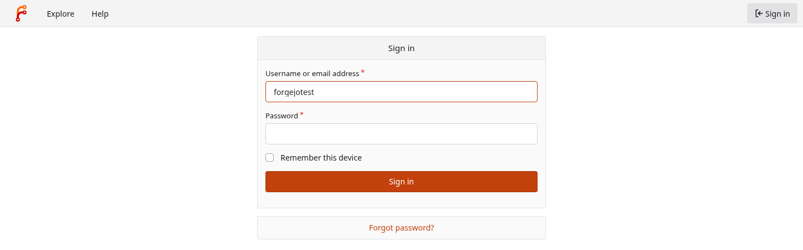
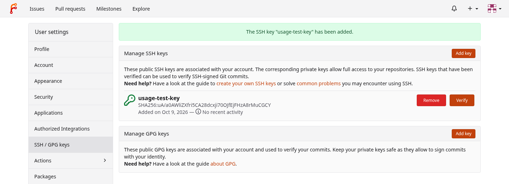
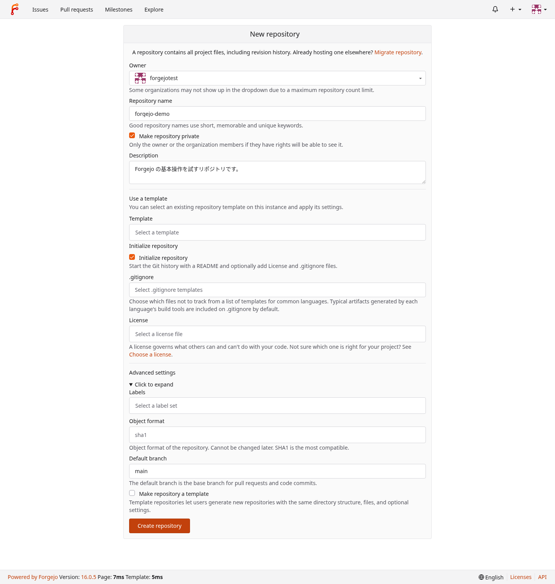
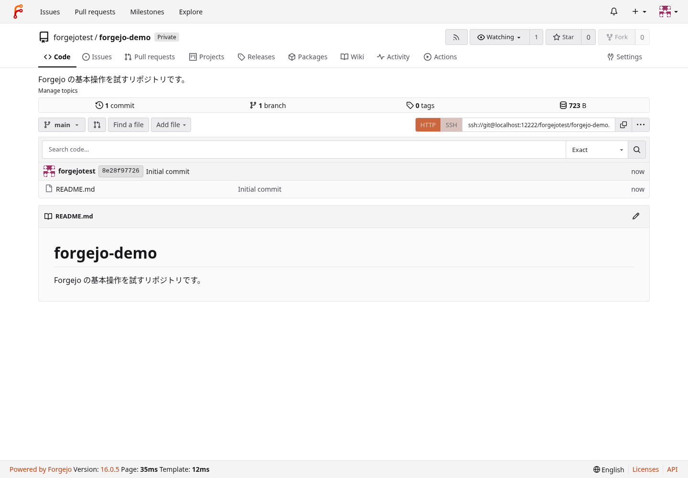
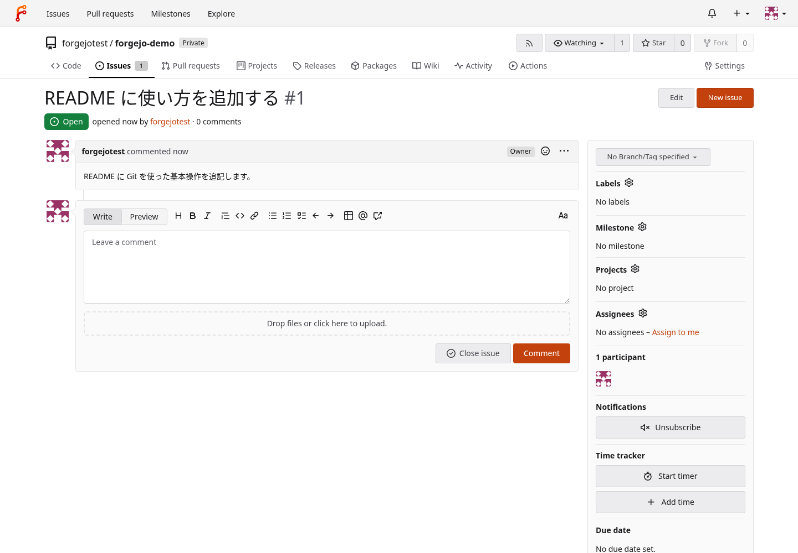
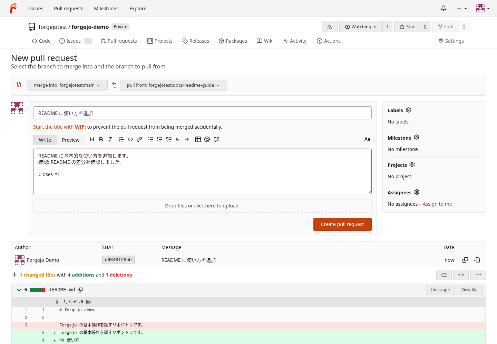
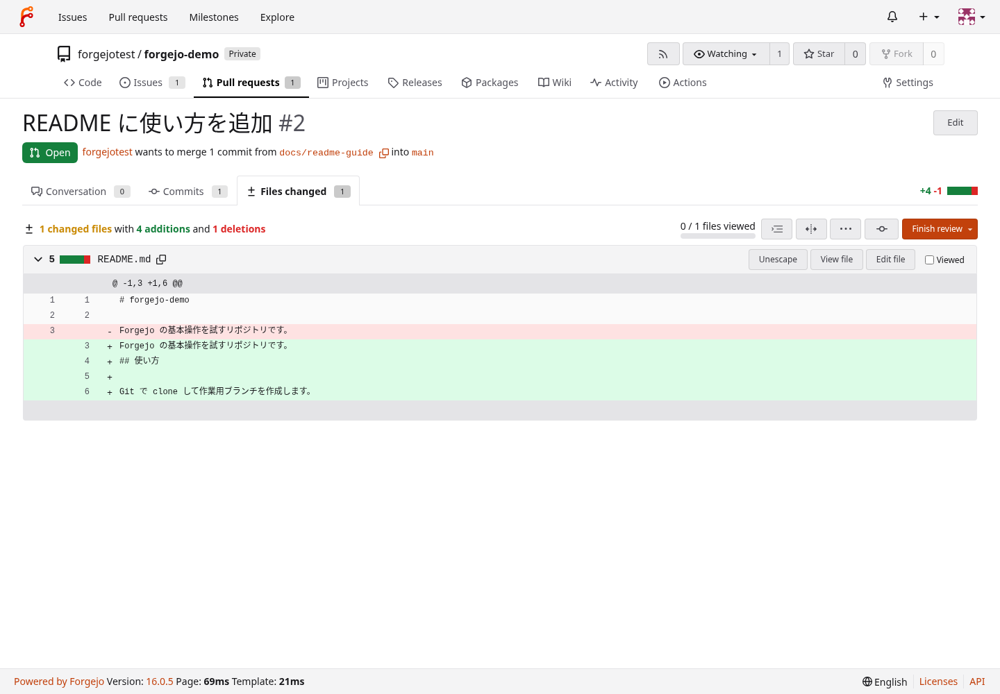
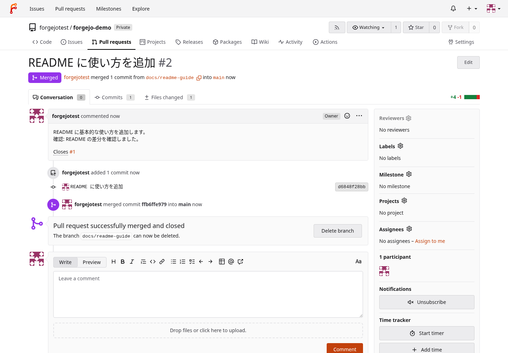

# AlmaLinux 10 のセットアップ

- [検証記録](https://github.com/ryo-aoki-pc/setup-notes-verification/blob/main/docs/verification/almalinux-setup.md)・[参考資料](reference/almalinux-setup.md)・[ロールバックと注意点](extra/almalinux-setup.md)

> [!IMPORTANT]
> - 前提: AlmaLinux 10 Workstation を入れた PC と、インターネット接続。オフラインの Homebrew は[別手順](#homebrew-のオフライン導入)を使う
> - **GNOME にログインした、インストール時の管理者ユーザー（`wheel`）の bash で行う**。`sudo -i`・`su -` のシェルでは行わない

- どの項も単独で通せる。目的の項のリードの前提を先に満たす
- 新しく入れた PC では、カテゴリを上から順に、要る項を選んで通す
- 対話・GUI・再起動は各手順の案内に従い、プロンプトに戻ってから次へ進む
- 貼った後は、反転表示の「確認」から後ろの出力を箇条書きで確かめる
- 新しい端末では、使う項の変数の手順を貼り直す
- Windows 11 は[Windows の初期設定](windows-setup.md)から指定された項だけを使う
- AI コーディングエージェント（Claude Code・Codex CLI・Grok Build）は、[AI コーディングエージェントのセットアップ](ai-agents.md)で入れる
- 入れたものを上げるときは、[更新](#更新)の案内に従う

> [!WARNING]
> - [ログインと sudo](#ログインと-sudo)の手順 3 の後は、**このユーザーのプログラムがパスワード無しで root 権限を使える**。人が触れる場所の PC や信用できないプログラムを使うユーザーでは行わない
> - sudo のパスワード入力は「ログインと sudo」の手順 3 だけ。元に戻すときは[ロールバック](extra/almalinux-setup.md#ロールバック)の最後の手順

## 基本の設定

- インストール直後の sudo・更新・SSH・ログの設定、パッケージの入手元（EPEL・RPM Fusion・Flathub）、OS の自動更新・Secure Boot の署名鍵・ユーザーサービスの常駐

### ログインと sudo

- インストールのときに作った管理者のユーザーで GNOME にログインし、sudo をパスワード無しで使えるようにする
- 前提: 無し
- 実行場所: この PC の画面（GNOME のログイン画面）。この項の手順 3 は、この項の手順 2 で開く端末（bash）

1. インストールのときに作ったユーザーで GNOME にログインし、「ようこそ」の窓を閉じる。

   - インストールの後の最初の起動で、ログイン画面でユーザーを選び、パスワードを入れる
   - 「AlmaLinux 10.2 (Lavender Lion) へようこそ」で「スキップ」を押す。ツアーを見るなら「“ツアー”を始める」

1. 端末を開く。

   - Super キー（Windows キー）でアクティビティの画面を開き、`terminal` と打って Enter（「ターミナル」が出る）。アクティビティの画面の下の Dash の、ターミナルのアイコンでもよい
   - 端末のアプリは Ptyxis（画面の表示は「ターミナル」）。この項の手順 3 から、この端末に貼る

1. sudo をパスワード無しで使えるようにする（パスワードを 1 回聞かれる）。

   ```bash
   {
     if ! id -nG | grep -qw wheel; then
       echo '中断: このユーザーは wheel の一員ではない（インストールのときに管理者にしたユーザーで貼る）' >&2
     else
       printf '\n\033[7m 確認 \033[0m\n'
       printf 'Defaults:%s verifypw=any\n%s ALL=(ALL) NOPASSWD: ALL\n' "${USER}" "${USER}" | sudo visudo -cf - &&
         printf 'Defaults:%s verifypw=any\n%s ALL=(ALL) NOPASSWD: ALL\n' "${USER}" "${USER}" | sudo install -m 0440 /dev/stdin /etc/sudoers.d/nopasswd
       sudo visudo -c
     fi
     sudo -k
     sudo -n -v && sudo -n true && echo 'sudo はパスワードを聞かない'
   }
   ```

   - `[sudo] <USER> のパスワード:` にはログインのパスワードを入れる
   - `stdin: 正しく構文解析されました`（英語では `parsed OK`）、`/etc/sudoers`・`/etc/sudoers.d/nopasswd`、最後に `sudo はパスワードを聞かない` が出ればよい
   - `中断:` が出たら、何も書いていない。インストールのときに管理者にしたユーザーでログインし直して、この項の手順 2 から
   - **次の手順は、パスワードを入れて、プロンプトに戻ってから貼る**（続けて貼ると、パスワードとして食われる）

---

### OS とファームウェアの更新

- OS のパッケージを最新にし、ファームウェアの更新があれば入れて、要るときだけ再起動する
- 前提: [ログインと sudo](#ログインと-sudo)を通してある
- 実行場所: GNOME にログインした自分のユーザーの端末（bash）

1. OS を最新にする。

   ```bash
   sudo dnf upgrade --refresh
   ```

   - 更新するものの一覧（トランザクション表）の後に `これでよろしいですか? [y/N]:` と聞かれる。`y`
   - インストールの後の最初の更新では、続けて AlmaLinux の署名鍵の取り込みを聞かれる（`GPG 鍵 0xC2A1E572 をインポート中:`）
     - `Userid : "AlmaLinux OS 10 <packager@almalinux.org>"` と `Fingerprint: EE6D B7B9 8F5B F5ED D9DA 0DE5 DEE5 C11C C2A1 E572` を確かめてから `y`（[AlmaLinux の Security のページ](https://almalinux.org/security/)の値と同じ）。違っていれば `N` で中断する
   - `行うべきことはありません。` と出たら、更新は無い（`[y/N]` も、署名鍵の確認も出ない）
     - このときは、AlmaLinux の署名鍵は、[EPEL と RPM Fusion](#epel-と-rpm-fusion)の手順 1 で取り込まれる
   - **次の手順は、`完了しました!` が出てプロンプトに戻ってから貼る**（続けて貼ると、`[y/N]` の答えとして食われる）

1. ファームウェアの情報（LVFS のメタデータ）を取り直す。

   ```bash
   sudo fwupdmgr refresh --force
   ```

   - 初めてのときは `現在リモートが有効になっていないため、メタデータが利用できません。` に続けて `このリモートを有効にしますか? [Y|n]:` と聞かれる。`Y`
   - `新しいメタデータのダウンロードに成功しました:` と、更新できる機器の数が出る（VirtualBox の VM では `更新可能なデバイスはありません`。Hyper-V と VMware の VM では `N 個のデバイスが更新可能です` と出て、この項の手順 3 で `UEFI dbx` の更新を聞かれることがある）
   - `デーモンへの接続に失敗しました: … タイムアウトしました` と出たら、少し待ってから貼り直す
   - **次の手順は、問いに答えてプロンプトに戻ってから貼る**（続けて貼ると、答えとして食われる）

1. ファームウェアの更新があれば、更新する。

   ```bash
   sudo fwupdmgr update
   ```

   - 更新が無ければ `No updatable devices` と出て終わる
   - 更新があれば、機器ごとに確認を聞かれる。`y`。再起動するかを聞かれたら `n`（この項の手順 5 で再起動する）
   - **注意**: 更新の途中で電源を切らない。ノート PC は電源につないでおく
   - **次の手順は、問いに答え終わってプロンプトに戻ってから貼る**（続けて貼ると、答えとして食われる）

1. OS の再起動が要るかを確かめる。

   ```bash
   dnf needs-restarting -r
   ```

   - `再起動な必要ありません。`（表示のとおり）と出て、この項の手順 3 でファームウェアを更新していなければ、この項の手順 5 は飛ばす
   - `再起動が必要です` の形の行（カーネルや systemd などを更新したとき）が出たか、この項の手順 3 でファームウェアを更新したなら、この項の手順 5 で再起動する

1. 再起動が要るときだけ、再起動する。

   ```bash
   sudo systemctl reboot
   ```

   - 保存していない文書のあるアプリが開いていると、`Operation inhibited by …` で断られることがある。そのアプリを閉じてから貼り直す
   - **次の手順は、起動してログインし、端末を開いてから貼る**（端末の開き方は[ログインと sudo](#ログインと-sudo)の手順 2）

---

### システムの設定

- PC の名前・SSH の待ち受け・ログ（journal）の保存・kdump・コマンドが無いときの案内を設定する
- 前提: [ログインと sudo](#ログインと-sudo)を通してある
- 実行場所: GNOME にログインした自分のユーザーの端末（bash）

1. 変数を設定する（PC の名前を変えるなら、`HOST_NAME` に値を入れる）。

   ```bash
   HOST_NAME=''   # この PC の新しい名前（英小文字・数字・ハイフン。例: alma-pc）。変えないなら空のまま。<HOSTNAME>
   ```

   ```bash
   printf '\n\033[7m 確認 \033[0m\n'
   for v in USER HOST_NAME; do
     printf '%-9s = %s\n' "$v" "${!v}"
   done
   ```

   - 最後に値を読み戻して確かめる
   - `HOST_NAME` を変えないなら空のままにして、この項の手順 2 を飛ばす
   - `USER` が `root` になっているなら、ここで止めて、自分のユーザーの端末で貼り直す
   - **新しい端末を開いたら**、この項の手順 1 を貼り直してから先へ進む

1. PC の名前を変えるときだけ、名前を変える。

   ```bash
   if [ -z "${HOST_NAME}" ]; then echo '中断: この項の手順 1 の HOST_NAME が空のまま。名前を変えないなら、この手順は飛ばす' >&2; else
     printf '\n\033[7m 確認 \033[0m\n'
     echo "変える前: $(hostnamectl --static)"
     sudo hostnamectl hostname "${HOST_NAME}"
     echo "変えた後: $(hostnamectl --static)"
   fi
   ```

   - `変える前:` の名前を控える（[ロールバックの「システムの設定を戻す」](extra/almalinux-setup.md#システムの設定を戻す)の手順 4 で使う）
   - `変えた後:` に、この項の手順 1 の名前が出ればよい
   - 開いている端末のプロンプトは、開き直すまで前の名前のまま

1. SSH の待ち受けとファイアウォールを確かめ、この PC の IP アドレスを見る。

   ```bash
   {
     printf '\n\033[7m 確認 \033[0m\n'
     systemctl is-enabled sshd
     systemctl is-active sshd
     sudo firewall-cmd --query-service=ssh
     sudo firewall-cmd --permanent --query-service=ssh
     ip -4 -brief address show scope global
   }
   ```

   - `enabled`・`active`・`yes`・`yes` と、この PC の IP アドレスが出ればよい（この項の手順 4 は飛ばす）
   - どれかが違えば、この項の手順 4 で直す

1. SSH の待ち受けか、ファイアウォールの ssh が違うときだけ、直す。

   ```bash
   {
     if ! rpm -q openssh-server; then sudo dnf install -y openssh-server; fi
     sudo systemctl enable --now sshd
     sudo firewall-cmd --permanent --add-service=ssh
     sudo firewall-cmd --reload
     printf '\n\033[7m 確認 \033[0m\n'
     systemctl is-active sshd
     sudo firewall-cmd --query-service=ssh
   }
   ```

   - `active` と `yes` が出ればよい

1. ログ（journal）を、再起動の後も残るようにディスクに書く。

   ```bash
   {
     sudo mkdir -p /etc/systemd/journald.conf.d
     printf '[Journal]\nStorage=persistent\n' | sudo tee /etc/systemd/journald.conf.d/50-persistent.conf >/dev/null
     sudo systemctl restart systemd-journald
     sudo journalctl --flush
     sudo systemd-tmpfiles --create --prefix /var/log/journal
     printf '\n\033[7m 確認 \033[0m\n'
     ls -ld /var/log/journal
     journalctl --disk-usage
   }
   ```

   - `drwxr-sr-x+ … root systemd-journal … /var/log/journal` の行と、journal の大きさが出ればよい

1. kdump が有効になっているか確かめる。

   ```bash
   printf '\n\033[7m 確認 \033[0m\n'
   systemctl is-enabled kdump
   cat /sys/kernel/kexec_crash_size
   grep -o 'crashkernel=[^ ]*' /proc/cmdline
   ```

   - `enabled` と、0 でない数と、`crashkernel=…` が出たら、この項の手順 7 で止める
   - `disabled` と `0` が出て、`crashkernel=` が無ければ、この項の手順 7 は飛ばす

1. kdump が有効なときだけ、止めて、カーネルが落ちたときのために予約しているメモリーを外す（効くのは再起動の後）。

   ```bash
   {
     sudo systemctl disable --now kdump
     sudo sed -i 's/^auto_reset_crashkernel yes$/auto_reset_crashkernel no/' /etc/kdump.conf
     sudo grubby --update-kernel=ALL --remove-args=crashkernel
     printf '\n\033[7m 確認 \033[0m\n'
     grep -n '^auto_reset_crashkernel' /etc/kdump.conf
     sudo grubby --info=ALL | grep -E '^args='
   }
   ```

   - `auto_reset_crashkernel no` と、`crashkernel=` を含まない `args=` の行が出ればよい
   - **注意**: カーネルが落ちたときの記録（vmcore）は残らなくなる

1. コマンドが無いときにパッケージを探して案内する機能（PackageKit-command-not-found）を外す。

   ```bash
   sudo dnf remove PackageKit-command-not-found
   ```

   - `削除中:` が `PackageKit-command-not-found` の 1 つだけになる。`これでよろしいですか? [y/N]:` に `y`
   - **次の手順は、`完了しました!` が出てプロンプトに戻ってから貼る**（続けて貼ると、`[y/N]` の答えとして食われる）

---

### EPEL と RPM Fusion

- EPEL と RPM Fusion（free）のリポジトリを、署名鍵を確かめてから入れる
- 前提: [ログインと sudo](#ログインと-sudo)を通してある
- 実行場所: GNOME にログインした自分のユーザーの端末（bash）

1. EPEL が無ければ入れ、有効になったか確かめる。

   ```bash
   {
     if ! dnf repolist enabled | grep -qE '^epel'; then sudo dnf install -y epel-release; fi
     printf '\n\033[7m 確認 \033[0m\n'
     rpm -q epel-release
     dnf repolist enabled | grep -E '^epel'
   }
   ```

   - `epel-release` の版と、`epel` の行が出れば有効になっている
   - 最後に出る「CRB を有効にすることを推奨」は、気にしなくてよい
   - [OS とファームウェアの更新](#os-とファームウェアの更新)の手順 1 で更新が無かったときは、ここで AlmaLinux の署名鍵が、確認を求めずに取り込まれる（「確認」の見出しより前の dnf の出力に、`GPG 鍵 0xC2A1E572 をインポート中:` と出る）
     - その出力の `Fingerprint:` が `EE6D B7B9 8F5B F5ED D9DA 0DE5 DEE5 C11C C2A1 E572` であることを確かめる。違っていれば、ここで中断する（鍵は取り込まれた後なので、次の手順へ進まない）
   - EPEL の署名鍵は、EPEL からパッケージを初めて入れるとき（この文書では[GNOME の表示と入力](#gnome-の表示と入力)の手順 11）に、dnf が 1 回だけ確認を求める
     - fingerprint が `7D8D 15CB FC4E 6268 8591 FB26 33D9 8517 E37E D158`（Fedora (epel10) &lt;epel@fedoraproject.org&gt;）であることを確かめてから `y`。違っていれば `N` で中断する

1. RPM Fusion（free）の署名鍵を落として、取り込む前に fingerprint と uid を確かめる。

   ```bash
   curl -fsSL 'https://rpmfusion.org/keys?action=AttachFile&do=get&target=RPM-GPG-KEY-rpmfusion-free-el-10' | gpg --show-keys
   ```

   - `gpg` が無ければ、`sudo dnf install -y gnupg2` で入れてから貼り直す
   - `pub` 行の fingerprint が `5FC4AE73FC2B08B9DFE7EB990C8489D8DB85DDD7`
   - uid が `RPM Fusion free repository for EL (10) <rpmfusion-gpg-key-el10-free@rpmfusion.org>`
   - 違っていればここで止める
   - **次の手順は、この 2 つを目で確かめてから貼る**

1. 一致したら、鍵を rpm に取り込み、入ったか確かめる。

   ```bash
   {
     sudo rpm --import 'https://rpmfusion.org/keys?action=AttachFile&do=get&target=RPM-GPG-KEY-rpmfusion-free-el-10'
     printf '\n\033[7m 確認 \033[0m\n'
     rpm -q gpg-pubkey --qf '%{name}-%{version}-%{release} %{summary}\n' | grep -i fusion
   }
   ```

   - `rpm --import` は何も表示しない
   - `gpg-pubkey-db85ddd7-67a63d8b RPM Fusion free repository for EL (10) ...` の 1 行が出れば、取り込めている

1. RPM Fusion（free）のリポジトリを入れる。

   ```bash
   sudo dnf --setopt=localpkg_gpgcheck=1 install https://mirrors.rpmfusion.org/free/el/rpmfusion-free-release-10.noarch.rpm
   ```

   - `--setopt=localpkg_gpgcheck=1` を外さない（外すと、この項の手順 3 の鍵で署名を確かめずに入る）
   - EPEL が有効なホストでは、`インストール:` が `rpmfusion-free-release` の 1 つだけになる
   - **次の手順は、トランザクション表を見て `[y/N]` に答えてから貼る**（続けて貼ると答えとして食われる）

1. RPM Fusion（free）が有効になったか確かめる。

   ```bash
   printf '\n\033[7m 確認 \033[0m\n'
   rpm -q rpmfusion-free-release
   dnf repolist enabled | grep -E '^rpmfusion'
   ```

   - `rpmfusion-free-release` の版と、`rpmfusion-free-updates` の行が出れば有効になっている

---

### Flatpak と Flathub

- flatpak を確かめ、署名鍵を確かめてから Flathub を system に登録し、確認用のアプリ（Flatseal）で動きを確かめる
- 前提: [ログインと sudo](#ログインと-sudo)を通してある
- 実行場所: GNOME にログインした自分のユーザーの端末（bash）

1. flatpak を確かめ（無ければ入れ）、登録されているリモートを見る。

   ```bash
   {
     printf '\n\033[7m 確認 \033[0m\n'
     if ! rpm -q flatpak; then sudo dnf install -y flatpak; fi
     flatpak --version
     flatpak remotes --show-details
   }
   ```

   - `flatpak-1.16.0-…` と `Flatpak 1.16.0` が出る
   - 導入直後の `flatpak remotes` の `error: While opening repository /var/lib/flatpak/repo: ...` は正常。次の手順へ進む

1. Flathub の登録ファイルに埋め込まれた公開鍵の fingerprint を確かめる。

   ```bash
   curl -fsSL https://dl.flathub.org/repo/flathub.flatpakrepo | sed -n 's/^GPGKey=//p' | base64 -d | gpg --show-keys --with-fingerprint
   ```

   - 次の値と一致することを目で確かめる
     - `6E5C 05D9 79C7 6DAF 93C0 8135 4184 DD4D 907A 7CAE`（Flathub Repo Signing Key &lt;flathub@flathub.org&gt;、有効期限 2027-06-14）
   - **次の手順は、一致するのを確かめてから貼る**（違っていれば先へ進まない）

1. Flathub を system に登録して、登録されたか確かめる。

   ```bash
   {
     sudo flatpak remote-add --if-not-exists flathub https://dl.flathub.org/repo/flathub.flatpakrepo
     printf '\n\033[7m 確認 \033[0m\n'
     flatpak remotes --show-details
   }
   ```

   - `flathub` の行が出て、`Options` の列が `system` になっていればよい

1. 確認用のアプリ（Flatseal）を入れる。

   ```bash
   sudo flatpak install flathub com.github.tchx84.Flatseal
   ```

   - **確認を 2 回聞かれる**。どちらも `y` で進める
     - 1 回目: runtime を入れるか（`Do you want to install it? [Y/n]`）
     - 2 回目: アプリの権限と入れるものの一覧を見せたうえでの最終確認（`Proceed with these changes to the system installation? [Y/n]`）
   - 最初の 1 本は runtime ごと落とすので、`/var/lib/flatpak` が 1.7 GB ほどになる（runtime が GNOME 50 のとき）。要らなければ、この手順とこの項の手順 5 は飛ばしてよい
   - **次の手順は、2 回の確認に答え、完了してから貼る**（続けて貼ると答えとして食われる）

1. 確認用のアプリが入り、サンドボックスが起動できるか確かめる。

   ```bash
   printf '\n\033[7m 確認 \033[0m\n'
   flatpak list --app --columns=application,version,branch,installation
   flatpak info com.github.tchx84.Flatseal
   flatpak run --command=true com.github.tchx84.Flatseal && echo 'sandbox OK'
   ls /var/lib/flatpak/exports/share/applications/
   ```

   - `flatpak list` に `com.github.tchx84.Flatseal  2.4.1  stable  system` のように出る
   - `sandbox OK` が出れば、アプリのサンドボックスが起動できている
   - 最後の行に `com.github.tchx84.Flatseal.desktop` が出れば、デスクトップのメニューに載せるためのファイルができている
   - メニューに載るのは、[再起動と確認](#再起動と確認)の手順 1 の再起動の後

#### Flatpak の使い方の基本

| コマンド | 用途 |
|---|---|
| `sudo flatpak update --appstream` | 検索用のアプリ一覧（appstream）を取り直す。**Flathub を登録した直後は、先にこれを 1 回実行しないと `flatpak search` が何も返さない** |
| `flatpak search <キーワード>` | Flathub のアプリを探す（ID が分かる） |
| `flatpak remote-info flathub <ID>` | 入れる前に大きさ・runtime・更新日を見る |
| `flatpak remote-ls flathub --app --arch=aarch64` | aarch64 向けに出ているアプリの一覧（Raspberry Pi で使えるか） |
| `sudo flatpak install flathub <ID>` | 入れる |
| `flatpak run <ID>` | 起動する（ふつうはデスクトップのメニューから起動する） |
| `flatpak list --app` | 入っているアプリ |
| `flatpak info --show-permissions <ID>` | アプリに与えられている権限（ファイル・デバイス・ネットワーク） |
| `sudo flatpak override <ID> --filesystem=<パス>` | 権限を足す（GUI でやるなら Flatseal） |
| `sudo flatpak override --reset <ID>` | 足した権限を元に戻す |
| `sudo flatpak uninstall <ID>` | 消す |
| `sudo flatpak uninstall --unused` | もう誰も使っていない runtime を消す |

- `flatpak` の読み取り系（`search` / `list` / `info` / `remote-ls`）は `sudo` 無しで動く
- Flathub を登録した直後に `flatpak search flatseal` が `No matches found` を返す場合は、`sudo flatpak update --appstream` で検索用のメタデータを取得してから検索し直す。`sudo flatpak update` を 1 度実行したあとも、同じように検索できるようになる

---

### dnf-automatic で自動で更新する

- BaseOS の `dnf-automatic` のタイマーで、毎日、更新をダウンロードして入れる。再起動はしない（カーネルなどの更新は、[OS とファームウェアの更新](#os-とファームウェアの更新)の手順 4・5 で自分で再起動する）
- 前提: [ログインと sudo](#ログインと-sudo)を通してある
- 実行場所: GNOME にログインした自分のユーザーの端末（bash）
- GNOME Software の自動の更新（裏でダウンロードし、再起動のときに入れる）は、この項の手順 3 で止める（二重にしない）
- 戻すときは、この項の手順 5・6

1. dnf-automatic を入れる。

   ```bash
   sudo dnf install dnf-automatic
   ```

   - `インストール:` が `dnf-automatic` の 1 つだけになる。`これでよろしいですか? [y/N]:` に `y`
   - **次の手順は、`完了しました!` が出てプロンプトに戻ってから貼る**（続けて貼ると、`[y/N]` の答えとして食われる）

1. 更新を入れるタイマーを有効にする。

   ```bash
   {
     sudo systemctl enable --now dnf-automatic-install.timer
     printf '\n\033[7m 確認 \033[0m\n'
     systemctl list-timers 'dnf-automatic*' --no-pager
   }
   ```

   - `dnf-automatic-install.timer` の行に、次に動く日時（`NEXT`）が出ればよい

1. GNOME Software の自動の更新を止める。

   ```bash
   /usr/bin/gsettings set org.gnome.software download-updates false
   printf '\n\033[7m 確認 \033[0m\n'
   /usr/bin/gsettings get org.gnome.software download-updates
   ```

   - `false` が出ればよい

1. 今すぐ 1 回動かして、動くことを確かめる。

   ```bash
   {
     sudo systemctl start dnf-automatic-install.service
     printf '\n\033[7m 確認 \033[0m\n'
     systemctl status dnf-automatic-install.service --no-pager | head -n 5
     journalctl -u dnf-automatic-install.service -b --no-pager | tail -n 5
   }
   ```

   - `Active: inactive (dead)` と、`… Finished dnf-automatic-install.service …` の行が出ればよい（更新が無ければすぐに終わる）
   - 更新があれば、入れ終わるまでプロンプトに戻らない

1. 元に戻すときは、タイマーを止め、GNOME Software の自動の更新を戻す。

   ```bash
   {
     sudo systemctl disable --now dnf-automatic-install.timer
     /usr/bin/gsettings reset org.gnome.software download-updates
     printf '\n\033[7m 確認 \033[0m\n'
     systemctl list-timers 'dnf-automatic*' --no-pager
     /usr/bin/gsettings get org.gnome.software download-updates
   }
   ```

   - タイマーの一覧が `0 timers listed.` になり、最後に `true` が出ればよい

1. 元に戻すときは、続けて dnf-automatic を外す。

   ```bash
   sudo dnf remove dnf-automatic
   ```

   - `削除中:` が `dnf-automatic` の 1 つだけになる。`これでよろしいですか? [y/N]:` に `y`

---

### Secure Boot の署名鍵

- Secure Boot が有効な PC（または VM）で、自分でビルドしたカーネルモジュールを読み込めるように、署名用の鍵を作って MOK に登録する
- 前提: [ログインと sudo](#ログインと-sudo)を通してある（bootc のシステムでは、`sudo` できるユーザーでログインしてある）
- 実行場所: Secure Boot を使う PC（または VM）の、自分のユーザーの端末（bash）か SSH
- [検証記録](https://github.com/ryo-aoki-pc/setup-notes-verification/blob/main/docs/verification/secure-boot-mok.md)・[参考資料](reference/secure-boot-mok.md)・[ロールバックと注意点](extra/secure-boot-mok.md)
- **カーネルモジュールをビルドする項より先に通す**。この項の手順 3 で Secure Boot が無効と分かったら、この項はそこで終わり
- bootc のシステム（AlmaLinux Atomic Desktop など）でも同じ手順になる
- **この項の手順 4 で一時パスワードを 2 回聞かれ、この項の手順 5 で再起動する**。答えてから次の手順を貼る
- 通すと使えるようになるもの（この鍵で署名したモジュールが、Secure Boot のまま読み込まれる）:
  - [VirtualBox](#virtualbox) のホストのモジュール（`vboxdrv` など）
  - [VirtualBox Guest Additions（bootc のゲスト）](#virtualbox-の-bootc-ゲスト) のモジュール（`vboxguest` など）

> [!IMPORTANT]
> - **この項の手順 5 を SSH で貼る前に、VM のウィンドウを開いておく**（再起動直後の MokManager を操作するため）
> - **この項の手順 6 は、起動の途中の MokManager の画面で行う**（最初の画面は 10 秒で消える。VM なら VM のウィンドウで操作する）

1. `mokutil` と `openssl` が入っているか確かめる。

   ```bash
   rpm -q mokutil openssl
   ```

   - 2 つとも版が出れば、手順 2 は飛ばす
   - `package mokutil is not installed` のように出たら、手順 2 で入れる

1. どちらかが未導入のときだけ、`mokutil` と `openssl` を入れる。

   ```bash
   sudo dnf install -y mokutil openssl
   ```

   - bootc のシステムでは dnf で入れられないが、Atomic Desktop のイメージには 2 つとも入っている

1. Secure Boot が有効かを見る。

   ```bash
   mokutil --sb-state
   ```

   - `SecureBoot enabled` なら、手順 4 から続ける
   - **`SecureBoot disabled`（または `EFI variables are not supported on this system`）なら、この項の手順はここで終わり**

1. 鍵がまだ無いときだけ、署名用の鍵を作り、MOK への登録を予約する。

   ```bash
   if sudo test -e /var/lib/shim-signed/mok/MOK.der; then echo '中断: 鍵が既にある。作り直さずに、手順 7 で登録を確かめる' >&2; else
     sudo mkdir -m 0700 -p /var/lib/shim-signed/mok
     sudo openssl req -nodes -new -x509 -newkey rsa:2048 -outform DER -addext "extendedKeyUsage=codeSigning" -subj "/CN=Local kernel module signing key/" -days 36500 -keyout /var/lib/shim-signed/mok/MOK.priv -out /var/lib/shim-signed/mok/MOK.der
     printf '\n\033[7m 確認 \033[0m\n'
     sudo ls -l /var/lib/shim-signed/mok
     sudo mokutil --import /var/lib/shim-signed/mok/MOK.der
   fi
   ```

   - 鍵を作る間は `.....+++` のような行が流れる
   - `MOK.priv`（秘密鍵。`-rw-------`）と `MOK.der`（公開鍵の証明書）ができる
   - **`MOK.priv` は登録した鍵で信頼するモジュールを作れる秘密鍵**。root 以外に読ませず、ほかのマシンに持ち出さない
   - **場所とファイル名は変えない**
   - **一時パスワードを 2 回聞かれる**（手順 6 の MokManager で 1 回だけ使う。本書には残さない）
   - `中断: 鍵が既にある` と出たら、前に作った鍵がある。手順 7 へ進む
   - ホストオンリーだけの VM は、この手順の代わりに[オフラインビルド](#virtualbox-の-bootc-ゲスト-ホストオンリーアダプターだけの-vm-でビルドする)の手順 2〜5 を通す
   - 鍵はホストで作り、証明書だけを VM に置いて予約する。手順 5 からは同じ
   - **次の手順は、一時パスワードに答えてから貼る**（続けて貼ると答えとして食われる）

1. 再起動する。

   ```bash
   sudo systemctl reboot
   ```

   - 起動の途中で青い **MokManager** の画面が出る（手順 6）

1. 起動の途中の MokManager で、鍵を登録する。

   - 最初の画面の `Press any key to perform MOK management` は、`Booting in 10 seconds` から数え下げて 10 秒で消える。消える前に何かキーを押す（VM なら、VM のウィンドウで押す）
   - 続けて `Enroll MOK` → `Continue` → `Yes` → 手順 4 の一時パスワード → `Reboot` と進む
   - **何もしないで進むと登録されない**。そのときは `sudo mokutil --import /var/lib/shim-signed/mok/MOK.der`（手順 4 の最後の行）を貼り直してから、手順 5 からやり直す
   - **注意**: MokManager でキーボードが効かない PC がある（[検証記録](https://github.com/ryo-aoki-pc/setup-notes-verification/blob/main/docs/verification/secure-boot-mok.md#実施手順--手順-6-補足-画面の並びと登録できなかった-pc)の手順 6 の補足を参照）
   - **次の手順は、起動したらログインし、新しい端末を開いてから貼る**

1. 鍵が登録されたか確かめる。

   ```bash
   sudo mokutil --test-key /var/lib/shim-signed/mok/MOK.der
   ```

   - `/var/lib/shim-signed/mok/MOK.der is already enrolled` が出れば、登録できている
   - 登録できていなければ `is not enrolled` になる。手順 6 の箇条書きのとおりやり直す
   - `sudo` が要る。鍵のディレクトリは root だけが入れる（`drwx------`）

---

### ユーザーサービスの常駐

- 自分のユーザーの linger を有効にして、ログアウトしている間も、そのユーザーのサービスが動くようにする
- 前提: [ログインと sudo](#ログインと-sudo)を通してある
- 実行場所: 常駐させるユーザー自身のシェル（デスクトップの端末か SSH の bash）
- [検証記録](https://github.com/ryo-aoki-pc/setup-notes-verification/blob/main/docs/verification/linger.md)・[参考資料](reference/linger.md)・[ロールバックと注意点](extra/linger.md)
- 通すと使えるようになるもの（ログアウトしている間も動く）:
  - [Syncthing](#syncthing)・[Dropbox 公式](#dropbox)・[rclone](#dropbox-と-rclone)
  - [Forgejo](#forgejo)・[Grok のブラウザ操作](ai-agents.md#grok-build-のブラウザ操作-実施手順)
  - [Podman の Quadlet](#podman-quadlet-で自動起動する)で動かすコンテナ

> [!IMPORTANT]
> - **`sudo -i` した root のシェルでは行わない**（`${USER}` が `root` になる）

1. linger が有効になっているか確かめる。

   ```bash
   loginctl show-user "$(id -u)" -p Linger
   ```

   - `Linger=yes` が出れば、手順 2 は飛ばす
   - `Linger=no` と出たら、手順 2 で有効にする

1. linger が無効のときだけ、linger を有効にして、有効になったか確かめる。

   ```bash
   {
     sudo loginctl enable-linger "${USER}"
     printf '\n\033[7m 確認 \033[0m\n'
     loginctl show-user "$(id -u)" -p Linger
     ls /var/lib/systemd/linger
   }
   ```

   - `enable-linger` は何も出さない
   - `Linger=yes` と、自分のユーザー名が出ればよい

---

## GNOME のデスクトップ

- 日本語入力と、GNOME の表示・入力・電源の設定

### 日本語入力

- GNOME で日本語を打てるように、Anthy と日本語のフォントを入れ、入力ソースを「キーボードの配列 + Anthy」にする
- 前提: [ログインと sudo](#ログインと-sudo)を通してある
- 実行場所: GNOME にログインした自分のユーザーの端末（bash）
- **Homebrew を入れた（これから入れる）PC では、[Homebrew](#homebrew)の手順 4 も通す**。Homebrew が既に入っていても、IBus の PATH 固定まで行う

1. 変数を設定する。

   ```bash
   XKB_LAYOUT=$(localectl status 2>/dev/null | sed -n 's/^ *X11 Layout: \([a-z][a-z0-9_]*\).*/\1/p')   # キーボードの配列（自動）。JIS は jp、US は us。<XKB_LAYOUT>
   printf '\n\033[7m 確認 \033[0m\n'
   printf 'XKB_LAYOUT = %s\n' "${XKB_LAYOUT}"
   ```

   - 最後に値を読み戻して確かめる
   - `XKB_LAYOUT` が空か配列と違えば、`XKB_LAYOUT=jp`（JIS）か `XKB_LAYOUT=us`（US）を貼ってから進む
   - **新しい端末を開いたら**、この項の手順 1 を貼り直してから先へ進む

1. ibus-anthy と日本語のフォントが無ければ入れる。

   ```bash
   if ! rpm -q ibus ibus-anthy default-fonts-cjk-sans; then sudo dnf install -y ibus-anthy default-fonts-cjk-sans; fi
   ```

   - 3 つとも版が出れば、入っている
   - `package … is not installed` が出たときは、続けて AppStream から入る。入れたときは、[再起動と確認](#再起動と確認)の手順 1 の再起動の後に使えるようになる

1. 入力ソースを「キーボードの配列 + Anthy」にする。

   ```bash
   if [ -z "${XKB_LAYOUT}" ]; then echo '中断: この項の手順 1 の XKB_LAYOUT が空のまま。値を入れて貼り直す' >&2; else
     printf '\n\033[7m 確認 \033[0m\n'
     /usr/bin/gsettings get org.gnome.desktop.input-sources sources
     /usr/bin/gsettings set org.gnome.desktop.input-sources sources "[('xkb', '${XKB_LAYOUT}'), ('ibus', 'anthy')]"
     /usr/bin/gsettings get org.gnome.desktop.input-sources sources
     /usr/bin/gsettings get org.gnome.desktop.wm.keybindings switch-input-source
   fi
   ```

   - 最初の `get` は変える前の値（最初のログインの後は、今の配列だけの `[('xkb', 'us')]` など）。戻すときのために控えておく
   - 2 つ目の `get` が `[('xkb', 'jp'), ('ibus', 'anthy')]`（US 配列なら `'us'`）になればよい
   - **ほかの入力ソースは消える**。残すものは `set` の値に足す
   - **注意**: `/usr/bin/` を外さない（[GNOME の表示と入力](#gnome-の表示と入力)の手順 1〜14 も同じ）
   - [Neovim](#neovim)の手順 3 では、JIS 配列でも入力ソースが「英語 (US)」と Anthy に変わる

---

### GNOME の表示と入力

- ホームのフォルダーの名前・ダークモード・キーの割り当て・上部バー・Files・拡大率・トレイアイコン・Dash のお気に入りを、自分用に変える
- 前提: [ログインと sudo](#ログインと-sudo)を通してある。この項の手順 11（EPEL から入れる）には、[EPEL と RPM Fusion](#epel-と-rpm-fusion)の手順 1 も要る
- 実行場所: GNOME にログインした自分のユーザーの端末（bash）

1. 変数を設定する。

   ```bash
   DASH_FAVORITES="['firefox.desktop', 'org.gnome.Nautilus.desktop', 'org.gnome.Ptyxis.desktop', 'org.gnome.TextEditor.desktop']"   # Dash に並べるアプリ（左から）
   printf '\n\033[7m 確認 \033[0m\n'
   printf 'DASH_FAVORITES = %s\n' "${DASH_FAVORITES}"
   ```

   - **編集が必須の変数は無い**。既定のままなら、Dash に Firefox・ファイル・端末（Ptyxis）・テキストエディターが並ぶ
   - 最後に値を読み戻して確かめる
   - **新しい端末を開いたら**、この項の手順 1 を貼り直してから先へ進む

1. ホームのフォルダーの名前を、日本語から英語にする（中身ごと移す）。

   ```bash
   printf '\n\033[7m 確認 \033[0m\n'
   /usr/bin/python3 - <<'EOF'
   import pathlib, subprocess, urllib.parse
   home = pathlib.Path.home()
   names = {'DESKTOP': 'Desktop', 'DOWNLOAD': 'Downloads', 'TEMPLATES': 'Templates', 'PUBLICSHARE': 'Public',
            'DOCUMENTS': 'Documents', 'MUSIC': 'Music', 'PICTURES': 'Pictures', 'VIDEOS': 'Videos'}
   moved = {}
   for key, name in names.items():
       old = pathlib.Path(subprocess.run(['xdg-user-dir', key], capture_output=True, text=True, check=True).stdout.strip())
       new = home / name
       if old == new:
           print(f'そのまま: {new}')
           continue
       if new.exists():
           print(f'飛ばした: {new} がすでにある（{old} はそのまま）')
           continue
       if old != home and old.is_dir():
           old.rename(new)
           moved[old] = new
       else:
           new.mkdir()
       subprocess.run(['xdg-user-dirs-update', '--set', key, str(new)], check=True)
       print(f'{old} → {new}')
   bookmarks = home / '.config/gtk-3.0/bookmarks'
   if moved and bookmarks.exists():
       uri = lambda p: 'file://' + urllib.parse.quote(str(p))
       lines = bookmarks.read_text().splitlines()
       for old, new in moved.items():
           lines = [uri(new) + line[len(uri(old)):] if line == uri(old) or line.startswith(uri(old) + ' ') else line for line in lines]
       bookmarks.write_text('\n'.join(lines) + '\n')
   EOF
   grep '^XDG_' ~/.config/user-dirs.dirs
   cat ~/.config/gtk-3.0/bookmarks
   ```

   - `/home/<USER>/ダウンロード → /home/<USER>/Downloads` のような行が 8 つ出る
   - `user-dirs.dirs` の 8 行が `$HOME/` の下の `Desktop`・`Downloads`・`Templates`・`Public`・`Documents`・`Music`・`Pictures`・`Videos` を指し、ブックマークも英語の名前を指せばよい
   - 英語の名前のフォルダーがもうあると、そのフォルダーは `飛ばした:` で変えない

1. ダークモードにする。

   ```bash
   /usr/bin/gsettings set org.gnome.desktop.interface color-scheme prefer-dark
   printf '\n\033[7m 確認 \033[0m\n'
   /usr/bin/gsettings get org.gnome.desktop.interface color-scheme
   ```

   - `'prefer-dark'` が出ればよい

1. Caps Lock を Ctrl にする（今の配列の設定に足す）。

   ```bash
   xkb=$(/usr/bin/gsettings get org.gnome.desktop.input-sources xkb-options)
   echo "変える前: ${xkb}"
   case "${xkb}" in
     *"'ctrl:nocaps'"*) ;;
     '@as []') /usr/bin/gsettings set org.gnome.desktop.input-sources xkb-options "['ctrl:nocaps']" ;;
     *) /usr/bin/gsettings set org.gnome.desktop.input-sources xkb-options "${xkb%]}, 'ctrl:nocaps']" ;;
   esac
   printf '\n\033[7m 確認 \033[0m\n'
   /usr/bin/gsettings get org.gnome.desktop.input-sources xkb-options
   ```

   - 最後に `['ctrl:nocaps']`（ほかの設定があれば、その後ろに `'ctrl:nocaps'`）が出ればよい。すぐに効く

1. ウィンドウのタイトルバーに、最小化と最大化のボタンを出す。

   ```bash
   /usr/bin/gsettings set org.gnome.desktop.wm.preferences button-layout 'appmenu:minimize,maximize,close'
   printf '\n\033[7m 確認 \033[0m\n'
   /usr/bin/gsettings get org.gnome.desktop.wm.preferences button-layout
   ```

   - `'appmenu:minimize,maximize,close'` が出ればよい

1. 上部バーの時計に曜日と秒を出し、電池の残りを % で出す。

   ```bash
   /usr/bin/gsettings set org.gnome.desktop.interface clock-show-weekday true
   /usr/bin/gsettings set org.gnome.desktop.interface clock-show-seconds true
   /usr/bin/gsettings set org.gnome.desktop.interface show-battery-percentage true
   printf '\n\033[7m 確認 \033[0m\n'
   /usr/bin/gsettings list-recursively org.gnome.desktop.interface | grep -E 'clock-show-(weekday|seconds)|show-battery-percentage'
   ```

   - 3 行とも `true` が出ればよい
   - 電池の % は、電池のある PC だけに出る

1. Files とファイルを選ぶ窓で、隠しファイルを出し、フォルダーを先に並べる。

   ```bash
   printf '\n\033[7m 確認 \033[0m\n'
   for s in org.gtk.Settings.FileChooser org.gtk.gtk4.Settings.FileChooser; do
     /usr/bin/gsettings set "${s}" show-hidden true
     /usr/bin/gsettings set "${s}" sort-directories-first true
     /usr/bin/gsettings list-recursively "${s}" | grep -E 'show-hidden|sort-directories-first'
   done
   ```

   - 2 つのスキーマで、`show-hidden true` と `sort-directories-first true` が 2 行ずつ出ればよい

1. Alt+Tab を、アプリごとではなくウィンドウごとの切り替えにする。

   ```bash
   /usr/bin/gsettings set org.gnome.desktop.wm.keybindings switch-applications "['<Super>Tab']"
   /usr/bin/gsettings set org.gnome.desktop.wm.keybindings switch-applications-backward "['<Shift><Super>Tab']"
   /usr/bin/gsettings set org.gnome.desktop.wm.keybindings switch-windows "['<Alt>Tab']"
   /usr/bin/gsettings set org.gnome.desktop.wm.keybindings switch-windows-backward "['<Shift><Alt>Tab']"
   printf '\n\033[7m 確認 \033[0m\n'
   /usr/bin/gsettings list-recursively org.gnome.desktop.wm.keybindings | grep -E 'switch-(applications|windows)'
   ```

   - `switch-windows ['<Alt>Tab']` と `switch-applications ['<Super>Tab']` などの 4 行が出ればよい

1. 画面の左上の角（ホットコーナー）にマウスを当てても、アクティビティの画面を開かないようにする。

   ```bash
   /usr/bin/gsettings set org.gnome.desktop.interface enable-hot-corners false
   printf '\n\033[7m 確認 \033[0m\n'
   /usr/bin/gsettings get org.gnome.desktop.interface enable-hot-corners
   ```

   - `false` が出ればよい

1. 設定の「ディスプレイ」で、拡大率に 125%・150% などを選べるようにする（効くのは再起動の後）。

   ```bash
   f=$(/usr/bin/gsettings get org.gnome.mutter experimental-features)
   echo "変える前: ${f}"
   for x in scale-monitor-framebuffer xwayland-native-scaling; do
     case "${f}" in
       *"'${x}'"*) ;;
       '@as []') f="['${x}']" ;;
       *) f="${f%]}, '${x}']" ;;
     esac
   done
   /usr/bin/gsettings set org.gnome.mutter experimental-features "${f}"
   printf '\n\033[7m 確認 \033[0m\n'
   /usr/bin/gsettings get org.gnome.mutter experimental-features
   ```

   - `['scale-monitor-framebuffer', 'xwayland-native-scaling']` が出ればよい

1. EPEL から、トレイアイコンを出す GNOME の拡張（AppIndicator）を入れる。

   ```bash
   sudo dnf install gnome-shell-extension-appindicator
   ```

   - `これでよろしいですか? [y/N]:` に `y`
   - EPEL からパッケージを入れるのが初めてなら、続けて EPEL の鍵の取り込みを聞かれる。fingerprint が[EPEL と RPM Fusion](#epel-と-rpm-fusion)の手順 1 の値なら `y`、違っていれば `N`
   - 入るのは `gnome-shell-extension-appindicator` と、依存の 3 つ（`libappindicator-gtk3`・`libdbusmenu`・`libdbusmenu-gtk3`）
   - **次の手順は、`完了しました!` が出てプロンプトに戻ってから貼る**（続けて貼ると、`[y/N]` の答えとして食われる）

1. 入れた拡張を有効にする（効くのは再起動の後）。

   ```bash
   e=$(/usr/bin/gsettings get org.gnome.shell enabled-extensions)
   echo "変える前: ${e}"
   case "${e}" in
     *"'appindicatorsupport@rgcjonas.gmail.com'"*) ;;
     '@as []') /usr/bin/gsettings set org.gnome.shell enabled-extensions "['appindicatorsupport@rgcjonas.gmail.com']" ;;
     *) /usr/bin/gsettings set org.gnome.shell enabled-extensions "${e%]}, 'appindicatorsupport@rgcjonas.gmail.com']" ;;
   esac
   printf '\n\033[7m 確認 \033[0m\n'
   /usr/bin/gsettings get org.gnome.shell enabled-extensions
   ```

   - 最後に、もとの拡張（`'background-logo@fedorahosted.org'`）と `'appindicatorsupport@rgcjonas.gmail.com'` が出ればよい

1. Ctrl+Alt+T で端末を開くようにする（ショートカットを足す）。

   ```bash
   kb=/org/gnome/settings-daemon/plugins/media-keys/custom-keybindings/terminal/
   list=$(/usr/bin/gsettings get org.gnome.settings-daemon.plugins.media-keys custom-keybindings)
   case "${list}" in
     *"'${kb}'"*) ;;
     '@as []') /usr/bin/gsettings set org.gnome.settings-daemon.plugins.media-keys custom-keybindings "['${kb}']" ;;
     *) /usr/bin/gsettings set org.gnome.settings-daemon.plugins.media-keys custom-keybindings "${list%]}, '${kb}']" ;;
   esac
   /usr/bin/gsettings set "org.gnome.settings-daemon.plugins.media-keys.custom-keybinding:${kb}" name '端末'
   /usr/bin/gsettings set "org.gnome.settings-daemon.plugins.media-keys.custom-keybinding:${kb}" command 'ptyxis --new-window'
   /usr/bin/gsettings set "org.gnome.settings-daemon.plugins.media-keys.custom-keybinding:${kb}" binding '<Control><Alt>t'
   printf '\n\033[7m 確認 \033[0m\n'
   /usr/bin/gsettings get org.gnome.settings-daemon.plugins.media-keys custom-keybindings
   /usr/bin/gsettings list-recursively "org.gnome.settings-daemon.plugins.media-keys.custom-keybinding:${kb}"
   ```

   - 一覧に `'/org/gnome/settings-daemon/plugins/media-keys/custom-keybindings/terminal/'` と、`binding '<Control><Alt>t'`・`command 'ptyxis --new-window'`・`name '端末'` が出ればよい

1. Dash のお気に入り（アクティビティの画面の下の並び）を、この項の手順 1 のアプリにする。

   ```bash
   if [ -z "${DASH_FAVORITES}" ]; then echo '中断: この項の手順 1 の DASH_FAVORITES が空のまま。値を入れて貼り直す' >&2; else
     printf '\n\033[7m 確認 \033[0m\n'
     /usr/bin/gsettings get org.gnome.shell favorite-apps
     /usr/bin/gsettings set org.gnome.shell favorite-apps "${DASH_FAVORITES}"
     /usr/bin/gsettings get org.gnome.shell favorite-apps
   fi
   ```

   - 最初の `get` の並びを、元に戻すときのために控える
   - 2 つ目の `get` がこの項の手順 1 の値になればよい。すぐに効く

---

### 画面オフ・画面ロック・自動サスペンドを止める

- 常時動かしておく PC で、GNOME が画面を消したり、ロックしたり、放置で眠ったりしないようにする。ログイン画面・蓋・OS のサスペンドも止める
  - WireGuard・Samba・Syncthing・Dropbox のホストや、RDP で待ち受ける PC は、眠るとサービスが止まる
  - [GNOME のヘッドレスのセッション](#gnome-のヘッドレスセッション)はこの項の手順 1・2 が前提。サスペンドできる PC では手順 3・4 も通す
  - [Claude Code で GUI を確かめる](ai-agents.md#claude-code-の-gnome-操作-実施手順)はこの項の手順 1・2、[GNOME のデスクトップ共有](#gnome-のデスクトップ共有)は手順 1〜4 が前提
- 前提: [ログインと sudo](#ログインと-sudo)を通してある
- 実行場所: GNOME にログインするユーザー本人の端末（bash）。この項の手順 1 で変数を設定したシェルに貼る
- **人が触れる場所にある PC では行わない**（画面をロックしないので、前にいる人がそのまま使える）
- GNOME を入れていない（デスクトップの無い）機械では、この項の手順 4・5 だけを行う
- 戻すときは、この項の手順 6〜9。変える前の値ではなく**既定値**に戻る（Server with GUI で入れた PC は、既定でも電源につないでいる間は眠らない）

1. 変数を設定する。

   ```bash
   IDLE_DELAY=0               # 無操作で画面を消すまでの秒数。0 は消さない（GNOME の既定は 300）
   LOCK_ENABLED=false         # 画面が消えたときにロックするか。true / false（既定は true）
   POWER_BUTTON=interactive   # 電源ボタンを押したとき。interactive（電源オフの確認を出す）/ nothing（何もしない）
   printf '\n\033[7m 確認 \033[0m\n'
   for v in USER IDLE_DELAY LOCK_ENABLED POWER_BUTTON; do
     printf '%-12s = %s\n' "$v" "${!v}"
   done
   ```

   - **編集が必須の変数は無い**。既定のままなら、画面を消さず、ロックもしない
   - 最後に値を読み戻して確かめる
   - `USER` が `root` になっているなら、ここで止めて、自分のユーザーのシェルで貼り直す
   - **新しいシェルを開いたら**（SSH を張り直したあとも）、この項の手順 1 のブロックを貼り直してから先へ進む

1. 自分のセッションの画面オフ・減光・ロック・自動サスペンド・電源ボタンを変える。

   ```bash
   /usr/bin/gsettings set org.gnome.desktop.session idle-delay "${IDLE_DELAY:?この項の手順 1 の IDLE_DELAY が空のまま。値を入れて貼り直す}"
   /usr/bin/gsettings set org.gnome.desktop.screensaver lock-enabled "${LOCK_ENABLED:?この項の手順 1 の LOCK_ENABLED が空のまま。値を入れて貼り直す}"
   /usr/bin/gsettings set org.gnome.settings-daemon.plugins.power idle-dim false
   /usr/bin/gsettings set org.gnome.settings-daemon.plugins.power sleep-inactive-ac-type nothing
   /usr/bin/gsettings set org.gnome.settings-daemon.plugins.power sleep-inactive-battery-type nothing
   /usr/bin/gsettings set org.gnome.settings-daemon.plugins.power power-button-action "${POWER_BUTTON:?この項の手順 1 の POWER_BUTTON が空のまま。値を入れて貼り直す}"
   printf '\n\033[7m 確認 \033[0m\n'
   /usr/bin/gsettings get org.gnome.desktop.session idle-delay
   /usr/bin/gsettings get org.gnome.desktop.screensaver lock-enabled
   /usr/bin/gsettings list-recursively org.gnome.settings-daemon.plugins.power | grep -E 'idle-dim|sleep-inactive-(ac|battery)-type|power-button-action'
   ```

   - `uint32 0`、`false`、続いて `idle-dim false`・`power-button-action 'interactive'`・`sleep-inactive-ac-type 'nothing'`・`sleep-inactive-battery-type 'nothing'` の 4 行が出ればよい
   - 値が変わっていなければ、デスクトップの端末でこの項の手順 1 から貼り直す
   - **注意**: `/usr/bin/` を外さない

1. ログイン画面（GDM）用の設定を書き、dconf を作り直して、ログイン画面から見える値を確かめる。

   ```bash
   if [ -z "${POWER_BUTTON}" ]; then echo '中断: この項の手順 1 の POWER_BUTTON が空のまま。値を入れて貼り直す' >&2; else
     sudo tee /etc/dconf/db/gdm.d/90-power >/dev/null <<EOF
   [org/gnome/settings-daemon/plugins/power]
   sleep-inactive-ac-type='nothing'
   sleep-inactive-battery-type='nothing'
   power-button-action='${POWER_BUTTON:?この項の手順 1 の POWER_BUTTON が空のまま。値を入れて貼り直す}'
   EOF
     printf '\n\033[7m 確認 \033[0m\n'
     sudo dconf update
     sudo -u gdm env DCONF_PROFILE=gdm /usr/bin/gsettings list-recursively org.gnome.settings-daemon.plugins.power | grep -E 'sleep-inactive-(ac|battery)-type|power-button-action'
   fi
   ```

   - `dconf update` は、成功すると何も出さない。`invalid value` と出たら、この手順を貼り直す
   - `power-button-action 'interactive'`・`sleep-inactive-ac-type 'nothing'`・`sleep-inactive-battery-type 'nothing'` の 3 行が出ればよい
   - `中断:` と出たら、何も書いていない

1. OS 全体で、サスペンドとハイバネートを止める。

   ```bash
   {
     printf '\n\033[7m 確認 \033[0m\n'
     sudo systemctl mask sleep.target suspend.target hibernate.target hybrid-sleep.target suspend-then-hibernate.target
     systemctl is-enabled sleep.target suspend.target hibernate.target hybrid-sleep.target suspend-then-hibernate.target
   }
   ```

   - `Created symlink '/etc/systemd/system/sleep.target' → '/dev/null'.` のような行が 5 つ出て、`masked` が 5 行出ればよい
   - **注意**: ノート PC は、蓋を閉じても電池が減っても眠らない。閉じたまま鞄に入れると熱を持つので、持ち歩くときは電源を切る

1. 蓋を閉じても何もしないように、logind のドロップインを置く。

   ```bash
   {
     sudo mkdir -p /etc/systemd/logind.conf.d
     sudo tee /etc/systemd/logind.conf.d/90-lid.conf >/dev/null <<'EOF'
   [Login]
   HandleLidSwitch=ignore
   EOF
     sudo systemctl reload systemd-logind
     printf '\n\033[7m 確認 \033[0m\n'
     busctl get-property org.freedesktop.login1 /org/freedesktop/login1 org.freedesktop.login1.Manager HandleLidSwitch
   }
   ```

   - `s "ignore"` と出ればよい

1. 元に戻すときは、自分のセッションの値を既定値に戻す。

   ```bash
   /usr/bin/gsettings reset org.gnome.desktop.session idle-delay
   /usr/bin/gsettings reset org.gnome.desktop.screensaver lock-enabled
   /usr/bin/gsettings reset org.gnome.settings-daemon.plugins.power idle-dim
   /usr/bin/gsettings reset org.gnome.settings-daemon.plugins.power sleep-inactive-ac-type
   /usr/bin/gsettings reset org.gnome.settings-daemon.plugins.power sleep-inactive-battery-type
   /usr/bin/gsettings reset org.gnome.settings-daemon.plugins.power power-button-action
   printf '\n\033[7m 確認 \033[0m\n'
   /usr/bin/gsettings get org.gnome.desktop.session idle-delay
   /usr/bin/gsettings get org.gnome.desktop.screensaver lock-enabled
   /usr/bin/gsettings list-recursively org.gnome.settings-daemon.plugins.power | grep -E 'idle-dim|sleep-inactive-(ac|battery)-type|power-button-action'
   ```

   - `uint32 300`、`true`、続いて `idle-dim true`・`power-button-action 'suspend'`・`sleep-inactive-ac-type 'suspend'`・`sleep-inactive-battery-type 'suspend'` の 4 行が出ればよい

1. 元に戻すときは、続けてログイン画面用の設定ファイルを消し、dconf を作り直して、ログイン画面から見える値が戻ったか確かめる。

   ```bash
   {
     sudo rm -f /etc/dconf/db/gdm.d/90-power
     sudo dconf update
     printf '\n\033[7m 確認 \033[0m\n'
     sudo -u gdm env DCONF_PROFILE=gdm /usr/bin/gsettings list-recursively org.gnome.settings-daemon.plugins.power | grep -E 'sleep-inactive-(ac|battery)-type|power-button-action'
   }
   ```

   - 3 行とも `'suspend'` になればよい

1. 元に戻すときは、続けてサスペンドとハイバネートの mask を外す。

   ```bash
   {
     printf '\n\033[7m 確認 \033[0m\n'
     sudo systemctl unmask sleep.target suspend.target hibernate.target hybrid-sleep.target suspend-then-hibernate.target
     systemctl is-enabled sleep.target suspend.target hibernate.target hybrid-sleep.target suspend-then-hibernate.target
   }
   ```

   - `Removed '/etc/systemd/system/sleep.target'.` のような行が 5 つ出て、`static` が 5 行出ればよい

1. 元に戻すときは、続けて蓋のドロップインを消し、logind に読み直させる。

   ```bash
   {
     sudo rm -f /etc/systemd/logind.conf.d/90-lid.conf
     sudo systemctl reload systemd-logind
     printf '\n\033[7m 確認 \033[0m\n'
     busctl get-property org.freedesktop.login1 /org/freedesktop/login1 org.freedesktop.login1.Manager HandleLidSwitch
   }
   ```

   - `s "suspend"` と出ればよい

---

## シェルと端末

- 共通の bash 設定・Homebrew・シェルのツール・フォント・WezTerm と、端末で使う道具（btop・gdu）

### 共通の bash 設定

- 自分のユーザーに共通の bash 設定（[ryo-aoki-pc/bash](https://github.com/ryo-aoki-pc/bash)）を入れ、bash-completion と `~/.inputrc` で補完と履歴の検索を整える
- 前提: [ログインと sudo](#ログインと-sudo)を通してある
- 実行場所: GNOME にログインした自分のユーザーの端末（bash）

1. 共通の bash 設定を入れる。

   ```bash
   printf '\n\033[7m 確認 \033[0m\n'
   git clone https://github.com/ryo-aoki-pc/bash.git ~/.config/bash &&
     bash ~/.config/bash/install.sh
   ```

   - `~/.bashrc: 設定済み（元の内容: ~/.bashrc.before-bash）` と `完了: 端末を開き直す。…` が出ればよい
   - clone 済みで `fatal: destination path … already exists` と出たら、`git -C ~/.config/bash pull --ff-only` と `bash ~/.config/bash/install.sh` を貼る

1. 共通の bash 設定を今の端末に読み込み、履歴と shopt の値を確かめる。

   ```bash
   . ~/.bashrc
   printf '\n\033[7m 確認 \033[0m\n'
   echo "${__bash_config_loaded-読まれていない}"
   printf '%s\n' "$HISTSIZE" "$HISTFILESIZE" "$HISTCONTROL"
   shopt histappend autocd cdspell dirspell globstar
   ```

   - `1`、`100000`・`100000`・`ignoreboth`、5 つの `on` が出ればよい

1. bash-completion が入っているか確かめ、無ければ入れる。

   ```bash
   if ! rpm -q bash-completion; then sudo dnf install -y bash-completion; fi
   ```

   - `bash-completion-2.11-…` と出れば入っている
   - `package bash-completion is not installed` のときは、続けて BaseOS から入る

1. `~/.inputrc` を書き、今のシェルにも読ませる。

   ```bash
   if [ -e ~/.inputrc ]; then
     echo '中断: ~/.inputrc がすでにある。中身を見て、この手順の set と矢印の行を手で足す' >&2
   else
     cat > ~/.inputrc <<'EOF'
   # OS の設定（Home / End / Delete、Ctrl+矢印の単語の移動など）を先に読む。この行が無いと読まれなくなる
   $include /etc/inputrc
   # 補完: 大文字小文字を区別しない、候補が複数なら 1 回の Tab で一覧を出す、種類と打った部分を色で示す
   set completion-ignore-case on
   set show-all-if-ambiguous on
   set colored-stats on
   set colored-completion-prefix on
   # ↑/↓: 打った文字で始まる履歴だけをさかのぼる（何も打っていなければ 1 つずつ）
   "\e[A": history-search-backward
   "\e[B": history-search-forward
   "\eOA": history-search-backward
   "\eOB": history-search-forward
   EOF
     bind -f ~/.inputrc
     printf '\n\033[7m 確認 \033[0m\n'
     bind -v | grep -E 'completion-ignore-case|show-all-if-ambiguous|colored-stats|colored-completion-prefix'
     bind -q history-search-backward
     bind -q beginning-of-line
   fi
   ```

   - `set … on` が 4 行出る。`history-search-backward` は `\eOA`・`\e[5~`・`\e[A`、`beginning-of-line` は `\C-a`・`\eOH`・`\e[1~`・`\e[H` の割り当てが出る
   - `beginning-of-line` に `"\e[1~"` が無ければ、`$include /etc/inputrc` の行が読まれていない
   - `中断:` が出たら、既存の `~/.inputrc` の先頭に `$include /etc/inputrc` が無ければ足し、`set` と矢印の各 4 行を足して `bind -f ~/.inputrc` を貼る

#### 共通の bash 設定を手動で移行する

通常は[共通の bash 設定](#共通の-bash-設定)の `install.sh` を使う。この項は、`install.sh` を使わずに、手で確認しながら移行するときだけ行う。

- 前提: 無し（Git は AlmaLinux 10 Workstation に初めから入っている）
- 実行場所: 自分のユーザーの端末（bash）。Windows 11 も、Git Bash でこの項の手順をすべて行える。WSL は Linux 側で別に行う
- この項の手順 3 の控えと、手順 4 の既存の行の確認を省かない

[背景説明](https://github.com/ryo-aoki-pc/bash/blob/main/docs/reference/install.md)・[検証記録](https://github.com/ryo-aoki-pc/bash/blob/main/docs/verification/install.md)

1. この設定が既に入っているか確かめる。

   ```bash
   ls -ld ~/.config/bash
   grep -n 'config/bash/bashrc' ~/.bashrc
   ```

   - `ls` が `No such file or directory` で、`grep` が何も出さなければ、まだ入っていない。手順 2 へ進む
   - `ls` がディレクトリ、`grep` が `if [ -r ~/.config/bash/bashrc ]; then . ~/.config/bash/bashrc; fi` を出せば導入済み
   - 導入済みなら手順 2〜10 を飛ばし、[更新](#共通の-bash-設定を更新する)を行う
   - Git Bash で `~/.bashrc` がまだ無ければ、`grep` は `No such file or directory` と出す（手順 3 で作られる）

1. この設定を `~/.config/bash` に clone する。

   ```bash
   git clone https://github.com/ryo-aoki-pc/bash.git ~/.config/bash
   ```

   - `Cloning into '/home/<USER>/.config/bash'...` と出る（Git Bash では `Cloning into 'C:/Users/<WIN_USER>/.config/bash'...`）
   - 問いは出ない（公開のリポジトリなので、認証は要らない）
   - インターネットに出られないホストでは、[SSH の SOCKS トンネル](#ssh-の-socks-トンネル)を張ったシェルで貼る
   - 止まったときは `~/.config/bash` は残らないので、そのまま貼り直せる

1. `~/.bashrc` を控えてから、元の手順書が書いた行を消す。

   ```bash
   if [ ! -r ~/.config/bash/migrate/remove-old-lines.awk ]; then echo '中断: 手順 2 の clone ができていない' >&2
   elif [ -e ~/.bashrc.before-bash ]; then echo '中断: ~/.bashrc.before-bash が既にある' >&2
   else
     touch ~/.bashrc &&
       cp -p ~/.bashrc ~/.bashrc.before-bash &&
       awk -f ~/.config/bash/migrate/remove-old-lines.awk ~/.config/bash/migrate/old-lines.txt ~/.config/bash/migrate/old-y.txt ~/.bashrc.before-bash > ~/.bashrc &&
       bash -n ~/.bashrc && echo 'bash -n: OK'
   fi
   ```

   - `bash -n: OK` と出ればよい
   - `中断:` と出たら、何も書き換えていない。`~/.bashrc.before-bash` が前の実行の控えなら、手順 4 から続ける
   - `bash -n` が `syntax error` を出したら、`cp -p ~/.bashrc.before-bash ~/.bashrc` で戻し、手順 4 の `grep` の行をエディタで消す形に切り替える
   - **行全体が[移行で消す行](https://github.com/ryo-aoki-pc/bash/blob/main/docs/reference/readme.md#移行で消す行)と同じ行だけを消す**

1. 手順 3 で消した行と、残った関係の行を見る。

   ```bash
   git --no-pager diff --no-index ~/.bashrc.before-bash ~/.bashrc
   grep -n -i -E 'brew|zoxide|starship|yazi|eza|gdu-go|MANPAGER|nvim|DOCKER_HOST|wezterm|HIST|shopt|bash_completion|fzf|FZF_' ~/.bashrc
   ```

   - `git diff` の `-` で始まる行が、手順 3 で消した行
   - `grep` が何も出さなければ、手順 6・7 は飛ばす
   - `grep` が行を出したら、手順 6 でエディタで見る（行の番号が左に出る）

1. `~/.bashrc` の末尾に、この設定を読む 1 行を足す。

   ```bash
   if ! grep -qxF 'if [ -r ~/.config/bash/bashrc ]; then . ~/.config/bash/bashrc; fi' ~/.bashrc; then
     [ -z "$(tail -c 1 ~/.bashrc)" ] || echo >> ~/.bashrc
     echo 'if [ -r ~/.config/bash/bashrc ]; then . ~/.config/bash/bashrc; fi' >> ~/.bashrc
   fi
   tail -n 1 ~/.bashrc
   bash -n ~/.bashrc && echo 'bash -n: OK'
   ```

   - `if [ -r ~/.config/bash/bashrc ]; then . ~/.config/bash/bashrc; fi` と `bash -n: OK` が出ればよい
   - 既にその 1 行があれば、足さない（2 度貼っても 1 行のまま）
   - このホストだけの設定を足すときは、この 1 行より後ろに書く

1. 手順 4 で行が出たときだけ、`~/.bashrc` をエディタで開き、この設定と重なる行を消して、残す行を末尾の 1 行より後ろへ移す。

   - [共通設定が読むもの](https://github.com/ryo-aoki-pc/bash/blob/main/docs/reference/readme.md#読むもの)と同じ処理の行を消す
   - `if … fi` は `fi` まで、`y()` は `function y() {` から `}` まで消す
   - この設定と違う形で使いたい行（`--cmd cd` の zoxide、手で直した `alias ll` など）は、消さずに、手順 5 で足した末尾の 1 行より後ろへ移す
   - zoxide の行を残すときは、`--hook none` を足す（例: `eval "$(zoxide init bash --cmd cd --hook none)"`）
   - Homebrew のコマンドを使う行も、手順 5 の 1 行より後ろへ移す（Homebrew の PATH は、その 1 行で足される）
   - WSL の WezTerm の行は残す。starship を使うなら手順 5 の 1 行より後ろへ移す（[読む順番](https://github.com/ryo-aoki-pc/bash/blob/main/docs/reference/readme.md#読む順番)）
   - トークンなど、ホストだけの行は残す（前でも後ろでもよい）
   - **次の手順は、エディタを閉じてから貼る**

1. 手順 6 でエディタで直したときだけ、構文と並びを確かめる。

   ```bash
   bash -n ~/.bashrc && echo 'bash -n: OK'
   grep -n -i -E 'config/bash/bashrc|brew|zoxide|starship|yazi|eza|gdu-go|MANPAGER|nvim|DOCKER_HOST|wezterm' ~/.bashrc
   ```

   - `bash -n: OK` と出ればよい。`syntax error` と出たら、手順 6 に戻って直す
   - 手順 6 で残した行の番号が、`config/bash/bashrc` の行（手順 5 の 1 行）の番号より大きければよい

1. ログインシェルの設定ファイルが無いときだけ（新しい Git Bash など）、`~/.bashrc` を読む `~/.bash_profile` を作る。

   ```bash
   if [ -e ~/.bash_profile ] || [ -e ~/.bash_login ] || [ -e ~/.profile ]; then
     grep -n 'bashrc' ~/.bash_profile ~/.bash_login ~/.profile 2>/dev/null
   else
     printf '%s\n' '# ログインシェルでも ~/.bashrc を読む' 'if [ -f ~/.bashrc ]; then . ~/.bashrc; fi' > ~/.bash_profile
     cat ~/.bash_profile
   fi
   ```

   - AlmaLinux 10 では既存の `~/.bash_profile` の `if [ -f ~/.bashrc ]; then` と `. ~/.bashrc` の 2 行が出る。ファイルは作らない
   - Git for Windows が作った `~/.bash_profile` のある Git Bash では、`/c/Users/<WIN_USER>/.bash_profile:3:test -f ~/.bashrc && . ~/.bashrc` の 1 行が出る（何も作らない）
   - ログインシェルの設定ファイルが 1 つも無いホスト（新しい Git Bash）では、作った 2 行が出る
   - 既にあるファイルが何も出さなければ、そのファイルは `~/.bashrc` を読んでいない。エディタで `if [ -f ~/.bashrc ]; then . ~/.bashrc; fi` を足す

1. 開いている端末をすべて閉じて、開き直す。

   - WezTerm などの端末アプリは、ウィンドウをすべて閉じて起動し直す。ssh で入っているなら、ログアウトして入り直す
   - 開いたままのシェルには効かない（手順 3 で消した行の関数やフックも、そのシェルには残っている）
   - **次の手順は、開き直した端末で貼る**

1. 開き直した端末で、この設定が読まれたか確かめる。

   ```bash
   echo "${__bash_config_loaded-読まれていない}"
   alias | grep -E "^alias (ll|la|lt|vi|gdu)="
   type -t y z
   echo "EDITOR=${EDITOR-} DOCKER_HOST=${DOCKER_HOST-}"
   echo "HISTSIZE=${HISTSIZE} $(shopt -p autocd globstar | tr '\n' ' ')"
   bind -X
   complete -p brew bat 2>/dev/null
   bash -c '. ~/.bashrc' 2>&1 | wc -c
   ```

   - 1 行目が `1` なら、対話のシェルでこの設定が最後まで読まれている
   - `HISTSIZE=100000 shopt -s autocd shopt -s globstar` は、どのホストでも出る（履歴と `shopt`）
   - fzf があれば `bind -X` に Ctrl+R の `__fzf_history__` と Ctrl+T の `fzf-file-widget` が出る。Git Bash 5.3 ではコロン無しでよい
   - WezTerm の統合を読む場合はマウス報告よけの行も出る
   - Homebrew の bat があれば `complete -p` に `complete -F _fzf_path_completion bat`（fzf 無しなら `_bat`）と `brew` の行が出る
   - 2〜4 行目は導入済みのツールだけ出る。eza は `ll`・`la`・`lt`、yazi は `function`（`y`）、zoxide は `function`（`z`）
   - Git Bash では eza 無しでも `alias ll='ls -l'` が出てよい。`alias gdu` は出ない
   - AlmaLinux 10 でも、eza が無いと `alias ll='ls -l --color=auto'` が出る（coreutils-common の `/etc/profile.d/colorls.sh` のもので、この設定のものではない）
   - 最後が `0` なら、非対話のシェル（`ssh <HOST> <コマンド>`・scp・rsync）で何も出力しない
   - 1 行目が `読まれていない` なら、手順 5・8 を見直す

#### 共通の bash 設定を root に入れる

root のシェルにも、共通の bash 設定を入れる。一般ユーザーを信用できる自分専用のホストだけで行う。root が一般ユーザーの書き換えられる Homebrew のコマンド・補完を実行し、Homebrew が PATH の先頭になる。

- 前提: [共通の bash 設定](#共通の-bash-設定)を通してある（一般ユーザーの共通 bash 設定を先に入れる）
- 実行場所: この項の手順 1 は自分のユーザーの端末（bash）。手順 2 からは、その端末から `sudo -i` で入った root のシェル（手順 3 で入り直す）
- `sudo -i` は `ALL_PROXY` を渡さない

1. 自分のユーザーのシェルから root に入る。

   ```bash
   sudo -i
   ```

   - **次の手順は、root のシェルで貼る**

1. root 自身の clone を作り、読み込み口を設定する。

   ```bash
   git clone https://github.com/ryo-aoki-pc/bash.git ~/.config/bash &&
     bash ~/.config/bash/install.sh
   ```

   - `~` は `/root`。clone 済みなら更新し、`bash ~/.config/bash/install.sh` を実行する
   - 控えは `/root/.bashrc.before-bash`。既知の Homebrew・DOCKER_HOST の追記も移行する
   - 控えが既にある状態で変更が必要なら中断する。手動で確認する場合は[共通 bash の手動移行](#共通の-bash-設定を手動で移行する)の手順をすべて root のシェルで行う
   - 独自設定は共通設定の読み込み行より後ろに置く。構文エラーなら変更せず中断する

1. `exit` で抜け、自分のユーザーから `sudo -i` で入り直す。

   - **次の手順は、入り直した root のシェルで貼る**

1. 読み込みと非対話時の無出力を確かめる。

   ```bash
   echo "${__bash_config_loaded-読まれていない}"
   echo "DOCKER_HOST=${DOCKER_HOST-}"
   bash -c '. ~/.bashrc' 2>&1 | wc -c
   ```

   - 最初が `1`、最後が `0` ならよい
   - システムの `podman.socket` があれば `DOCKER_HOST=unix:///run/podman/podman.sock`、無ければ空
   - 確認後は `exit` で抜ける。戻すときは[共通 bash のロールバック](https://github.com/ryo-aoki-pc/bash/blob/main/docs/extra/quick-start.md)を root のシェルで行う

#### 共通の bash 設定を更新する

共通の bash 設定のリポジトリを pull で上げる。更新後は端末を開き直す。

- 前提: [共通の bash 設定](#共通の-bash-設定)か[共通の bash 設定を手動で移行する](#共通の-bash-設定を手動で移行する)を通してある
- 実行場所: 自分のユーザーの端末（bash。Windows 11 は Git Bash）。この項の手順 2 は、`sudo -i` で入った root のシェル

1. origin を HTTPS にそろえて、設定のリポジトリを pull する。

   ```bash
   git -C ~/.config/bash remote set-url origin https://github.com/ryo-aoki-pc/bash.git
   git -C ~/.config/bash pull --ff-only
   git -C ~/.config/bash log -1 --oneline
   ```

   - 新しいコミットが無ければ `Already up to date.` と出て、最後にいちばん新しいコミットが 1 行出る
   - `set-url` は、HTTPS で clone したホストでは何も変えない。SSH で clone したホストを HTTPS にそろえる
   - インターネットに出られないホストは、[SSH の SOCKS トンネル](#ssh-の-socks-トンネル)を張ったシェルで貼る
   - 手元で変えたファイルがあって pull が止まったら、`git -C ~/.config/bash status` で見る
   - 開いている端末には効かない。端末を開き直す

1. root のシェルにも入れたときだけ、`sudo -i` の root のシェルで、この項の手順 1 を貼る。

   - `/root/.config/bash` が新しくなる。出力は、この項の手順 1 と同じ
   - 開いている root のシェルには効かない。`exit` で抜けて入り直す

---

### Homebrew

- Homebrew を公式のインストーラで `/home/linuxbrew/.linuxbrew` に入れ、共通の bash 設定で PATH を通す
- 前提: [ログインと sudo](#ログインと-sudo)と[共通の bash 設定](#共通の-bash-設定)を通してある
- 実行場所: GNOME にログインした自分のユーザーの端末（bash）
- インターネットに出られない PC は、この項を飛ばし、[Homebrew のオフライン導入](#homebrew-のオフライン導入)を通す
- **GNOME で日本語入力を使う PC は、この項の手順 4 を飛ばさない**。Homebrew が既に入っていても、IBus の PATH 固定まで行う

1. Homebrew の依存パッケージを入れる。

   ```bash
   sudo dnf install -y procps-ng curl file git
   ```

   - Workstation では、どれも入っている（`は既にインストールされています。` と出る）

1. Homebrew の公式のインストーラを実行する。

   ```bash
   /bin/bash -c "$(curl -fsSL https://raw.githubusercontent.com/Homebrew/install/HEAD/install.sh)"
   ```

   - インストーラは続行の確認で `RETURN` を求める
   - `==> Installation successful!` と `==> Next steps:` が出ればよい。`Next steps` の `~/.bashrc` への追記は行わない
   - **次の手順は、インストーラが終わってから貼る**（続けて貼ると `RETURN` の確認として食われる）

1. 共通の bash 設定を読み直して Homebrew の PATH を有効にし、入ったか確かめる。

   ```bash
   . ~/.bashrc
   printf '\n\033[7m 確認 \033[0m\n'
   brew --version
   command -v brew
   brew config | head -12
   ```

   - `command -v brew` が `/home/linuxbrew/.linuxbrew/bin/brew` を返す
   - `brew config` の `HOMEBREW_PREFIX` が `/home/linuxbrew/.linuxbrew` ならよい

1. IBus の GNOME 向けユーザーサービスの PATH を、Homebrew を含まない固定値にする。

   ```bash
   {
     mkdir -p ~/.config/systemd/user/org.freedesktop.IBus.session.GNOME.service.d
     printf '%s\n' '[Service]' 'Environment=PATH=/usr/local/bin:/usr/bin:/usr/local/sbin:/usr/sbin' > ~/.config/systemd/user/org.freedesktop.IBus.session.GNOME.service.d/10-system-path.conf
     systemctl --user daemon-reload
     printf '\n\033[7m 確認 \033[0m\n'
     systemctl --user show org.freedesktop.IBus.session.GNOME.service -p Environment
   }
   ```

   - `Environment=PATH=/usr/local/bin:/usr/bin:/usr/local/sbin:/usr/sbin` が出ればよい
   - GNOME で日本語入力を使う PC では、この手順を飛ばさない（理由は[参考資料](reference/almalinux-setup.md#homebrew--手順-4-補足-ibus-の-path-を固定する理由)）
   - 効くのは、[再起動と確認](#再起動と確認)の手順 1 の再起動の後

#### Homebrew の使い方の基本

この文書の各項が使うコマンドはこれだけ。

| コマンド | 用途 |
|---|---|
| `brew install <formula>` | 入れる。ビルド済みのボトルがあれば `Pouring ...` と出て、ソースビルドは走らない |
| `brew uninstall <formula>` | 消す。Homebrew 7.0.7 では、不要になった依存も既定で自動削除する（[注意点](extra/almalinux-setup.md#注意点)） |
| `brew list --versions` | 入っているものと版の一覧 |
| `brew leaves` | ほかの導入済み formula や cask から依存されていない formula の一覧。明示的に入れたものの履歴ではない |
| `brew info <formula>` | 版・依存・caveat（[gdu](#gdu) のような名前の注意書き） |
| `brew deps --tree <formula>` | 依存の木。単独で入れたときに何が付いてくるか |
| `brew outdated` | 更新できるものの一覧。何も無ければ無出力 |
| `brew autoremove` | 依存として入って、もう誰も使っていないものを消す（`--dry-run` で確認できる） |

- `brew install`・`brew upgrade` などの管理操作は、導入した一般ユーザーで行う
- [Homebrew を sudo でも使う](#homebrew-を-sudo-でも使う)を通しても、管理操作は一般ユーザーで行う
- 入れたコマンドを root のシェルでも使うなら [Homebrew を root のシェルでも使う](#homebrew-を-root-のシェルでも使う)を、`sudo <コマンド>` で使うなら [Homebrew を sudo でも使う](#homebrew-を-sudo-でも使う)を通す
- `brew install` の確認が出たら答えてから進む（[確認が出る条件](extra/almalinux-setup.md#注意点)）
- Homebrew からツールを入れる手順は、[Homebrew](#homebrew)の手順 1〜3 を前提にする。Trivy は dnf で入れる

#### Homebrew を root のシェルでも使う

- root のログインシェルでも、Homebrew で入れたコマンドを使う。PATH は、root に入れた共通の bash 設定が足す
- 前提: [Homebrew](#homebrew)と[共通の bash 設定を root に入れる](#共通の-bash-設定を-root-に入れる)（root 自身の clone と読み込み口）を通してある
- 実行場所: Homebrew を入れた自分のユーザーの端末（bash）
- 自分専用のマシンで、一般ユーザーを信用できる場合だけ行う。root のシェルから Homebrew のユーザー所有のコマンドを実行するため
- 共通設定の `brew shellenv` は Homebrew を PATH の先頭に入れる。同名の RPM コマンドより Homebrew が優先される
- `sudo <コマンド>` は別で、[Homebrew を sudo でも使う](#homebrew-を-sudo-でも使う)の `secure_path` を使う

1. root のログインシェルから Homebrew が見えることを確かめる。

   ```bash
   sudo -i bash -c 'printenv PATH; command -v brew'
   ```

   - `/home/linuxbrew/.linuxbrew/bin/brew` が出ればよい。`/root/.bashrc` に PATH の行は追記しない
   - `brew install` などは一般ユーザーで行う

1. root の共通設定も外す場合だけ、bash のロールバックを行う。

   - [root の導入手順](#共通の-bash-設定を-root-に入れる)のロールバックを参照する

#### Homebrew を sudo でも使う

- sudo の設定に 1 行のファイル（`/etc/sudoers.d/homebrew`）を置き、sudo がコマンドを探す PATH（`secure_path`）の末尾に、Homebrew の `bin` と `sbin` を足す
- 前提: [Homebrew](#homebrew)の手順 1〜3 を通してある
- 実行場所: Homebrew を入れた自分のユーザーの端末（bash）
- **`sudo <コマンド>` で Homebrew のコマンドを使わないなら、この項は不要**
- `sudo nvim /etc/hosts` や `sudo gdu-go /` のように、`sudo <コマンド>` で使えるようになる。`sudo -s`・`sudo -i` で開いた root のシェルでも使える
- `EDITOR=nvim` の `sudoedit` も、自分の設定の Homebrew の `nvim` で開くようになる（この項の前は、黙って `vi` で開く）
- sudo を通らない `su -`、コンソールや ssh での root のログインには効かない。そちらは [Homebrew を root のシェルでも使う](#homebrew-を-root-のシェルでも使う)を通す
- RPM にも同じ名前のコマンドがあると、`sudo` では RPM のほうが使われる
- `brew install` などの管理操作は、この項を通しても一般ユーザーで行う（通常のホストでは `sudo brew install` などを `Running Homebrew as root is extremely dangerous …` で断られる）
- 補足: [参考資料](reference/almalinux-setup.md#homebrew-sudo-で使うときの補足)

> [!WARNING]
> - `/home/linuxbrew/.linuxbrew` は Homebrew を入れたユーザーの所有。`sudo` で打ったコマンドが `/usr/bin` などに無いと、そのユーザーが書き換えられるプログラムを root の権限で動かすことになる（そのユーザーを乗っ取られると、root まで取られる）
> - sudo の設定はホスト全体にかかる。このホストで `sudo` を使う、ほかのユーザーにも効く

1. sudo の `secure_path` の末尾に Homebrew を足すファイルを置き、`sudo` の PATH を確かめる。

   ```bash
   {
     printf '\n\033[7m 確認 \033[0m\n'
     if sudo printenv PATH | grep -q /home/linuxbrew; then echo '中断: sudo の PATH に Homebrew が既にある' >&2
     elif [ "$(sudo printenv PATH)" != /sbin:/bin:/usr/sbin:/usr/bin ]; then echo '中断: sudo の PATH が AlmaLinux 10 の既定（/sbin:/bin:/usr/sbin:/usr/bin）と違う' >&2
     else
       line='Defaults secure_path = /sbin:/bin:/usr/sbin:/usr/bin:/home/linuxbrew/.linuxbrew/bin:/home/linuxbrew/.linuxbrew/sbin'
       echo "${line}" | sudo visudo -cf - && echo "${line}" | sudo install -m 0440 /dev/stdin /etc/sudoers.d/homebrew
       sudo visudo -c
     fi
     sudo bash -c 'printenv PATH; command -v brew'
   }
   ```

   - `stdin: parsed OK`・`/etc/sudoers: parsed OK`・`/etc/sudoers.d/homebrew: parsed OK` の 3 行が出る
     - `/etc/sudoers.d` にほかのファイル（[ログインと sudo](#ログインと-sudo)の手順 3 の `nopasswd` など）があれば、その行も出る
     - 日本語のロケール（`ja_JP.UTF-8`）では、`parsed OK` は `正しく構文解析されました` と出る
   - 最後の 2 行で、PATH の末尾が `:/home/linuxbrew/.linuxbrew/bin:/home/linuxbrew/.linuxbrew/sbin` で、`/home/linuxbrew/.linuxbrew/bin/brew` が出ればよい
   - `中断:` と出たら、何も書き換えていない（最後の 2 行は出る）
     - `既にある` なら、この項は通してある。最後の 2 行で確かめる
     - `既定と違う` なら、`secure_path` がほかで変えてある（`sudo grep -rn secure_path /etc/sudoers /etc/sudoers.d` で探す）。そのホストでは、この項は使わない
   - 開いたままの root のシェル（`sudo -s` など）には効かない。開き直す

1. 元に戻すときは、この項の手順 1 で置いたファイルを消す。

   ```bash
   {
     sudo rm -f /etc/sudoers.d/homebrew
     printf '\n\033[7m 確認 \033[0m\n'
     sudo printenv PATH   # /sbin:/bin:/usr/sbin:/usr/bin
   }
   ```

   - 最後に `/sbin:/bin:/usr/sbin:/usr/bin` と出ればよい
   - 開いたままの root のシェル（`sudo -s` など）の PATH には残る。開き直すと消える

---

### Homebrew のオフライン導入

- インターネットに出られないホスト（以下、オフラインのホスト）に、SSH の SOCKS トンネル越しに Homebrew を入れる。トンネルの出口は、インターネットに出られるホスト（以下、オンラインのホスト）
- 前提: [SSH の SOCKS トンネル](#ssh-の-socks-トンネル)の手順 1〜3 を、接続元をオンラインのホスト、接続先をオフラインのホストとして通してある。オフラインのホストには、[共通の bash 設定](#共通の-bash-設定)の手順 1・2 を、そのトンネルのシェルで通してある
- 実行場所: トンネルを張ってログインした、オフラインのホストの自分のユーザーのシェル（`ALL_PROXY` を入れたシェル。Homebrew の通信にもトンネルを使う）。この項の手順 5 には、オンラインのホストで行う操作がある
- [検証記録](https://github.com/ryo-aoki-pc/setup-notes-verification/blob/main/docs/verification/homebrew-offline.md)・[参考資料](reference/homebrew-offline.md)・[ロールバックと注意点](extra/homebrew-offline.md)
- この項の手順 3 で貼る[Homebrew](#homebrew)の手順 1〜4（同じ項の手順 4 は、GNOME で日本語入力を使う PC だけ）も、同じシェルのまま貼る
- **オフラインのホストには、`sudo` できる自分のユーザーでログインする**（[SSH の SOCKS トンネル](#ssh-の-socks-トンネル)の手順 1 の `OFFLINE_USER`）。root ではログインしない（Homebrew の導入・更新は root では行わない）
- **この項の手順 3・4 には対話入力がある**（インストーラの `RETURN`、brew の `[y/n]`）。終わってから次の手順を貼る
- Neovim の Mason に npm のパッケージを入れるなら、この項の手順 5 でトンネルを閉じる前に、このシェルで [npm のオフライン導入](#npm-のオフライン導入) を貼る（npm は `ALL_PROXY` を読まない）

> [!WARNING]
>
> - トンネルを張っている間は、オフラインのホストのどのユーザーもインターネットに出られる（出口はオンラインのホスト。[SSH の SOCKS トンネルの注意点](extra/ssh-socks-tunnel.md#注意点)）。使い終わったら、この項の手順 5 で閉じる

1. トンネルのシェルで、Homebrew の取得先に届くかと、Homebrew が使うパッケージを確かめる。

   ```bash
   printf '\n\033[7m 確認 \033[0m\n'
   for u in https://github.com https://raw.githubusercontent.com https://formulae.brew.sh https://ghcr.io/v2/; do
     printf '%-34s %s\n' "$u" "$(curl -sS -o /dev/null --connect-timeout 10 -w '%{http_code}' "$u")"
   done
   rpm -q procps-ng curl file git
   ```

   - 4 つの URL の数字が、どれも `000` 以外なら届いている（ghcr.io は `401`）
   - `000` と `Failed to connect to 127.0.0.1 port 1080` が出たら、トンネルか `ALL_PROXY` が無い。[SOCKS トンネル](#ssh-の-socks-トンネル)の手順 2 からやり直す
   - `rpm -q` の 4 つがどれも入っていれば、**この項の手順 2 は飛ばし、この項の手順 3 でも[Homebrew](#homebrew)の手順 1 を飛ばす**
   - dnf がトンネル無しで届くリポジトリ（社内のミラーなど）を使うホストなら、この項の手順 2 は飛ばす

1. この項の手順 1 で入っていないパッケージがあったときだけ、[SSH の SOCKS トンネルの「dnf にもトンネルを使わせる」](#ssh-の-socks-トンネル-dnf-にもトンネルを使わせる)を行う。

   - **次の手順は、その項の `Metadata cache created.` が出てから貼る**

1. この項の手順 1 のシェルのまま、[Homebrew](#homebrew)の手順 1〜4 を貼る。

   - `command -v brew` が `/home/linuxbrew/.linuxbrew/bin/brew` を返すなら、[Homebrew](#homebrew)の手順 1〜3 は飛ばす
   - [Homebrew](#homebrew)の手順 1 の dnf は、この項の手順 2 の設定で通る（この項の手順 1 で 4 つとも入っていたなら飛ばす）
   - [Homebrew](#homebrew)の手順 3 は、[共通の bash 設定](#共通の-bash-設定)の手順 1・2 を入れてあるシェルで貼る
   - [Homebrew](#homebrew)の手順 4 は、GNOME で日本語入力を使う PC だけで貼る。Homebrew が入っていても、この手順は飛ばさない
   - **次の手順は、[Homebrew](#homebrew)の手順 3（GNOME で日本語入力を使う PC は同じ項の手順 4）まで終えてから貼る**（同じ項の手順 2 に `RETURN` の確認がある）

1. 確かめるために、brew で jq をトンネル越しに入れる。

   ```bash
   brew install jq
   ```

   - 入れるものの一覧の後に `==> Do you want to proceed with the installation? [y/n]` と聞かれたら、`y` を押す（Enter は要らない）
   - `==> Pouring jq--…bottle…tar.gz` と出て、ソースからのビルドにならない
   - ほかの Homebrew で入れる項も、この項の手順 5 の前に、このシェルで貼る
   - **次の手順は、確認が出たら `y` を押し、入れ終わってから貼る**（続けて貼ると、後ろの行の文字が答えとして読まれる）

1. [SSH の SOCKS トンネルの「トンネルを閉じる」](#ssh-の-socks-トンネル-トンネルを閉じる)の手順 1〜4 で、トンネルを閉じて、転送を付けずにログインし直す。

   - その項で `exit` した後の、転送を付けないログインは、オンラインのホストで行う
   - その項の最後の確かめで、`ss` が何も出さず、`届かない（期待どおり）` になることを確かめる
   - **次の手順は、ログインし直したオフラインのホストのシェルで貼る**

1. オフラインのホストで、トンネルが無くても jq が動くことを確かめる。

   ```bash
   printf '\n\033[7m 確認 \033[0m\n'
   brew list --versions jq
   command -v jq
   echo '{"host": "offline"}' | jq -r .host
   ```

   - `jq 1.8.2` のような版、`/home/linuxbrew/.linuxbrew/bin/jq`、`offline` が出る

#### Homebrew のオフライン導入: 更新

- オフラインのホストで、SSH の SOCKS トンネル越しに Homebrew と、Homebrew で入れたものを上げる
- 前提: [Homebrew のオフライン導入](#homebrew-のオフライン導入)を通してある。[SSH の SOCKS トンネル](#ssh-の-socks-トンネル)の手順 1〜3 で、トンネルを張り直してある
- 実行場所: トンネルを張ってログインした、オフラインのホストの自分のユーザーのシェル（`ALL_PROXY` を入れたシェル）

1. [共通の bash 設定・Homebrew・Flatpak を上げる](#共通の-bash-設定homebrewflatpak-を上げる)の手順 2・3 を貼る。

   - `brew outdated` が何も出さなければ、上げるものは無いので、[共通の bash 設定・Homebrew・Flatpak を上げる](#共通の-bash-設定homebrewflatpak-を上げる)の手順 3 は飛ばす
   - `brew upgrade` が `[y/n]` と聞いたら、`y` を押す（[Homebrew のオフライン導入](#homebrew-のオフライン導入)の手順 4 と同じ確認）
   - **次の手順は、上げ終わってから行う**（続けて貼ると、後ろの行の文字が答えとして読まれる）

1. [SSH の SOCKS トンネルの「トンネルを閉じる」](#ssh-の-socks-トンネル-トンネルを閉じる)の手順 1 で、トンネルを閉じる。

---

### シェルのツール

- starship・zoxide・fzf・eza・bat・tmux を Homebrew で入れ、共通の bash 設定が読み込んだことを確かめる
- 前提: [共通の bash 設定](#共通の-bash-設定)と[Homebrew](#homebrew)の手順 1〜3 を通してある
- 実行場所: GNOME にログインした自分のユーザーの端末（bash。PATH に Homebrew が入った端末）。この項の手順 2 で端末を開き直し、手順 3 からは開き直した端末で貼る

1. brew で starship・zoxide・fzf・eza・bat・tmux を入れる。

   ```bash
   brew install starship zoxide fzf eza bat tmux
   ```

   - 入れるものの一覧の後に `Do you want to proceed with the installation? [y/n]` と聞かれる。`y`（Enter は要らない）
   - `Warning: Landlock ABI 10 or later is required to deny all network access; found ABI 6.` の行は、気にしなくてよい
   - 要らないツールは、名前を外してから貼る
   - **次の手順は、`y` と答えて、プロンプトに戻ってから行う**（続けて貼ると、後ろの行の文字が答えとして読まれる）

1. 開いている端末を閉じて、開き直す。

   - Ctrl+Alt+T（[GNOME の表示と入力](#gnome-の表示と入力)の手順 13）でも開ける
   - 開き直した端末から、プロンプトが starship に変わり、zoxide・fzf・eza のエイリアス・bat の `MANPAGER` も効く
   - 今の端末で `. ~/.bashrc` を読み直さず、端末を開き直す
   - **次の手順は、開き直した端末で貼る**

1. bash の履歴・補完・キー操作の設定が効いていることを確かめる。

   ```bash
   printf '\n\033[7m 確認 \033[0m\n'
   printf '%s\n' "${HISTSIZE}" "${HISTFILESIZE}" "${HISTCONTROL}"
   shopt histappend autocd cdspell dirspell globstar
   complete -p -D
   complete -p brew
   bind -v | grep -E 'completion-ignore-case|show-all-if-ambiguous|colored-stats|colored-completion-prefix'
   bind -q history-search-backward
   ```

   - `100000`・`100000`・`ignoreboth`、5 つの `on` が出る
   - `complete -F _completion_loader -D`（Workstation では `complete -F _python_argcomplete_global -D` のこともある）と、`-F _brew brew` を含む行が出る
   - `set … on` が 4 行と、`history-search-backward` の `\eOA`・`\e[5~`・`\e[A` の割り当てが出る

1. starship が入り、プロンプトの文字列が作られるか確かめる。

   ```bash
   printf '\n\033[7m 確認 \033[0m\n'
   grep -n -e 'starship init' -e 'WEZTERM_SHELL_INTEGRATION' -e 'zoxide init' ~/.config/bash/bashrc
   starship --version
   command -v starship
   starship module directory
   starship explain
   ```

   - 最初の行で、starship → WezTerm → zoxide の順に出る
   - `starship 1.26.0` のような版と、`/home/linuxbrew/.linuxbrew/bin/starship` が出る

1. fzf が入り、キー操作と補完が組み込まれたか確かめる。

   ```bash
   printf '\n\033[7m 確認 \033[0m\n'
   fzf --version
   command -v fzf
   bind -X
   bind -s | grep -F '"\ec"'
   complete -p cd vi ssh
   ```

   - `0.74.4 (Homebrew)` のような版と `/home/linuxbrew/.linuxbrew/bin/fzf` が出る
   - Ctrl+R・Ctrl+T の割り当て（`"\C-r": "__fzf_history__"`・`"\C-t": "fzf-file-widget"`）と、Alt+C のマクロ（`` "\ec": " \C-b\C-k \C-u`__fzf_cd__`… ``）が出る
   - `cd`・`vi`・`ssh` の補完の定義（`_fzf_dir_completion`・`_fzf_path_completion`・`_fzf_complete_ssh`）が出る

1. eza の版と Git の列、`ll`・`la`・`lt` を確かめる。

   ```bash
   printf '\n\033[7m 確認 \033[0m\n'
   eza --version
   command -v eza
   eza -l --git --header ~/.config/bash
   alias ll la lt
   ```

   - `eza --version` は `v0.23.5 [+git]` のような行を含む
   - `Permissions Size User Date Modified Git Name` の見出しの一覧が出る
   - `ll` は `eza -l --git --group-directories-first`、`la` は `-la`、`lt` は `eza --tree --level=2`

1. bat の版と、色と行番号、man のページャを確かめる。

   ```bash
   printf '\n\033[7m 確認 \033[0m\n'
   bat --version
   command -v bat
   bat --color=always --style=numbers /etc/os-release | head -5
   printf '%s\n' "$MANPAGER"
   ```

   - `bat 0.26.1` のような版と、`/home/linuxbrew/.linuxbrew/bin/bat` が出る
   - 行番号付きで `NAME="AlmaLinux"` から 5 行が色付きで出る
   - 最後に `bat -plman` が出ればよい

1. tmux が入ったことを確かめる。

   ```bash
   printf '\n\033[7m 確認 \033[0m\n'
   tmux -V
   command -v tmux
   rpm -q tmux
   ```

   - `tmux 3.7c` のような版と `/home/linuxbrew/.linuxbrew/bin/tmux` が出る
   - 最後の行は `パッケージ tmux はインストールされていません`（英語の環境では `package tmux is not installed`）でよい
   - **BaseOS の tmux（`tmux-3.3a-…`）が出て、そちらで始めたセッションが動いているなら**、そのセッションには `/usr/bin/tmux attach` で入る

1. zoxide の `z` と `zi` を確かめ、記録を試すディレクトリへ移る。

   ```bash
   printf '\n\033[7m 確認 \033[0m\n'
   type -t z zi
   zoxide --version
   command -v zoxide
   cd /usr/share
   ```

   - `function` が 2 行と、`zoxide 0.10.0` のような版、`/home/linuxbrew/.linuxbrew/bin/zoxide` が出る
   - **注意**: 対話のシェル（端末に貼る）で行う。スクリプトの中では記録されない
   - **次の手順は、プロンプトが戻ってから貼る**。戻る前は `/usr/share` が zoxide に記録されない

1. zoxide のデータベースに記録されたか確かめ、ホームに戻る。

   ```bash
   printf '\n\033[7m 確認 \033[0m\n'
   zoxide query --list
   cd ~
   ```

   - `/usr/share` が出れば動いている

#### キー操作を試す

- 共通の bash 設定とシェルのツールのキー操作（補完・履歴の検索・fzf のキー）を、端末で押して試す
- 前提: [シェルのツール](#シェルのツール)を通してある
- 実行場所: GNOME にログインした自分のユーザーの端末（bash。[シェルのツール](#シェルのツール)でツールを入れた後に開いた端末）

1. キーを押して、補完と履歴の検索を確かめる。

   - `systemctl star` と打って Tab: `systemctl start ` になる（bash-completion）
   - `ls /usr/s` → Tab: 色付きの `sbin/ share/ src/` が 1 回で出る
   - `cd /usr/SH` と打って Tab: `cd /usr/share/` になる（`completion-ignore-case`）
   - `printf` と打って ↑: `printf` で始まる履歴の行が、新しい順に出る（`history-search-backward`。カーソルは `printf` の後ろに残る）。Ctrl+C で捨てる
     - [シェルのツール](#シェルのツール)の手順 7 を貼った端末なら、1 回目は「確認」の見出しの `printf '\n\033[7m 確認 \033[0m\n'`、もう 1 回 ↑ で、その手順の `printf '%s\n' "$MANPAGER"`
   - `/usr/share` と打って Enter: `cd -- /usr/share` と出て移る（`autocd`）。`cd /usr/shaer` と打って Enter: `/usr/share` と出て移る（`cdspell`）。`cd` で戻る
   - `ls /usr/share/doc/bash-completion/**/*.md` と打って Enter: `CONTRIBUTING.md` と `README.md` が出る（`globstar`。効いていないと、`そのようなファイルやディレクトリはありません` になる）
   - `eza --gi` と打って Tab: `--git  --git-ignore  --git-repos  --git-repos-no-status` の一覧が出て、`eza --git` まで入る（Homebrew のコマンドの補完）

1. Ctrl+R を押し、履歴から[シェルのツール](#シェルのツール)の手順 5 の `fzf --version` を選んで実行する。

   - 画面の下から fzf の一覧が開き、最下行の `>` の右に打った文字で絞り込める。`fzf --v` と打ち、上下キーで `fzf --version` の行を選ぶ
   - Enter でその行がプロンプトに入る（**実行はされない**）。もう一度 Enter で実行する
   - Esc か Ctrl+C で、何も選ばずに閉じる
   - 履歴に `fzf --version` が無ければ、Esc で閉じ、`fzf --version` を打って Enter で実行してから、この手順をやり直す

1. `cat ` と打ってから Ctrl+T を押し、ファイルを選ぶ。

   - ホームのファイル一覧で `.bashrc` と打つと先頭になり、Enter でカーソル位置に入る。`bashrc` だけでは `.config/bash/bashrc` が先頭になる
   - 右側に、選んでいるファイルの中身が bat の行番号と色付きで出る
   - そのまま Enter で `cat .bashrc` が動く

1. `ls /usr/share/**` と打って Tab を押し、候補から選ぶ。

   - `**` → Tab: `/usr/share/` のパス一覧が開く。`doc/bash` → Enter: `ls /usr/share/doc/bash/` が入る。再度 Enter で実行する

1. Alt+C を押してディレクトリを選んで移り、`cd -` で戻る。

   - 今のディレクトリの下のディレクトリの一覧が開く。選んで Enter で、`builtin cd -- <ディレクトリ>` と表示して移る
   - 端末が Alt を ESC の前置きとして送る設定のときに届く（届かなければ、`ESC` を押してから `c`）
   - `cd -` で元のディレクトリに戻る

#### starship のプリセットを当てる

- 公式が配っている設定一式を `~/.config/starship.toml` に書き出す
- 前提: [シェルのツール](#シェルのツール)を通してある
- 実行場所: GNOME にログインした自分のユーザーの端末（bash。[シェルのツール](#シェルのツール)でツールを入れた後に開いた、starship を読み込んだ端末）
- **この項の手順 2 で、既存の設定は上書きされる**。自分で書いたものがあれば、先に退避する

1. 当てられるプリセットの一覧を見る。

   ```bash
   starship preset --list
   ```

   - `plain-text-symbols` と `no-nerd-font` は**Nerd Font が無い端末向け**で、記号を ASCII に置き換える
   - `nerd-font-symbols` / `pastel-powerline` / `gruvbox-rainbow` などは Nerd Font が要る（[HackGen Console NF](#hackgen-console-nf) など）
   - **次の手順は、使うプリセットを決めてから貼る**

1. 選んだプリセットを `~/.config/starship.toml` に書き出す（`STARSHIP_PRESET` は、この項の手順 1 で選んだ名前にする）。

   ```bash
   STARSHIP_PRESET=plain-text-symbols   # 当てるプリセット（この項の手順 1 の一覧から）。<STARSHIP_PRESET>
   ```

   ```bash
   if [ -z "${STARSHIP_PRESET}" ]; then echo '中断: STARSHIP_PRESET が空のまま。値を入れて貼り直す' >&2; else
     mkdir -p ~/.config
     starship preset "${STARSHIP_PRESET}" -o ~/.config/starship.toml --force &&
       wc -l ~/.config/starship.toml &&
       starship prompt
   fi
   ```

   - 設定ファイルの変更だけなら `~/.bashrc` を読み直す必要はない。次のプロンプトから変わる

#### starship の設定ファイル

- starship の設定ファイル `~/.config/starship.toml` を、手で書く
- 前提: [シェルのツール](#シェルのツール)を通してある
- 実行場所: GNOME にログインした自分のユーザーの端末（bash。[シェルのツール](#シェルのツール)でツールを入れた後に開いた、starship を読み込んだ端末）
- `~/.config/starship.toml` は**既定では存在しない**（無ければ組み込みの既定値で動く）

1. `~/.config/starship.toml` に、設定を手で書く。

   ```bash
   mkdir -p ~/.config
   cat > ~/.config/starship.toml <<'EOF'
   add_newline = false

   [directory]
   truncation_length = 3
   truncate_to_repo = false
   EOF
   starship prompt
   ```

   - `~/.config/starship.toml` が既にあれば、まるごと置き換える（[starship のプリセットを当てる](#starship-のプリセットを当てる)の設定も消える）

#### starship でユーザー名とホスト名を常に表示する

- ユーザーを切り替えても名前を出す（starship の既定は、SSH のときと、ログインしたユーザーと違うときだけ出す）
- 前提: [シェルのツール](#シェルのツール)を通してある。[starship のプリセットを当てる](#starship-のプリセットを当てる)や[starship の設定ファイル](#starship-の設定ファイル)の例を使う場合は、それを先に通してある
- 実行場所: GNOME にログインした自分のユーザーの端末（bash。[シェルのツール](#シェルのツール)でツールを入れた後に開いた、starship を読み込んだ端末）。root の設定は別のファイルになる

1. ユーザー名とホスト名を常に表示する設定を入れる。

   ```bash
   mkdir -p ~/.config
   starship config username.show_always true
   starship config hostname.ssh_only false
   printf '\n\033[7m 確認 \033[0m\n'
   starship module username
   starship module hostname
   ```

   - ユーザー名とホスト名が出ることを確かめる
   - 次のプロンプトから反映される。端末の開き直しや `~/.bashrc` の読み直しは不要
   - 設定後にプリセットや設定ファイルを上書きした場合は、この項の手順をもう一度実行する

#### fzf の使い方の基本

- 全部のキーと変数は `man fzf`（Homebrew のものが読める）と [README](https://github.com/junegunn/fzf#readme)

| シェルのキー | すること | 動きを変える変数 |
|---|---|---|
| Ctrl+R | 履歴を曖昧検索で選び、プロンプトに入れる（実行はしない） | `FZF_CTRL_R_OPTS` |
| Ctrl+T | 今のディレクトリの下のファイル・ディレクトリを選び、カーソルの位置に入れる（Tab で複数） | `FZF_CTRL_T_COMMAND`・`FZF_CTRL_T_OPTS` |
| Alt+C | 今のディレクトリの下のディレクトリを選んで `cd` する | `FZF_ALT_C_COMMAND`・`FZF_ALT_C_OPTS` |
| `<コマンド> **` + Tab | パス（`cd` などはディレクトリ、`ssh` はホスト、`export` は変数）を選んで入れる | `FZF_COMPLETION_TRIGGER`（既定 `**`）・`FZF_COMPLETION_OPTS` |

| fzf の画面のキー | すること |
|---|---|
| 文字 | 打つたびに絞り込む |
| ↑ / ↓、Ctrl+K / Ctrl+J、Ctrl+P / Ctrl+N | 候補を上下に動く |
| Enter | 選んで閉じる |
| Esc、Ctrl+C、Ctrl+G | 選ばずに閉じる |
| Tab / Shift+Tab | 複数を選ぶ・外す（Ctrl+T と `**<Tab>` のパスのとき） |
| Ctrl+R（履歴の中で） | 並びを「新しい順」と「一致の良い順」で切り替える（右上の `+S`） |

| 検索の書き方 | 意味 | 例（`apple banana cherry grape pineapple apple-pie` から） |
|---|---|---|
| `ap` | 文字が順に含まれる（曖昧一致） | `apple` `apple-pie` `grape` `pineapple` |
| `'ap` | その文字列をそのまま含む（完全一致） | 同上（`'apple` なら `apple` `apple-pie` `pineapple`） |
| `^ap` | その文字列で始まる | `apple` `apple-pie` |
| `le$` | その文字列で終わる | `apple` `pineapple` |
| `!ap` | 含まない | `banana` `cherry` |
| `ap le`（空白） | 両方に一致（AND） | `apple` `apple-pie` `pineapple` |
| `ap \| ch` | どちらかに一致（OR） | `apple` `cherry` `apple-pie` `grape` `pineapple` |

- 共通の見た目や動き（`--height`・`--layout`・`--border` など）は `FZF_DEFAULT_OPTS` に書く。本書では変えていない

#### fzf で fd と bat を候補とプレビューに使う

- Ctrl+T と Alt+C の候補を、fd の一覧に変える（`.git` の中を除き、隠しファイルは含める。`.gitignore` の対象は fd が既定で除く）
- 前提: [シェルのツール](#シェルのツール)を通してある（bat は、その項の手順 1 で入る）
- 実行場所: GNOME にログインした自分のユーザーの端末（bash。PATH に Homebrew が入った端末）。この項の手順 2 で端末を開き直し、手順 3 からは開き直した端末で貼る
- 共通の bash 設定が、fd があるときに候補の `FZF_*` の 3 つの変数を入れる。Ctrl+T の右側の bat のプレビュー（`FZF_CTRL_T_OPTS`）は、bat があれば入るので、[シェルのツール](#シェルのツール)の手順 1 の後から出ている。`~/.bashrc` への追記は要らない
- `**<Tab>` の候補は変わらない（`find` のまま）
- fd は[Neovim](#neovim)の手順 3（自分用の Neovim の設定の導入）と[yazi](#yazi)の手順 2 でも入る。fd が入っていれば、この項の手順 1・2 は飛ばす
- 戻すときは、この項の手順 5

1. brew で fd を入れる。

   ```bash
   brew install fd
   ```

   - 確認が出たら `y`（Enter は要らない）
   - EPEL の `fd-find` と二重に入れない
   - **次の手順は、プロンプトに戻ってから行う**

1. 開いている端末を閉じて、開き直す。

   - **次の手順は、開き直した端末で貼る**

1. fd と bat があり、変数が入ったか確かめる。

   ```bash
   printf '\n\033[7m 確認 \033[0m\n'
   command -v fd bat
   printf '%s\n' "${FZF_DEFAULT_COMMAND-}" "${FZF_CTRL_T_COMMAND-}" "${FZF_ALT_C_COMMAND-}" "${FZF_CTRL_T_OPTS-}"
   ```

   - 2 つのパスと、`fd` を使う候補の 3 変数・`bat` を使うプレビューの変数が出ればよい

1. `cat ` と打ってから Ctrl+T を押し、候補が fd の一覧になったことを確かめる。

   - `.git` の中のファイルと、`.gitignore` に書かれたファイルは一覧に出ない
   - 一覧の右側に、選んでいるファイルの中身が行番号と色付きで出る。Esc で閉じる

1. 元に戻すときは、fd を消す。

   ```bash
   brew uninstall fd
   ```

   - `Uninstalling /home/linuxbrew/.linuxbrew/Cellar/fd/…` と出ればよい
   - [Neovim](#neovim)の手順 3 か[yazi](#yazi)の手順 2 で fd を入れてあれば、消さない（自分用の Neovim の設定のファイルピッカーと yazi も使う）

#### eza の表示を調整する

設定ファイルは無く、すべてコマンドラインオプションと環境変数で決める。よく使うもの:

| やりたいこと | オプション |
|---|---|
| 列の見出しを出す | `--header`（`-h`） |
| 時刻の書式を変える | `--time-style=long-iso` / `iso` / `relative` / `+%Y-%m-%d` |
| 8 進数のパーミッション | `--octal-permissions`（`-o`） |
| アイコンを出す | `--icons=always`（**Nerd Font が要る**） |
| ディレクトリを先に並べる | `--group-directories-first` |
| `.gitignore` のファイルを隠す | `--git-ignore` |
| git 連携を切る | `--no-git` |

- 色は `LS_COLORS` と `EZA_COLORS` を見る
- 全オプションは `eza --help`（86 行）と `man eza`

#### bat の設定ファイル

- bat の設定ファイルを置き、テーマ・表示の飾り・ページャを決める
- 前提: [シェルのツール](#シェルのツール)を通してある
- 実行場所: GNOME にログインした自分のユーザーの端末（bash。PATH に Homebrew が入った端末）
- パッケージは設定ファイルを置かない。無ければ組み込みの既定値で動く
- 置き場所は `~/.config/bat/config`（`bat --config-file` で確認できる）
  - 既定の場所に置く限り bat は自分で見つける。別の場所に置きたいときだけ `BAT_CONFIG_PATH` を `~/.bashrc` に `export` する

1. よく変える 3 つだけを書いた、最小の設定ファイルを置く。

   ```bash
   BAT_THEME_NAME=ansi   # 使うテーマ。ansi は端末の 16 色にそのまま従う（一覧は bat --list-themes）。<BAT_THEME_NAME>
   ```

   ```bash
   if [ -z "${BAT_THEME_NAME}" ]; then echo '中断: BAT_THEME_NAME が空のまま。値を入れて貼り直す' >&2; else
     mkdir -p ~/.config/bat
     cat > ~/.config/bat/config <<EOF
   --theme="${BAT_THEME_NAME}"
   --style="numbers,changes,header"
   --paging=never
   EOF
     printf '\n\033[7m 確認 \033[0m\n'
     cat ~/.config/bat/config
     bat --config-file
   fi
   ```

   - 書いた 3 行と、`/home/<USER>/.config/bat/config` が出ればよい
   - `中断:` と出たら、何も書いていない

#### tmux を試す

- tmux のセッションを作り、抜けて（デタッチ）、入り直して（アタッチ）、終わらせる
- 前提: [シェルのツール](#シェルのツール)を通してある
- 実行場所: GNOME にログインした自分のユーザーの端末（bash。PATH に Homebrew が入った端末）

1. tmux のセッションを作って入る。

   ```bash
   tmux new-session -s work
   ```

   - 画面の下に緑の帯（ステータス行）が出て、左端に `[work]` が出る
   - **`Ctrl+b` を押して離してから `d`** で抜ける（デタッチ）。シェルに戻って `[detached (from session work)]` と出る
   - **次の手順は、デタッチしてシェルに戻ってから貼る**（続けて貼ると、tmux の中のシェルへの入力になる）

1. セッションの一覧を見て、もう一度入る。

   ```bash
   printf '\n\033[7m 確認 \033[0m\n'
   tmux ls
   tmux attach -t work
   ```

   - `tmux ls` の `work: 1 windows (created …)` は、tmux の画面を出た後のシェルに見える
   - `tmux attach -t work` で、この項の手順 1 の画面に戻る
   - 中で `exit` と打つと、シェルが終わってセッションも終わる。`[exited]` と出てシェルに戻る
   - **次の手順は、`exit` でシェルに戻ってから貼る**（続けて貼ると、tmux の中のシェルへの入力になる）

1. tmux のセッションが残っていないことを確かめる。

   ```bash
   tmux ls
   ```

   - `no server running on /tmp/tmux-<UID>/default` と出る

#### tmux の使い方の基本

- tmux のキーは、**`Ctrl+b`（プレフィックス）を押して離してから**次のキーを押す
- 全部のキーは `Ctrl+b` → `?` で出る（`q` で閉じる）。`man tmux` も Homebrew の tmux のものが読める

| キー（`Ctrl+b` の後） | すること |
|---|---|
| `d` | デタッチ（セッションを残して抜ける） |
| `c` | 新しいウィンドウを作る |
| `n` / `p` | 次 / 前のウィンドウへ |
| `0`〜`9` | その番号のウィンドウへ |
| `w` | セッションとウィンドウの一覧から選ぶ（`q` で閉じる） |
| `s` | セッションの一覧から選ぶ |
| `%` | ペインを左右に分ける |
| `"` | ペインを上下に分ける |
| `o` / 矢印 | 次のペイン / その向きのペインへ |
| `z` | 今のペインを全画面にする（もう一度で戻る） |
| `x` | 今のペインを閉じる（`kill-pane …? (y/n)` に `y`） |
| `[` | さかのぼって読む（コピーモード。矢印・PageUp・PageDown で動き、`q` で戻る） |
| `$` / `,` | セッション / ウィンドウの名前を変える |
| `:` | tmux のコマンドを打つ |
| `Ctrl+b` | `Ctrl+b` を中のアプリに送る |

| コマンド | すること |
|---|---|
| `tmux new-session -s <名前>` | 名前を付けてセッションを作り、入る |
| `tmux new-session -A -s <名前>` | 同じ名前のセッションがあれば入り、無ければ作って入る |
| `tmux new-session -d -s <名前> <コマンド>` | 入らずに、コマンドを動かすセッションを作る（コマンドが終わるとセッションも終わる） |
| `tmux ls` | セッションの一覧（どこかで入っているものには `(attached)`） |
| `tmux attach -t <名前>` | セッションに入る |
| `tmux attach -d -t <名前>` | ほかの端末から入っていれば、そちらを外してから入る |
| `tmux kill-session -t <名前>` | セッションを終わらせる（中のコマンドも止まる） |
| `tmux kill-server` | すべてのセッションを終わらせる |

#### tmux の設定ファイル

- マウスのホイールでさかのぼれるようにし、さかのぼれる行数を 2000 から 50000 に増やす。Claude Code のように出力が長く続くものを、tmux の中で読み返すときに効く
- 前提: [シェルのツール](#シェルのツール)を通してある
- 実行場所: GNOME にログインした自分のユーザーの端末（bash。PATH に Homebrew が入った端末）
- tmux は、サーバーが起動するときに `~/.tmux.conf` と `~/.config/tmux/tmux.conf` の**両方**を読む（あるものだけ）。新規作成は後者、既存設定がある場合はそのファイルに書く
- マウスを on にすると、マウスでの文字の選択は tmux が受け取る。端末の選択を使うときは、端末の決まりに従う（WezTerm などは Shift を押しながら）

1. 設定ファイルを書く。

   ```bash
   if [ -e ~/.tmux.conf ] || [ -e ~/.config/tmux/tmux.conf ]; then
     echo '中断: tmux の設定ファイルがすでにある。中身を見て、この項の set の 2 行を手で足す' >&2
   else
     mkdir -p ~/.config/tmux
     cat > ~/.config/tmux/tmux.conf <<'EOF'
   # マウス: ホイールでさかのぼる・クリックでペインを選ぶ・境界のドラッグで大きさを変える
   set -g mouse on
   # さかのぼれる行数（既定は 2000）
   set -g history-limit 50000
   EOF
     printf '\n\033[7m 確認 \033[0m\n'
     cat ~/.config/tmux/tmux.conf
   fi
   ```

   - 書いた 4 行が出る
   - `中断:` が出たら、既存ファイルの `mouse`・`history-limit` を編集する。両方あるなら `~/.config/tmux/tmux.conf` に異なる値が無いことも確かめる

1. 動いている tmux にも読ませて、効いたか確かめる。

   ```bash
   if TMUX_CHECK_ID=$(tmux new-session -d -P -F '#{session_id}' -s "conf-check-$$"); then
     for conf in ~/.tmux.conf ~/.config/tmux/tmux.conf; do
       if [ -f "${conf}" ]; then tmux source-file "${conf}"; fi
     done
     printf '\n\033[7m 確認 \033[0m\n'
     tmux show -g mouse
     tmux show -g history-limit
     tmux kill-session -t "${TMUX_CHECK_ID}"
   else
     echo '中断: 確認用のセッションを作れなかった。既存セッションは終了しない' >&2
   fi
   ```

   - `mouse on` と `history-limit 50000` が出る

---

### HackGen Console NF

- 日本語と Nerd Fonts のアイコンを含む等幅のフォント HackGen Console NF を、Homebrew の cask で入れる
- 前提: [Homebrew](#homebrew)の手順 1〜3 を通してある
- 実行場所: GNOME にログインした自分のユーザーの端末（bash。PATH に Homebrew が入った端末）

1. 変数を設定する。

   ```bash
   HACKGEN_FAMILY='HackGen Console NF'   # 確認と設定に使うファミリー名。<HACKGEN_FAMILY>
   printf '\n\033[7m 確認 \033[0m\n'
   printf '%-15s = %s\n' HACKGEN_FAMILY "${HACKGEN_FAMILY}"
   ```

   - **編集が必須の変数は無い**。この項の手順 5 の確認に使うファミリー名で、既定のまま進められる
   - 文字幅が半角 3:全角 5 の版を使いたいときだけ、`HackGen35 Console NF` に変える
   - **新しいシェルを開いたら**（SSH を張り直したあとも）、先にこのブロックを貼り直す

1. `unzip` が入っているか確かめる。

   ```bash
   command -v unzip || echo 'unzip は未導入'
   ```

   - パスが出れば、この項の手順 3 は飛ばす
   - `unzip は未導入` と出たら、この項の手順 3 で入れる

1. `unzip` が未導入のときだけ、`unzip` を入れる。

   ```bash
   sudo dnf install -y unzip
   ```

1. HackGen を Homebrew の cask で入れる。

   ```bash
   brew install --cask font-hackgen-nerd
   ```

   - `==> Moving Font ...` が 4 行出る
   - `font-hackgen-nerd was successfully installed!` で終わる

1. HackGen が入ったか確かめ、かな・漢字・記号・アイコンが入っているかも見る。

   ```bash
   printf '\n\033[7m 確認 \033[0m\n'
   brew list --cask --versions font-hackgen-nerd
   ls ~/.local/share/fonts/
   fc-list : family style file | grep HackGen
   fc-match "${HACKGEN_FAMILY:?「HackGen Console NF」の手順 1 の HACKGEN_FAMILY が空のまま。値を入れて貼り直す}"
   for cp in 3042 6f22 e0b0 f09b; do printf 'U+%s: ' "${cp}"; fc-list ":charset=${cp}" family | grep -c -x -F "${HACKGEN_FAMILY:?「HackGen Console NF」の手順 1 の HACKGEN_FAMILY が空のまま。値を入れて貼り直す}"; done
   ```

   - `font-hackgen-nerd 2.10.0`、4 つの `.ttf`、`HackGen Console NF` と `HackGen35 Console NF` の Regular / Bold の 4 行が出る
   - `fc-match` が `HackGenConsoleNF-Regular.ttf: "HackGen Console NF" "Regular"` を返せばよい
   - **ファイル名が HackGen であることを確かめる**
   - 4 行とも `1` なら入っている（`あ` / `漢` / Powerline の三角 / GitHub のアイコン）

---

### WezTerm

- 端末のアプリ WezTerm（nightly）を COPR から入れ、自分用の設定を入れて起動し直す
- 前提: [ログインと sudo](#ログインと-sudo)と[共通の bash 設定](#共通の-bash-設定)を通してある。[HackGen Console NF](#hackgen-console-nf)は任意（通してあれば、自分用の設定がそのフォントで描く）
- 実行場所: GNOME にログインした自分のユーザーの、WezTerm の外の端末（bash。Ptyxis など）。この項の手順 5 の中で、起動し直した WezTerm のタブへ移る

1. chroot を明示して、COPR を有効化する。

   ```bash
   sudo dnf copr enable wezfurlong/wezterm-nightly "rhel-9-$(uname -m)"
   ```

   - 有効化してよいか `[y/N]` で聞かれる
   - **次の手順は、`[y/N]` に答えてから貼る**（続けて貼ると答えとして食われる）

1. できた repo ファイルを確かめる。

   ```bash
   cat /etc/yum.repos.d/_copr:copr.fedorainfracloud.org:wezfurlong:wezterm-nightly.repo
   ```

   - `baseurl` が `.../wezterm-nightly/rhel-9-$basearch/`、`gpgcheck=1` になっていればよい

1. WezTerm を入れる。

   ```bash
   sudo dnf install wezterm
   ```

   - 途中で COPR の GPG 鍵の取り込みを聞かれる
   - fingerprint は `FD90 9B62 88A8 4250 AD58 020F A698 91C5 CEA2 757D`（`wezfurlong_wezterm-nightly`）
   - **次の手順は、トランザクション表の `[y/N]` と鍵の確認に答えてから貼る**（続けて貼ると答えとして食われる）

1. WezTerm が入ったか確かめる。

   ```bash
   printf '\n\033[7m 確認 \033[0m\n'
   rpm -q wezterm wezterm-common wezterm-gui wezterm-mux-server
   dnf -q repoquery --installed --qf '%{name} %{from_repo}\n' 'wezterm*'
   wezterm --version
   ldd /usr/bin/wezterm-gui /usr/bin/wezterm /usr/bin/wezterm-mux-server | grep -c 'not found'   # 0 なら OK
   wezterm ls-fonts | sed -n '1,5p'
   ```

   - GUI は、**GNOME にログイン済みの実セッションの端末から** `wezterm` を起動すれば開く
   - アプリ一覧には「WezTerm」が出る

1. 自分用の設定（[ryo-aoki-pc/wezterm](https://github.com/ryo-aoki-pc/wezterm)）を入れ、起動し直した WezTerm に移る。

   - [WezTerm の設定を導入する](#wezterm-の設定を導入する)の手順をすべて、その項の実行場所のとおりに通す
   - 参照先の手順 5 で WezTerm を起動し、手順 6 を WezTerm のタブに貼って確かめる

#### WezTerm と HackGen Console NF をデスクトップで使う

- GNOME の等幅のフォントを HackGen Console NF にし、Ctrl+Alt+T と Dash のお気に入りの端末を WezTerm にする
- 前提: [GNOME の表示と入力](#gnome-の表示と入力)（Ctrl+Alt+T のショートカットと Dash のお気に入り）、[HackGen Console NF](#hackgen-console-nf)、[WezTerm](#wezterm)を通してある
- 実行場所: GNOME にログインした自分のユーザーの WezTerm のタブ（bash）

1. GNOME の等幅のフォントを HackGen Console NF にする。

   ```bash
   MONO_FONT='HackGen Console NF 11'   # 等幅のフォントの名前と大きさ。<MONO_FONT>
   ```

   ```bash
   if [ -z "${MONO_FONT}" ]; then echo '中断: MONO_FONT が空のまま。値を入れて貼り直す' >&2; else
     /usr/bin/gsettings get org.gnome.desktop.interface monospace-font-name
     /usr/bin/gsettings set org.gnome.desktop.interface monospace-font-name "${MONO_FONT}"
     printf '\n\033[7m 確認 \033[0m\n'
     /usr/bin/gsettings get org.gnome.desktop.interface monospace-font-name
   fi
   ```

   - 2 つ目の `get` が `'HackGen Console NF 11'` になればよい

1. Ctrl+Alt+T と Dash のお気に入りの端末を WezTerm にする。

   ```bash
   kb=/org/gnome/settings-daemon/plugins/media-keys/custom-keybindings/terminal/
   /usr/bin/gsettings set "org.gnome.settings-daemon.plugins.media-keys.custom-keybinding:${kb}" command 'wezterm start'
   printf '\n\033[7m 確認 \033[0m\n'
   /usr/bin/gsettings get "org.gnome.settings-daemon.plugins.media-keys.custom-keybinding:${kb}" command
   fav=$(/usr/bin/gsettings get org.gnome.shell favorite-apps)
   /usr/bin/gsettings set org.gnome.shell favorite-apps "${fav//org.gnome.Ptyxis.desktop/org.wezfurlong.wezterm.desktop}"
   /usr/bin/gsettings get org.gnome.shell favorite-apps
   ```

   - `'wezterm start'` と、端末のところが `'org.wezfurlong.wezterm.desktop'` になったお気に入りが出ればよい
   - お気に入りに Ptyxis が無かったときは、お気に入りは変わらない

1. Ctrl+Alt+T と Dash から WezTerm が開き、等幅のフォントが変わったことを確かめる。

   - Ctrl+Alt+T と、Dash の WezTerm のアイコンで、WezTerm の窓が開く
   - Ptyxis（アクティビティの画面で `terminal`）の文字が HackGen Console NF になっている

#### WezTerm の設定ファイル

- パッケージ（Windows 11 ではインストーラ）は設定ファイルを置かない。無ければ組み込みの既定値で動く
- [WezTerm](#wezterm)の手順 5 で入れた自分用の設定は、`~/.config/wezterm/wezterm.lua`（下の表の 5）

| 優先 | 場所 | 用途 |
|---|---|---|
| 1 | `wezterm --config-file <path>` | 一時的に別の設定で起動する |
| 2 | 環境変数 `WEZTERM_CONFIG_FILE` | 同上（環境ごとに切り替える） |
| 3 | `~/.wezterm.lua` | **1 ファイルで済む設定はここ**（公式の推奨） |
| 4 | `${XDG_CONFIG_HOME}/wezterm/wezterm.lua`（`XDG_CONFIG_HOME` を設定している場合のみ） | 複数ファイルに分ける設定 |
| 5 | `~/.config/wezterm/wezterm.lua`（`XDG_CONFIG_HOME` 未設定のとき） | 同上 |

- **Windows 11 では**、`~` は `%USERPROFILE%`（`C:\Users\<WIN_USER>`）。置くのは `%USERPROFILE%\.wezterm.lua` か `%USERPROFILE%\.config\wezterm\wezterm.lua`
  - 表の 2 と 3 の間に、`wezterm.exe` と同じフォルダーの `wezterm.lua`（`C:\Program Files\WezTerm\wezterm.lua`）が入る。USB メモリで持ち運ぶとき用で、公式は勧めていない
- **自分用の設定**は [ryo-aoki-pc/wezterm](https://github.com/ryo-aoki-pc/wezterm) にある（Tokyo Night 系の配色・ピル型タブ・ステータスバー・シェル統合の設定）
  - 導入は[WezTerm](#wezterm)の手順 5。[設定を導入する](#wezterm-の設定を導入する)の手順 5 で端末を開き直す
  - Windows 11 では、同じブロックを Git for Windows の Git Bash に貼る（[Windows 11 の初期設定の「Git Bash と WezTerm の設定」](windows-setup.md#git-bash-と-wezterm-の設定)）
  - どこを変えればよいかは [README の「カスタマイズの勘所」](https://github.com/ryo-aoki-pc/wezterm#カスタマイズの勘所)
  - nightly が前提（stable では未知のオプションで設定エラーになる）。本書で入れるのは、AlmaLinux 10 も Windows 11 も nightly
  - フォントは HackGen Console NF（[HackGen Console NF](#hackgen-console-nf)。Windows 11 は[Windows 11 の初期設定の「HackGen Console NF」](windows-setup.md#hackgen-console-nf)）
  - AlmaLinux 10 の公式 Bash 統合との併用は[導入手順の注意点](https://github.com/ryo-aoki-pc/wezterm/blob/main/docs/install.md#注意点)を参照する
  - Windows 11 は Git Bash を既定にし、Git Bash・PowerShell の統合を設定から読む（[シェル統合](https://github.com/ryo-aoki-pc/wezterm#シェル統合)）
  - `~/.wezterm.lua` があると、clone した設定は読まれない

#### WezTerm の設定を導入する

自分用の WezTerm の設定（[ryo-aoki-pc/wezterm](https://github.com/ryo-aoki-pc/wezterm)）を `~/.config/wezterm` に clone し、WezTerm を起動し直して読ませる。シェル統合は共通 bash 設定が読む。

- 前提: [WezTerm](#wezterm)の手順 1〜4（WezTerm nightly）と[共通の bash 設定](#共通の-bash-設定)を通してある。[HackGen Console NF](#hackgen-console-nf)は任意
- 実行場所: GNOME にログインした自分のユーザーの bash（Windows 11 は Git Bash）。この項の手順 1〜4 は WezTerm の外の端末、手順 6 は手順 5 で起動し直した WezTerm のタブ
- この項の手順 2 の退避の前に、WezTerm のウィンドウをすべて閉じる
- 既存の設定の確認（この項の手順 1）と退避（手順 2）を省かない

[背景説明](https://github.com/ryo-aoki-pc/wezterm/blob/main/docs/reference/install.md)・[検証記録](https://github.com/ryo-aoki-pc/wezterm/blob/main/docs/verification/install.md)

1. 既存の WezTerm の設定があるか確かめる。

   ```bash
   ls -ld ~/.wezterm.lua ~/.config/wezterm
   ```

   - どちらかが出たら、手順 2 で退避する
   - 2 行とも `No such file or directory` なら、設定は無い。手順 2 は飛ばす
   - `~/.wezterm.lua` が残っていると、この設定は読まれない

1. 既存の設定があるときだけ、名前の後ろに `.bak` を付けて退避する。

   ```bash
   (
     for f in ~/.wezterm.lua ~/.config/wezterm; do
       if [ -e "$f.bak" ] || [ -L "$f.bak" ]; then
         echo "中断: $f.bak が既にある。何も退避していない" >&2
         exit 1
       fi
     done
     for f in ~/.wezterm.lua ~/.config/wezterm; do
       if [ -e "$f" ] || [ -L "$f" ]; then mv -v "$f" "$f.bak" || exit 1; fi
     done
     ls -ld ~/.wezterm.lua ~/.config/wezterm
   )
   ```

   - あったものだけ、`renamed '/home/<USER>/.config/wezterm' -> '/home/<USER>/.config/wezterm.bak'` のように出る
   - 最後の `ls` が 2 行とも `No such file or directory` ならよい
   - `.bak` が 1 つでもあれば、どちらも動かさず `中断:` で止まる。中身を確かめて片付けてから、この項の手順 2 を貼り直す
   - `中断:` や `mv` のエラーが出たら、手順 3 へ進まない。原因を直して手順 2 を貼り直す
   - 退避したものは、[WezTerm 設定のロールバック](https://github.com/ryo-aoki-pc/wezterm/blob/main/docs/extra/install.md#ロールバック)の手順 4 で戻せる

1. この設定を `~/.config/wezterm` に clone する。

   ```bash
   git clone https://github.com/ryo-aoki-pc/wezterm.git ~/.config/wezterm
   git -C ~/.config/wezterm log -1 --oneline
   ```

   - `Cloning into '/home/<USER>/.config/wezterm'...` の後に、最新のコミットが 1 行出る
   - `fatal: destination path '/home/<USER>/.config/wezterm' already exists and is not an empty directory.` と出たら、手順 1 から見直す

1. WezTerm がこの設定を読めるか確かめる。

   ```bash
   wezterm ls-fonts --text 'aあ'
   ```

   - `ERROR  wezterm_gui >` が無ければ設定を読めている。終了コードは誤りがあっても `0` なので使わない
   - `show-keys` は読み込み確認に使わず、`| head` も付けない
   - HackGen Console NF があればそのフォントで描く。無ければフォント警告が出て代替フォントを使う。画面なしでは通知の dbus エラーが出る場合もある
   - Windows でコマンドが無ければ `"/c/Program Files/WezTerm/wezterm.exe" ls-fonts --text 'aあ'` を使う

1. WezTerm のウィンドウをすべて閉じてから、起動し直す。

   - WezTerm を開いていなければ、起動するだけでよい
   - AlmaLinux 10 はアプリ一覧の「WezTerm」から、Windows 11 はスタートメニューの「WezTerm」から起動する
   - シェル統合とウィンドウ装飾は起動し直して反映する
   - **次の手順は、起動し直した WezTerm のタブで貼る**（開いていたタブで貼ると、手順 6 の確かめが外れる）

1. 起動し直した WezTerm のタブで、シェル統合が読まれたか確かめる。

   ```bash
   echo "$TERM_PROGRAM"
   echo "$WEZTERM_SHELL_INTEGRATION"
   declare -F __wezterm_set_user_var __wezterm_notify_done __wz_mouse_off
   ```

   - 1 行目は `WezTerm`、2 行目は `.config/wezterm/shell/wezterm.sh` で終わるパス
   - 3 つ目は、WezTerm のパッケージの公式のシェル統合があるかどうかで変わる
     - AlmaLinux 10 の公式 Bash 統合: `__wezterm_set_user_var`・`__wezterm_notify_done`・`__wz_mouse_off` の 3 行
     - 公式統合との併用は[注意点](https://github.com/ryo-aoki-pc/wezterm/blob/main/docs/extra/install.md#注意点)を参照する
     - 公式の統合が無いとき（Windows の Git Bash など）: `__wezterm_notify_done` と `__wz_mouse_off` の 2 行
   - 1 行目が空なら、WezTerm の外で貼っている。2 行目が空なら、手順 5 の前から開いていたタブで貼っている
   - `__wz_mouse_off` が出なければ、`~/.bashrc` の行が読まれていない。共通の bash 設定を見直す

#### WezTerm のシェル統合を SSH 先で使う

手元の WezTerm から ssh でつないだ先でも、WezTerm のシェル統合を使う。手元の WezTerm から `TERM_PROGRAM` を送り、SSH 先の sshd で受け取る。公式 Bash 統合が既に有効なら、変数が未設定でも補完処理が動く。

- 前提: 手元で[WezTerm](#wezterm)を通してある。SSH 先は自分で管理する AlmaLinux 10 で、手元から `ssh <HOST>` でログインできる
- 実行場所: この項の手順 1・4 は手元（WezTerm を使う PC）、手順 2・3・5 は SSH 先の自分のユーザーのシェル（bash）

1. 手元の `~/.ssh/config` で、使う `Host` に `SendEnv TERM_PROGRAM` を足す。

   - エディタで `~/.ssh/config` を開く（Windows は `%USERPROFILE%\.ssh\config`。Git Bash では `~/.ssh/config`）
   - 使う `Host <HOST>` の行の下に、字下げして `SendEnv TERM_PROGRAM` の行を足す
   - WezTerm から ssh したときだけ、`WezTerm` が送られる。公式統合が無い場合、この値が `WezTerm` のときだけ独自統合が動く

1. ssh 先で、sshd が `TERM_PROGRAM` を受け取るようにする。

   ```bash
   {
     echo 'AcceptEnv TERM_PROGRAM' | sudo tee /etc/ssh/sshd_config.d/50-wezterm.conf
     sudo sshd -t && sudo systemctl reload sshd
     sudo sshd -T | grep -i '^acceptenv'
   }
   ```

   - 最後に `acceptenv TERM_PROGRAM` と出ればよい
   - `sshd -t` が設定の誤りを出したら、`reload` はされない
   - **次の手順は、`sudo` のパスワードを聞かれたら答えてから貼る**（続けて貼ると答えとして食われる）

1. SSH 先に共通 bash 設定と WezTerm のシェル統合を置く。

   ```bash
   git clone https://github.com/ryo-aoki-pc/bash.git ~/.config/bash &&
     bash ~/.config/bash/install.sh
   git clone https://github.com/ryo-aoki-pc/wezterm.git ~/.config/wezterm
   ```

   - clone 済みなら、そのリポジトリの更新を行う
   - WezTerm 本体は SSH 先のシェル統合には要らない
   - 同期済みの設定は再 clone しない
   - **次の手順は、clone が成功してから行う**

1. 手元の WezTerm の新しいタブから、ssh し直す。

   - `ssh <HOST>` を打つか、起動メニュー（`Ctrl+Shift+M`）の「ssh <HOST>」を選ぶ
   - **次の手順は、ssh 先のシェルで貼る**

1. ssh 先のシェルで、`TERM_PROGRAM` が届き、シェル統合が読まれたか確かめる。

   ```bash
   echo "$TERM_PROGRAM"
   declare -F __wezterm_set_user_var __wezterm_notify_done __wz_mouse_off
   ```

   - 1 行目が `WezTerm` ならよい。公式 Bash 統合が有効なら、空でも補完処理は動く。公式統合が無ければ、この項の手順 1・2 を見直す
   - 2 つ目の見方は`__wezterm_notify_done` と `__wz_mouse_off` が出ればよい。COPR の公式統合が有効なら `__wezterm_set_user_var` も出る
   - tmux の中では `TERM_PROGRAM` が `tmux` になり、マウス報告よけのほかは動かない

#### WezTerm: Windows の SSH 先で PowerShell に貼り付ける

手元の WezTerm から Windows の SSH 先に入り、その PowerShell の PSReadLine の入力欄へ複数行を貼る。接続元は Linux または Windows の WezTerm、接続先は Windows OpenSSH と Git Bash。両側にこの版の設定を置く（この項の手順 1）。

- 前提: 接続元で[WezTerm](#wezterm)（Windows の接続元は[Git Bash と WezTerm の設定](windows-setup.md#git-bash-と-wezterm-の設定)）を通してある。Windows 接続先で [OpenSSH サーバー](windows-setup.md#openssh-サーバー)・[Git Bash と WezTerm の設定](windows-setup.md#git-bash-と-wezterm-の設定)・[SSH の既定シェル](windows-setup.md#ssh-の既定のシェルを-git-bash-にする)を通してある
- 実行場所: 接続元の WezTerm のタブ（Linux では GUI セッションから起動した WezTerm）。この項の手順 4・9 は接続先の Git Bash、手順 5〜8 は接続先の PowerShell
- 通常の PowerShell プロファイルには追記しない
- 管理者・同じユーザーの非管理者 PowerShell の切り替えは [Windows の SSH 操作手順](windows-setup.md#ssh-で管理者非管理者の-powershell-を使う)を使う
- **この項の手順 3 の `surface` は検証環境の SSH 接続名。貼る前に、自分の設定済み接続名へ置き換える**

[参照情報](https://github.com/ryo-aoki-pc/wezterm/blob/main/docs/reference/install.md)・[検証記録](https://github.com/ryo-aoki-pc/wezterm/blob/main/docs/verification/install.md)

1. 接続元と Windows 接続先の設定を、[WezTerm の設定を更新する](#wezterm-の設定を更新する)の手順 1 で更新する。

   - Windows 接続先では Git Bash で、[Windows の設定更新](windows-setup.md#wezterm-の設定を更新する)の手順 2 を通す
   - 接続元は `Ctrl+Shift+R` で設定を読み直す
   - 通常の PowerShell プロファイルには追記しない

1. Linux の接続元では、セッションに対応するクリップボード取得コマンドがあるか確かめる。

   ```bash
   if [ -n "${WAYLAND_DISPLAY-}" ]; then
     command -v wl-paste
   elif [ -n "${DISPLAY-}" ]; then
     command -v xclip
   else
     echo 'GUI セッションから WezTerm を起動してください'
   fi
   ```

   - Wayland は `wl-paste`、X11 は `xclip` のパスが出ればよい
   - 無ければ接続元の dnf で `wl-clipboard`（Wayland）か `xclip`（X11）を導入し、この項の手順 2 をやり直す。GUI セッションが無い場合も先へ進まない
   - Windows 接続元ではこの手順を飛ばす。標準の Windows PowerShell を `-NoProfile` で使う

1. 接続元の WezTerm の新しいペインで Windows に接続する。

   ```bash
   ssh surface
   ```

   - `surface` はこの環境の SSH エイリアス。別の接続先では自分のホスト名を使う
   - Windows OpenSSH の既定シェルは Git Bash とする
   - **次の手順は、接続先の Git Bash のプロンプトが出てから貼る**

1. 接続先の Git Bash で統合を読み、Windows PowerShell 5.1 を起動する。

   ```bash
   export TERM_PROGRAM=WezTerm
   . ~/.config/wezterm/shell/wezterm.sh
   powershell.exe -NoLogo -NoExit -Command '. "$env:USERPROFILE\.config\wezterm\shell\wezterm.ps1"'
   ```

   - PowerShell 7 を使う場合は、最後の行の `powershell.exe` を `pwsh.exe` に替える
   - **次の手順は、PowerShell のプロンプトが出てから貼る**

1. 接続先 PowerShell で、専用受信キーが登録されたか確かめる。

   ```powershell
   Get-Module PSReadLine | Select-Object Name, Version; Get-PSReadLineKeyHandler -Bound | Where-Object Function -eq WezTermSshPaste
   ```

   - `Ctrl+Shift+F12` の `WezTermSshPaste` が出ればよい。このキーは配送用で、手動では押さない
   - キーが無ければ PSReadLine を読み込み、統合を読み直してから確認する

1. 接続元で無害な複数行をコピーし、右クリックまたは `Ctrl+Shift+V` で貼る。

   ```powershell
   & {
     '一行目'

     '二行目'
   }
   ```

   - このブロックは入力欄に残り、Enter を押すまで実行しない
   - 空行・日本語・末尾改行を保持する。PSReadLine の Paste と同じく CR を除き、タブを空白 4 個にする
   - 準備応答・取得・検証が失敗すると通知し、本文を挿入しない。自動で通常貼り付けに切り替えない
   - 本文は UTF-8 で 64 KiB まで。途中で `Ctrl+C` を押すと終端まで受信して捨てる。配送が止まった場合は受信待機が続くため、本文を追加で貼らず、接続元でその SSH ペインを閉じて接続し直す

1. 入力欄を確認し、Enter を押して実行する。

   - `一行目`・`二行目` が一度ずつ出ればよい
   - **次の手順は、PowerShell のプロンプトが戻ってから行う**

1. PowerShell を終了して Git Bash に戻る。

   ```powershell
   exit
   ```

   - **次の手順は、Git Bash のプロンプトに戻ってから貼る**

1. 接続先の Git Bash で接続を閉じる。

   ```bash
   exit
   ```

   - 接続元のプロンプトに戻ればよい

#### WezTerm の設定を更新する

自分用の WezTerm の設定のリポジトリを pull で上げる。WezTerm 本体の更新は[更新](#更新)で行う。

- 前提: [WezTerm](#wezterm)を通してある
- 実行場所: 自分のユーザーの bash（Windows 11 は Git Bash）

1. 設定のリポジトリを pull する。

   ```bash
   git -C ~/.config/wezterm pull
   git -C ~/.config/wezterm log -1 --oneline
   ```

   - 新しいコミットが無ければ、`Already up to date.` と出る
   - 起動中の WezTerm は、ファイルが変わると設定を読み直す（効かなければ `Ctrl+Shift+R`）
   - シェル統合（`shell/`）とウィンドウの装飾の変更は、WezTerm を起動し直すまで効かない
   - 手元で変えたファイルがあって pull が止まったら、`git -C ~/.config/wezterm status` で見る

---

### btop

- CPU・メモリ・ディスク・ネットワーク・プロセスを端末の画面で見る btop を、EPEL から入れる
- 前提: [EPEL と RPM Fusion](#epel-と-rpm-fusion)の手順 1 で EPEL を有効にしてある（`dnf repolist enabled | grep -E '^epel'` で何も出なければ、先に通す）
- 実行場所: btop を入れるホストの、自分のユーザーの端末（bash）。**すべて、その対象ホスト上で実行する**
- [検証記録](https://github.com/ryo-aoki-pc/setup-notes-verification/blob/main/docs/verification/btop.md)・[参考資料](reference/btop.md)・[ロールバックと注意点](extra/btop.md)
- **この項の手順 1 には対話入力がある**（トランザクション表の `[y/N]` と鍵の確認）。答えてから手順 2 を貼る
- **この項の手順 2 で TUI が開く**。`q` で終了してから手順 3 を貼る

1. 入手できる版を見てから、btop を入れる。

   ```bash
   printf '\n\033[7m 確認 \033[0m\n'
   dnf -q list --showduplicates btop
   sudo dnf install btop
   ```

   - 版は `btop.aarch64  1.4.7-1.el10_2  epel` のように 1 つだけ出る
   - **EPEL の署名鍵をまだ取り込んでいなければ、ここで 1 回だけ確認を求められる**
   - fingerprint `7D8D 15CB FC4E 6268 8591 FB26 33D9 8517 E37E D158`（Fedora (epel10) &lt;epel@fedoraproject.org&gt;）なら `y`、違えば `N` で中断する
   - **次の手順は、トランザクション表の `[y/N]` と鍵の確認に答えてから貼る**（続けて貼ると答えとして食われる）

1. btop が入ったか確かめ、起動する。

   ```bash
   printf '\n\033[7m 確認 \033[0m\n'
   btop --version
   command -v btop
   dnf -q repoquery --installed --qf '%{name} %{version}-%{release} %{from_repo}\n' btop
   btop
   ```

   - `btop version: 1.4.7` と `/usr/bin/btop` が出てから、btop の画面が開く
   - 画面が出たら `q` で終了する
   - **次の手順は、`q` で終了してから貼る**（続けて貼ると btop への操作として食われる）

1. 初回の起動で `~/.config/btop/btop.conf` が作られたか確かめる。

   ```bash
   ls -l ~/.config/btop
   ```

   - `btop.conf` と `themes/` があればよい

#### btop: 設定ファイル

- btop の設定ファイルとテーマの置き場所を確かめ、起動せずに既定の設定を見る
- 前提: [btop](#btop)を通してある
- 実行場所: btop を入れたホストの、自分のユーザーの端末（bash）
- `~/.config/btop/btop.conf` は**初回起動時に既定値で作られる**（約 9.8 KB、項目ごとにコメント付き）
- アプリ内では `Esc` または `m` でメニューが開き、`Options` からほとんどの項目を GUI で変えられる（保存も btop がやる）
- テーマは 2 か所から読む。`btop.conf` の `color_theme` にファイル名を書くと切り替わる（`"Default"` と `"TTY"` は組み込み）
  - `/usr/share/btop/themes/`: RPM が入れる既定のテーマ（`dracula` / `nord` / `gruvbox-*` / `adwaita-dark` など）
  - `~/.config/btop/themes/`: 自分で足すテーマ

1. 起動せずに、既定の設定だけを見る。

   ```bash
   btop --default-config | head -20
   ```

#### btop: 更新

- btop を dnf で上げる。btop は通常の更新に含まれる
- 前提: [btop](#btop)を通してある
- 実行場所: btop を入れたホストの、自分のユーザーの端末（bash）

1. btop を更新する。

   ```bash
   sudo dnf upgrade btop
   ```

   - システム全体なら `sudo dnf upgrade`
   - EPEL が新しい版を出すまでは上がらない（[注意点](extra/btop.md#注意点)）

---

### gdu

- ディスクの使用量を端末の画面で調べる gdu を、Homebrew で入れる
- 前提: [共通の bash 設定](#共通の-bash-設定)と[Homebrew](#homebrew)の手順 1〜3 を通してある（`command -v brew` で何も出なければ、先に通す）
- 実行場所: GNOME にログインした自分のユーザーの端末（bash。PATH に Homebrew が入った端末）
- [検証記録](https://github.com/ryo-aoki-pc/setup-notes-verification/blob/main/docs/verification/gdu.md)・[参考資料](reference/gdu.md)・[ロールバックと注意点](extra/gdu.md)
- ツール別の設定は bash リポジトリで管理し、`~/.bashrc` には追記しない

> [!IMPORTANT]
> - **自分のシェルで実行する**。`sudo -i` した root のシェルでは行わない（Homebrew の導入・更新は root では行わず、共通設定も自分のユーザーに導入するため）

1. brew で gdu を入れる。

   ```bash
   brew install gdu
   ```

   - **入るコマンドは `gdu` ではなく `gdu-go`**
   - `brew install` の最後に ``To avoid a conflict with `coreutils`, `gdu` has been installed as `gdu-go`.`` という caveat が出る

1. `gdu-go` が入ったことと、TUI を起動せずに走査できることを確かめる。

   ```bash
   printf '\n\033[7m 確認 \033[0m\n'
   gdu-go --version
   brew list --versions gdu
   command -v gdu-go
   command -v gdu || echo 'gdu という名前のコマンドは無い'
   gdu-go -n /usr/share | tail -5
   ```

   - `Version: v5.38.0` のように版が出る
   - `command -v gdu` の行は `gdu という名前のコマンドは無い` になる。[gdu の名前で呼ぶ](#gdu-gdu-の名前で呼ぶ)をやるまでは、これが正しい状態
   - 最後の `gdu-go -n` では、サイズの大きい順に並んだ一覧が出る

#### gdu: gdu の名前で呼ぶ

- 共通の bash 設定のエイリアスで、`gdu-go` を `gdu` の名前で呼ぶ
- 前提: [gdu](#gdu)を通してある
- 実行場所: GNOME にログインした自分のユーザーの端末（bash。PATH に Homebrew が入った端末）

1. 共通設定を読み直し、gdu のエイリアスを確かめる。

   ```bash
   . ~/.bashrc
   printf '\n\033[7m 確認 \033[0m\n'
   alias gdu
   ```

   - `alias gdu='gdu-go'` が出ればよい

1. スクリプトや他のツールからも `gdu` で呼びたいときだけ、シンボリックリンクにする。

   ```bash
   mkdir -p ~/.local/bin && ln -sfn /home/linuxbrew/.linuxbrew/bin/gdu-go ~/.local/bin/gdu
   ```

   - `sudo gdu` には効かない。`sudo` では `gdu-go` と打つ（[Homebrew を sudo でも使う](#homebrew-を-sudo-でも使う)が要る）

#### gdu: 更新

- brew で gdu を上げる
- 前提: [gdu](#gdu)を通してある
- 実行場所: GNOME にログインした自分のユーザーの端末（bash。PATH に Homebrew が入った端末）

1. brew で gdu を更新する。

   ```bash
   brew upgrade gdu
   ```

   - すべてまとめて上げるなら `brew upgrade`

---

## Git と開発の道具

- Git・git-delta・GitHub CLI・Neovim（LazyVim）・lazygit・yazi・mdtable・ShellCheck と shfmt・VS Code と、オフラインの npm

### Git

- コミットに載せる名前とメールアドレスと、pull・改行・ブランチなどの git の設定を `--global` に書き、使い捨てのリポジトリで確かめる
- 前提: [Homebrew](#homebrew)の手順 1 で git を入れてある（Workstation では最初から入っている）
- 実行場所: GNOME にログインした自分のユーザーの端末（bash）。[WezTerm](#wezterm)を通したなら、WezTerm のタブ

1. 変数を設定する（`GIT_USER_NAME` と `GIT_USER_EMAIL` は必ず値を入れる）。

   ```bash
   GIT_USER_NAME=''                     # ← コミットに載せる名前を引用符の中に書く（例: 'Taro Yamada'）。<GIT_USER_NAME>
   ```

   ```bash
   GIT_USER_EMAIL=''                    # ← コミットに載せるメールアドレスを引用符の中に書く。<GIT_USER_EMAIL>
   ```

   ```bash
   printf '\n\033[7m 確認 \033[0m\n'
   for v in GIT_USER_NAME GIT_USER_EMAIL; do
     printf '%-14s = %s\n' "$v" "${!v}"
   done
   ```

   - 2 つとも `git log` に出る。push したリポジトリでは公開される
   - 最後に値を読み戻して確かめる。空のままなら、この項の手順 3 で中断する
   - **新しいシェルを開いたら**、この項の手順 1 の 3 つのブロックを貼り直してから先へ進む

1. git の版と、今の設定を確かめる。

   ```bash
   printf '\n\033[7m 確認 \033[0m\n'
   git --version
   git config --list --show-scope --show-origin
   ```

   - AlmaLinux 10.2 では `git version 2.52.0` と出る（git は[Homebrew](#homebrew)の手順 1 で入っている）
   - 2 つ目は、設定を `<場所>	file:<ファイル>	<キー>=<値>` の形で 1 行ずつ出す。何も設定していなければ、何も出ない
   - **この項の手順 3〜5 のキーと `pull.ff` の元の値・スコープ・ファイルを控える**。`global` に無ければ「global は未設定」と控える（[ロールバック](extra/almalinux-setup.md#git-の道具を消す)で使う）
   - 実際に追加・変更したキーも控える。既存の値が同じなら「変更なし」、この項の手順 7 を飛ばしたら「`pull.ff` は変更なし」とする
   - Windows では、インストーラが書いた `system` の行（`core.autocrlf=true` など）も出る

1. 名前とメールアドレスを設定する。

   ```bash
   if [ -z "${GIT_USER_NAME}" ] || [ -z "${GIT_USER_EMAIL}" ]; then echo '中断: 「Git」の手順 1 の GIT_USER_NAME か GIT_USER_EMAIL が空のまま' >&2; else
     git config --global user.name "${GIT_USER_NAME}"
     git config --global user.email "${GIT_USER_EMAIL}"
     printf '\n\033[7m 確認 \033[0m\n'
     git config --global --get-regexp '^user\.'
   fi
   ```

   - `user.name <GIT_USER_NAME>` と `user.email <GIT_USER_EMAIL>` の 2 行が出る
   - `中断:` と出たら、この項の手順 1 で値を入れて貼り直す

1. pull を rebase にし、autostash を有効にし、改行を変換しないようにする。

   ```bash
   git config --global pull.rebase true
   git config --global rebase.autoStash true
   git config --global core.autocrlf false
   ```

   - 何も出ない。値はこの項の手順 6 でまとめて確かめる

1. 推奨の設定を入れる。

   ```bash
   git config --global init.defaultBranch main
   git config --global core.quotepath false
   git config --global fetch.prune true
   git config --global push.autoSetupRemote true
   git config --global rerere.enabled true
   git config --global merge.conflictStyle zdiff3
   git config --global diff.algorithm histogram
   git config --global branch.sort -committerdate
   git config --global tag.sort version:refname
   ```

   - 何も出ない。値はこの項の手順 6 でまとめて確かめる

1. 効いている値と、その値を書いた場所を確かめる。

   ```bash
   printf '\n\033[7m 確認 \033[0m\n'
   cd ~
   for k in user.name user.email pull.rebase rebase.autoStash core.autocrlf \
            init.defaultBranch core.quotepath fetch.prune push.autoSetupRemote rerere.enabled \
            merge.conflictStyle diff.algorithm branch.sort tag.sort pull.ff; do
     printf '%-21s %s\n' "$k" "$(git config --show-scope --get "$k")"
   done
   ```

   - `pull.ff` を除く 14 行が、`global` とこの項の手順 3〜5 の値になる（`pull.rebase           global	true` など）
   - `pull.ff` 以外に `system` の行があれば、`global` に書けていない。この項の手順 3〜5 を貼り直す
   - 最後の `pull.ff` は、何も出ないのが普通
   - `pull.ff` が空か、`only` 以外なら、この項の手順 7 は飛ばす
   - `only` なら、その値とスコープをこの項の手順 2 の記録と照合してから手順 7 へ進む

1. この項の手順 6 で `pull.ff` が `only` だったときだけ、`true` で上書きする。

   ```bash
   git config --global pull.ff true
   printf '\n\033[7m 確認 \033[0m\n'
   git config --show-scope --get pull.ff
   ```

   - `global	true` と出る
   - `pull.ff` を今回変更したことを、この項の手順 2 の元値の記録に書き足す

1. 使い捨てのリポジトリで、改行・ブランチ名・日本語のファイル名・最初の push を確かめる。

   ```bash
   GIT_TEST_DIR=$(mktemp -d)
   cd "$GIT_TEST_DIR"
   git init -q --bare remote.git
   git init -q a
   cd a
   printf 'line 1\r\n' > crlf.txt
   printf '1\n' > a.txt
   touch 日本語.txt
   printf '\n\033[7m 確認 \033[0m\n'
   git status --short
   git add .
   git commit -q -m first
   git ls-files --eol crlf.txt
   git branch --show-current
   git remote add origin ../remote.git
   git push
   ```

   - `git status --short` に `?? 日本語.txt` がそのまま出る
   - `git ls-files --eol` は `i/crlf  w/crlf` で始まる
   - ブランチは `main`
   - `git push` の最後に `branch 'main' set up to track 'origin/main'.` と出る

1. この項の手順 8 と同じシェルで、別の clone から pull し、rebase と autostash を確かめる。

   ```bash
   cd "$GIT_TEST_DIR"
   git clone -q remote.git b
   cd a
   printf '2\n' >> a.txt
   git commit -q -a -m 'a: 2'
   git push -q
   cd ../b
   printf 'b\n' > b.txt
   git add b.txt
   git commit -q -m 'b: b.txt'
   printf 'line 2\r\n' >> crlf.txt
   printf '\n\033[7m 確認 \033[0m\n'
   git pull
   git log --oneline --graph
   git status --short
   ```

   - `git pull` が `Created autostash: …`・`Applied autostash.`・`Successfully rebased and updated refs/heads/main.` を出す
   - `git log` は枝分かれせず、`b: b.txt` → `a: 2` → `first` の 1 本になる
   - `git status --short` に `M crlf.txt` が残る

1. 使い捨てのリポジトリを消す。

   ```bash
   cd ~
   rm -rf "${GIT_TEST_DIR:?「Git」の手順 8 と同じシェルで貼る}"
   ```

   - 何も出ない

#### 改行を変換して clone したリポジトリを直す

- 改行を変換する設定（`core.autocrlf=true`）のときに clone したリポジトリは、作業ツリーのファイルが CRLF のまま残る
- [Git](#git)の手順 4 の後は、それらが変更ありと出る。編集してコミットすると、CRLF で入る
- Windows で、Git for Windows の既定の設定のまま clone したリポジトリが当たる
- 前提: [Git](#git)を通してある
- 実行場所: 自分のユーザーの端末（bash。Windows 11 では Git Bash）の、直すリポジトリのトップのディレクトリ。リポジトリごとに、この項の手順 1 から貼る
- **この項の手順 3 は、作業ツリーの追跡しているファイルをすべて書き直し、未コミットの変更を消す**。この項の手順 1 で変更が出たら、手順 2 で退避してから貼る

1. 直すリポジトリのトップで、未コミットの変更と、CRLF で書かれたファイルの数を見る。

   ```bash
   printf '\n\033[7m 確認 \033[0m\n'
   git -c core.autocrlf=true status --short
   git ls-files --eol | grep -c 'i/lf *w/crlf'
   ```

   - 2 つ目の数が、直すファイルの数。`0` なら、この項は要らない
   - 1 つ目が何も出ないか、`??`（未追跡）の行だけなら、追跡しているファイルの変更は無い。この項の手順 2 と 4 は飛ばす
   - `??` 以外の行があれば、この項の手順 2 で追跡しているファイルの変更を退避する。未追跡ファイルはそのまま残す

1. この項の手順 1 で `??` 以外の変更が出たときだけ、前の設定のまま stash する。

   ```bash
   git -c core.autocrlf=true stash
   ```

   - `Saved working directory and index state WIP on …` と出る
   - `No local changes to save` なら、この項の手順 4 は飛ばす。エラーなら、ここで止めて原因を直す

1. 作業ツリーのファイルを、今の設定で書き直す。

   ```bash
   git rm -r -q --cached .
   git reset -q --hard
   printf '\n\033[7m 確認 \033[0m\n'
   git ls-files --eol | grep -c 'i/lf *w/crlf'
   git status --short
   ```

   - 数は `0` になる
   - `git status --short` は、もともとあった `??` の行以外は出さない

1. この項の手順 2 で保存成功の表示が出たときだけ、今回の変更を戻す。

   ```bash
   printf '\n\033[7m 確認 \033[0m\n'
   git stash pop
   git ls-files --eol
   ```

   - `git status` の形で、元の変更だけが出る
   - 戻したファイルも `w/lf` になる
   - この項の手順 2 からここまでは、別の stash を作らない

---

### git-delta

- 差分を色付きで見やすくする git-delta を Homebrew で入れ、git のページャにする
- 前提: [共通の bash 設定](#共通の-bash-設定)と[Homebrew](#homebrew)を通し、PATH に Homebrew が入った端末（[シェルのツール](#シェルのツール)の手順 2 で開き直した端末）を開いてある
- 実行場所: 前提の端末（GNOME にログインした自分のユーザーの bash）。[WezTerm](#wezterm)を通したなら、WezTerm のタブ

1. 変数を設定する。

   ```bash
   DELTA_NAVIGATE=true       # ページャ内で n / N を「次の変更・前の変更」にする。<DELTA_NAVIGATE>
   DELTA_LINE_NUMBERS=true   # 差分の左に行番号を出す。<DELTA_LINE_NUMBERS>
   DELTA_SIDE_BY_SIDE=false  # true にすると左右 2 面に分けて表示する。<DELTA_SIDE_BY_SIDE>
   printf '\n\033[7m 確認 \033[0m\n'
   for v in DELTA_NAVIGATE DELTA_LINE_NUMBERS DELTA_SIDE_BY_SIDE; do printf '%-19s = %s\n' "$v" "${!v}"; done
   ```

   - **編集が必須の変数は無い**。既定のままで進められる
   - 広い画面で左右に並べたいなら、`DELTA_SIDE_BY_SIDE=true` にする
   - 最後の行で値を読み戻して確かめる
   - **新しいシェルを開いたら**（SSH を張り直したあとも）、先にこの項の手順 1 を貼り直す

1. brew で git-delta を入れる。

   ```bash
   brew install git-delta
   ```

   - **次の手順は、Homebrew の確認が出たら答え、導入が成功してプロンプトに戻ってから貼る**（続けて貼ると確認の答えとして食われる）

1. `git config --global` で git の設定を書き、読み戻す。

   ```bash
   printf '\n\033[7m 確認 \033[0m\n'
   if [ -z "${DELTA_NAVIGATE}" ] || [ -z "${DELTA_LINE_NUMBERS}" ] || [ -z "${DELTA_SIDE_BY_SIDE}" ]; then
     echo '中断: 「git-delta」の手順 1 の変数が空。3 つとも設定してから貼り直す' >&2
   else
     git config --global core.pager delta &&
       git config --global interactive.diffFilter 'delta --color-only' &&
       git config --global delta.navigate "${DELTA_NAVIGATE}" &&
       git config --global delta.line-numbers "${DELTA_LINE_NUMBERS}" &&
       git config --global delta.side-by-side "${DELTA_SIDE_BY_SIDE}" &&
       git config --global merge.conflictstyle zdiff3 &&
       git config --global --get-regexp '^(core\.pager|interactive\.difffilter|delta\.(navigate|line-numbers|side-by-side)|merge\.conflictstyle)$'
   fi
   ```

   - 設定した 6 項目が出る。`中断:` が出た場合は、どの設定も書き換えていない
   - **`interactive.difffilter` と小文字で表示される**のが正しい

1. delta の版と、共通の bash 設定の clone の最後のコミットの差分の表示を確かめる。

   ```bash
   printf '\n\033[7m 確認 \033[0m\n'
   delta --version
   brew list --versions git-delta
   command -v delta
   git -C ~/.config/bash show --format= | delta --paging=never | head -20
   ```

   - 版は `delta 0.19.2` / `git-delta 0.19.2` のように出る
   - ファイル名のヘッダと、行ごとに背景色の付いた差分が出る
   - 差分の行が出ないときは、`git -C ~/.config/bash log -1 --oneline` で最後のコミットを確かめる。差分を持たないコミット（マージコミットなど）なら、この差分表示の確認は飛ばす（その場合の出力は VM では確かめていない）
   - **`git diff` を単体で打ったときは、端末に直接出る場合だけ delta を通る**。`git diff | head` のようにパイプに繋ぐと git はページャを呼ばないので、素の差分が出る

#### git-delta の設定ファイル

設定の実体は `~/.gitconfig` の `[delta]` セクション（Windows 11 では `C:\Users\<WIN_USER>\.gitconfig`。Git Bash・PowerShell・cmd の git が同じファイルを読む）。[git-delta](#git-delta)の手順 3 で書いた 3 つのほかによく使うもの:

| キー | 意味 |
|---|---|
| `features` | 名前付き設定のまとめ読み（`[delta "<名前>"]` を作って指定する） |
| `syntax-theme` | シンタックスハイライトの配色。一覧は `delta --list-syntax-themes` |
| `hyperlinks` | ファイル名を端末のハイパーリンクにする |
| `true-color` | 24 bit 色を使うか（既定は端末から自動判定） |
| `file-style` / `minus-style` / `plus-style` | ファイル名行・削除行・追加行の色 |

- 今の実効値は `delta --show-config` で全部出る
- `delta --help` にはオプションとして同じ名前が並んでおり、コマンドラインで一時的に上書きできる

---

### GitHub CLI

- GitHub の dnf のリポジトリから GitHub CLI（`gh`）を入れ、GitHub にログインする
- 前提: GitHub のアカウントを用意し、[ログインと sudo](#ログインと-sudo)を通してある
  - この項の手順 4 のブラウザ認証には、このホストのブラウザ（[Firefox](#firefox)）か、手元のブラウザを使う
- 実行場所: GNOME にログインした自分のユーザーの端末（bash）。[WezTerm](#wezterm)を通したなら、WezTerm のタブ

1. `dnf config-manager` を使えるようにし、リポジトリを追加する。

   ```bash
   {
     sudo dnf install -y 'dnf-command(config-manager)'
     printf '\n\033[7m 確認 \033[0m\n'
     sudo dnf config-manager --add-repo https://cli.github.com/packages/rpm/gh-cli.repo
     cat /etc/yum.repos.d/gh-cli.repo
   }
   ```

   - `repo の追加: https://cli.github.com/packages/rpm/gh-cli.repo` と出て、`/etc/yum.repos.d/gh-cli.repo` ができる
   - `gpgcheck=1` になっていることを確認する

1. gh をインストールする。

   ```bash
   sudo dnf install gh
   ```

   - 入るパッケージの一覧の後に `これでよろしいですか? [y/N]` と聞かれる。`y`
   - 初回は、続けて署名鍵の取り込みを **2 回**聞かれる
   - fingerprint が次の 2 つであることを目で確かめてから `y` と答える（この順に出る）
     - `2C61 0620 1985 B60E 6C7A C873 23F3 D4EA 7571 6059`
     - `7F38 BBB5 9D06 4DBC B3D8 4D72 5612 B364 6231 3325`
   - どちらも Userid は `GitHub CLI <opensource+cli@github.com>`。違っていれば `N` で中断する
   - 1 つ目の鍵を取り込むと、`警告: Certificate 23F3D4EA75716059:` と、次の行に `The certificate is expired: …` が出る（2026-09-05 に期限が切れている）。導入は続く
   - **次の手順は、答えてから貼る**（続けて貼ると答えとして食われる）

1. GitHub へのログインを始める。

   ```bash
   gh auth login
   ```

   - 対話で GitHub.com / HTTPS / ブラウザ認証を選ぶ
   - `Authenticate Git with your GitHub credentials?` は `Y`。外すときは[ロールバックの「Git の道具を消す」](extra/almalinux-setup.md#git-の道具を消す)の手順 6
   - ワンタイムコードが表示されたら、この項の手順 4 のブラウザで使う
   - **トークン（`gh auth token` の出力）や、認証中に表示されるワンタイムコードはこの文書に載せない**

1. ブラウザで、GitHub の認証を済ませる。

   - この項の手順 3 のワンタイムコードを、ブラウザの `https://github.com/login/device` に入れ、画面の案内に従う
   - SSH 越しの端末でこのホストのブラウザを開けないときは、手元のブラウザで開く
   - **次の手順は、`gh auth login` が終わってから貼る**（続けて貼ると対話の答えとして食われる）

1. 認証できたか確かめる。

   ```bash
   printf '\n\033[7m 確認 \033[0m\n'
   gh auth status
   gh --version
   ```

   - 認証前の `gh auth status` は `You are not logged into any GitHub hosts.` を返す

---

### Neovim

- Neovim を Homebrew で入れ、自分用の設定（LazyVim をもとにした設定）を入れて、既定のエディタになったことを確かめる
- 前提: [共通の bash 設定](#共通の-bash-設定)・[Homebrew](#homebrew)・[WezTerm](#wezterm)を通し、PATH に Homebrew が入った端末（[シェルのツール](#シェルのツール)の手順 2 で開き直した端末）を開いてある
  - この項の手順 3 は、[LazyVim の設定を導入する](#lazyvim-の設定を導入する)の前提も要る
  - インターネットに出られないホストは、[Homebrew](#homebrew)の代わりに[Homebrew のオフライン導入](#homebrew-のオフライン導入)を通し、そのトンネルのシェルで行う
- 実行場所: WezTerm のタブ（前提の、PATH に Homebrew が入った端末。GNOME にログインした自分のユーザーの bash）。この項の手順 4 で新しいタブを開く

1. brew で Neovim を入れる。

   ```bash
   brew install neovim
   ```

   - **次の手順は、Homebrew の確認が出たら答え、導入が成功してプロンプトに戻ってから貼る**（続けて貼ると確認の答えとして食われる）

1. Neovim が入ったか確かめる。

   ```bash
   printf '\n\033[7m 確認 \033[0m\n'
   nvim --version | head -3
   brew list --versions neovim
   command -v nvim
   ```

   - `NVIM v0.12.…` と `LuaJIT 2.1...` が出れば入っている
   - ここでは `nvim` を起動しない（この項の手順 3 の退避より前に起動すると、`~/.local/state/nvim` などができて、それも退避される）
     - この手順の `nvim --version` だけでも、空の `~/.local/state/nvim/nvim.log` ができる。この項の手順 3 で、`~/.local/state/nvim.bak` に退避される

1. オフラインでは npm の経路を先に設定し、[自分用の設定](https://github.com/ryo-aoki-pc/LazyVimStarter)を入れる。

   - オフラインのホストでは、先に [npm のオフライン導入](#npm-のオフライン導入)の手順 1・2 を同じトンネルのシェルで通す。参照先の「LazyVim の設定を導入する」の手順 10 の初回起動より前に行う
   - [LazyVim の設定を導入する](#lazyvim-の設定を導入する)の全項を、この項で指定した端末で通す
   - 参照先の手順 1 で Node.js・ibus-anthy・wl-clipboard、手順 5 で lazygit・ripgrep・fd を入れる
   - 参照先の手順 7〜9 で入力ソースを「英語 (US)」と Anthy にし、Ctrl+Space・Ctrl+J を Anthy の切り替えから外す。JIS 配列でも US にする
   - 参照先の手順 9 の後はログインし直さず、[再起動と確認](#再起動と確認)の手順 1 の再起動で読み直す
   - 参照先の手順 11 で Neovim が開く。Mason の導入を待ち、`:qa` で閉じてから次を貼る（参照先の手順 12 は画面を開かない）
   - [日本語検索・整形・IME 連携の確認](#lazyvim-の日本語検索整形ime-連携を確かめる)は、[再起動と確認](#再起動と確認)の手順 8 で行う

1. WezTerm で新しいタブを開き、既定のエディタを確かめる。

   ```bash
   printf '\n\033[7m 確認 \033[0m\n'
   printf '%s / %s\n' "$EDITOR" "$VISUAL"
   alias vi
   ```

   - `nvim / nvim` と `alias vi='nvim'` が出ればよい
   - この 3 項目は共通の bash 設定が持つ（`nvim` があれば、開いたシェルで設定する）。元値の控えや `~/.bashrc` への追記は行わない
   - 開いていたタブは、`nvim` を入れる前の値のまま。`. ~/.bashrc` で読み直さない（[シェルのツール](#シェルのツール)の手順 2）

#### Neovim の設定ファイル

- パッケージは設定ファイルを置かない。無ければ組み込みの既定値（素の Vim に近い挙動）で動く
- 置き場所は `~/.config/nvim` で、読み込まれるのは `init.lua` か `init.vim` のどちらか一方
  - `XDG_CONFIG_HOME` を設定していれば `$XDG_CONFIG_HOME/nvim` になる。別の場所を使うなら `XDG_CONFIG_HOME` か `NVIM_APPNAME` を設定する
- Windows 11 の設定は `%LOCALAPPDATA%\nvim`（`init.lua`）、プラグイン・undo・ログは `%LOCALAPPDATA%\nvim-data`、キャッシュは `%TEMP%\nvim-data`
- Windows 11 の場所は[初期設定の「Neovim」](windows-setup.md#neovim)の手順 5 で確かめる
  - Windows 11 では `XDG_CONFIG_HOME` を設定しない（[理由](reference/windows-setup.md#neovim-windows-11-では-選択した方針)）
- **自分用の設定**は [ryo-aoki-pc/LazyVimStarter](https://github.com/ryo-aoki-pc/LazyVimStarter) にある（LazyVim をベースに、日本語の入力・検索と Markdown（GLFM）の執筆を強くした設定）
  - 導入は[Neovim](#neovim)の手順 3
  - Windows 11 では既存の設定とデータを `.bak` に退避し、外部コマンドと設定を入れる
  - Windows 11 は、[Windows 11 の初期設定の「Neovim」](windows-setup.md#neovim)の手順 4 で通す
  - 何ができるか・どこを変えたかは [README の「主なカスタマイズ」](https://github.com/ryo-aoki-pc/LazyVimStarter#主なカスタマイズ)
- インターネットに出られないホストで、Mason が npm で入れるパッケージ（LSP サーバー・リンター）を入れるなら、[npm のオフライン導入](#npm-のオフライン導入) を通す

#### LazyVim の設定を導入する

- 自分用の Neovim の設定（[ryo-aoki-pc/LazyVimStarter](https://github.com/ryo-aoki-pc/LazyVimStarter)）を `~/.config/nvim` に入れる。外部コマンドと日本語入力の設定を全部入れてから、Neovim を初回起動する
- 前提: [EPEL と RPM Fusion](#epel-と-rpm-fusion)・[共通の bash 設定](#共通の-bash-設定)・[Homebrew](#homebrew)・[HackGen Console NF](#hackgen-console-nf)を通し、[Neovim](#neovim)の手順 1・2 で Neovim を入れてある。PATH に Homebrew が入った端末（[シェルのツール](#シェルのツール)の手順 2 で開き直した端末）を開いてある
- 実行場所: 前提の端末（GNOME にログインした自分のユーザーの bash）。[WezTerm](#wezterm)を通したなら、WezTerm のタブ。`sudo` は、この項の手順 1 だけで使う。この項の手順 3 の既存の設定の退避を省かない
- [背景説明](https://github.com/ryo-aoki-pc/LazyVimStarter/blob/custom/docs/reference/setup.md)・[検証記録](https://github.com/ryo-aoki-pc/LazyVimStarter/blob/custom/docs/verification/setup.md)

1. 外部コマンドと日本語入力 (ibus-anthy) を dnf で入れる。

   ```bash
   sudo dnf install git gcc curl tar gzip unzip nodejs nodejs-npm file procps-ng ibus-anthy wl-clipboard
   ```

   - 何に使うかは[必要なもの一覧](https://github.com/ryo-aoki-pc/LazyVimStarter/blob/custom/docs/extra/setup.md#必要なもの一覧)
   - ripgrep と fd は、この項の手順 5 で Homebrew から入れる (EPEL の `ripgrep` / `fd-find` は入れない)
   - EPEL の署名鍵をまだ取り込んでいなければ、ここで 1 回だけ確認を求められる
   - 鍵の fingerprint が `7D8D 15CB FC4E 6268 8591 FB26 33D9 8517 E37E D158` (`Fedora (epel10)`) であることを確かめてから `y` と答える
   - **次の手順は、トランザクション表の `[y/N]` と鍵の確認に答えてから貼る** (続けて貼ると答えとして食われる)

1. dnf で入ったか確かめる。

   ```bash
   rpm -q git gcc curl tar gzip unzip nodejs nodejs-npm file procps-ng ibus-anthy wl-clipboard
   node --version
   command -v gdbus busctl wl-paste
   ```

   - どの行も `package … is not installed` にならなければよい
   - `node --version` が `v22.…` と出る
   - `gdbus` / `busctl` / `wl-paste` の 3 つの場所が出る (`gdbus` と `busctl` は IME 連携が ibus と話すのに使う)

1. 既存の Neovim の設定とデータがあれば、`.bak` を付けて退避する。

   ```bash
   for d in ~/.config/nvim ~/.local/share/nvim ~/.local/state/nvim ~/.cache/nvim; do
     [ ! -e "${d}" ] || mv -vT "${d}" "${d}.bak"
   done
   ```

   - 退避したものは `renamed '…/nvim' -> '…/nvim.bak'` と出る。何も出なければ、退避するものは無かった
   - **注意**: `.bak` がすでにあると `mv` が `cannot overwrite` で止まる。古い `.bak` を片付けてから、この手順を貼り直す
   - 戻し方は[ロールバック](https://github.com/ryo-aoki-pc/LazyVimStarter/blob/custom/docs/extra/setup.md#ロールバック)

1. この設定を `~/.config/nvim` に clone する。

   ```bash
   [ -e ~/.config/nvim/init.lua ] || git clone https://github.com/ryo-aoki-pc/LazyVimStarter.git ~/.config/nvim
   git -C ~/.config/nvim branch --show-current
   ```

   - `custom` と出ればよい (実運用の設定のブランチで、このリポジトリの既定のブランチ)
   - すでに clone してあれば、`git clone` は飛ばされる

1. lazygit・ripgrep・fd を Homebrew で入れる。

   ```bash
   brew install lazygit ripgrep fd
   ```

   - `Do you want to proceed with the installation? [y/n]` と聞かれたら、入るものの一覧 (依存を含む) を見て `y` と答える
   - lazygit は任意 (無ければ `<leader>gg` が定義されないだけ)
   - ripgrep (`rg`) と fd は、ピッカーと Migemo の候補が使う。EPEL の `ripgrep` / `fd-find` と二重に入れない (実行ファイルの名前が同じで、PATH の先頭の Homebrew 版が使われる)
   - **次の手順は、確認が出たら答え、インストールが成功してプロンプトに戻ってから貼る** (確認に答える前に続けて貼ると、答えとして食われる)

1. Neovim・lazygit・ripgrep・fd が入ったか確かめる。

   ```bash
   nvim --version | head -1
   command -v nvim lazygit rg fd
   ```

   - `NVIM v0.12.…` と出ればよい (0.12 以上が要る)
   - 4 つとも `/home/linuxbrew/.linuxbrew/bin/…` と出る

1. 入力ソースを「英語 (US)」と Anthy の 2 つにする。

   ```bash
   export DBUS_SESSION_BUS_ADDRESS="unix:path=/run/user/$(id -u)/bus"
   /usr/bin/gsettings get org.gnome.desktop.input-sources sources
   /usr/bin/gsettings set org.gnome.desktop.input-sources sources "[('xkb', 'us'), ('ibus', 'anthy')]"
   /usr/bin/gsettings get org.gnome.desktop.input-sources sources
   ```

   - 最後の行が `[('xkb', 'us'), ('ibus', 'anthy')]` になればよい
   - 最初の行は変える前の値。ほかの入力ソースは消える
   - 日本語と英数の切り替えは Super+Space になる
   - **注意**: JIS 配列のキーボードでも `us` にする。IME 連携が英数を `xkb:us::eng` に固定しているため
   - `gsettings` は `/usr/bin/gsettings` と場所まで書く。Homebrew の `gsettings` は GNOME の設定 (dconf) に書かない

1. Anthy の `on_off` のキーから `Ctrl+J` と `Ctrl+space` を外した値を作る。

   ```bash
   ANTHY_SHORTCUT=$(/usr/bin/gsettings get org.freedesktop.ibus.engine.anthy.shortcut default | sed "s/'on_off': <\['Zenkaku_Hankaku', 'Ctrl+space', 'Ctrl+J'\]>/'on_off': <['Zenkaku_Hankaku']>/")
   printf '%s\n' "${ANTHY_SHORTCUT}" | grep -o "'on_off': <\[[^]]*\]>"
   ```

   - `'on_off': <['Zenkaku_Hankaku']>` と出ればよい
   - `Ctrl+J` が残っている・何も出ないときは、この項の手順 9 は飛ばす。代わりに `ibus-setup-anthy` の「キー割り当て」で `on_off` から `Ctrl+J` と `Ctrl+space` を消す
   - **次の手順は、出た行を目で確かめてから貼る**

1. 作った値を Anthy の設定に書き戻す。

   ```bash
   /usr/bin/gsettings set org.freedesktop.ibus.engine.anthy.shortcut default "${ANTHY_SHORTCUT:?この項の手順 8 の ANTHY_SHORTCUT が空のまま。この項の手順 8 を貼り直す}"
   /usr/bin/gsettings get org.freedesktop.ibus.engine.anthy.shortcut default | grep -o "'on_off': <\[[^]]*\]>"
   ```

   - `'on_off': <['Zenkaku_Hankaku']>` と出ればよい
   - 以後、日本語と英数の切り替えは Super+Space と、Neovim の中の `<C-j>` になる
   - 導入後の[再起動と確認](#再起動と確認)で Anthy と入力ソースを読み直す。日本語検索・IME 連携は[LazyVim の日本語検索・整形・IME 連携を確かめる](#lazyvim-の日本語検索整形ime-連携を確かめる)で行う

1. プラグインを入れ、`lazy-lock.json` の版に揃える。

   ```bash
   nvim --headless +qa
   git -C ~/.config/nvim checkout -- lazy-lock.json
   nvim --headless "+Lazy! restore" +qa
   git -C ~/.config/nvim status --short
   ```

   - 1 行目で lazy.nvim が自分を clone し、プラグイン 38 個を入れる。数分かかる
   - `Neovim is exiting while packages are still installing.`・`Unmet requirements for **nvim-treesitter**`・`Error in command line` は出ても進んでよい
   - 未完了の導入は、この項の手順 11 で補完する
   - 最後の `git status --short` が何も出さなければ、`lazy-lock.json` の版に揃っている
   - **次の手順は、プロンプトが戻ってから貼る** (最後のメッセージの行末に続けて出ることがある)

1. 試験用の Markdown を開いて、treesitter と Mason の導入を待つ。

   ```bash
   printf '%s\n' '#動作確認' '' '日本語の検索を試す。' > /tmp/lazyvim-check.md
   nvim /tmp/lazyvim-check.md
   ```

   - 画面の下に `Downloading tree-sitter-…` などの通知が流れる
   - `Error running markdownlint-cli2: ENOENT` が 1 回出てもよい (Mason が入れ終わる前に lint が走っただけ)
   - `:Mason` を開き、Installed が 11 個になり、導入中のものが無くなるまで待つ (`q` で閉じる。tree-sitter の CLI を別に入れてあれば 10 個)
   - 待ったら `:qa` で閉じる
   - **次の手順は、`:qa` で閉じてから貼る** (続けて貼ると Neovim への入力として食われる)

1. 外部コマンドと Mason のツールが揃ったかを、`checkhealth` で確かめる。

   ```bash
   ls ~/.local/share/nvim/mason/bin
   nvim --headless "+Lazy! load mason.nvim luamigemo" "+checkhealth lazyvim luamigemo" "+w! /tmp/lazyvim-health.txt" +qa
   grep -E 'ERROR|WARNING' /tmp/lazyvim-health.txt
   ```

   - `mason/bin` に `markdownlint-cli2` / `marksman` / `stylua` / `tree-sitter` などが並ぶ
   - `grep` が何も出さないか、`` WARNING `fzf` is not installed `` の 1 行だけならよい (無視してよい。fzf が入っていれば出ない)
   - `ERROR` が出たら[注意点](https://github.com/ryo-aoki-pc/LazyVimStarter/blob/custom/docs/extra/setup.md#注意点)

#### LazyVim の日本語検索・整形・IME 連携を確かめる

- 試験用の Markdown で、LazyVim の日本語検索・保存のときの整形・IME 連携・アイコンの表示を確かめる
- 前提: [WezTerm](#wezterm)・[LazyVim の設定を導入する](#lazyvim-の設定を導入する)・[LazyVim の安全な Markdown 整形を導入する](#lazyvim-の安全な-markdown-整形を導入する)を通し、その後に再起動してある（[再起動と確認](#再起動と確認)の手順 1）
- 実行場所: 再起動の後に開いた WezTerm の新しいタブ（GNOME にログインした自分のユーザーの bash。`sudo` は使わない）

1. 試験用の Markdown を作って開き、日本語検索・整形・IME 連携を確かめる。

   ```bash
   printf '%s\n' '#動作確認' '' '日本語の検索を試す。' > /tmp/lazyvim-check.md
   nvim /tmp/lazyvim-check.md
   ```

   - `/kensaku` と打って Enter を押す。3 行目の「検索」にカーソルが移り、`[1/1]` と出る
   - `/kensaku` と打って `<Tab>` を押す。入力が「検索」に置き換わる (候補が 1 つなので、すぐ確定する)。`<Esc>` で抜ける
   - `:w` で保存する。1 行目が `# 動作確認` に直る (glfm_markdownlint の整形)
   - 遅い VM では整形に数秒掛かる。Markdown / MDX の待ち時間の上限は 10 秒で、処理が終わればすぐ戻る
   - `o` で行を開き、`<C-j>` を押す。下の表示が `A` から `あ` に変わる。`<Esc>` で `A` に戻る
   - `<C-j>` を押したときは、カーソルのすぐ下にも `あ` / `A` が約 1 秒出る
   - `/` を押す。最下段の検索欄の右端に `A` が出る。`<C-j>` で `あ` に変わり、検索欄のカーソルのすぐ上にも `あ` が約 1 秒出て、カーソルが橙になる
   - `<Esc>` で抜ける。下の表示が `A` に戻り、次の `/` は `あ` で始まる (検索の sticky)。`<C-j>` で `A` にしてから `<Esc>` で抜ける
   - Space を 2 回押してファイルピッカーを開き、アイコンが豆腐でないことを見る (`<Esc>` で閉じる)
   - `:qa!` で閉じる (`o` で足した行は保存しない)
   - これで導入は終わり

#### LazyVim の設定とプラグインの版を揃える

- 設定と `lazy-lock.json` を取り込み、プラグインをその版に揃える
- 前提: [LazyVim の設定を導入する](#lazyvim-の設定を導入する)を通してある
- 実行場所: GNOME にログインした自分のユーザーの端末（bash。`sudo` は使わない）。[WezTerm](#wezterm)を通したなら、WezTerm のタブ。この項の手順 1 で `pull` が止まったときの、手元の変更の確認を省かない
- 初回と整形用 lock の変更後は、[LazyVim の安全な Markdown 整形を導入する](#lazyvim-の安全な-markdown-整形を導入する)を通し直す
- 外したプラグインは `:Lazy clean`、外した Mason ツールは `:MasonUninstall <名前>` で消す

1. AlmaLinux 10 では、設定を最新にしてプラグインを揃える。

   ```bash
   git -C ~/.config/nvim pull --ff-only && nvim --headless "+Lazy! restore" +qa
   git -C ~/.config/nvim status --short
   ```

   - `git status --short` が何も出さなければ、`lazy-lock.json` の版に揃っている
   - 起動時に `lazy-lock.json` が書き換わり、`git status --short` に `M lazy-lock.json` が出たら、`git -C ~/.config/nvim checkout -- lazy-lock.json` で戻す
   - 続けて `nvim --headless "+Lazy! restore" +qa` をもう一度貼る
   - `pull` が `Not possible to fast-forward` で止まったら、このマシンに push していないコミットがある。先に push するか、`git -C ~/.config/nvim log --oneline '@{u}..'` で中身を見る
   - `pull` が `Your local changes to the following files would be overwritten by merge:` と `lazy-lock.json` を出して止まったら、lock の変更を確認する
   - `:Lazy update` の結果として残すのでなければ、`git -C ~/.config/nvim checkout -- lazy-lock.json` で戻して、この手順を貼り直す

#### LazyVim の安全な Markdown 整形を導入する

- Markdown を保存のときに整形する依存（lock ファイルで固定した markdownlint-cli2 と Comrak）を Neovim から入れ、整形を確かめる。AlmaLinux 10 / Windows 11 共通
- 前提: [LazyVim の設定を導入する](#lazyvim-の設定を導入する)を通してある（Node.js 22 以上と npm が要る）
- 実行場所: 自分のユーザーの端末（bash。`sudo` は使わない）で開いた Neovim の中。[WezTerm](#wezterm)を通したなら、WezTerm のタブで開く
- 初回と `tools/glfm-format/package-lock.json` の変更後に行う
- 整形用依存は Neovim のデータディレクトリの `glfm-format` に入る。Mason のツールとは別に管理する

1. Neovim で整形用の依存を導入する。

   ```vim
   :GlfmFormatInstall
   ```

   - 完了の通知が出るまで待つ
   - 取得するのは lock ファイルで固定した markdownlint-cli2 と Comrak (WASM 版)。整形時は通信しない
   - 失敗したら Node.js と npm が PATH にあるか確かめ、同じコマンドを入力し直す
   - lint の診断用は `:MasonInstall markdownlint-cli2` で導入する

1. Markdown ファイルで保存と手動整形を確かめる。

   ```markdown
   #動作確認

   用語
   : 説明

     - 内部の項目
   ```

   - `:w` または `<leader>cf` で `#動作確認` が `# 動作確認` に直る
   - `内部の項目` の行頭の 2 スペースが保たれる
   - `<leader>cf` はビジュアル選択した範囲にも使える
   - 説明の対応や本文を変える修正は除外するため、一部の lint 診断は残ることがある
   - `:ConformInfo` に `glfm_markdownlint` が出る。依存不足・設定不正・時間切れのときは原文を保持し、エラーを知らせる

#### LazyVim のカーソル色を tmux で使う

- 挿入モードのカーソル色も IME の状態で変わる。ただし tmux 越しでは既定では効かないので、tmux の設定に 1 行足す
- 前提: [LazyVim の設定を導入する](#lazyvim-の設定を導入する)を通し、[シェルのツール](#シェルのツール)の手順 1 で tmux を入れてある
- 実行場所: GNOME にログインした自分のユーザーの端末（bash。`sudo` は使わない）。この項の手順 2 は tmux の中のシェル。既存の `~/.tmux.conf` の確認（この項の手順 1）を省かない
- AlmaLinux 10 で tmux を使うときだけ行う。無くても害は無い
- `tmux-256color` には `Cs` / `Cr` が無く、Neovim がカーソル色の OSC 12 を出さないため

1. tmux の設定ファイルに `terminal-overrides` を 1 行足す。

   ```bash
   mkdir -p ~/.config/tmux
   grep -qF 'Cs=\E]12' ~/.config/tmux/tmux.conf 2>/dev/null || cat >> ~/.config/tmux/tmux.conf <<'EOF'
   set -ga terminal-overrides ',*:Cs=\E]12;%p1%s\007:Cr=\E]112\007'
   EOF
   ```

   - すでに書いてあれば足さない
   - **注意**: `~/.tmux.conf` があると、tmux は `~/.config/tmux/tmux.conf` を読まない。そのときは、この 1 行を `~/.tmux.conf` に書く

1. tmux の中で、設定を読み直して確かめる。

   ```bash
   tmux source-file ~/.config/tmux/tmux.conf
   tmux show-options -g terminal-overrides | grep -F 'Cs='
   ```

   - `terminal-overrides[0] "*:Cs=\\E]12;%p1%s\\007:Cr=\\E]112\\007"` のような行が出ればよい
   - `-ga` は足すたびに同じ値を増やすので、起動時と読み直しの分で 2 行出ることがある。害は無い
   - Neovim を起動し直すと、挿入モードで `<C-j>` を押したときにカーソルの色が変わる

#### LazyVim の IME 連携に GNOME の上部バーを合わせる

- Neovim がモードに合わせて IME を切り替えても、GNOME の上部バーの表示と Super+Space の順番がずれないようにする
- GNOME Shell は ibus の engine が外から変わっても、上部バーと Super+Space が基準にする「今の入力ソース」を更新しない。そのため、この項を行わないと Neovim を開いた時点で上部バーがずれ、最初の Super+Space が空振りする
- この設定のリポジトリにある GNOME Shell の拡張 (`gnome-shell/ibus-engine-follow@ryo-aoki-pc.github.com`) を有効にする。engine が変わったときに「今の入力ソース」を合わせるだけで、engine やキー配列は変えない
- 前提: [LazyVim の設定を導入する](#lazyvim-の設定を導入する)を通してある（拡張は `~/.config/nvim` の中にある）
- 実行場所: GNOME にログインした自分のユーザーの端末（bash。`sudo` は使わない）。この項の手順 3 からは、ログインし直した後に開いた端末
- AlmaLinux 10 + GNOME 49 のときだけ行う。拡張は GNOME Shell の内部の関数を使うので、GNOME を上げたらこの項の手順 4 で確かめる
- **この項の手順 2 で、ログアウトしてログインし直す**

1. 拡張を、GNOME Shell が拡張を探す場所につなぐ。

   ```bash
   mkdir -p ~/.local/share/gnome-shell/extensions
   ln -sfn ~/.config/nvim/gnome-shell/ibus-engine-follow@ryo-aoki-pc.github.com ~/.local/share/gnome-shell/extensions/
   ls -l ~/.local/share/gnome-shell/extensions/
   ```

   - `ibus-engine-follow@ryo-aoki-pc.github.com -> …/.config/nvim/gnome-shell/ibus-engine-follow@ryo-aoki-pc.github.com` と出ればよい
   - つないでおくので、[取り込み](#lazyvim-の設定とプラグインの版を揃える)で拡張が変わると、次のログインから新しい方が使われる

1. ログアウトしてログインし直す。

   - GNOME Shell (Wayland) は、新しい拡張をログインのときにしか探さない
   - **次の手順は、ログインし直した後の端末で貼る**

1. 拡張を有効にする。

   ```bash
   gnome-extensions enable ibus-engine-follow@ryo-aoki-pc.github.com
   gnome-extensions info ibus-engine-follow@ryo-aoki-pc.github.com | grep -E 'Enabled|State'
   ```

   - `Enabled: Yes` と `State: ACTIVE` が出ればよい
   - `doesn't exist` と出たら、この項の手順 1 のつなぎ先が無い (設定を取り込んでいない) か、ログインし直していない
   - `State: OUT OF DATE` と出たら、GNOME Shell の版が拡張の `metadata.json` の `shell-version` に無い

1. Neovim を開き、上部バーが Neovim の IME の状態に付いてくることを確かめる。

   ```bash
   printf '%s\n' '#動作確認' '' '日本語の検索を試す。' > /tmp/lazyvim-check.md
   nvim /tmp/lazyvim-check.md
   ```

   - 開いた時点で、上部バーの入力ソースが英語 (US) になる (Neovim がノーマルモードで英数にするため)
   - `o` → `<C-j>` で、上部バーが Anthy (`あ`) になる。`<Esc>` で英語 (US) に戻る
   - ノーマルモードで Super+Space を 1 回押すと、上部バーと lualine の `あ` / `A` が一緒に変わる (空振りしない)
   - `:qa!` で閉じる

#### LazyVim のヤンクを SSH 越しに手元へ送る

- 手元の端末から AlmaLinux 10 に ssh して Neovim を使うとき、`y` `d` `x` などでレジスタに入れたものを、手元のクリップボードにも入れる
- 仕組みは端末の OSC 52 で、この設定が SSH のシェル (`SSH_CONNECTION` がある) で起動したときだけ使う。手元にも AlmaLinux 10 にも、足すソフトは無い
- 向きは Neovim → 手元だけ。手元でコピーしたものは、端末の貼り付け (WezTerm は Ctrl+Shift+V) で Neovim に入れる
- 前提: AlmaLinux 10 で、[LazyVim の設定を導入する](#lazyvim-の設定を導入する)を通し、[LazyVim の設定とプラグインの版を揃える](#lazyvim-の設定とプラグインの版を揃える)の手順 1 で設定を最新にしてある。[システムの設定](#システムの設定)の手順 3・4 で、SSH を待ち受けている
  - 手元は WezTerm nightly を使う（AlmaLinux 10 は[WezTerm](#wezterm)、Windows 11 は[Windows 11 のセットアップの「WezTerm」](windows-setup.md#wezterm)）。安定版 20240203 は設定があると OSC 52 を捨てる（[注意点](https://github.com/ryo-aoki-pc/LazyVimStarter/blob/custom/docs/extra/setup.md#注意点)）
- 実行場所: **GNOME の端末ではなく、手元の WezTerm から AlmaLinux 10 に ssh したシェル**（ssh でログインした自分のユーザーの bash。`sudo` は使わない）。tmux の中の Neovim は扱わない

1. SSH のシェルで、この設定が OSC 52 を使うことを確かめる。

   ```bash
   printf 'SSH_CONNECTION=%s\n' "${SSH_CONNECTION:-(無い)}"
   nvim --headless "+lua io.stdout:write((vim.g.clipboard or {}).name or '(無い)', '\n')" +qa
   ```

   - 1 行目が `SSH_CONNECTION=` に続けて、接続元と接続先のアドレスとポートを 4 つ出せばよい
   - 2 行目が `OSC 52 (copy only)` と出ればよい
   - `SSH_CONNECTION=(無い)` と出たら、SSH のシェルではない (`sudo -i` や `su -` のシェルでは消える)。ssh でログインしたユーザーのシェルで貼り直す
   - 2 行目が `(無い)` と出たら、設定が古い。[LazyVim の設定とプラグインの版を揃える](#lazyvim-の設定とプラグインの版を揃える)の手順 1 を貼ってから、この手順を貼り直す

1. 試験用のテキストを開き、ヤンクした行が手元のクリップボードに入ることを確かめる。

   ```bash
   printf '%s\n' 'SSH 越しのヤンクを試す。' > /tmp/lazyvim-ssh.txt
   nvim /tmp/lazyvim-ssh.txt
   ```

   - `yy` を押す。手元のアプリ (メモ帳など) に貼り付けると、`SSH 越しのヤンクを試す。` が入る
   - `p` を押す。待たされずに、同じ行がすぐ下に入る
   - `:set clipboard?` が `clipboard=unnamedplus` と出る
   - `:qa!` で閉じる

#### LazyVim の GitLab プレビューを設定する

- LazyVim の Markdown のプレビュー（`<leader>cp`）を GitLab で描けるように、GitLab のトークンと URL を `~/.bashrc` に書く。設定しなくても近似プレビューは使える
- 前提: [LazyVim の設定を導入する](#lazyvim-の設定を導入する)を通し、GitLab でスコープ `read_api` の個人アクセストークンを用意してある
- 実行場所: GNOME にログインした自分のユーザーの端末（bash。`sudo` は使わない）。この項の手順 3 は、この項の手順 1・2 の後に開いた新しい端末
- 編集中の内容とトークンは設定した GitLab（空なら gitlab.com）に送る
- 削除は [LazyVim のロールバック](https://github.com/ryo-aoki-pc/LazyVimStarter/blob/custom/docs/extra/setup.md#gitlab-プレビューの設定を消す)で行う

1. AlmaLinux 10 では、トークンを入力して `~/.bashrc` に書く。

   ```bash
   read -rsp 'GitLab のトークン: ' t && echo && sed -i '/^export GITLAB_TOKEN=/d' ~/.bashrc && printf 'export GITLAB_TOKEN=%q\n' "$t" >> ~/.bashrc; unset t
   ```

   - `GitLab のトークン: ` と出るので、トークンを貼って Enter を押す (画面には出ない)
   - 前に書いた `GITLAB_TOKEN` の行があれば、書き直す
   - **次の手順は、トークンを入力してから貼る**

1. AlmaLinux 10 で、gitlab.com 以外の GitLab (社内の GitLab など) を使うときは、その URL を入力して `~/.bashrc` に書く。

   ```bash
   read -rp 'GitLab の URL (gitlab.com なら空のまま Enter): ' h && sed -i '/^export GITLAB_HOST=/d' ~/.bashrc && { [ -z "$h" ] || printf 'export GITLAB_HOST=%q\n' "$h" >> ~/.bashrc; }; unset h
   ```

   - `https://gitlab.example.com` のように入力する (ホスト名だけでもよい)
   - 空のまま Enter を押すと、`GITLAB_HOST` を書かない (前に書いた行も消す)。送り先は gitlab.com になる
   - **次の手順は、URL を入力してから貼る**

1. AlmaLinux 10 では、新しい端末でこの設定の README を開き、プレビューで確かめる。

   ```bash
   nvim ~/.config/nvim/README.md
   ```

   - `<leader>cp` を押すとブラウザが開き、右上に `GitLab: gitlab.com` (設定した GitLab のホスト名) と出ればよい
   - `近似表示` と出たら、上のバナーに理由が出る ([注意点](https://github.com/ryo-aoki-pc/LazyVimStarter/blob/custom/docs/extra/setup.md#注意点))
   - `<leader>cp` をもう一度押すと止まる。`:qa` で閉じる

#### LazyVim の本体・外部コマンド・プラグインを更新する

- Homebrew で入れた Neovim・lazygit・ripgrep・fd・HackGen と、LazyVim のプラグインを上げる
- 前提: [Homebrew](#homebrew)と[LazyVim の設定を導入する](#lazyvim-の設定を導入する)を通し、PATH に Homebrew が入った端末（[シェルのツール](#シェルのツール)の手順 2 で開き直した端末）を開いてある
  - `lazy-lock.json` を push するには、[GitHub CLI](#github-cli)でログインしてある
- 実行場所: 前提の端末（GNOME にログインした自分のユーザーの bash。`sudo` は使わない）。[WezTerm](#wezterm)を通したなら、WezTerm のタブ。この項の手順 2 の `lazy-lock.json` の差分の確認を省かない
- 設定の取り込みは[LazyVim の設定とプラグインの版を揃える](#lazyvim-の設定とプラグインの版を揃える)で行う
- プラグイン更新後は動作を確認し、`lazy-lock.json` の差分をコミット・push する

1. AlmaLinux 10 では、Homebrew で入れたものを上げる。

   ```bash
   brew upgrade neovim lazygit ripgrep fd
   brew upgrade --cask font-hackgen-nerd
   nvim --version | head -1
   ```

   - 最新なら `Warning: neovim 0.12.5_1 already installed` のように出て、何も上げない
   - dnf で入れたもの (git・node など) は、OS の更新 (`sudo dnf upgrade`) で上がる

1. AlmaLinux 10 では、プラグインを上げて `lazy-lock.json` の差分を見る。

   ```bash
   nvim --headless "+Lazy! update" +qa
   git -C ~/.config/nvim diff --stat
   ```

   - `lazy-lock.json` だけが変わっていればよい
   - 上げた後は、Neovim を起動して使えることを確かめてから、`lazy-lock.json` をコミットして push する

---

### lazygit

- Git を端末の画面で操作する lazygit を Homebrew で入れ、自分用の設定を入れて起動を確かめる
- 前提: [共通の bash 設定](#共通の-bash-設定)と[Homebrew](#homebrew)を通し、PATH に Homebrew が入った端末（[シェルのツール](#シェルのツール)の手順 2 で開き直した端末）を開いてある
  - この項の手順 2 は、[lazygit の設定を導入する](#lazygit-の設定を導入する)の前提も要る
- 実行場所: 前提の端末（GNOME にログインした自分のユーザーの bash）。[WezTerm](#wezterm)を通したなら、WezTerm のタブ

1. brew で lazygit を入れる。

   ```bash
   brew install lazygit
   ```

   - [Neovim](#neovim)の手順 3 で入っていれば、`Warning: lazygit … is already installed and up-to-date.` と出て何も変えない
   - **次の手順は、Homebrew の確認が出たら答え、導入が成功してプロンプトに戻ってから貼る**（続けて貼ると確認の答えとして食われる）

1. 自分用の設定（[ryo-aoki-pc/lazygit](https://github.com/ryo-aoki-pc/lazygit)）を入れる。

   - [lazygit の設定を導入する](#lazygit-の設定を導入する)の全項を通す
   - 差分の表示に delta（[git-delta](#git-delta)）、アイコンに Nerd Fonts（[HackGen Console NF](#hackgen-console-nf)）を使う設定
   - `e` キーで開くエディタは、`EDITOR`（[Neovim](#neovim)の手順 4）から決まる

1. lazygit が入ったか確かめる。

   ```bash
   printf '\n\033[7m 確認 \033[0m\n'
   lazygit --version
   brew list --versions lazygit
   command -v lazygit
   ```

   - `build source=Homebrew, version=0.65.1, os=linux, arch=arm64` のように出る

1. 共通の bash 設定の clone（`~/.config/bash`）で lazygit を起動して確かめる。

   ```bash
   (cd ~/.config/bash && lazygit)
   ```

   - 初回に `Thanks for using lazygit...` の案内が出たら Enter で閉じる（この項の手順 2 の設定を入れていれば、出ない）。ファイル・変更差分・ブランチ・コミットの一覧が出ればよい
   - **注意**: git 管理下でないディレクトリで起動すると、リポジトリを作るか聞かれる
   - `q` で終了する
   - **次の手順は、`q` で終了してから貼る**（続けて貼ると lazygit への操作として食われる）

#### lazygit の設定ファイル

- パッケージは設定ファイルを置かない。無ければ組み込みの既定値で動く
- 置き場所は `~/.config/lazygit/config.yml`（`lazygit --print-config-dir` で確認できる）
- Windows 11 は `%LOCALAPPDATA%\lazygit\config.yml`（`%APPDATA%\lazygit\config.yml` があれば、そちらも読む）。`state.yml` も同じフォルダー
- Windows 11 の場所は[初期設定の「lazygit」](windows-setup.md#lazygit)の手順 6 で確かめる
- **自分用の設定**は [ryo-aoki-pc/lazygit](https://github.com/ryo-aoki-pc/lazygit) にある（公式の既定の全項目に、あいまい検索・Nerd Fonts のアイコン・マウス無効などの変更を載せた `config.yml`）
  - 導入は[lazygit](#lazygit)の手順 2。`config.yml` を `~/.config/lazygit/config.yml` にリンクする
  - Windows 11 は[初期設定の「lazygit」](windows-setup.md#lazygit)の手順 5。リンクにせず `%LOCALAPPDATA%\lazygit` に直接 clone する
  - 何を変えたかは [設定のリポジトリの参考資料の「主な設定内容」](https://github.com/ryo-aoki-pc/lazygit/blob/custom/docs/reference/readme.md#主な設定内容)
  - アイコンに Nerd Fonts が要る（`gui.nerdFontsVersion: "3"`）。端末のフォントを HackGen Console NF（[HackGen Console NF](#hackgen-console-nf)）にする
    - Windows 11 への導入は[HackGen Console NF](windows-setup.md#hackgen-console-nf)。WezTerm は自分用の設定で変わる
    - Windows Terminal のフォントは[Windows 11 のセットアップの「Windows Terminal のフォントと貼り付けの警告を変える」](windows-setup.md#windows-terminal-のフォントと貼り付けの警告を変える)で変える
  - 差分に delta を使う（[AlmaLinux](#git-delta)・[Windows 11](windows-setup.md#git-delta)）。Windows の引用符は[設定例](https://github.com/ryo-aoki-pc/lazygit#windows-で使う場合)を参照する
  - `e` キーで開くエディタは、`EDITOR` などから自動で決まる（[Neovim](#neovim)の手順 4）
    - Windows 11 で Windows PowerShell から起動するなら、[Windows 11 の初期設定の「Neovim を既定のエディタにする」](windows-setup.md#neovim-を既定のエディタにする)で、ユーザーの環境変数 `EDITOR` を `nvim` にする

#### lazygit の設定を導入する

- 自分用の lazygit の設定（[ryo-aoki-pc/lazygit](https://github.com/ryo-aoki-pc/lazygit)）を `~/lazygit-config` に clone し、`~/.config/lazygit/config.yml` にリンクする
- 前提: [lazygit](#lazygit)の手順 1 で lazygit を入れ、[git-delta](#git-delta)と[HackGen Console NF](#hackgen-console-nf)を通してある
- 実行場所: GNOME にログインした自分のユーザーの端末（bash。`sudo` は使わない）。[WezTerm](#wezterm)を通したなら、WezTerm のタブ。この項の手順 1 の前の、既存の `config.yml` の確認と退避を省かない

> [!CAUTION]
> - この項の手順 1 は既存の `~/.config/lazygit/config.yml` を置き換える
> - 残す通常ファイルがある場合は止め、別名へ退避してから、この項の手順 1 を貼る

1. 設定を clone してリンクする。

   ```bash
   git clone https://github.com/ryo-aoki-pc/lazygit.git ~/lazygit-config
   mkdir -p ~/.config/lazygit
   ln -sf ~/lazygit-config/config.yml ~/.config/lazygit/config.yml
   ```

   - 設定の置き場所は `lazygit --print-config-dir` で確かめる
   - `e` キーのエディタは `EDITOR` から決まる
   - 一時的に試すなら `lazygit --use-config-file ~/lazygit-config/config.yml` を使う

#### lazygit の Excel 差分表示を導入する

- 設定のリポジトリ（`~/lazygit-config`）のスクリプトで、Git と lazygit が Excel のブックの差分をテキストで出せるようにする
- 前提: [lazygit の設定を導入する](#lazygit-の設定を導入する)を通してある（`~/lazygit-config` を使う）。Python 3.9 以上と git が要る
  - 部分ステージ（[lazygit で Excel のセル変更を部分ステージする](#lazygit-で-excel-のセル変更を部分ステージする)）には、lazygit 0.66.0 以上・delta 0.20.1 以上も要る
- 実行場所: GNOME にログインした自分のユーザーの端末（bash）。`sudo` は、ensurepip で止まったときの `python3-pip` の導入だけで使う

1. 設定リポジトリで Excel の差分表示を導入して確かめる。

   ```bash
   (
     cd ~/lazygit-config &&
       python3 --version &&
       python3 scripts/setup-excel-diff.py &&
       python3 scripts/setup-excel-diff.py --check
   )
   ```

   - 仮想環境の作成が ensurepip で止まる場合は `sudo dnf install python3-pip` を行って再実行する
   - Git 全体の textconv・alias・属性を設定し、依存はリポジトリ外の仮想環境へ入れる
   - 同期したリポジトリでも端末ごとに一度実施し、スクリプトを更新したら再実行する
   - `--check` は読み取りだけの確認

#### lazygit で Excel の差分を確かめる

- Excel のブックのある Git リポジトリで、ブックの差分がシートとセル番地の付いたテキストで出ることを確かめる
- 前提: [lazygit の Excel 差分表示を導入する](#lazygit-の-excel-差分表示を導入する)を通してある
- 実行場所: GNOME にログインした自分のユーザーの端末（bash。`sudo` は使わない）の、ブックのある Git リポジトリのディレクトリ。[WezTerm](#wezterm)を通したなら、WezTerm のタブ

1. Excel のある Git リポジトリで差分を確かめる（`売上表.xlsx` は実際のファイル名）。

   ```bash
   git check-attr diff -- "売上表.xlsx"
   git diff -- "売上表.xlsx"
   git diff --cached -- "売上表.xlsx"
   ```

   - 最初に `売上表.xlsx: diff: excel` が出て、差分に `Sheet:` とセル番地が出ればよい
   - lazygit を開き直してファイルを選ぶと delta で表示する。`|` の内蔵表示でも Excel のテキスト差分が出る
   - `unset` や別のドライバーが出たら、そのリポジトリの `.gitattributes`・`.git/info/attributes` を確認する
   - そのリポジトリだけに設定するなら、`.git/info/attributes` に `*.[xX][lL][sS][xX] diff=excel` を足す
   - 全体をステージするには、lazygit の**ファイル一覧で `Space`** を押す
   - **通常差分の `Enter` から行・ハンクのステージや破棄を行わない**。既存 Excel にはパッチを適用できず、新規ファイルはテキストをステージしてしまう場合がある
   - `diff.excel.binary=true` でも、この操作は禁止されない。部分ステージは[専用画面](#lazygit-で-excel-のセル変更を部分ステージする)の `E` で行う
   - 対応形式と制限は[Excel 差分の仕様](https://github.com/ryo-aoki-pc/lazygit/blob/custom/docs/excel-diff.md)を参照する

#### lazygit で Excel のセル変更を部分ステージする

- lazygit の専用画面で、Excel のブックのセルの変更を選んで index に入れる
- 前提: [lazygit](#lazygit)・[git-delta](#git-delta)・[lazygit の Excel 差分表示を導入する](#lazygit-の-excel-差分表示を導入する)を通してある（lazygit 0.66.0 以上・delta 0.20.1 以上）
- 実行場所: GNOME にログインした自分のユーザーの端末（bash。`sudo` は使わない）で、ブックのある Git リポジトリを開いた lazygit。[WezTerm](#wezterm)を通したなら、WezTerm のタブ
- 対象は HEAD と index にある既存 `.xlsx` / `.xlsm` / `.xltx` / `.xltm`
- 新規ファイルは全体をコミットしてから使う

1. lazygit のファイル一覧で対象を選び、`E` を押す。

   - 端末から開くなら `git excel-stage -- "売上表.xlsx"`。実際のファイル名に置き換える
   - 専用画面が開くまで待つ。大きいブックでは「Excel を読み込んでいます」と出る

1. 専用画面で `Enter` → `Space` を押してハンクを選ぶ。

   - 左右の矢印で移動し、ステージ済み差分を確認する
   - 値・通常の数式の変更だけを選べる。置換は削除・追加の両方を選ぶ
   - 書式・画像・マクロ・行列の挿入や移動を反映する場合は、元のファイル一覧で全体をステージする
   - 対応できない変更は index を変更せず中断する。[対応条件と制限](https://github.com/ryo-aoki-pc/lazygit/blob/custom/docs/extra/excel-diff.md)を確認する

1. 選択を確認して専用画面の `X` で適用し、`q` で戻る。

   - `X` の前に `q` で閉じれば選択を取り消す
   - 作業中の Excel は変えず、index 側の書式・画像・マクロを保持する
   - 開いた後に対象の index・作業ファイルが変わった場合は中断する。閉じて `E` から開き直す
   - 選んだ文字列セルのふりがなは引き継がない。未選択のセルは保持する
   - 次に Excel で開いたときに再計算する。スクリプトはマクロ・外部リンク更新・数式再計算を実行しない

#### lazygit で大きな Excel の変換を待つ

- 大きなブックの差分を、全セルの変換が終わるまで待ってから出す
- 前提: [lazygit の Excel 差分表示を導入する](#lazygit-の-excel-差分表示を導入する)を通してある
- 実行場所: GNOME にログインした自分のユーザーの端末（bash。`sudo` は使わない）の、ブックのある Git リポジトリのディレクトリ。[WezTerm](#wezterm)を通したなら、WezTerm のタブ

1. 全セルの変換を待って差分を表示する（`売上表.xlsx` は実際のファイル名）。

   ```bash
   EXCEL_TEXTCONV_TIMEOUT=0 git diff -- "売上表.xlsx"
   ```

   - 通常の変換中のブックは、完了後に選び直すか `R` で表示する
   - この環境変数は、このコマンドにだけ適用する

---

### yazi

- 端末のファイルマネージャーの yazi と、プレビュー・検索に使うツールを Homebrew で入れ、自分用の設定を入れて `y` で起動する
- 前提: [共通の bash 設定](#共通の-bash-設定)・[Homebrew](#homebrew)・[WezTerm](#wezterm)を通し、PATH に Homebrew が入った端末（[シェルのツール](#シェルのツール)の手順 2 で開き直した端末）を開いてある
  - この項の手順 3 は、[yazi の設定を導入する](#yazi-の設定を導入する)の前提も要る
- 実行場所: WezTerm のタブ（前提の、PATH に Homebrew が入った端末。GNOME にログインした自分のユーザーの bash）。この項の手順 4 で新しいタブを開く

1. 変数を設定する。

   ```bash
   YAZI_EXTRAS="ffmpeg-full sevenzip jq poppler fd ripgrep fzf resvg imagemagick-full font-symbols-only-nerd-font"   # プレビューと検索に使う。空にすると yazi 本体だけ
   printf '\n\033[7m 確認 \033[0m\n'
   printf 'YAZI_EXTRAS = %s\n' "${YAZI_EXTRAS}"
   ```

   - **編集が必須の変数は無い**
   - 最小構成にするなら、`YAZI_EXTRAS` を空にする
   - 最後の行で値を読み戻して確かめる
   - **新しいシェルを開いたら**（SSH を張り直したあとも）、先にこの項の手順 1 を貼り直す

1. brew で yazi と、プレビュー・検索に使うツールを入れる。

   ```bash
   brew install yazi ${YAZI_EXTRAS}
   ```

   - fd・ripgrep（[LazyVim の設定を導入する](#lazyvim-の設定を導入する)の手順 5）と fzf（[シェルのツール](#シェルのツール)の手順 1）を入れてあれば、`Warning: fd … is already installed and up-to-date.` のように出る
   - 依存を合わせて 170 個ほどが入り、数分から 10 分ほどかかる
   - **次の手順は、確認が出たら表示された導入予定を確かめて `y` と答え、プロンプトに戻ってから貼る**（続けて貼ると確認の答えとして食われる。[Homebrew の注意点](extra/almalinux-setup.md#注意点)）

1. 自分用の設定（[ryo-aoki-pc/yazi](https://github.com/ryo-aoki-pc/yazi)）を入れる。

   - [yazi の設定を導入する](#yazi-の設定を導入する)の全項を通す
   - ファイルを開くエディタは nvim（[Neovim](#neovim)）、`z` と `Z` のキーは fzf と zoxide（[シェルのツール](#シェルのツール)の手順 1）を使う

1. WezTerm で新しいタブを開き、y 関数を確かめる。

   ```bash
   printf '\n\033[7m 確認 \033[0m\n'
   type -t y
   ```

   - `function` が出ればよい。`~/.bashrc` への関数の追記は不要
   - **`. ~/.bashrc` で読み直さず、新しいタブで `y` を確かめる**（[シェルのツール](#シェルのツール)の手順 2）

1. 同じタブで、yazi が入ったか確かめ、`y` で起動する。

   ```bash
   printf '\n\033[7m 確認 \033[0m\n'
   yazi --version
   ya --version
   brew list --versions yazi
   y
   ```

   - `Version: 26.9.1 (Homebrew ...)`、`Triple: aarch64-unknown-linux-gnu` のように出る
   - プレビューを確かめるには、PDF・動画・画像・書庫のあるディレクトリで右ペインを見る
   - 画像プレビューは端末側の対応が要る（[注意点](extra/almalinux-setup.md#注意点)）
   - 画面が出たら `q` で終了する
   - **ほかのコマンドは、`q` で終了してから貼る**（続けて貼ると yazi への操作として食われる）

#### yazi の設定ファイル

- パッケージは設定ファイルを置かない。無ければ組み込みの既定値で動く
- 置き場所は `~/.config/yazi/` で、ファイル名は `yazi.toml`（全般）/ `keymap.toml`（キー割り当て）/ `theme.toml`（配色）
- Windows 11 の置き場所は `%APPDATA%\yazi\config\`（Windows の yazi は `XDG_CONFIG_HOME` を見ない。別の場所にするなら `YAZI_CONFIG_HOME` に絶対パスを入れる）
  - 状態は `%APPDATA%\yazi\state`、キャッシュは `%LOCALAPPDATA%\yazi`
  - yazi が読む場所は `ya env` の `Config` の行で確かめられる（[Windows 11 の初期設定の「yazi」](windows-setup.md#yazi)の手順 7）
- **既定値のファイルは配布物に入っていない**。変更する項目だけを設定ファイルに書く
- 既定値は[公式ドキュメントの Configuration](https://yazi-rs.github.io/docs/configuration/overview/) か、リポジトリの `yazi-config/preset/` を見る
- **自分用の設定**は [ryo-aoki-pc/yazi](https://github.com/ryo-aoki-pc/yazi) にある（上流の既定の設定を丸ごと置き、3 ペインの比率・行表示・独自のキー割り当てなどを変えた設定）
  - 導入は[yazi](#yazi)の手順 3。`custom` を `~/.config/yazi` に clone する
  - Windows 11 は[初期設定の「yazi」](windows-setup.md#yazi)の手順 6。`custom` を `%APPDATA%\yazi\config` に clone する
  - キーは[独自キーバインド](https://github.com/ryo-aoki-pc/yazi/blob/custom/docs/reference/readme.md#独自キーバインド抜粋)、外部コマンドは[依存コマンド](https://github.com/ryo-aoki-pc/yazi#依存コマンド)を参照する
  - fd・ripgrep・fzf は[yazi](#yazi)の手順 2、nvim は[Neovim](#neovim)、zoxide と fzf のキー操作は[シェルのツール](#シェルのツール)で入れる
    - Windows 11 の Git Bash の fzf のキー操作と zoxide は、[Windows 11 の初期設定の「シェルのツールを入れる」](windows-setup.md#シェルのツールを入れる)で入る（zoxide は 0.9.9 に止める）
  - Windows 11 では、`O`（対話的に開く）の候補に Neovide も出る。選んで使うなら、Neovide（scoop の extras の `neovide`）を入れておく

#### yazi の設定を導入する

- 自分用の yazi の設定（[ryo-aoki-pc/yazi](https://github.com/ryo-aoki-pc/yazi) の `custom` ブランチ）を `~/.config/yazi` に clone する
- 前提: [yazi](#yazi)の手順 1・2 で yazi と依存ツールを入れてある。ファイルを開くエディタに nvim（[Neovim](#neovim)）、`z` と `Z` のキーに fzf と zoxide（[シェルのツール](#シェルのツール)の手順 1）を使う
- 実行場所: GNOME にログインした自分のユーザーの端末（bash。`sudo` は使わない）。[WezTerm](#wezterm)を通したなら、WezTerm のタブ。既存の `~/.config/yazi` の確認と退避を省かない

1. yazi を終了し、自分用の設定を clone する。

   ```bash
   git clone -b custom https://github.com/ryo-aoki-pc/yazi.git ~/.config/yazi
   ```

   - `custom` ブランチを使う。導入先は `~/.config/yazi`
   - 既存ディレクトリがあれば clone は中断する。内容を確認して退避してから貼り直す
   - `ya env` の Config で読み込む場所を確かめる

#### yazi で複数ファイルをまとめて開く

- yazi で選んだ複数のファイルを、`l` / `<Enter>` でまとめて開けるようにする
- 前提: [yazi の設定を導入する](#yazi-の設定を導入する)を通してある
- 実行場所: 自分のユーザーがエディタで開いた `~/.config/yazi/init.lua`（`sudo` は使わない）。追記の前に、今の中身の確認を省かない

1. 選択した複数ファイルをまとめて開くため、`init.lua` に追記する。

   ```lua
   require("smart-enter"):setup { open_multi = true }
   ```

   - `l` / `<Enter>` で選択した複数ファイルを開く。追記前はホバー中の 1 ファイルだけを開く

---

### mdtable

- GLFM の Markdown の表を、Excel のブックにして編集し、Markdown へ戻す（[md-table-excel](https://github.com/ryo-aoki-pc/md-table-excel)）

#### mdtable を導入・更新する

- `mdtable` を `~/md-table-excel` に clone し、専用の仮想環境に入れて確かめる。更新も、この項の手順 1 で行う
- 前提: Python 3.9 以上と git が入っている（git は[Homebrew](#homebrew)の手順 1 で入る）
- 実行場所: GNOME にログインした自分のユーザーの端末（bash）。`sudo` は、ensurepip で止まったときの `python3-pip` の導入だけで使う。更新では、`~/md-table-excel` の手元の変更の確認を省かない

1. リポジトリを clone し、導入して確かめる。

   ```bash
   git clone https://github.com/ryo-aoki-pc/md-table-excel.git ~/md-table-excel
   (
     cd ~/md-table-excel &&
       python3 scripts/setup-mdtable.py &&
       python3 scripts/setup-mdtable.py --check
   )
   ```

   - ensurepip で止まったら `sudo dnf install python3-pip` を行う
   - 依存はリポジトリ外の専用仮想環境へ入る
   - 起動コマンドは `~/.local/bin`。PATH に無いときは案内に従って加える
   - `--check` は何も変更せず状態を確かめる
   - 更新時は `git -C ~/md-table-excel pull --ff-only` し、この手順の `(`〜`)` の導入・確認を再実行する

#### mdtable のブックを Excel で編集するときの注意

- セルは文字列の書式（`@`）になっている。書式をクリアしたセルや、別のブック・Web から「すべて貼り付け」したセルでは、Excel が入力を数値や日付に変えることがある（`1/2` → 日付、`3.10` → 3.1 など）。日付になったセルがあると取り込みは止まる
- 貼り付けは「値のみ」か、セルの編集中（F2・数式バー）に行う
- オートコレクト（`(c)` → `©` など）は入力を変える。コードを書くなら Excel の [ファイル] → [オプション] で切る
- 見出し行の直下に行を挿入すると、見出しの書式が写る（HTML の表では `<th>` になる）。[挿入オプション] で「下と同じ書式を適用」を選ぶ
- [セルを結合して中央揃え] は中央揃えも付く。結合だけなら [セルを結合]
- 「テーブルとして書式設定」（Ctrl+T）は使わない
- セルの一部だけの書式（文字の色・斜体など）は書き戻さない。強調は `**` などで書く
- シート名の変更・並べ替えはよい。シートを消した表は変更なしとして扱う。足したシートは読まない
- 表から離れたセルに書いた値は無視する（警告を出す）
- フォントは、書き出す PC に HackGen Console NF が入っていればそれ、無ければ BIZ UDゴシック（`\` が `¥` に見える）。環境変数 `MDTABLE_FONT` にフォント名を入れると、そのフォントにする

#### mdtable で Markdown の表を Excel と往復する

- Markdown の表を Excel のブックに書き出し、Excel で編集したブックの変更を Markdown に書き戻す
- 前提: [mdtable を導入・更新する](#mdtable-を導入更新する)を通し、`mdtable` が PATH にある。ブックの編集には、Excel のある端末を使う
- 実行場所: GNOME にログインした自分のユーザーの端末（bash。`sudo` は使わない）の、編集する文書のあるディレクトリ。ブックの編集は、Excel のある端末
- `README.md` と `README.tables.xlsx` は、対象の文書名とブック名に置き換える

> [!CAUTION]
> この項の手順 1 の後で Excel を編集する前に、[mdtable のブックを Excel で編集するときの注意](#mdtable-のブックを-excel-で編集するときの注意)を必ず読む。日付化・小数の桁落ちなどで、元の文字列を失うことがある。

1. Markdown の表を Excel ブックへ書き出す。

   ```bash
   mdtable export README.md
   ```

   - 同じフォルダーに `README.tables.xlsx` ができる。保存先は `-o` で変えられる
   - 既存のブックは `--force` が無ければ上書きしない
   - **次の手順は、Excel のある端末でブックを編集し、元のフォルダーへ戻してから貼る**

1. 取り込む差分を確かめる。

   ```bash
   mdtable import README.tables.xlsx --dry-run
   ```

   - 差分だけが表示され、Markdown は変わらない
   - **次の手順は、差分の内容を確かめてから貼る**

1. ブックの変更を Markdown に書き戻す。

   ```bash
   mdtable import README.tables.xlsx
   ```

   - ブックに記録した Markdown に書き戻す。書き戻す先は `--md` で変えられる
   - 書き出し後に Markdown の表を変えていたら、衝突として書き戻さない。**`--force` はブックの内容で上書きする**
   - 取り込み済みのブックは「適用済み」になる。取り込み後のブックは消してよい

---

### ShellCheck と shfmt

- シェルスクリプトの静的検査の ShellCheck と、整形の shfmt を Homebrew で入れ、自分のスクリプトを検査する
- 前提: [Homebrew](#homebrew)を通し、PATH に Homebrew が入った端末（[シェルのツール](#シェルのツール)の手順 2 で開き直した端末）を開いてある。`command -v brew` で何も出なければ、先に通す
  - この項の手順 5 の JSON の集計には `jq` が要る。`command -v jq` で何も出なければ、[導入元一覧の jq](tool-catalog.md#cli-定番の置き換え) を先に入れる
- 実行場所: 前提の端末（GNOME にログインした自分のユーザーの bash）。[WezTerm](#wezterm)を通したなら、WezTerm のタブ
- [検証記録](https://github.com/ryo-aoki-pc/setup-notes-verification/blob/main/docs/verification/shellcheck.md)・[参考資料](reference/shellcheck.md)・[ロールバックと注意点](extra/shellcheck.md)

> [!IMPORTANT]
> - **自分のシェルで実行する**。Homebrew の導入・管理は一般ユーザーで行う

1. 変数を設定する（`SC_TARGET` は必ず値を入れる）。

   ```bash
   SC_TARGET=scripts/wireguard/wg-vpn.sh   # 検査するスクリプト。自分のパスに変える。<SC_TARGET>
   ```

   ```bash
   SC_SEVERITY=style        # -S に渡す最低重大度。style だと全部出る。error / warning / info / style。<SC_SEVERITY>
   SHFMT_INDENT=2           # shfmt -i のインデント幅。0 ならタブ。<SHFMT_INDENT>
   printf '\n\033[7m 確認 \033[0m\n'
   for v in SC_TARGET SC_SEVERITY SHFMT_INDENT; do printf '%-13s = %s\n' "$v" "${!v}"; done
   ```

   - **編集が必須なのは、検査対象のパス `SC_TARGET` だけ**。自分のリポジトリのスクリプトに変える
   - 残りは既定のままでよい
   - 最後に値を読み戻して確かめる
   - **新しいシェルを開いたら**（SSH を張り直したあとも）、先にこの項の手順 1 の 2 つのブロックを貼り直す

1. ShellCheck と shfmt を入れる。

   ```bash
   brew install shellcheck shfmt
   ```

   - **次の手順は、Homebrew の確認が出たら答え、導入が成功してプロンプトに戻ってから貼る**（続けて貼ると確認の答えとして食われる）

1. 2 つが入ったか確かめ、わざと欠陥のあるコードで検出できるかを見る。

   ```bash
   printf '\n\033[7m 確認 \033[0m\n'
   shellcheck --version
   shfmt --version
   command -v shellcheck shfmt
   brew list --versions shellcheck shfmt
   printf '#!/bin/bash\nx=$(ls)\necho $x\n' | shellcheck -
   echo "rc=$?"
   printf '#!/bin/bash\nif true; then\necho a\nfi\n' | shfmt -i 2 -d -
   echo "rc=$?"
   ```

   - `version: 0.11.0` と `3.14.1` が出る
   - ShellCheck は `SC2086 (info): Double quote to prevent globbing and word splitting.` が 1 件出て **`rc=1`** になる
   - shfmt は字下げを足す差分が出て `rc=1` になる

1. スクリプトを、bash の構文チェックと ShellCheck で検査する。

   ```bash
   printf '\n\033[7m 確認 \033[0m\n'
   bash -n "${SC_TARGET:?手順 1 の SC_TARGET が空のまま。値を入れて貼り直す}"
   echo "rc=$?"
   shellcheck -x "${SC_TARGET}"
   echo "rc=$?"
   ```

   - 1 つ目の `rc=0` なら構文としては通っている
   - **警告が 0 件なら何も出ずに `rc=0` で終わる**

1. 件数だけ見たいときと、重大度で絞りたいときは、JSON で数えて `-S` で絞る。

   ```bash
   printf '\n\033[7m 確認 \033[0m\n'
   if [ -z "${SC_TARGET}" ] || [ -z "${SC_SEVERITY}" ]; then
     echo '中断: 手順 1 の SC_TARGET と SC_SEVERITY を設定してから貼り直す' >&2
   elif ! command -v jq >/dev/null 2>&1; then
     echo '中断: jq が無い。リードの導入元一覧から入れて貼り直す' >&2
   else
     shellcheck -x -f json "${SC_TARGET}" | jq 'length'
     shellcheck -x -f json "${SC_TARGET}" | jq -r '.[] | "\(.level) \(.code)"' | sort | uniq -c | sort -rn
     shellcheck -x -S "${SC_SEVERITY}" "${SC_TARGET}" | head -20
   fi
   ```

#### ShellCheck と shfmt: shfmt で整形を確かめる

- shfmt で、スクリプトの今の書き方と整形した結果との違いを見て、`-w` の上書きを一時ディレクトリの複製で試す
- 前提: [ShellCheck と shfmt](#shellcheck-と-shfmt)を通してある
- 実行場所: GNOME にログインした自分のユーザーの端末（bash）。[WezTerm](#wezterm)を通したなら、WezTerm のタブ
- **`-d` は差分を出すだけでファイルを変えない**

> [!WARNING]
> **`-w` は元のファイルを上書きする。** いきなり本番のスクリプトに掛けない。**この項の**手順 3 は、一時ディレクトリの複製に掛けて挙動を見る。

1. 変数を設定する（`SC_TARGET` は必ず値を入れる）。

   ```bash
   SC_TARGET=scripts/wireguard/wg-vpn.sh   # 検査するスクリプト。自分のパスに変える。<SC_TARGET>
   ```

   ```bash
   SHFMT_INDENT=2           # shfmt -i のインデント幅。0 ならタブ。<SHFMT_INDENT>
   printf '\n\033[7m 確認 \033[0m\n'
   for v in SC_TARGET SHFMT_INDENT; do printf '%-13s = %s\n' "$v" "${!v}"; done
   ```

   - [ShellCheck と shfmt](#shellcheck-と-shfmt)の手順 1 と同じ値を入れる
   - **編集が必須なのは、検査対象のパス `SC_TARGET` だけ**
   - 最後に値を読み戻して確かめる
   - **新しいシェルを開いたら**（SSH を張り直したあとも）、先にこの項の手順 1 の 2 つのブロックを貼り直す

1. 今の書き方とどれだけ違うかを見て、整形対象になるファイルを一覧する。

   ```bash
   printf '\n\033[7m 確認 \033[0m\n'
   if [ -z "${SC_TARGET}" ] || [ -z "${SHFMT_INDENT}" ]; then
     echo '中断: この項の手順 1 の SC_TARGET と SHFMT_INDENT を設定してから貼り直す' >&2
   else
     shfmt -i "${SHFMT_INDENT}" -d "${SC_TARGET}" | wc -l
     shfmt -i "${SHFMT_INDENT}" -d "${SC_TARGET}" | head -30
     shfmt -f "$(dirname -- "${SC_TARGET}")" | head
     shfmt -l -i "${SHFMT_INDENT}" "$(dirname -- "${SC_TARGET}")"
   fi
   ```

1. 一時ディレクトリに複製して、`-w` の挙動を見る。

   ```bash
   if [ -z "${SC_TARGET}" ] || [ -z "${SHFMT_INDENT}" ]; then
     echo '中断: この項の手順 1 の SC_TARGET と SHFMT_INDENT を設定してから貼り直す' >&2
   else
     SHFMT_TMP=$(mktemp -d)
     cp "${SC_TARGET}" "${SHFMT_TMP}/copy.sh"
     shfmt -i "${SHFMT_INDENT}" -w "${SHFMT_TMP}/copy.sh"
     printf '\n\033[7m 確認 \033[0m\n'
     diff <(wc -l < "${SC_TARGET}") <(wc -l < "${SHFMT_TMP}/copy.sh")
     rm -rf "${SHFMT_TMP}"
   fi
   ```

   - 行数がどれだけ増減するかが出る
   - **差分が大きいときは、そのスクリプトの書き方と shfmt の既定が合っていない**（[検証記録](https://github.com/ryo-aoki-pc/setup-notes-verification/blob/main/docs/verification/shellcheck.md)・[参考資料](reference/shellcheck.md)の shfmt の項を見る）

#### ShellCheck と shfmt: 検査を調整する

- ShellCheck の指摘を、1 行だけ（ディレクティブ）か、リポジトリ全体（`.shellcheckrc`）で黙らせる書き方を確かめる
- 前提: [ShellCheck と shfmt](#shellcheck-と-shfmt)を通してある
- 実行場所: GNOME にログインした自分のユーザーの端末（bash）。[WezTerm](#wezterm)を通したなら、WezTerm のタブ

1. 変数を設定する（`SC_TARGET` は必ず値を入れる）。

   ```bash
   SC_TARGET=scripts/wireguard/wg-vpn.sh   # 検査するスクリプト。自分のパスに変える。<SC_TARGET>
   ```

   ```bash
   printf '\n\033[7m 確認 \033[0m\n'
   printf 'SC_TARGET = %s\n' "${SC_TARGET}"
   ```

   - [ShellCheck と shfmt](#shellcheck-と-shfmt)の手順 1 と同じ値を入れる
   - 最後に値を読み戻して確かめる
   - **新しいシェルを開いたら**（SSH を張り直したあとも）、先にこの項の手順 1 の 2 つのブロックを貼り直す

1. 1 行だけ黙らせるディレクティブの例を、検査対象の中から探す。

   ```bash
   grep -n 'shellcheck disable' "${SC_TARGET}"
   ```

   - **1 行だけ黙らせる**には、その行の直前にディレクティブを置く
   - `# shellcheck disable=SC1090` のような行が出る
   - 複数まとめるならカンマ区切り（`disable=SC2086,SC2034`）

1. リポジトリ全体に効かせるときは、`.shellcheckrc` の挙動を一時ディレクトリで確かめる。

   ```bash
   SC_TMP=$(mktemp -d)
   cp "${SC_TARGET}" "${SC_TMP}/target.sh"
   printf '\n\033[7m 確認 \033[0m\n'
   printf 'disable=SC2034\nexternal-sources=true\nsource-path=SCRIPTDIR\n' > "${SC_TMP}/.shellcheckrc"
   (cd "${SC_TMP}" && shellcheck -x target.sh; echo "rc=$?")
   rm -rf "${SC_TMP}"
   ```

   - **リポジトリ全体に効かせる**なら `.shellcheckrc` を置く
   - `disable` に挙げたコードの指摘が消える。元から対象の指摘が無い場合は `rc` は変わらない

#### ShellCheck と shfmt: 更新

- Homebrew で入れた ShellCheck と shfmt を上げる
- 前提: [Homebrew](#homebrew)と[ShellCheck と shfmt](#shellcheck-と-shfmt)を通し、PATH に Homebrew が入った端末（[シェルのツール](#シェルのツール)の手順 2 で開き直した端末）を開いてある
- 実行場所: 前提の端末（GNOME にログインした自分のユーザーの bash）。[WezTerm](#wezterm)を通したなら、WezTerm のタブ

1. ShellCheck と shfmt を上げる。

   ```bash
   brew upgrade shellcheck shfmt
   ```

   - すべてまとめて上げるなら `brew upgrade`
   - **ほかのコマンドは、Homebrew の確認が出たら答え、更新が終わってから貼る**（続けて貼ると確認の答えとして食われる）

---

### VS Code

- Microsoft の dnf のリポジトリから VS Code（rpm 版）を入れ、起動を確かめる
- 前提: [ログインと sudo](#ログインと-sudo)を通してある
- 実行場所: GNOME にログインした自分のユーザーの端末（bash）。[WezTerm](#wezterm)を通したなら、WezTerm のタブ
- [検証記録](https://github.com/ryo-aoki-pc/setup-notes-verification/blob/main/docs/verification/vscode.md)・[参考資料](reference/vscode.md)・[ロールバックと注意点](extra/vscode.md)

> [!IMPORTANT]
> - **すべて対象ホスト上で実行する**。デスクトップが要るのは、この項の手順 6（GUI の起動）だけ
> - **この項の手順 6 は、デスクトップにログインした端末から実行する**。TTY やディスプレイが無いシェル（ssh や自動化）からは実行しない

1. 署名鍵を落として、取り込む前に fingerprint を見る。

   ```bash
   curl -fsSL https://packages.microsoft.com/keys/microsoft.asc -o /tmp/microsoft.asc
   gpg --show-keys --with-fingerprint /tmp/microsoft.asc
   ```

   - 次の値と一致することを目で確かめる。違っていればここで止める
     - fingerprint `BC52 8686 B50D 79E3 39D3 721C EB3E 94AD BE12 29CF`
     - uid `Microsoft (Release signing) <gpgsecurity@microsoft.com>`
   - **次の手順は、一致したのを確かめてから貼る**

1. fingerprint が一致したら署名鍵を取り込み、確かめて鍵ファイルを消す。

   ```bash
   {
     sudo rpm --import /tmp/microsoft.asc
     rpm -q gpg-pubkey --qf '%{name}-%{version}-%{release} %{summary}\n' | grep -i microsoft
     rm -f /tmp/microsoft.asc
   }
   ```

   - `gpg-pubkey-be1229cf-5631588c Microsoft (Release signing) ...` が出れば入っている

1. リポジトリを追加する。

   ```bash
   {
     sudo tee /etc/yum.repos.d/vscode.repo >/dev/null <<'EOF'
   [vscode]
   name=Visual Studio Code
   baseurl=https://packages.microsoft.com/yumrepos/vscode
   enabled=1
   gpgcheck=1
   gpgkey=https://packages.microsoft.com/keys/microsoft.asc
   EOF
     printf '\n\033[7m 確認 \033[0m\n'
     cat /etc/yum.repos.d/vscode.repo
   }
   ```

1. 何が入るかを先に見てから、VS Code を入れる。

   ```bash
   {
     printf '\n\033[7m 確認 \033[0m\n'
     sudo dnf install --assumeno code
     sudo dnf install code
   }
   ```

   - 先に何が入るかだけ見る（`--assumeno` は必ず中断する）
   - `code ... 343 M` と `Installed size: 1.0 G` のように容量が出る。よければ、続く `dnf install` の `[y/N]` に答えて入れる
   - **次の手順は、トランザクション表を見て `[y/N]` に答えてから貼る**（続けて貼ると答えとして食われる）

1. VS Code が入ったか確かめる。

   ```bash
   printf '\n\033[7m 確認 \033[0m\n'
   code --version
   dnf -q repoquery --installed --qf '%{name} %{version}-%{release} %{from_repo}\n' code
   rpm -qi code | sed -n '/^Vendor/p;/^Build Date/p'
   ldd /usr/share/code/code | grep -c 'not found'
   rpm -ql code | grep '/applications/.*\.desktop$'
   ```

   - バージョン / コミットハッシュ / アーキテクチャ（`x64` または `arm64`）の 3 行が出る
   - `from_repo` が `vscode`、`Vendor` が `Microsoft Corporation` になる
   - **`ldd` の `not found` が `0`** なら、必要な共有ライブラリがすべて EL10 側で解決できている

1. デスクトップにログインした端末から、GUI を起動する。

   ```bash
   code
   ```

   - アプリ一覧の「Visual Studio Code」からでも同じ
   - **注意**: ssh や自動化など、TTY もディスプレイも無いシェルからは起動できなかった（この項のリードのアラートと、この手順の補足）
   - ウィンドウが開き、初回は Welcome 画面と `Continue without Signing In` のボタンが表示される
   - ウィンドウが出たことを確かめる
   - **次の手順は、ウィンドウを閉じてから貼る**（続けて貼ると VS Code への操作として食われる）

1. 初回起動で設定のディレクトリができたか確かめる。

   ```bash
   printf '\n\033[7m 確認 \033[0m\n'
   ls -d ~/.config/Code ~/.vscode
   code --list-extensions
   ```

   - 初回起動で `~/.config/Code` ができる
   - `~/.vscode` は、起動を試みた時点で `argv.json` だけ作られる
   - 拡張を入れていなければ、`code --list-extensions` は何も返さない

#### VS Code: 拡張機能を入れる

- VS Code の拡張機能を、CLI（`code`）で一覧し、入れ、消す
- 前提: [VS Code](#vs-code)を通してある
- 実行場所: GNOME にログインした自分のユーザーの端末（bash）。[WezTerm](#wezterm)を通したなら、WezTerm のタブ
- Settings Sync・Remote-SSH・Marketplace の利用条件は扱わない

1. 入っている拡張機能を一覧する。

   ```bash
   code --list-extensions --show-versions
   ```

   - 入れるときは `code --install-extension <publisher.name>` の形で ID を渡す。たとえば [ShellCheck](#shellcheck-と-shfmt) をエディタから使うなら `timonwong.shellcheck`
   - 消すときは `code --uninstall-extension <publisher.name>`

#### VS Code: 更新

- VS Code を dnf で上げる。VS Code は、OS の通常の更新にも含まれる
- 前提: [VS Code](#vs-code)を通してある
- 実行場所: GNOME にログインした自分のユーザーの端末（bash）。[WezTerm](#wezterm)を通したなら、WezTerm のタブ

1. VS Code を更新する。

   ```bash
   sudo dnf upgrade code
   ```

   - システム全体なら `sudo dnf upgrade`
   - **rpm 版では VS Code 内蔵のアップデータは使わない**

---

### npm のオフライン導入

- インターネットに出られないホストで、SSH の SOCKS トンネルを通して AppStream の Node.js と npm を入れ、Neovim の Mason に npm のパッケージ（LSP サーバー・リンター）を入れる
- 前提: オンラインのホストから[SSH の SOCKS トンネル](#ssh-の-socks-トンネル)の手順 1〜3 でトンネルを張り、オフラインのホストへ接続してある
  - この項の手順 1 の前に、[SSH の SOCKS トンネル: dnf にもトンネルを使わせる](#ssh-の-socks-トンネル-dnf-にもトンネルを使わせる)も通してある
  - 同じトンネルで、[Homebrew のオフライン導入](#homebrew-のオフライン導入)と[Neovim](#neovim)の手順 1・2 を通してある
  - この項の手順 1・2 で経路を設定してから、[LazyVim の設定を導入する](#lazyvim-の設定を導入する)の手順 10 の初回起動を含む導入を行い、この項の手順 3 へ進む。Mason の npm パッケージは未導入でよい
- 実行場所: オフラインのホストの、`sudo` できる自分のユーザーのシェル（[SSH の SOCKS トンネル](#ssh-の-socks-トンネル)の手順 3 のシェル）。この項の手順 4 でトンネルを閉じてログインし直し（オンラインのホストでも操作する）、この項の手順 5 はログインし直したシェルに貼る
- [検証記録](https://github.com/ryo-aoki-pc/setup-notes-verification/blob/main/docs/verification/npm-offline.md)・[参考資料](reference/npm-offline.md)・[ロールバックと注意点](extra/npm-offline.md)

> [!WARNING]
>
> - トンネルを張っている間は、オフラインのホストのどのユーザーも `127.0.0.1:1080` を通って外に出られる（[SSH の SOCKS トンネルの注意点](extra/ssh-socks-tunnel.md#注意点)）

1. [SSH の SOCKS トンネル](#ssh-の-socks-トンネル)の手順 3 のシェルで、AppStream の Node.js と npm を入れる。

   ```bash
   sudo dnf install -y nodejs nodejs-npm
   ```

   - `nodejs`・`nodejs-npm` と不足する依存が入り、`Complete!`（日本語では `完了しました!`）で終わる。導入済みなら `Nothing to do.`（`行うべきことはありません。`）も出る
   - `Failed to download metadata for repo` で止まったら、dnf がトンネルを通っていない
     - `Curl error (6)`（名前を引けない）なら、[SSH の SOCKS トンネル: dnf にもトンネルを使わせる](#ssh-の-socks-トンネル-dnf-にもトンネルを使わせる)の設定が無い
     - `Curl error (7)`（`127.0.0.1 port 1080` につながらない）なら、トンネルが無い（[SSH の SOCKS トンネル](#ssh-の-socks-トンネル)の手順 2 から張り直す）

1. Node.js と npm を確かめ、npm にトンネルを使わせて、レジストリに届くか確かめる。

   ```bash
   printf '\n\033[7m 確認 \033[0m\n'
   node --version
   npm --version
   command -v node npm
   export https_proxy=socks5h://127.0.0.1:1080
   npm config get https-proxy
   npm config get proxy
   npm ping
   ```

   - `v22.23.2`、`10.9.8`、`/usr/bin/node`、`/usr/bin/npm` が出る
   - `/home/linuxbrew/.linuxbrew/bin/npm` が出たら、Homebrew の node が PATH で先に来ていて、Mason もそちらを使う（[注意点](extra/npm-offline.md#注意点)）
   - `npm config get` の 2 行は、どちらも `null`
   - ほかの値が出たら、`~/.npmrc` などの設定が `https_proxy` より優先される
   - `npm notice PONG 148ms` のように `PONG` が出れば、npm はトンネルを通ってレジストリに届いている
   - **トンネルを張り直したら、[SSH の SOCKS トンネル](#ssh-の-socks-トンネル)の手順 3 に続けて、この手順を貼り直す**

1. この項の手順 2 のシェルで Neovim でファイルを開き、Mason に足りないパッケージを入れさせる。

   ```bash
   nvim -R ~/.config/nvim/init.lua
   ```

   - 入れ終わるたびに、`markdownlint-cli2 was successfully installed.` のような通知が出る
   - `:Mason` で画面を開くと、入れている間は `Installing` に `$ npm install markdown-toc@1.2.0` のような行が出る
   - npm のパッケージ（`markdownlint-cli2`・`json-lsp` など）が `Installed` に並べばよい
   - この項の手順 5 で使う `markdownlint-cli2` が設定に無ければ、`:MasonInstall markdownlint-cli2` で入れる。ほかの npm のパッケージも、同じように名前で入れられる
   - 失敗は通知が出ないことがある。`Installed` に並ばないものは、`:MasonLog` の `Installation failed for Package(name=…)` の行で理由を見る
   - npm 以外の理由（`unzip` が無い、など）で失敗したものは[注意点](extra/npm-offline.md#注意点)
   - 通知が出そろってから、`:qa` で閉じる
   - LSP サーバーが 1 つも入らなかったら、`:qa` で閉じて、この手順をもう一度貼る
   - **次の手順は、`:qa` で Neovim を閉じてから貼る**（続けて貼ると Neovim への入力として食われる）

1. [SSH の SOCKS トンネル: トンネルを閉じる](#ssh-の-socks-トンネル-トンネルを閉じる)の手順 1・3 を貼り、トンネルを閉じて、転送を付けずにログインし直す。

   - [SSH の SOCKS トンネル: トンネルを閉じる](#ssh-の-socks-トンネル-トンネルを閉じる)の手順 1（`exit`）はオフラインのホストで、同じ項の手順 3 はオンラインのホストで貼る
   - オンラインのホストのシェルで[SSH の SOCKS トンネル](#ssh-の-socks-トンネル)の手順 1 の変数が消えていたら（新しいシェルなど）、先に[SSH の SOCKS トンネル](#ssh-の-socks-トンネル)の手順 1 を貼る
   - **次の手順は、ログインし直してから貼る**（続けて貼るとパスワードへの答えとして食われる）

1. オフラインのホストで、トンネルが無くても Mason の npm のパッケージが動き、npm が外に出られないことを確かめる。

   ```bash
   printf '\n\033[7m 確認 \033[0m\n'
   env | grep -i _proxy
   ls ~/.local/share/nvim/mason/bin
   ~/.local/share/nvim/mason/bin/markdownlint-cli2 --help | head -n 1
   npm ping --fetch-retries=0 && echo '届いた（オフラインではない）' || echo '届かない（期待どおり）'
   ```

   - `env` は何も出さない
   - `ls` に、Mason で入れたコマンド（`markdownlint-cli2`・`vscode-json-language-server` など）が並ぶ
   - `markdownlint-cli2 v0.23.3 (markdownlint v0.41.1)` のような版の行が出る
   - 最後の行は、`ENOTFOUND` のエラーの後に `届かない（期待どおり）`

#### npm のオフライン導入: 更新

- オフラインのホストの Node.js と npm、Mason の npm のパッケージを、SSH の SOCKS トンネルを通して上げる
- 前提: [npm のオフライン導入](#npm-のオフライン導入)を通してある。[SSH の SOCKS トンネル](#ssh-の-socks-トンネル)の手順 1〜3 でトンネルを張り、そのシェルで[npm のオフライン導入](#npm-のオフライン導入)の手順 2 を貼ってある
- 実行場所: オフラインのホストの、トンネルを張った ssh のシェル（`sudo` できる自分のユーザー）
- Node.js と npm は `sudo dnf upgrade` でも上がる（トンネルか、dnf が届くリポジトリが要る）

1. Node.js と npm を上げる。

   ```bash
   sudo dnf upgrade -y nodejs nodejs-npm
   ```

   - 上げるものが無ければ `Nothing to do.`（日本語では `行うべきことはありません。`）と `Complete!`（`完了しました!`）で終わる

1. Neovim でファイルを開き、Mason のパッケージを上げる。

   ```bash
   nvim -R ~/.config/nvim/init.lua
   ```

   - `:MasonUpdate` で、Mason のパッケージの一覧を取り直す（`Successfully updated 1 registry.` の通知が出る）
   - `:Mason` の画面の `Installed` の見出しに `Press U to update 1 package (markdown-toc)` のような案内が出たら、`U` を押して上げる
   - 案内が無ければ、上げるものは無い
   - 上げ終わると `markdown-toc was successfully installed.` のような通知が出る。通知が出そろってから、`:qa` で閉じる
   - 画面の `Installing` の表示は、上げ終わっても残ることがある（`q` で閉じて `:Mason` で開き直すと、`Installed` に移っている）
   - **次の手順は、`:qa` で Neovim を閉じてから貼る**（続けて貼ると Neovim への入力として食われる）

1. オフラインのホストからログアウトして、トンネルを閉じる。

   ```bash
   exit
   ```

---

## アプリ

- Firefox と画像の道具

### Firefox

- Mozilla の dnf のリポジトリから最新版（Rapid Release）の Firefox を入れ、RPM Fusion の FFmpeg で AAC・H.264 を再生できるようにする
- 前提: [ログインと sudo](#ログインと-sudo)を通してある。この項の手順 8〜10 には、[EPEL と RPM Fusion](#epel-と-rpm-fusion)も要る
- 実行場所: GNOME にログインした自分のユーザーの端末（bash）。この項の手順 7・11 は、デスクトップのセッションの Firefox

1. 変数を設定する。

   ```bash
   FF_PKG=firefox                  # 本書は最新版（Rapid Release）の firefox だけを扱う。変更しない。<FF_PKG>
   FF_L10N=firefox-l10n-ja         # 日本語 UI の言語パック。要らなければ空にする。<FF_L10N>
   printf '\n\033[7m 確認 \033[0m\n'
   for v in FF_PKG FF_L10N; do printf '%-9s = %s\n' "$v" "${!v}"; done
   ```

   - **編集が必須の変数は無い**。最新版（Rapid Release）を入れるなら既定のままでよい
   - `FF_PKG` は `firefox` のまま使う
   - `FF_PKG` が空なら、ここで止めて直す
   - **新しいシェルを開いたら**（SSH を張り直したあとも）、先にこのブロックを貼り直す

1. 署名鍵を落として、取り込む前に fingerprint と uid を確かめる。

   ```bash
   curl -fsSL https://packages.mozilla.org/rpm/firefox/signing-key.gpg | gpg --show-keys
   ```

   - `gpg` が無ければ、`sudo dnf install -y gnupg2` で入れてから貼り直す
   - `pub` 行の fingerprint が `14F26682D0916CDD81E37B6D61B7B526D98F0353`
   - uid が `Mozilla Software Releases <release@mozilla.com>`
   - 違っていればここで止める
   - **次の手順は、この 2 つを目で確かめてから貼る**

1. 一致したら、鍵を rpm に取り込み、入ったか確かめる。

   ```bash
   {
     printf '\n\033[7m 確認 \033[0m\n'
     sudo rpm --import https://packages.mozilla.org/rpm/firefox/signing-key.gpg
     rpm -q gpg-pubkey --qf '%{name}-%{version}-%{release} %{summary}\n' | grep -i mozilla
   }
   ```

   - `rpm --import` は期限切れの副鍵についての warning を出すが、問題ない
   - `gpg-pubkey-d98f0353-55a94004 Mozilla Software Releases ...` の 1 行が出る

1. Mozilla のリポジトリを追加し、入手できる版を見る。

   ```bash
   {
     sudo tee /etc/yum.repos.d/mozilla.repo >/dev/null <<'EOF'
   [mozilla]
   name=Mozilla Packages
   baseurl=https://packages.mozilla.org/rpm/firefox
   enabled=1
   gpgcheck=1
   repo_gpgcheck=0
   gpgkey=https://packages.mozilla.org/rpm/firefox/signing-key.gpg
   priority=10
   EOF
     printf '\n\033[7m 確認 \033[0m\n'
     dnf -q list --showduplicates "${FF_PKG}" | tail -6
   }
   ```

   - 一覧の下のほうに、`mozilla` リポジトリ提供の版が出る
   - `aarch64` と `x86_64` の両方の行が並ぶ

1. Firefox を入れる。

   ```bash
   sudo dnf install "${FF_PKG:?「Firefox」の手順 1 の FF_PKG が空のまま。値を入れて貼り直す}" ${FF_L10N}
   ```

   - AppStream の Firefox（ESR）が既に入っているホストでは、この 1 コマンドが、`firefox` のアップグレードとして解決される（一覧の `アップグレード:` の下に `firefox` が出る。参考資料を参照）
   - この文書を Firefox で見ているときは、入れ替わった後に Firefox を開き直す（この項の手順 7 で、新しい版で起動する）
   - **次の手順は、トランザクション表を見て `[y/N]` に答えてから貼る**（続けて貼ると答えとして食われる）

1. Mozilla 公式のビルドが入ったか確かめる。

   ```bash
   printf '\n\033[7m 確認 \033[0m\n'
   dnf -q repoquery --installed --qf '%{name} %{version}-%{release} %{from_repo}\n' "${FF_PKG}" ${FF_L10N}
   firefox --version
   rpm -qi "${FF_PKG}" | sed -n '/^Vendor/p;/^Build Date/p'
   ```

   - `from_repo` が `mozilla`、`Vendor` が `Mozilla` なら、Mozilla 公式のビルドが入っている

1. デスクトップのセッションで Firefox を起動し、`about:support` で公式のビルドかを確かめる。

   - 最初の起動では、窓いっぱいに「Firefox へようこそ」が出る（続行すると、Firefox の利用規約とプライバシー通知に同意したことになる、と書かれている）。「続行」を押すまで、`about:support` は開けない
   - 次のように出ればよい（日本語 UI の表記）
     - 「更新チャンネル」が `release`
     - 「プログラムの実行ファイル」が `/usr/lib/firefox/firefox-bin`（AppStream 版の `/usr/lib64` ではない）
   - 日本語パックを入れた場合は、`about:preferences` の言語で日本語を選べる

1. 入手できる版を見てから、RPM Fusion（[EPEL と RPM Fusion](#epel-と-rpm-fusion)の手順 2〜5）の FFmpeg のライブラリを入れる。

   ```bash
   printf '\n\033[7m 確認 \033[0m\n'
   dnf -q list --showduplicates ffmpeg-libs
   sudo dnf install ffmpeg-libs
   ```

   - 版は `ffmpeg-libs.aarch64  7.1.5-1.el10  rpmfusion-free-updates` のように出る
   - 依存として、RPM Fusion の `x264-libs`・`x265-libs` などと、EPEL のライブラリが入る
   - EPEL の `noopenh264` も依存で入るが、H.264 の再生には影響しない（参考資料を参照）
   - `conflicts with libswresample-free` と出て止まったら、この項の手順 9 で入れ直す。入ったときは手順 9 は飛ばす
   - **次の手順は、トランザクション表の `[y/N]` に答えてから貼る**（続けて貼ると答えとして食われる）

1. この項の手順 8 が `libavcodec-free` との衝突で止まったときだけ、それを外して入れ直す。

   ```bash
   sudo dnf install --allowerasing ffmpeg-libs
   ```

   - トランザクション表の `Removing dependent packages:` に、`libavcodec-free`・`libavutil-free`・`libswresample-free` の 3 つが出る
   - この 3 つのほかにも `Removing` に出たら、`N` で止める
   - **次の手順は、トランザクション表を見て `[y/N]` に答えてから貼る**（続けて貼ると答えとして食われる）

1. FFmpeg のライブラリが入ったか確かめる。

   ```bash
   printf '\n\033[7m 確認 \033[0m\n'
   dnf -q repoquery --installed --qf '%{name} %{version}-%{release} %{from_repo}\n' ffmpeg-libs rpmfusion-free-release epel-release
   ls /usr/lib64/libavcodec.so.*
   ```

   - `ffmpeg-libs 7.1.5-1.el10 rpmfusion-free-updates` の行と、`rpmfusion-free-release`・`epel-release` の行が出る
   - `/usr/lib64/libavcodec.so.61` がある

1. Firefox をすべて閉じてから起動し直し、AAC・H.264 の再生を確かめる。

   - **開いていたら全部閉じてから起動し直す**
   - `about:support` の「コーデックサポート情報」で、`H264` と `AAC` の「ソフトウェアデコーディング」が「対応」になる
   - 再生できなかった動画が再生できる

---

### 画像の道具

- Dockerfile とコンテナイメージの検査（hadolint・dive・Trivy）に使う
- 前提: [Homebrew](#homebrew)の手順 1〜3 と[Podman](#podman)の手順 7（API ソケット）までを通してある
  - `command -v brew podman` が 2 行を返さない、または `systemctl --user is-active podman.socket` が `active` を返さなければ、先に前提を通す
- 実行場所: 自分のユーザーでログインしたシェル（端末の bash か SSH）
- [検証記録](https://github.com/ryo-aoki-pc/setup-notes-verification/blob/main/docs/verification/image-tools.md)・[参考資料](reference/image-tools.md)・[ロールバックと注意点](extra/image-tools.md)
- **この項の手順 3 には対話入力がある**（トランザクション表の `[y/N]` と Trivy の鍵の確認）。答えてから次の手順を貼る
- **この項の手順 10 で dive の画面（TUI）が開く**。`q` で終了する

> [!IMPORTANT]
> - **`sudo -i` した root のシェルでは行わない**（Homebrew の導入・更新は root では行わず、イメージも自分のユーザーの podman に作るため）

1. brew で hadolint と dive を入れる。

   ```bash
   brew install hadolint dive
   ```

   - **次の手順は、確認が出たら答え、インストールが終わってシェルのプロンプトに戻ってから貼る**（依存の追加を確認する `[y/n]` が出る版では、続けて貼ると回答として食われる）

1. hadolint と dive が入ったか確かめる。

   ```bash
   printf '\n\033[7m 確認 \033[0m\n'
   hadolint --version
   dive --version
   command -v hadolint dive
   ```

   - `Haskell Dockerfile Linter 2.15.1` と `dive 0.13.1` が出る
   - どちらも `/home/linuxbrew/.linuxbrew/bin/` の下にある

1. Trivy の公式 dnf リポジトリを登録し、ファイルと版を確かめてから Trivy を入れる。

   ```bash
   {
     sudo tee /etc/yum.repos.d/trivy.repo >/dev/null <<'EOF'
   [trivy]
   name=Trivy repository
   baseurl=https://aquasecurity.github.io/trivy-repo/rpm/releases/$basearch/
   gpgcheck=1
   enabled=1
   gpgkey=https://aquasecurity.github.io/trivy-repo/rpm/public.key
   EOF
     printf '\n\033[7m 確認 \033[0m\n'
     cat /etc/yum.repos.d/trivy.repo
     dnf -q list --showduplicates trivy
     sudo dnf install trivy
   }
   ```

   - ファイルに `gpgcheck=1` があることを確かめる
   - 公式の候補は `trivy.x86_64  0.75.0-1  trivy` のように出る。EPEL の候補も並ぶことがある
   - 初回は署名鍵の取り込みを 1 回聞かれる
   - fingerprint が `825A D903 6F7C 850E 6A6F ED49 35B8 ACA4 4FD9 CA9F`（`trivy-repo <oss@aquasec.com>`）であることを確かめてから `y` と答える。違っていれば `N` で中断する
   - **次の手順は、トランザクション表の `[y/N]` と鍵の確認に答えてから貼る**（続けて貼ると答えとして食われる）

1. Trivy が入ったか確かめる。

   ```bash
   printf '\n\033[7m 確認 \033[0m\n'
   trivy --version
   command -v trivy
   rpm -q trivy
   ```

   - 1 行目の `Version:` が、手順 3 で導入した RPM の版と一致し、`/usr/bin/trivy` とその RPM の名前が出ればよい

1. わざと欠陥のある Containerfile を hadolint に渡し、指摘が出ることを確かめる。

   ```bash
   printf 'FROM registry.access.redhat.com/ubi10/ubi-minimal\nRUN microdnf install -y httpd\n' | hadolint -; echo "rc=$?"
   ```

   - `DL3006`・`DL3040`・`DL3041` の 3 つの `warning` と、`rc=1` が出ればよい

1. 確認用の Containerfile とページを置き、hadolint が何も指摘しないことを確かめる。

   ```bash
   mkdir -p ~/image-check
   echo 'hello from image-check' > ~/image-check/index.html
   printf '\n\033[7m 確認 \033[0m\n'
   cat > ~/image-check/Containerfile <<'EOF'
   FROM registry.access.redhat.com/ubi10/httpd-24:10.1
   COPY index.html /var/www/html/index.html
   EOF
   hadolint ~/image-check/Containerfile; echo "rc=$?"
   ```

   - 何も出ずに `rc=0` ならよい

1. イメージを作る。

   ```bash
   printf '\n\033[7m 確認 \033[0m\n'
   podman build -t localhost/image-check:1 ~/image-check
   podman images localhost/image-check
   ```

   - `Successfully tagged localhost/image-check:1` が出る
   - `podman images` に `localhost/image-check  1` の行が出る（283 MB）

1. dive の判定のモード（`--ci`）で、イメージの無駄を数える。

   ```bash
   dive --source podman --ci localhost/image-check:1; echo "rc=$?"
   ```

   - `Image Source: podman://localhost/image-check:1` が出れば、podman のイメージを直接読めている
   - `efficiency: 85.4470 %` と `wastedBytes: 58951134 bytes (59 MB)` が出る
   - **既定の基準では `Result:FAIL` と `rc=1` になる**

1. Trivy で、イメージの脆弱性を調べる。

   ```bash
   trivy image --image-src podman --severity HIGH,CRITICAL localhost/image-check:1
   ```

   - 初回は脆弱性のデータベースを落とす（容量は取得時点で変わる）
   - `Detected OS  family="redhat" version="10.1"` の後に、`Report Summary` の表が出る
   - 脆弱性の結果は、データベースの日付とイメージの中身で変わる

1. dive の画面で、層の中身を見る。

   ```bash
   dive --source podman localhost/image-check:1
   ```

   - 左に `Layers` と `Image Details`、右に `Current Layer Contents` が出る
   - `Image Details` の `Image efficiency score: 85 %` と `Potential wasted space: 59 MB` は、手順 8 と同じ値
   - いちばん下の行に、キーの案内（`Quit`・`Tab Switch view`・`^F Filter` など）が出る
   - `q` で終了する
   - **次のコマンドは、`q` で終了してから貼る**（続けて貼ると dive への操作として食われる）

#### 画像の道具: 使い方の基本

| コマンド | 用途 |
|---|---|
| `hadolint <Containerfile>` | Containerfile（Dockerfile）の書き方を検査する |
| `hadolint --ignore <規則> <Containerfile>` | 特定の規則を外して検査する |
| `dive --source podman <イメージ>` | 層ごとの中身と無駄を画面で見る |
| `dive --source podman --ci <イメージ>` | 無駄の量を基準で判定する（`PASS` / `FAIL` と終了コード） |
| `trivy image --image-src podman <イメージ>` | 手元の podman のイメージの脆弱性を調べる |
| `trivy image <レジストリのイメージ>` | 手元に取らずに、レジストリのイメージを調べる |
| `trivy config <ディレクトリ>` | Containerfile などの設定の問題を調べる |

- `trivy image registry.access.redhat.com/ubi10/ubi-minimal:latest --severity CRITICAL` は、手元に取らずに `redhat 10.2` と判定し、`0` を返した
- 確認用の Containerfile に `trivy config ~/image-check` を使うと、hadolint が何も言わなかったのに対して、2 つが出た
  - `DS-0002 (HIGH)`: `USER` が無い（ベースイメージが root 以外で動くことは見ていない）
  - `DS-0026 (LOW)`: `HEALTHCHECK` が無い

#### 画像の道具: 更新

- Homebrew で入れた hadolint・dive と、dnf で入れた Trivy を上げる
- 前提: [画像の道具](#画像の道具)を通してある
- 実行場所: 自分のユーザーでログインしたシェル（端末の bash か SSH）

1. hadolint と dive を更新する。

   ```bash
   brew upgrade hadolint dive
   ```

   - 新しい版が無ければ `Warning: hadolint 2.15.1 already installed` のように出て、何もしない
   - すべてまとめて上げるなら `brew upgrade`

1. Trivy を更新する。

   ```bash
   sudo dnf upgrade trivy
   ```

   - 更新があると `[y/N]` で聞かれる。無ければ `Nothing to do.` で終わる

---

## ネットワークとリモート操作

- SSH・Wake on LAN・SOCKS トンネル・WireGuard と、GNOME のリモートの画面（デスクトップ共有・ヘッドレスセッション・リモートログイン）

### SSH を公開鍵だけにする

- 常時動かしておく PC で、パスワードでの SSH のログインを断り、公開鍵だけにする
- 前提: [ログインと sudo](#ログインと-sudo)と、[システムの設定](#システムの設定)の手順 3・4（SSH の待ち受けとファイアウォール）を通してある
- 実行場所: 常時動かしておく PC の、SSH でログインを受けるユーザーの端末（bash）。この項の手順 2・4 は、つなぐ側の PC で行う
- 鍵は、つなぐ側の PC で作る（`ssh-keygen -t ed25519`）。公開鍵の 1 行は、つなぐ側の `~/.ssh/id_ed25519.pub`（Windows は `%USERPROFILE%\.ssh\id_ed25519.pub`）

> [!WARNING]
> **この項の手順 3 の後は、パスワードでは SSH でログインできない**。この項の手順 2 で、鍵でログインできることを確かめてから貼る。SSH でつないで作業しているときは、そのセッションを閉じずに、別のセッションでこの項の手順 4 を確かめる。

1. 公開鍵を `~/.ssh/authorized_keys` に足す（`SSH_PUBKEY` は必ず値を入れる）。

   ```bash
   SSH_PUBKEY=''   # つなぐ側の PC の公開鍵（ssh-ed25519 AAAA… の 1 行）。<SSH_PUBKEY>
   ```

   ```bash
   if [ -z "${SSH_PUBKEY}" ]; then echo '中断: SSH_PUBKEY が空のまま。公開鍵の 1 行を入れて貼り直す' >&2
   elif ! printf '%s\n' "${SSH_PUBKEY}" | ssh-keygen -lf - >/dev/null; then echo '中断: SSH_PUBKEY が公開鍵の形ではない' >&2
   else
     install -d -m 700 ~/.ssh
     touch ~/.ssh/authorized_keys
     chmod 600 ~/.ssh/authorized_keys
     if grep -qxF "${SSH_PUBKEY}" ~/.ssh/authorized_keys; then echo 'この鍵はもうある'; else printf '%s\n' "${SSH_PUBKEY}" >> ~/.ssh/authorized_keys; fi
     restorecon -R ~/.ssh
     printf '\n\033[7m 確認 \033[0m\n'
     ssh-keygen -lf ~/.ssh/authorized_keys
   fi
   ```

   - 最後に、足した鍵の fingerprint（`256 SHA256:… (ED25519)`）が出ればよい

1. つなぐ側の PC から、鍵でログインできることを確かめる。

   - `ssh -o PasswordAuthentication=no <USER>@<IP>` でログインできればよい（パスフレーズを付けた鍵なら、パスフレーズを聞かれる）
   - `Permission denied (publickey,…)` で断られたら、この項の手順 1 の鍵と、つなぐ側の鍵が合っていない。この項の手順 3 へは進まない
   - **次の手順は、鍵でログインできてから貼る**

1. パスワードでの SSH のログインを切る。

   ```bash
   {
     printf 'PasswordAuthentication no\nKbdInteractiveAuthentication no\n' | sudo install -m 0600 /dev/stdin /etc/ssh/sshd_config.d/40-pubkey-only.conf
     printf '\n\033[7m 確認 \033[0m\n'
     sudo sshd -t && sudo systemctl reload sshd
     sudo sshd -T | grep -Ei '^(passwordauthentication|kbdinteractiveauthentication|pubkeyauthentication) '
   }
   ```

   - `passwordauthentication no`・`kbdinteractiveauthentication no`・`pubkeyauthentication yes` が出ればよい
   - `sshd -t` が設定の誤りを見つけたら、reload しない（誤りの行が出る）。今つないでいるセッションは切れない

1. つなぐ側の PC から、パスワードでは断られることを確かめる。

   - `ssh -o PubkeyAuthentication=no <USER>@<IP>` が、パスワードを聞かずに `Permission denied (publickey,gssapi-keyex,gssapi-with-mic).` で断られればよい
   - 鍵（`ssh <USER>@<IP>`）では、そのまま入れる

1. 元に戻すときは、この項の手順 3 のファイルを消し、パスワードでもログインできるようにする。

   ```bash
   {
     sudo rm -f /etc/ssh/sshd_config.d/40-pubkey-only.conf
     sudo sshd -t && sudo systemctl reload sshd
     printf '\n\033[7m 確認 \033[0m\n'
     sudo sshd -T | grep -Ei '^(passwordauthentication|kbdinteractiveauthentication) '
   }
   ```

   - `passwordauthentication yes` と `kbdinteractiveauthentication no` が出ればよい
   - 足した公開鍵は `~/.ssh/authorized_keys` に残る。要らなければ、その行を手で消す

---

### Wake on LAN を使う

- 電源を切った（シャットダウンした）この PC を、LAN の別の PC から起こせるようにする。有線 LAN だけ（Wi-Fi では使えない）
- 前提: [ログインと sudo](#ログインと-sudo)を通してある
- 実行場所: GNOME にログインした自分のユーザーの端末（bash）。この項の手順 4 は UEFI の設定の画面、この項の手順 7 は LAN の別の PC で行う
- **この項の手順 3 で再起動して UEFI の画面に入る**
- 仮想マシンでは、電源を切った VM は起こせない（VirtualBox など）

1. 変数を設定する（どちらも自動）。

   ```bash
   LAN_CON=$(nmcli -g NAME,TYPE connection show --active | awk -F: '$2 == "802-3-ethernet" { print $1; exit }')   # 有線 LAN の接続（自動）。<LAN_CON>
   LAN_IF=$(nmcli -g GENERAL.DEVICES connection show "${LAN_CON}" 2>/dev/null)   # その機器（自動）。<LAN_IF>
   printf '\n\033[7m 確認 \033[0m\n'
   for v in LAN_CON LAN_IF; do
     printf '%-8s = %s\n' "$v" "${!v}"
   done
   ```

   - 最後に値を読み戻して確かめる
   - `LAN_CON` が空なら、有線の LAN の接続が無い（この項は使えない）
   - 新しい端末を開いたら（この項の手順 3 の再起動の後も）、この項の手順 1 を貼り直す

1. 有線の接続で、マジック パケットでの起動を有効にし、MAC アドレスを表示する。

   ```bash
   if [ -z "${LAN_CON}" ]; then echo '中断: この項の手順 1 の LAN_CON が空のまま（有線の LAN の接続が無い）' >&2; else
     sudo nmcli connection modify "${LAN_CON}" 802-3-ethernet.wake-on-lan magic
     sudo nmcli device reapply "${LAN_IF}"
     printf '\n\033[7m 確認 \033[0m\n'
     nmcli -g 802-3-ethernet.wake-on-lan connection show "${LAN_CON}"
     sudo ethtool "${LAN_IF}" | grep -i 'wake-on'
     ip -brief link show "${LAN_IF}"
   fi
   ```

   - `magic` と、`Supports Wake-on:` の文字に `g` があり、`Wake-on: g` が出ればよい
   - 最後の行の `xx:xx:xx:xx:xx:xx` が MAC アドレス。この項の手順 7 で使うので控える
   - `Supports Wake-on:` に `g` が無ければ、この LAN のアダプターは Wake on LAN を使えない
   - `Wake-on: d` のままなら、アダプターのドライバが設定を受け付けていない。この項の手順 5 で、起動の後にもう一度見る

1. 再起動して、UEFI の設定の画面に入る。

   ```bash
   sudo systemctl reboot --firmware-setup
   ```

   - 再起動して、UEFI（BIOS）の設定の画面が開く
   - **次の手順は、UEFI の設定の画面が開いてから行う**

1. UEFI の設定の画面で、Wake on LAN を有効にして保存し、AlmaLinux を起動する。

   - 項目の名前は機種による（`Wake on LAN`・`Power On By PCI-E`・`Resume by LAN` など）。「ErP」「Deep Sleep」のような待機電力を減らす設定は切る
   - 保存して終了（多くは F10）すると、AlmaLinux が起動する
   - **次の手順は、起動してログインし、端末を開いてから貼る**

1. この項の手順 1 を貼り直してから、Wake on LAN が有効なままか確かめる。

   ```bash
   sudo ethtool "${LAN_IF}" | grep -i 'wake-on'
   ```

   - `Wake-on: g` が出ればよい

1. この PC の電源を切る。

   ```bash
   sudo systemctl poweroff
   ```

   - LAN のケーブルはつないだまま、電源のコンセントも抜かない
   - **次の手順は、この PC の電源が切れてから、LAN の別の PC で行う**

1. LAN の別の PC からマジック パケットを送り、この PC が起動することを確かめる。

   - AlmaLinux など Python のある PC では、`python3 -c "import socket; m = bytes.fromhex('<MAC>'.replace(':', '').replace('-', '')); s = socket.socket(socket.AF_INET, socket.SOCK_DGRAM); s.setsockopt(socket.SOL_SOCKET, socket.SO_BROADCAST, 1); s.sendto(b'\xff' * 6 + m * 16, ('255.255.255.255', 9))"` で送れる（`<MAC>` はこの項の手順 2 の値）
   - 起動しなければ、UEFI の設定（この項の手順 4）と、LAN のアダプターのランプ（電源が切れていても点いているか）を見る

1. 元に戻すときは、マジック パケットでの起動を切る。

   ```bash
   if [ -z "${LAN_CON}" ]; then echo '中断: この項の手順 1 の LAN_CON が空のまま' >&2; else
     sudo nmcli connection modify "${LAN_CON}" 802-3-ethernet.wake-on-lan default
     sudo nmcli device reapply "${LAN_IF}"
     printf '\n\033[7m 確認 \033[0m\n'
     nmcli -g 802-3-ethernet.wake-on-lan connection show "${LAN_CON}"
   fi
   ```

   - `default` が出ればよい。UEFI の設定は、この項の手順 4 の画面で戻す

---

### SSH の SOCKS トンネル

- インターネットに出られないホストから、ssh の SOCKS の転送で、インターネットに出られるホストを通して外へ出る
- 前提: オンラインのホストからオフラインのホストへ ssh でログインできる（LAN・VPN・VirtualBox のホストオンリーのネットワークなど）。オンラインのホストの OpenSSH は 7.6 以上
- 実行場所: この項の手順 1・2 は、インターネットに出られるホスト（以下、オンラインのホスト）のシェル（bash）。手順 3 は、手順 2 でログインしたインターネットに出られないホスト（以下、オフラインのホスト）のシェル
- [検証記録](https://github.com/ryo-aoki-pc/setup-notes-verification/blob/main/docs/verification/ssh-socks-tunnel.md)・[参考資料](reference/ssh-socks-tunnel.md)・[ロールバックと注意点](extra/ssh-socks-tunnel.md)

> [!IMPORTANT]
> - **2 台のホストで行う**。この項の手順 1・2 はオンラインのホストで、手順 3 は、手順 2 でログインしたオフラインのホストのシェルで貼る
> - **この項の手順 2 は ssh のログイン**。ログインしてから手順 3 を貼る
> - オンラインのホストが Windows なら、この項の手順 1 は飛ばし、手順 2 の箇条書きのとおり 1 行を打つ

- これを前提にする項:
  - [Homebrew（インターネットに出られないホスト）](#homebrew-のオフライン導入)
  - [npm（インターネットに出られないホスト）](#npm-のオフライン導入)（Neovim の Mason が npm で入れるパッケージ。npm には `https_proxy` を足す）

> [!WARNING]
> **トンネルを張っている間は、オフラインのホストのどのユーザーも `127.0.0.1:1080` を通ってインターネットに出られる**（出口はオンラインのホスト）。使い終わったら[トンネルを閉じる](#ssh-の-socks-トンネル-トンネルを閉じる)。
>

1. オンラインのホストで、変数を設定する（`OFFLINE_HOST` は必ず値を入れる）。

   ```bash
   OFFLINE_HOST=192.168.1.20            # ← 自分の値に書き換える。オフラインのホストの IP アドレスかホスト名。<OFFLINE_HOST>
   ```

   ```bash
   OFFLINE_USER=${USER}                 # オフラインのホストでログインするユーザー。<OFFLINE_USER>
   printf '\n\033[7m 確認 \033[0m\n'
   for v in OFFLINE_HOST OFFLINE_USER; do
     printf '%-12s = %s\n' "$v" "${!v}"
   done
   ```

   - 編集が必須なのは `OFFLINE_HOST` だけ
   - オフラインのホストのユーザー名がオンラインのホストと違うときは、`OFFLINE_USER` も書き換える
   - 最後に値を読み戻して確かめる
   - `OFFLINE_HOST` を書き換えたかをここで確かめる
   - **新しいシェルを開いたら**、この項の手順 1 の 2 つのブロックを貼り直す

1. オンラインのホストから、SOCKS の転送を付けて ssh でログインする。

   ```bash
   ssh -o ExitOnForwardFailure=yes -o ControlPath=none -R 1080 "${OFFLINE_USER:?手順 1 の OFFLINE_USER が空のまま}@${OFFLINE_HOST:?手順 1 の OFFLINE_HOST が空のまま}"
   ```

   - ログインすると、オフラインのホストの `127.0.0.1:1080` が SOCKS プロキシになる。そこへの接続は、オンラインのホストから外へ出る
   - 転送は、この ssh のセッションが続く間だけ有効。このウィンドウは開いたままにする
   - オンラインのホストが Windows なら、PowerShell か cmd に `ssh -o ExitOnForwardFailure=yes -o ControlPath=none -R 1080 <OFFLINE_USER>@<OFFLINE_HOST>` を打つ
   - `Error: remote port forwarding failed for listen port 1080` で終わったら、オフラインのホストで 1080 番がふさがっているか、sshd が転送を禁じている（参考資料を参照）
   - 初めてつなぐホストでは、ホスト鍵の確認に `yes` と答える
   - **次の手順は、オフラインのホストにログインしてから貼る**（続けて貼るとホスト鍵の確認やパスワードへの答えとして食われる）

1. オフラインのホストで、プロキシを環境変数に入れ、インターネットに届くか確かめる。

   ```bash
   export ALL_PROXY=socks5h://127.0.0.1:1080
   printf '\n\033[7m 確認 \033[0m\n'
   ss -Hltn 'sport = :1080'
   curl -sS -o /dev/null --connect-timeout 10 -w '%{http_code}\n' https://github.com
   ```

   - `ss` の行は `127.0.0.1:1080`（IPv6 があれば `[::1]:1080` も）だけ
   - `0.0.0.0:1080` や `*:1080` が出たら、LAN 全体にプロキシが開いている。`exit` で抜けて、ここで止める（参考資料を参照）
   - 最後の行が `200` なら届いている
   - `000` と `Failed to connect to 127.0.0.1 port 1080` が出たら、この項の手順 2 の転送が無い
   - `export` はこのシェルの中だけで有効。**ssh を張り直したら、この項の手順 2 からやり直す**
   - `sudo` を付けたコマンド・podman・npm は `ALL_PROXY` を読まない（参考資料を参照）。dnf には[dnf にもトンネルを使わせる](#ssh-の-socks-トンネル-dnf-にもトンネルを使わせる)で設定する

#### SSH の SOCKS トンネル: dnf にもトンネルを使わせる

- オフラインのホストで、dnf で外のリポジトリから入れるときだけ行う（[Homebrew のオフライン導入](#homebrew-のオフライン導入) では、Homebrew の依存が足りないとき）
- 前提: オフラインのホストで[ログインと sudo](#ログインと-sudo)を通してある。[SSH の SOCKS トンネル](#ssh-の-socks-トンネル)の手順 1〜3 で、トンネルを張ってある
- 実行場所: オフラインのホストの、[SSH の SOCKS トンネル](#ssh-の-socks-トンネル)の手順 3 を貼ったシェル（bash）
- 社内のミラーなど、dnf がトンネル無しで届くリポジトリを使うホストでは行わない（その通信もトンネルに向かってしまう）
- 足した行は、[ロールバック](extra/ssh-socks-tunnel.md#ロールバック)で消すまで残る

1. dnf にプロキシを設定する。

   ```bash
   if grep -q '^proxy' /etc/dnf/dnf.conf; then echo '中断: /etc/dnf/dnf.conf に proxy の行が既にある（この手順は行わない）' >&2; else
     sudo sed -i '/^\[main\]$/a proxy=socks5h://127.0.0.1:1080' /etc/dnf/dnf.conf
     printf '\n\033[7m 確認 \033[0m\n'
     grep -n '^proxy' /etc/dnf/dnf.conf
     sudo dnf makecache
   fi
   ```

   - `2:proxy=socks5h://127.0.0.1:1080` と `Metadata cache created.`（日本語では `メタデータキャッシュを作成しました。`）が出ればよい

#### SSH の SOCKS トンネル: トンネルを閉じる

- SOCKS のトンネルを閉じ、オフラインのホストが外に出られなくなったことを確かめる
- 前提: [SSH の SOCKS トンネル](#ssh-の-socks-トンネル)でトンネルを張り、トンネルを使う手順書の作業を終えてある
- 実行場所: この項の手順 1 は、トンネルを張ったオフラインのホストのシェル（[SSH の SOCKS トンネル](#ssh-の-socks-トンネル)の手順 2 でログインしたシェル）。手順 2・3 は、手順 1 で戻ったオンラインのホストのシェル（bash）、手順 4 は、手順 3 でログインしたオフラインのホストのシェル
- オンラインのホストが Windows なら、この項の手順 2 は飛ばし、手順 3 の箇条書きのとおり 1 行を打つ
- 張り直すときは、[SSH の SOCKS トンネル](#ssh-の-socks-トンネル)の手順 1〜3 から（同じ項の手順 1 の変数が残っているオンラインのホストのシェルなら、同じ項の手順 2 から）
- この項の手順 2〜4 は、閉じたことを確かめるためのもの。確かめないなら、この項の手順 1 だけでよい

1. オフラインのホストからログアウトして、トンネルを閉じる。

   ```bash
   exit
   ```

   - **次の手順は、オンラインのホストのプロンプトに戻ってから貼る**

1. オンラインのホストで、変数を設定する（`OFFLINE_HOST` は必ず値を入れる）。

   ```bash
   OFFLINE_HOST=192.168.1.20            # ← 自分の値に書き換える。オフラインのホストの IP アドレスかホスト名。<OFFLINE_HOST>
   ```

   ```bash
   OFFLINE_USER=${USER}                 # オフラインのホストでログインするユーザー。<OFFLINE_USER>
   printf '\n\033[7m 確認 \033[0m\n'
   for v in OFFLINE_HOST OFFLINE_USER; do
     printf '%-12s = %s\n' "$v" "${!v}"
   done
   ```

   - 編集が必須なのは `OFFLINE_HOST` だけ。[SSH の SOCKS トンネル](#ssh-の-socks-トンネル)の手順 1 と同じ値を入れる
   - `OFFLINE_USER` も、[SSH の SOCKS トンネル](#ssh-の-socks-トンネル)の手順 1 で書き換えたなら、同じ値に書き換える
   - 最後に値を読み戻して確かめる
   - **新しいシェルを開いたら**、この項の手順 2 の 2 つのブロックを貼り直す

1. オンラインのホストから、転送を付けずにログインし直す。

   ```bash
   ssh "${OFFLINE_USER:?この項の手順 2 の OFFLINE_USER が空のまま}@${OFFLINE_HOST:?この項の手順 2 の OFFLINE_HOST が空のまま}"
   ```

   - オンラインのホストが Windows なら、この Bash のブロックの代わりに、PowerShell か cmd に `ssh <OFFLINE_USER>@<OFFLINE_HOST>` を打つ（[SSH の SOCKS トンネル](#ssh-の-socks-トンネル)の手順 2 と同じユーザー・ホストを指定する）
   - **次の手順は、ログインしてから貼る**（続けて貼るとパスワードへの答えとして食われる）

1. オフラインのホストで、トンネルが無く、外に出られないことを確かめる。

   ```bash
   printf '\n\033[7m 確認 \033[0m\n'
   ss -Hltn 'sport = :1080'
   curl -sS -o /dev/null --connect-timeout 10 https://github.com && echo '届いた（オフラインではない）' || echo '届かない（期待どおり）'
   ```

   - `ss` は何も出さない
   - 最後の行は `届かない（期待どおり）`

---

### WireGuard

- [検証記録](https://github.com/ryo-aoki-pc/setup-notes-verification/blob/main/docs/verification/wireguard.md)・[参考資料](reference/wireguard.md)・[ロールバックと注意点](extra/wireguard.md)

> [!IMPORTANT]
> - **拠点の WG ホスト用の手順**。外出先の PC は[AlmaLinux](#wireguard-almalinux-10-の-pc-からつなぐ)・[Windows](windows-setup.md#wireguard)の手順から通す
> - [site.env を作る](#wireguard-siteenv-を作る)の手順 1〜3 と[鍵を作って適用する](#wireguard-鍵を作って適用する)の手順 1〜6 は**両拠点の WG ホストで**、同じ項の手順 7 は**両拠点のルーターで行う**
> - [クライアント登録](#wireguard-クライアントを登録する)の手順 1〜7・9 と[疎通確認](#wireguard-状態と疎通を確かめる)の手順 1・2 は**受ける拠点のホストで行う**
> - [クライアント登録](#wireguard-クライアントを登録する)の手順 8 と[疎通確認](#wireguard-状態と疎通を確かめる)の手順 3 はクライアントで行う
> - コマンドはすべて `${REPO}/scripts/wireguard`（`REPO` は、各項の手順 1 で設定する clone 先）で実行し、`-e ~/wg/site.env` で値を渡す
> - **拠点 B のホストでは、引数の `A` を `B` に読み替える**
> - [site.env を作る](#wireguard-siteenv-を作る)の手順 2 と[鍵を作って適用する](#wireguard-鍵を作って適用する)の手順 3 で、**`vi` が開く**。保存して閉じてから次の手順を行う
> - **OS を入れ直して同じ鍵で戻したい場合は、先に[バックアップと復旧](#wireguard-バックアップと復旧os-の再インストール)を読む**。鍵さえ残っていれば、相手拠点の設定も配布済みのクライアント conf も変えずに復旧できる

- `REPO` を使う項は、その項の手順 1 で `REPO` を設定したシェルで実行する。新しいシェルを開いたら、その項の手順 1 を貼り直す
  - `./wg-vpn.sh` で始まるブロックは、その項の中で先に貼った `cd` で移った先（`<REPO>/scripts/wireguard`）で貼る
  - 項の途中でシェルを開き直したら、その項の手順 1 を貼り直した後に `cd "$REPO/scripts/wireguard"` を打ってから続ける。`sudo: ./wg-vpn.sh: コマンドが見つかりません` と出たら、これが抜けている

> [!WARNING]
> **トンネル越しに ssh して作業している場合、`apply` の restart で自分のセッションが切れる。**
>
> - 対象は[鍵の適用](#wireguard-鍵を作って適用する)の手順 6 と[クライアント登録](#wireguard-クライアントを登録する)の手順 5
> - [MTU の変更](#wireguard-回線に合わせて-mtu-を下げる)と[クライアント削除](#wireguard-クライアントを削除する)の `apply` も対象
> - 切り離して実行する方法は、[落とし穴](#wireguard-落とし穴-apply-は作業中の-ssh-経路そのものを切る)にある

#### WireGuard: site.env を作る

- 両拠点の WG ホストで、`wg-vpn.sh` に渡す値を書いた `~/wg/site.env` を作り、両拠点に同じ内容で置く
- 前提: 両拠点の WG ホストに、このリポジトリ（setup-notes）を clone してある
- 実行場所: 両拠点の WG ホストの、自分のユーザーのシェル（bash）

1. 変数を設定する。

   ```bash
   REPO=~/setup-notes                    # このリポジトリを clone した場所に合わせる。新しいシェルを開いたら設定し直す
   ```

   - clone 先が `~/setup-notes` なら、既定のままでよい

1. `~/wg/site.env` を作って編集する。

   ```bash
   mkdir -p ~/wg && chmod 700 ~/wg
   cp "${REPO:?このリポジトリの場所を REPO に入れてから貼る}/scripts/wireguard/site.env.example" ~/wg/site.env
   chmod 600 ~/wg/site.env
   vi ~/wg/site.env                      # 公開鍵は「鍵を作って適用する」の手順 3 で書き足す
   ```

   - **編集するのは `~/wg/site.env` だけ。** 埋める値は[設定値の表](#wireguard-siteenv-に書く値)にある（クライアント帯は、クライアントを受ける拠点にだけ書く）
   - 書けたら、保存して `vi` を閉じる

1. 書いた `site.env` を、両拠点の WG ホストの `~/wg/site.env` に同じ内容で置く。

   - **次の手順は、両拠点に置いてから貼る**

#### WireGuard: 鍵を作って適用する

- 両拠点の WG ホストで、WG ホストの鍵ペアを作り、`site.env` の設定を適用する（つなぐ側の AlmaLinux 10 の PC の鍵は、[鍵を作る](#wireguard-鍵を作る)で作る）
- 前提: 両拠点の WG ホストで、[ログインと sudo](#ログインと-sudo)と[site.env を作る](#wireguard-siteenv-を作る)を通してある
- 実行場所: 両拠点の WG ホストの、自分のユーザーのシェル（bash）。この項の手順 7 は、両拠点のルーターで行う

1. 変数を設定する。

   ```bash
   REPO=~/setup-notes                    # このリポジトリを clone した場所（「site.env を作る」の手順 1 と同じ）
   printf '\n\033[7m 確認 \033[0m\n'
   printf 'REPO = %s\n' "${REPO}"
   ```

   - clone 先が `~/setup-notes` なら、既定のままでよい。[site.env を作る](#wireguard-siteenv-を作る)の手順 1 と同じ値にする
   - 最後に値を読み戻して確かめる
   - **新しいシェルを開いたら**、この項の手順 1 を貼り直してから先へ進む

1. 両拠点の WG ホストで、`wireguard-tools` を入れて鍵ペアを作る。

   ```bash
   printf '\n\033[7m 確認 \033[0m\n'
   cd "${REPO:?この項の手順 1 の REPO を設定してから貼る}/scripts/wireguard" &&
   sudo ./wg-vpn.sh -e ~/wg/site.env keygen A        # 拠点 B のホストでは B
   ```

   - `公開鍵:` の行に、このホストの公開鍵が出る
   - **次の手順は、両拠点で鍵を作ってから貼る**（両拠点の公開鍵を `site.env` に書くため）

1. それぞれの公開鍵を `site.env` に書く。

   ```bash
   vi ~/wg/site.env                      # SITE_A_PUBKEY と SITE_B_PUBKEY を埋める
   ```

   - **相手拠点の公開鍵は必須**。空のまま `apply` すると、何も変更せずに止まる
   - 相手に渡すのは公開鍵だけ。秘密鍵（`/etc/wireguard/wg0.key`）は拠点の外に出さない
   - 書けたら、保存して `vi` を閉じる

1. 両拠点の `~/wg/site.env` を、公開鍵を書いた同じ内容にそろえる。

   - **次の手順は、両拠点でそろえてから貼る**

1. 両拠点の WG ホストで、`apply` の実行予定の内容を見る。

   ```bash
   printf '\n\033[7m 確認 \033[0m\n'
   cd "${REPO:?この項の手順 1 の REPO を設定してから貼る}/scripts/wireguard" &&
   sudo ./wg-vpn.sh -e ~/wg/site.env --dry-run apply A   # 拠点 B のホストでは B。秘密鍵は (hidden) と表示
   ```

   - **次の手順は、表示された内容でよいか確かめてから貼る**

1. 両拠点の WG ホストで、設定を適用する。

   ```bash
   sudo ./wg-vpn.sh -e ~/wg/site.env apply A             # 拠点 B のホストでは B
   ```

   - 末尾に、ルーターに入れる値（ポート転送と静的経路）が表示される（この項の手順 7）
   - 拠点の指定（`A` / `B`）はこのホストの LAN 側 IP（`WG_x_LAN_IP`）と照合され、違えば何も変更せずに止まる
   - **注意**: トンネル越しの ssh で作業していると、`apply` の restart で切れる（冒頭の警告）

1. 両拠点のルーターに、この項の手順 6 の `apply` の末尾に表示された値を入れる。

   - 入れるのは、ポート転送と静的経路
   - **次の手順は、両拠点のルーターに入れてから貼る**

#### WireGuard: クライアントを登録する

- クライアントを受ける拠点の WG ホストで、クライアント（PC・スマートフォン）を登録して反映し、クライアント用 conf を渡す
- 前提: 両拠点の WG ホストで、[鍵を作って適用する](#wireguard-鍵を作って適用する)を通してある
- 実行場所: クライアントを受ける拠点の WG ホストの、自分のユーザーのシェル（bash）。この項の手順 8 は、クライアント（PC・スマートフォン）で行う

1. クライアントを受ける拠点の WG ホストで変数を設定し、登録済みのクライアントを確かめる（`SITE` と `CLIENT_NAME` は必ず値を入れる）。

   ```bash
   SITE=A                               # クライアントを受ける拠点（A または B）
   ```

   ```bash
   CLIENT_NAME=laptop                   # 登録簿（clients.list）に載せる名前。英数字・-・_ のみ
   ```

   ```bash
   CLIENT_PUBKEY=                       # クライアント側で鍵を作ったときだけ、その公開鍵（44 文字）を貼る。鍵をホストで作るときは空のまま
   ```

   ```bash
   REPO=~/setup-notes                   # WG ホスト上でこのリポジトリを clone した場所（「site.env を作る」の手順 1 と同じ）
   printf '\n\033[7m 確認 \033[0m\n'
   cd "${REPO:?REPO が空のまま}/scripts/wireguard" && ./wg-vpn.sh -e ~/wg/site.env client list
   ```

   - 編集が必須なのは、`SITE` と `CLIENT_NAME` の 2 ブロック。`CLIENT_PUBKEY` は、クライアント側で鍵を作ったとき（この項の手順 4）だけ入れる
   - `REPO` は、clone 先が `~/setup-notes` なら既定のままでよい
   - 最後に、登録済みのクライアントを一覧で確認する
   - `CLIENT_NAME` と同じ名前が一覧に無ければ、この項の手順 2 は飛ばす
   - 変数はそのシェルの中だけで有効。WG ホストのシェルを開き直したら、この手順のブロックを貼り直す
   - 複数のクライアントを登録するときは、1 台ごとにこの手順から貼り直す

1. `CLIENT_NAME` と同じ名前が一覧にあるときだけ、旧登録を消して反映する。

   - [クライアントを削除する](#wireguard-クライアントを削除する)の手順 1〜6 を行う。`CLIENT_NAME`・`SITE`・`REPO` はこの項の手順 1 と同じ値にする
   - 削除前の公開鍵を控え、未知 peer がその鍵だけであることを確かめてから、削除を明示的に許可する。無関係の peer が出たら止める
   - 削除が反映されると、その旧鍵では接続できなくなる。トンネル越しの ssh で作業していた場合は、別の経路から WG ホストに入り直す
   - この項の手順 4 の `CLIENT_PUBKEY` は、クライアントで作った新しい鍵の公開鍵のままにする。WG ホストのシェルを開き直したらこの項の手順 1 の変数を設定し直す

1. 鍵をホストで作るときは、クライアントを登録する。

   ```bash
   sudo ./wg-vpn.sh -e ~/wg/site.env client add "${SITE:?この項の手順 1 の SITE が空のまま}" "${CLIENT_NAME:?この項の手順 1 の CLIENT_NAME が空のまま}"
   ```

   - **鍵をどちらで作るかで、この項の手順 3・4 のどちらかを選ぶ**（両方を上から順に貼るものではない）

1. 鍵をクライアント側で作ったときは（この項の手順 3 の代わりに）、公開鍵で登録する。

   ```bash
   if [ -z "${CLIENT_PUBKEY}" ]; then echo '中断: CLIENT_PUBKEY が空のまま。クライアントで作った公開鍵を、この項の手順 1 に入れて貼り直す' >&2; else
     sudo ./wg-vpn.sh -e ~/wg/site.env client add "${SITE:?この項の手順 1 の SITE が空のまま}" "${CLIENT_NAME:?この項の手順 1 の CLIENT_NAME が空のまま}" --pubkey "${CLIENT_PUBKEY}"
   fi
   ```

   - 公開鍵は[AlmaLinux の鍵作成](#wireguard-鍵を作る)の手順 3、[Windows の鍵作成](windows-setup.md#wireguard-windows-11-で-wireguard-と鍵を用意する)の手順 5 で用意する

1. クライアントの台数分、この項の手順 1〜4 を繰り返したら、まとめて反映する。

   ```bash
   sudo ./wg-vpn.sh -e ~/wg/site.env apply "${SITE:?この項の手順 1 の SITE が空のまま}"      # 登録した [Peer] を wg0.conf に書いて restart
   ```

   - 同じクライアントを両拠点に登録することはできない（[理由](extra/wireguard.md#1-台のクライアントは-1-つの拠点にしか接続できない)）
   - **注意**: トンネル越しの ssh で作業していると、`apply` の restart で切れる（冒頭の警告）
   - **次の手順は、`apply` が終わってから貼る**

1. PC に渡すときは、クライアント用 conf を表示する。

   ```bash
   sudo ./wg-vpn.sh -e ~/wg/site.env client show "${CLIENT_NAME:?この項の手順 1 の CLIENT_NAME が空のまま}"
   ```

   - 表示した内容を、この項の手順 8 で PC に取り込む
   - この項の手順 4 の `--pubkey` で登録した conf は、`PrivateKey` がプレースホルダのままなので、**秘密情報を含まない**

1. スマートフォンに渡すときは、クライアント用 conf を QR コードで表示する。

   ```bash
   sudo ./wg-vpn.sh -e ~/wg/site.env client show "${CLIENT_NAME:?この項の手順 1 の CLIENT_NAME が空のまま}" --qr   # qrencode が必要。EL10 では epel-release が要る場合がある
   ```

   - 表示した QR コードを、この項の手順 8 でスマートフォンに読み取らせる
   - `ERROR: qrencode がありません` と出て止まったら、`sudo dnf install -y qrencode` で入れてから、この手順を貼り直す
     - AlmaLinux 10 では、`qrencode` は EPEL にある（EPEL は、[EPEL と RPM Fusion](#epel-と-rpm-fusion)の手順 1 で有効にする）

1. クライアントで、この項の手順 6・7 の conf を取り込む。

   - AlmaLinux 10 の PC は、[conf を取り込む](#wireguard-conf-を取り込む)の手順 1〜5
   - Windows 11 の PC は、[Windows 11 で WG ホストに登録して取り込む](windows-setup.md#wireguard-windows-11-で-wg-ホストに登録して取り込む)の手順 1・2・4・5（手順 2 で関数を定義した後に、この項の `client show` の出力をコピーし直してから、手順 4 を行う）
   - スマートフォンは、この項の手順 7 の QR コードを読み取る
   - この項の手順 4 の `--pubkey` で登録したときは、conf の `PrivateKey`（`<CLIENT_PRIVATE_KEY>`）を、端末側で自分の秘密鍵に置き換える
   - **次の手順は、クライアントに取り込んでから貼る**

1. 鍵をホストで作ったときは、秘密鍵入りの conf をホストから消す。

   ```bash
   sudo rm "/etc/wireguard/clients/${CLIENT_NAME:?この項の手順 1 の CLIENT_NAME が空のまま}.conf"
   ```

   - 取り込む前に conf を消すと再発行が必要になる（`client remove` してから登録し直す）

#### WireGuard: 状態と疎通を確かめる

- 受ける拠点の WG ホストで WireGuard の状態を見て、クライアントから疎通を確かめる
- 前提: 両拠点の WG ホストで、[鍵を作って適用する](#wireguard-鍵を作って適用する)を通してある。外出先のクライアントからも確かめるときは、[クライアントを登録する](#wireguard-クライアントを登録する)を通してある
- 実行場所: 受ける拠点の WG ホストの、自分のユーザーのシェル（bash）。この項の手順 3 は、クライアントで行う

1. 変数を設定する。

   ```bash
   REPO=~/setup-notes                    # WG ホスト上でこのリポジトリを clone した場所（「site.env を作る」の手順 1 と同じ）
   printf '\n\033[7m 確認 \033[0m\n'
   printf 'REPO = %s\n' "${REPO}"
   ```

   - clone 先が `~/setup-notes` なら、既定のままでよい。[site.env を作る](#wireguard-siteenv-を作る)の手順 1 と同じ値にする
   - 最後に値を読み戻して確かめる
   - **新しいシェルを開いたら**、この項の手順 1 を貼り直してから先へ進む

1. WG ホストで状態を見る。

   ```bash
   printf '\n\033[7m 確認 \033[0m\n'
   cd "${REPO:?この項の手順 1 の REPO を設定してから貼る}/scripts/wireguard" &&
   sudo ./wg-vpn.sh -e ~/wg/site.env status
   ```

   - `status` には次が出る
     - `wg show`（`latest handshake` が 2 分以内）
     - `wg0` の経路、サービス、`ip_forward`
     - `wg0` が属するゾーンの内容（interfaces / ports / forward）
     - クライアントの最終ハンドシェイク

1. クライアントから、疎通を確かめる。

   - 拠点の LAN 上のクライアント同士は、Client A から次を試す（`<...>` は値に読み替える）
     - `ping <Client B の IP>`
     - `tracepath -n <Client B の IP>`
   - 外出先のクライアントからは、次を試す（同じく値に読み替える）
     - `ping <接続先拠点の LAN のホスト>`（例: `192.168.110.100`）
     - `ping <相手拠点の LAN のホスト>`（例: `192.168.120.100`）
     - `tracepath -n <相手拠点の LAN のホスト>`
   - **逆方向（Client B → Client A、拠点の LAN → クライアント）も必ず確認する**
   - 片方向だけ失敗する、`latest handshake` が出ない、といった場合は [検証記録の症状と原因の対応](https://github.com/ryo-aoki-pc/setup-notes-verification/blob/main/docs/verification/wireguard.md#症状と原因の対応実測) を見る

#### WireGuard: AlmaLinux 10 の PC からつなぐ

> [!IMPORTANT]
> - **この項は AlmaLinux 10 の PC のもの**。Windows 11 の PC は、[Windows 11 で使う](windows-setup.md#wireguard)から通す（管理者の Windows PowerShell 5.1 に貼る）
> - **PC で実行する**。[WG ホストに登録する](#wireguard-wg-ホストに登録する)の手順と、[トンネルを確かめる](#wireguard-トンネルを確かめる)の WG ホストで確かめる手順だけ、WG ホストで実行する
> - **`sudo -i` した root のシェルではなく、自分のシェルで貼る**。`~` が自分のホームになるため
> - [conf を取り込む](#wireguard-conf-を取り込む)の手順 2 で **`vi` が開く**。`client show` の出力を貼って保存し、閉じてから次の手順を貼る
> - [conf を取り込む](#wireguard-conf-を取り込む)の手順 4 で、**PC を拠点の LAN の外のネットワークにつなぐ**（スマートフォンのテザリングなど）。その後の手順は LAN の外で行う

- 変数のある項は、その項の手順 1 で変数を設定したシェルに貼る

##### WireGuard: 鍵を作る

- つなぐ側の AlmaLinux 10 の PC で、`wireguard-tools` を入れ、この PC の鍵ペアを作る（拠点の WG ホストの鍵は、[鍵を作って適用する](#wireguard-鍵を作って適用する)で作る）
- 前提: この PC で[ログインと sudo](#ログインと-sudo)を通してある。拠点の WG ホストで、[状態と疎通を確かめる](#wireguard-状態と疎通を確かめる)まで通してある
- 実行場所: つなぐ側の AlmaLinux 10 の PC の、自分のユーザーの端末（bash）

1. 変数を設定する。

   ```bash
   WG_DIR=~/wg-client                   # 鍵と conf の一時置き場（「トンネルを確かめる」の手順 7 で秘密鍵と conf を消す）
   printf '\n\033[7m 確認 \033[0m\n'
   printf 'WG_DIR = %s\n' "${WG_DIR}"
   ```

   - 鍵と conf の一時置き場（`WG_DIR`）は既定のままでよい
   - 最後に値を読み戻して確かめる
   - 変数はそのシェルの中だけで有効。**新しいシェルを開いたら**（SSH を張り直したあとも）、この項の手順 1 を貼り直してから先へ進む

1. `wireguard-tools` を入れる。

   ```bash
   {
     sudo dnf install -y wireguard-tools
     printf '\n\033[7m 確認 \033[0m\n'
     rpm -q wireguard-tools NetworkManager systemd-resolved
     systemctl is-enabled systemd-resolved         # disabled（依存で入るだけ。本手順では有効にしない）
     modinfo -n wireguard                          # カーネル同梱のモジュールのパスが出る
   }
   ```

1. 鍵ペアを作る。

   ```bash
   printf '\n\033[7m 確認 \033[0m\n'
   if [ -e "${WG_DIR:?この項の手順 1 の WG_DIR が空のまま}/wg0.key" ]; then echo '中断: wg0.key が既にある（作り直すなら先に消す。WG ホストに登録済みの公開鍵と対応しなくなる）' >&2; else
     mkdir -p "${WG_DIR}" && chmod 700 "${WG_DIR}" &&
     ( umask 077; wg genkey | tee "${WG_DIR}/wg0.key" | wg pubkey > "${WG_DIR}/wg0.pub" ) &&
     ls -l "${WG_DIR}/wg0.key" "${WG_DIR}/wg0.pub" &&           # どちらも -rw------- で 45 バイト
     cat "${WG_DIR}/wg0.pub"                                     # この 1 行（公開鍵）を WG ホストへ渡す。秘密鍵（.key）は渡さない
   fi
   ```

   - 表示された公開鍵（44 文字）だけを、[WG ホストに登録する](#wireguard-wg-ホストに登録する)の手順 1 で WG ホストに渡す

##### WireGuard: WG ホストに登録する

- クライアントを受ける拠点の WG ホストで、この PC の公開鍵を登録して反映し、クライアント用 conf を PC へ持っていく
- 前提: [鍵を作る](#wireguard-鍵を作る)を通し、この PC の公開鍵を表示してある
- 実行場所: クライアントを受ける拠点の WG ホストの、自分のユーザーのシェル（bash）

1. WG ホストで、[クライアントを登録する](#wireguard-クライアントを登録する)の手順 1・2・4・5 を行い、この PC の公開鍵を登録して反映する。

   - 同じ項の手順 1 の `CLIENT_PUBKEY` には、[鍵を作る](#wireguard-鍵を作る)の手順 3 で PC に表示された公開鍵（44 文字）を貼る
   - 同じ項の手順 1 の `CLIENT_NAME` は、この PC だけの名前にする（例 `laptop`）
   - **トンネル越しの ssh は、同じ項の手順 5 の `apply` の restart で切れる**。切り離して実行する方法は[落とし穴](#wireguard-落とし穴-apply-は作業中の-ssh-経路そのものを切る)を参照する

1. WG ホストで、[クライアントを登録する](#wireguard-クライアントを登録する)の手順 6 の `client show` の出力をコピーし、PC へ持っていく。

   - `PrivateKey` はプレースホルダのままなので、**秘密情報を含まない**。どの経路で運んでもよい
   - **次の手順は、`client show` の出力を PC に持ってきてから貼る**

##### WireGuard: conf を取り込む

- つなぐ側の AlmaLinux 10 の PC で、クライアント用 conf に秘密鍵を入れ、拠点の LAN の外で NetworkManager に取り込む
- 前提: [WG ホストに登録する](#wireguard-wg-ホストに登録する)を通し、`client show` の出力を PC に持ってきてある
- 実行場所: つなぐ側の AlmaLinux 10 の PC の、自分のユーザーの端末（bash）

1. 変数を設定する。

   ```bash
   WG_DIR=~/wg-client                   # 鍵と conf の一時置き場（「鍵を作る」の手順 1 と同じ）
   printf '\n\033[7m 確認 \033[0m\n'
   printf 'WG_DIR = %s\n' "${WG_DIR}"
   ```

   - [鍵を作る](#wireguard-鍵を作る)の手順 1 と同じ値にする（既定のままなら、変えなくてよい）
   - 最後に値を読み戻して確かめる
   - **新しいシェルを開いたら**、この項の手順 1 を貼り直してから先へ進む

1. PC で、[WG ホストに登録する](#wireguard-wg-ホストに登録する)の手順 2 の `client show` の出力を `vi` に貼り、`wg0.conf` に保存する。

   ```bash
   ( umask 077; vi "${WG_DIR:?この項の手順 1 の WG_DIR が空のまま}/wg0.conf" )    # 「WG ホストに登録する」の手順 2 の client show の出力をそのまま貼って保存する
   ```

   - `client show` の出力は、WG ホストの端末からコピーする
   - **ファイル名は `wg0.conf` にする**
   - ファイルで渡すなら、WG ホストで `client show` の出力をファイルに書き出し、`scp` で `${WG_DIR}/wg0.conf` に置く
   - **次の手順は、保存して `vi` を閉じてから貼る**（続けて貼ると `vi` への入力として食われる）

1. `PrivateKey` 行だけを、[鍵を作る](#wireguard-鍵を作る)の手順 3 の秘密鍵に置き換える（鍵は表示しない）。

   ```bash
   printf '\n\033[7m 確認 \033[0m\n'
   if [ "$(grep -c '^PrivateKey *=' "${WG_DIR:?この項の手順 1 の WG_DIR が空のまま}/wg0.conf" 2>/dev/null)" != 1 ] || [ ! -s "${WG_DIR}/wg0.key" ]; then
     echo '中断: wg0.conf の PrivateKey 行が 1 行ちょうどでないか、wg0.key が無い' >&2
   else
     sed -i "s|^PrivateKey *=.*|PrivateKey = $(cat "${WG_DIR}/wg0.key")|" "${WG_DIR}/wg0.conf" &&
     grep -c '^PrivateKey = [A-Za-z0-9+/]\{43\}=$' "${WG_DIR}/wg0.conf" &&    # 1（置き換わった。鍵そのものは表示しない）
     grep -v '^PrivateKey' "${WG_DIR}/wg0.conf"                                # 残りの行を目で確かめる（Address / PublicKey / Endpoint / AllowedIPs。拠点が WG_MTU を書いていれば MTU も）
   fi
   ```

1. PC を、拠点の LAN の外のネットワークにつなぐ（スマートフォンのテザリングなど）。

   - LAN 内でこの項の手順 5 を貼ると、そこで通信が切れる
   - **次の手順は、LAN の外につないでから貼る**

1. 拠点の LAN の外で、conf を NetworkManager に取り込み、自動で張られたトンネルをすぐ切る。

   ```bash
   {
     sudo nmcli connection import type wireguard file "${WG_DIR:?この項の手順 1 の WG_DIR が空のまま}/wg0.conf" &&
     sudo nmcli connection modify wg0 connection.autoconnect no &&
     nmcli -f NAME,TYPE,DEVICE,STATE,AUTOCONNECT connection show | grep -E '^(NAME|wg0 )'    # STATE は activated（import 直後に張られる）。AUTOCONNECT は no
     nmcli -t -f NAME,STATE connection show | grep -qx 'wg0:activated' && sudo nmcli connection down wg0    # 張られていたら切る（「トンネルを確かめる」の手順 2 で改めて張る）
     printf '\n\033[7m 確認 \033[0m\n'
     nmcli -f connection.id,connection.interface-name,connection.autoconnect,connection.zone,ipv4.method,ipv4.addresses,ipv4.dns,ipv6.method,wireguard connection show wg0
     sudo ls -l /etc/NetworkManager/system-connections/wg0.nmconnection     # -rw------- root root。秘密鍵はこの中（表示はしない）
   }
   ```

   - **注意**: LAN 内でこの手順を貼ってしまうと、そこで通信が切れて、その後の手順を貼れなくなる。その場合は PC のコンソールで `sudo nmcli connection down wg0`
   - 日本語の表示では、コメントの `activated` は `アクティベート済み`、`no` は `いいえ` と出る
   - 最後に、プロファイルの内容と秘密鍵の保存先を確認する。見るところは次のとおり
     - `ipv4.method` が `manual`
     - `ipv4.addresses` が `<CLIENT_TUN_IP>/32`
     - `ipv4.dns` が `--`
     - `wireguard.private-key` が `<hidden>`
     - `wireguard.peer-routes` が `yes`（日本語の表示では `はい`）
     - `wireguard.peers` に接続先拠点の公開鍵

##### WireGuard: トンネルを確かめる

- つなぐ側の AlmaLinux 10 の PC でトンネルを張り、拠点への疎通と、拠点から PC への逆方向を確かめる
- 前提: [conf を取り込む](#wireguard-conf-を取り込む)を通してある
- 実行場所: 拠点の LAN の外につないだ、つなぐ側の AlmaLinux 10 の PC の、自分のユーザーの端末（bash）。この項の手順 4・5 は、クライアントを受ける拠点の WG ホストの、自分のユーザーのシェルで行う

1. PC で、変数を設定する（4 つの IP は必ず値を入れる）。

   ```bash
   WG_HOST_TUN_IP=10.99.0.1             # 接続先拠点の WG ホストの wg0 アドレス（site.env の WG_A_TUN_IP）。<WG_HOST_TUN_IP>
   ```

   ```bash
   WG_HOST_LAN_IP=192.168.110.2         # 同じホストの LAN 側 IP（WG_A_LAN_IP）。<WG_HOST_LAN_IP>
   ```

   ```bash
   ROUTER_LAN_IP=192.168.110.1          # 接続先拠点のルーターの LAN 側 IP（ROUTER_A_LAN_IP）。<ROUTER_LAN_IP>
   ```

   ```bash
   PEER_WG_LAN_IP=192.168.120.2         # 相手拠点の WG ホストの LAN 側 IP（WG_B_LAN_IP）。<PEER_WG_LAN_IP>
   ```

   ```bash
   WG_DIR=~/wg-client                   # 鍵と conf の一時置き場（「鍵を作る」の手順 1 と同じ）
   printf '\n\033[7m 確認 \033[0m\n'
   for v in WG_HOST_TUN_IP WG_HOST_LAN_IP ROUTER_LAN_IP PEER_WG_LAN_IP WG_DIR; do
     printf '%-15s = %s\n' "$v" "${!v}"
   done
   ```

   - 編集が必須なのは、1 行ずつの 4 ブロック
   - `WG_DIR` は、[鍵を作る](#wireguard-鍵を作る)の手順 1 と同じ値にする（既定のままなら、変えなくてよい）
   - 最後に値を読み戻して確かめる
   - 例の値は拠点 A がクライアントを受ける構成のもの。拠点 B が受ける構成なら、`site.env` の `*_B_*` 側の値が入っていること
   - **既定値のままでもエラーにならない**ので、4 つの IP を書き換えたか必ずここで確かめる
   - 変数はそのシェルの中だけで有効。**新しいシェルを開いたら**（SSH を張り直したあとも）、この項の手順 1 の 5 つのブロックを貼り直してから先へ進む

1. 拠点の LAN の外で、トンネルを張る。

   ```bash
   {
     printf '\n\033[7m 確認 \033[0m\n'
     sudo nmcli connection up wg0 &&
     nmcli device status | grep -E '^(DEVICE|wg0 )' &&                            # wireguard  connected  wg0
     nmcli -f GENERAL.STATE,IP4.ADDRESS,IP4.ROUTE,IP4.DNS connection show wg0 &&   # activated。IP4.ROUTE に AllowedIPs の 3 経路（mt = 50）
     ip -4 route show dev wg0 &&                                                  # 同じ 3 経路と metric
     ip link show dev wg0 | grep -o 'mtu [0-9]*' &&                               # 1420（conf に MTU = があれば、その値）
     sudo wg show wg0                                                             # latest handshake が数秒前、transfer の received が 0 でない
     sudo firewall-cmd --get-active-zones           # wg0 が既定ゾーン public に入る
     cat /etc/resolv.conf                           # 「鍵を作る」の手順 2 の前と同じ（DNS = が無いので変わらない）
     sudo ausearch -m AVC -ts recent                # <no matches>
   }
   ```

   - 日本語の表示では、コメントの `connected` は `接続済み`、`activated` は `アクティベート済み` と出る

1. PC で、トンネル IP → WG ホストの LAN 側 → ルーター → 相手拠点の順に疎通を試す。

   ```bash
   printf '\n\033[7m 確認 \033[0m\n'
   for h in "${WG_HOST_TUN_IP:?この項の手順 1 の変数が空のまま}" "${WG_HOST_LAN_IP:?}" "${ROUTER_LAN_IP:?}" "${PEER_WG_LAN_IP:?}"; do
     echo "== $h"; ping -c 3 -W 2 "$h" | tail -2
   done
   tracepath -n "${PEER_WG_LAN_IP:?}"             # <WG_HOST_TUN_IP> → <PEER_WG_LAN_IP> の順に出る
   ```

   - `tracepath` の `<PEER_WG_LAN_IP>` の行が `!H` で終わっても、4 つの `ping` が `0% packet loss` なら届いている
   - 相手拠点の LAN 上の別のホストへの `ping`、トンネル越しの `ssh <ユーザー>@<WG_HOST_LAN_IP>` も試しておくとよい
   - どこで止まるかで、疑う場所が変わる（→ [検証記録の補足](https://github.com/ryo-aoki-pc/setup-notes-verification/blob/main/docs/verification/wireguard.md#road-warrior-実施手順--トンネルを確かめる--手順-2-補足-疎通確認)）

1. WG ホストで、変数を設定する（`CLIENT_NAME` は必ず値を入れる）。

   ```bash
   CLIENT_NAME=laptop                   # この PC を登録簿（clients.list）に載せた名前（「クライアントを登録する」の手順 1 と同じ）
   ```

   ```bash
   REPO=~/setup-notes                   # WG ホスト上でこのリポジトリを clone した場所（「site.env を作る」の手順 1 と同じ）
   printf '\n\033[7m 確認 \033[0m\n'
   for v in CLIENT_NAME REPO; do
     printf '%-12s = %s\n' "$v" "${!v}"
   done
   ```

   - 編集が必須なのは `CLIENT_NAME` の 1 ブロック。[クライアントを登録する](#wireguard-クライアントを登録する)の手順 1 で、この PC に付けた名前を入れる
   - `REPO` は、clone 先が `~/setup-notes` なら既定のままでよい
   - 最後に値を読み戻して確かめる
   - WG ホストのシェルを開き直したら、この項の手順 4 を貼り直す

1. WG ホストで、ハンドシェイクと逆方向（拠点 → PC）を確かめる。

   ```bash
   if [ -z "${REPO}" ] || [ -z "${CLIENT_NAME}" ]; then echo '中断: この項の手順 4 の REPO と CLIENT_NAME を設定してから貼り直す' >&2; else
     printf '\n\033[7m 確認 \033[0m\n'
     cd "${REPO}/scripts/wireguard" &&
     sudo ./wg-vpn.sh -e ~/wg/site.env client list &&                                        # LAST_HANDSHAKE が「N 秒前」
     CLIENT_TUN_IP=$(awk -v n="${CLIENT_NAME}" '$1 == n { print $3 }' ~/wg/clients.list) &&
     ping -c 3 "${CLIENT_TUN_IP:?clients.list にその名前が無い}"                              # 拠点 → PC（PC の public ゾーンは ping に応答する）
   fi
   ```

   - 接続先拠点の LAN 上の別のホストから `ping <CLIENT_TUN_IP>` も通る（ルーターにクライアント帯の静的経路がある前提）
   - 片方向だけ失敗する、`latest handshake` が出ない、といった場合は [症状と原因の対応](https://github.com/ryo-aoki-pc/setup-notes-verification/blob/main/docs/verification/wireguard.md#症状と原因の対応実測)

1. PC で、トンネルを切る。

   ```bash
   printf '\n\033[7m 確認 \033[0m\n'
   sudo nmcli connection down wg0 &&
   nmcli device status | grep -E '^(DEVICE|wg0 )'         # wg0 の行が消える
   ```

   - 日常は、外出先で `sudo nmcli connection up wg0`、拠点に戻る前に `sudo nmcli connection down wg0`

1. PC で、平文の鍵と conf を消す。

   ```bash
   printf '\n\033[7m 確認 \033[0m\n'
   rm -f "${WG_DIR:?この項の手順 1 の WG_DIR が空のまま}/wg0.key" "${WG_DIR}/wg0.conf" &&
   ls -l "${WG_DIR}"                                       # wg0.pub だけ残る
   ```

#### WireGuard: 回線に合わせて MTU を下げる

- 両拠点の WG ホストで、`wg0` の MTU を回線に合わせて下げ、配布済みのクライアントにも同じ値を入れる
- 小さい通信は通るのに、大きい通信だけ遅い・止まるときに行う（ssh の画面の描き直し、ファイル転送、一部の HTTPS）
- 前提: 両拠点の WG ホストで、[鍵を作って適用する](#wireguard-鍵を作って適用する)を通してある
- 実行場所: 両拠点の WG ホストの、自分のユーザーのシェル（bash）。この項の手順 9 は、クライアントで行う
- `WG_MTU` は両拠点で同じ値にする
- **トンネル越しに ssh して作業している場合、この項の手順 7 の restart で自分のセッションが切れる**（→ [落とし穴](#wireguard-落とし穴-apply-は作業中の-ssh-経路そのものを切る)）
- 配布済みのクライアントの MTU は、`apply` では変わらない（この項の手順 9 で入れる。→ [注意点の MTU](extra/wireguard.md#mtu)）
- → [補足](reference/wireguard.md#回線に合わせて-mtu-を下げる--手順-2-補足-wg_mtu-に書く値)

1. 変数を設定する。

   ```bash
   REPO=~/setup-notes                    # WG ホスト上でこのリポジトリを clone した場所（「site.env を作る」の手順 1 と同じ）
   printf '\n\033[7m 確認 \033[0m\n'
   printf 'REPO = %s\n' "${REPO}"
   ```

   - clone 先が `~/setup-notes` なら、既定のままでよい。[site.env を作る](#wireguard-siteenv-を作る)の手順 1 と同じ値にする
   - 最後に値を読み戻して確かめる
   - **新しいシェルを開いたら**、この項の手順 1 を貼り直してから先へ進む

1. 両拠点の WG ホストで、回線の MTU と今の `wg0` の MTU を調べる。

   ```bash
   printf '\n\033[7m 確認 \033[0m\n'
   tracepath -n -m 8 1.1.1.1 | grep -o 'pmtu [0-9]*' | tail -n 1
   ip -o link show dev wg0 | grep -o 'mtu [0-9]*'
   ```

   - `pmtu` の値を、両拠点の分とも控える
   - `WG_MTU` に書く値は、両拠点の `pmtu` の小さいほうから 60 を引いた値以下にする（1454 なら 1394 以下。例: `1380`）
   - `Endpoint` が IPv6 のアドレスのときは、60 ではなく 80 を引く
   - その値が今の `wg0` の `mtu` 以上なら、下げなくてよい（この項はここで終える）

1. `site.env` の `WG_MTU` に、この項の手順 2 で決めた値を書く。

   ```bash
   vi ~/wg/site.env                      # WG_MTU= の右に値を書く（例: WG_MTU=1380）
   ```

   - 書けたら、保存して `vi` を閉じる

1. 両拠点の `~/wg/site.env` を、`WG_MTU` を書いた同じ内容にそろえる。

   - **次の手順は、両拠点でそろえてから貼る**

1. トンネルを切らずに先に効かせるときだけ、両拠点の WG ホストで動いている `wg0` の MTU を下げる。

   ```bash
   . ~/wg/site.env
   if [ -z "${WG_MTU}" ]; then echo '中断: site.env の WG_MTU が空のまま' >&2; else
     sudo ip link set dev wg0 mtu "${WG_MTU}"
     printf '\n\033[7m 確認 \033[0m\n'
     ip -o link show dev wg0 | grep -o 'mtu [0-9]*'
   fi
   ```

   - `mtu` が `WG_MTU` の値になっていればよい
   - この項の手順 6・7 も、切れてよいときに必ず行う（行わないと、`wg-quick@wg0` の restart や OS の再起動で元の MTU に戻る）

1. 両拠点の WG ホストで、`apply` の実行予定の内容を見る。

   ```bash
   printf '\n\033[7m 確認 \033[0m\n'
   cd "${REPO:?この項の手順 1 の REPO を設定してから貼る}/scripts/wireguard" &&
   sudo ./wg-vpn.sh -e ~/wg/site.env --dry-run apply A   # 拠点 B のホストでは B。秘密鍵は (hidden) と表示
   ```

   - `[Interface]` に `MTU =` の行があり、値がこの項の手順 3 で書いたものになっている
   - **次の手順は、表示された内容でよいか確かめてから貼る**

1. 両拠点の WG ホストで、設定を適用する。

   ```bash
   sudo ./wg-vpn.sh -e ~/wg/site.env apply A             # 拠点 B のホストでは B
   ```

   - `wg-quick@wg0 を起動しました` と出ればよい
   - **注意**: トンネル越しの ssh で作業していると、`apply` の restart で切れる（冒頭の警告）

1. 両拠点の WG ホストで、`wg0` の MTU と、相手拠点への ping の損失を確かめる。

   ```bash
   . ~/wg/site.env
   printf '\n\033[7m 確認 \033[0m\n'
   ip -o link show dev wg0 | grep -o 'mtu [0-9]*'
   ping -c 100 -i 0.2 -q "$WG_B_TUN_IP"                                                        # 拠点 B のホストでは WG_A_TUN_IP
   ping -c 100 -i 0.2 -q -M do -s "$(( $(cat /sys/class/net/wg0/mtu) - 28 ))" "$WG_B_TUN_IP"   # 同上
   ```

   - `mtu` が `WG_MTU` の値になっている
   - 2 つの ping が、どちらも `0% packet loss`
   - 後ろの ping（`wg0` の MTU いっぱいの大きさ）だけ落ちるなら、`WG_MTU` をさらに下げて、この項の手順 3 からやり直す
   - `WG_IFACE` を変えている場合は、この項の `wg0` を読み替える

1. 配布済みのクライアントに、この項の手順 3 と同じ値の MTU を入れる。

   - この項の手順 3 より後に `client add` で登録したクライアントは、conf に同じ `MTU =` が入っているので、何もしなくてよい
   - AlmaLinux 10 は `sudo nmcli connection modify wg0 wireguard.mtu 1380` を貼る（`1380` はこの項の手順 3 の値）
   - 続けて `sudo nmcli connection down wg0` と `sudo nmcli connection up wg0` を貼る
   - Windows 11 の PC は、トンネルを切ってから、WireGuard の窓の「編集」で `[Interface]` に `MTU = 1380` を足す（同じく読み替える）
   - スマートフォンは、公式アプリのトンネルの編集で、インターフェースの MTU に同じ値を入れる
   - PC の MTU は[AlmaLinux](extra/wireguard.md#almalinux-10-の-pc-からつなぐときの注意点)・[Windows](extra/wireguard.md#windows-11-の注意点)の注意点を参照する

#### WireGuard: クライアントを削除する

- クライアントを受ける拠点のホストで行う。登録簿から消しただけでは、動いているトンネルの接続許可は残る
- 前提: [クライアントを登録する](#wireguard-クライアントを登録する)で、消すクライアントを登録してある
- 実行場所: クライアントを受ける拠点の WG ホストの、自分のユーザーのシェル（bash）
- 鍵の交換や PC のロールバックでも、この項を使う
- `WG_USE_EXISTING_CONF=0`（既定）の、登録簿から conf を生成する構成が対象。`1` のままでは `apply` が peer を書き換えないので、この項では削除できない
- **トンネル越しに ssh して作業している場合、この項の手順 5 の restart で自分のセッションが切れる**（→ [落とし穴](#wireguard-落とし穴-apply-は作業中の-ssh-経路そのものを切る)）

1. 変数を設定する（`CLIENT_NAME` と `SITE` は削除する登録に合わせる）。

   ```bash
   CLIENT_NAME=laptop                  # 消すクライアントの名前。鍵交換なら交換前の登録名
   ```

   ```bash
   SITE=A                              # このクライアントを受ける拠点（A または B）
   ```

   ```bash
   REPO=~/setup-notes                   # WG ホスト上の clone 先
   ```

   - [クライアントを登録する](#wireguard-クライアントを登録する)の手順 2 から来た場合は、同じ項の手順 1 で設定した `CLIENT_NAME`・`SITE`・`REPO` と同じ値にする

1. 登録簿を表示し、削除対象の名前・拠点・IP・公開鍵を控える。

   ```bash
   printf '\n\033[7m 確認 \033[0m\n'
   cd "${REPO:?この項の手順 1 の REPO が空のまま}/scripts/wireguard" &&
   ./wg-vpn.sh -e ~/wg/site.env client list
   ```

   - `CLIENT_NAME` の行の `SITE` がこの項の手順 1 と一致することを確かめる
   - 公開鍵は、この項の手順 3 に出る未知 peer と照合するため、行全体を手元に控える
   - 対象の行が無い、拠点が違う、別端末の登録だった場合は、ここで止める

1. 登録を消し、通常の dry-run で既存 conf に残る公開鍵を確認する。

   ```bash
   printf '\n\033[7m 確認 \033[0m\n'
   if [ -z "${CLIENT_NAME}" ] || [ -z "${SITE}" ]; then echo '中断: この項の手順 1 を貼り直す' >&2; else
     sudo ./wg-vpn.sh -e ~/wg/site.env client remove "${CLIENT_NAME}" &&
     sudo ./wg-vpn.sh -e ~/wg/site.env --dry-run apply "${SITE}"
   fi
   ```

   - 反映済みの登録なら、`登録簿に無い [Peer]` のエラーと、既存 conf の行番号・公開鍵が出て止まる。これは削除を確認するための停止
   - **表示された未知 peer が、この項の手順 2 で控えた公開鍵だけであることを確認する**。まだ反映していない登録なら、未知 peer は出ない
   - 未知 peer 以外のエラーが出た場合も、原因を直して通常の dry-run が検査を通るまで進まない
   - ほかの公開鍵も出たら、この項の手順 4・5 へ進まない。残す peer を、表示された案内に従って `client add --pubkey … --ip …` で登録簿へ取り込み、通常の dry-run をやり直す
   - **次の手順は、未知 peer が削除対象だけ、または未知 peer が無いことを確かめてから貼る**

1. 未知 peer の確認が済んだ場合だけ、削除を許可した dry-run の全変更を確認する。

   ```bash
   sudo ./wg-vpn.sh -e ~/wg/site.env --drop-unknown-peers --dry-run apply "${SITE:?この項の手順 1 の SITE が空のまま}"
   ```

   - `--drop-unknown-peers` は、登録簿に無い peer をすべて消す指定。削除対象以外の公開鍵が警告に出たら、本実行しない
   - **次の手順は、表示された公開鍵と変更内容でよいか確かめてから貼る**

1. 確認した削除をホストへ反映する。

   ```bash
   sudo ./wg-vpn.sh -e ~/wg/site.env --drop-unknown-peers apply "${SITE:?この項の手順 1 の SITE が空のまま}"
   ```

   - この項の手順 4 の後に登録簿や conf を変更した場合は、この項の手順 3 の `--dry-run apply` の行だけを実行して確認し直す（`client remove` は済んでいるので繰り返さない）
   - `wg-quick@wg0 を起動しました` と出れば反映が終わった

1. 登録簿と動作中の peer から、削除対象の公開鍵が消えたことを確かめる。

   ```bash
   printf '\n\033[7m 確認 \033[0m\n'
   ./wg-vpn.sh -e ~/wg/site.env client list &&
   sudo wg show wg0 peers
   ```

   - この項の手順 2 で控えた名前が登録簿に無く、公開鍵が `wg show` に無ければよい（`WG_IFACE` を変えている場合は `wg0` も読み替える）
   - ルーターのクライアント帯の静的経路は残す

#### WireGuard: バックアップと復旧（OS の再インストール）

- WG ホストの鍵と設定をバックアップし、OS を入れ直したホストに同じ鍵で戻す
- 前提: 両拠点の WG ホストで、[鍵を作って適用する](#wireguard-鍵を作って適用する)を通してある。復旧先のホストでは、OS を入れ直した後に[ログインと sudo](#ログインと-sudo)を通し、このリポジトリを clone してある
- 実行場所: WG ホストの、自分のユーザーのシェル（bash）。この項の手順 1〜3 は OS を入れ直す前の両拠点のホストで、手順 4〜9 は OS を入れ直した復旧先のホストで（この項の手順 1 を貼り直してから）行う。手順 10 は、その拠点のルーターで行う
- OS を入れ直しても、**ホストの秘密鍵とネットワークの値が同じなら**、相手拠点の `site.env` も、配布済みのクライアントの conf も、ルーターの設定も**そのまま使える**
- 逆に鍵を作り直すと、相手拠点の公開鍵の差し替えと、クライアント全台の conf 再発行が連鎖する
- → [バックアップと復旧の補足](reference/wireguard.md#バックアップと復旧の補足)

1. 変数を設定する。

   ```bash
   REPO=~/setup-notes                    # WG ホスト上でこのリポジトリを clone した場所（「site.env を作る」の手順 1 と同じ）
   printf '\n\033[7m 確認 \033[0m\n'
   printf 'REPO = %s\n' "${REPO}"
   ```

   - clone 先が `~/setup-notes` なら、既定のままでよい。[site.env を作る](#wireguard-siteenv-を作る)の手順 1 と同じ値にする
   - 最後に値を読み戻して確かめる
   - **新しいシェルを開いたら**（OS を入れ直した復旧先のホストでも）、この項の手順 1 を貼り直してから先へ進む

1. 両拠点でそれぞれ、バックアップを取る。

   ```bash
   cd "${REPO:?この項の手順 1 の REPO を設定してから貼る}/scripts/wireguard" &&
   sudo ./wg-vpn.sh -e ~/wg/site.env --dry-run backup &&       # まとめる内容を表示するだけ
   sudo ./wg-vpn.sh -e ~/wg/site.env backup                    # ~/wg-backup-<ホスト名>-<日時>.tar.gz（0600）
   ```

   - 読むだけなので、トンネルを止めずに稼働中のホストで実行できる
   - 出力先を変えるときは、`backup` の前に `-o /mnt/usb/wgb.tar.gz` のように付ける

1. この項の手順 2 のアーカイブを、このマシンの外（別のディスク、オフラインのメディア）に保管する。

   - **このアーカイブには秘密鍵が入っている。** `0600` のまま、リポジトリの中には置かない

1. クリーンインストール後のホストで、戻す内容を見る（`BACKUP` は必ず値を入れる）。

   ```bash
   BACKUP=                              # ← 復旧に使うアーカイブ（例: ~/wg-backup-<ホスト名>-<日時>.tar.gz）
   ```

   ```bash
   printf '\n\033[7m 確認 \033[0m\n'
   cd "${REPO:?この項の手順 1 の REPO を設定してから貼る}/scripts/wireguard" &&
   sudo ./wg-vpn.sh --dry-run restore "${BACKUP:?復旧するアーカイブを BACKUP に入れてから貼る}"
   ```

   - `keygen` は実行しない。別の鍵ができ、復旧の意味が無くなる
   - `BACKUP` が空のまま貼ると、`${BACKUP:?…}` で中断し、何も戻さない
   - **次の手順は、表示された内容でよいか確かめてから貼る**

1. 鍵・conf・`site.env`・`clients.list` を戻す。

   ```bash
   sudo ./wg-vpn.sh restore "${BACKUP:?この項の手順 4 の BACKUP が空のまま}"
   ```

   - WG ホストの LAN 側 IP が変わっていなければ、この項の手順 6・7・10 は飛ばす

1. WG ホストの LAN 側 IP が変わったときだけ、`site.env` を直す。

   ```bash
   vi ~/wg/site.env
   ```

   - このホストに対応する `WG_A_LAN_IP` または `WG_B_LAN_IP` を、実際に割り当てた固定 IP に直す
   - `LAN_ZONE` を明示していて NIC のゾーンが変わった場合も見直す
   - **次の手順は、保存してエディタを閉じてから行う**（続けて貼るとエディタへの入力になる）

1. WG ホストの LAN 側 IP が変わったときだけ、更新した `site.env` を相手拠点にも置く。

   - この項の手順 6 で更新したファイルと同じ内容にそろえる。相手拠点の公開鍵は変えない
   - **次の手順は、両拠点に同じ設定を置いてから貼る**

1. 復旧先のホストで、適用する内容を確認する。

   ```bash
   sudo ./wg-vpn.sh -e ~/wg/site.env --dry-run apply B          # このホストの拠点に読み替える（例は拠点 B）
   ```

   - ホストの LAN 側 IP の検査が通り、戻した鍵と登録簿を使うことを確かめる
   - **次の手順は、表示された内容でよいか確かめてから貼る**

1. 復旧先のホストで、設定を適用する。

   ```bash
   sudo ./wg-vpn.sh -e ~/wg/site.env apply B                   # このホストの拠点に読み替える（例は拠点 B）
   ```

   - `wg-quick@wg0 を起動しました` と出ればよい

1. WG ホストの LAN 側 IP が変わったときだけ、その拠点のルーターの転送先を直す。

   - ポート転送の宛先と、相手 LAN・クライアント帯の静的経路のゲートウェイを新しい LAN 側 IP にする
   - 入れる値は、この項の手順 9 の `apply` の末尾に表示される（[補足: ルーターの設定](reference/wireguard.md#ルーターの設定)）
   - 相手拠点の WG ホストの LAN 側 IP が同じなら、相手拠点のルーターのゲートウェイは変更しない

#### WireGuard: 落とし穴: `apply` は作業中の ssh 経路そのものを切る

- WG ホストで、`apply` を、作業中の ssh のセッションから切り離して実行する
- 前提: `apply` を使う項（[鍵を作って適用する](#wireguard-鍵を作って適用する)・[クライアントを登録する](#wireguard-クライアントを登録する)・[回線に合わせて MTU を下げる](#wireguard-回線に合わせて-mtu-を下げる)・[クライアントを削除する](#wireguard-クライアントを削除する)）を、`apply` の手前まで通してある
- 実行場所: トンネル越しに ssh でログインした、WG ホストの自分のユーザーのシェル（bash）
- `apply` は最後に `wg-quick@wg0` を再起動する。トンネル越しに WG ホストへ ssh して作業すると、その接続が切れる
- 切れたまま戻らない場合に備えて、LAN 側の ssh やコンソールなど別の経路を用意しておく

1. WG ホストで、`apply` を SSH セッションから切り離して実行する。

   - `sudo systemd-run --unit=wg-apply-rw -p Type=oneshot /bin/bash <REPO>/scripts/wireguard/wg-vpn.sh -e <ENV_FILE> apply B` を使う
   - `<REPO>`・`<ENV_FILE>` と拠点 `B` は対象の値に合わせる
   - ホーム配下のスクリプトは、パスを直接渡さず `/bin/bash` の引数にする
   - 再接続したら `journalctl -u wg-apply-rw` で結果を読み、`systemctl show wg-apply-rw -p Result -p ExecMainStatus` で終了状態を確認する
   - 戻れない場合は、用意した LAN 側の ssh またはコンソールで状態を確認する

#### WireGuard: site.env に書く値

- 両拠点の値を同じ `site.env` に書き、両拠点のホストへ同じファイルを置く
- 各帯は互いに重ならないように設定する

| 変数 | 意味 |
|---|---|
| `${SITE_A_LAN}` / `${SITE_B_LAN}` | 各拠点の LAN サブネット（**重複不可**） |
| `${ROUTER_A_LAN_IP}` / `${ROUTER_B_LAN_IP}` | 各拠点ルーターの LAN 側 IP |
| `${WG_A_LAN_IP}` / `${WG_B_LAN_IP}` | 各 WireGuard ホストの LAN 側 IP（**固定にする**） |
| `${SITE_A_PUBLIC}` / `${SITE_B_PUBLIC}` | 各拠点ルーターのグローバル IP または DDNS 名 |
| `${WG_TUNNEL_NET}` | トンネル内のアドレス帯 |
| `${WG_A_TUN_IP}` / `${WG_B_TUN_IP}` | 各 wg0 のアドレス |
| `${WG_PORT}` | WireGuard の待ち受け UDP ポート |
| `${LAN_ZONE}` | WG ホストの LAN 側 NIC が属する firewalld ゾーン。**`wg0` もここに入れる**（空なら自動で検出する） |
| `${SITE_A_PUBKEY}` / `${SITE_B_PUBKEY}` | 各拠点の WireGuard 公開鍵 |
| `${WG_IFACE}` / `${WG_FW_ZONE}` | インターフェース名 / 旧レイアウトで `wg0` を入れていた専用ゾーン名（残っていれば `apply` / `remove` が消す。[移行](reference/wireguard.md#旧レイアウト専用ゾーン--policyからの移行)） |
| `${WG_A_CLIENT_NET}` / `${WG_B_CLIENT_NET}` | 各拠点に接続するクライアントに割り当てるトンネル内のアドレス帯（**LAN・`${WG_TUNNEL_NET}`・互いに重複不可**、`/30` またはそれより広く。クライアントを受けない拠点は空） |
| `${WG_CLIENT_DNS}` | クライアント用 conf に書く DNS サーバー（任意） |
| `${WG_MTU}` | `wg0` の MTU（任意。空なら wg-quick が決める。書く値は[回線に合わせて MTU を下げる](#wireguard-回線に合わせて-mtu-を下げる)の手順 2）。値があれば、`client add` が作るクライアント用 conf にも同じ `MTU =` を書く |

---

### GNOME のデスクトップ共有

- [検証記録](https://github.com/ryo-aoki-pc/setup-notes-verification/blob/main/docs/verification/gnome-desktop-sharing.md)・[参考資料](reference/gnome-desktop-sharing.md)・[ロールバックと注意点](extra/gnome-desktop-sharing.md)

> [!IMPORTANT]
> - **PC の画面・キーボード・マウスは使わない**。共有するユーザーで SSH でログインしたシェルに貼り、画面は[再起動の後に確かめてつなぐ](#gnome-のデスクトップ共有-再起動の後に確かめてつなぐ)の手順 4 で RDP のクライアントから確かめる
> - PC の画面のセッションは、GDM の自動ログインで作る（[自動ログインにして再起動する](#gnome-のデスクトップ共有-自動ログインにして再起動する)の手順 1〜3）。PC の前でログインしておく必要は無い
> - **そのユーザー本人のシェルで貼る**。`sudo -i` / `su -` したシェルでは貼らない（設定と資格情報は、貼ったユーザーのものになるため）
> - [前提確認](#gnome-のデスクトップ共有-前提を確かめる)の手順 4 と[RDP 設定](#gnome-のデスクトップ共有-rdp-を設定する)の手順 4 は**対話入力を終えてから次を貼る**
> - [自動ログインと再起動](#gnome-のデスクトップ共有-自動ログインにして再起動する)の手順 3 で**再起動する**。OS のパスワードを入力する
> - [再起動の後に確かめてつなぐ](#gnome-のデスクトップ共有-再起動の後に確かめてつなぐ)の手順 4（クライアントからの接続）だけ別のマシンで行う
> - 同じユーザーの[ヘッドレスセッション](#gnome-のヘッドレスセッション)とは併用できない
> - [リモートログイン](#gnome-のリモートログイン)を併用済みなら、[前提確認](#gnome-のデスクトップ共有-前提を確かめる)の手順 1 でポートが 3390 になる
> - 後からリモートログインを有効にする場合は[注意点](extra/gnome-desktop-sharing.md#注意点)を参照する

- 変数のある項は、その項の手順 1 で変数を設定したシェルに貼る
- 現行版と以前の版の環境・実施範囲は[検証記録](https://github.com/ryo-aoki-pc/setup-notes-verification/blob/main/docs/verification/gnome-desktop-sharing.md)を参照する

> [!WARNING]
> - **自動ログインにするので、PC の前にいる人は誰でも、パスワード無しでこのユーザーのデスクトップを使える**（前提の画面オフ・画面ロック・自動サスペンドを止める項で、ロックもしない）
> - [RDP を設定する](#gnome-のデスクトップ共有-rdp-を設定する)の手順 4 で入れる RDP のユーザー名とパスワードは、暗号化されずに `~/.local/share/keyrings/` に置かれる
> - PC を置く場所を信用できるときだけ行う

#### GNOME のデスクトップ共有: 前提を確かめる

- デスクトップ共有を設定する前に、SSH・GDM・モニター・画面の設定・ポート・自動ログイン・RDP の資格情報の状態を確かめる
- 前提: [ログインと sudo](#ログインと-sudo)と、[システムの設定](#システムの設定)の手順 3・4（SSH の待ち受け）を通してある。[画面オフ・画面ロック・自動サスペンドを止める](#画面オフ画面ロック自動サスペンドを止める)の手順 1〜4 も通してある（遠隔の PC は、眠ると起こせない。画面が暗くなるかロックされると、RDP の接続が切れる）
- 実行場所: 共有するユーザーで SSH でログインしたシェル（bash）

1. 変数を設定する。

   ```bash
   RDP_PORT=$(if [ "$(systemctl is-enabled gnome-remote-desktop.service 2>/dev/null)" = enabled ]; then echo 3390; else echo 3389; fi)   # 待ち受けるポート（自動）。<RDP_PORT>
   printf '\n\033[7m 確認 \033[0m\n'
   for v in USER RDP_PORT; do
     printf '%-12s = %s\n' "$v" "${!v}"
   done
   ```

   - **編集が必須の変数は無い**。既定のままでよい
   - `USER` が `root` なら、ここで止めて、共有するユーザーのシェルで貼り直す
   - **新しいシェルを開いたら**、この項の手順 1 を貼り直してから先へ進む

1. 再起動の後も SSH で入り直せて、GNOME が自動で起動するかを確かめる。

   ```bash
   {
     printf '\n\033[7m 確認 \033[0m\n'
     systemctl is-enabled sshd.service
     sudo firewall-cmd --permanent --query-service=ssh
     systemctl get-default
     systemctl is-enabled gdm.service
     cat /sys/class/drm/card*-*/status 2>/dev/null | grep -cx connected
     lsblk -rno TYPE | grep -cx crypt
   }
   ```

   - `enabled`・`yes`・`graphical.target`・`enabled`・`1` 以上・`0` の 6 行が出ればよい
   - 1 行目が `enabled` でなければ、`sudo systemctl enable sshd.service` を貼る（[自動ログインにして再起動する](#gnome-のデスクトップ共有-自動ログインにして再起動する)の手順 3 の再起動の後に SSH で入れなくなる）
   - 2 行目が `no` なら、`sudo firewall-cmd --permanent --add-service=ssh` を貼る。SSH を別のポートやゾーンで通しているなら、それが永続の設定にあることを確かめる
   - 3 行目が `graphical.target` でなければ、`sudo systemctl set-default graphical.target` を貼る
   - 4 行目が `enabled` でなければ、GDM が起動しない。先に GDM を使える状態にする
   - 5 行目は、PC につながっているモニターの数。`0` なら、写す画面が無い。モニターの無い PC は[ヘッドレスのセッション](#gnome-のヘッドレスセッション)を使う
   - 6 行目は、暗号化したディスクの数。`0` でなければ、起動のときにパスフレーズを PC の画面で入れるかを確かめる
     - 入れるなら、[自動ログインにして再起動する](#gnome-のデスクトップ共有-自動ログインにして再起動する)の手順 3 の再起動から戻らないので、この用途（デスクトップ共有）の手順は使えない（TPM などで自動で開くなら続けてよい）

1. 共有するユーザーの画面の設定・共有とヘッドレスの状態・ポート・自動ログインの設定・資格情報を確かめる。

   ```bash
   if [ -z "${USER}" ] || [ "${USER}" = root ] || [ -z "${RDP_PORT}" ]; then echo '中断: USER が空か root、または「前提を確かめる」の手順 1 の RDP_PORT が空のまま。共有するユーザーのシェルで「前提を確かめる」の手順 1 を貼り直す' >&2
   else
     printf '\n\033[7m 確認 \033[0m\n'
     /usr/bin/gsettings get org.gnome.desktop.session idle-delay
     /usr/bin/gsettings get org.gnome.desktop.screensaver lock-enabled
     systemctl is-enabled suspend.target
     /usr/bin/gsettings get org.gnome.desktop.remote-desktop.rdp enable
     systemctl --user is-enabled gnome-remote-desktop-headless.service
     systemctl --user is-active gnome-remote-desktop-headless.service
     if systemctl --user is-enabled --quiet gnome-remote-desktop-headless.service ||
        systemctl --user is-active --quiet gnome-remote-desktop-headless.service; then
       echo '中断: ヘッドレスの unit が有効か起動中。以降は貼らず、利用状況を確認する' >&2
     fi
     ss -Hlnt "sport = :${RDP_PORT}" | wc -l
     grep -c '^AutomaticLogin' /etc/gdm/custom.conf
     busctl --user call org.freedesktop.secrets /org/freedesktop/secrets org.freedesktop.Secret.Service SearchItems 'a{ss}' 1 xdg:schema org.gnome.RemoteDesktop.RdpCredentials
     loginctl list-sessions --no-legend | awk '$4 == "seat0"'
   fi
   ```

   - 次の 9 行の後に、PC の画面のセッションの行が出ればよい
     - `uint32 0`・`false`・`masked`（画面を消さず、ロックせず、眠らない）
     - `false`（デスクトップ共有はまだ無効）
     - `disabled` と `inactive`（同じユーザーのヘッドレスの RDP は無効で停止中）
     - `0`（`RDP_PORT` で待ち受けているものが無い）
     - `0`（GDM の自動ログインはまだ無い）
     - `aoao 0 0`（RDP の資格情報はまだ無い）
   - 最後の行は、PC の画面のセッション。誰もログインしていなければ、ログイン画面の `gdm` の行（`greeter`）だけが出る
     - ほかのユーザーの行があれば、[自動ログインにして再起動する](#gnome-のデスクトップ共有-自動ログインにして再起動する)の手順 3 の再起動で、そのセッションは閉じる
   - 1〜3 行目が `uint32 0`・`false`・`masked` でなければ、[画面オフ・画面ロック・自動サスペンドを止める](#画面オフ画面ロック自動サスペンドを止める)の手順 1〜4 を行う
   - 4 行目が `true` なら、設定アプリなどでデスクトップ共有を有効にしてある
     - 先に `grdctl rdp disable` で止めてから貼り直す
   - ヘッドレスの unit が有効か起動中なら、ここで止める。利用状況を確認してから、どちらを使うか決める
   - `RDP_PORT` の行が `0` でなければ、ほかのもの（ほかのユーザーの[ヘッドレスのセッション](#gnome-のヘッドレスセッション)など）がそのポートを使っている
     - この項の手順 1 の `RDP_PORT` の行を、空いているポート（`3391` など）に書き換えて貼り直し、この手順を貼り直す
   - `AutomaticLogin` の行が `0` でなければ、自動ログインがすでに設定してある。[自動ログインにして再起動する](#gnome-のデスクトップ共有-自動ログインにして再起動する)の手順 1 で、このユーザーかを確かめる
   - `aoao 0 0` なら、この項の手順 4 は飛ばす。それ以外なら、RDP の資格情報がすでにあるので、この項の手順 4 を行う

1. 前に入れた RDP の資格情報が残っているときだけ、[RDP を設定する](#gnome-のデスクトップ共有-rdp-を設定する)の手順 4 のキーリングの外にあるものを消す。

   ```bash
   printf '\n\033[7m 確認 \033[0m\n'
   /usr/bin/python3 - <<'PY'
   import getpass
   from pathlib import Path
   from gi.repository import Gio, GLib
   marker = Path.home() / '.local/state/gnome-desktop-sharing-setup/autologin-keyring'
   owned = marker.read_text().strip() if marker.is_file() and not marker.is_symlink() else ''
   bus = Gio.bus_get_sync(Gio.BusType.SESSION)
   svc = '/org/freedesktop/secrets'
   def call(path, iface, method, args, rtype):
       return bus.call_sync('org.freedesktop.secrets', path, iface, method, args,
                            GLib.VariantType(rtype), Gio.DBusCallFlags.NONE, -1, None).unpack()
   def prop(path, iface, name):
       return call(path, 'org.freedesktop.DBus.Properties', 'Get', GLib.Variant('(ss)', (iface, name)), '(v)')[0]
   attrs = {'xdg:schema': 'org.gnome.RemoteDesktop.RdpCredentials'}
   unlocked, locked = call(svc, 'org.freedesktop.Secret.Service', 'SearchItems', GLib.Variant('(a{ss})', (attrs,)), '(aoao)')
   stale = [i for i in unlocked + locked if not (owned and i.startswith(owned + '/'))]
   if not stale:
       print('ほかのキーリングに RDP の資格情報は無い')
       raise SystemExit(0)
   closed = sorted({i.rsplit('/', 1)[0] for i in stale if i in locked})
   opened = []
   try:
       if closed:
           password = getpass.getpass('閉じたキーリングのパスワード（ふつうは OS のパスワード）: ')
           _, session = call(svc, 'org.freedesktop.Secret.Service', 'OpenSession', GLib.Variant('(sv)', ('plain', GLib.Variant('s', ''))), '(vo)')
           for col in closed:
               try:
                   call(svc, 'org.gnome.keyring.InternalUnsupportedGuiltRiddenInterface', 'UnlockWithMasterPassword',
                        GLib.Variant('(o(oayays))', (col, (session, b'', password.encode(), 'text/plain'))), '()')
               except GLib.Error as e:
                   raise SystemExit(f'中断: {col} を開けない（{e.message}）。資格情報は消していない')
               if prop(col, 'org.freedesktop.Secret.Collection', 'Locked'):
                   raise SystemExit(f'中断: {col} を開けない。資格情報は消していない')
               opened.append(col)
       for item in stale:
           prompt, = call(item, 'org.freedesktop.Secret.Item', 'Delete', None, '(o)')
           if prompt != '/':
               raise SystemExit(f'中断: {item} の削除が終わらない')
           print('消した:', item)
   finally:
       if opened:
           call(svc, 'org.freedesktop.Secret.Service', 'Lock', GLib.Variant('(ao)', (opened,)), '(aoo)')
           print('閉じ直した:', ' '.join(opened))
   PY
   ```

   - 資格情報が閉じたキーリング（自動ログインのときのログインのキーリングなど）にあれば、そのパスワードを聞かれる。ログインのキーリングなら、ふつうは OS のパスワード
   - `消した: <コレクションのパス>/<N>` の形の行が出ればよい。開いたキーリングは、消した後に閉じ直す（`閉じ直した:` の行）
   - [RDP 設定](#gnome-のデスクトップ共有-rdp-を設定する)の手順 4 で作るキーリングの項目は消さない
   - 対象は `~/.local/state/gnome-desktop-sharing-setup/autologin-keyring` に記録されている。ほかに無ければ `ほかのキーリングに RDP の資格情報は無い` と出る
   - キーリングを開けないときの `中断:`（`を開けない`）では、何も消していない。パスワードが違うときは、貼り直す
   - **次の手順は、パスワードを聞かれたなら、入力し終えてから貼る**（続けて貼ると入力として食われる）

#### GNOME のデスクトップ共有: RDP を設定する

- 共有するユーザーで、RDP の証明書と鍵・ポート・資格情報を設定し、デスクトップ共有を有効にして、ファイアウォールを開ける
- 前提: [前提を確かめる](#gnome-のデスクトップ共有-前提を確かめる)を通してある
- 実行場所: 共有するユーザーで SSH でログインしたシェル（bash）

1. 変数を設定する（`SERVER_IP` は必ず値を入れる）。

   ```bash
   SERVER_IP=192.168.10.100            # ← 自分の値に書き換える。クライアントが接続に使う IP。<SERVER_IP>
   ```

   ```bash
   SERVER_NAME=$(hostname)             # 証明書の CN と SAN に入る（自動）。<HOSTNAME>
   SERVER_FQDN=$(hostname -f)          # 同上。<HOSTNAME>.<DOMAIN>
   RDP_PORT=$(if [ "$(systemctl is-enabled gnome-remote-desktop.service 2>/dev/null)" = enabled ]; then echo 3390; else echo 3389; fi)   # 待ち受けるポート（自動）。<RDP_PORT>
   printf '\n\033[7m 確認 \033[0m\n'
   for v in USER SERVER_IP SERVER_NAME SERVER_FQDN RDP_PORT; do
     printf '%-12s = %s\n' "$v" "${!v}"
   done
   ```

   - **編集が必須なのは `SERVER_IP` の 1 行だけ**。残りは既定のままでよい
   - [前提を確かめる](#gnome-のデスクトップ共有-前提を確かめる)の手順 1 の `RDP_PORT` を書き換えたとき（同じ項の手順 3 の分岐）は、2 つ目のブロックの `RDP_PORT` の行も同じ値に書き換える
   - 最後に値を読み戻して確かめる
   - `USER` が `root` なら、ここで止めて、共有するユーザーのシェルで貼り直す
   - **新しいシェルを開いたら**、この項の手順 1 の 2 つのブロックを貼り直してから先へ進む

1. 変える設定の元値と共用する TLS 設定を退避し、証明書と鍵を作る（既にあれば作らない）。

   ```bash
   if [ -z "${SERVER_IP}" ] || [ -z "${SERVER_NAME}" ] || [ -z "${SERVER_FQDN}" ]; then
     echo '中断: この項の手順 1 の変数が空のまま。この項の手順 1 を貼り直す' >&2
   else
     (
       set -e
       trap 'echo "中断: この項の手順 2 が失敗した。この項の手順 3 へ進まない" >&2' ERR
       umask 077
       if [ -e ~/.local/state/gnome-desktop-sharing-setup ] || [ -L ~/.local/state/gnome-desktop-sharing-setup ]; then
         if [ -L ~/.local/state/gnome-desktop-sharing-setup ] ||
            [ ! -f ~/.local/state/gnome-desktop-sharing-setup/backup-complete ]; then
           echo '中断: 設定の退避が不完全。退避内容を確認し、先へ進まない' >&2
           exit 1
         fi
       else
         mkdir -p ~/.local/state
         mkdir ~/.local/state/gnome-desktop-sharing-setup
         for key in port negotiate-port view-only tls-cert tls-key; do
           dconf read "/org/gnome/desktop/remote-desktop/rdp/${key}" > ~/.local/state/gnome-desktop-sharing-setup/"${key}"
         done
         touch ~/.local/state/gnome-desktop-sharing-setup/backup-complete
       fi
       rm -f ~/.local/state/gnome-desktop-sharing-setup/ready ~/.local/state/gnome-desktop-sharing-setup/restored
       if [ -e ~/.local/share/gnome-remote-desktop/certificates/rdp-tls.crt ] || [ -L ~/.local/share/gnome-remote-desktop/certificates/rdp-tls.crt ] ||
          [ -e ~/.local/share/gnome-remote-desktop/certificates/rdp-tls.key ] || [ -L ~/.local/share/gnome-remote-desktop/certificates/rdp-tls.key ]; then
         if [ ! -s ~/.local/share/gnome-remote-desktop/certificates/rdp-tls.crt ] ||
            [ ! -s ~/.local/share/gnome-remote-desktop/certificates/rdp-tls.key ]; then
           echo '中断: 証明書と鍵の両方が必要。既存ファイルは上書きしていない' >&2
           exit 1
         fi
       else
         mkdir -p ~/.local/share/gnome-remote-desktop/certificates
         touch ~/.local/state/gnome-desktop-sharing-setup/created-certificate
         openssl req -x509 -newkey rsa:2048 -noenc -days 3650 \
           -subj "/CN=${SERVER_NAME}" \
           -addext "subjectAltName=DNS:${SERVER_NAME},DNS:${SERVER_FQDN},DNS:${SERVER_IP},IP:${SERVER_IP}" \
           -addext "extendedKeyUsage=serverAuth" \
           -keyout ~/.local/share/gnome-remote-desktop/certificates/rdp-tls.key \
           -out    ~/.local/share/gnome-remote-desktop/certificates/rdp-tls.crt
         chmod 644 ~/.local/share/gnome-remote-desktop/certificates/rdp-tls.crt
         sha256sum ~/.local/share/gnome-remote-desktop/certificates/rdp-tls.crt \
           ~/.local/share/gnome-remote-desktop/certificates/rdp-tls.key > ~/.local/state/gnome-desktop-sharing-setup/created.sha256
       fi
       openssl x509 -in ~/.local/share/gnome-remote-desktop/certificates/rdp-tls.crt -noout
       openssl pkey -in ~/.local/share/gnome-remote-desktop/certificates/rdp-tls.key -passin pass: -noout
       CERT_PUBLIC_KEY=$(openssl x509 -in ~/.local/share/gnome-remote-desktop/certificates/rdp-tls.crt -pubkey -noout)
       KEY_PUBLIC_KEY=$(openssl pkey -in ~/.local/share/gnome-remote-desktop/certificates/rdp-tls.key -passin pass: -pubout)
       if [ "${CERT_PUBLIC_KEY}" != "${KEY_PUBLIC_KEY}" ]; then
         echo '中断: 証明書と秘密鍵の公開鍵が一致しない。既存ファイルを確認する' >&2
         exit 1
       fi
       printf '\n\033[7m 確認 \033[0m\n'
       echo '証明書と秘密鍵の公開鍵: 一致'
       touch ~/.local/state/gnome-desktop-sharing-setup/ready
       ls -l ~/.local/share/gnome-remote-desktop/certificates
       echo '設定の退避と証明書の準備が完了'
     )
   fi
   ```

   - 最後に `設定の退避と証明書の準備が完了` と出れば、この項の手順 3 へ進む
   - その前に `証明書と秘密鍵の公開鍵: 一致` と出る
   - 新規生成した場合は `rdp-tls.crt`（`-rw-r--r--`）と `rdp-tls.key`（`-rw-------`）が出る
   - `中断:` が出たら、この項の手順 3 以降へ進まない。原因を直してから、この手順を貼り直す
   - `設定の退避が不完全` と出たら、`~/.local/state/gnome-desktop-sharing-setup` の中身を手で確かめる。何も変えていなければ、このディレクトリを消してから貼り直す

1. `grdctl` で、証明書と鍵・ポートと、リモートからの操作を設定する。

   ```bash
   if [ -z "${RDP_PORT}" ]; then echo '中断: この項の手順 1 の RDP_PORT が空のまま。この項の手順 1 を貼り直す' >&2
   elif [ ! -f ~/.local/state/gnome-desktop-sharing-setup/ready ]; then
     echo '中断: この項の手順 2 が完了していない。設定は変更しない' >&2
   else
     printf '\n\033[7m 確認 \033[0m\n'
     rm -f ~/.local/state/gnome-desktop-sharing-setup/restored &&
     grdctl rdp set-tls-cert ~/.local/share/gnome-remote-desktop/certificates/rdp-tls.crt &&
     grdctl rdp set-tls-key ~/.local/share/gnome-remote-desktop/certificates/rdp-tls.key &&
     grdctl rdp set-port "${RDP_PORT}" &&
     grdctl rdp disable-port-negotiation &&
     grdctl rdp disable-view-only &&
     {
       if systemctl --user is-active --quiet gnome-remote-desktop.service; then
         systemctl --user restart gnome-remote-desktop.service
       fi
     } &&
     /usr/bin/gsettings list-recursively org.gnome.desktop.remote-desktop.rdp
   fi
   ```

   - 最後の行で読み戻す。`negotiate-port false`・`port uint16 <RDP_PORT>`・`tls-cert` と `tls-key` の証明書と鍵のパス・`view-only false` が出ればよい
     - ほかに `enable` と `screen-share-mode` の行も出る（`enable` は、この項の手順 6 で有効にするまで `false`）
   - 初めて設定するときだけ、`[x509_utils_from_pem]: BIO_new failed for certificate` と `RDP server certificate is invalid.` が 1 回ずつ出る。害は無い
   - `中断:` が出たら、この項の手順 4 以降へ進まない
   - 既にデーモンが起動していれば、再起動する。接続中の RDP クライアントは切れる
   - デーモンが起動した後に貼り直すと、再起動のときに `Warning: The unit file, … of gnome-remote-desktop.service changed on disk.` が出ることがある。再起動はされ、害は無い

1. RDP のユーザー名とパスワードを、パスワードの無いキーリングに入れる。

   ```bash
   printf '\n\033[7m 確認 \033[0m\n'
   /usr/bin/python3 - <<'PY'
   import getpass
   import sys
   from pathlib import Path
   from gi.repository import Gio, GLib
   state = Path.home() / '.local/state/gnome-desktop-sharing-setup'
   marker = state / 'autologin-keyring'
   if (state.is_symlink() or not (state / 'ready').is_file() or marker.is_symlink()
           or (marker.exists() and not marker.is_file())):
       raise SystemExit('中断: この項の手順 2 が完了していないか、キーリングの記録が不正。資格情報は入れない')
   bus = Gio.bus_get_sync(Gio.BusType.SESSION)
   svc = '/org/freedesktop/secrets'
   def call(path, iface, method, args, rtype):
       return bus.call_sync('org.freedesktop.secrets', path, iface, method, args,
                            GLib.VariantType(rtype), Gio.DBusCallFlags.NONE, -1, None).unpack()
   def prop(path, iface, name):
       return call(path, 'org.freedesktop.DBus.Properties', 'Get', GLib.Variant('(ss)', (iface, name)), '(v)')[0]
   attrs = {'xdg:schema': 'org.gnome.RemoteDesktop.RdpCredentials'}
   cols = [c for c in prop(svc, 'org.freedesktop.Secret.Service', 'Collections')
           if prop(c, 'org.freedesktop.Secret.Collection', 'Label') == 'rdp']
   owned = marker.read_text().strip() if marker.exists() else None
   if owned == '':
       raise SystemExit('中断: キーリングの記録が空。autologin-keyring を確認する')
   if cols and (len(cols) != 1 or owned != cols[0]):
       raise SystemExit('中断: この手順で作ったと確認できない rdp キーリングがある。既存の項目は変更しない')
   if owned and not cols:
       raise SystemExit('中断: 記録したキーリングが見つからない。autologin-keyring と既存のキーリングを確認する')
   if cols:
       _, prompt = call(svc, 'org.freedesktop.Secret.Service', 'Unlock', GLib.Variant('(ao)', (cols,)), '(aoo)')
       if prompt != '/' or prop(cols[0], 'org.freedesktop.Secret.Collection', 'Locked'):
           raise SystemExit('中断: 記録したキーリングをパスワードなしで開けない。既存の項目は変更しない')
   unlocked, locked = call(svc, 'org.freedesktop.Secret.Service', 'SearchItems', GLib.Variant('(a{ss})', (attrs,)), '(aoao)')
   if [i for i in unlocked + locked if not (cols and i.startswith(cols[0] + '/'))]:
       raise SystemExit('中断: ほかのキーリングに RDP の資格情報がある。「前提を確かめる」の手順 4 で消してから貼る')
   sys.stdin = open('/dev/tty')
   username = input('RDP のユーザー名: ').strip()
   password = getpass.getpass('RDP のパスワード: ')
   if not username or not password or password != getpass.getpass('RDP のパスワード（もう一度）: '):
       raise SystemExit('中断: ユーザー名かパスワードが空か、2 回のパスワードが違う。資格情報は変えていない')
   value = GLib.Variant('a{sv}', {'username': GLib.Variant('s', username),
                                  'password': GLib.Variant('s', password)}).print_(True)
   _, session = call(svc, 'org.freedesktop.Secret.Service', 'OpenSession', GLib.Variant('(sv)', ('plain', GLib.Variant('s', ''))), '(vo)')
   if not cols:
       cols = [call(svc, 'org.gnome.keyring.InternalUnsupportedGuiltRiddenInterface', 'CreateWithMasterPassword',
                    GLib.Variant('(a{sv}(oayays))', ({'org.freedesktop.Secret.Collection.Label': GLib.Variant('s', 'rdp')},
                                                     (session, b'', b'', 'text/plain'))), '(o)')[0]]
       with marker.open('x') as f:
           f.write(cols[0] + '\n')
   props = {'org.freedesktop.Secret.Item.Label': GLib.Variant('s', 'GNOME Remote Desktop RDP credentials'),
            'org.freedesktop.Secret.Item.Attributes': GLib.Variant('a{ss}', attrs)}
   item, prompt = call(cols[0], 'org.freedesktop.Secret.Collection', 'CreateItem',
                       GLib.Variant('(a{sv}(oayays)b)', (props, (session, b'', value.encode(), 'text/plain'), True)), '(oo)')
   if item == '/' or prompt != '/':
       raise SystemExit('中断: 資格情報を入れた項目を確認できない')
   print('入れた先:', item)
   print('キーリングの記録:', marker)
   PY
   ```

   - `RDP のユーザー名:`・`RDP のパスワード:`・`RDP のパスワード（もう一度）:` を聞かれる。クライアントが接続するときに入れるもので、OS のアカウントと違ってよい
   - `入れた先: <コレクションのパス>/<N>` と `キーリングの記録: …/autologin-keyring` の形の行が出ればよい。初めてなら、コレクションのパスは `/org/freedesktop/secrets/collection/rdp` になる
   - 貼り直すと、同じキーリングの資格情報を上書きする（ユーザー名とパスワードを変えるときも、この手順を貼り直す）
   - `中断:` やエラーが出たら、次へ進まない
   - **次の手順は、ユーザー名とパスワードを入力し終えてから貼る**（続けて貼ると入力として食われる）

1. RDP の資格情報が、この項の手順 4 のキーリングにだけあることを確かめる。

   ```bash
   printf '\n\033[7m 確認 \033[0m\n'
   busctl --user call org.freedesktop.secrets /org/freedesktop/secrets org.freedesktop.Secret.Service SearchItems 'a{ss}' 1 xdg:schema org.gnome.RemoteDesktop.RdpCredentials
   RDP_KEYRING=$(cat ~/.local/state/gnome-desktop-sharing-setup/autologin-keyring) &&
   printf '記録したキーリング: %s\n' "${RDP_KEYRING}" &&
   busctl --user get-property org.freedesktop.secrets "${RDP_KEYRING}" org.freedesktop.Secret.Collection Locked
   ```

   - `aoao 1 "<コレクションのパス>/<N>" 0` と `記録したキーリング: <コレクションのパス>`、`b false` が出ればよい。項目のパスが、記録したキーリングの直下であることを確かめる
   - 記録したキーリングの外のパスがあれば、[前提を確かめる](#gnome-のデスクトップ共有-前提を確かめる)の手順 4 を行ってから、この手順を貼り直す

1. デスクトップ共有を有効にする。

   ```bash
   if [ -z "${USER}" ] || [ "${USER}" = root ]; then echo '中断: USER が空か root。共有するユーザーのシェルで貼り直す' >&2
   elif [ ! -f ~/.local/state/gnome-desktop-sharing-setup/ready ]; then echo '中断: この項の手順 2 が完了していない。有効にしない' >&2
   elif [ ! -s ~/.local/state/gnome-desktop-sharing-setup/autologin-keyring ]; then echo '中断: この項の手順 4 が完了していない。有効にしない' >&2
   elif systemctl --user is-enabled --quiet gnome-remote-desktop-headless.service ||
        systemctl --user is-active --quiet gnome-remote-desktop-headless.service; then
     echo '中断: 同じユーザーのヘッドレスのセッションの RDP が有効か起動中。有効にしない' >&2
   else
     grdctl rdp enable
     printf '\n\033[7m 確認 \033[0m\n'
     systemctl --user is-enabled gnome-remote-desktop.service
   fi
   ```

   - `enabled` と出ればよい
   - PC の画面にこのユーザーのセッションがまだ無ければ、デーモンは待ち受けない。待ち受けは、[再起動の後に確かめてつなぐ](#gnome-のデスクトップ共有-再起動の後に確かめてつなぐ)の手順 2 で確かめる

1. ファイアウォールで、`RDP_PORT` の TCP を開ける。

   ```bash
   if [ -z "${RDP_PORT}" ]; then echo '中断: この項の手順 1 の RDP_PORT が空のまま。この項の手順 1 を貼り直す' >&2; else
   printf '\n\033[7m 確認 \033[0m\n'
   sudo firewall-cmd --permanent --add-port="${RDP_PORT}/tcp"
   sudo firewall-cmd --reload
   sudo firewall-cmd --list-ports
   fi
   ```

   - `success` が 2 行出て、最後に `<RDP_PORT>/tcp` を含む行が出ればよい

#### GNOME のデスクトップ共有: 自動ログインにして再起動する

- PC の画面のセッションを GDM の自動ログインで作るようにし、起動画面を止めて、PC を再起動する
- 前提: [RDP を設定する](#gnome-のデスクトップ共有-rdp-を設定する)を通してある
- 実行場所: 共有するユーザーで SSH でログインしたシェル（bash）

1. GDM の自動ログインを、このユーザーで有効にする。

   ```bash
   printf '\n\033[7m 確認 \033[0m\n'
   if [ -z "${USER}" ] || [ "${USER}" = root ]; then echo '中断: USER が空か root。共有するユーザーのシェルで貼り直す' >&2
   elif grep -qx 'AutomaticLoginEnable=True' /etc/gdm/custom.conf && grep -qx "AutomaticLogin=${USER}" /etc/gdm/custom.conf &&
        [ "$(grep -c '^AutomaticLogin' /etc/gdm/custom.conf)" = 2 ]; then
     echo 'このユーザーの自動ログインは設定済み'
     grep -A 2 '^\[daemon\]' /etc/gdm/custom.conf
   elif grep -q '^AutomaticLogin' /etc/gdm/custom.conf; then echo '中断: /etc/gdm/custom.conf に自動ログインの行がすでにある。中身を確かめる' >&2
   else
     sudo sed -i "/^\[daemon\]/a AutomaticLoginEnable=True\nAutomaticLogin=${USER}" /etc/gdm/custom.conf
     grep -A 2 '^\[daemon\]' /etc/gdm/custom.conf
   fi
   ```

   - `[daemon]`・`AutomaticLoginEnable=True`・`AutomaticLogin=<USER>` の 3 行が出ればよい
   - このユーザーで設定してあれば、`このユーザーの自動ログインは設定済み` の後に同じ 3 行が出る
   - `中断:` なら、ほかのユーザーの自動ログインなどが書いてある。`/etc/gdm/custom.conf` を確かめ、要らない行を消してから貼り直す

1. 起動画面（plymouth）を止め、自動ログインの後にログイン画面が前に出ないようにする。

   ```bash
   {
     sudo grubby --update-kernel=ALL --args="rd.plymouth=0 plymouth.enable=0"
     printf '\n\033[7m 確認 \033[0m\n'
     sudo grubby --info=DEFAULT | grep '^args='
   }
   ```

   - `args=` の行に `rd.plymouth=0 plymouth.enable=0` が入っていればよい

1. PC を再起動する。

   ```bash
   systemctl reboot -i
   ```

   - `sudo` は付けない。`==== AUTHENTICATING FOR org.freedesktop.login1.…` と出てパスワードを聞かれるので、このユーザーの OS のパスワードを入れる
   - SSH の接続が切れる。PC が起動すると、GDM がこのユーザーで自動でログインする
   - 数分待っても SSH で入れないときは、PC の前での対処が要る（[前提を確かめる](#gnome-のデスクトップ共有-前提を確かめる)の手順 2 の確認を見直す）
   - **PC が起動したら SSH で入り直し、[再起動の後に確かめてつなぐ](#gnome-のデスクトップ共有-再起動の後に確かめてつなぐ)へ進む**

#### GNOME のデスクトップ共有: 再起動の後に確かめてつなぐ

- 再起動の後に、自動でログインしたセッションと、RDP の待ち受け・証明書を確かめ、別のマシンからつなぐ
- 前提: [自動ログインにして再起動する](#gnome-のデスクトップ共有-自動ログインにして再起動する)で再起動し、PC が起動している
- 実行場所: 共有するユーザーで SSH でログインし直したシェル（bash）。この項の手順 4 は、RDP のクライアントのある別のマシンで行う

1. 変数を設定する（`SERVER_IP` は必ず値を入れる）。

   ```bash
   SERVER_IP=192.168.10.100            # ← 自分の値に書き換える。クライアントが接続に使う IP。<SERVER_IP>
   ```

   ```bash
   RDP_PORT=$(if [ "$(systemctl is-enabled gnome-remote-desktop.service 2>/dev/null)" = enabled ]; then echo 3390; else echo 3389; fi)   # 待ち受けるポート（自動）。<RDP_PORT>
   printf '\n\033[7m 確認 \033[0m\n'
   for v in USER SERVER_IP RDP_PORT; do
     printf '%-12s = %s\n' "$v" "${!v}"
   done
   ```

   - **編集が必須なのは `SERVER_IP` の 1 行だけ**。[RDP を設定する](#gnome-のデスクトップ共有-rdp-を設定する)で証明書を作ったときと同じ値を入れる
   - [前提を確かめる](#gnome-のデスクトップ共有-前提を確かめる)の手順 1 の `RDP_PORT` を書き換えたとき（同じ項の手順 3 の分岐）は、2 つ目のブロックの `RDP_PORT` の行も同じ値に書き換える
   - 最後に値を読み戻して確かめる
   - `USER` が `root` なら、ここで止めて、共有するユーザーのシェルで貼り直す
   - **新しいシェルを開いたら**、この項の手順 1 の 2 つのブロックを貼り直してから先へ進む

1. 自動でログインしたセッションと、デーモンの待ち受けを確かめる。

   ```bash
   if [ -z "${RDP_PORT}" ]; then echo '中断: この項の手順 1 の RDP_PORT が空のまま。この項の手順 1 を貼り直す' >&2
   elif [ -z "$(loginctl list-sessions --no-legend | awk -v u="${USER}" '$3 == u && $4 == "seat0"')" ]; then
     echo '中断: PC の画面にこのユーザーのセッションが無い（自動ログインしていない）' >&2
   else
     printf '\n\033[7m 確認 \033[0m\n'
     loginctl show-session "$(loginctl list-sessions --no-legend | awk -v u="${USER}" '$3 == u && $4 == "seat0" {print $1}')" -p Service -p Active
     busctl --user status org.gnome.Mutter.ScreenCast >/dev/null 2>&1 && echo 'ScreenCast: ok'
     systemctl --user is-active gnome-remote-desktop.service
     (
       for attempt in {1..30}; do
         RDP_LISTENER=$(ss -Hlntp "sport = :${RDP_PORT}")
         if printf '%s\n' "${RDP_LISTENER}" | grep -q 'gnome-remote-de'; then
           printf '%s\n' "${RDP_LISTENER}"
           exit 0
         fi
         sleep 1
       done
       echo "中断: ${RDP_PORT}/tcp の待ち受けを 30 秒以内に確認できない。この項の手順 3 へ進まず、デーモンのログを確認する" >&2
       exit 1
     )
   fi
   ```

   - `Service=gdm-autologin` と `Active=yes`、`ScreenCast: ok`、`active` が出る
   - `ss` が `LISTEN … *:<RDP_PORT> … users:(("gnome-remote-de",…))` の 1 行を出せばよい
   - `Active=no` なら GDM のログイン画面が出ており、RDP は真っ黒になる
   - [自動ログイン](#gnome-のデスクトップ共有-自動ログインにして再起動する)の手順 2 を `sudo grubby --info=DEFAULT` で確かめ、[復旧手順](#gnome-のデスクトップ共有-つながらなくなったとき)の手順 2 で戻す
   - セッションが無いと出たら、[自動ログインにして再起動する](#gnome-のデスクトップ共有-自動ログインにして再起動する)の手順 1 の `/etc/gdm/custom.conf` を確かめる
   - `中断:` が出たら、この項の手順 3 へ進まない。`journalctl -b _SYSTEMD_USER_UNIT=gnome-remote-desktop.service` で理由を見る
     - ほかのプロセスがポートを使っていると、`Error binding to address [::]:<RDP_PORT>: Address already in use` が出ている
     - 原因を直したら、[RDP を設定する](#gnome-のデスクトップ共有-rdp-を設定する)の手順 3 を貼り直し（起動中のデーモンを再起動する）、この手順を貼り直す

1. 設定を読み戻し、TLS のハンドシェイクと、提示される証明書を確かめる。

   ```bash
   cat > ~/rdp_tls_probe.py <<'PY'
   #!/usr/bin/env python3
   # usage: python3 rdp_tls_probe.py <host> [port]
   import socket, ssl, struct, sys, hashlib, subprocess
   host = sys.argv[1]; port = int(sys.argv[2]) if len(sys.argv) > 2 else 3389
   # X.224 Connection Request + RDP_NEG_REQ (PROTOCOL_SSL|PROTOCOL_HYBRID)
   neg = struct.pack('<BBHI', 0x01, 0x00, 8, 0x00000003)
   x224 = bytes([len(neg) + 6, 0xE0, 0, 0, 0, 0, 0]) + neg
   tpkt = struct.pack('>BBH', 3, 0, 4 + len(x224)) + x224
   s = socket.create_connection((host, port), timeout=10)
   s.sendall(tpkt)
   resp = s.recv(1024)
   t, flags, length, proto = struct.unpack('<BBHI', resp[11:19])
   print(f"negotiation: type=0x{t:02x} ({'RESPONSE' if t == 2 else 'FAILURE'}) selectedProtocol=0x{proto:x}")
   if t != 2: sys.exit(1)
   ctx = ssl.create_default_context(); ctx.check_hostname = False; ctx.verify_mode = ssl.CERT_NONE
   ts = ctx.wrap_socket(s, server_hostname=host)
   der = ts.getpeercert(binary_form=True)
   print("tls:", ts.version(), ts.cipher()[0])
   print("fingerprint:", ':'.join(f'{b:02x}' for b in hashlib.sha256(der).digest()))
   pem = ssl.DER_cert_to_PEM_cert(der)
   print(subprocess.run(['openssl', 'x509', '-noout', '-subject', '-ext', 'subjectAltName'], input=pem, capture_output=True, text=True).stdout, end='')
   ts.close()
   PY
   printf '\n\033[7m 確認 \033[0m\n'
   /usr/bin/python3 ~/rdp_tls_probe.py "${SERVER_IP}" "${RDP_PORT}" &&
   grdctl status &&
   openssl x509 -in ~/.local/share/gnome-remote-desktop/certificates/rdp-tls.crt -noout -fingerprint -sha1
   ```

   - プローブで、`selectedProtocol=0x2` でネゴシエーションが成立し、SAN に接続に使う名前が `DNS:` エントリとして含まれていればよい
   - `grdctl status` で `Unit status: active`・`Status: enabled`・`Port: <RDP_PORT>` を確認する
   - `View-only: no`・`Negotiate port: no`・`Username: (hidden)`・`Password: (hidden)` も確認する
   - プローブの `fingerprint:` の行が、`grdctl status` の `TLS fingerprint:` の行と**完全一致**すればよい。この値をこの項の手順 4 で使う
   - 最後の `sha1 Fingerprint=` の行は、Windows のクライアントで証明書を確かめるときに使う（この項の手順 4）
   - **注意**: `grdctl status` の `Port:` は設定した値で、実際に待ち受けたポートではない。ポートはこの項の手順 2 の `ss` で見る
   - 確認が済んだら `rm ~/rdp_tls_probe.py` で消してよい

1. 別のマシンから、RDP クライアントでつなぐ。

   - AlmaLinux 10 の FreeRDP（`freerdp` パッケージ）なら `xfreerdp /v:<SERVER_IP>:<RDP_PORT> /u:<RDP のユーザー名>` の形でつなぐ
   - Windows なら「リモート デスクトップ接続」で `<SERVER_IP>:<RDP_PORT>` につなぐ
   - `<SERVER_IP>`・`<RDP_PORT>` はこの項の手順 1 の値に、`<RDP のユーザー名>` は [RDP を設定する](#gnome-のデスクトップ共有-rdp-を設定する)の手順 4 の値に読み替える
   - FreeRDP は、証明書の `Thumbprint:` を出して `Do you trust the above certificate? (Y/T/N)` と聞く。この項の手順 3 の `TLS fingerprint` と同じなら `Y` で受け入れる
     - 初めてつなぐときも、その前に `REMOTE HOST IDENTIFICATION HAS CHANGED!` などの警告が出る。続く `Thumbprint:` で判断する
   - Windows は、拇印を出さずに「このリモート コンピューターの ID を識別できません」と聞く
     - 「証明書の表示」→「詳細」の「拇印」（SHA-1）が、この項の手順 3 の `sha1 Fingerprint=` の値と同じかを見てから「はい」を押す（拇印はコロンが無く小文字なので、そこは違ってよい）
   - FreeRDP は `Domain:` も聞く。空のまま Enter を押す
   - パスワードは [RDP を設定する](#gnome-のデスクトップ共有-rdp-を設定する)の手順 4 のもの。通ると、PC の画面に出ているデスクトップが、PC の画面の解像度のまま出る
     - FreeRDP は、パスワードの後に `[ERROR][com.winpr.sspi.Kerberos]` の `krb5_parse_name (Configuration file does not specify default realm …)` の行を出すことがある。デスクトップが出れば、害は無い
   - このユーザーが初めてデスクトップにログインしたなら、「AlmaLinux 10.2 (Lavender Lion) へようこそ」の窓が出ている。RDP の画面で「スキップ」を押す
   - RDP の画面に、キーリングのパスワードを聞く窓が出ていないことを確かめる
   - クライアントでの操作は、PC の画面にもそのまま出る。PC の上部バーには、共有中の印が出る
   - 問題があれば、PC で `journalctl -b _SYSTEMD_USER_UNIT=gnome-remote-desktop.service` を見る（`journalctl --user` は、既定の構成では `No journal files were found.` になる）
     - この項の手順 3 を貼った時刻の `client authentication failure` と `Network or intentional disconnect, stopping session` などの行は、そのプローブが残したもの。害は無い

#### GNOME のデスクトップ共有: 見るだけにする

- デスクトップ共有を見るだけにし、クライアントからのキーボードとマウスを受け付けないようにする
- 前提: [RDP を設定する](#gnome-のデスクトップ共有-rdp-を設定する)を通してある
- 実行場所: 共有するユーザーで SSH でログインしたシェル（bash）
- **クライアントから操作させるなら、この項は不要**

1. クライアントからのキーボードとマウスを受け付けないようにする。

   ```bash
   grdctl rdp enable-view-only
   printf '\n\033[7m 確認 \033[0m\n'
   grdctl status | grep 'View-only'
   ```

   - `View-only: yes` と出ればよい

1. 元に戻すときは、クライアントからの操作を受け付ける。

   ```bash
   grdctl rdp disable-view-only
   printf '\n\033[7m 確認 \033[0m\n'
   grdctl status | grep 'View-only'
   ```

   - `View-only: no` と出ればよい

#### GNOME のデスクトップ共有: 接続元を LAN に絞る

- デスクトップ共有の RDP のポートを、LAN の送信元サブネットからだけ受け付けるようにする
- 前提: [RDP を設定する](#gnome-のデスクトップ共有-rdp-を設定する)を通してある
- 実行場所: 共有するユーザーで SSH でログインしたシェル（bash）
- **接続元を制限しないなら、この項は不要**
- [RDP を設定する](#gnome-のデスクトップ共有-rdp-を設定する)の手順 7 は、public ゾーンに属するすべての NIC で `RDP_PORT` の TCP を開く
- WireGuard などで別の拠点からつなぐなら、`LAN_SUBNET` には、PC に届くときの接続元のサブネットを入れる（この項は 1 つのサブネットだけを通す）

1. 変数を設定する。

   ```bash
   RDP_PORT=$(if [ "$(systemctl is-enabled gnome-remote-desktop.service 2>/dev/null)" = enabled ]; then echo 3390; else echo 3389; fi)   # 待ち受けるポート（自動）。<RDP_PORT>
   printf '\n\033[7m 確認 \033[0m\n'
   printf 'RDP_PORT = %s\n' "${RDP_PORT}"
   ```

   - [前提を確かめる](#gnome-のデスクトップ共有-前提を確かめる)の手順 1 の `RDP_PORT` を書き換えたとき（同じ項の手順 3 の分岐）は、`RDP_PORT` の行も同じ値に書き換える
   - 最後に値を読み戻して確かめる
   - **新しいシェルを開いたら**、この項の手順 1 を貼り直してから先へ進む

1. LAN に絞るなら、送信元サブネットを入れ、ポートの開放を rich rule に置き換える。

   ```bash
   LAN_SUBNET=192.168.10.0/24           # ← 自分の値に書き換える。<LAN_SUBNET>
   ```

   ```bash
   if [ -z "${LAN_SUBNET}" ] || [ -z "${RDP_PORT}" ]; then echo '中断: LAN_SUBNET か、この項の手順 1 の RDP_PORT が空のまま。値を入れて貼り直す' >&2; else
   printf '\n\033[7m 確認 \033[0m\n'
   sudo firewall-cmd --permanent --remove-port="${RDP_PORT}/tcp"
   sudo firewall-cmd --permanent --add-rich-rule="rule family=ipv4 source address=${LAN_SUBNET} port port=${RDP_PORT} protocol=tcp accept"
   sudo firewall-cmd --reload
   sudo firewall-cmd --list-ports
   sudo firewall-cmd --list-rich-rules        # source address と port に実際の値が入っていることを確認する
   fi
   ```

   - `success` が 3 行出て、`--list-ports` に `<RDP_PORT>/tcp` が無く、rich rule に `<LAN_SUBNET>` と `<RDP_PORT>` が入っていればよい

#### GNOME のデスクトップ共有: つながらなくなったとき

- デスクトップ共有でつながらなくなったときに、**PC の画面を触らずに、SSH から直す**
- 前提: [再起動の後に確かめてつなぐ](#gnome-のデスクトップ共有-再起動の後に確かめてつなぐ)まで通してある
- 実行場所: 共有するユーザーで SSH でログインしたシェル（bash）
- 当てはまる手順だけを貼る。どれも[前提を確かめる](#gnome-のデスクトップ共有-前提を確かめる)の手順 1 の変数は要らない
- 理由が分からないときは、`journalctl -b _SYSTEMD_USER_UNIT=gnome-remote-desktop.service` を見る

1. 画面がロックされて切れたとき（クライアントから Super+L を押したときなど）は、ロックを解く。

   ```bash
   if [ -z "$(loginctl list-sessions --no-legend | awk -v u="${USER}" '$3 == u && $4 == "seat0"')" ]; then
     echo '中断: PC の画面にこのユーザーのセッションが無い。この項の手順 3 を行う' >&2
   else
     printf '\n\033[7m 確認 \033[0m\n'
     busctl --user call org.gnome.ScreenSaver /org/gnome/ScreenSaver org.gnome.ScreenSaver GetActive
     loginctl unlock-session "$(loginctl list-sessions --no-legend | awk -v u="${USER}" '$3 == u && $4 == "seat0" {print $1}')"
     sleep 2
     busctl --user call org.gnome.ScreenSaver /org/gnome/ScreenSaver org.gnome.ScreenSaver GetActive
   fi
   ```

   - `b true` の後に `b false` が出ればよい。クライアントからつなぎ直す

1. RDP の画面が真っ黒なとき（PC の画面にログイン画面が前に出たとき）は、自動ログインのセッションを前に戻す。

   ```bash
   if [ -z "$(loginctl list-sessions --no-legend | awk -v u="${USER}" '$3 == u && $4 == "seat0"')" ]; then
     echo '中断: PC の画面にこのユーザーのセッションが無い。この項の手順 3 を行う' >&2
   else
     sudo loginctl activate "$(loginctl list-sessions --no-legend | awk -v u="${USER}" '$3 == u && $4 == "seat0" {print $1}')"
     printf '\n\033[7m 確認 \033[0m\n'
     loginctl show-session "$(loginctl list-sessions --no-legend | awk -v u="${USER}" '$3 == u && $4 == "seat0" {print $1}')" -p Active
   fi
   ```

   - `Active=yes` と出ればよい。つないだままのクライアントにも、また画面が写る（切れていれば、つなぎ直す）
   - 再起動のたびに起きるなら、[自動ログインにして再起動する](#gnome-のデスクトップ共有-自動ログインにして再起動する)の手順 2 の起動の引数を確かめる

1. PC の画面のセッションが無いとき（クライアントから「ログアウト」を選んだときなど）は、PC を再起動して自動ログインさせる。

   ```bash
   systemctl reboot -i
   ```

   - パスワードの聞かれ方は、[自動ログインにして再起動する](#gnome-のデスクトップ共有-自動ログインにして再起動する)の手順 3 と同じ
   - 起動したら SSH で入り直し、[再起動の後に確かめてつなぐ](#gnome-のデスクトップ共有-再起動の後に確かめてつなぐ)の手順 1・2 で確かめる

---

### GNOME のヘッドレスセッション

- モニターの無い PC でも、自分の GNOME のデスクトップをヘッドレスのセッションで常駐させ、RDP でつなぐ
- 前提: [ログインと sudo](#ログインと-sudo)と、[画面オフ・画面ロック・自動サスペンドを止める](#画面オフ画面ロック自動サスペンドを止める)の手順 1・2 を通してある。サスペンドできる PC は、同じ項の手順 3・4 も通してある
- 実行場所: セッションを使うユーザー本人のシェル（bash。SSH でよい）。この項の手順 10 は、LAN 内の別のマシンで行う
- [検証記録](https://github.com/ryo-aoki-pc/setup-notes-verification/blob/main/docs/verification/gnome-headless-session.md)・[参考資料](reference/gnome-headless-session.md)・[ロールバックと注意点](extra/gnome-headless-session.md)
- **この項の手順 5 は RDP のユーザー名とパスワードの対話入力がある**。入力し終えてから次の手順を貼る
- [リモートログイン](#gnome-のリモートログイン)（GDM で認証し、新しいセッションを作るか既存のセッションへ引き渡す方式）と同じ PC でも使える。そのときのポートは、この項の手順 1 で自動で 3390 になる
- この項の手順 1 で変数を設定したシェルに貼る

> [!IMPORTANT]
> - **セッションを使うユーザー本人のシェル（SSH でよい）で貼る**。`sudo -i` / `su -` したシェルでは貼らない（セッションと RDP の設定は、貼ったユーザーのものになるため）
> - この項の手順 10（クライアントからの接続）だけ別のマシンで行う

1. 変数を設定する（`SERVER_IP` は必ず値を入れる）。

   ```bash
   SERVER_IP=192.168.10.100            # ← 自分の値に書き換える。クライアントが接続に使う IP。<SERVER_IP>
   ```

   ```bash
   SERVER_NAME=$(hostname)             # 証明書の CN と SAN に入る（自動）。<HOSTNAME>
   SERVER_FQDN=$(hostname -f)          # 同上。<HOSTNAME>.<DOMAIN>
   RDP_PORT=$(if [ "$(systemctl is-enabled gnome-remote-desktop.service 2>/dev/null)" = enabled ]; then echo 3390; else echo 3389; fi)   # 待ち受けるポート（自動）。<RDP_PORT>
   printf '\n\033[7m 確認 \033[0m\n'
   for v in USER SERVER_IP SERVER_NAME SERVER_FQDN RDP_PORT; do
     printf '%-12s = %s\n' "$v" "${!v}"
   done
   ```

   - **編集が必須なのは `SERVER_IP` の 1 行だけ**。残りは既定のままでよい
   - `USER` が `root` なら、ここで止めて、セッションを使うユーザーのシェルで貼り直す
   - **新しいシェルを開いたら**、この項の手順 1 の 2 つのブロックを貼り直してから先へ進む

1. ヘッドレスのセッションを有効にして起動し、セッションができたかを確かめる。

   ```bash
   if [ -z "${USER}" ] || [ "${USER}" = root ]; then echo '中断: USER が空か root。セッションを使うユーザーのシェルで貼り直す' >&2
   else
     printf '\n\033[7m 確認 \033[0m\n'
     sudo systemctl enable --now "gnome-headless-session@${USER}.service"
     for i in $(seq 1 30); do
       busctl --user status org.gnome.Mutter.ScreenCast >/dev/null 2>&1 &&
         [ -n "$(loginctl list-sessions --no-legend | awk -v u="${USER}" '$3 == u && $7 == "headless"')" ] && break
       sleep 1
     done
     loginctl list-sessions --no-legend | awk -v u="${USER}" '$3 == u && $7 == "headless"'
     pgrep -a -u "${USER}" -x gnome-shell
   fi
   ```

   - `gnome-headless-session@<USER>.service` の `Created symlink` が出る
   - 続いて `<SESSION_ID> <UID> <USER> - <PID> user headless no -` の形の行と、`<PID> /usr/bin/gnome-shell` が出ればよい
   - 何も出ないときは、`systemctl status "gnome-headless-session@${USER}.service"` と `systemctl --user status org.gnome.Shell@wayland.service` を見る

1. 共用する TLS 設定を退避し、証明書と鍵を作る（既にあれば作らない）。

   ```bash
   if [ -z "${SERVER_IP}" ] || [ -z "${SERVER_NAME}" ] || [ -z "${SERVER_FQDN}" ]; then
     echo '中断: 手順 1 の変数が空のまま。手順 1 を貼り直す' >&2
   else
     (
       set -e
       trap 'echo "中断: 手順 3 が失敗した。手順 4 へ進まない" >&2' ERR
       if [ -e ~/.local/state/gnome-headless-session-setup ] || [ -L ~/.local/state/gnome-headless-session-setup ]; then
         if [ -L ~/.local/state/gnome-headless-session-setup ] ||
            [ ! -f ~/.local/state/gnome-headless-session-setup/backup-complete ] ||
            [ ! -f ~/.local/state/gnome-headless-session-setup/tls-cert ] ||
            [ ! -f ~/.local/state/gnome-headless-session-setup/tls-key ]; then
           echo '中断: TLS 設定の退避が不完全。退避内容を確認し、先へ進まない' >&2
           exit 1
         fi
       else
         umask 077
         mkdir -p ~/.local/state
         mkdir ~/.local/state/gnome-headless-session-setup
         dconf read /org/gnome/desktop/remote-desktop/rdp/tls-cert > ~/.local/state/gnome-headless-session-setup/tls-cert
         dconf read /org/gnome/desktop/remote-desktop/rdp/tls-key > ~/.local/state/gnome-headless-session-setup/tls-key
         touch ~/.local/state/gnome-headless-session-setup/backup-complete
       fi
       rm -f ~/.local/state/gnome-headless-session-setup/ready ~/.local/state/gnome-headless-session-setup/restored
       if [ -e ~/.local/share/gnome-remote-desktop/certificates/rdp-tls.crt ] || [ -L ~/.local/share/gnome-remote-desktop/certificates/rdp-tls.crt ] ||
          [ -e ~/.local/share/gnome-remote-desktop/certificates/rdp-tls.key ] || [ -L ~/.local/share/gnome-remote-desktop/certificates/rdp-tls.key ]; then
         if [ ! -s ~/.local/share/gnome-remote-desktop/certificates/rdp-tls.crt ] ||
            [ ! -s ~/.local/share/gnome-remote-desktop/certificates/rdp-tls.key ]; then
           echo '中断: 証明書と鍵の両方が必要。既存ファイルは上書きしていない' >&2
           exit 1
         fi
       else
         mkdir -p ~/.local/share/gnome-remote-desktop/certificates
         touch ~/.local/state/gnome-headless-session-setup/created-certificate
         openssl req -x509 -newkey rsa:2048 -noenc -days 3650 \
           -subj "/CN=${SERVER_NAME}" \
           -addext "subjectAltName=DNS:${SERVER_NAME},DNS:${SERVER_FQDN},DNS:${SERVER_IP},IP:${SERVER_IP}" \
           -addext "extendedKeyUsage=serverAuth" \
           -keyout ~/.local/share/gnome-remote-desktop/certificates/rdp-tls.key \
           -out    ~/.local/share/gnome-remote-desktop/certificates/rdp-tls.crt
         chmod 644 ~/.local/share/gnome-remote-desktop/certificates/rdp-tls.crt
         sha256sum ~/.local/share/gnome-remote-desktop/certificates/rdp-tls.crt \
           ~/.local/share/gnome-remote-desktop/certificates/rdp-tls.key > ~/.local/state/gnome-headless-session-setup/created.sha256
       fi
       openssl x509 -in ~/.local/share/gnome-remote-desktop/certificates/rdp-tls.crt -noout
       openssl pkey -in ~/.local/share/gnome-remote-desktop/certificates/rdp-tls.key -passin pass: -noout
       touch ~/.local/state/gnome-headless-session-setup/ready
       printf '\n\033[7m 確認 \033[0m\n'
       ls -l ~/.local/share/gnome-remote-desktop/certificates
       echo 'TLS の退避と証明書の準備が完了'
     )
   fi
   ```

   - 最後に `TLS の退避と証明書の準備が完了` と出れば、この項の手順 4 へ進む
   - 新規生成した場合は `rdp-tls.crt`（`-rw-r--r--`）と `rdp-tls.key`（`-rw-------`）が出る
   - 既存の鍵も、この手順で生成するものと同じく、パスフレーズなしで読める必要がある
   - `中断:` が出たら、この項の手順 4 以降へ進まない。[ロールバック](extra/gnome-headless-session.md#ロールバック)の手順 3・4 で戻す

1. `grdctl --headless` で、証明書と鍵・ポートを設定する。

   ```bash
   if [ -z "${RDP_PORT}" ]; then echo '中断: 手順 1 の RDP_PORT が空のまま。手順 1 を貼り直す' >&2
   elif [ ! -f ~/.local/state/gnome-headless-session-setup/ready ]; then
     echo '中断: 手順 3 が完了していない。TLS 設定は変更しない' >&2
   else
     printf '\n\033[7m 確認 \033[0m\n'
     rm -f ~/.local/state/gnome-headless-session-setup/restored &&
     grdctl --headless rdp set-tls-cert ~/.local/share/gnome-remote-desktop/certificates/rdp-tls.crt &&
     grdctl --headless rdp set-tls-key ~/.local/share/gnome-remote-desktop/certificates/rdp-tls.key &&
     grdctl --headless rdp set-port "${RDP_PORT}" &&
     grdctl --headless rdp disable-port-negotiation
   fi
   ```

   - TPM の無い PC の `Init TPM credentials failed because No TPM device found, using GKeyFile as fallback.` は正常
   - 初めて設定するときだけ、`[x509_utils_from_pem]: BIO_new failed for certificate` と `RDP server certificate is invalid.` が 1 回ずつ出る。害は無い

1. RDP のユーザー名とパスワードを、引数なしで対話入力する。

   ```bash
   grdctl --headless rdp set-credentials
   ```

   - ユーザー名とパスワードを聞かれる。クライアントが接続するときに入れるもので、OS のアカウントと違ってよい
   - **次の手順は、ユーザー名とパスワードを入力し終えてから貼る**（続けて貼ると入力として食われる）

1. RDP を有効にする。

   ```bash
   grdctl --headless rdp enable
   printf '\n\033[7m 確認 \033[0m\n'
   systemctl --user is-enabled gnome-remote-desktop-headless.service
   ```

   - `enabled` と出ればよい
   - デーモンが待ち受けたかは、この項の手順 8 で確かめる

1. ファイアウォールで、`RDP_PORT` の TCP を開ける。

   ```bash
   if [ -z "${RDP_PORT}" ]; then echo '中断: 手順 1 の RDP_PORT が空のまま。手順 1 を貼り直す' >&2; else
   printf '\n\033[7m 確認 \033[0m\n'
   sudo firewall-cmd --permanent --add-port="${RDP_PORT}/tcp"
   sudo firewall-cmd --reload
   sudo firewall-cmd --list-ports
   fi
   ```

   - `success` が 2 行出て、最後に `<RDP_PORT>/tcp` を含む行が出ればよい

1. デーモンが待ち受けているかを確かめる。

   ```bash
   printf '\n\033[7m 確認 \033[0m\n'
   grdctl --headless status
   ss -Hlnt "sport = :${RDP_PORT:?手順 1 の RDP_PORT が空のまま}"
   ```

   - `grdctl --headless status` で、`Unit status: active`・`Status: enabled`・`Port: <RDP_PORT>`・`Negotiate port: no`・`Username: (hidden)` を確かめる
   - `TLS fingerprint` の値を控えておく（この項の手順 9 と手順 10 で使う）
   - `ss` が `LISTEN … *:<RDP_PORT> …` の 1 行を出せばよい

1. TLS のハンドシェイクと、提示される証明書を確かめる。

   ```bash
   cat > ~/rdp_tls_probe.py <<'PY'
   #!/usr/bin/env python3
   # usage: python3 rdp_tls_probe.py <host> [port]
   import socket, ssl, struct, sys, hashlib, subprocess
   host = sys.argv[1]; port = int(sys.argv[2]) if len(sys.argv) > 2 else 3389
   # X.224 Connection Request + RDP_NEG_REQ (PROTOCOL_SSL|PROTOCOL_HYBRID)
   neg = struct.pack('<BBHI', 0x01, 0x00, 8, 0x00000003)
   x224 = bytes([len(neg) + 6, 0xE0, 0, 0, 0, 0, 0]) + neg
   tpkt = struct.pack('>BBH', 3, 0, 4 + len(x224)) + x224
   s = socket.create_connection((host, port), timeout=10)
   s.sendall(tpkt)
   resp = s.recv(1024)
   t, flags, length, proto = struct.unpack('<BBHI', resp[11:19])
   print(f"negotiation: type=0x{t:02x} ({'RESPONSE' if t == 2 else 'FAILURE'}) selectedProtocol=0x{proto:x}")
   if t != 2: sys.exit(1)
   ctx = ssl.create_default_context(); ctx.check_hostname = False; ctx.verify_mode = ssl.CERT_NONE
   ts = ctx.wrap_socket(s, server_hostname=host)
   der = ts.getpeercert(binary_form=True)
   print("tls:", ts.version(), ts.cipher()[0])
   print("fingerprint:", ':'.join(f'{b:02x}' for b in hashlib.sha256(der).digest()))
   pem = ssl.DER_cert_to_PEM_cert(der)
   print(subprocess.run(['openssl', 'x509', '-noout', '-subject', '-ext', 'subjectAltName'], input=pem, capture_output=True, text=True).stdout, end='')
   ts.close()
   PY
   printf '\n\033[7m 確認 \033[0m\n'
   /usr/bin/python3 ~/rdp_tls_probe.py "${SERVER_IP}" "${RDP_PORT}"
   grdctl --headless status 2>/dev/null | grep 'TLS fingerprint'
   ```

   - 次の 3 つがそろえばよい
     - `selectedProtocol=0x2` でネゴシエーションが成立する
     - `fingerprint:` の行が、最後の `TLS fingerprint:` の行と**完全一致**する
     - SAN に、接続に使う名前が `DNS:` エントリとして含まれている
   - 確認が済んだら `rm ~/rdp_tls_probe.py` で消してよい

1. LAN 内の別のマシンから、RDP クライアントでつなぐ。

   - AlmaLinux 10 は `freerdp` の `xfreerdp /v:<SERVER_IP>:<RDP_PORT> /u:<RDP のユーザー名>` でつなぐ
   - Windows は「リモート デスクトップ接続」で `<SERVER_IP>:<RDP_PORT>` につなぐ
   - `<SERVER_IP>`・`<RDP_PORT>`・`<RDP のユーザー名>` は、この項の手順 1 と手順 5 の値に読み替える
   - 証明書の確認を聞かれたら、表示された Thumbprint がこの項の手順 8 の `TLS fingerprint` と同じかを見てから受け入れる
     - FreeRDP は、`Thumbprint:` の後に `Do you trust the above certificate? (Y/T/N)` と聞く。同じなら `Y` で答える
     - FreeRDP は、初めてつなぐときも、その前に `REMOTE HOST IDENTIFICATION HAS CHANGED!` などの警告を出す。続く `Thumbprint:` で判断する
     - `Y` で答えた後は、同じクライアントからつなぎ直しても証明書の確認は出ず、`Domain:` から聞かれる
   - FreeRDP は `Domain:` も聞く。空のまま Enter を押す
   - パスワードはこの項の手順 5 のもの。通ると、このセッションの GNOME のデスクトップが、クライアントの窓の大きさで出る
     - FreeRDP は、パスワードの後に `[ERROR][com.winpr.sspi.Kerberos]` の `krb5_parse_name (Configuration file does not specify default realm …)` の行を出すことがある。デスクトップが出れば、害は無い
   - 切ってつなぎ直すと、同じデスクトップ（開いていたアプリもそのまま）に戻る
   - 問題があれば、PC の端末で `journalctl -b _SYSTEMD_USER_UNIT=gnome-remote-desktop-headless.service` を見る
     - この項の手順 9 を貼った時刻の `client authentication failure` と `Network or intentional disconnect, stopping session` などの行は、そのプローブが残したもの。害は無い

#### GNOME のヘッドレスセッション: 接続元を LAN に絞る

- ヘッドレスのセッションの RDP のポートを、LAN の送信元サブネットからだけ受け付けるようにする
- 前提: [GNOME のヘッドレスセッション](#gnome-のヘッドレスセッション)を通してある
- 実行場所: セッションを使うユーザー本人のシェル（bash。SSH でよい）
- **接続元を制限しないなら、この項は不要**
- [GNOME のヘッドレスセッション](#gnome-のヘッドレスセッション)の手順 7 は、public ゾーンに属するすべての NIC で `RDP_PORT` の TCP を開く

1. 変数を設定する。

   ```bash
   RDP_PORT=$(if [ "$(systemctl is-enabled gnome-remote-desktop.service 2>/dev/null)" = enabled ]; then echo 3390; else echo 3389; fi)   # 待ち受けるポート（自動）。<RDP_PORT>
   printf '\n\033[7m 確認 \033[0m\n'
   printf 'RDP_PORT = %s\n' "${RDP_PORT}"
   ```

   - 最後に値を読み戻して確かめる
   - `RDP_PORT` が、[GNOME のヘッドレスセッション](#gnome-のヘッドレスセッション)の手順 1 で設定した値と違えば、`RDP_PORT` の行をその値に書き換えて貼り直す
   - **新しいシェルを開いたら**、この項の手順 1 を貼り直してから先へ進む

1. LAN に絞るなら、送信元サブネットを入れ、ポートの開放を rich rule に置き換える。

   ```bash
   LAN_SUBNET=192.168.10.0/24           # ← 自分の値に書き換える。<LAN_SUBNET>
   ```

   ```bash
   if [ -z "${LAN_SUBNET}" ] || [ -z "${RDP_PORT}" ]; then echo '中断: LAN_SUBNET か、この項の手順 1 の RDP_PORT が空のまま。値を入れて貼り直す' >&2; else
   printf '\n\033[7m 確認 \033[0m\n'
   sudo firewall-cmd --permanent --remove-port="${RDP_PORT}/tcp"
   sudo firewall-cmd --permanent --add-rich-rule="rule family=ipv4 source address=${LAN_SUBNET} port port=${RDP_PORT} protocol=tcp accept"
   sudo firewall-cmd --reload
   sudo firewall-cmd --list-ports
   sudo firewall-cmd --list-rich-rules        # source address と port に実際の値が入っていることを確認する
   fi
   ```

   - `success` が 3 行出て、`--list-ports` に `<RDP_PORT>/tcp` が無く、rich rule に `<LAN_SUBNET>` と `<RDP_PORT>` が入っていればよい

#### GNOME のヘッドレスセッション: リモートログインだけにする（併用をやめる）

- [リモートログイン](#gnome-のリモートログイン)と[ヘッドレスのセッション](#gnome-のヘッドレスセッション)を併用している PC で、ヘッドレスのセッションをやめ、リモートログインだけにする
- 前提: [GNOME のリモートログイン](#gnome-のリモートログイン)と[GNOME のヘッドレスセッション](#gnome-のヘッドレスセッション)を通して、併用している。ログインしていない間もユーザーのサービス（Syncthing など）を動かすなら、先に [ユーザーサービスの常駐](#ユーザーサービスの常駐) を通す（linger が無いと、セッションが 1 つも無い間はユーザーの systemd が止まる）
- 実行場所: セッションを使うユーザー本人で SSH でログインしたシェル（bash）。この項の手順 6 は、クライアントの PC で行う
- リモートログインの設定（システムのデーモン・証明書・資格情報・3389/tcp）は変えない
- ヘッドレスのセッションで動いていたアプリは閉じる
- [Claude Code の GNOME 操作](ai-agents.md#claude-code-の-gnome-操作-実施手順) の仮想モニターのドロップインも外す。この PC では、Claude Code から GUI を撮って確かめられなくなる
- やめた後は、リモートログインで入ると新しいセッションができる。切断してもセッションは残り、次のログインでそこへ戻る
- [GNOME のヘッドレスセッション](#gnome-のヘッドレスセッション)の手順 1 の変数は、この項の手順 2 を行うときだけ要る
- 元に戻すときは、[GNOME のヘッドレスセッション](#gnome-のヘッドレスセッション)の手順 2（ヘッドレスのセッションの RDP も使うなら、同じ項の手順 3〜10）と、[Claude Code の GNOME 操作 手順 1〜3](ai-agents.md#claude-code-の-gnome-操作-実施手順)

> [!IMPORTANT]
> - **セッションを使うユーザー本人のシェルに、SSH で入って貼る**。リモートログインのセッションの中の端末では貼らない（この項の手順 5 で、そのセッションを終わらせるため）
> - この項の手順 6（クライアントからの接続）だけ、クライアントの PC で行う

1. 今の状態を確かめる。

   ```bash
   {
     printf '\n\033[7m 確認 \033[0m\n'
     for s in $(loginctl list-sessions --no-legend | awk -v u="${USER}" '$3 == u && $7 == "headless" {print $1}'); do
       echo "${s} $(loginctl show-session "${s}" -p Service --value)"
     done
     systemctl is-enabled "gnome-headless-session@${USER}.service"
     systemctl --user is-enabled gnome-remote-desktop-headless.service
     ls ~/.config/systemd/user/org.gnome.Shell@wayland.service.d
     pgrep -a -u "${USER}" -x gnome-shell
     sudo firewall-cmd --list-ports
     sudo firewall-cmd --list-rich-rules
   }
   ```

   - `grdctl --headless status` では確かめない
   - 2 つ目の `systemctl` が `enabled`、`--list-ports` に `3390/tcp`、rich rule に `port="3390"` のどれかがあれば、ヘッドレスのセッションの RDP を設定してある。どれも無ければ、この項の手順 2 は飛ばす
   - `ls` が `virtual-monitor.conf` を出せば、Claude Code の GNOME 操作のドロップインがある。`No such file or directory` なら、この項の手順 3 は飛ばす
   - `gdm-password` の行があり、gnome-shell の行に `--virtual-monitor` が付いていれば、この項の手順 5 を行う。そうでなければ、この項の手順 5 は飛ばす

1. ヘッドレスのセッションの RDP を設定してあるときだけ、その設定を外す。

   - [GNOME のヘッドレスセッション](#gnome-のヘッドレスセッション)の手順 1 の 2 つのブロックを貼ってから、[ロールバック](extra/gnome-headless-session.md#ロールバック)の手順 1（LAN に絞ったときは手順 2）・手順 3・手順 4 を順に貼る
   - ロールバックの手順 5 は貼らない（この項の手順 4 で行う）

1. Claude Code の GNOME 操作のドロップインがあるときだけ、外す。

   ```bash
   rm ~/.config/systemd/user/org.gnome.Shell@wayland.service.d/virtual-monitor.conf
   rmdir --ignore-fail-on-non-empty ~/.config/systemd/user/org.gnome.Shell@wayland.service.d
   systemctl --user daemon-reload
   printf '\n\033[7m 確認 \033[0m\n'
   systemctl --user cat org.gnome.Shell@wayland.service | grep '^ExecStart'
   ```

   - `ExecStart=/usr/bin/gnome-shell` の 1 行が出ればよい
   - Claude Code の GNOME 操作の[ロールバック](extra/claude-code-gui.md#ロールバック)の手順 2 は行わない

1. ヘッドレスのセッションを止めて起動時に作らないようにし、終わったかを確かめる。

   ```bash
   if [ -z "${USER}" ] || [ "${USER}" = root ]; then echo '中断: USER が空か root。セッションを使うユーザーのシェルで貼り直す' >&2
   else
     printf '\n\033[7m 確認 \033[0m\n'
     sudo systemctl disable --now "gnome-headless-session@${USER}.service"
     for i in $(seq 1 30); do
       [ "$(loginctl list-sessions --no-legend | awk -v u="${USER}" '$3 == u && $7 == "headless" {print $1}' |
         xargs -r -n 1 loginctl show-session -p Service --value 2>/dev/null | grep -cx gdm-autologin)" -eq 0 ] && break
       sleep 1
     done
     loginctl list-sessions --no-legend | awk -v u="${USER}" '$3 == u && $7 == "headless" {print $1}' |
       xargs -r -n 1 loginctl show-session -p Service --value 2>/dev/null | grep -cx gdm-autologin
   fi
   ```

   - 有効だったときは `Removed '/etc/systemd/system/graphical.target.wants/gnome-headless-session@<USER>.service'.` と出る（既に `disabled` なら何も出ない）
   - セッションで動いていたアプリも閉じる
   - 続いて `0` が出ればよい

1. ドロップインを外す前に入ったリモートログインのセッションが残っていれば、終わらせる。

   ```bash
   if [ -z "${USER}" ] || [ "${USER}" = root ]; then echo '中断: USER が空か root。セッションを使うユーザーのシェルで貼り直す' >&2
   else
     for s in $(loginctl list-sessions --no-legend | awk -v u="${USER}" '$3 == u && $7 == "headless" {print $1}'); do
       [ "$(loginctl show-session "${s}" -p Service --value 2>/dev/null)" = gdm-password ] && loginctl terminate-session "${s}"
     done
     for i in $(seq 1 30); do [ -z "$(pgrep -u "${USER}" -x gnome-shell)" ] && break; sleep 1; done
     printf '\n\033[7m 確認 \033[0m\n'
     loginctl list-sessions --no-legend | awk -v u="${USER}" '$3 == u && $7 == "headless"' | wc -l
     pgrep -a -u "${USER}" -x gnome-shell
   fi
   ```

   - `0` が出て、gnome-shell の行が出なければよい
   - そのセッションで開いていたアプリは閉じる。つないでいたクライアントは切れる

1. クライアントの PC から、リモートログインでつなぎ直してログインする。

   - Windows なら「リモート デスクトップ接続」で `<SERVER_IP>`（3389/tcp）につなぎ、GDM のログイン画面からログインする（[GNOME のリモートログイン](#gnome-のリモートログイン)の手順 11 と同じ）
   - 上部バーのあるデスクトップが、クライアントの窓の大きさで出ればよい
   - 切断してつなぎ直すと、同じデスクトップに戻る
   - **次の手順は、ログインし終えてから貼る**

1. サーバーで、リモートログインのセッションだけになったかを確かめる。

   ```bash
   printf '\n\033[7m 確認 \033[0m\n'
   for s in $(loginctl list-sessions --no-legend | awk -v u="${USER}" '$3 == u && $7 == "headless" {print $1}'); do
     echo "${s} $(loginctl show-session "${s}" -p Service --value)"
   done
   pgrep -a -u "${USER}" -x gnome-shell
   systemctl is-enabled "gnome-headless-session@${USER}.service"
   ss -Hlnt 'sport = :3389'
   ```

   - `<SESSION_ID> gdm-password` の 1 行だけが出て、`gdm-autologin` の行が無ければよい
   - gnome-shell の行が `<PID> /usr/bin/gnome-shell`（`--virtual-monitor` の無い形）ならよい
   - 続いて `disabled` と、`LISTEN … *:3389 …` の 1 行が出ればよい

---

### GNOME のリモートログイン

- RDP のクライアントに GDM のログイン画面を出し、OS のアカウントでログインできるようにする（システムのデーモンで待ち受ける）
- 前提: [ログインと sudo](#ログインと-sudo)を通してある
- 実行場所: サーバーの、自分のユーザーのシェル（bash）。この項の手順 11 は、LAN 内の別のマシンで行う
- [検証記録](https://github.com/ryo-aoki-pc/setup-notes-verification/blob/main/docs/verification/gnome-remote-desktop.md)・[参考資料](reference/gnome-remote-desktop.md)・[ロールバックと注意点](extra/gnome-remote-desktop.md)
- **この項の手順 6 には対話入力がある**（ユーザー名とパスワード）。入力し終えてから手順 7 を貼る
- この項の手順 1 で変数を設定したシェルに貼る
- モニターの無い PC に自分のデスクトップを常駐させて RDP でつなぐなら、[GNOME のヘッドレスセッション](#gnome-のヘッドレスセッション)。この項と同じ PC で併用できる（ポートは 3390）
- PC の画面を触らず、デスクトップをそのまま RDP で共有する場合は[デスクトップ共有](#gnome-のデスクトップ共有)を通す。現行版・以前の版の実施範囲は[検証記録](https://github.com/ryo-aoki-pc/setup-notes-verification/blob/main/docs/verification/gnome-desktop-sharing.md)を参照する
  - デスクトップ共有を 3389 で使っている PC では、この項の後に、デスクトップ共有の[注意点](extra/gnome-desktop-sharing.md#注意点)の「後からリモートログインを有効にしたとき」で共有を 3390 へ移す（共有は 3389 で待ち受けられなくなる）

> [!IMPORTANT]
> - **すべてサーバー上で実行する**。この項の手順 11（クライアントからのログイン）だけ別マシン

1. 変数を設定する（`SERVER_IP` は必ず値を入れる）。

   ```bash
   SERVER_IP=192.168.10.100            # ← 自分の値に書き換える。クライアントが接続に使う IP。<SERVER_IP>
   ```

   ```bash
   SERVER_NAME=$(hostname)             # 証明書の CN と SAN に入る（自動）。<HOSTNAME>
   SERVER_FQDN=$(hostname -f)          # 同上。<HOSTNAME>.<DOMAIN>
   printf '\n\033[7m 確認 \033[0m\n'
   for v in SERVER_IP SERVER_NAME SERVER_FQDN; do
     printf '%-12s = %s\n' "$v" "${!v}"
   done
   ```

   - **編集が必須なのは `SERVER_IP` の 1 行だけ**。残りは既定のままでよい
   - `SERVER_IP` が空、または `SERVER_NAME` / `SERVER_FQDN` が意図した名前と違うなら、ここで止めて直す
   - **新しいシェルを開いたら**（SSH を張り直したあとも）、この項の手順 1 の 2 つのブロックを貼り直してから先へ進む

1. `gnome-remote-desktop` ユーザーとして、TLS 証明書と鍵を openssl で生成する。

   ```bash
   if [ -z "${SERVER_IP}" ] || [ -z "${SERVER_NAME}" ] || [ -z "${SERVER_FQDN}" ]; then
     echo '中断: 手順 1 の変数が空のまま。手順 1 を貼り直す' >&2
   else
     sudo -u gnome-remote-desktop mkdir -p /var/lib/gnome-remote-desktop/.local/share/gnome-remote-desktop/certificates
     sudo -u gnome-remote-desktop openssl req -x509 -newkey rsa:2048 -noenc -days 3650 \
       -subj "/CN=${SERVER_NAME}" \
       -addext "subjectAltName=DNS:${SERVER_NAME},DNS:${SERVER_FQDN},DNS:${SERVER_IP},IP:${SERVER_IP}" \
       -addext "extendedKeyUsage=serverAuth" \
       -keyout /var/lib/gnome-remote-desktop/.local/share/gnome-remote-desktop/certificates/rdp-tls.key \
       -out    /var/lib/gnome-remote-desktop/.local/share/gnome-remote-desktop/certificates/rdp-tls.crt
   fi
   ```

   - `中断:` と出たら、何も変更していない。この項の手順 1 を貼り直してから、この手順をやり直す

1. 証明書と鍵のパーミッションと、SELinux のコンテキストを整える。

   ```bash
   {
     sudo chmod 600 /var/lib/gnome-remote-desktop/.local/share/gnome-remote-desktop/certificates/rdp-tls.key
     sudo chmod 644 /var/lib/gnome-remote-desktop/.local/share/gnome-remote-desktop/certificates/rdp-tls.crt
     sudo restorecon -Rv /var/lib/gnome-remote-desktop
     printf '\n\033[7m 確認 \033[0m\n'
     sudo ls -lZ /var/lib/gnome-remote-desktop/.local/share/gnome-remote-desktop/certificates
   }
   ```

   - `rdp-tls.key` が `-rw-------`、`rdp-tls.crt` が `-rw-r--r--` で、どちらも所有者が `gnome-remote-desktop`、コンテキストに `gnome_remote_desktop_var_lib_t` が出ればよい

1. grdctl で、システムデーモンに鍵と証明書を設定し、RDP を有効にする。

   ```bash
   {
     sudo grdctl --system rdp set-tls-key  /var/lib/gnome-remote-desktop/.local/share/gnome-remote-desktop/certificates/rdp-tls.key
     sudo grdctl --system rdp set-tls-cert /var/lib/gnome-remote-desktop/.local/share/gnome-remote-desktop/certificates/rdp-tls.crt
     sudo grdctl --system rdp enable
   }
   ```

   - `sudo grdctl --system status` に表示される **TLS fingerprint を控えておく**（この項の手順 10・11 で使う）
   - TPM の無い PC では、`grdctl --system` のコマンドごとに `Init TPM credentials failed because No TPM device found, using GKeyFile as fallback.` が出る（この項の手順 6・8 でも出る）。害は無い（[注意点](extra/gnome-remote-desktop.md#注意点)）

1. GDM の後に起動するようにしてサービスを有効にし、ファイアウォールで RDP を開ける。

   ```bash
   {
     sudo mkdir -p /etc/systemd/system/gnome-remote-desktop.service.d
     sudo tee /etc/systemd/system/gnome-remote-desktop.service.d/10-after-gdm.conf >/dev/null <<'CONF'
   [Unit]
   After=gdm.service
   CONF
     sudo systemctl daemon-reload
     sudo systemctl enable --now gnome-remote-desktop.service
     sudo firewall-cmd --permanent --add-service=rdp
     sudo firewall-cmd --reload
   }
   ```

   - ドロップイン（`10-after-gdm.conf`）は、起動のときにこのデーモンを GDM より後に立ち上げる
   - 無いと、起動のたびに、リモートログインが真っ暗な画面のまま 30 秒で切れることがある（参考資料を参照）

1. 本物の端末で、システム共通の RDP 資格情報を引数なしで対話入力する。

   ```bash
   sudo grdctl --system rdp set-credentials
   ```

   - ユーザー名とパスワードを聞かれる
   - **対話入力は TTY 必須**。スクリプト・パイプ・Claude Code の `!` では、設定されずに exit 0 で終わる（[記録](https://github.com/ryo-aoki-pc/setup-notes-verification/blob/main/docs/verification/gnome-remote-desktop.md#落とし穴-1-grdctl-の対話入力は-tty-必須)）
   - **次の手順は、ユーザー名とパスワードを入力し終えてから貼る**（続けて貼ると入力として食われる）

1. 資格情報を反映させるため、デーモンを起動し直す。

   - 再起動しないと `[RDP] Credentials are not set, denying client` で拒否され続ける（[落とし穴 2](https://github.com/ryo-aoki-pc/setup-notes-verification/blob/main/docs/verification/gnome-remote-desktop.md#落とし穴-2-資格情報の変更にはデーモンの再起動が必要)）
   - [設定済みのサーバーで GDM の後に起動させる](#gnome-のリモートログイン-設定済みのサーバーで-gdm-の後に起動させる)の手順 3 を行う。ヘッドレスのセッションがある PC では、続けて同じ項の手順 4 も行う
   - その項の手順 1・2・5 は行わない
   - **次の手順は、デーモンと必要な受け渡し役の起動し直しが終わってから貼る**

1. サーバー側の状態を確かめる。

   ```bash
   {
     printf '\n\033[7m 確認 \033[0m\n'
     sudo grdctl --system status              # Status: enabled / Username: (hidden)
     systemctl status gnome-remote-desktop    # active (running)
     ss -lntp | grep 3389                     # *:3389 で LISTEN
     sudo firewall-cmd --list-services        # rdp が含まれる
   }
   ```

1. 鍵と証明書が対応しているかを確かめる。

   ```bash
   {
     printf '\n\033[7m 確認 \033[0m\n'
     sudo openssl x509 -in /var/lib/gnome-remote-desktop/.local/share/gnome-remote-desktop/certificates/rdp-tls.crt -noout -modulus | openssl sha256
     sudo openssl rsa  -in /var/lib/gnome-remote-desktop/.local/share/gnome-remote-desktop/certificates/rdp-tls.key -noout -modulus | openssl sha256
   }
   ```

   - 2 つのハッシュが一致すれば、ペアとして正しい

1. TLS ハンドシェイクと、提示される証明書を確かめる。

   ```bash
   cat > ~/rdp_tls_probe.py <<'PY'
   #!/usr/bin/env python3
   # usage: python3 rdp_tls_probe.py <host> [port]
   import socket, ssl, struct, sys, hashlib, subprocess
   host = sys.argv[1]; port = int(sys.argv[2]) if len(sys.argv) > 2 else 3389
   # X.224 Connection Request + RDP_NEG_REQ (PROTOCOL_SSL|PROTOCOL_HYBRID)
   neg = struct.pack('<BBHI', 0x01, 0x00, 8, 0x00000003)
   x224 = bytes([len(neg) + 6, 0xE0, 0, 0, 0, 0, 0]) + neg
   tpkt = struct.pack('>BBH', 3, 0, 4 + len(x224)) + x224
   s = socket.create_connection((host, port), timeout=10)
   s.sendall(tpkt)
   resp = s.recv(1024)
   t, flags, length, proto = struct.unpack('<BBHI', resp[11:19])
   print(f"negotiation: type=0x{t:02x} ({'RESPONSE' if t == 2 else 'FAILURE'}) selectedProtocol=0x{proto:x}")
   if t != 2: sys.exit(1)
   ctx = ssl.create_default_context(); ctx.check_hostname = False; ctx.verify_mode = ssl.CERT_NONE
   ts = ctx.wrap_socket(s, server_hostname=host)
   der = ts.getpeercert(binary_form=True)
   print("tls:", ts.version(), ts.cipher()[0])
   print("fingerprint:", ':'.join(f'{b:02x}' for b in hashlib.sha256(der).digest()))
   pem = ssl.DER_cert_to_PEM_cert(der)
   print(subprocess.run(['openssl', 'x509', '-noout', '-subject', '-ext', 'subjectAltName'], input=pem, capture_output=True, text=True).stdout, end='')
   ts.close()
   PY
   printf '\n\033[7m 確認 \033[0m\n'
   python3 ~/rdp_tls_probe.py "${SERVER_IP}"
   ```

   - 次の 3 つがそろえばよい
     - `selectedProtocol=0x2` でネゴシエーションが成立する
     - `fingerprint` が `grdctl --system status` の TLS fingerprint と**完全一致**する
     - SAN に、接続に使う名前が `DNS:` エントリとして含まれている
   - サーバー側には `nla_recv() error` などのログが出るが正常（この手順の補足の「TLS プローブ」）
   - 確認が済んだら `rm ~/rdp_tls_probe.py` で消してよい

1. LAN 内の別マシンから、RDP クライアントでログインする。

   - AlmaLinux 10 の FreeRDP（`freerdp` パッケージ）なら `xfreerdp /v:<SERVER_IP>:3389 /u:<システムRDPユーザー名>` の形で接続する
   - `<SERVER_IP>` と `<システムRDPユーザー名>` は値に読み替える
   - FreeRDP は、証明書の `Thumbprint:` を出して `Do you trust the above certificate? (Y/T/N)` と聞く。この項の手順 4 で控えた `TLS fingerprint` と同じなら `Y` で受け入れる
     - 初めてつなぐときも、その前に `REMOTE HOST IDENTIFICATION HAS CHANGED!` などの警告が出る。続く `Thumbprint:` で判断する
     - `Y` で答えた後は、同じクライアントからつなぎ直しても証明書の確認は出ず、`Domain:` から聞かれる
   - FreeRDP は `Domain:` も聞く。空のまま Enter を押す
   - FreeRDP の `Password:` には、この項の手順 6 のシステム共通パスワードを入れる
     - FreeRDP は、パスワードの後に `[ERROR][com.winpr.sspi.Kerberos]` の `krb5_parse_name (Configuration file does not specify default realm …)` の行を出すことがある。GDM のログイン画面が出れば、害は無い
   - システム共通パスワードで RDP 認証を通過すると GDM のログイン画面が出るので、OS アカウントでログインする
   - 問題があれば、サーバー側で `journalctl -u gnome-remote-desktop -f` と `journalctl -u gdm -f` を並行して見る

#### GNOME のリモートログイン: 接続元を LAN に絞る

- リモートログインの RDP（3389/tcp）を、LAN の送信元サブネットからだけ受け付けるようにする
- 前提: [GNOME のリモートログイン](#gnome-のリモートログイン)を通してある
- 実行場所: サーバーの、自分のユーザーのシェル（bash）
- **接続元を制限しないなら、この項は不要**
- [GNOME のリモートログイン](#gnome-のリモートログイン)の手順 5 は、public ゾーンに属するすべての NIC で 3389/tcp を開く

1. LAN に絞るなら、送信元サブネットを入れ、`rdp` サービスの開放を rich rule に置き換える。

   ```bash
   LAN_SUBNET=192.168.10.0/24           # ← 自分の値に書き換える。<LAN_SUBNET>
   ```

   ```bash
   if [ -z "${LAN_SUBNET}" ]; then echo '中断: LAN_SUBNET が空のまま。値を入れて貼り直す' >&2; else
   sudo firewall-cmd --permanent --remove-service=rdp
   sudo firewall-cmd --permanent --add-rich-rule="rule family=ipv4 source address=${LAN_SUBNET} port port=3389 protocol=tcp accept"
   sudo firewall-cmd --reload
   printf '\n\033[7m 確認 \033[0m\n'
   sudo firewall-cmd --list-rich-rules        # source address に実際のサブネットが入っていることを確認する
   fi
   ```

#### GNOME のリモートログイン: 設定済みのサーバーで GDM の後に起動させる

- 設定済みのサーバーで、リモートログインのデーモンを GDM の後に起動させ、起動のときに GDM とすれ違ったデーモンを起動し直す
- 前提: [GNOME のリモートログイン](#gnome-のリモートログイン)で設定してある
- 実行場所: サーバーの、自分のユーザーのシェル（bash）。この項の手順 4 は、ヘッドレスのセッションを使うユーザーのシェルで行う
- ドロップインが効くのは次の起動から。今のデーモンが起動のときに GDM とすれ違っていたら、この項の手順 3 でデーモンを起動し直すと直る（理由は[GNOME のリモートログイン](#gnome-のリモートログイン)の手順 5 の補足）
- 資格情報や証明書を変更した後も、この項の手順 3 と、ヘッドレスのセッションがある場合は手順 4 を使う。その場合、この項の手順 1・2・5 は行わない
- **この項の手順 3・4 は、リモートログインでつないでいる利用者がいないときに行う**（ヘッドレスのセッションに入った RDP の接続は、手順 4 で再起動する受け渡し役のデーモンが持っている）

1. 起動の順番を GDM の後にするドロップインを置く。

   ```bash
   {
     sudo mkdir -p /etc/systemd/system/gnome-remote-desktop.service.d
     sudo tee /etc/systemd/system/gnome-remote-desktop.service.d/10-after-gdm.conf >/dev/null <<'CONF'
   [Unit]
   After=gdm.service
   CONF
     sudo systemctl daemon-reload
     printf '\n\033[7m 確認 \033[0m\n'
     systemctl show gnome-remote-desktop.service -p After | grep -ow 'gdm\.service'
   }
   ```

   - `gdm.service` と出ればよい

1. 今のデーモンが、起動のときに GDM とすれ違ったかを確かめる。

   ```bash
   sudo journalctl --no-pager _PID="$(systemctl show -p MainPID --value gnome-remote-desktop.service)" | grep -c 'Error calling GetManagedObjects'
   ```

   - `1` なら、すれ違っている。この項の手順 3 へ進む
   - `0` なら、起動時のすれ違いを直すためのこの項の手順 3・4 は飛ばす（資格情報や証明書を変更した後は、`0` でも行う）

1. デーモンを起動し直す必要があるときは、止めて待ってから起動する。

   ```bash
   {
     sudo systemctl stop gnome-remote-desktop.service
     sleep 5
     sudo systemctl start gnome-remote-desktop.service
     sleep 5
     printf '\n\033[7m 確認 \033[0m\n'
     sudo journalctl --no-pager _PID="$(systemctl show -p MainPID --value gnome-remote-desktop.service)" | grep -E 'GetManagedObjects|RDP server started'
   }
   ```

   - `RDP server started` の 1 行だけが出ればよい
   - **注意**: `systemctl restart` にしない（参考資料を参照）

1. ヘッドレスのセッションがある PC では、そのユーザーのシェルで、受け渡し役のデーモンを再起動する。

   ```bash
   {
     systemctl --user restart gnome-remote-desktop-handover.service
     sleep 3
     printf '\n\033[7m 確認 \033[0m\n'
     sudo journalctl --no-pager _PID="$(systemctl --user show -p MainPID --value gnome-remote-desktop-handover.service)" | grep 'RDP server started'
   }
   ```

   - `RDP server started` と出ればよい
   - ヘッドレスのセッションは [GNOME のヘッドレスセッション](#gnome-のヘッドレスセッション) のもの。無い PC では、この手順は飛ばす

1. 元に戻すときは、ドロップインを消して読み込ませる。

   ```bash
   {
     sudo rm -f /etc/systemd/system/gnome-remote-desktop.service.d/10-after-gdm.conf
     sudo rmdir --ignore-fail-on-non-empty /etc/systemd/system/gnome-remote-desktop.service.d
     sudo systemctl daemon-reload
     printf '\n\033[7m 確認 \033[0m\n'
     systemctl show gnome-remote-desktop.service -p After | grep -cw 'gdm\.service'   # 0
   }
   ```

   - 最後に `0` と出ればよい

---

## コンテナと仮想マシン

- Podman とその周りの道具（podman-compose・podman-tui・lazydocker）・Distrobox・VirtualBox・kvm-container

### Podman

- AppStream の podman を入れ、自分のユーザー（rootless）でコンテナを動かせるようにする
- 前提: [ログインと sudo](#ログインと-sudo)を通してある
- 実行場所: 自分のユーザーでログインした bash（GNOME の端末か SSH）
- [検証記録](https://github.com/ryo-aoki-pc/setup-notes-verification/blob/main/docs/verification/podman.md)・[参考資料](reference/podman.md)・[ロールバックと注意点](extra/podman.md)
- 導入後は、必要な[コンテナ用ツール](tool-catalog.md#cli-コンテナ)を追加する

> [!IMPORTANT]
> - **自分のユーザーでログインした bash（デスクトップの端末か SSH）で行う**
> - `sudo -i` の root のシェルや、`sudo -iu <ユーザー>` で切り替えたシェルでは行わない

1. podman が入っているか確かめる。

   ```bash
   rpm -q podman || echo 'podman は未導入'
   ```

   - `podman-5.8.2-...` のように版が出れば、手順 2 は飛ばす
   - `podman は未導入` と出たら、手順 2 で入れる

1. podman が未導入のときだけ、AppStream から入れる。

   ```bash
   sudo dnf install -y podman
   ```

1. 自分のユーザーに、rootless 用の UID・GID の範囲（subuid / subgid）があるか確かめる。

   ```bash
   printf '\n\033[7m 確認 \033[0m\n'
   for f in /etc/subuid /etc/subgid; do
     grep -H "^${USER}:" "$f" || printf '%s: 自分の割り当てが無い\n' "$f"
   done
   ```

   - `/etc/subuid:<USER>:524288:65536` と `/etc/subgid:<USER>:524288:65536` のような 2 行が出れば、手順 4 は飛ばす
   - 片方でも `自分の割り当てが無い` と出たら、手順 4 で不足している側だけ割り当てる

1. 片方でも割り当てが無いときだけ、不足する側に範囲を割り当て、podman に読み直させる。

   ```bash
   if [ -z "${USER}" ] || [ "${USER}" = root ]; then echo '中断: 自分のユーザーのシェルで貼る' >&2
   elif SUBID_START=$(awk -F: '{ e = $2 + $3; if (e > m) m = e } END { print (m > 524288 ? m : 524288) }' /etc/subuid /etc/subgid); then
     SUBID_ARGS=()
     if ! grep -q "^${USER}:" /etc/subuid; then
       SUBID_ARGS+=(--add-subuids "${SUBID_START}-$((SUBID_START + 65535))")
     fi
     if ! grep -q "^${USER}:" /etc/subgid; then
       SUBID_ARGS+=(--add-subgids "${SUBID_START}-$((SUBID_START + 65535))")
     fi
     if [ "${#SUBID_ARGS[@]}" -eq 0 ]; then echo '両方とも割り当て済み'
     else
       printf '\n\033[7m 確認 \033[0m\n'
       sudo usermod "${SUBID_ARGS[@]}" "${USER}" &&
       podman system migrate &&
       grep -H "^${USER}:" /etc/subuid /etc/subgid
     fi
   else echo '中断: /etc/subuid または /etc/subgid を読めない' >&2
   fi
   ```

   - 手順 3 で出るはずだった 2 行が出ればよい

1. 自分のユーザーで動く設定になっているか確かめる。

   ```bash
   printf '\n\033[7m 確認 \033[0m\n'
   podman version --format '{{.Client.Version}}'
   command -v podman
   podman info --format '{{.Host.Security.Rootless}} {{.Store.GraphDriverName}} {{.Host.OCIRuntime.Name}} {{.Host.NetworkBackend}} {{.Host.RootlessNetworkCmd}} {{.Host.CgroupsVersion}}'
   podman info --format '{{.Store.GraphRoot}}'
   ```

   - `5.8.2` と `/usr/bin/podman` が出る
   - 3 行目が `true overlay crun netavark pasta v2` なら、自分のユーザー（rootless）で動く
   - イメージとコンテナは、4 行目の場所（`/home/<USER>/.local/share/containers/storage`）に入る

1. イメージを完全な名前で指定して、コンテナを 1 つ動かす。

   ```bash
   printf '\n\033[7m 確認 \033[0m\n'
   podman run --rm quay.io/podman/hello
   podman images
   ```

   - `!... Hello Podman World ...!` から始まる絵と案内が出る
   - `podman images` に `quay.io/podman/hello` の行が出る
   - **イメージはレジストリの名前から書く**（`quay.io/...`、`registry.access.redhat.com/...`）。短い名前だと、どこから取るかを聞かれることがある（参考資料を参照）

1. API ソケットを有効にして、応答を確かめる。

   ```bash
   printf '\n\033[7m 確認 \033[0m\n'
   systemctl --user enable --now podman.socket
   systemctl --user is-active podman.socket
   curl -s --unix-socket "${XDG_RUNTIME_DIR}/podman/podman.sock" http://d/_ping; echo
   podman --remote version --format '{{.Server.Version}}'
   ```

   - `active`・`OK`・`5.8.2` が出ればよい
   - 初めて有効にしたときは、その前に `Created symlink '/home/<USER>/.config/systemd/user/sockets.target.wants/podman.socket' → '/usr/lib/systemd/user/podman.socket'.` の行が 1 つ出る
   - `Failed to connect to user scope bus` と出たら、`sudo -iu` などで切り替えたシェルで実行している。自分のユーザーでログインし直す

#### Podman: Docker 向けのツールから使う

- Docker の API に `DOCKER_HOST` でつなぐツール（[lazydocker](#lazydocker) など）のための設定
- 前提: [Podman](#podman)と[共通の bash 設定](#共通の-bash-設定)を通してある
  - `DOCKER_HOST` は共通の bash 設定が入れる。ツール別の設定は bash リポジトリで管理し、`~/.bashrc` には追記しない
- 実行場所: 自分のユーザーでログインした bash（GNOME の端末か SSH）
- [画像の道具](#画像の道具) の dive と Trivy、[podman-tui](#podman-tui) は podman を直接読むので、この項は要らない

1. 共通設定を読み直し、ソケットが Docker の API に答えるか確かめる。

   ```bash
   . ~/.bashrc
   printf '\n\033[7m 確認 \033[0m\n'
   printf '%s\n' "${DOCKER_HOST-}"
   curl -s --unix-socket "${DOCKER_HOST#unix://}" http://d/version | grep -o '"Name":"Podman Engine"'
   ```

   - `unix:///run/user/…/podman/podman.sock` と `"Name":"Podman Engine"` が出ればよい
   - 既に別の値がある場合は上書きせず、その用途を確認する
   - `~/.bashrc` には追記しない

#### Podman: Quadlet で自動起動する

- `podman run -d` で動かしたコンテナは、PC を再起動すると戻らない。linger が無いと、ログアウトしただけで止まる（[注意点](extra/podman.md#注意点)）
- Quadlet は、`~/.config/containers/systemd` に置いた定義から、ユーザーの systemd のサービスを作る仕組み。podman に含まれている
- 確認用に、`registry.access.redhat.com/ubi10/httpd-24`（Apache）を `127.0.0.1:8080` で動かす
- 前提: [Podman](#podman)と[ユーザーサービスの常駐](#ユーザーサービスの常駐)（linger）を通してある
  - `loginctl show-user "$(id -u)" -p Linger` が `Linger=yes` でなければ、先に通す
- 実行場所: 自分のユーザーでログインした bash（GNOME の端末か SSH）
- この項の手順 3 で再起動する

1. 確認用の Web サーバーの定義とページを置く。

   ```bash
   mkdir -p ~/hello-web ~/.config/containers/systemd
   echo 'hello from quadlet' > ~/hello-web/index.html
   cat > ~/.config/containers/systemd/hello-web.container <<'EOF'
   [Unit]
   Description=Quadlet の確認用の Web サーバー

   [Container]
   Image=registry.access.redhat.com/ubi10/httpd-24:latest
   ContainerName=hello-web
   PublishPort=127.0.0.1:8080:8080
   Volume=%h/hello-web:/var/www/html:Z
   AutoUpdate=registry

   [Service]
   TimeoutStartSec=300

   [Install]
   WantedBy=default.target
   EOF
   ```

1. systemd に定義を読み直させ、サービスを起動して応答を確かめる。

   ```bash
   systemctl --user daemon-reload
   systemctl --user start hello-web.service
   printf '\n\033[7m 確認 \033[0m\n'
   systemctl --user is-active hello-web.service
   systemctl --user is-enabled hello-web.service
   curl -s --retry 10 --retry-delay 1 --retry-all-errors http://127.0.0.1:8080/
   ```

   - `active`・`generated`・`hello from quadlet` が出ればよい
   - 初回の `start` は、数十秒かかることがある
   - **`systemctl --user enable` は使わない**

1. 再起動しても起動するかを確かめるときだけ、再起動する。

   ```bash
   sudo systemctl reboot
   ```

   - 再起動しないなら、この項の手順 4 も飛ばす
   - **次の手順は、再起動した後にログインし直してから貼る**

1. 再起動の後、ログインより前にサービスが起動していたことを確かめる。

   ```bash
   printf '\n\033[7m 確認 \033[0m\n'
   systemctl --user show hello-web.service -p ActiveEnterTimestamp
   loginctl show-session "${XDG_SESSION_ID}" -p Timestamp
   curl -s http://127.0.0.1:8080/
   ```

   - 1 行目の時刻（サービスが起動した時刻）が、2 行目の時刻（ログインした時刻）より前ならよい
   - `hello from quadlet` が出る

#### Podman: 使い方の基本

| コマンド | 用途 |
|---|---|
| `podman ps -a` | コンテナの一覧（止まっているものも） |
| `podman images` | イメージの一覧 |
| `podman run -d --name <名前> -p 127.0.0.1:<ポート>:<ポート> <イメージ>` | 裏で動かす。自分のユーザーでは 1024 未満のポートを使えない（[注意点](extra/podman.md#注意点)） |
| `podman logs <名前>` | ログを見る（`-f` で追い続ける） |
| `podman exec -it <名前> bash` | 動いているコンテナの中でシェルを開く |
| `podman stop <名前>` / `podman rm <名前>` | 止める / 消す |
| `podman rmi <イメージ>` | イメージを消す |
| `podman pull <イメージ>` | 取得だけする |
| `podman manifest inspect <イメージ>` | 取得せずに、対応しているアーキ（`arm64` など）を見る |
| `podman system df` | イメージ・コンテナ・ボリュームの容量 |
| `podman image prune -a` | どのコンテナも使っていないイメージを消す（`-a` 無しは、名前の無いイメージだけ） |
| `podman unshare ls -ln <パス>` | コンテナから見える UID で、ファイルの持ち主を見る |

- どれも `sudo` を付けない
- `sudo podman` は root 用の別の保管場所（`/var/lib/containers`）を使うので、自分のコンテナもイメージも見えない

#### Podman: 更新

- podman と、Quadlet で動かすコンテナのイメージを上げる
- 前提: [Podman](#podman)を通してある
- 実行場所: 自分のユーザーでログインした bash（GNOME の端末か SSH）

1. podman を更新する。

   ```bash
   sudo dnf upgrade podman
   ```

   - システム全体なら `sudo dnf upgrade`
   - 更新があると `[y/N]` で聞かれる。無ければ `Nothing to do.` で終わる
   - **次の手順は、答えて完了してから貼る**（続けて貼ると答えとして食われる）

1. [Quadlet で自動起動する](#podman-quadlet-で自動起動する)を通したときだけ、新しいイメージがあるか見てから当てる。

   ```bash
   printf '\n\033[7m 確認 \033[0m\n'
   podman auto-update --dry-run
   podman auto-update
   ```

   - `UPDATED` の列が `false` なら、新しいイメージは無い
   - `true` なら、新しいイメージを取ってサービスを起動し直す

---

### podman-compose

- EPEL の podman-compose を入れ、compose ファイルで 2 つのコンテナを動かして確かめる
- 前提: [Podman](#podman)と[EPEL と RPM Fusion](#epel-と-rpm-fusion)の手順 1 を通してある
  - `podman info --format '{{.Host.Security.Rootless}}'` が `true` を返さない、または `dnf repolist enabled | grep -E '^epel'` で何も出なければ、先に前提を通す
- 実行場所: 自分のユーザーでログインした bash（GNOME の端末か SSH）
- [検証記録](https://github.com/ryo-aoki-pc/setup-notes-verification/blob/main/docs/verification/podman-compose.md)・[参考資料](reference/podman-compose.md)・[ロールバックと注意点](extra/podman-compose.md)
- **手順 1 には対話入力がある**（トランザクション表の `[y/N]` と、EPEL の鍵の確認）。答えてから手順 2 を貼る
- **手順 6 の `podman-compose exec` は、動いている間に貼った行をコンテナへの入力として取り込む**。プロンプトが戻ってから次を貼る
- PC を再起動しても動かしておきたいものは、compose ではなく [Podman の Quadlet](#podman-quadlet-で自動起動する) で動かす（[注意点](extra/podman-compose.md#注意点)）

> [!IMPORTANT]
> - **自分のユーザーでログインしたシェルで実行する**。`sudo -i` した root のシェルでは行わない（コンテナを自分のユーザーの rootless の podman で動かすため）

1. 入手できる版を見てから、podman-compose を入れる。

   ```bash
   dnf -q list --showduplicates podman-compose
   sudo dnf install podman-compose
   ```

   - 版は `podman-compose.noarch  1.5.0-1.el10_1  epel` のように 1 つだけ出る
   - 一緒に入るのは未導入の Python のライブラリで、最大 4 つ（`python3-click`・`python3-dotenv`・`python3-dotenv+cli`・`python3-pyyaml`）
   - **EPEL の署名鍵をまだ取り込んでいなければ、ここで 1 回だけ確認を求められる**
   - fingerprint が `7D8D 15CB FC4E 6268 8591 FB26 33D9 8517 E37E D158`（Fedora (epel10) &lt;epel@fedoraproject.org&gt;）であることを確かめてから `y` と答える
   - **次の手順は、トランザクション表の `[y/N]` と鍵の確認に答えてから貼る**（続けて貼ると答えとして食われる）

1. podman-compose が入ったか確かめる。

   ```bash
   printf '\n\033[7m 確認 \033[0m\n'
   podman-compose version
   command -v podman-compose
   dnf -q repoquery --installed --qf '%{name} %{version}-%{release} %{from_repo}\n' podman-compose
   podman compose version
   ```

   - `podman-compose version 1.5.0` と `podman version 5.8.2` の 2 行が出る
   - `/usr/bin/podman-compose`、`podman-compose 1.5.0-1.el10_1 epel` が出る
   - 最後の `podman compose` は、`Executing external compose provider "/usr/bin/podman-compose"` と出してから、同じ 2 行を出す

1. 確認用の compose ファイルとページを置く。

   ```bash
   mkdir -p ~/compose-sample/html
   echo 'hello from compose' > ~/compose-sample/html/index.html
   cat > ~/compose-sample/compose.yaml <<'EOF'
   services:
     web:
       image: registry.access.redhat.com/ubi10/httpd-24:latest
       ports:
         - "127.0.0.1:8081:8080"
       volumes:
         - ./html:/var/www/html:Z
     check:
       image: registry.access.redhat.com/ubi10/httpd-24:latest
       command: sleep infinity
       init: true
   EOF
   cat ~/compose-sample/compose.yaml
   ```

1. compose ファイルのあるディレクトリで、コンテナを起動する。

   ```bash
   cd ~/compose-sample
   printf '\n\033[7m 確認 \033[0m\n'
   podman-compose up -d
   ```

   - 最後に `compose-sample_web_1` と `compose-sample_check_1` が出る

1. 起動したコンテナと、公開したポートを確かめる。

   ```bash
   cd ~/compose-sample
   printf '\n\033[7m 確認 \033[0m\n'
   podman-compose ps
   podman pod ps
   curl -s --retry 10 --retry-delay 1 --retry-all-errors http://127.0.0.1:8081/
   ```

   - `podman-compose ps` に 2 つのコンテナが `Up` で出て、`web` の `PORTS` に `127.0.0.1:8081->8080/tcp` が出る
   - `podman pod ps` に `pod_compose-sample` が `Running` で出る
   - `hello from compose` が出ればよい

1. `check` のコンテナから、サービス名 `web` でつながるか確かめる。

   ```bash
   cd ~/compose-sample
   printf '\n\033[7m 確認 \033[0m\n'
   podman-compose exec check curl -s http://web:8080/
   ```

   - `hello from compose` が出ればよい
   - **ほかの項の手順は、プロンプトが戻ってから貼る**（続けて貼るとコンテナの中のコマンドへの入力として食われる）

#### podman-compose: 使い方の基本

どれも compose ファイル（`compose.yaml`）のあるディレクトリで打つ。別の場所からなら `-f <ファイル>` を付ける。

| コマンド | 用途 |
|---|---|
| `podman-compose up -d` | 起動する（無ければ作る） |
| `podman-compose ps` | コンテナの一覧と状態 |
| `podman-compose logs <サービス>` | ログを見る |
| `podman-compose exec <サービス> <コマンド>` | 動いているコンテナの中でコマンドを動かす（動いている間に貼った行を取り込むので、終わってから次を打つ） |
| `podman-compose pull` | イメージを取り直す |
| `podman-compose down` | コンテナ・pod・ネットワークを消す。名前付きのボリュームは残る |
| `podman-compose down -v` | 名前付きのボリュームも消す（中のデータも消える） |

- 端末の画面（TUI）でサービスのログを見たり再起動したりするなら、[lazydocker の compose の節](#lazydocker-compose-のプロジェクトを見る)

#### podman-compose: 更新

- podman-compose を上げ、確認用の compose のイメージを取り直す
- 前提: [podman-compose](#podman-compose)を通してある（この項の手順 2 は `~/compose-sample` を使う）
- 実行場所: 自分のユーザーでログインした bash（GNOME の端末か SSH）

1. podman-compose を更新する。

   ```bash
   sudo dnf upgrade podman-compose
   ```

   - システム全体なら `sudo dnf upgrade`
   - 更新があると `[y/N]` で聞かれる。無ければ `Nothing to do.` で終わる
   - **次の手順は、答えて完了してから貼る**（続けて貼ると答えとして食われる）

1. イメージを取り直し、新しいイメージでコンテナを起動し直す。

   ```bash
   cd ~/compose-sample
   podman-compose pull
   printf '\n\033[7m 確認 \033[0m\n'
   podman-compose up -d
   ```

   - 新しいイメージが無いときも、`up -d` はコンテナの名前を出して終わる

---

### podman-tui

- EPEL の podman-tui を入れ、確認用のコンテナを画面（TUI）から止めて確かめる
- 前提: [Podman](#podman)の手順 7（API ソケット）までと、[EPEL と RPM Fusion](#epel-と-rpm-fusion)の手順 1 を通してある
  - `systemctl --user is-active podman.socket` が `active` を返さない、または `dnf repolist enabled | grep -E '^epel'` で何も出なければ、先に前提を通す
- 実行場所: 自分のユーザーでログインした bash（GNOME の端末か SSH）
- [検証記録](https://github.com/ryo-aoki-pc/setup-notes-verification/blob/main/docs/verification/podman-tui.md)・[参考資料](reference/podman-tui.md)・[ロールバックと注意点](extra/podman-tui.md)
- **手順 1 には対話入力がある**（トランザクション表の `[y/N]` と、EPEL の鍵の確認）。答えてから手順 2 を貼る
- **手順 4 で podman-tui の画面（TUI）が開く**。`Ctrl+C` で終了してから手順 5 を貼る（`q` では終わらない）
- Docker の API でつなぐ TUI なら [lazydocker](#lazydocker)（違いは[選択した方針](https://github.com/ryo-aoki-pc/setup-notes-verification/blob/main/docs/verification/podman-tui.md#選択した方針)）

> [!IMPORTANT]
> - **自分のユーザーでログインしたシェルで実行する**。`sudo -i` した root のシェルでは行わない（podman-tui は、自分のユーザーの API ソケットにつなぐため）

1. 入手できる版を見てから、podman-tui を入れる。

   ```bash
   dnf -q list --showduplicates podman-tui
   sudo dnf install podman-tui
   ```

   - 版は `podman-tui.x86_64  1.10.0-1.el10_2  epel` のように 1 つだけ出る
   - 入るのは `podman-tui` の 1 パッケージだけ（ダウンロード 9.5 MB、展開後 32 MB）
   - **EPEL の署名鍵をまだ取り込んでいなければ、ここで 1 回だけ確認を求められる**
   - fingerprint `7D8D 15CB FC4E 6268 8591 FB26 33D9 8517 E37E D158`（Fedora (epel10) &lt;epel@fedoraproject.org&gt;）なら `y`、違えば `N` で中断する
   - **次の手順は、トランザクション表の `[y/N]` と鍵の確認に答えてから貼る**（続けて貼ると答えとして食われる）

1. podman-tui が入ったか確かめる。

   ```bash
   printf '\n\033[7m 確認 \033[0m\n'
   podman-tui version
   command -v podman-tui
   dnf -q repoquery --installed --qf '%{name} %{version}-%{release} %{from_repo}\n' podman-tui
   ```

   - `podman-tui v1.10.0`、`/usr/bin/podman-tui`、`podman-tui 1.10.0-1.el10_2 epel` が出る

1. 画面で操作する、確認用のコンテナを動かす。

   ```bash
   podman run -d --name podman-tui-web registry.access.redhat.com/ubi10/httpd-24:latest
   printf '\n\033[7m 確認 \033[0m\n'
   podman ps --filter name=podman-tui-web --format '{{.Names}} {{.Status}}'
   ```

   - `podman-tui-web Up Less than a second` のように出る

1. podman-tui を起動し、確認用のコンテナを画面から止める。

   ```bash
   podman-tui
   ```

   - 最初に SYSTEM の画面が開き、上の `Connection:` に `✅ STATUS_OK`、`API version:` に `5.8.2` が出る
   - その下の `SYSTEM CONNECTIONS[1]` に、`localhost` が `✅ connected` で出る
   - `F4` でコンテナの画面（`CONTAINERS[N]`）に移り、↑↓ で `podman-tui-web` の行を選ぶ
   - `m` でコマンドのメニューを開き、↓ で `stop` まで下りて Enter を押す（確認は出ない）
   - 数秒で、`STATUS` が `▼ Exited (0) ...` に変わる
   - `Ctrl+C` で終了する
   - **次の手順は、`Ctrl+C` で終了してから貼る**（続けて貼ると podman-tui への操作として食われる）

1. 確認用のコンテナが止まったことを、podman でも確かめる。

   ```bash
   podman ps -a --filter name=podman-tui-web --format '{{.Names}} {{.Status}}'
   ```

   - `podman-tui-web Exited (0) ...` と出ればよい

#### podman-tui: 使い方の基本

| キー | 動作 |
|---|---|
| `F1` | ヘルプ（キーの一覧） |
| `F2`〜`F8` | SYSTEM・PODS・CONTAINERS・VOLUMES・IMAGES・NETWORKS・SECRETS の画面 |
| `l` / `h`（`→` / `←`） | 次 / 前の画面 |
| `j` / `k`（`↓` / `↑`） | 行を選ぶ |
| `m` | 選んだものへのコマンドのメニュー（コンテナなら `start`・`stop`・`logs`・`exec`・`rm` など） |
| `s` | 並べ替えのダイアログ |
| `Delete` | 選んだものを消す（確認の枠が出る） |
| `Tab` | ダイアログの中の項目を移る |
| `Esc` | メニューや確認の枠を閉じる |
| `Ctrl+C` | 終了（`q` では終わらない） |

- F キーが端末に取られて届かないときは、`l` / `h` で画面を移る
- 並べ替えのダイアログは、`Esc` で閉じないことがある。`Tab` で `Cancel` に移って Enter を押す
- 画面での操作は API を通るので、結果はそのまま `podman ps` などにも出る

#### podman-tui: 更新

- podman-tui を上げる
- 前提: [podman-tui](#podman-tui)を通してある
- 実行場所: 自分のユーザーでログインした bash（GNOME の端末か SSH）

1. podman-tui を更新する。

   ```bash
   sudo dnf upgrade podman-tui
   ```

   - システム全体なら `sudo dnf upgrade`
   - 更新があると `[y/N]` で聞かれる。無ければ `Nothing to do.` で終わる
   - EPEL の podman-tui が 2.x に上がったときは、上流の互換表で podman の版と合うかを確かめる（[注意点](extra/podman-tui.md#注意点)）

---

### lazydocker

- Homebrew の lazydocker を入れ、podman の API ソケットにつないで、確認用のコンテナを画面（TUI）から止める
- 前提: [共通の bash 設定](#共通の-bash-設定)、[Homebrew](#homebrew)の手順 1〜3、[Podman](#podman)の手順 7（API ソケット）まで、[Podman: Docker 向けのツールから使う](#podman-docker-向けのツールから使う)を通してある
  - ツール別の設定は bash リポジトリで管理し、`~/.bashrc` には追記しない
  - `command -v brew podman` が 2 行を返さない、または `echo "${DOCKER_HOST}"` が `unix:///run/user/<UID>/podman/podman.sock` を返さなければ、先に前提を通す
- 実行場所: 自分のユーザーでログインした bash（GNOME の端末か SSH）
- [検証記録](https://github.com/ryo-aoki-pc/setup-notes-verification/blob/main/docs/verification/lazydocker.md)・[参考資料](reference/lazydocker.md)・[ロールバックと注意点](extra/lazydocker.md)
- **手順 4 で lazydocker の画面（TUI）が開く**。`q` で終了してから手順 5 を貼る
- pod やシークレットも画面で扱うなら [podman-tui](#podman-tui)（違いは[選択した方針](https://github.com/ryo-aoki-pc/setup-notes-verification/blob/main/docs/verification/lazydocker.md#選択した方針)）

> [!IMPORTANT]
> - **自分のユーザーでログインしたシェルで実行する**。`sudo -i` した root のシェルでは行わない（Homebrew の導入・更新は root では行わず、lazydocker も自分のユーザーの API ソケットにつなぐため）

1. brew で lazydocker を入れる。

   ```bash
   brew install lazydocker
   ```

   - **次の手順は、確認が出たら答え、インストールが終わってシェルのプロンプトに戻ってから貼る**（依存の追加を確認する `[y/n]` が出る版では、続けて貼ると回答として食われる）

1. lazydocker が入ったことと、つなぐ先を確かめる。

   ```bash
   printf '\n\033[7m 確認 \033[0m\n'
   lazydocker --version
   command -v lazydocker
   echo "${DOCKER_HOST}"
   curl -s --unix-socket "${DOCKER_HOST#unix://}" http://d/_ping; echo
   ```

   - 1 行目で `Version: 0.25.2` と `BuildSource: Homebrew` が出る
   - `/home/linuxbrew/.linuxbrew/bin/lazydocker` が出る
   - `unix:///run/user/<UID>/podman/podman.sock` と `OK` が出れば、lazydocker は podman の API ソケットにつなぐ
   - 3 行目が空なら、`DOCKER_HOST` が無い。[Podman: Docker 向けのツールから使う](#podman-docker-向けのツールから使う)を通す（参考資料を参照）

1. 画面で操作する、確認用のコンテナを動かす。

   ```bash
   podman run -d --name lazydocker-web --label name=lazydocker-web registry.access.redhat.com/ubi10/httpd-24:latest
   printf '\n\033[7m 確認 \033[0m\n'
   podman ps --filter name=lazydocker-web --format '{{.Names}} {{.Status}}'
   ```

   - `lazydocker-web Up Less than a second` のように出る

1. lazydocker を起動し、確認用のコンテナを画面から止める。

   ```bash
   lazydocker
   ```

   - 左に `[3]─Containers`・`[4]─Images`・`[5]─Volumes`・`[6]─Networks`、右に `Logs - Stats - Env - Config - Top` の枠が出る
   - ↑↓ で `running` の `lazydocker-web` の行を選ぶと、右の枠に Apache のログ（`... configured -- resuming normal operations` など）が出る
   - `s` を押し、`Are you sure you want to stop this container?` に `y` と答える
   - 行が `exited (0)` に変わる
   - `q` で終了する
   - **次の手順は、`q` で終了してから貼る**（続けて貼ると lazydocker への操作として食われる）

1. 確認用のコンテナが止まったことと、設定ファイルができたことを確かめる。

   ```bash
   printf '\n\033[7m 確認 \033[0m\n'
   podman ps -a --filter name=lazydocker-web --format '{{.Names}} {{.Status}}'
   ls -l ~/.config/lazydocker
   ```

   - `lazydocker-web Exited (0) ...` と出ればよい
   - `config.yml`（0 バイト）がある

#### lazydocker: podman exec でシェルを開く

- lazydocker の `E`（シェルを開く）と `a`（アタッチ）は、`docker` コマンドを直接呼ぶ。podman だけの PC では、`+ docker exec -it ...` と出るだけで何も起きない（[注意点](extra/lazydocker.md#注意点)）
- この項で、`c`（自分で足したコマンドのメニュー）に、`podman exec` でシェルを開くコマンドを足す
- 前提: [lazydocker](#lazydocker)を通してある（確認用のコンテナ `lazydocker-web` と、設定ファイル `~/.config/lazydocker/config.yml` を使う）
- 実行場所: 自分のユーザーでログインした bash（GNOME の端末か SSH）

1. [手順 4](#lazydocker) で止めた確認用のコンテナを、起動し直す。

   ```bash
   podman start lazydocker-web
   ```

   - `lazydocker-web` と出る

1. `podman exec` でシェルを開くコマンドを、設定ファイルに足す。

   ```bash
   cat >> ~/.config/lazydocker/config.yml <<'EOF'
   customCommands:
     containers:
       - name: podman exec sh
         attach: true
         command: 'podman exec -it {{ .Container.ID }} sh'
   EOF
   printf '\n\033[7m 確認 \033[0m\n'
   cat ~/.config/lazydocker/config.yml
   ```

   - 読み戻した中身に、足した 5 行が出る
   - **注意**: 既に `customCommands:` があるなら、`cat >>` で足さずに手で中身をまとめる。同じキーが 2 つあると、後ろのものだけが使われ、前の定義は黙って無視される（参考資料を参照）

1. lazydocker を起動し、足したコマンドでコンテナのシェルを開く。

   ```bash
   lazydocker
   ```

   - `running` の `lazydocker-web` の行を選び、`c` を押す
   - `Custom Command:` の枠の `podman exec sh` で Enter を押すと、`sh-5.2$` のプロンプトになる
   - `id` を打つと `uid=1001(default) gid=0(root) groups=0(root)` と出る
   - `exit` で抜け、`Press enter to return to lazydocker ...` で Enter を押すと画面に戻る
   - `q` で終了する
   - **ほかの項の手順は、`q` で終了してから貼る**（続けて貼ると lazydocker への操作として食われる）

#### lazydocker: compose のプロジェクトを見る

- lazydocker は、起動したディレクトリで `docker compose config --quiet` が通ったときだけ、`[1]─Project` と `[2]─Services` の枠を出す
- podman だけの PC では通らないので、この項で compose のコマンドを `podman-compose` に替える
- 前提: [lazydocker](#lazydocker)を通し、[podman-compose](#podman-compose)を手順 4 まで通して、`~/compose-sample` のコンテナが動いている
- 実行場所: 自分のユーザーでログインした bash（GNOME の端末か SSH）

1. compose のコマンドを `podman-compose` にする設定を、設定ファイルに足す。

   ```bash
   cat >> ~/.config/lazydocker/config.yml <<'EOF'
   commandTemplates:
     dockerCompose: podman-compose
   EOF
   printf '\n\033[7m 確認 \033[0m\n'
   cat ~/.config/lazydocker/config.yml
   ```

   - 読み戻した中身に、足した 2 行が出る
   - **注意**: 既に `commandTemplates:` があるなら、`cat >>` で足さずに手で中身をまとめる

1. compose ファイルのあるディレクトリで lazydocker を起動し、`web` のサービスを再起動する。

   ```bash
   cd ~/compose-sample
   lazydocker
   ```

   - 左の上に `[1]─Project`（`compose-sample`）と `[2]─Services`（`check`・`web`）の枠が出る
   - 確認用のコンテナなど compose の外のものは、`[3]─Standalone Containers` に移る
   - `web` の行を選ぶと、右の枠に Apache のログが出る
   - `r` を押すと、確認なしに `web` が再起動する
   - `q` で終了する
   - **次の手順は、`q` で終了してから貼る**（続けて貼ると lazydocker への操作として食われる）

1. `web` だけが再起動したことを確かめる。

   ```bash
   cd ~/compose-sample
   printf '\n\033[7m 確認 \033[0m\n'
   podman-compose ps --format '{{.Names}} {{.Status}}'
   ```

   - `compose-sample_web_1 Up 15 seconds` のように、`web` の動いている時間が `check` より短ければよい

#### lazydocker: root でも使う

- この項で、システムの podman の API ソケット（`/run/podman/podman.sock`）を有効にし、root のコンテナを lazydocker で見る
- **root のコンテナを lazydocker で見ないなら、この項は不要**
- root のコンテナは `/var/lib/containers` にあり、[手順 4](#lazydocker)の一般ユーザーの画面には出ない
- 前提: [lazydocker](#lazydocker)と[共通の bash 設定を root に入れる](#共通の-bash-設定を-root-に入れる)を通してある
  - この設定が Homebrew の PATH と root 用の `DOCKER_HOST` を読む。sudo の `secure_path` だけではこの項の前提を満たさない
  - `sudo -i bash -c 'command -v lazydocker'` が `/home/linuxbrew/.linuxbrew/bin/lazydocker` を返せばよい
- 実行場所: 自分のユーザーでログインした bash（GNOME の端末か SSH）。root の権限は、コマンドに付けた `sudo` で使う
- [注意点](extra/podman.md#注意点)と[root を使う条件](https://github.com/ryo-aoki-pc/setup-notes-verification/blob/main/docs/verification/podman.md#選択した方針)を先に確認する
- root の共通設定が、システムのソケットを指す `DOCKER_HOST` を入れる。`/root/.bashrc` には追記しない
- 起動は `sudo -i lazydocker`。`su -`・`sudo -i`・`sudo -s` で開いた root のシェルでは `lazydocker`
- `-i` の無い `sudo lazydocker` は root の `~/.bashrc` を読まないので、root のコンテナにつながらない（[root で使うときの補足](reference/lazydocker.md#root-で使うときの補足)）
- この項の手順 4 で lazydocker の画面（TUI）が開く
- 補足: [root で使うときの補足](reference/lazydocker.md#root-で使うときの補足)

> [!WARNING]
> - root の lazydocker は、一般ユーザーが書き換えられるプログラムを root 権限で動かす。[root 用 Homebrew](#homebrew-を-root-のシェルでも使う)と同じ導入条件で行う
> - システムの API ソケットにつなげるのは root だけ。権限を緩めない（つなげると、root と同じことができる）

1. システムの podman の API ソケットを有効にして、root で応答を確かめる。

   ```bash
   {
     printf '\n\033[7m 確認 \033[0m\n'
     sudo systemctl enable --now podman.socket
     systemctl is-active podman.socket
     sudo curl -s --unix-socket /run/podman/podman.sock http://d/_ping; echo
     sudo podman --remote version --format '{{.Server.Version}}'
   }
   ```

   - `active`・`OK`・`5.8.2` が出ればよい
   - `Created symlink …` が出なければ、前から有効だった。元に戻すときは、この項の手順 8 を飛ばす

1. root の共通設定が接続先を設定したことを確かめる。

   ```bash
   sudo -i bash -c 'printenv DOCKER_HOST; command -v lazydocker'
   ```

   - `unix:///run/podman/podman.sock` と `/home/linuxbrew/.linuxbrew/bin/lazydocker` が出ればよい
   - root 自身の [共通設定](#共通の-bash-設定を-root-に入れる)を先に導入する。`/root/.bashrc` への `DOCKER_HOST` の追記は不要
   - 接続先が違う場合はここで止め、既存の用途を確認する

1. 確認用のコンテナを root で動かす。

   ```bash
   {
     printf '\n\033[7m 確認 \033[0m\n'
     sudo podman run -d --name lazydocker-root-web --label name=lazydocker-root-web registry.access.redhat.com/ubi10/httpd-24:latest
     sudo podman ps --filter name=lazydocker-root-web --format '{{.Names}} {{.Status}}'
   }
   ```

   - コンテナの ID の後に、`lazydocker-root-web Up Less than a second` のように出る

1. root で lazydocker を起動し、確認用のコンテナを止める。

   ```bash
   sudo -i lazydocker
   ```

   - `[3]─Containers` に `running  lazydocker-root-web` の行が出る。[手順 3](#lazydocker) の `lazydocker-web` は出ない
   - ↑↓ で `lazydocker-root-web` の行を選び、`s` を押し、`Are you sure you want to stop this container?` に `y` と答える
   - 行が `exited (0)` に変わる
   - `q` で終了する
   - **次の手順は、`q` で終了してから貼る**（続けて貼ると lazydocker への操作として食われる）

1. 確認用のコンテナが止まったことと、root の設定ファイルができたことを確かめる。

   ```bash
   {
     printf '\n\033[7m 確認 \033[0m\n'
     sudo podman ps -a --filter name=lazydocker-root-web --format '{{.Names}} {{.Status}}'
     sudo ls -l /root/.config/lazydocker
   }
   ```

   - `lazydocker-root-web Exited (0) ...` と出ればよい
   - `config.yml`（0 バイト）は root の設定ファイル

1. 元に戻すときは、root の確認用コンテナと lazydocker の設定を消す。

   ```bash
   {
     sudo podman rm -f lazydocker-root-web
     sudo rm -rf /root/.config/lazydocker
   }
   ```

   - root の設定ファイルに手で足したものも消える
   - 共通設定と `~/.bashrc` は変更しない。ソケットはこの項の手順 8 で止める

1. 元に戻すときは、root でほかに使っていないときだけ、root のイメージを消す。

   ```bash
   sudo podman rmi registry.access.redhat.com/ubi10/httpd-24:latest
   ```

   - `Untagged:` と `Deleted:` が出る
   - 同じイメージの root のコンテナが残っていると、消せずにエラーになる

1. 元に戻すときは、この項の手順 1 で有効にしたときだけ、システムの API ソケットを止める。

   ```bash
   {
     printf '\n\033[7m 確認 \033[0m\n'
     sudo systemctl disable --now podman.socket
     systemctl is-active podman.socket
   }
   ```

   - `Removed …` と `inactive` が出ればよい
   - Cockpit の podman の画面など、ほかのものも、このソケットを使うことがある

#### lazydocker: 使い方の基本

| キー | 動作 |
|---|---|
| `↑` / `↓` | 行を選ぶ |
| `←` / `→`、`1`〜`6` | 枠を移る（`3` が Containers、`4` が Images など） |
| `[` / `]` | 右の枠のタブ（Logs・Stats・Env・Config・Top）を移る |
| `s` | 止める（確認が出る） |
| `r` | 再起動する（確認は出ない） |
| `m` | ログを画面いっぱいに追う（`Ctrl+C` で戻る） |
| `e` | 止まったコンテナを隠す / また出す |
| `d` | 消す（`remove`・`remove with volumes`・`cancel` から選ぶ） |
| `c` | 自分で足したコマンドのメニュー（[podman exec の節](#lazydocker-podman-exec-でシェルを開く)） |
| `x` | 選んでいる枠のキーの一覧 |
| `q` | 終了 |

- `E`（シェル）と `a`（アタッチ）は `docker` コマンドを呼ぶので、podman だけの PC では何も起きない。シェルは `c` から開く
- 画面は英語で出る（lazydocker に日本語の翻訳は無い）

#### lazydocker: 更新

- Homebrew の lazydocker を上げる
- 前提: [lazydocker](#lazydocker)を通してある
- 実行場所: 自分のユーザーでログインした bash（GNOME の端末か SSH）。Homebrew の更新は root のシェルでは行わない

1. lazydocker を更新する。

   ```bash
   brew upgrade lazydocker
   ```

   - 新しい版が無ければ `Warning: lazydocker 0.25.2 already installed` のように出て、何もしない
   - すべてまとめて上げるなら `brew upgrade`

---

### Distrobox

- EPEL の distrobox を入れ、podman のコンテナでほかのディストリ（既定は Ubuntu 24.04）のボックスを作って入る
- 前提: [Podman](#podman)と[EPEL と RPM Fusion](#epel-と-rpm-fusion)の手順 1 を通してある
  - `podman info --format '{{.Host.Security.Rootless}}'` が `true` を返さない、または `dnf repolist enabled | grep -E '^epel'` で何も出なければ、先に前提を通す
- 実行場所: ホストの、自分のユーザーでログインした bash（GNOME の端末か SSH）
- [検証記録](https://github.com/ryo-aoki-pc/setup-notes-verification/blob/main/docs/verification/distrobox.md)・[参考資料](reference/distrobox.md)・[ロールバックと注意点](extra/distrobox.md)
- この項の手順 1 で変数を設定したシェルに貼る
- **手順 2 には対話入力がある**（トランザクション表の `[y/N]` と、EPEL の鍵の確認）。答えてから手順 3 を貼る
- **手順 5 と 6 はボックスの中のコマンドになる**。手順 5 は終わってから、手順 6 は `exit` で戻ってから、次を貼る

> [!IMPORTANT]
> - **自分のユーザーでログインしたシェルで実行する**。`sudo -i` した root のシェルでは行わない（ボックスは自分のユーザーの rootless の podman で動かすため）

1. 変数を設定する。

   ```bash
   DBX_NAME=ubuntu                                  # ボックスの名前。<DBX_NAME>
   DBX_IMAGE=quay.io/toolbx/ubuntu-toolbox:24.04    # 元にするイメージ。<DBX_IMAGE>
   printf '\n\033[7m 確認 \033[0m\n'
   printf '%-9s = %s\n' DBX_NAME "${DBX_NAME}" DBX_IMAGE "${DBX_IMAGE}"
   ```

   - **編集が必須の変数は無い**。既定のままなら、Ubuntu 24.04 のボックスができる
   - 別のディストリにするときだけ `DBX_IMAGE` を変える（候補はこの手順の補足）
   - 最後の行で値を読み戻して確かめる
   - **新しいシェルを開いたら**（SSH を張り直したあとも）、先にこのブロックを貼り直す

1. 入手できる版を見てから、distrobox を入れる。

   ```bash
   printf '\n\033[7m 確認 \033[0m\n'
   dnf -q list --showduplicates distrobox
   sudo dnf install distrobox
   ```

   - 版は `distrobox.noarch  1.8.2.3-1.el10_2  epel` のように 1 つだけ出る
   - `hicolor-icon-theme` が未導入なら一緒に入る。導入済みなら追加されない
   - **EPEL の署名鍵をまだ取り込んでいなければ、ここで 1 回だけ確認を求められる**
   - fingerprint が `7D8D 15CB FC4E 6268 8591 FB26 33D9 8517 E37E D158`（Fedora (epel10) &lt;epel@fedoraproject.org&gt;）であることを確かめてから `y` と答える
   - **次の手順は、トランザクション表の `[y/N]` と鍵の確認に答えてから貼る**（続けて貼ると答えとして食われる）

1. distrobox が入ったか確かめる。

   ```bash
   printf '\n\033[7m 確認 \033[0m\n'
   distrobox version
   command -v distrobox
   dnf -q repoquery --installed --qf '%{name} %{version}-%{release} %{from_repo}\n' distrobox
   distrobox list
   ```

   - `distrobox: 1.8.2.3`、`/usr/bin/distrobox`、`distrobox 1.8.2.3-1.el10_2 epel` が出る
   - `distrobox list` は見出しの行だけを出す（ボックスはまだ無い）

1. ボックスを作る。

   ```bash
   printf '\n\033[7m 確認 \033[0m\n'
   distrobox create --yes --name "${DBX_NAME:?手順 1 の DBX_NAME が空のまま。値を入れて貼り直す}" --image "${DBX_IMAGE:?手順 1 の DBX_IMAGE が空のまま。値を入れて貼り直す}"
   distrobox list
   ```

   - イメージを取得してから、`Distrobox 'ubuntu' successfully created.` が出る
   - `distrobox list` に、`ubuntu`・`Created`・`quay.io/toolbx/ubuntu-toolbox:24.04` の行が出る
   - `--yes` は、イメージの取得を確かめる問い合わせ（`Do you want to pull the image now? [Y/n]`）を飛ばす

1. 初回の初期化を兼ねて、ボックスの中でコマンドを 1 つ動かす。

   ```bash
   distrobox enter "${DBX_NAME:?手順 1 の DBX_NAME が空のまま。値を入れて貼り直す}" -- sh -c 'grep PRETTY_NAME /etc/os-release; id -un; pwd'
   ```

   - 初回はボックスの初期化が走る。`[ OK ]` の行が並んだ後に `Container Setup Complete!` が出る
   - その後に `PRETTY_NAME="Ubuntu 24.04.5 LTS"`・自分のユーザー名・`/home/<USER>` が出る
   - **次の手順は、プロンプトが戻ってから貼る**（続けて貼るとボックスの中のコマンドへの入力として食われる）

1. ボックスのシェルに入る。

   ```bash
   distrobox enter "${DBX_NAME:?手順 1 の DBX_NAME が空のまま。値を入れて貼り直す}"
   ```

   - プロンプトが `📦[<USER>@ubuntu ~]$` に変わる。ここから先はボックスの中のシェル
   - SSH など画面の無いログインから入ると、`host-spawn: command not found` が出ることがある。出なくても、ボックスのプロンプトに入れればよい
   - `exit` でホストに戻る
   - **ほかの項の手順は、`exit` でホストに戻ってから貼る**

#### Distrobox: ボックスのコマンドをホストから呼ぶ

- 例として、AppStream と EPEL に無い `ffmpeg` を Ubuntu のボックスに入れ、ホストのシェルから `ffmpeg` で呼べるようにする
- ボックスに入れたものはボックスの中にだけある。ホストには、ボックスを呼び出す小さなスクリプトが `~/.local/bin` に置かれる
- 前提: [Distrobox](#distrobox)を通して、ボックスを作ってある
- 実行場所: ホストの、自分のユーザーでログインした bash（GNOME の端末か SSH）。ボックスの中のシェルには貼らない
- **この項の手順 2〜4 は `distrobox enter` で終わる**。プロンプトが戻ってから次を貼る

1. 変数を設定する（既定のままでよい）。

   ```bash
   DBX_NAME=ubuntu                                  # ボックスの名前。<DBX_NAME>
   printf '\n\033[7m 確認 \033[0m\n'
   printf '%-9s = %s\n' DBX_NAME "${DBX_NAME}"
   ```

   - [Distrobox](#distrobox)の手順 1 で `DBX_NAME` を変えたときは、同じ値を入れる
   - 最後の行で値を読み戻して確かめる
   - **新しいシェルを開いたら**（SSH を張り直したあとも）、先にこのブロックを貼り直す

1. ボックスのパッケージの一覧を新しくする。

   ```bash
   distrobox enter "${DBX_NAME:?この項の手順 1 の DBX_NAME が空のまま。値を入れて貼り直す}" -- sudo apt-get update
   ```

   - `Reading package lists...` または `パッケージリストを読み込んでいます... 完了` で終わる
   - **次の手順は、プロンプトが戻ってから貼る**（続けて貼るとボックスの中のコマンドへの入力として食われる）

1. ボックスに ffmpeg を入れる。

   ```bash
   distrobox enter "${DBX_NAME:?この項の手順 1 の DBX_NAME が空のまま。値を入れて貼り直す}" -- sudo apt-get install -y ffmpeg
   ```

   - **次の手順は、プロンプトが戻ってから貼る**（続けて貼るとボックスの中のコマンドへの入力として食われる）

1. ffmpeg をホストから呼べるように書き出す。

   ```bash
   distrobox enter "${DBX_NAME:?この項の手順 1 の DBX_NAME が空のまま。値を入れて貼り直す}" -- distrobox-export --bin /usr/bin/ffmpeg --export-path ~/.local/bin
   ```

   - `/usr/bin/ffmpeg from ubuntu exported successfully in /home/<USER>/.local/bin.` と `OK!` が出る
   - **次の手順は、プロンプトが戻ってから貼る**（続けて貼るとボックスの中のコマンドへの入力として食われる）

1. ホストのシェルから ffmpeg を呼ぶ。

   ```bash
   printf '\n\033[7m 確認 \033[0m\n'
   command -v ffmpeg
   ~/.local/bin/ffmpeg -version | head -1
   ```

   - 最後の行が `ffmpeg version 6.1.1-3ubuntu5 ...` なら、書き出したコマンドを呼べている
   - `command -v ffmpeg` が `/home/<USER>/.local/bin/ffmpeg` 以外なら、通常の `ffmpeg` は既存の別の版を呼ぶ。ボックスの版を使うときは `~/.local/bin/ffmpeg` で呼ぶ

#### Distrobox: 更新

- distrobox と、ボックスの中のパッケージを上げる
- 前提: [Distrobox](#distrobox)を通して、ボックスを作ってある
- 実行場所: ホストの、自分のユーザーでログインした bash（GNOME の端末か SSH）。ボックスの中のシェルには貼らない

1. 変数を設定する（既定のままでよい）。

   ```bash
   DBX_NAME=ubuntu                                  # ボックスの名前。<DBX_NAME>
   printf '\n\033[7m 確認 \033[0m\n'
   printf '%-9s = %s\n' DBX_NAME "${DBX_NAME}"
   ```

   - [Distrobox](#distrobox)の手順 1 で `DBX_NAME` を変えたときは、同じ値を入れる
   - 最後の行で値を読み戻して確かめる
   - **新しいシェルを開いたら**（SSH を張り直したあとも）、先にこのブロックを貼り直す

1. distrobox を更新する。

   ```bash
   sudo dnf upgrade distrobox
   ```

   - システム全体なら `sudo dnf upgrade`
   - 更新があると `[y/N]` で聞かれる。無ければ `Nothing to do.` で終わる
   - **次の手順は、答えて完了してから貼る**（続けて貼ると答えとして食われる）

1. ボックスの中のパッケージを更新する。

   ```bash
   distrobox upgrade "${DBX_NAME:?この項の手順 1 の DBX_NAME が空のまま。値を入れて貼り直す}"
   ```

   - **ボックスの中身は `dnf upgrade` では上がらない**。ボックスごとにこの手順を行う
   - **ほかの項の手順は、プロンプトが戻ってから貼る**（続けて貼るとボックスの中のコマンドへの入力として食われる）

---

### VirtualBox

- [検証記録](https://github.com/ryo-aoki-pc/setup-notes-verification/blob/main/docs/verification/virtualbox.md)・[参考資料](reference/virtualbox.md)・[ロールバックと注意点](extra/virtualbox.md)

> [!IMPORTANT]
> - AlmaLinux 10 用の手順。Windows 11 は[Windows の手順](windows-setup.md#virtualbox)を管理者の Windows PowerShell 5.1 で通す
> - Windows では EPEL・Secure Boot の前提と KVM の設定は不要
> - **対象ホスト（x86_64 の PC）上で実行する**。VirtualBox には Linux の arm64 版が無いので、Raspberry Pi 5（aarch64）には入らない
> - **自分のシェルで実行する**。`sudo -i` した root のシェルでは行わない

#### VirtualBox: リポジトリを置く

- Oracle の VirtualBox の dnf リポジトリを置き、その署名鍵を rpm と dnf に取り込む
- 前提: [ログインと sudo](#ログインと-sudo)を通してある
- 実行場所: 対象ホスト（x86_64 の AlmaLinux 10 の PC）の、自分のユーザーの端末（bash）
- この項の手順 4・5 には、**対話入力がある**（鍵の確認）。答えてから次の手順を貼る

1. この PC に入るかを確かめる。

   ```bash
   printf '\n\033[7m 確認 \033[0m\n'
   uname -m
   lscpu | grep -E '^Virtualization:' || echo 'CPU の仮想化支援が見えない'
   ```

   - `uname -m` が `x86_64` で、`Virtualization:` の行に `VT-x`（Intel）か `AMD-V`（AMD）が出ればよい
   - **`aarch64` なら VirtualBox は入らないので、ここで止める**
   - `CPU の仮想化支援が見えない` と出たら、PC の UEFI（BIOS）の設定で Intel VT-x / AMD-V（SVM）を有効にしてから始める

1. Oracle の署名鍵を落として、取り込む前に fingerprint を見る。

   ```bash
   curl -fsSL https://www.virtualbox.org/download/oracle_vbox_2016.asc -o /tmp/oracle_vbox_2016.asc
   printf '\n\033[7m 確認 \033[0m\n'
   gpg --show-keys --with-fingerprint /tmp/oracle_vbox_2016.asc
   ```

   - `gpg` が無ければ、`sudo dnf install -y gnupg2` で入れてから貼り直す
   - 次の値と一致することを目で確かめる
     - fingerprint `B9F8 D658 297A F3EF C18D 5CDF A2F6 83C5 2980 AECF`
     - uid `Oracle Corporation (VirtualBox archive signing key) <info@virtualbox.org>`
   - `sub` の下にも fingerprint が出ることがある。照らし合わせるのは `pub` の下の行
   - 違っていればここで止める
   - **次の手順は、fingerprint と uid が一致するのを確かめてから貼る**

1. 一致したら、鍵を rpm に取り込み、入ったか確かめて、落としたファイルを消す。

   ```bash
   {
     sudo rpm --import /tmp/oracle_vbox_2016.asc
     printf '\n\033[7m 確認 \033[0m\n'
     rpm -q gpg-pubkey --qf '%{name}-%{version}-%{release} %{summary}\n' | grep -i virtualbox
     rm -f /tmp/oracle_vbox_2016.asc
   }
   ```

   - `gpg-pubkey-2980aecf-5719f4e1 Oracle Corporation (VirtualBox archive signing key) ...` が出れば入っている

1. repo ファイルを置き、`sudo` の dnf でメタデータの鍵を受け入れる。

   ```bash
   {
     sudo tee /etc/yum.repos.d/virtualbox.repo >/dev/null <<'EOF'
   [virtualbox]
   name=Oracle VirtualBox for EL$releasever - $basearch
   baseurl=https://download.virtualbox.org/virtualbox/rpm/el/$releasever/$basearch
   enabled=1
   gpgcheck=1
   repo_gpgcheck=1
   gpgkey=https://www.virtualbox.org/download/oracle_vbox_2016.asc
   EOF
     cat /etc/yum.repos.d/virtualbox.repo
     printf '\n\033[7m 確認 \033[0m\n'
     sudo dnf makecache --repo virtualbox
   }
   ```

   - 最初の 1 回だけ鍵の取り込みを聞かれる
   - 鍵の表示は `Importing GPG key 0x2980AECF:`（日本語は `GPG 鍵 0x2980AECF をインポート中:`）
   - fingerprint が、この項の手順 2 と同じ `B9F8 D658 297A F3EF C18D 5CDF A2F6 83C5 2980 AECF` であることを確かめて `y` と答える
   - `Metadata cache created.`（日本語では `メタデータキャッシュを作成しました。`）で終わる
   - **次の手順は、鍵の確認に答えてから貼る**（続けて貼ると答えとして食われる）

1. `sudo` を付けない dnf にも、同じ鍵の確認を 1 回だけ通す。

   ```bash
   dnf makecache --repo virtualbox
   ```

   - この項の手順 4 と同じ fingerprint を確かめて `y` と答える
   - **次の手順は、答えてから貼る**（続けて貼ると答えとして食われる）

#### VirtualBox: VirtualBox を入れる

- VirtualBox と、カーネルモジュールのビルドに要るものを入れ、モジュールが動いているか確かめる
- 前提: [VirtualBox: リポジトリを置く](#virtualbox-リポジトリを置く)と[EPEL と RPM Fusion](#epel-と-rpm-fusion)の手順 1 を通してある
  - `dnf repolist enabled | grep -E '^epel'` で何も出なければ、先に EPEL を通す
  - **Secure Boot が有効な PC は、VirtualBox より先に[Secure Boot の署名鍵](#secure-boot-の署名鍵)で鍵を MOK に登録してある**。有効かは[Secure Boot の署名鍵](#secure-boot-の署名鍵)の手順 3 で分かる
  - 署名鍵の手順で再起動し、起動途中の MokManager を操作する
- 実行場所: 対象ホスト（x86_64 の AlmaLinux 10 の PC）の、自分のユーザーの端末（bash）
- この項の手順 4 には、**対話入力がある**（`[y/N]`・鍵の確認）。答えてから次の手順を貼る

1. 何が入るかを見る（`--assumeno` は必ず中断する）。

   ```bash
   sudo dnf install --assumeno VirtualBox-7.2
   ```

   - `VirtualBox-7.2 ... 7.2.20_175154_el10-1 ... virtualbox ... 105 M` と、依存の中に `liblzf ... epel` が出れば解決できている
   - `nothing provides liblzf.so.1()(64bit)` と出たら、EPEL が有効になっていない（[AlmaLinux 10 の初期設定の「EPEL と RPM Fusion」の手順 1](#epel-と-rpm-fusion)）

1. 動いているカーネルが、入っている中で一番新しいものかを見る。

   ```bash
   printf '\n\033[7m 確認 \033[0m\n'
   uname -r
   rpm -q --last kernel-core | head -1
   ```

   - 2 つの版が同じならよい
   - **違っていれば（更新したカーネルでまだ起動していなければ）、再起動してから続ける**
   - **次の手順は、2 つの版が同じなのを確かめてから貼る**

1. カーネルモジュールのビルドに要るものを、VirtualBox より先に入れて確かめる。

   ```bash
   {
     sudo dnf install -y gcc make perl-interpreter mokutil openssl "kernel-devel-$(uname -r)"
     printf '\n\033[7m 確認 \033[0m\n'
     rpm -q gcc make perl-interpreter mokutil openssl "kernel-devel-$(uname -r)"
     ls -d "/lib/modules/$(uname -r)/build/include"
   }
   ```

   - 6 つとも版が出て、最後の行がディレクトリを返せばよい
   - `No such file or directory` なら、kernel-devel の版が合っていない

1. VirtualBox を入れる。

   ```bash
   sudo dnf install VirtualBox-7.2
   ```

   - トランザクション表を見て、`[y/N]` に `y` と答える
   - **EPEL の署名鍵をまだ取り込んでいなければ、続けて 1 回だけ確認を求められる**（[AlmaLinux 10 の初期設定の「EPEL と RPM Fusion」の手順 1](#epel-と-rpm-fusion) に書いた鍵）
     - `7D8D 15CB FC4E 6268 8591 FB26 33D9 8517 E37E D158`、Fedora (epel10) &lt;epel@fedoraproject.org&gt;
   - 最後に `Creating group 'vboxusers'. VM users must be member of that group!` が出て、続けてモジュールのビルドが走る
   - **次の手順は、`[y/N]` と鍵の確認に答え、`Complete!`（日本語では `完了しました!`）が出てから貼る**（続けて貼ると答えとして食われる）

1. `Complete!`（日本語では `完了しました!`）だけでは成功とは限らないので、モジュールが動いているか確かめる。

   ```bash
   printf '\n\033[7m 確認 \033[0m\n'
   systemctl is-enabled vboxdrv
   systemctl is-active vboxdrv
   lsmod | grep -E '^vbox'
   ls -l /dev/vboxdrv
   sudo tail -n 5 /var/log/vbox-setup.log
   ```

   - `enabled` と `active`、`vboxnetadp` / `vboxnetflt` / `vboxdrv` の 3 行、root だけが読み書きできる `/dev/vboxdrv` が出ればよい
   - `dnf install` の途中で `There were problems setting up VirtualBox.` が出ていた、または `active` にならないときは、ログ（`/var/log/vbox-setup.log`）で原因を見る
   - 原因を直してから、`sudo /sbin/vboxconfig` を実行し直す

#### VirtualBox: KVM と USB の設定

- KVM が仮想化支援を先に取らないようにし、USB 機器を渡すなら自分を `vboxusers` に入れて、再起動で反映させる
- 前提: [VirtualBox: VirtualBox を入れる](#virtualbox-virtualbox-を入れる)を通してある
- 実行場所: 対象ホスト（x86_64 の AlmaLinux 10 の PC）の、自分のユーザーの端末（bash）
- **この項の手順 3 で再起動する**。再起動した後は新しい端末を開いて続ける

1. KVM が仮想化支援を先に取らないように、modprobe.d に設定を置いて確かめる。

   ```bash
   {
     echo 'options kvm enable_virt_at_load=0' | sudo tee /etc/modprobe.d/kvm-virtualbox.conf
     printf '\n\033[7m 確認 \033[0m\n'
     cat /etc/modprobe.d/kvm-virtualbox.conf
     modprobe -c | grep enable_virt_at_load
   }
   ```

   - `cat` と `modprobe -c` のどちらにも `options kvm enable_virt_at_load=0` が出ればよい
   - `modprobe -c` には `alias symbol:enable_virt_at_load kvm` の行も出る（モジュールの別名の一覧の行で、気にしなくてよい）

1. USB 機器を VM に渡すときだけ、自分を `vboxusers` に入れて確かめる。

   ```bash
   {
     sudo usermod -aG vboxusers "${USER}"
     printf '\n\033[7m 確認 \033[0m\n'
     getent group vboxusers
   }
   ```

   - **VM を動かすだけなら要らない**（この手順は飛ばしてこの項の手順 3 へ）
   - `vboxusers:x:<GID>:<USER>` のように、自分の名前が出ればよい

1. 再起動して、この項の手順 1 の KVM の設定と、この項の手順 2 のグループを反映させる。

   ```bash
   sudo systemctl reboot
   ```

   - **次の手順は、起動したら新しい端末を開いてから貼る**

#### VirtualBox: 動作を確かめる

- VirtualBox の版とモジュール・KVM の状態を見て、使い捨ての VM と GUI で動くか確かめる
- 前提: [VirtualBox: KVM と USB の設定](#virtualbox-kvm-と-usb-の設定)を通し、再起動してある
- 実行場所: 対象ホスト（x86_64 の AlmaLinux 10 の PC）の、GNOME にログインした自分のユーザーの端末（bash。再起動した後に開いたもの）
- この項の手順 4 で **GUI のウィンドウが開く**（デスクトップにログインした端末から行う）。閉じてからこの項の手順 5 を貼る

1. VirtualBox の版と、モジュールと KVM の状態を確かめる。

   ```bash
   printf '\n\033[7m 確認 \033[0m\n'
   VBoxManage --version
   systemctl is-active vboxdrv
   lsmod | grep -E '^vbox'
   cat /sys/module/kvm/parameters/enable_virt_at_load 2>/dev/null || echo 'kvm は未ロード'
   id -nG | tr ' ' '\n' | grep -x vboxusers || echo 'vboxusers には入っていない'
   ```

   - `7.2.20r175154` のような版、`active`、vbox の 3 行、`N`（または `kvm は未ロード`）が出ればよい
   - 最後の行は、[KVM と USB の設定](#virtualbox-kvm-と-usb-の設定)の手順 2 を行ったときだけ `vboxusers` になる
   - **版の前に `WARNING: The vboxdrv kernel module is not loaded.` が出たら、モジュールが読み込まれていない**（[VirtualBox を入れる](#virtualbox-virtualbox-を入れる)の手順 5 に戻る）

1. Secure Boot が有効なときだけ、モジュールの署名を見る。

   ```bash
   modinfo -F signer vboxdrv
   ```

   - 署名者が `Local kernel module signing key` ならよい（[署名鍵](#secure-boot-の署名鍵)）。旧手順の鍵なら `VirtualBox module signing key`

1. 使い捨ての VM を画面無しで起動し、状態を見てから止めて消す。

   ```bash
   printf '\n\033[7m 確認 \033[0m\n'
   if VBoxManage showvminfo vbox-selftest >/dev/null 2>&1; then
     echo 'vbox-selftest はすでにある。変更せずに中断する' >&2
   elif VBoxManage createvm --name vbox-selftest --ostype Other_64 --register; then
     if VBoxManage modifyvm vbox-selftest --memory 64 --nic1 none --audio-enabled off &&
        VBoxManage startvm vbox-selftest --type headless; then
       VBoxManage showvminfo vbox-selftest --machinereadable | grep -E '^VMState='
       VBoxManage controlvm vbox-selftest poweroff
     fi
     VBoxManage unregistervm vbox-selftest --delete
   else
     echo 'VM を作れなかった。変更・起動・削除は行わない' >&2
   fi
   ```

   - 既に `vbox-selftest` があれば、変更せず中断する。別の名前で試すなら、ブロック中の `vbox-selftest` をすべて同じ名前に変える
   - `VM "vbox-selftest" has been successfully started.` が出れば動いている
   - `VMState="running"` なら動いていた
   - `controlvm ... poweroff` で止まり、`unregistervm ... --delete` は `0%...10%...` と進んで、VM のファイルごと消える

1. デスクトップにログインした端末から、GUI を起動する。

   ```bash
   VirtualBox
   ```

   - アプリ一覧の「Oracle VirtualBox」からでも同じ
   - VirtualBox マネージャーのウィンドウが開く（一覧は空）
   - 端末に `Qt WARNING: QObject::disconnect: wildcard call disconnects from destroyed signal of UIInvisibleWindow::unnamed` が何行か出るが、気にしなくてよい
   - ウィンドウを閉じると、端末がプロンプトに戻る
   - **次の手順は、ウィンドウを閉じてから貼る**（続けて貼ると VirtualBox への操作として食われる）

1. `~/.config/VirtualBox` に設定ができたか確かめる。

   ```bash
   ls ~/.config/VirtualBox
   ```

   - `VirtualBox.xml` などが並ぶ

#### VirtualBox: カーネルを更新したとき

- 新しいカーネルで起動した後に、VirtualBox のモジュールが作り直されたか確かめる
- 前提: [VirtualBox: リポジトリを置く](#virtualbox-リポジトリを置く)から[VirtualBox: 動作を確かめる](#virtualbox-動作を確かめる)までを通し、新しいカーネルで起動してある
- 実行場所: 対象ホスト（x86_64 の AlmaLinux 10 の PC）の、自分のユーザーの端末（bash。新しいカーネルで起動した後に開いたもの）
- この項は AlmaLinux 10 だけのもの（Windows 11 のドライバーは、ビルド済みのものをインストーラが入れる）
- `sudo dnf upgrade` で新しいカーネルが入ると、同じ版の `kernel-devel` も一緒に入る（installonly。[検証記録](https://github.com/ryo-aoki-pc/setup-notes-verification/blob/main/docs/verification/virtualbox.md)・[参考資料](reference/virtualbox.md)）
- **新しいカーネルで起動すると、`vboxdrv.service` がその場でモジュールをビルドし直す**（Secure Boot なら [Secure Boot の署名鍵](#secure-boot-の署名鍵) の鍵で署名もする）。そのぶん、その 1 回の起動が遅くなる
  - スクリプトは、動いているカーネル用の vbox のモジュールが無ければ、その場でビルドする
  - 最後に「もう入っていないカーネル」用のモジュールを消す

1. 新しいカーネルで起動した後に、モジュールが作り直されたか確かめる。

   ```bash
   printf '\n\033[7m 確認 \033[0m\n'
   uname -r
   systemctl is-active vboxdrv
   modinfo -F vermagic vboxdrv
   ```

   - `modinfo` の先頭が `uname -r` と同じ版で、`active` ならよい
   - そうでなければ `sudo tail -n 20 /var/log/vbox-setup.log` で原因を見て、`sudo /sbin/vboxconfig` を実行する

#### VirtualBox: 更新

- VirtualBox を同じ系列の新しい版に上げる。系列を変えるときは、消してから入れ直す
- 前提: [VirtualBox: リポジトリを置く](#virtualbox-リポジトリを置く)から[VirtualBox: 動作を確かめる](#virtualbox-動作を確かめる)までを通してある
- 実行場所: 対象ホスト（x86_64 の AlmaLinux 10 の PC）の、GNOME にログインした自分のユーザーの端末（bash）
- この項は AlmaLinux 10 のもの。Windows 11 は[Windows 11 の更新](windows-setup.md#virtualbox-windows-11-の更新)
- **系列を変えるとき（7.2 → 7.3 など）は、先に消してから入れる**（この項の手順 3・4）
  - 系列ごとにパッケージ名が違うので `dnf upgrade` では移らず、2 つを同時に入れることもできない
- VM の設定（`~/.config/VirtualBox` と `~/VirtualBox VMs`）は、rpm の操作では消えない

> [!WARNING]
> 系列の切り替え（この項の手順 3・4）に **`dnf swap` は使わない**。モジュールと設定を保持するため、この項の削除・再導入の順で切り替える。

1. VirtualBox の VM と GUI をすべて閉じる。

   - VirtualBox の裏のプロセス `VBoxSVC` が動いていると、rpm の `%pre` が `A copy of VirtualBox is currently running.  Please close it and try again.` で止める

1. 同じ系列の中で、新しい版に上げる。

   ```bash
   sudo dnf upgrade VirtualBox-7.2
   ```

   - トランザクション表を見て `[y/N]` に答える
   - [VirtualBox を入れる](#virtualbox-virtualbox-を入れる)の手順 5 と同じ確認をする
   - [VirtualBox を入れる](#virtualbox-virtualbox-を入れる)の手順 5 の確認は、**`[y/N]` に答えて `Complete!`（日本語では `完了しました!`）が出てから貼る**（続けて貼ると答えとして食われる）

1. 系列を変えるときは（この項の手順 2 の代わりに）、[ロールバック](extra/virtualbox.md#ロールバック)の手順 2 だけを行う。

   - [ロールバック](extra/virtualbox.md#ロールバック)の手順 2 は `sudo dnf remove VirtualBox-7.2`
   - `[y/N]` に答えてから、この項の手順 4 に進む

1. 系列を変えるときは、パッケージ名を新しい系列に置き換えて、[VirtualBox を入れる](#virtualbox-virtualbox-を入れる)の手順 1 の下見と同じ項の手順 4 からやり直す。

   - [VirtualBox を入れる](#virtualbox-virtualbox-を入れる)の手順 1・4 の `VirtualBox-7.2` を、新しい系列の名前（`VirtualBox-7.3` など）に置き換えて貼る
   - 以後は、この項の手順 2 と[ロールバック](extra/virtualbox.md#ロールバック)の手順 2 も同じく置き換える

---

### VirtualBox の bootc ゲスト

- VirtualBox の VM の中の AlmaLinux Atomic Desktop（bootc）に Guest Additions を入れる。**dnf では入れない**。Guest Additions を焼き込んだ派生イメージをこの VM でビルドし、`bootc switch` で切り替える（手順 3〜7）
- 前提:
  - ホストに VirtualBox を入れ、その VM に AlmaLinux Atomic Desktop（GNOME）を入れてある。ホストは AlmaLinux 10（[VirtualBox: リポジトリを置く](#virtualbox-リポジトリを置く)から[VirtualBox: 動作を確かめる](#virtualbox-動作を確かめる)まで）でも Windows 11（[Windows の VirtualBox](windows-setup.md#virtualbox)）でもよい
  - **Secure Boot が有効な VM は、先に[Secure Boot の署名鍵](#secure-boot-の署名鍵)を VM の中で通し、鍵を MOK に登録してある**
    - 再起動時の MokManager を VM のウィンドウで操作する。最初の画面は 10 秒で消える
    - `mokutil --sb-state` が `SecureBoot enabled` であることを確認する
    - `sudo mokutil --test-key /var/lib/shim-signed/mok/MOK.der` が `is already enrolled` を返さなければ、先に署名鍵の手順を通す
    - ホストオンリーだけなら、[Secure Boot の署名鍵](#secure-boot-の署名鍵)の手順 3 まで通す
      - [オフラインビルド](#virtualbox-の-bootc-ゲスト-ホストオンリーアダプターだけの-vm-でビルドする)の手順 2〜5 でホストに鍵を作り、[Secure Boot の署名鍵](#secure-boot-の署名鍵)の手順 5〜7 で登録する
- 実行場所:
  - ゲスト: VirtualBox の VM の中の AlmaLinux Atomic Desktop（GNOME）にログインし、端末を開いた自分のユーザーの bash。手順 1〜3・5〜8・10。`sudo -i` した root のシェルでは行わない
  - ホスト: ホストのデスクトップの、VM のウィンドウ（メニューの操作）。手順 4・9（手順 4 の CD の挿入は、ホスト側の操作）
- [検証記録](https://github.com/ryo-aoki-pc/setup-notes-verification/blob/main/docs/verification/virtualbox-guest-bootc.md)・[参考資料](reference/virtualbox-guest-bootc.md)・[ロールバックと注意点](extra/virtualbox-guest-bootc.md)
- この項の手順 1 で変数を設定したシェルに貼る。新しい端末を開いたら、この項の手順 1 を貼り直す
- **手順 7 で再起動する**。手順 6 はビルドが終わるのを待ってから次を貼る
- **インターネットに出られないホストオンリーだけの VM は、手順 6 の代わりに[オフラインビルド](#virtualbox-の-bootc-ゲスト-ホストオンリーアダプターだけの-vm-でビルドする)を通す**
  - イメージと署名鍵はホストで作り、イメージを ssh で VM へ運ぶ
- **切り替えた後は、`sudo bootc upgrade` だけでは OS が上がらない**（[更新](#virtualbox-の-bootc-ゲスト-更新)の手順でビルドし直す）
- 自作の kernel-rt のイメージでも、手順 1 の `BASE_IMAGE` を変えるだけで同じ手順になる（イメージで `rt` のリポジトリを有効にしておく）
- `vboxguest` を読み込んだ直後にカーネルの `WARNING` が出ることがある。手順 7・8 の起動状態とログを確認する
  - 起動が止まった場合は、手順 7 の注意と[参考資料](reference/virtualbox-guest-bootc.md)を確認する
- VirtualBox のメニューの名前は、日本語の表示と英語の表示を並べて書いてある

> [!WARNING]
> **Windows のホストで Hyper-V が動いていると（WSL 2 を使っている PC など）、手順 6 の途中で VM が 1〜7 分ずつ止まることがある**。VirtualBox が Hyper-V の上で VM を動かす形になるため（VM のウィンドウの状態バーの「機能」のアイコンの説明に「実行エンジン: native API」と出る）。出力が止まったら、VM のウィンドウで Shift キーを押すと動き出す。止まっている間に systemd の watchdog が `systemd-logind` などを止め、GNOME がログイン画面に戻ることもある（[注意点](extra/virtualbox-guest-bootc.md#注意点)）。

1. 変数を設定する（既定のままでよい）。

   ```bash
   BASE_IMAGE=quay.io/almalinuxorg/atomic-desktop-gnome:latest   # 元のイメージ（手順 2 の Booted image）
   echo "BASE_IMAGE = ${BASE_IMAGE}"
   ```

   - 公式の ISO で入れた Atomic Desktop の GNOME なら、このままでよい（ISO は `:latest` を追う。この手順の補足）
   - 自作の kernel-rt のイメージ（レジストリにあるもの）なら、手順 2 の `Booted image:` に合わせて、そのイメージの名前にする
     - 手順 3 の Containerfile がカーネルを見分けて、`kernel-rt-devel` でビルドする
     - `kernel-rt-devel` は `rt` のリポジトリにしか無いので、そのイメージで `rt` を有効にしておく（参考資料を参照）
   - 手順 6、[更新](#virtualbox-の-bootc-ゲスト-更新)、[ロールバック](extra/virtualbox-guest-bootc.md#ロールバック)で使う

1. VirtualBox の VM で bootc のシステムが動いているかと、空き容量を確かめる。

   ```bash
   printf '\n\033[7m 確認 \033[0m\n'
   systemd-detect-virt
   df -h /var
   sudo bootc status
   ```

   - 1 行目が `oracle`（VirtualBox）ならよい
   - `/var` の `Avail` が 10 GB 以上あればよい
   - `● Booted image:` が手順 1 の `BASE_IMAGE` と同じならよい。違えば手順 1 を直して貼り直す

1. ビルド用のディレクトリに Containerfile を置く。

   ```bash
   mkdir -p ~/vbox-ga-image
   cat > ~/vbox-ga-image/Containerfile <<'EOF'
   # VirtualBox Guest Additions を焼き込んだ派生イメージ（VirtualBox の bootc ゲスト）
   ARG BASE_IMAGE=quay.io/almalinuxorg/atomic-desktop-gnome:10

   FROM scratch AS ctx
   COPY VBoxLinuxAdditions.run /

   FROM ${BASE_IMAGE}
   ARG MOK_SIGN=0
   RUN --mount=type=bind,from=ctx,source=/,target=/ctx \
       --mount=type=tmpfs,target=/tmp \
       --mount=type=secret,id=mok_priv \
       --mount=type=secret,id=mok_der <<'EOS'
   # -x: 実行するコマンドを「+」付きでビルドの表示に出す（最後の結果の表示の前で止める）
   set -euxo pipefail
   # イメージのカーネル（bootc のイメージには 1 つだけ）。kernel-rt のイメージでは版の末尾に +rt が付く
   kver=$(ls /usr/lib/modules)
   mods=/usr/lib/modules/${kver}/misc

   # VBoxClient が XWayland のクリップボードで読み込む（イメージに無いと --clipboard が落ち続ける）
   dnf -y install libXt

   # ビルドの道具（最後に消す）。カーネルと同じ版の kernel-devel か kernel-rt-devel が、イメージで有効なリポジトリから入る
   dnf -y install gcc make "kernel-devel-uname-r = ${kver}"

   # イメージのカーネル向けにビルドする。ビルド中はモジュールを読み込めないので、終了コードは 0 にならない
   TARGET_VER=${kver} sh /ctx/VBoxLinuxAdditions.run --nox11 || echo "installer exit=$?"
   test -f "${mods}/vboxguest.ko"
   test -f "${mods}/vboxsf.ko"
   set -- /opt/VBoxGuestAdditions-*
   ga=$1
   test -x "${ga}/init/vboxadd"

   # ビルド中は systemd が動いていないので、インストーラは SysV のスクリプトを置く。systemd の unit に作り直す
   rm -f /etc/rc.d/init.d/vboxadd /etc/rc.d/init.d/vboxadd-service
   (
     . "${ga}/routines.sh"
     systemd_wrap_init_script "${ga}/init/vboxadd" vboxadd
     systemd_wrap_init_script "${ga}/init/vboxadd-service" vboxadd-service
   )
   systemctl enable vboxadd.service vboxadd-service.service

   # Secure Boot のときは MOK の鍵で署名する
   if [ "${MOK_SIGN}" = 1 ]; then
     hash=$(sed -n 's/^CONFIG_MODULE_SIG_HASH="\(.*\)"$/\1/p' "/usr/src/kernels/${kver}/.config")
     for m in "${mods}"/vbox*.ko; do
       "/usr/src/kernels/${kver}/scripts/sign-file" "${hash}" /run/secrets/mok_priv /run/secrets/mok_der "${m}"
     done
   fi
   depmod -a "${kver}"

   # /var はイメージから更新されないので、設定は /usr に置いて起動時にリンクを張る
   mkdir -p /usr/share/factory/var/lib
   mv /var/lib/VBoxGuestAdditions /usr/share/factory/var/lib/
   echo 'L+ /var/lib/VBoxGuestAdditions - - - -' > /usr/lib/tmpfiles.d/vboxadd.conf

   # ユーザーとグループは起動時に systemd-sysusers で作る
   cat > /usr/lib/sysusers.d/vboxadd.conf <<'EOT'
   u vboxadd -:1 - /var/run/vboxadd /bin/false
   g vboxsf -
   g vboxdrmipc -
   EOT

   dnf -y remove gcc make "kernel-devel-uname-r = ${kver}"
   dnf clean all
   rm -rf /var/lib/dnf /var/cache/dnf /var/cache/ldconfig /var/log/dnf.* /var/log/hawkey.log /var/log/vboxadd-*

   # 結果を表示する（コマンドの表示は止める）
   set +x
   for m in "${mods}"/vbox*.ko; do
     echo "${m##*/}: $(modinfo -F vermagic "${m}")signer=$(modinfo -F signer "${m}")"
   done
   systemctl is-enabled vboxadd.service vboxadd-service.service
   EOS

   RUN bootc container lint
   EOF
   printf '\n\033[7m 確認 \033[0m\n'
   ls -l ~/vbox-ga-image
   ```

   - ヒアドキュメントは `<<'EOF'`（クォート付き）。`${...}` はシェルではなく、ビルドの中で展開される
   - `Containerfile` の 1 行が出ればよい

1. VM のウィンドウのメニューで、Guest Additions の CD を入れる。

   - 「デバイス」→「Guest Additions CD イメージを挿入」を選ぶ（英語の表示では Devices → Insert Guest Additions CD image...）
   - CD は自動でマウントされるが、GNOME の画面には何も出ない（自動実行の確認も、デスクトップのアイコンも出ない。手順 3 の補足）
   - 「仮想光学ディスク … をマシン … に挿入できません。」と出たら、インストールに使った ISO がまだ入っている。VM の端末で `eject /dev/sr0` を実行してから、もう一度選ぶ
   - **次の手順は、CD を入れて 10 秒ほどたってから貼る**

1. CD からインストーラをコピーし、壊れていないかと版を確かめる。

   ```bash
   install -m 0644 /run/media/"${USER}"/VBox_GAs_*/VBoxLinuxAdditions.run ~/vbox-ga-image/
   printf '\n\033[7m 確認 \033[0m\n'
   sh ~/vbox-ga-image/VBoxLinuxAdditions.run --check
   sh ~/vbox-ga-image/VBoxLinuxAdditions.run --info | head -1
   ```

   - `MD5 checksums are OK. All good.` が出れば壊れていない（前の `does not contain an embedded SHA256 checksum.` は出てよい）
   - `Identification: VirtualBox 7.2.20 Guest Additions for Linux` の版が、ホストの「ヘルプ」→「VirtualBox について」（Help → About VirtualBox...）と同じならよい
   - **7.2.8 より古いなら、先にホストの VirtualBox を上げる**
   - `install: cannot stat` なら、CD がマウントされていない。`udisksctl mount -b /dev/sr0` でマウントしてから貼り直す

1. 派生イメージをビルドする。

   ```bash
   build_args=(--pull=newer)
   if mokutil --sb-state 2>/dev/null | grep -q 'SecureBoot enabled'; then
     build_args+=(--build-arg MOK_SIGN=1 --secret id=mok_priv,src=/var/lib/shim-signed/mok/MOK.priv --secret id=mok_der,src=/var/lib/shim-signed/mok/MOK.der)
   fi
   printf '\n\033[7m 確認 \033[0m\n'
   sudo podman build "${build_args[@]}" --build-arg "BASE_IMAGE=${BASE_IMAGE:?手順 1 の BASE_IMAGE が空のまま。値を入れて貼り直す}" -t localhost/vbox-ga:latest ~/vbox-ga-image
   ```

   - 初回はベースのイメージ（圧縮で約 2.2 GB）を取り込む。Atomic Desktop の `/etc/containers/policy.json` に従って、イメージの署名が確かめられる
     - 自作の kernel-rt のイメージなど、`policy.json` に載っていないレジストリのイメージは、既定（`insecureAcceptAnything`）のとおり署名を確かめずに取り込む
   - 途中の `unable to load vboxguest kernel module` と `installer exit=1` は、失敗ではない
     - Guest Additions が動く VM でビルドし直すときの `mknod: /dev/vboxguest: Operation not permitted` と `installer exit=2` は正常
       - カーネルも新しくなったとき（ベースの更新）は、`mknod` の行が出て `installer exit=1` になる
   - 最後に次が出ればよい
     - `vboxguest.ko:`・`vboxsf.ko:`・`vboxvideo.ko:` にイメージのカーネルの版が出る。Secure Boot なら `signer=Local kernel module signing key` も出る
     - kernel-rt のイメージなら、版の末尾が `+rt` で、`SMP preempt_rt` になる
     - `enabled` が 2 行
     - `Checks passed: 13`（`Warnings:` の行が無い）と `Successfully tagged localhost/vbox-ga:latest`
   - `could not parse secrets: faccessat /var/lib/shim-signed/mok/MOK.priv: no such file or directory` で止まったら、署名鍵が無い
   - Secure Boot の[署名鍵](#secure-boot-の署名鍵)を作ってからやり直す
   - `No match for argument: kernel-devel-uname-r = …+rt` で止まったら、kernel-rt のイメージで `rt` のリポジトリが有効になっていない
   - `pinging container registry quay.io` と `dial tcp: lookup quay.io` で止まったら、VM がインターネットに出られない
   - [オフラインビルド](#virtualbox-の-bootc-ゲスト-ホストオンリーアダプターだけの-vm-でビルドする)でビルドする
   - **注意**: Windows のホストで Hyper-V が動いていると、途中で出力が数分止まることがある。VM のウィンドウで Shift キーを押すと動き出す（リードの WARNING）
   - **次の手順は、`Successfully tagged` が出てから貼る**

1. 作ったイメージに切り替えて、再起動する。

   ```bash
   sudo bootc switch --apply --transport containers-storage localhost/vbox-ga:latest
   ```

   - イメージを取り込んだあと、そのまま再起動する（`--apply`）
   - **注意**: 起動がロゴの画面のまま数分進まないときは、VM のウィンドウのメニューの「仮想マシン」→「リセット」で起動し直す（英語の表示では Machine → Reset。手順 8 の補足）
   - **次の手順は、起動したらログインし、新しい端末を開いてから貼る**

1. Guest Additions が動いているか確かめる。

   ```bash
   printf '\n\033[7m 確認 \033[0m\n'
   lsmod | grep -E '^vbox'
   systemctl is-active vboxadd vboxadd-service
   pgrep -a VBoxClient
   sudo bootc status
   ```

   - `vboxguest` の行と、`active` が 2 行出ればよい（`vboxsf` は、共有フォルダーを足すまで読み込まれない）
   - `pgrep` に `/usr/bin/VBoxClient --clipboard`・`--vmsvga-session` などが並べばよい（GNOME にログインしたときに自動で起動する）
   - `● Booted image: containers-storage:localhost/vbox-ga:latest` ならよい

1. VM のウィンドウで、クリップボードの共有と画面の大きさの追従を試す。

   - メニューの「デバイス」→「クリップボードの共有」→「双方向」にし、ホストとの間でコピー・貼り付けを試す（英語の表示では Devices → Shared Clipboard → Bidirectional）
   - ウィンドウの大きさを変えると、画面の解像度が追従する
     - VM の設定のグラフィックコントローラが VMSVGA で、メニューの「表示」→「ゲストOSの画面を自動リサイズ」が有効な場合（英語の表示では View → Auto-resize Guest Display）

1. Secure Boot が有効なときだけ、モジュールの署名を見る。

   ```bash
   modinfo -F signer vboxguest
   ```

   - モジュールが読み込まれていないときは、[Secure Boot の署名鍵](#secure-boot-の署名鍵)の手順 7 で鍵が登録されているか見る（手順 8 の補足の表）

#### VirtualBox の bootc ゲスト: ホストオンリーアダプターだけの VM でビルドする

- ホストオンリーだけでインターネットに出られない VM は、[VirtualBox の bootc ゲスト](#virtualbox-の-bootc-ゲスト)の手順 6 の代わりに通す。その項の手順 1〜5 と 7 以降は同じ
  - そのままの[VirtualBox の bootc ゲスト](#virtualbox-の-bootc-ゲスト)の手順 6 は、ベースのイメージを取り込めずに `pinging container registry quay.io: Get "https://quay.io/v2/": dial tcp: lookup quay.io …` で止まる
- ホスト（VirtualBox を動かしている PC）で派生イメージをビルドし、1 つのファイルにして ssh で VM に運ぶ。VM はインターネットに出ない
  - ビルドの材料（[VirtualBox の bootc ゲスト](#virtualbox-の-bootc-ゲスト)の手順 3 の Containerfile と、同じ項の手順 5 でコピーしたインストーラ）は、VM から写して使う
- 前提:
  - VM の中で[VirtualBox の bootc ゲスト](#virtualbox-の-bootc-ゲスト)の手順 1〜5 を通してある
  - Secure Boot が有効な VM は、VM の中で[Secure Boot の署名鍵](#secure-boot-の署名鍵)の手順 3 まで通してある
  - ホストは、インターネットに出られ、x86_64 の AlmaLinux 10 の rootless の podman が動くこと（[Podman](#podman)の手順 1〜6）
    - Windows ホストでは WSL の AlmaLinux 10 の端末で行う。既定の NAT でホストオンリーの VM に届くことを確認済み
    - [WSL のミラーネットワーク](windows-setup.md#wsl-のネットワークをミラーにする)での接続は未確認
- 実行場所:
  - ゲスト: VirtualBox の VM の中の AlmaLinux Atomic Desktop（GNOME）にログインし、端末を開いた自分のユーザーの bash。この項の手順 1・2・5・10・11
  - ホスト: VirtualBox を動かしている PC の、自分のユーザーの端末（bash）。Windows のホストでは WSL の AlmaLinux 10 の端末。この項の手順 3・4・6〜9・12
- Secure Boot なら[署名鍵](#secure-boot-の署名鍵)の手順 4 も、この項の手順 4・5 で代える
- [VirtualBox の bootc ゲスト](#virtualbox-の-bootc-ゲスト)の手順 6 と違うところ:
  - ベースのイメージはホストが取り込む。署名は、VM の `policy.json` と公開鍵を写して、ホストで同じように確かめる（この項の手順 7）
  - Secure Boot の鍵はホストで作り、秘密鍵はホストに置く。VM には証明書だけを置く（この項の手順 4・5。登録は [Secure Boot の署名鍵](#secure-boot-の署名鍵)の手順 5〜7）
  - OS を上げるたびに、ベースを含むイメージの全体（`podman save` のファイルで約 4.8G）を VM に運ぶ
- ホストオンリーアダプターだけの VM で OS を上げるときは、[更新](#virtualbox-の-bootc-ゲスト-更新)の手順 3 の代わりに、この項の手順 6・8〜10。元のイメージに戻すときは、この項の手順 11・12

1. VM の端末で、変数を設定する（既定のままでよい）。

   ```bash
   BASE_IMAGE=quay.io/almalinuxorg/atomic-desktop-gnome:latest   # 元のイメージ（「VirtualBox の bootc ゲスト」の手順 2 の Booted image）
   printf '\n\033[7m 確認 \033[0m\n'
   echo "BASE_IMAGE = ${BASE_IMAGE}"
   ```

   - [VirtualBox の bootc ゲスト](#virtualbox-の-bootc-ゲスト)の手順 1 と同じ値を入れる
   - この項の手順 11 で使う
   - 新しい端末を開いたら、この手順を貼り直す

1. VM の端末で、ホストオンリーアダプターの IP を見る。

   ```bash
   ip -4 -br addr show scope global
   ```

   - `enp0s3  UP  192.168.56.101/24` のような行の IP（`/24` の前）が、この項の手順 3 で使う `<VM_IP>`
   - 何も出ないときは、有線の接続が上がっていない。`nmcli -t -f NAME,DEVICE connection show` で接続の名前を見て、`sudo nmcli connection up <名前>` で上げる
     - 自動接続しない VM は `sudo nmcli connection modify <名前> connection.autoconnect yes` で有効にする（[インストール時の状態](https://github.com/ryo-aoki-pc/setup-notes-verification/blob/main/docs/verification/virtualbox-guest-bootc.md#実施前の状態)）

1. ホストの端末で、変数を設定する（`VM_SSH` は必ず値を入れる）。

   ```bash
   VM_SSH=   # ← VM のユーザー名と、この項の手順 2 の IP（<USER>@<VM_IP>）
   ```

   ```bash
   BASE_IMAGE=quay.io/almalinuxorg/atomic-desktop-gnome:latest   # 元のイメージ（「VirtualBox の bootc ゲスト」の手順 2 の Booted image）
   printf '\n\033[7m 確認 \033[0m\n'
   echo "VM_SSH = ${VM_SSH}"
   echo "BASE_IMAGE = ${BASE_IMAGE}"
   ```

   - `BASE_IMAGE` は、この項の手順 1 と同じ値を入れる（この項の手順 8・9・12 で使う）
   - 最後の 2 行で値を読み戻して確かめる
   - 新しい端末を開いたら、この手順の 2 つのブロックを貼り直す
   - Windows のホストでは、WSL の AlmaLinux 10 の端末を開いて貼る

1. Secure Boot が有効なときだけ、ホストの端末で署名用の鍵を作り、証明書を VM に送る。

   ```bash
   if [ -z "${VM_SSH}" ]; then
     echo 'VM_SSH が空のまま。この項の手順 3 を貼り直す' >&2
   else
     rpm -q openssl >/dev/null || sudo dnf install -y openssl
     if [ ! -e ~/vbox-ga-mok/MOK.priv ]; then
       mkdir -m 0700 -p ~/vbox-ga-mok
       openssl req -nodes -new -x509 -newkey rsa:2048 -outform DER -addext "extendedKeyUsage=codeSigning" -subj "/CN=Local kernel module signing key/" -days 36500 -keyout ~/vbox-ga-mok/MOK.priv -out ~/vbox-ga-mok/MOK.der
     fi
     printf '\n\033[7m 確認 \033[0m\n'
     ls -l ~/vbox-ga-mok
     scp ~/vbox-ga-mok/MOK.der "${VM_SSH}:"
   fi
   ```

   - Secure Boot が有効かは、VM で [Secure Boot の署名鍵](#secure-boot-の署名鍵)の手順 3 の `mokutil --sb-state` で見たもの
   - `MOK.priv`（秘密鍵。`-rw-------`）と `MOK.der`（公開鍵の証明書）が並び、`scp` が `MOK.der` を VM のホームに送る
   - **秘密鍵 `MOK.priv` はホストのほかのユーザーに読ませず、ほかのマシンに持ち出さない**。VM へ送るのは証明書 `MOK.der` だけ
   - 初めてつなぐときはホスト鍵を聞かれるので `yes`、続けて VM のユーザーのパスワードを入れる
   - **次の手順は、パスワードに答え、`MOK.der` の転送が終わってから、VM の端末で貼る**

1. Secure Boot が有効なときだけ、VM の端末で証明書を置き、MOK への登録を予約する。

   ```bash
   {
     sudo install -d -m 0700 /var/lib/shim-signed/mok
     sudo install -m 0644 ~/MOK.der /var/lib/shim-signed/mok/MOK.der
     rm ~/MOK.der
     printf '\n\033[7m 確認 \033[0m\n'
     sudo ls -l /var/lib/shim-signed/mok
     sudo mokutil --import /var/lib/shim-signed/mok/MOK.der
   }
   ```

   - `MOK.der` だけが並ぶ（秘密鍵は VM に置かない）
   - 置き場所は [Secure Boot の署名鍵](#secure-boot-の署名鍵)の手順 4 と同じなので、同じ項の手順 7 と[ロールバック](extra/secure-boot-mok.md#ロールバック)はそのまま使える
   - `MOK.priv` も並ぶなら、[Secure Boot の署名鍵](#secure-boot-の署名鍵)の手順 4 で VM に作った鍵が残っている。この項ではホストの鍵で署名するので、使われない
   - **一時パスワードを 2 回聞かれる**（[Secure Boot の署名鍵](#secure-boot-の署名鍵)の手順 6 の MokManager で 1 回だけ使う。本書には残さない）
   - 続けて、VM で [Secure Boot の署名鍵](#secure-boot-の署名鍵)の手順 5〜7 を行い、再起動して MokManager で登録し、`--test-key` で確かめる。ホストの端末は、開いたままにしておく
   - [Secure Boot の署名鍵](#secure-boot-の署名鍵)の手順 7 の後、この項の手順 6 はホストの端末で貼る（VM の端末を開き直したら、この項の手順 1 を貼り直す）
   - **次の手順（[Secure Boot の署名鍵](#secure-boot-の署名鍵)の手順 5）は、一時パスワードに答えてから貼る**（続けて貼ると答えとして食われる）

1. ホストの端末で、ビルドの材料と、署名を確かめる設定を VM から写す。

   ```bash
   if [ -z "${VM_SSH}" ]; then
     echo 'VM_SSH が空のまま。この項の手順 3 を貼り直す' >&2
   else
     mkdir -p ~/vbox-ga-host
     printf '\n\033[7m 確認 \033[0m\n'
     ssh "${VM_SSH}" 'tar -cf - vbox-ga-image -C / etc/containers/policy.json etc/containers/registries.d etc/pki/containers' | tar -xvf - -C ~/vbox-ga-host
   fi
   ```

   - VM のユーザーのパスワードを聞かれる
   - `vbox-ga-image/Containerfile`・`vbox-ga-image/VBoxLinuxAdditions.run`・`etc/containers/policy.json` などの名前が並べばよい
   - `tar: … time stamp … is … s in the future` が混ざることがある。害は無い（参考資料を参照）
   - **次の手順は、パスワードに答え、名前が並んでから貼る**

1. ホストの端末で、ベースのイメージの署名を VM と同じ鍵で確かめるようにする。

   ```bash
   if [ -e ~/.config/containers/policy.json ] || [ -L ~/.config/containers/policy.json ] ||
      [ -e ~/.config/containers/registries.d ] || [ -L ~/.config/containers/registries.d ] ||
      [ -e ~/.config/containers/pki ] || [ -L ~/.config/containers/pki ]; then
     echo '~/.config/containers に policy.json・registries.d・pki のいずれかがすでにある。上書きせず、この手順の補足を見て手で足す' >&2
   elif [ -e ~/vbox-ga-host/containers-config-created ] || [ -L ~/vbox-ga-host/containers-config-created ]; then
     echo '前回の設定の控えがある。上書きせず、この項の手順 12 で確認してからやり直す' >&2
   elif mkdir ~/vbox-ga-host/containers-config-created &&
        mkdir ~/vbox-ga-host/containers-config-created/pki &&
        cp ~/vbox-ga-host/etc/pki/containers/*.pub ~/vbox-ga-host/containers-config-created/pki/ &&
        cp -r ~/vbox-ga-host/etc/containers/registries.d ~/vbox-ga-host/containers-config-created/ &&
        sed "s#/etc/pki/containers/#${HOME}/.config/containers/pki/#g" ~/vbox-ga-host/etc/containers/policy.json > ~/vbox-ga-host/containers-config-created/policy.json &&
        mkdir -p ~/.config/containers &&
        cp -r ~/vbox-ga-host/containers-config-created/pki ~/.config/containers/ &&
        cp -r ~/vbox-ga-host/containers-config-created/registries.d ~/.config/containers/ &&
        cp ~/vbox-ga-host/containers-config-created/policy.json ~/.config/containers/ &&
        touch ~/vbox-ga-host/containers-config-created/.ready; then
     printf '\n\033[7m 確認 \033[0m\n'
     podman image trust show
   else
     echo '設定のコピーに失敗した。次へ進まず、この項の手順 12 で残ったファイルを確認する' >&2
   fi
   ```

   - `quay.io/almalinuxorg/atomic-desktop-gnome` の行が `sigstoreSigned` ならよい
   - 自分のユーザーの podman のすべてに効く（`/etc/containers` の設定の代わりに読まれる）。消すのは、この項の手順 12
   - 「すでにある」と出たときは何も変えずに止まる。[既存の署名設定への追加](#virtualbox-の-bootc-ゲスト-既存のコンテナ署名設定に追加する)を行ってから、この項の手順 8 へ進む
   - 新規に置く設定の控えは `~/vbox-ga-host/containers-config-created` に残す。この項の手順 12 で、内容が変わっていないことを確かめてから消すため
   - コピーや `podman image trust show` が失敗したときは、次の手順に進まない

1. ホストの端末で、派生イメージをビルドする（[VirtualBox の bootc ゲスト](#virtualbox-の-bootc-ゲスト)の手順 6 の代わりに）。

   ```bash
   build_args=(--pull=newer)
   if [ -e ~/vbox-ga-mok/MOK.priv ]; then
     build_args+=(--build-arg MOK_SIGN=1 --secret "id=mok_priv,src=${HOME}/vbox-ga-mok/MOK.priv" --secret "id=mok_der,src=${HOME}/vbox-ga-mok/MOK.der")
   fi
   printf '\n\033[7m 確認 \033[0m\n'
   podman build "${build_args[@]}" --build-arg "BASE_IMAGE=${BASE_IMAGE:?この項の手順 3 の BASE_IMAGE が空のまま。値を入れて貼り直す}" -t localhost/vbox-ga:latest ~/vbox-ga-host/vbox-ga-image
   ```

   - [通常の導入](#virtualbox-の-bootc-ゲスト)の手順 6 と同じ `Storing signatures` と 3 モジュールの行が出る
   - `enabled` が 2 行、`Checks passed: 13`、`Successfully tagged localhost/vbox-ga:latest` も出ればよい
   - ホストに鍵（`~/vbox-ga-mok/MOK.priv`）があるときだけ、モジュールに署名する（3 行が `signer=Local kernel module signing key`）
   - 途中の `depmod: ERROR`・`depmod: FATAL`、`installer exit=1`、`libsemanage.semanage_rename: WARNING: … Invalid cross-device link …` は、失敗ではない（参考資料を参照）
   - **次の手順は、`Successfully tagged` が出てから貼る**

1. ホストの端末で、派生イメージとベースのイメージを 1 つのファイルにして、VM に送る。

   ```bash
   if [ -z "${VM_SSH}" ] || [ -z "${BASE_IMAGE}" ]; then
     echo 'VM_SSH か BASE_IMAGE が空のまま。この項の手順 3 を貼り直す' >&2
   else
     rm -f ~/vbox-ga-host/vbox-ga.tar
     printf '\n\033[7m 確認 \033[0m\n'
     podman save -m -o ~/vbox-ga-host/vbox-ga.tar localhost/vbox-ga:latest "${BASE_IMAGE}" && ls -lh ~/vbox-ga-host/vbox-ga.tar && scp ~/vbox-ga-host/vbox-ga.tar "${VM_SSH}:"
     rm -f ~/vbox-ga-host/vbox-ga.tar
   fi
   ```

   - `vbox-ga.tar` が約 4.8G で並び、`scp` がそれを VM のホームに送る。送った後に、ホストのファイルは消す
   - VM のユーザーのパスワードを聞かれる。`scp` が進み具合を出す
   - **次の手順は、パスワードに答え、転送が終わってから、VM の端末で貼る**

1. VM の端末で、送ったファイルからイメージを取り込む。

   ```bash
   {
     printf '\n\033[7m 確認 \033[0m\n'
     sudo podman load -i ~/vbox-ga.tar
     rm ~/vbox-ga.tar
     sudo podman images
   }
   ```

   - `Loaded image: localhost/vbox-ga:latest` と `Loaded image: quay.io/almalinuxorg/atomic-desktop-gnome:latest` が出る
   - `sudo podman images` に、この 2 つが並べばよい
   - VM の `/var` には、ファイル（約 4.8G）の分も一時的に要る（[VirtualBox の bootc ゲスト](#virtualbox-の-bootc-ゲスト)の手順 2 の空きの目安より多く）
   - 続けて[VirtualBox の bootc ゲスト](#virtualbox-の-bootc-ゲスト)の手順 7 から先を行う
   - **[VirtualBox の bootc ゲスト](#virtualbox-の-bootc-ゲスト)の手順 7 は、`Loaded image:` が出てから貼る**

1. 元に戻すときは、VM の端末で、[ロールバック](extra/virtualbox-guest-bootc.md#ロールバック)の手順 1 の代わりにこれを貼る。

   ```bash
   sudo bootc switch --apply --transport containers-storage "${BASE_IMAGE:?この項の手順 1 の BASE_IMAGE が空のまま。値を入れて貼り直す}"
   ```

   - この項の手順 10 で運んだベースイメージへ切り替えて再起動する
   - `Fetching layers` が `0/0`、`Queued for next boot: ostree-unverified-image:containers-storage:quay.io/almalinuxorg/atomic-desktop-gnome:latest` が出る
   - 起動した後の `sudo bootc status` の `● Booted image:` は `containers-storage:quay.io/almalinuxorg/atomic-desktop-gnome:latest` になる
     - `Digest:` も、レジストリのものとは違う値になる
     - 中身は元のイメージと同じ版（`Version:`）で、Guest Additions のモジュールと `/opt/VBoxGuestAdditions-*` は無くなる
   - 続けて[ロールバック](extra/virtualbox-guest-bootc.md#ロールバック)の手順 2 から先を行う
   - **[ロールバック](extra/virtualbox-guest-bootc.md#ロールバック)の手順 2 は、起動したらログインし、新しい端末で[VirtualBox の bootc ゲスト](#virtualbox-の-bootc-ゲスト)の手順 1 を貼ってから貼る**

1. 元に戻すときは、ホストの端末で、ビルドに使ったものと、署名を確かめる設定を消す。

   ```bash
   if [ -z "${BASE_IMAGE}" ]; then
     echo 'BASE_IMAGE が空のまま。この項の手順 3 を貼り直す' >&2
   elif [ ! -f ~/vbox-ga-host/containers-config-created/.ready ]; then
     echo '新規作成した設定の控えが無いか、不完全。自動では消さず、この手順の注意に従って戻す' >&2
   else
     vbox_config_matches=1
     for vbox_config_item in policy.json registries.d pki; do
       if [ -e "${HOME}/.config/containers/${vbox_config_item}" ] || [ -L "${HOME}/.config/containers/${vbox_config_item}" ]; then
         if ! diff -qr "${HOME}/vbox-ga-host/containers-config-created/${vbox_config_item}" "${HOME}/.config/containers/${vbox_config_item}"; then
           vbox_config_matches=0
         fi
       fi
     done
     if [ "$vbox_config_matches" = 1 ]; then
       printf '\n\033[7m 確認 \033[0m\n'
       rm -rf ~/.config/containers/policy.json ~/.config/containers/registries.d ~/.config/containers/pki &&
       rm -rf ~/vbox-ga-host &&
       podman rmi localhost/vbox-ga:latest "${BASE_IMAGE}"
       rmdir --ignore-fail-on-non-empty ~/.config/containers
     else
       echo '設定・公開鍵の追加や変更、または比較の失敗がある。何も消さず、この手順の注意に従って戻す' >&2
     fi
   fi
   ```

   - 自動で消せたときは、`Untagged:` が 2 行と、`Deleted:` の行が並ぶ
   - ビルドの最初の段（`<none>`、6.43 MB）が残る。`podman image prune` で消せる（`[y/N]` を聞く）
   - **注意**: 控えが無い・不完全なときや、設定の内容が変わったときは、`policy.json`・`registries.d`・`pki` をまとめて消さない。退避と控えを見て、今回追加・変更したファイルや項目だけを手で戻す
     - 手動で戻した後に、ビルドの材料を `rm -rf ~/vbox-ga-host` で消し、イメージを `podman rmi localhost/vbox-ga:latest "${BASE_IMAGE:?この項の手順 3 を貼り直す}"` で消す
     - コピーの途中で失敗した場合も、残ったファイルを確かめてから戻す。比較自体が失敗した場合は原因を直すか、同じく手で確認する
   - Secure Boot の鍵（`~/vbox-ga-mok`）は残る。消すときは、[ロールバック](extra/virtualbox-guest-bootc.md#ロールバック)のリード

#### VirtualBox の bootc ゲスト: 共有フォルダーを使う

- 共有フォルダーを足すと、VM の中で `vboxsf` のモジュールが読み込まれ、フォルダーが `/media/sf_<名前>` に自動でマウントされる
  - `findmnt` の表示は `/run/media/sf_<名前>`（Atomic Desktop では `/media` が `run/media` へのリンク）
- 読み書きできるのは `vboxsf` グループのユーザーだけ
- 前提: [VirtualBox の bootc ゲスト](#virtualbox-の-bootc-ゲスト)を通し、Guest Additions が動いている
- 実行場所:
  - ホスト: VirtualBox マネージャーか `VBoxManage`（この項の手順 1）
  - ゲスト: VirtualBox の VM の中の AlmaLinux Atomic Desktop（GNOME）にログインし、端末を開いた自分のユーザーの bash（この項の手順 2〜4）

1. ホストの VirtualBox で、VM の設定の「共有フォルダー」にフォルダーを足す。

   - 「自動マウント」にチェックを入れる（英語の表示では Shared Folders と Auto-mount）
   - VM を動かしたままでも足せる
   - 動いている VM に共有フォルダを足す場合は `VBoxManage sharedfolder add --automount --transient` を使う。`--transient` が無いと `is already locked for a session` で断られる

1. 自分を `vboxsf` グループに入れる。

   ```bash
   sudo usermod -aG vboxsf "${USER}"
   ```

   - **効くのはログインし直してから**（この項の手順 3）

1. GNOME からログアウトして、ログインし直す。

   - **次の手順は、新しい端末を開いてから貼る**

1. グループと共有フォルダーを確かめる。

   ```bash
   printf '\n\033[7m 確認 \033[0m\n'
   id -nG | tr ' ' '\n' | grep -x vboxsf
   findmnt -t vboxsf
   ```

   - `vboxsf` の行と、共有フォルダーのマウントの行（`/run/media/sf_<名前>` の `vboxsf`）が出ればよい
   - `vboxsf` が出ないときは、VM を再起動してログインし直し、この手順を貼り直す

#### VirtualBox の bootc ゲスト: 更新

- 切り替えた VM の OS（ベースのイメージ）や Guest Additions を上げるときに、派生イメージをビルドし直して取り込む
- 前提: [VirtualBox の bootc ゲスト](#virtualbox-の-bootc-ゲスト)を通し、`localhost/vbox-ga:latest` に切り替えてある
- 実行場所:
  - ゲスト: VirtualBox の VM の中の AlmaLinux Atomic Desktop（GNOME）にログインし、端末を開いた自分のユーザーの bash（この項の手順 1〜4）
  - ホスト: ホストのデスクトップの、VM のウィンドウ（この項の手順 2 の CD の挿入）
  - ホストオンリーだけの VM でホストでビルドし直すときは、ホストの端末（下の箇条書き）
- OS（ベースのイメージ）を上げる: この項の手順 1・3・4。カーネルが変わっても、同じ手順でモジュールが作り直される
  - 自作の kernel-rt のイメージは、先にレジストリのイメージを新しくしておく（この項の手順 3 は、レジストリにあるものを取り込む）
- ホストの VirtualBox を上げた（Guest Additions の版が変わった）: この項の手順 1 から
- ホストオンリーだけの VM は、この項の手順 3 の代わりに[オフラインビルド](#virtualbox-の-bootc-ゲスト-ホストオンリーアダプターだけの-vm-でビルドする)の手順 6・8〜10 でビルドし直し、VM へ運ぶ
- ホストの端末で、先に[オフラインビルド](#virtualbox-の-bootc-ゲスト-ホストオンリーアダプターだけの-vm-でビルドする)の手順 3 を貼る
- Secure Boot の鍵を作り直したときは、この項の手順 3 で `sudo podman build` に `--no-cache` を足す（ビルドのキャッシュは、渡した鍵の中身の違いを見分けない。ホストでビルドするときも同じ）
- 古いイメージは `sudo podman image prune` で消せる（`[y/N]` を聞く）

> [!WARNING]
> **切り替えた後は、`sudo bootc upgrade` だけでは OS（ベースのイメージ）が上がらない**。bootc が見に行くのは、この VM の中の `localhost/vbox-ga:latest` だけになる。OS を上げるときも、この項の手順 3・4 でビルドし直す。

1. 変数を設定する（既定のままでよい）。

   ```bash
   BASE_IMAGE=quay.io/almalinuxorg/atomic-desktop-gnome:latest   # 元のイメージ（「VirtualBox の bootc ゲスト」の手順 2 の Booted image）
   printf '\n\033[7m 確認 \033[0m\n'
   echo "BASE_IMAGE = ${BASE_IMAGE}"
   ```

   - [VirtualBox の bootc ゲスト](#virtualbox-の-bootc-ゲスト)の手順 1 と同じ値を入れる
   - この項の手順 3 で使う
   - 新しい端末を開いたら、この手順を貼り直す

1. ホストの VirtualBox を上げたときだけ、CD を入れ直して[VirtualBox の bootc ゲスト](#virtualbox-の-bootc-ゲスト)の手順 5 を貼る。

   - VM のウィンドウのメニューの「デバイス」→「Guest Additions CD イメージを挿入」（英語の表示では Devices → Insert Guest Additions CD image...）で、新しい版の CD を入れる
   - [VirtualBox の bootc ゲスト](#virtualbox-の-bootc-ゲスト)の手順 5 の `Identification:` が、ホストの新しい版になっていればよい

1. この項の手順 1 を貼ったシェルで、[VirtualBox の bootc ゲスト](#virtualbox-の-bootc-ゲスト)の手順 6 を貼り直す。

   - 何も変わっていなければ、ビルドのキャッシュが使われて同じイメージになる（`Using cache` が 4 行並び、最後のイメージ ID が同じ）
   - Containerfile を置き直したとき（[VirtualBox の bootc ゲスト](#virtualbox-の-bootc-ゲスト)の手順 3）は、Guest Additions の段をやり直す
   - **次の手順は、`Successfully tagged` が出てから貼る**

1. 新しいイメージを取り込んで、再起動する。

   ```bash
   sudo bootc upgrade --apply
   ```

   - イメージが変わっていれば、`Queued for next boot:` と入れ替わった層の数を出してから再起動する
   - 変わっていなければ、`No changes in ...` と `No update available.` を出して、再起動しない
   - 起動したら、[VirtualBox の bootc ゲスト](#virtualbox-の-bootc-ゲスト)の手順 8・9 で確かめる

#### VirtualBox の bootc ゲスト: 既存のコンテナ署名設定に追加する

- ホストの `~/.config/containers` に既にある署名の設定へ、VM の Atomic Desktop の署名を確かめる設定を手で足す
- 前提: [ホストオンリーアダプターだけの VM でビルドする](#virtualbox-の-bootc-ゲスト-ホストオンリーアダプターだけの-vm-でビルドする)の手順 7 で「すでにある」と出た場合だけ行う（VM から写した `~/vbox-ga-host` を使う）
- 実行場所: ホスト（VirtualBox を動かしている PC）の、自分のユーザーの端末とエディタ。Windows のホストでは WSL の AlmaLinux 10

1. 変更前の設定と公開鍵を別の場所に退避し、今回追加・変更するファイルを控える。既存の同名の鍵や設定は上書きしない。

1. 公開鍵は `~/vbox-ga-host/etc/pki/containers/*.pub` から `~/.config/containers/pki` に写す。同名があるときは内容を照合し、別の鍵なら名前と `policy.json` の参照先を合わせて分ける。

1. `policy.json` があるなら、その `transports` の `docker` に、VM の `quay.io/almalinuxorg/atomic-desktop-gnome` の項目を足す。無いなら VM のファイルを写す。どちらも鍵のパスを `~/.config/containers/pki/` に合わせる。

1. `registries.d` があるなら、VM の `almalinuxorg-atomic-desktop-gnome.yaml` を、同名が無いことを確かめて足す。無いなら VM の `registries.d` をまるごと写す（1 つでも置くと、`/etc/containers/registries.d` が読まれなくなるため）。

1. 元に戻すときは、[オフラインビルド](#virtualbox-の-bootc-ゲスト-ホストオンリーアダプターだけの-vm-でビルドする)の手順 12 の自動削除は使わず、控えたファイル・項目だけを戻す。

---

### kvm-container

- qemu-kvm と libvirt を systemd のコンテナに収め、このホストで VM を動かす（[kvm-container](https://github.com/ryo-aoki-pc/kvm-container)）

#### kvm-container を導入する

- podman と git だけのホストに kvm-container のリポジトリを clone し、イメージをビルドしてコンテナを起動する
- 前提: [ログインと sudo](#ログインと-sudo)を通してある（ホストの sudo がパスワードなしで使える）。podman と git は、この項の手順 2 で入れる
  - CPU の SVM（AMD）/ VT-x（Intel）が有効であること。VM 内なら外側からネストした仮想化が提供されていること
  - VM 作成は x86_64 用
- 実行場所: 対象ホストの一般ユーザーの bash（画面を使う場合は GNOME の端末、画面なしの場合は SSH のシェル）。root の権限は、コマンドに付けた `sudo` だけで使う
- [仕様](https://github.com/ryo-aoki-pc/kvm-container/blob/main/docs/SPEC.md)・[参照情報](https://github.com/ryo-aoki-pc/kvm-container/blob/main/docs/reference/setup.md)・[検証記録](https://github.com/ryo-aoki-pc/kvm-container/blob/main/docs/verification/setup.md)
- 既に clone したリポジトリやホスト自身の libvirt がある PC では、この項の手順 4・5 の確認を省かない
- ホストごとに 1 度だけ行う。2 回目からは[VM を使う](#kvm-container-の-vm-を使う)から始める

1. 変数を設定する（既定のままでよい）。

   ```bash
   REPO=~/kvm-container   # clone 先。ユーザーのホームディレクトリ配下にする。<REPO>
   printf '\n\033[7m 確認 \033[0m\n'
   printf 'REPO = %s\n' "${REPO}"
   [ ! -d "${REPO}" ] || cd "${REPO}"
   ```

   - `REPO` は、既定のままでよければそのまま貼る
   - clone 先を `~/kvm-container` 以外にするときだけ `REPO` を変える。ユーザーのホームディレクトリ配下にする
   - 値を読み戻して確かめる
   - clone 済みなら、最後の行でリポジトリ直下に移る
   - **新しいシェルを開いたら** (SSH を張り直したあとも)、この手順を貼り直してから先へ進む


1. podman と git を入れる。

   ```bash
   sudo dnf install podman git
   ```

   - ホストに入れるのは podman と git だけ (podman は root で使う)
   - qemu・libvirt・virt-viewer はホストに入れない
   - **次の手順は、`[y/N]` に答えてインストールが終わってから貼る** (続けて貼ると答えとして食われる)


1. podman と git が入ったか確かめる。

   ```bash
   rpm -q podman git
   ```

   - 2 行とも `podman-…` / `git-…` の版が出ればよい

1. リポジトリを clone する。

   ```bash
   [ -e "${REPO:?この項の手順 1 の REPO が空のまま。この項の手順 1 を貼り直す}/kvm.sh" ] || git clone https://github.com/ryo-aoki-pc/kvm-container.git "${REPO}"
   cd "${REPO}" && ls -l kvm.sh
   ```

   - `kvm.sh` の行 (実行権限付き) が出ればよい
   - すでに clone してあれば、`git clone` は飛ばされる
   - `already exists and is not an empty directory` で止まったら、`REPO` を変えてこの項の手順 1 から貼り直す
   - 以降の手順は、このディレクトリ (リポジトリ直下) で貼る


1. ホストの SELinux と画面の有無を確かめる。

   ```bash
   getenforce
   env | grep -E 'DISPLAY|WAYLAND|XDG_RUNTIME|XAUTH'
   if [ -n "${DISPLAY:-}${WAYLAND_DISPLAY:-}" ]; then echo '画面あり: kvm と kvm-gui を使う'; else echo '画面なし: kvm だけを使う'; fi
   ```

   - `getenforce` は `Enforcing` のままでよい
   - GNOME の端末なら `WAYLAND_DISPLAY` / `DISPLAY` / `XDG_RUNTIME_DIR` / `XAUTHORITY` の行が並び、`画面あり` と出る
   - ディスプレイの無いホスト (SSH のみ) では `画面なし` と出る。これで正常で、以降の手順は `kvm` だけを扱う
   - **注意**: GNOME のホストで `画面なし` と出たら、SSH か `sudo -i` のシェルで貼っている。GNOME の端末を開き、この項の手順 1 から貼り直す
   - ファームウェアで SVM (AMD) / VT-x (Intel) を有効にしておく
   - ホスト自身の libvirt は停止しておく (`virbr0` / 192.168.122.0/24 の衝突を避ける)
   - 画面があっても使わない場合は、`KVM_HOST=headless` を各 `up` の前に付け、この項の手順 7 は飛ばす


1. `kvm` のイメージをビルドする。

   ```bash
   cd "${REPO:?この項の手順 1 の REPO が空のまま。値を入れて貼り直す}" && ./kvm.sh build kvm
   ```

   - 時間がかかる (AlmaLinux 10 minimal のイメージ取得と `microdnf` でのパッケージ導入)
   - ビルドの最後に `Successfully tagged localhost/kvm-container/kvm:latest` が出ればよい
   - ビルドが失敗したら `./kvm.sh build kvm 2>&1 | tee build.log` のように出力を残して原因を確認する
   - **次の手順は、ビルドが終わってから貼る**


1. GUI のイメージをビルドする (画面の無いホストでは何もしない)。

   ```bash
   [ -z "${DISPLAY:-}${WAYLAND_DISPLAY:-}" ] || ./kvm.sh build gui
   ```

   - 画面のあるホストでは GUI のイメージも作る
   - ビルドの最後に `Successfully tagged localhost/kvm-container/gui:latest` が出ればよい
   - **次の手順は、ビルドが終わってから貼る**

1. コンテナを起動する。

   ```bash
   ./kvm.sh up
   ```

   - 初回は `>> seeding …/data/var-libvirt from image …` のように `data/` の初期化が 3 回出る
   - `>> ready. VMs: …` が出れば `kvm` は起動している
   - 画面のあるホストでは、続けて `>> kvm-gui started. VM screen: ./kvm.sh viewer [VM]` が出る
   - 画面の無いホストでは `>> no display found: GUI disabled (manage the VMs with ./kvm.sh virsh / virt-install)` が出る。これで正常
   - `!! /dev/kvm not found …` や `modprobe: ERROR: could not insert 'kvm_amd': Operation not supported` で止まったら、SVM（AMD）/ VT-x（Intel）を見直す
   - VM 内なら外側のハイパーバイザーのネストした仮想化も確かめる。`--privileged` だけでは CPU の仮想化支援は増えない
   - `!! virbr0 already exists on the host …` は警告だけで、`kvm` は起動してしまう
   - 前回のコンテナの残骸なら `./kvm.sh down` → `sudo ip link del virbr0` → `./kvm.sh up` の順にやり直す
   - **次の手順は、`>> ready.` が出てから貼る**


1. 両コンテナと、コンテナをまたぐ libvirt の接続を確かめる。

   ```bash
   {
     printf '\n\033[7m 確認 \033[0m\n'
     sudo podman exec kvm systemctl is-system-running         # running (degraded ではない)
     sudo podman exec kvm ls -l /run/libvirt/virtqemud-sock   # srw-rw---- root libvirt
     ./kvm.sh virsh list --all                                # 空の一覧 (ヘッダだけ) で可
     if sudo podman container exists kvm-gui; then
       sudo podman exec kvm-gui systemctl is-system-running                          # running
       sudo podman exec kvm-gui runuser -u "$USER" -- virsh -c qemu:///system list   # 一般ユーザーが kvm-gui から kvm の libvirt に接続できること
     else
       echo 'kvm-gui が無い (画面なし): skip'
     fi
   }
   ```

   - `kvm` の `systemctl is-system-running` が `running` (`degraded` ではない)
   - `virtqemud-sock` が `srw-rw---- root libvirt`
   - `virsh list --all` は空の一覧 (ヘッダだけ) で可
   - 画面のあるホストでは `kvm-gui` も確かめる。画面の無いホストでは `skip` と出るだけ
   - `degraded` なら `./kvm.sh shell` (`kvm-gui` は `./kvm.sh shell gui`) で `systemctl --failed` を見る
   - ログは `./kvm.sh logs` (`kvm-gui` は `./kvm.sh logs gui`)
   - この後は[VM を作る](#kvm-container-で-vm-を作る)に進む

#### kvm-container で VM を作る

- ISO を `data/` に置き、`virt-install` で VM (ディスクは SATA の SSD、NIC は e1000e) を作って、virt-viewer の画面でインストールする
- 前提: [kvm-container を導入する](#kvm-container-を導入する)を通してある。コンテナが止まっていれば、先に[VM を使う](#kvm-container-の-vm-を使う)の手順 1・2 で起動する
  - VM をホストのブリッジにつなぐなら、先に[VM をホストのブリッジにつなぐ](#kvm-container-の-vm-をホストのブリッジにつなぐ)の手順 1〜8 を行う
- 実行場所: 対象ホストの一般ユーザーの bash（画面を使う場合は GNOME の端末、画面なしの場合は SSH のシェル）。root の権限は、コマンドに付けた `sudo` だけで使う
- x86_64 のホストで行う。この項の手順 4 で使う SATA と e1000e は、aarch64 の qemu-kvm には無い
- 2 台目からは、この項の手順 1 の `VM_NAME` (ISO を変えるなら `ISO` も) を変えて、この項の手順 1 から貼る

> [!CAUTION]
> - ブリッジを使うホストは、この項の手順 5 の最初のブロックだけを貼り、次のブロックは貼らない
> - 先に、この項の手順 1 の `BRIDGE` に利用中の名前を入れる。空で止まったら、この項の手順 1 で値を入れてから、最初のブロックを貼り直す

1. 変数を設定する（`ISO` は必ず値を入れる）。

   ```bash
   ISO=   # ← ダウンロードした ISO のホスト側パス (例: ~/Downloads/AlmaLinux-10-latest-x86_64-dvd.iso)。<ISO>
   ```

   ```bash
   REPO=~/kvm-container   # clone 先。ユーザーのホームディレクトリ配下にする。<REPO>
   VM_NAME=alma10         # VM 名。ディスクは /var/lib/libvirt/images/${VM_NAME}.qcow2 になる。<VM_NAME>
   VM_MEMORY=4096         # メモリ (MiB)。<VM_MEMORY>
   VM_VCPUS=2             # vCPU 数。<VM_VCPUS>
   VM_DISK=20             # ディスクの大きさ (GiB)。<VM_DISK>
   VM_NETWORK=default     # VM をつなぐ libvirt ネットワーク。ブリッジの項を通したホストで LAN に直接つなぐなら bridged。<VM_NETWORK>
   BRIDGE=br0             # ブリッジの名前 (ブリッジを使うホストだけが使う)。<BRIDGE>
   printf '\n\033[7m 確認 \033[0m\n'
   for v in ISO REPO VM_NAME VM_MEMORY VM_VCPUS VM_DISK VM_NETWORK BRIDGE; do
     printf '%-10s = %s\n' "$v" "${!v}"
   done
   [ ! -d "${REPO}" ] || cd "${REPO}"
   ```

   - `ISO` には、ホストにダウンロードしておいた ISO の絶対パスを入れる (`~` 始まりも可。代入値を引用符で囲むと `~` は展開されない)
   - `REPO` から `BRIDGE` までは、既定のままでよければそのまま貼る
   - `REPO` は、[kvm-container を導入する](#kvm-container-を導入する)の手順 1 と同じ値を入れる
   - `VM_NETWORK` は、[VM をホストのブリッジにつなぐ](#kvm-container-の-vm-をホストのブリッジにつなぐ)を通したホストで LAN に直接つなぐなら `bridged` にする
   - `BRIDGE` は、ブリッジを使うホストだけが使う。[VM をホストのブリッジにつなぐ](#kvm-container-の-vm-をホストのブリッジにつなぐ)の手順 1 と同じ値を入れる
   - 値を読み戻して確かめる
   - 最後の行でリポジトリ直下に移る
   - **新しいシェルを開いたら** (SSH を張り直したあとも)、この手順の 2 つのブロックを貼り直してから先へ進む

1. ISO があるか確かめ、`data/` にコピーする。

   ```bash
   ls -l "${ISO:?この項の手順 1 の ISO が空のまま。値を入れて貼り直す}"
   sudo cp "${ISO:?この項の手順 1 の ISO が空のまま。値を入れて貼り直す}" data/var-libvirt/images/
   ```

   - `ls -l` が `No such file or directory` なら、この項の手順 1 の `ISO` を直して貼り直してから、この手順を貼り直す
   - ISO の大きさによっては時間がかかる
   - **次の手順は、`cp` が終わってから貼る**


1. ISO が置けたか確かめる。

   ```bash
   sudo ls -l data/var-libvirt/images/   # ISO が root 所有で置かれている
   ```

   - ISO が root 所有で置かれていればよい

1. ディスクを SATA の SSD、NIC を e1000e にして VM を作る。

   ```bash
   ./kvm.sh virt-install --name "${VM_NAME:?この項の手順 1 の VM_NAME が空のまま。値を入れて貼り直す}" --memory "${VM_MEMORY}" --vcpus "${VM_VCPUS}" \
     --machine q35 --disk "size=${VM_DISK},bus=sata,target.rotation_rate=1" \
     --cdrom "/var/lib/libvirt/images/$(basename "${ISO:?この項の手順 1 の ISO が空のまま。値を入れて貼り直す}")" --osinfo detect=on,require=off \
     --network "network=${VM_NETWORK:?この項の手順 1 の VM_NETWORK が空のまま。この項の手順 1 を貼り直す},model=e1000e" --graphics vnc --noautoconsole
   ```

   - `virt-install` はすぐ戻り、VM はインストーラが起動した状態 (`running`) になる
   - ディスクは `/var/lib/libvirt/images/${VM_NAME}.qcow2` (ホストの `data/var-libvirt/images/`) に作られる
   - ディスクは SATA の SSD (`sda`)、NIC は `e1000e` になる (確かめるのはこの項の手順 6)
   - `VM_NETWORK=bridged` でネットワークが見つからないと言われたら、[VM をホストのブリッジにつなぐ](#kvm-container-の-vm-をホストのブリッジにつなぐ)の手順 6・7 (`KVM_BRIDGE` を付けた `up`) を先に行う
   - **注意**: aarch64 のホストでは通らない想定。qemu-kvm に SATA と e1000e が無い


1. virt-viewer で画面を開き、インストールする（ブリッジを使うホストは最初のブロック、使わないホストは次のブロック。どちらか一方だけを貼る）。

   ```bash
   KVM_BRIDGE="${BRIDGE:?この項の手順 1 の BRIDGE を設定する}" ./kvm.sh viewer "${VM_NAME}"
   ```

   ```bash
   ./kvm.sh viewer "${VM_NAME}"
   ```

   - ホストのデスクトップに virt-viewer のウィンドウが開き、インストーラの画面が出る。ウィンドウの中でインストールを進める
   - インストーラが最後に再起動すると VM は `shut off` になり、ウィンドウも閉じる
   - **注意**: ディスプレイの無いホストでは `!! no display found ...` で終わる (終了コード 2)。ゲストにはシリアルコンソールかネットワーク経由でアクセスする
   - シリアルコンソールは `./kvm.sh virsh console "${VM_NAME}"` で開き、`Ctrl+]` で抜ける。ISO のインストーラがシリアルに出るかは ISO による
   - **次の手順は、VM が `shut off` になるか、ウィンドウを閉じてから貼る** (`viewer` はウィンドウが閉じるまで戻らない)


1. VM ができ、ディスクが SATA の SSD、NIC が e1000e か確かめる。

   ```bash
   ./kvm.sh virsh list --all                       # VM_NAME の行がある (インストール完了後は shut off)
   ./kvm.sh virsh domblklist "${VM_NAME}"          # sda = /var/lib/libvirt/images/${VM_NAME}.qcow2。sdb はインストール中は ISO、終了後は空 (-)
   ./kvm.sh virsh dumpxml "${VM_NAME}" | grep "bus='sata'"   # sda の行に rotation_rate='1' (SATA の SSD)
   ./kvm.sh virsh domiflist "${VM_NAME}"           # Model が e1000e
   sudo ls -l "${REPO}/data/var-libvirt/images/"   # ${VM_NAME}.qcow2 と ISO がある (root / qemu 所有)
   ```

   - `VM_NAME` の行があり、インストール完了後は `shut off`
   - `domblklist` の `sda` が `/var/lib/libvirt/images/${VM_NAME}.qcow2`。`sdb` はインストール中は ISO、終了後は空 (`-`)
   - `grep` の出力に `<target dev='sda' bus='sata' rotation_rate='1'/>` がある
   - `domiflist` の `Model` が `e1000e`
   - `data/var-libvirt/images/` に `${VM_NAME}.qcow2` と ISO がある (root / qemu 所有)


1. VM が `up` で自動起動するように設定する。

   ```bash
   ./kvm.sh virsh autostart "${VM_NAME}"           # up で自動起動する (解除は --disable)
   ```

   - 以後、`kvm` を起動するたびに (`./kvm.sh up`)、この VM も起動する
   - 自動起動させない VM では、`--disable` を付けて貼り直す
   - `down` の時点で動いていた VM は次の `up` で起動しない。`up` で起動させたい VM には、この手順の `autostart` を設定する
   - この後の起動・画面・停止は[VM を使う](#kvm-container-の-vm-を使う)

#### kvm-container の VM を使う

- コンテナと VM を起動し、画面を見て、止めるまでの流れ。ホストの起動後やログインのたびに、要る手順だけを貼る
- 前提: [kvm-container を導入する](#kvm-container-を導入する)と[VM を作る](#kvm-container-で-vm-を作る)を通してある
- 実行場所: 対象ホストの一般ユーザーの bash（画面を使う場合は GNOME の端末、画面なしの場合は SSH のシェル）。root の権限は、コマンドに付けた `sudo` だけで使う

> [!CAUTION]
> - ブリッジを使うホストは、この項の手順 2・4 の最初のブロックだけを貼り、次のブロックは貼らない
> - 先に、この項の手順 1 の `BRIDGE` に利用中の名前を入れる。空で止まったら、この項の手順 1 で値を入れてから、最初のブロックを貼り直す
> - `KVM_BRIDGE` を付けずに `kvm` を起動すると `bridged` は削除される

1. 変数を設定する（既定のままでよい）。

   ```bash
   REPO=~/kvm-container   # clone 先。ユーザーのホームディレクトリ配下にする。<REPO>
   VM_NAME=alma10         # VM 名。<VM_NAME>
   BRIDGE=br0             # ブリッジの名前 (ブリッジを使うホストだけが使う)。<BRIDGE>
   printf '\n\033[7m 確認 \033[0m\n'
   for v in REPO VM_NAME BRIDGE; do
     printf '%-10s = %s\n' "$v" "${!v}"
   done
   [ ! -d "${REPO}" ] || cd "${REPO}"
   ```

   - `REPO` は、[kvm-container を導入する](#kvm-container-を導入する)の手順 1 と同じ値を入れる
   - `VM_NAME` は、[VM を作る](#kvm-container-で-vm-を作る)で作った VM の名前を入れる
   - `BRIDGE` は、ブリッジを使うホストだけが使う。[VM をホストのブリッジにつなぐ](#kvm-container-の-vm-をホストのブリッジにつなぐ)の手順 1 と同じ値を入れる
   - 値を読み戻して確かめる
   - 最後の行でリポジトリ直下に移る
   - **新しいシェルを開いたら** (SSH を張り直したあとも)、この手順を貼り直してから先へ進む

1. コンテナを起動する（動いていれば何もしない。ブリッジを使うホストは最初のブロック、使わないホストは次のブロック。どちらか一方だけを貼る）。

   ```bash
   cd "${REPO:?この項の手順 1 の REPO が空のまま。値を入れて貼り直す}" && KVM_BRIDGE="${BRIDGE:?この項の手順 1 の BRIDGE を設定する}" ./kvm.sh up
   ```

   ```bash
   cd "${REPO:?この項の手順 1 の REPO が空のまま。値を入れて貼り直す}" && ./kvm.sh up
   ```

   - `>> ready. VMs: …` が出れば `kvm` は起動している。動いていれば `>> kvm is already running`
   - 画面のあるホストでは、続けて `>> kvm-gui started. …` か `>> kvm-gui is already running` が出る
   - 再ログインの後なら `>> the host session has changed: recreating kvm-gui …` が出て、`kvm-gui` だけが作り直される
   - [VM を作る](#kvm-container-で-vm-を作る)の手順 7 で自動起動を設定した VM は、`kvm` の起動と一緒に起動する
   - **次の手順は、`>> ready.` か `>> kvm is already running` が出てから貼る**

1. VM を起動する。

   ```bash
   ./kvm.sh virsh start "${VM_NAME:?この項の手順 1 の VM_NAME が空のまま。値を入れて貼り直す}"
   ./kvm.sh virsh domstate "${VM_NAME}"            # running
   ```

   - `domstate` が `running` になる
   - 自動起動などで動いていれば、`start` はエラーになる。`domstate` が `running` ならそのまま先へ進む

1. VM の画面を開く（ブリッジを使うホストは最初のブロック、使わないホストは次のブロック。どちらか一方だけを貼る）。

   ```bash
   KVM_BRIDGE="${BRIDGE:?この項の手順 1 の BRIDGE を設定する}" ./kvm.sh viewer "${VM_NAME:?この項の手順 1 の VM_NAME が空のまま。値を入れて貼り直す}"
   ```

   ```bash
   ./kvm.sh viewer "${VM_NAME:?この項の手順 1 の VM_NAME が空のまま。値を入れて貼り直す}"
   ```

   - ホストのデスクトップに virt-viewer のウィンドウが開き、VM の画面が出る
   - VM が `shut off` になると、ウィンドウは自動で閉じる
   - **注意**: ディスプレイの無いホストでは `!! no display found ...` で終わる (終了コード 2)。ゲストにはシリアルコンソールかネットワーク経由でアクセスする
   - シリアルコンソールは `./kvm.sh virsh console "${VM_NAME}"` で開き、`Ctrl+]` で抜ける。ISO のインストーラがシリアルに出るかは ISO による
   - **次の手順は、ウィンドウを閉じてから貼る** (`viewer` はウィンドウが閉じるまで戻らない)

1. VM を ACPI で停止する。

   ```bash
   ./kvm.sh virsh shutdown "${VM_NAME}"            # ACPI で停止 (destroy は強制停止)
   ```

   - `shutdown` は非同期で、コマンドはすぐ戻る
   - **注意**: 起動途中の OS は ACPI に応じないことがある。OS が起動してログイン画面になってから貼る
   - **次の手順は、数十秒待ってから貼る**

1. VM が止まったか確かめる。

   ```bash
   ./kvm.sh virsh domstate "${VM_NAME}"            # shut off
   ```

   - `domstate` が `shut off` になる。`running` のままなら、少し待ってからもう一度貼る

1. ホストを再起動・シャットダウンする前だけ、コンテナを止める。

   ```bash
   ./kvm.sh down
   ```

   - 動いている VM は先に ACPI でシャットダウンされる (`>> shutting down the running VMs (up to 120 s)...`。120 秒で電源断)
   - `data/` (VM のディスク・定義) は残る
   - ホストの停止に任せると、VM が正常にシャットダウンできるとは限らない
   - ホストの起動後は、この項の手順 1 から貼る。起動するのは、自動起動を設定した VM だけ

#### kvm-container の GUI を再ログイン後に使う

- GNOME からログアウト / 再ログインしたり、ホスト側の `DISPLAY` 等を変えたりしたときに行う
- `kvm-gui` だけが作り直され、`kvm` と VM は動いたまま
- 前提: 画面のあるホストで[kvm-container を導入する](#kvm-container-を導入する)を通してあり、`kvm` のコンテナが動いている
- 実行場所: GNOME にログインし直した後に開いた、一般ユーザーの GNOME の端末（bash）。root の権限は、コマンドに付けた `sudo` だけで使う
- [VM を使う](#kvm-container-の-vm-を使う)の `up` と `viewer` も同じことをしてから動くので、それらを使うならこの項は飛ばしてよい

1. 変数を設定する（既定のままでよい）。

   ```bash
   REPO=~/kvm-container   # clone 先。ユーザーのホームディレクトリ配下にする。<REPO>
   printf '\n\033[7m 確認 \033[0m\n'
   printf 'REPO = %s\n' "${REPO}"
   [ ! -d "${REPO}" ] || cd "${REPO}"
   ```

   - `REPO` は、[kvm-container を導入する](#kvm-container-を導入する)の手順 1 と同じ値を入れる
   - 値を読み戻して確かめる
   - 最後の行でリポジトリ直下に移る

1. `kvm-gui` を作り直す。

   ```bash
   cd "${REPO:?この項の手順 1 の REPO が空のまま。値を入れて貼り直す}" && ./kvm.sh up gui
   ```

   - `>> the host session has changed: recreating kvm-gui (the kvm container and its VMs keep running)` が出る
   - 何も変わっていなければ `>> kvm-gui is already running`
   - 引数なしの `./kvm.sh up` でも同じ (`kvm` は `>> kvm is already running` で素通りする)
   - **次の手順は、`up` が終わってから貼る**

1. VM が動いたままか確かめる。

   ```bash
   ./kvm.sh virsh list   # VM が動いたまま
   ```

   - VM が動いたままならよい

#### kvm-container の VM をホストのブリッジにつなぐ

- VM にホストと同じセグメントの IP (LAN の DHCP) を割り当てる。ホストにブリッジを作り、`KVM_BRIDGE` でそれを libvirt ネットワーク `bridged` として登録する
- 前提: [kvm-container を導入する](#kvm-container-を導入する)を通してある。[VM を作る](#kvm-container-で-vm-を作る)より前に行い、VM を作るときは `VM_NETWORK` を `bridged` にする
  - すでに VM を作ったなら、[VM を作る](#kvm-container-で-vm-を作る)では `VM_NAME` も別の名前にする (作った VM の `default` からの付け替えは扱わない)
  - ブリッジ自体はホスト側で作る (`kvm.sh` はホストのネットワーク設定を変更しない)。無線 NIC しか無いホストでは使えない
- 実行場所: **物理マシン / VM の AlmaLinux 10 + GNOME (NetworkManager) で、GNOME にログインした一般ユーザーの端末 (コンソール) から行う**。root の権限は、コマンドに付けた `sudo` だけで使う
- この項の手順 4 は NIC の接続をブリッジに切り替えるので、その NIC 越しの ssh は切れる
- NIC の元の接続名 (この項の手順 1 の `NIC_CON`) を控えてから、接続を変える (この項の手順 3・4)
- この項の手順 9 だけは、[VM を作る](#kvm-container-で-vm-を作る)の手順 4 で VM を作った後に貼る
- 元に戻すのは[ロールバック](https://github.com/ryo-aoki-pc/kvm-container/blob/main/docs/extra/setup.md#ロールバック)の手順 1〜4

1. 変数を設定する (`NIC` は必ず値を入れる)。

   ```bash
   NIC=   # ← ブリッジに収容する物理 NIC (ip -br link で確認。例: enp1s0)。<NIC>
   ```

   ```bash
   BRIDGE=br0             # 作るブリッジの名前。libvirt ネットワーク bridged の実体になる。<BRIDGE>
   NIC_CON=$(nmcli -g NAME,DEVICE connection show --active | awk -F: -v d="${NIC}" '$2==d{print $1}')   # NIC の現在の接続名 (自動)。<NIC_CON>
   REPO=~/kvm-container   # clone 先。ユーザーのホームディレクトリ配下にする。<REPO>
   VM_NAME=alma10         # VM 名 (この項の手順 9 で使う)。<VM_NAME>
   printf '\n\033[7m 確認 \033[0m\n'
   for v in NIC BRIDGE NIC_CON REPO VM_NAME; do
     printf '%-8s = %s\n' "$v" "${!v}"
   done
   [ ! -d "${REPO}" ] || cd "${REPO}"
   ```

   - `NIC` には、ブリッジに収容する物理 NIC の名前を入れる (`ip -br link` で確認する)
   - `BRIDGE` は、既定のままでよければそのまま貼る
   - `NIC_CON` は `NIC` から自動で入る
   - `REPO` は、[kvm-container を導入する](#kvm-container-を導入する)の手順 1 と同じ値を入れる
   - `VM_NAME` は、[VM を作る](#kvm-container-で-vm-を作る)で作る (作った) VM の名前を入れる。この項の手順 9 で使う
   - 値を読み戻して確かめる
   - 最後の行でリポジトリ直下に移る
   - `NIC_CON` が空なら、ここで止める。`NIC` の名前が違うか、その NIC に active な接続が無い (`nmcli connection show --active` で確かめる)
   - **`NIC_CON` の値を控えておく**。[ロールバック](https://github.com/ryo-aoki-pc/kvm-container/blob/main/docs/extra/setup.md#ロールバック)の手順 4 で NIC の元の接続を上げるのに使う
   - 新しいシェルを開いたら (SSH を張り直したあとも)、この手順の 2 つのブロックを貼り直してから先へ進む。**この項の手順 4 の後に貼り直すと `NIC_CON` の値が変わる**


1. NIC が UP で、IP を持っているか確かめる。

   ```bash
   ip -br addr show "${NIC:?この項の手順 1 の NIC が空のまま。値を入れて貼り直す}"
   ```

   - NIC が `UP` で IP を持っていればよい (この IP がブリッジ側に移る)

1. ブリッジの接続と、NIC を収容する接続を作る。

   ```bash
   if [ -z "${BRIDGE}" ] || [ -z "${NIC}" ]; then echo '中断: この項の手順 1 の BRIDGE と NIC を設定してから貼り直す' >&2; else
     sudo nmcli connection add type bridge ifname "${BRIDGE}" con-name "${BRIDGE}" ipv4.method auto
     sudo nmcli connection add type bridge-slave ifname "${NIC}" master "${BRIDGE}"
   fi
   ```

   - 物理 NIC をブリッジに収容し、IP はブリッジ側に持たせる
   - **次の手順は、コンソール (GNOME の端末) から単独で貼る** (NIC の接続を切り替えるので、その NIC 越しの ssh は切れる)


1. コンソールから単独で、NIC の接続を落としてブリッジを上げる。

   ```bash
   sudo nmcli connection down "${NIC_CON:?この項の手順 1 の NIC_CON が空のまま。この項の手順 1 を貼り直す}" && sudo nmcli connection up "${BRIDGE}"
   ```

   - **注意**: この NIC 越しに ssh でつないでいるとセッションが切れ、2 つ目のコマンドが走らないことがある。コンソール (GNOME の端末) から、このブロックだけを単独で貼る
   - **次の手順は、ブリッジが上がって IP が付いてから貼る** (数秒かかる)


1. ブリッジが上がり、`kvm.sh` がブリッジと判定できるか確かめる。

   ```bash
   ip -br addr show "${BRIDGE}"                  # UP で、LAN の DHCP から IP が付く
   ls -d "/sys/class/net/${BRIDGE}/bridge"       # kvm.sh がブリッジと判定する条件 (このディレクトリがあること)
   ```

   - `ip -br addr show` でブリッジが `UP` で、LAN の DHCP から IP が付く
   - `ls -d` が `No such file or directory` なら、この項の手順 7 の `up` は `!! KVM_BRIDGE=... is not a bridge on this host` で止まる
   - そのときはブリッジの名前と状態を見直してから先へ進む


1. ブリッジを登録するため、先に `kvm` を止める。

   ```bash
   cd "${REPO:?この項の手順 1 の REPO が空のまま。この項の手順 1 を貼り直す}" && ./kvm.sh down kvm   # 動いている VM は ACPI で停止
   ```

   - 動いている VM は ACPI でシャットダウンされる (最大 120 秒待つ)
   - `kvm` が動いたままだと、この項の手順 7 の `up` は `>> kvm is already running` で戻り、`bridged` は登録されない
   - **次の手順は、`down` が終わってから貼る**


1. `KVM_BRIDGE` を付けて `kvm` を起動し、ブリッジを `bridged` として登録する。

   ```bash
   KVM_BRIDGE="${BRIDGE:?この項の手順 1 の BRIDGE が空のまま。この項の手順 1 を貼り直す}" ./kvm.sh up
   ```

   - `>> waiting for libvirt...` のあとに、`>> libvirt network "bridged" -> host bridge <ブリッジ名> (use it with …)` と出る
   - 最後に `>> ready. VMs: ...` で戻る
   - **注意**: 以後、`kvm` を起動するすべての経路に毎回 `KVM_BRIDGE=` を付ける
   - 付けずに `kvm` を起動すると `bridged` は削除される (`>> KVM_BRIDGE is not set: removing the libvirt network "bridged"`)
   - `viewer` も内部で `up` を呼ぶ。ブリッジ利用時は、[VM を作る](#kvm-container-で-vm-を作る)の手順 5・[VM を使う](#kvm-container-の-vm-を使う)の手順 4 の最初のブロックだけを貼る
   - [VM を使う](#kvm-container-の-vm-を使う)の手順 2 も最初のブロックだけを貼る
   - `./kvm.sh up gui` (再ログイン後の `kvm-gui` の作り直し) は `bridged` に影響しない。`kvm` が動いている限り `bridged` はそのまま
   - **次の手順は、`>> ready.` が出てから貼る**


1. `bridged` が登録されたか確かめる。

   ```bash
   ./kvm.sh virsh net-list                # bridged が active (default と並ぶ)
   ./kvm.sh virsh net-dumpxml bridged     # forward mode が bridge、bridge name が BRIDGE の値
   ```

   - `net-list` で `bridged` が active (`default` と並ぶ)
   - `net-list` に `bridged` が無ければ、`kvm` を止めずに `up` したか、`KVM_BRIDGE=` を付け忘れている。この項の手順 6・7 をやり直す
   - この後は[VM を作る](#kvm-container-で-vm-を作る)に進む
   - `VM_NETWORK=bridged` にすると、[VM を作る](#kvm-container-で-vm-を作る)の手順 4 は `--network network=bridged` を使う
   - VM は LAN の DHCP から IP を取る (ホストと同じセグメント)


1. [VM を作る](#kvm-container-で-vm-を作る)の手順 4 の後に、VM が `bridged` につながっていることを確かめる。

   ```bash
   ./kvm.sh virsh domiflist "${VM_NAME:?この項の手順 1 の VM_NAME を設定してから貼る}"   # Type が network、Source が bridged
   ```

   - この項の手順 1 の変数を設定したシェル (リポジトリ直下) で貼る
   - `Type` が `network`、`Source` が `bridged` ならよい
   - 既存の VM の付け替え (定義の `<source network='default'/>` を `bridged` にする) は本書では扱わない

#### kvm-container の VM を削除する

- VM の定義・UEFI 変数・ディスクを消す。ISO は、消すときだけこの項の手順 7 で消す
- 前提: [kvm-container を導入する](#kvm-container-を導入する)を通してある。コンテナが止まっていれば、先に[VM を使う](#kvm-container-の-vm-を使う)の手順 1・2 で起動する
- 実行場所: 対象ホストの一般ユーザーの bash（画面を使う場合は GNOME の端末、画面なしの場合は SSH のシェル）。root の権限は、コマンドに付けた `sudo` だけで使う
- コンテナ停止・`data/` の削除は[ロールバック](https://github.com/ryo-aoki-pc/kvm-container/blob/main/docs/extra/setup.md#ロールバック)の手順 5〜7
- `down` は `data/` を残す。**`clean` は削除する**
- 共有 ISO を消さないため、`--remove-all-storage` は使わず、消すディスクを `--storage` で指定する
- UEFI の VM は `--nvram` を付ける。BIOS の VM に付けてもよい

> [!CAUTION]
> **この項の手順 6 で、VM の定義・UEFI 変数・ディスク (`sda`) が消え、取り戻せない。** ISO は残る。

1. 変数を設定する（ISO も消すときは、`ISO` に必ず値を入れる）。

   ```bash
   ISO=   # ← VM を作ったときの ISO のホスト側パス (例: ~/Downloads/AlmaLinux-10-latest-x86_64-dvd.iso)。<ISO>
   ```

   ```bash
   REPO=~/kvm-container   # clone 先。ユーザーのホームディレクトリ配下にする。<REPO>
   VM_NAME=alma10         # 消す VM の名前。<VM_NAME>
   printf '\n\033[7m 確認 \033[0m\n'
   for v in ISO REPO VM_NAME; do
     printf '%-10s = %s\n' "$v" "${!v}"
   done
   [ ! -d "${REPO}" ] || cd "${REPO}"
   ```

   - `ISO` は、[VM を作る](#kvm-container-で-vm-を作る)の `ISO` と同じ値を入れる。使うのは、ISO も消すとき (この項の手順 7) だけ
   - `REPO` は、[kvm-container を導入する](#kvm-container-を導入する)の手順 1 と同じ値を入れる
   - `VM_NAME` には、消す VM の名前 ([VM を作る](#kvm-container-で-vm-を作る)の `VM_NAME`) を入れる
   - 値を読み戻して確かめる
   - 最後の行でリポジトリ直下に移る
   - **新しいシェルを開いたら** (SSH を張り直したあとも)、この手順の 2 つのブロックを貼り直してから先へ進む

1. 削除するディスクと、CD-ROM の中身を確かめる。

   ```bash
   ./kvm.sh virsh domblklist "${VM_NAME:?この項の手順 1 の VM_NAME が空のまま。値を入れて貼り直す}"   # sda = 消すディスク。sdb に ISO が入ったままなら次の手順で取り出す
   ```

   - `sda` が消すディスク
   - `sdb` が `-` なら、この項の手順 3 は飛ばす (`--cdrom` でインストールした VM は、Windows 以外はインストール後に取り出されている)
   - `vda` が出たら virtio で作った VM。この項の `sda` を `vda` に、`sdb` を `sda` に読み替えて貼る

1. `sdb` に他の VM と共有している ISO が入ったままのときだけ、取り出す。

   ```bash
   ./kvm.sh virsh change-media "${VM_NAME}" sdb --eject --config   # CD-ROM から ISO を取り出す (定義にも反映)
   ```


1. VM を ACPI で止める。

   ```bash
   ./kvm.sh virsh shutdown "${VM_NAME}"
   ```

   - 急ぐなら `shutdown` を `destroy` (強制停止) に変えて貼る
   - 止まっている VM では `domain is not running` のエラーになるが、そのまま先へ進んでよい
   - **次の手順は、数十秒待ってから貼る**

1. VM が止まったか確かめる。

   ```bash
   ./kvm.sh virsh domstate "${VM_NAME}"   # shut off。running のままなら少し待ってもう一度貼る
   ```

   - `running` のままなら、少し待ってからもう一度貼る
   - **次の手順は、`shut off` になったのを確かめてから貼る**

1. VM の定義・UEFI 変数・ディスクを消す (取り戻せない)。

   ```bash
   ./kvm.sh virsh undefine "${VM_NAME}" --nvram --storage sda   # 定義・UEFI 変数・ディスクを削除 (ISO は残る)
   sudo ls "${REPO:?この項の手順 1 の REPO が空のまま。値を入れて貼り直す}/data/var-libvirt/images" "${REPO}/data/etc-libvirt/qemu"   # qcow2 と xml が消え、ISO は残っている
   ```

   - `sudo ls` で、qcow2 と xml が消え、ISO が残っていることを確かめる

1. ISO も消すときだけ、他の VM が使っていないことを `domblklist` で確かめてから消す。

   ```bash
   sudo rm "${REPO:?この項の手順 1 の REPO が空のまま。値を入れて貼り直す}/data/var-libvirt/images/$(basename "${ISO:?この項の手順 1 の ISO が空のまま。値を入れて貼り直す}")"
   ```

#### kvm-container を更新する

- リポジトリを最新にし、イメージを作り直してコンテナを起動し直す。`data/` (VM のディスク・定義) はそのまま使える
- 前提: [kvm-container を導入する](#kvm-container-を導入する)を通してある
- 実行場所: 対象ホストの一般ユーザーの bash（画面を使う場合は GNOME の端末、画面なしの場合は SSH のシェル）。root の権限は、コマンドに付けた `sudo` だけで使う
- リポジトリに自分で加えた変更があれば、この項の手順 2 の `git pull --ff-only` の前に確かめて退避する
- [VM をホストのブリッジにつなぐ](#kvm-container-の-vm-をホストのブリッジにつなぐ)を通したホストでは、この項の手順 3 の最後の `./kvm.sh up` を `KVM_BRIDGE=br0 ./kvm.sh up` に変えて貼る (`br0` は[VM をホストのブリッジにつなぐ](#kvm-container-の-vm-をホストのブリッジにつなぐ)の手順 1 の `BRIDGE`)。付けないと `bridged` が消える

1. 変数を設定する（既定のままでよい）。

   ```bash
   REPO=~/kvm-container   # clone 先。ユーザーのホームディレクトリ配下にする。<REPO>
   printf '\n\033[7m 確認 \033[0m\n'
   printf 'REPO = %s\n' "${REPO}"
   [ ! -d "${REPO}" ] || cd "${REPO}"
   ```

   - `REPO` は、[kvm-container を導入する](#kvm-container-を導入する)の手順 1 と同じ値を入れる
   - 値を読み戻して確かめる
   - 最後の行でリポジトリ直下に移る

1. リポジトリを最新にし、コンテナを止める。

   ```bash
   cd "${REPO:?この項の手順 1 の REPO が空のまま。この項の手順 1 を貼り直す}" && git pull --ff-only
   ./kvm.sh down
   ```

   - 動いている VM は ACPI でシャットダウンされる (最大 120 秒)
   - **次の手順は、`down` が終わってから貼る**

1. イメージを作り直して起動する。

   ```bash
   ./kvm.sh build kvm && { [ -z "${DISPLAY:-}${WAYLAND_DISPLAY:-}" ] || ./kvm.sh build gui; } && ./kvm.sh up
   ```

   - 画面の無いホストでは `gui` を作らない
   - `>> ready.` が出れば終わり。確認は[kvm-container を導入する](#kvm-container-を導入する)の手順 9
   - **次の手順は、`>> ready.` が出てから貼る**

1. 旧版で `install-desktop` を実行したときだけ、残ったランチャーを消す。

   ```bash
   rm -f "${XDG_DATA_HOME:-$HOME/.local/share}"/applications/kvm-{virt-viewer,virt-manager,firefox}.desktop \
     "${XDG_DATA_HOME:-$HOME/.local/share}"/icons/hicolor/*/apps/{virt-viewer,virt-manager,firefox}.*
   ```

   - アクティビティからの起動 (`install-desktop` / `launch`) は廃止した。残ったランチャーは、押しても VM の画面が開かない
   - sudo は要らない

---

## ファイルの共有と同期

- Samba のクライアントとサーバー、Syncthing、Dropbox

### Samba クライアント

- クライアントの PC で、Samba の共有を cifs でマウントし、アクセスしたときに自動でマウントされるようにする（fstab と systemd の automount）
- 前提: サーバーで[Samba サーバー](#samba-サーバー)を通してある（Windows や NAS の共有でもよい）
- 実行場所: クライアントの PC の、自分のユーザーの bash（デスクトップの端末か SSH）
- [検証記録](https://github.com/ryo-aoki-pc/setup-notes-verification/blob/main/docs/verification/samba-client.md)・[参考資料](reference/samba-client.md)・[ロールバックと注意点](extra/samba-client.md)
- AlmaLinux 10 用の手順。Windows 11 は[Windows の手順](windows-setup.md#samba-クライアント)を、管理者ではない Windows PowerShell 5.1 で通す
- **手順 3 には対話入力がある**（共有のパスワード）。入力し終えてから次の手順を貼る
- この項の手順 1 で変数を設定したシェルに貼る

> [!IMPORTANT]
> - **`sudo -i` した root のシェルでは貼らない**（`$(id -u)` が 0 になり、マウントしたファイルが root の所有に見えるため）

1. 変数を設定する（`SERVER` は必ず値を入れる）。

   ```bash
   SERVER=192.168.1.10                  # ← 自分の値に書き換える。サーバーの IP アドレスか DNS 名（Samba サーバーの SERVER_IP）。<SERVER>
   ```

   ```bash
   SMB_USER=${USER}                     # サーバーの Samba ユーザー。AlmaLinux の「Samba サーバー」の設定なら、サーバーの OS のユーザー名。<SMB_USER>
   SHARE=${SMB_USER}                    # 共有名。Samba サーバーの [homes] では、ユーザー名と同じ名前の共有になる。<SHARE>
   MOUNT_POINT=/mnt/${SHARE}            # マウント先（無ければ手順 5 で作る）。<MOUNT_POINT>
   printf '\n\033[7m 確認 \033[0m\n'
   for v in SERVER USER SMB_USER SHARE MOUNT_POINT; do
     printf '%-11s = %s\n' "$v" "${!v}"
   done
   ```

   - 編集が必須なのは `SERVER` だけ
   - サーバーのユーザー名がこの PC と違うとき、NAS や Windows の共有のときは、`SMB_USER` と `SHARE` も書き換える
   - Samba サーバーの[root のホーム](#samba-サーバー-root-のホームも公開する)につなぐときは、`SHARE` を `root` に書き換える（`SMB_USER` は自分のまま）
   - Samba サーバーの[/home](#samba-サーバー-home-も公開する)につなぐときは、`SHARE` を `home` に書き換える（`SMB_USER` は自分のまま）
   - 最後に値を読み戻して確かめる
   - `SERVER` を書き換えたかをここで確かめる
   - `USER` が `root` なら、ここで止めて、自分のユーザーのシェルで貼り直す
   - **新しいシェルを開いたら**、手順 1 の 2 つのブロックを貼り直してから先へ進む

1. cifs-utils を入れ、カーネルのモジュールと、サーバーの 445/tcp に届くかを確かめる。

   ```bash
   {
     printf '\n\033[7m 確認 \033[0m\n'
     sudo dnf install -y cifs-utils
     rpm -q cifs-utils
     modinfo -n cifs
     timeout 5 bash -c "exec 3<>/dev/tcp/${SERVER:?手順 1 の SERVER が空のまま}/445" && echo '445/tcp に届く'
   }
   ```

   - 入っていれば、`パッケージ cifs-utils-… は既にインストールされています。`（英語の環境では `Package cifs-utils-… is already installed.`）と出る
   - `cifs-utils-7.7-…` と、`…/kernel/fs/smb/client/cifs.ko.xz` のパスが出る
   - 最後に `445/tcp に届く` と出ればよい
   - `Connection refused` が出る、または 5 秒たっても何も出ないときは、`SERVER` の値と、サーバーの firewalld と smbd（[Samba サーバー](#samba-サーバー)の手順 5・8）を確かめる
   - 外出先から使うなら、先に WireGuard のトンネルを張る（[注意点](extra/samba-client.md#注意点)）

1. 資格情報ファイルを作るため、共有のパスワードを入力する。

   ```bash
   IFS= read -rsp "Samba password for ${SMB_USER}@${SERVER}: " PW; echo
   ```

   - AlmaLinux の「Samba サーバー」の設定なら、[Samba サーバー](#samba-サーバー)の手順 6 で `smbpasswd -a` に入れたパスワード
   - **次の手順は、パスワードを入力し終えてから貼る**（続けて貼るとパスワードとして食われる）

1. 資格情報ファイルを、root だけが読めるように置く。

   ```bash
   if [ -z "${SMB_USER}" ] || [ -z "${SERVER}" ]; then echo '中断: 手順 1 の SMB_USER か SERVER が空のまま。手順 1 と手順 3 を貼り直す' >&2
   elif [ -z "${PW}" ]; then echo '中断: PW が空のまま。手順 3 を貼り直す' >&2
   else
     printf '\n\033[7m 確認 \033[0m\n'
     printf 'username=%s\npassword=%s\n' "${SMB_USER}" "${PW}" |
       sudo install -m 600 -o root -g root /dev/stdin "/root/smb-${SMB_USER}@${SERVER}.cred" &&
     sudo ls -lZ "/root/smb-${SMB_USER}@${SERVER}.cred"
   fi; unset PW
   ```

   - `-rw------- … root root … admin_home_t … /root/smb-<SMB_USER>@<SERVER>.cred` の 1 行が出ればよい
   - 資格情報ファイルの中身は平文（[注意点](extra/samba-client.md#注意点)）

1. 1 度だけ手でマウントして読み書きを確かめ、外す。

   ```bash
   printf '\n\033[7m 確認 \033[0m\n'
   sudo mkdir -p "${MOUNT_POINT:?手順 1 の MOUNT_POINT が空のまま}" &&
   sudo mount -t cifs "//${SERVER:?手順 1 の SERVER が空のまま}/${SHARE:?手順 1 の SHARE が空のまま}" "${MOUNT_POINT}" \
     -o "credentials=/root/smb-${SMB_USER:?手順 1 の SMB_USER が空のまま}@${SERVER}.cred,uid=$(id -u),gid=$(id -g),file_mode=0600,dir_mode=0700" && {
     findmnt "${MOUNT_POINT}"
     echo "cifs write" > "${MOUNT_POINT}/cifs-test.txt" && cat "${MOUNT_POINT}/cifs-test.txt" && rm "${MOUNT_POINT}/cifs-test.txt"
     ls -ldZ "${MOUNT_POINT}"
     sudo umount "${MOUNT_POINT}"
   }
   ```

   - `findmnt` に `//<SERVER>/<SHARE>` の `cifs` の行（`vers=3.1.1` を含む）、続いて `cifs write` が出ればよい
   - `ls -ldZ` は `drwx------ … <USER> <USER> … cifs_t …`
   - `mount error(…)` が出たら、ここで止めて原因を直す（表示と原因は[検証記録](https://github.com/ryo-aoki-pc/setup-notes-verification/blob/main/docs/verification/samba-client.md)・[参考資料](reference/samba-client.md)）
   - `SHARE=home`（Samba サーバーの `[home]`）では、`cifs-test.txt` の書き込みが `Permission denied` になる。`findmnt` の行が出ていればよい

1. `/etc/fstab` に自動マウントの行を足し、systemd に読み直させる。

   ```bash
   if [ -z "${SERVER}" ] || [ -z "${SMB_USER}" ] || [ -z "${SHARE}" ] || [ -z "${MOUNT_POINT}" ]; then
     echo '中断: 手順 1 の変数が空のまま。手順 1 を貼り直す' >&2
   elif grep -q '[[:space:]]' <<< "${SERVER}${SMB_USER}${SHARE}${MOUNT_POINT}"; then
     echo '中断: SERVER / SMB_USER / SHARE / MOUNT_POINT に空白がある（fstab に書けない）' >&2
   elif awk -v mp="${MOUNT_POINT}" '$1 !~ /^#/ && $2 == mp { f = 1 } END { exit !f }' /etc/fstab; then
     echo "中断: /etc/fstab に ${MOUNT_POINT} の行が既にある" >&2
   else
     printf '\n\033[7m 確認 \033[0m\n'
     echo "//${SERVER}/${SHARE} ${MOUNT_POINT} cifs credentials=/root/smb-${SMB_USER}@${SERVER}.cred,uid=$(id -u),gid=$(id -g),file_mode=0600,dir_mode=0700,x-systemd.automount,x-systemd.idle-timeout=1min 0 0" | sudo tee -a /etc/fstab &&
     sudo systemctl daemon-reload &&
     sudo findmnt --verify
   fi
   ```

   - 足した 1 行が表示され、最後に `Success, no errors or warnings detected` と出ればよい
   - `中断: …` と出たときは、表示の理由を直してから貼り直す
   - 同じマウント先の行が既にあるときは、その行を確かめる（前にこの手順で足した行なら、この手順は済んでいる）

1. 自動マウントを始め、アクセスしたときにマウントされることを確かめる。

   ```bash
   if [ -z "${MOUNT_POINT}" ]; then echo '中断: 手順 1 の MOUNT_POINT が空のまま。手順 1 を貼り直す' >&2; else
     printf '\n\033[7m 確認 \033[0m\n'
     sudo systemctl start "$(systemd-escape -p --suffix=automount "${MOUNT_POINT}")" &&
     systemctl is-active "$(systemd-escape -p --suffix=automount "${MOUNT_POINT}")" &&
     ls "${MOUNT_POINT}" > /dev/null && findmnt -R "${MOUNT_POINT}" &&
     echo "automount write" > "${MOUNT_POINT}/automount-test.txt" && cat "${MOUNT_POINT}/automount-test.txt" &&
     rm "${MOUNT_POINT}/automount-test.txt"
     sudo ausearch -m AVC -ts recent
   fi
   ```

   - 通常の共有では、`active`、`findmnt` の `autofs` と `cifs` の 2 行、`automount write` が出ればよい
   - `SHARE=home` では、手順 5 と同じく共有直下への書き込みが `Permission denied` になる。`active` と `findmnt` の 2 行が出ればマウントの確認はできている
   - 最後の `ausearch` は `<no matches>`

#### Samba クライアント: GNOME Files で開く

- クライアントの PC で、Samba の共有を GNOME Files（gvfs）でつなぎ、端末の `gio` で確かめて外す
- 前提: サーバーで[Samba サーバー](#samba-サーバー)を通してある（Windows や NAS の共有でもよい）。[Samba クライアント](#samba-クライアント)の cifs のマウントは要らない
- 実行場所: クライアントの PC の、GNOME にログインした自分のユーザーの端末（bash）
- fstab のマウントとは別の仕組み（gvfs）。ログインしたユーザーがつなぐので、root も資格情報ファイルも要らない
- 画面では「ファイル」（Nautilus）から開く。この項のコマンドは、同じ仕組みを端末から使う `gio`
- この項の手順 1 で変数を設定したシェルで貼る
- **この項の手順 4 には対話入力がある**（ドメインとパスワード）

1. 変数を設定する（`SERVER` は必ず値を入れる）。

   ```bash
   SERVER=192.168.1.10                  # ← 自分の値に書き換える。サーバーの IP アドレスか DNS 名（Samba サーバーの SERVER_IP）。<SERVER>
   ```

   ```bash
   SMB_USER=${USER}                     # サーバーの Samba ユーザー。AlmaLinux の「Samba サーバー」の設定なら、サーバーの OS のユーザー名。<SMB_USER>
   SHARE=${SMB_USER}                    # 共有名。Samba サーバーの [homes] では、ユーザー名と同じ名前の共有になる。<SHARE>
   printf '\n\033[7m 確認 \033[0m\n'
   for v in SERVER USER SMB_USER SHARE; do
     printf '%-11s = %s\n' "$v" "${!v}"
   done
   ```

   - 編集が必須なのは `SERVER` だけ。[Samba クライアント](#samba-クライアント)を通した PC では、その手順 1 と同じ値を入れる
   - サーバーのユーザー名がこの PC と違うとき、NAS や Windows の共有のときは、`SMB_USER` と `SHARE` も書き換える
   - Samba サーバーの[root のホーム](#samba-サーバー-root-のホームも公開する)につなぐときは `SHARE` を `root`、[/home](#samba-サーバー-home-も公開する)につなぐときは `SHARE` を `home` に書き換える（`SMB_USER` は自分のまま）
   - 最後に値を読み戻して確かめる
   - `SERVER` を書き換えたかをここで確かめる
   - `USER` が `root` なら、ここで止めて、自分のユーザーの端末で貼り直す
   - **新しいシェルを開いたら**、この項の手順 1 の 2 つのブロックを貼り直してから先へ進む

1. gvfs-smb と gvfs-fuse が入っているか確かめる。

   ```bash
   rpm -q gvfs-smb gvfs-fuse
   ```

   - `パッケージ … はインストールされていません`（英語の環境では `package … is not installed`）が出たら、この項の手順 3 で入れる
   - 2 つとも版が出たら、この項の手順 3 は飛ばす

1. どちらかが未導入のときだけ、gvfs-smb と gvfs-fuse を入れる。

   ```bash
   sudo dnf install -y gvfs-smb gvfs-fuse
   ```

   - 入れた後、ログインし直さなくてよい

1. 端末から共有をマウントする。

   ```bash
   /usr/bin/gio mount "smb://${SMB_USER:?この項の手順 1 の SMB_USER が空のまま}@${SERVER:?この項の手順 1 の SERVER が空のまま}/${SHARE:?この項の手順 1 の SHARE が空のまま}"
   ```

   - ドメインとパスワードを聞かれる（`Domain [SAMBA]:` と `Password:`。その前に、`認証が必要です`（英語の環境では `Authentication Required`）と、パスワードの入力を求める 1 行が出る）
   - ドメインは、Enter で既定のままでよい
   - パスワードは、共有のパスワード（AlmaLinux の「Samba サーバー」の設定なら、[Samba サーバー](#samba-サーバー)の手順 6 で `smbpasswd -a` に入れたもの）
   - 画面から開くときは、「ファイル」のサイドバーの「Network」を開き、「Server address」の欄に `smb://<SMB_USER>@<SERVER>/<SHARE>` を入れて「接続」を押す
   - 画面では、認証の画面で「期限なしで記憶する」を選ぶと、パスワードが GNOME のキーリングに保存される
   - **次の手順は、パスワードを入力し終えてから貼る**（続けて貼るとパスワードとして食われる）

1. マウントされたことを確かめる。

   ```bash
   if [ -z "${SERVER}" ] || [ -z "${SMB_USER}" ] || [ -z "${SHARE}" ]; then echo '中断: この項の手順 1 の SERVER・SMB_USER・SHARE を設定してから貼り直す' >&2; else
     printf '\n\033[7m 確認 \033[0m\n'
     /usr/bin/gio mount -l | grep -F "${SERVER}"
     ls "/run/user/$(id -u)/gvfs/"
     /usr/bin/gio list "smb://${SMB_USER}@${SERVER}/${SHARE}/"
   fi
   ```

   - `Mount(0): <SERVER> 上の <SHARE> -> smb://<SMB_USER>@<SERVER>/<SHARE>/` の 1 行が出ればよい（英語の環境では `<SHARE> on <SERVER>`）
   - 続いて `smb-share:server=<SERVER>,share=<SHARE>,user=<SMB_USER>`（端末では、`'` で囲まれて出る）と、共有の中の一覧（隠しファイルは出ない）が出る
   - 画面では、サイドバーに共有が出る

1. 共有を外す。

   ```bash
   /usr/bin/gio mount -u "smb://${SMB_USER:?この項の手順 1 の SMB_USER が空のまま}@${SERVER:?この項の手順 1 の SERVER が空のまま}/${SHARE:?この項の手順 1 の SHARE が空のまま}"
   ```

   - 何も出ずに終わればよい
   - 画面では、サイドバーの共有の横の取り出しのボタンで外す

---

### Samba サーバー

- サーバーで、自分のユーザーのホームを Samba（SMB3）で公開する
- 前提: [ログインと sudo](#ログインと-sudo)を通してある
- 実行場所: サーバーの、公開するユーザー自身の bash（デスクトップの端末か SSH）。手順 9 だけは、つなぐ側の別のマシン
- [検証記録](https://github.com/ryo-aoki-pc/setup-notes-verification/blob/main/docs/verification/samba.md)・[参考資料](reference/samba.md)・[ロールバックと注意点](extra/samba.md)
- **手順 6 には対話入力がある**（パスワード）。入力し終えてから次の手順を貼る
- `smb3 directory leases` が無い設定済みのサーバーは、[リースを切る手順](#samba-サーバー-設定済みのサーバーでディレクトリのリースを切る)で 1 行だけ足す
- この項の手順 1 で変数を設定したシェルに貼る
- この項の後に行う項:
  - root のホーム（`/root`）も公開するなら、[root のホームも公開する](#samba-サーバー-root-のホームも公開する)を行う
  - `/home` の下のすべてのホーム（ほかのユーザーのホームも）を 1 つの共有で開くなら、[/home も公開する](#samba-サーバー-home-も公開する)を行う
  - サーバーの上で読み書きを確かめるとき（クライアントでつなげないときの切り分けにも）は、[サーバーの上で動作を確かめる](#samba-サーバー-サーバーの上で動作を確かめる)を行う
  - 接続元を絞る場合は、最後に[接続元を絞る](#samba-サーバー-接続元を絞る)を行う
  - 戻すときは[ロールバック](extra/samba.md#ロールバック)

> [!IMPORTANT]
> - **設定済みのサーバーで手順 3 を貼り直さない**。smb.conf 全体が置き換わり、`[root]`・`[home]` も消える

1. 公開するユーザー自身のシェルで、変数を設定する（`sudo -i` した root のシェルでは貼らない）。

   ```bash
   WORKGROUP=WORKGROUP                 # Windows 側のワークグループ名。既定のままでよいことが多い
   SERVER_IP=$(ip -4 route get 1.1.1.1 2>/dev/null | sed -n 's/.* src \([0-9.]*\).*/\1/p')   # 検証と案内に使う（自動）。<SERVER_IP>
   printf '\n\033[7m 確認 \033[0m\n'
   for v in WORKGROUP USER SERVER_IP; do
     printf '%-10s = %s\n' "$v" "${!v}"
   done
   ```

   - 最後に値を読み戻して確かめる
   - `USER` が `root` になっている、`SERVER_IP` が空、または意図した NIC の IP でないなら、ここで止めて直す
   - root のホームも公開したいときも、ここでは自分のユーザーで進める。root のホームは、この項の後に[root のホームも公開する](#samba-サーバー-root-のホームも公開する)で足す
   - **新しいシェルを開いたら**（SSH を張り直したあとも）、手順 1 のブロックを貼り直してから先へ進む

1. samba・samba-client・cifs-utils を入れる。

   ```bash
   {
     sudo dnf install -y samba samba-client cifs-utils
     printf '\n\033[7m 確認 \033[0m\n'
     rpm -q samba samba-client cifs-utils
   }
   ```

1. 既定の smb.conf を退避して最小構成に置き換え、構文を検査する。

   ```bash
   if [ -z "${WORKGROUP}" ]; then echo '中断: 手順 1 の WORKGROUP が空のまま。値を入れて貼り直す' >&2; else
     sudo cp -an /etc/samba/smb.conf /etc/samba/smb.conf.orig
     sudo tee /etc/samba/smb.conf >/dev/null <<EOF
   [global]
       workgroup = ${WORKGROUP:?手順 1 の WORKGROUP が空のまま。値を入れて貼り直す}
       security = user
       passdb backend = tdbsam
       server smb transports = tcp
       load printers = no
       printing = bsd
       printcap name = /dev/null
       disable spoolss = yes
       smb3 directory leases = no

   [homes]
       comment = Home Directories
       valid users = %S
       browseable = No
       read only = No
       create mask = 0644
   EOF
     printf '\n\033[7m 確認 \033[0m\n'
     testparm -s
   fi
   ```

   - `Loaded services file OK.` と `Server role: ROLE_STANDALONE` が出て、`[global]` に `smb3 directory leases = No` があればよい
   - `中断:` と出たら、何も書いていない

1. SELinux の boolean `samba_enable_home_dirs` を on にする。

   ```bash
   {
     sudo setsebool -P samba_enable_home_dirs on
     printf '\n\033[7m 確認 \033[0m\n'
     sudo getsebool samba_enable_home_dirs        # samba_enable_home_dirs --> on
   }
   ```

1. firewalld で 445/tcp を開ける。

   ```bash
   {
     sudo firewall-cmd --permanent --add-port=445/tcp && sudo firewall-cmd --reload
     printf '\n\033[7m 確認 \033[0m\n'
     sudo firewall-cmd --list-ports               # 445/tcp が含まれる
   }
   ```

1. OS のアカウントを確かめ、Samba ユーザーを登録する。

   ```bash
   printf '\n\033[7m 確認 \033[0m\n'
   id "${USER}"
   sudo smbpasswd -a "${USER}"
   ```

   - `id` で、OS のアカウントが存在することを確かめる
   - **端末で対話入力する**。新しいパスワードを 2 回聞かれる
   - **次の手順は、2 回の入力を終えてから貼る**（続けて貼るとパスワードとして食われる）

1. Samba ユーザーが登録されたか確かめる。

   ```bash
   sudo pdbedit -L                              # <USER>:1000: の 1 行が出る
   ```

   - `<USER>:1000:` の 1 行が出ればよい

1. smb.service を有効にして起動する。

   ```bash
   {
     sudo systemctl enable --now smb.service
     printf '\n\033[7m 確認 \033[0m\n'
     systemctl is-active smb.service              # active
     ss -ltnp | grep -E ':(139|445) '             # 445 だけが LISTEN。139 は出ない
   }
   ```

1. 別のマシンから、クライアントで接続する。

   - `<SERVER_IP>` と `<USER>` は値に読み替える
   - Windows: エクスプローラーのアドレス欄に `\\<SERVER_IP>\<USER>`。資格情報は `<USER>` と手順 6 のパスワード
     - ドライブ文字に割り当てて、サインインのたびにつなぐなら、[Samba クライアントの Windows 11 で使う](windows-setup.md#samba-クライアント)
   - macOS: Finder の「サーバへ接続」に `smb://<SERVER_IP>/<USER>`
   - Android / iOS: ファイルアプリの SMB 接続先に `<SERVER_IP>`、共有名 `<USER>`
   - Linux: AlmaLinux 10 なら[Samba クライアント](#samba-クライアント)を通す（自動マウント・GNOME Files）
   - ほかは `smbclient "//<SERVER_IP>/<USER>" -U <USER>` または `mount -t cifs "//<SERVER_IP>/<USER>" <mountpoint> -o username=<USER>`
   - WireGuard 越しに接続するときは `<SERVER_IP>` を `<WG_IP>` に読み替える（クライアント側の `AllowedIPs` にトンネル網が入っていることが前提。[WireGuard の手順書](#wireguard)）
   - つなげないときは、[サーバーの上で動作を確かめる](#samba-サーバー-サーバーの上で動作を確かめる)で、サーバーの上から読み書きを確かめる

#### Samba サーバー: root のホームも公開する

- サーバーで、`\\<SERVER_IP>\root` で `/root` を読み書きできるようにする。つなぐのは[Samba サーバー](#samba-サーバー)の手順 6 で登録した自分の Samba ユーザーのままで、root の Samba ユーザーは作らない
- 前提: [Samba サーバー](#samba-サーバー)を通してある
- 実行場所: サーバーの、公開したユーザー自身の bash（デスクトップの端末か SSH）。`${USER}` を `valid users` に書く。この項の手順 4 だけは、つなぐ側の別のマシン
- **root のホーム（`/root`）を公開しないなら、この項は不要**
- smbd は、この共有の中を root として読み書きする（`force user = root`）。作ったファイルは root の所有になる
- `/root` の読み書きは、この項の手順 3 の後に、[サーバーの上で動作を確かめる](#samba-サーバー-サーバーの上で動作を確かめる)の手順 8・9 で確かめる
- 補足: [root のホームを公開するときの補足](reference/samba.md#root-のホームを公開するときの補足)

> [!WARNING]
> - Samba のパスワードは root のパスワードと同じ重みになる。`/root/.bashrc`・`/root/.ssh/authorized_keys` の書き換えで root の任意コマンドを動かせる
> - パスワードを長くし、[接続元の制限](#samba-サーバー-接続元を絞る)も検討する

1. smb.conf の末尾に `[root]` 共有を足し、構文を検査する。

   ```bash
   if [ -z "${USER}" ] || [ "${USER}" = root ]; then echo '中断: USER が空か root。公開したユーザー自身のシェルで貼る' >&2
   elif grep -q '^\[root\]' /etc/samba/smb.conf; then echo '中断: /etc/samba/smb.conf に [root] が既にある' >&2
   else
     sudo tee -a /etc/samba/smb.conf >/dev/null <<EOF

   [root]
       comment = Home of root
       path = /root
       valid users = ${USER}
       force user = root
       browseable = No
       read only = No
       create mask = 0644
   EOF
     printf '\n\033[7m 確認 \033[0m\n'
     testparm -s
   fi
   ```

   - `testparm -s` の末尾に `[root]` の節が出て、`force user = root` と `valid users = <USER>` があればよい
   - `中断:` と出たら、何も書き換えていない

1. SELinux で、smbd に `/root`（`admin_home_t`）の読み書きを許すモジュールを入れる。

   ```bash
   {
     cat > /tmp/samba_root_home.cil <<'EOF'
   (allow smbd_t admin_home_t (dir (add_name create getattr ioctl link lock open read remove_name rename reparent rmdir search setattr unlink watch watch_reads write)))
   (allow smbd_t admin_home_t (file (append create getattr ioctl link lock open read rename setattr unlink watch watch_reads write)))
   (allow smbd_t admin_home_t (lnk_file (append create getattr ioctl link lock read rename setattr unlink watch watch_reads write)))
   EOF
     sudo semodule -i /tmp/samba_root_home.cil
     rm /tmp/samba_root_home.cil
     printf '\n\033[7m 確認 \033[0m\n'
     sudo semodule -l | grep -x samba_root_home   # samba_root_home
   }
   ```

   - 最後に `samba_root_home` の 1 行が出ればよい
   - `semodule -i` は、終わるまでしばらく何も出さない

1. smb.service を再起動する。

   ```bash
   sudo systemctl restart smb.service
   ```

   - 再起動すると、ほかのクライアントのつないでいる接続が切れる
   - `/root` の一覧と書き込みは、[サーバーの上で動作を確かめる](#samba-サーバー-サーバーの上で動作を確かめる)の手順 8・9 で確かめる

1. 別のマシンから、共有名 `root` でつなぐ。

   - [Samba サーバー](#samba-サーバー)の手順 9 の `<USER>`（共有名）を `root` に読み替える。資格情報は `<USER>` と[Samba サーバー](#samba-サーバー)の手順 6 のパスワードのまま
   - Windows: エクスプローラーのアドレス欄に `\\<SERVER_IP>\root`
   - AlmaLinux 10 の PC なら、[Samba クライアント](#samba-クライアント)の手順 1 で `SHARE=root` にする（`SMB_USER` は自分のまま）

1. 元に戻すときは、`[root]` の節とモジュールを消し、smb.service を再起動する。

   ```bash
   {
     sudo sed -i '/^\[root\]$/,/^\[/{/^\[root\]$/d;/^\[/!d}' /etc/samba/smb.conf
     printf '\n\033[7m 確認 \033[0m\n'
     sudo semodule -r samba_root_home
     sudo systemctl restart smb.service
     testparm -s 2>/dev/null | grep -c '^\[root\]'   # 0
   }
   ```

   - 最後に `0` と出ればよい
   - `semodule -r` は約 50 秒（VM）かかり、`libsemanage.semanage_direct_remove_key: Removing last samba_root_home module …` と出る。エラーではない

#### Samba サーバー: /home も公開する

- サーバーで、`\\<SERVER_IP>\home` で `/home` を開き、その下のすべてのユーザーのホームを読み書きできるようにする。つなぐのは[Samba サーバー](#samba-サーバー)の手順 6 で登録した自分の Samba ユーザーのままで、ほかのユーザーは Samba に登録しなくてよい
- 前提: [Samba サーバー](#samba-サーバー)を通してある
- 実行場所: サーバーの、公開したユーザー自身の bash（デスクトップの端末か SSH）。`${USER}` を `valid users` に書く。この項の手順 3 だけは、つなぐ側の別のマシン
- **`/home` を公開しないなら、この項は不要**
- smbd は、この共有の中を root として読み書きする（`force user = root`）
- 新しく作ったファイルとディレクトリの所有者は、親ディレクトリの所有者（`/home/<ユーザー>` の中なら、そのユーザー）になる（`inherit owner = yes`）。グループは `root` になる
- `/home` の直下には、ファイルもディレクトリも作れない（SELinux が断る）
- 読み書きは、この項の手順 2 の後に、[サーバーの上で動作を確かめる](#samba-サーバー-サーバーの上で動作を確かめる)の手順 10・11 で確かめる
- 補足: [/home を公開するときの補足](https://github.com/ryo-aoki-pc/setup-notes-verification/blob/main/docs/verification/samba.md#home-を公開するときの補足)

> [!WARNING]
> - Samba のパスワードで、ほかのユーザーの `~/.bashrc`・`~/.ssh/authorized_keys` も読み書きできる
> - `sudo` が使えるユーザーのホームを書き換えると、root で任意のコマンドを動かせる。長いパスワードと[接続元の制限](#samba-サーバー-接続元を絞る)を検討する

1. smb.conf の末尾に `[home]` 共有を足し、構文を検査する。

   ```bash
   if [ -z "${USER}" ] || [ "${USER}" = root ]; then echo '中断: USER が空か root。公開したユーザー自身のシェルで貼る' >&2
   elif grep -q '^\[home\]' /etc/samba/smb.conf; then echo '中断: /etc/samba/smb.conf に [home] が既にある' >&2
   else
     sudo tee -a /etc/samba/smb.conf >/dev/null <<EOF

   [home]
       comment = /home
       path = /home
       valid users = ${USER}
       force user = root
       inherit owner = yes
       browseable = No
       read only = No
       create mask = 0644
   EOF
     printf '\n\033[7m 確認 \033[0m\n'
     testparm -s
   fi
   ```

   - `testparm -s` の末尾に `[home]` の節が出て、`force user = root`・`inherit owner = windows and unix`・`valid users = <USER>` があればよい
   - `中断:` と出たら、何も書き換えていない

1. smb.service を再起動する。

   ```bash
   sudo systemctl restart smb.service
   ```

   - 再起動すると、ほかのクライアントのつないでいる接続が切れる
   - `/home` の一覧と書き込みは、[サーバーの上で動作を確かめる](#samba-サーバー-サーバーの上で動作を確かめる)の手順 10・11 で確かめる

1. 別のマシンから、共有名 `home` でつなぐ。

   - [Samba サーバー](#samba-サーバー)の手順 9 の `<USER>`（共有名）を `home` に読み替える。資格情報は `<USER>` と[Samba サーバー](#samba-サーバー)の手順 6 のパスワードのまま
   - Windows: エクスプローラーのアドレス欄に `\\<SERVER_IP>\home`。ユーザーごとのフォルダーが並ぶ。フォルダーの外（`/home` の直下）には作れない
   - AlmaLinux 10 は[Samba クライアント](#samba-クライアント)の手順 1 で `SHARE=home` にし、`SMB_USER` は自分のままにする
   - [Samba クライアント](#samba-クライアント)の手順 5・7 の共有直下への書き込みは `Permission denied` になる

1. 元に戻すときは、`[home]` の節を消し、smb.service を再起動する。

   ```bash
   {
     sudo sed -i '/^\[home\]$/,/^\[/{/^\[home\]$/d;/^\[/!d}' /etc/samba/smb.conf
     sudo systemctl restart smb.service
     printf '\n\033[7m 確認 \033[0m\n'
     testparm -s 2>/dev/null | grep -c '^\[home\]'   # 0
   }
   ```

   - 最後に `0` と出ればよい

#### Samba サーバー: サーバーの上で動作を確かめる

- サーバーの上の `smbclient` と `mount.cifs` で、共有の読み書きを確かめる（クライアントでつなげないときの切り分けにも使う）
- 前提: [Samba サーバー](#samba-サーバー)を通してある
- 実行場所: サーバーの、公開したユーザー自身の bash（デスクトップの端末か SSH）
- **この項の手順 2・8・10 には対話入力がある**（パスワード）
- この項の手順 8・9 は、[root のホームも公開した](#samba-サーバー-root-のホームも公開する)ときだけ行う
- この項の手順 10・11 は、[/home も公開した](#samba-サーバー-home-も公開する)ときだけ行う
- サーバー自身からの接続は firewalld を通らない（[検証記録](https://github.com/ryo-aoki-pc/setup-notes-verification/blob/main/docs/verification/samba.md)・[参考資料](reference/samba.md)）

1. 変数を設定する。

   ```bash
   SERVER_IP=$(ip -4 route get 1.1.1.1 2>/dev/null | sed -n 's/.* src \([0-9.]*\).*/\1/p')   # 検証に使う（自動）。<SERVER_IP>
   printf '\n\033[7m 確認 \033[0m\n'
   for v in USER SERVER_IP; do
     printf '%-10s = %s\n' "$v" "${!v}"
   done
   ```

   - 最後に値を読み戻して確かめる
   - `USER` が `root` なら、ここで止めて、公開したユーザー自身のシェルで貼り直す
   - `SERVER_IP` が空か、意図した NIC の IP でないなら、[Samba サーバー](#samba-サーバー)の手順 1 と同じ値に直す
   - **新しいシェルを開いたら**（SSH を張り直したあとも）、この項の手順 1 を貼り直してから先へ進む

1. 資格情報ファイルを作るため、[Samba サーバー](#samba-サーバー)の手順 6 で登録したパスワードを入力する。

   ```bash
   AUTHFILE=/run/user/$(id -u)/smb-auth
   read -rsp "Samba password for ${USER}: " PW; echo
   ```

   - **次の手順は、パスワードを入力し終えてから貼る**（続けて貼るとパスワードとして食われる）

1. 資格情報ファイルを作る。

   ```bash
   ( umask 077; printf 'username=%s\npassword=%s\n' "${USER}" "${PW}" > "${AUTHFILE}" ); unset PW
   printf '\n\033[7m 確認 \033[0m\n'
   ls -l "${AUTHFILE}"                          # -rw------- で自分の所有
   ```

1. `smbclient` で、共有の一覧と読み書きを確かめる。

   ```bash
   printf '\n\033[7m 確認 \033[0m\n'
   smbclient -L //localhost -A "${AUTHFILE}"    # IPC$ と <USER> の 2 つだけ出る
   smbclient "//localhost/${USER}" -A "${AUTHFILE}" -c 'ls'
   smbclient "//localhost/${USER}" -A "${AUTHFILE}" -c "put /etc/hostname smb-test.txt; get smb-test.txt /tmp/smb-test.txt; ls smb-test.txt"
   ls -lZ ~/smb-test.txt /tmp/smb-test.txt      # -rw-r--r--。ホーム側は user_home_t、/tmp 側は user_tmp_t
   cmp /etc/hostname /tmp/smb-test.txt && echo "content identical"
   smbclient "//${SERVER_IP}/${USER}" -A "${AUTHFILE}" -c 'ls smb-test.txt'
   ```

1. `mount.cifs` でマウントして書き込み、`smbstatus` でセッションを確かめる。

   ```bash
   {
     sudo mkdir -p /mnt/smbtest
     sudo mount -t cifs "//127.0.0.1/${USER}" /mnt/smbtest -o "credentials=${AUTHFILE},uid=$(id -u),gid=$(id -g)"
     printf '\n\033[7m 確認 \033[0m\n'
     mount | grep cifs                            # vers=3.1.1
     echo "cifs write" > /mnt/smbtest/cifs-test.txt && cat /mnt/smbtest/cifs-test.txt
     ls -lZ /mnt/smbtest/cifs-test.txt ~/cifs-test.txt
     sudo smbstatus                               # Protocol Version: SMB3_11、Signing: partial(AES-128-CMAC)
   }
   ```

   - **次の手順は、`smbstatus` の出力を確かめてから貼る**（この項の手順 6 でアンマウントすると見えなくなる）

1. アンマウントして、マウントポイントを消す。

   ```bash
   sudo umount /mnt/smbtest && sudo rmdir /mnt/smbtest
   ```

1. 後片付けとして、検証で作ったファイルと資格情報ファイルを消し、AVC を確かめる。

   ```bash
   rm -f ~/smb-test.txt ~/cifs-test.txt /tmp/smb-test.txt "${AUTHFILE}"
   printf '\n\033[7m 確認 \033[0m\n'
   sudo ausearch -m AVC -ts today               # <no matches>
   ```

   - root のホームを公開していないなら、この項の手順 8・9 は飛ばす
   - `/home` を公開していないなら、この項の手順 10・11 は飛ばす

1. root のホームも公開したときだけ、自分の Samba ユーザーで `/root` の一覧と書き込みを確かめる。

   ```bash
   smbclient //localhost/root -U "${USER}" -c 'ls; put /etc/hostname smb-root-test.txt; ls smb-root-test.txt'
   ```

   - パスワードは、[Samba サーバー](#samba-サーバー)の手順 6 で登録した `<USER>` の Samba のパスワード
   - `/root` の中身（`.bashrc` や `.ssh` など）の一覧に続いて、`putting file /etc/hostname as \smb-root-test.txt` と `smb-root-test.txt` の 1 行が出ればよい
   - **次の手順は、パスワードを入力し終えてから貼る**（続けて貼るとパスワードとして食われる）

1. root のホームも公開したときだけ、作ったファイルの所有者とラベルを確かめて消し、AVC を確かめる。

   ```bash
   {
     printf '\n\033[7m 確認 \033[0m\n'
     sudo ls -lZ /root/smb-root-test.txt          # -rw-r--r--. root root … admin_home_t
     sudo rm /root/smb-root-test.txt
     sudo ausearch -m AVC -ts recent              # <no matches>
   }
   ```

   - ファイルは `root root` の所有で、ラベルは `admin_home_t`
   - `ausearch` が `<no matches>` ならよい
   - `/home` を公開していないなら、この項の手順 10・11 は飛ばす

1. `/home` も公開したときだけ、`/home` の一覧と、自分のホームへの書き込みを確かめる。

   ```bash
   smbclient //localhost/home -U "${USER}" -c "ls; put /etc/hostname ${USER}/smb-home-test.txt; ls ${USER}/smb-home-test.txt"
   ```

   - パスワードは、[Samba サーバー](#samba-サーバー)の手順 6 で登録した `<USER>` の Samba のパスワード
   - `/home` の中のユーザーのディレクトリ（`<USER>` など）の一覧に続いて、`putting file /etc/hostname as \<USER>\smb-home-test.txt` と `smb-home-test.txt` の 1 行が出ればよい
   - **次の手順は、パスワードを入力し終えてから貼る**（続けて貼るとパスワードとして食われる）

1. `/home` も公開したときだけ、作ったファイルの所有者とラベルを確かめて消し、AVC を確かめる。

   ```bash
   printf '\n\033[7m 確認 \033[0m\n'
   ls -lZ ~/smb-home-test.txt                   # -rw-r--r--. <USER> root … user_home_t
   rm ~/smb-home-test.txt
   sudo ausearch -m AVC -ts recent              # <no matches>
   ```

   - ファイルの所有者は `<USER>`（root ではない）、グループは `root`、ラベルは `user_home_t`
   - `ausearch` が `<no matches>` ならよい

#### Samba サーバー: 接続元を絞る

- サーバーで、445/tcp に届く送信元を、指定したサブネットだけに絞る
- 前提: [Samba サーバー](#samba-サーバー)を通してある
- 実行場所: サーバーの、自分のユーザーの bash（デスクトップの端末か SSH）
- **接続元を制限しないなら、この項は不要**
- [Samba サーバー](#samba-サーバー)の手順 5 は、public ゾーンに属するすべての NIC（この環境では `end0` と `wg0`）で 445/tcp を開く
- 補足: [接続元を絞るときの補足](https://github.com/ryo-aoki-pc/setup-notes-verification/blob/main/docs/verification/samba.md#接続元を絞るときの補足)

1. 送信元サブネットを空白区切りで入れ、445/tcp の開放を rich rule に置き換える。

   ```bash
   ALLOW_FROM="192.168.1.0/24 10.99.0.0/30"     # ← 自分の値に書き換える。<ALLOW_FROM>
   ```

   ```bash
   if [ -z "${ALLOW_FROM}" ]; then echo '中断: ALLOW_FROM が空のまま。値を入れて貼り直す' >&2; else
   sudo firewall-cmd --permanent --remove-port=445/tcp
   for src in ${ALLOW_FROM}; do
     sudo firewall-cmd --permanent --add-rich-rule="rule family=ipv4 source address=${src} port port=445 protocol=tcp accept"
   done
   sudo firewall-cmd --reload
   printf '\n\033[7m 確認 \033[0m\n'
   sudo firewall-cmd --list-rich-rules        # source address に実際のサブネットが入っていることを確認する
   fi
   ```

1. 元に戻すときは、絞ったときと同じ `ALLOW_FROM` を入れてから、public ゾーン全体の 445/tcp に戻す。

   ```bash
   if [ -z "${ALLOW_FROM}" ]; then echo '中断: ALLOW_FROM が空のまま。絞ったときと同じ値を入れて貼り直す' >&2; else
   for src in ${ALLOW_FROM}; do
     sudo firewall-cmd --permanent --remove-rich-rule="rule family=ipv4 source address=${src} port port=445 protocol=tcp accept"
   done
   sudo firewall-cmd --permanent --add-port=445/tcp && sudo firewall-cmd --reload
   fi
   ```

#### Samba サーバー: 設定済みのサーバーでディレクトリのリースを切る

- サーバーで、設定済みの smb.conf の `[global]` に `smb3 directory leases = no` の 1 行だけを足す（理由は[検証記録](https://github.com/ryo-aoki-pc/setup-notes-verification/blob/main/docs/verification/samba.md)・[参考資料](reference/samba.md)）
- 前提: [Samba サーバー](#samba-サーバー)を、この 1 行が入る前の手順で通してある
- 実行場所: サーバーの bash（デスクトップの端末か SSH）。変数を使わないので、どのユーザーのシェルで貼ってもよい
- **smb.conf に `smb3 directory leases` の行が無いサーバーだけ**。今の[Samba サーバー](#samba-サーバー)の手順 3 には、この 1 行が入っている
- [Samba サーバー](#samba-サーバー)の手順 3 は貼り直さない
- **この項の手順 2 で smb.service を再起動すると、つないでいるクライアントの接続が一度切れる**

1. smb.conf の `[global]` に 1 行を足し、構文を検査する。

   ```bash
   if grep -qiE '^[[:space:]]*smb3[[:space:]]+directory[[:space:]]+leases' /etc/samba/smb.conf; then echo '中断: /etc/samba/smb.conf に smb3 directory leases の行が既にある' >&2
   elif ! grep -q '^\[global\]$' /etc/samba/smb.conf; then echo '中断: /etc/samba/smb.conf に [global] の行が無い' >&2
   else
     sudo sed -i '/^\[global\]$/a\    smb3 directory leases = no' /etc/samba/smb.conf
     printf '\n\033[7m 確認 \033[0m\n'
     testparm -s 2>/dev/null | grep 'smb3 directory leases'
   fi
   ```

   - `smb3 directory leases = No` の 1 行が出ればよい
   - `中断:` と出たら、何も書き換えていない
   - `… 既にある` で止まったら、その行が `smb3 directory leases = no` かを見る。`no` なら、この項の手順 2 へ進む

1. smb.service を再起動する。

   ```bash
   {
     sudo systemctl restart smb.service
     printf '\n\033[7m 確認 \033[0m\n'
     systemctl is-active smb.service              # active
   }
   ```

   - `active` と出ればよい

1. 元に戻すときは、足した行を消して smb.service を再起動する。

   ```bash
   {
     sudo sed -i '/^[[:space:]]*smb3 directory leases = no$/d' /etc/samba/smb.conf
     sudo systemctl restart smb.service
     printf '\n\033[7m 確認 \033[0m\n'
     testparm -s 2>/dev/null | grep -c 'smb3 directory leases'   # 0
   }
   ```

   - 最後に `0` と出ればよい
   - 今の[Samba サーバー](#samba-サーバー)の手順 3 で置いた smb.conf の行も消える
   - 再起動すると、つないでいるクライアントの接続が一度切れる

---

### Syncthing

- Homebrew で Syncthing を入れ、ユーザーサービスとして常駐させ、Web GUI を HTTPS とパスワードで開けるようにする
- 前提: [Homebrew](#homebrew)の手順 1〜3 と、[ユーザーサービスの常駐](#ユーザーサービスの常駐)（linger。ログアウト中も Syncthing を動かすため）を通してある
  - `command -v brew` で何も出なければ、先に[Homebrew](#homebrew)を通す
  - `loginctl show-user "$(id -u)" -p Linger` が `Linger=yes` を返さなければ、先に[ユーザーサービスの常駐](#ユーザーサービスの常駐)を通す
- 実行場所: 同期するファイルの持ち主の、自分のユーザーの bash（デスクトップの端末か SSH）
- [検証記録](https://github.com/ryo-aoki-pc/setup-notes-verification/blob/main/docs/verification/syncthing.md)・[参考資料](reference/syncthing.md)・[ロールバックと注意点](extra/syncthing.md)
- AlmaLinux 10 の手順。Windows 11 の PC は、[Windows 11 で使う](windows-setup.md#syncthing)から通す（管理者の Windows PowerShell 5.1 に貼る）
- **手順 2・3 には対話入力がある**（手順 2 は Homebrew が依存の確認を出した場合、手順 3 はパスワード）。完了してから次の手順を貼る
- この項の手順 1 で変数を設定したシェルに貼る
- OS を入れ直したホストを同じデバイス ID で戻すなら、先に[バックアップから戻す](#syncthing-バックアップから戻す)の手順 1・2・4・5 を行ってから、手順 1 から通す

> [!IMPORTANT]
> - **自分のシェルで実行する**（`sudo -i` した root のシェルでは行わない）。Homebrew の導入・管理は一般ユーザーで行い、Syncthing も同期するファイルの持ち主として動かす

1. 変数を設定する。

   ```bash
   ST_GUI_USER=$(id -un)               # GUI のログイン名。OS のアカウントとは別物（自動で同じ名前が入る）。<USER>
   ST_GUI_ADDR=0.0.0.0:8384            # GUI の待ち受け。LAN にも公開する。手元だけなら 127.0.0.1:8384
   ST_LAN_IP=$(ip -4 route get 1.1.1.1 2>/dev/null | sed -n 's/.* src \([0-9.]*\).*/\1/p')   # 案内と検証に使う（自動）。<SERVER_IP>
   printf '\n\033[7m 確認 \033[0m\n'
   for v in USER ST_GUI_USER ST_GUI_ADDR ST_LAN_IP; do
     printf '%-12s = %s\n' "$v" "${!v}"
   done
   ```

   - **編集が必須の変数は無い**。Web GUI を LAN にも公開する前提で既定値が入っている
   - 手元のブラウザからしか開かないなら、`ST_GUI_ADDR` を `127.0.0.1:8384` にする
   - 最後に値を読み戻して確かめる
   - `USER` が `root` なら、ここで止めて自分のシェルに戻る。`ST_GUI_ADDR=0.0.0.0:8384` の場合は、`ST_LAN_IP` が空か意図した NIC の IP と違えば直す
   - **新しいシェルを開いたら**（SSH を張り直したあとも）、手順 1 を貼り直す。手順 5〜7 へ進む場合は、手順 3・4 もやり直す

1. brew で Syncthing を入れる。

   ```bash
   brew install syncthing
   ```

   - `Warning: Landlock ABI 10 or later is required to deny all network access; found ABI 6.` の行は、気にしなくてよい
   - **次の手順は、Homebrew の確認が出たら答え、導入が成功してプロンプトに戻ってから貼る**（続けて貼ると確認の答えとして食われる）

1. GUI のパスワードを読み取る。

   ```bash
   read -rsp 'Syncthing GUI のパスワード: ' ST_GUI_PASS; echo
   ```

   - **入力は画面に出ない**
   - **次の手順は、パスワードを入力し終えてから貼る**（続けて貼るとパスワードとして食われる）

1. サービスを起動する前に、鍵・証明書・設定ファイルを作り、GUI のログイン名とパスワードを入れる。

   ```bash
   ST_GUI_AUTH_READY=false
   printf '\n\033[7m 確認 \033[0m\n'
   if [ -z "${ST_GUI_USER}" ] || [ -z "${ST_GUI_PASS}" ]; then
     echo '中断: GUI のログイン名かパスワードが空。手順 1・3 で設定し直す' >&2
   elif printf '%s' "${ST_GUI_PASS}" | syncthing generate --gui-user="${ST_GUI_USER}" --gui-password=-; then
     ST_GUI_AUTH_READY=true
     brew list --versions syncthing
     syncthing --version
     syncthing device-id
   else
     echo '中断: GUI の認証設定に失敗した。原因を直して手順 3 からやり直す' >&2
   fi
   unset ST_GUI_PASS
   ```

   - `中断:` が出たら手順 5〜7 へ進まない。認証設定に成功した同じシェルだけで、手順 5〜7 を実行できる
   - `Generating key and certificate` の行に続いて、`Calculated device ID (device=...)` と `Updated GUI authentication user` / `Updated GUI authentication password` の 3 行が出る
   - 復元済みのホストの `Key exists; will not overwrite` は正常。鍵とデバイス ID は変わらない
   - ログイン名が同じなら `Updated GUI authentication user` は出ない
   - 最後の `syncthing device-id` が出す 7 桁 x 8 の文字列が、**このホストのデバイス ID**。相手デバイスに教える値で、秘密ではない

1. Syncthing のサービスを開始する。

   ```bash
   if [ "${ST_GUI_AUTH_READY:-false}" != true ]; then
     echo '中断: このシェルで手順 3・4 の認証設定を完了してから貼る' >&2
   else
     printf '\n\033[7m 確認 \033[0m\n'
     brew services start syncthing &&
       brew services list &&
       systemctl --user is-enabled sh.brew.syncthing.service &&
       systemctl --user is-active sh.brew.syncthing.service
   fi
   ```

   - ``Successfully started `syncthing` (label: sh.brew.syncthing)`` が出る

1. GUI の待ち受けと HTTPS を設定し、再起動して確かめる。

   ```bash
   printf '\n\033[7m 確認 \033[0m\n'
   if [ "${ST_GUI_AUTH_READY:-false}" != true ]; then
     echo '中断: このシェルで手順 3・4 の認証設定を完了してから貼る' >&2
   elif [ -z "${ST_GUI_ADDR}" ]; then
     echo '中断: 手順 1 の ST_GUI_ADDR が空。値を入れて貼り直す' >&2
   else
     for attempt in 1 2; do
       syncthing cli config gui raw-address set "${ST_GUI_ADDR}" &&
         syncthing cli config gui raw-use-tls set true && break
       sleep 3
     done
     if ST_GUI_ACTUAL_ADDR=$(syncthing cli config gui raw-address get) &&
        ST_GUI_ACTUAL_TLS=$(syncthing cli config gui raw-use-tls get) &&
        [ "${ST_GUI_ACTUAL_ADDR}" = "${ST_GUI_ADDR}" ] &&
        [ "${ST_GUI_ACTUAL_TLS}" = true ]; then
       printf '%s\n' "${ST_GUI_ACTUAL_ADDR}" "${ST_GUI_ACTUAL_TLS}"
       brew services restart syncthing &&
         sleep 3 &&
         ss -ltnp | grep 8384
     else
       echo '中断: GUI の待ち受けか TLS が設定値と違う。サービスのログを調べ、手順 6 をやり直す' >&2
     fi
   fi
   ```

   - 読み戻したアドレスが `ST_GUI_ADDR`、TLS が `true`、8384/tcp がそのアドレスで `LISTEN` ならよい（`0.0.0.0` は `*` と出る場合もある）
   - 設定が保存されても CLI が `EOF` で終わることがある。`中断:` が出たら手順 7 へ進まない

1. firewalld で同期用と、LAN に公開する場合の GUI 用のポートを開ける。

   ```bash
   if [ "${ST_GUI_AUTH_READY:-false}" != true ]; then
     echo '中断: このシェルで手順 3・4 の認証設定を完了してから貼る' >&2
   elif [ -z "${ST_GUI_ADDR}" ]; then
     echo '中断: 手順 1 の ST_GUI_ADDR を設定してから貼る' >&2
   else
     if [ "${ST_GUI_ADDR}" = 127.0.0.1:8384 ]; then
       sudo firewall-cmd --permanent --add-service=syncthing && sudo firewall-cmd --reload
     else
       sudo firewall-cmd --permanent --add-service=syncthing --add-service=syncthing-gui && sudo firewall-cmd --reload
     fi
     printf '\n\033[7m 確認 \033[0m\n'
     sudo firewall-cmd --list-services
   fi
   ```

   - `127.0.0.1:8384` の場合は `syncthing` だけ、それ以外は両方が一覧に含まれればよい

1. サービスと待ち受けを確かめ、GUI の URL を出す。

   ```bash
   printf '\n\033[7m 確認 \033[0m\n'
   brew services list
   systemctl --user is-active sh.brew.syncthing.service
   ss -ltunp | grep -E ':(8384|22000|21027)'
   syncthing device-id
   tail -5 /home/linuxbrew/.linuxbrew/var/log/syncthing.log
   if [ -z "${ST_GUI_ADDR}" ] || [ -z "${ST_GUI_USER}" ]; then
     echo '中断: 手順 1 の変数を設定してから GUI の URL を確かめる' >&2
   elif [ "${ST_GUI_ADDR}" = 0.0.0.0:8384 ] && [ -z "${ST_LAN_IP}" ]; then
     echo '中断: 手順 1 の ST_LAN_IP が空。LAN の IP を設定する' >&2
   elif [ "${ST_GUI_ADDR}" = 0.0.0.0:8384 ]; then
     printf 'GUI: https://%s:8384/  （ログイン名 %s）\n' "${ST_LAN_IP}" "${ST_GUI_USER}"
   else
     printf 'GUI: https://%s/  （ログイン名 %s）\n' "${ST_GUI_ADDR}" "${ST_GUI_USER}"
   fi
   ```

   - 8384/tcp と 22000/tcp が `LISTEN`、22000/udp と 21027/udp が `UNCONN` で出れば待ち受けている

1. ブラウザで GUI に入り、デバイス ID を確かめる。

   - 手順 8 の URL を開き、自己署名証明書の警告を受け入れ、手順 3〜4 で決めたログイン名とパスワードで入る
   - 初めて入ると、「匿名で使用状況をレポートすることを許可しますか？」と聞かれる。「はい」「いいえ」のどちらでもよい
   - `ST_GUI_ADDR=127.0.0.1:8384` の場合は、このホストのブラウザで開く。LAN に公開した場合は、LAN の別の端末から開いて firewalld 越しの到達も確かめる
   - 「メニュー」→「IDを表示」（英語の表示では Actions → Show ID）で出るデバイス ID が、`syncthing device-id` と同じであることを確認する
   - **この時点では同期するフォルダは 1 つも無い**
   - バックアップから戻したホストでは、戻したフォルダが並ぶ

#### Syncthing: 同期フォルダとデバイスを追加する

- Syncthing の GUI で相手のデバイスを登録し合い、同期するフォルダを共有する
- 前提: このホストで[Syncthing](#syncthing)（Windows 11 の PC は[Windows 11 で使う](windows-setup.md#syncthing)）を通してある。相手のデバイスには、この項の手順 1 で入れる
- 実行場所: このホストと相手のデバイスの、Syncthing の Web GUI（ブラウザ）
- **Syncthing 2.x は初回起動時に既定フォルダ（`~/Sync`）を作らない**。入れただけでは何も同期しないので、GUI から足す
- 操作は AlmaLinux 10 でも Windows 11 でも同じ。相手もどちらでもよい
- ボタン・欄・通知の名前は、GUI の表示が日本語のときのもの

> [!WARNING]
> **この項の手順 4・5 で、ホームディレクトリ（Windows 11 では `C:\Users\<WIN_USER>`）を丸ごと同期対象にしない。** `~/.local/state/syncthing`（Windows 11 では `AppData\Local\Syncthing`）自身や `~/.cache`、ほかのアプリのデータまで同期してしまう。
>
> - 同期したいものを入れる専用のディレクトリを作る（例: `~/Sync`、`C:\Users\<WIN_USER>\Sync`）
> - [Samba サーバー](#samba-サーバー)でホームを公開しているホストでは、同じ領域を二重に扱うことになる点にも注意する
> - Windows 11 では、OneDrive に移したデスクトップ・ドキュメントや、Dropbox のフォルダーも入れない（2 つの同期が同じファイルを書き合う）

1. 相手側のデバイスでも同じように Syncthing を入れ、そのデバイス ID を控える。

   - 相手が AlmaLinux 10 なら[Syncthing](#syncthing)、Windows 11 の PC なら [Windows 11 で使う](windows-setup.md#syncthing)で入れる

1. GUI の「接続先デバイスを追加」を押し、「デバイスID」の欄に相手のデバイス ID を貼って保存する。

   - 同じ LAN にいるなら、21027/udp のローカル探索で相手が自動的に見つかる（欄の下の「近くに検出された以下のデバイス」に ID が並ぶ）
   - その一覧には、同じ LAN のほかの Syncthing の ID も並ぶ。欄に入れた ID が、相手の `syncthing device-id` と同じであることを確かめてから保存する
   - VPN 越しの拠点同士は探索が届かないことがある。その場合は、デバイスのアドレスに `tcp://10.99.0.1:22000`（`tcp://<相手の IP>:22000`）のように直接書く

1. 相手側の GUI に出る承認の通知で、このデバイスを承認する。

   - 通知は「新規デバイス」（「デバイス「<このホストの名前>」 (…) が接続を求めています。新しいデバイスとして追加しますか？」）。「デバイスを追加」を押し、開いた画面で「保存」を押す

1. 「フォルダーを追加」でパス（例: `~/Sync`、Windows 11 では `C:\Users\<WIN_USER>\Sync`）とフォルダー ID を決め、「共有」タブで相手デバイスにチェックを入れて保存する。

1. 相手側の GUI に出る「新規フォルダー」の通知で「追加」を押し、フォルダーパスを入れて保存する。

   - 通知の文は「<このホストの名前> がフォルダー「<フォルダー名>」 (<フォルダー ID>) を共有するよう求めています。新しいフォルダーとして追加しますか？」
   - 「追加」で開く画面は、フォルダー名とフォルダー ID が入っていて、「フォルダーパス」が空。相手側で同期するディレクトリ（例: `~/Sync`）を入れるまで、「保存」を押せない
   - 保存した後、両方の GUI でフォルダーが「最新」になればよい

#### Syncthing: 接続元を絞る

- Syncthing の Web GUI（8384/tcp）に届く送信元を、指定したサブネットだけに絞る
- 前提: [Syncthing](#syncthing)を、GUI を LAN にも公開する設定（`ST_GUI_ADDR` が `127.0.0.1:8384` 以外）で通してある
- 実行場所: Syncthing を動かすホストの、自分のユーザーの bash（デスクトップの端末か SSH）
- **接続元を制限しないなら、この項は不要**
- [Syncthing](#syncthing)の手順 7 は、public ゾーンに属するすべての NIC（この環境では `end0` と `wg0`）で 8384/tcp を開く
- 同期そのもの（22000）まで絞ると、相手デバイスの側の経路が変わったときに黙って同期が止まる。**絞るのは GUI だけにしておく方が事故が少ない**

1. GUI だけを特定のサブネットに絞るため、`syncthing-gui` の開放を rich rule に置き換える。

   ```bash
   ST_ALLOW_FROM="192.168.1.0/24 10.99.0.0/30"     # ← 自分の値に書き換える。<ST_ALLOW_FROM>
   ```

   ```bash
   if [ -z "${ST_ALLOW_FROM}" ]; then echo '中断: ST_ALLOW_FROM が空のまま。値を入れて貼り直す' >&2; else
   sudo firewall-cmd --permanent --remove-service=syncthing-gui
   for src in ${ST_ALLOW_FROM}; do
     sudo firewall-cmd --permanent --add-rich-rule="rule family=ipv4 source address=${src} service name=syncthing-gui accept"
   done
   sudo firewall-cmd --reload
   printf '\n\033[7m 確認 \033[0m\n'
   sudo firewall-cmd --list-rich-rules        # source address に実際のサブネットが入っていることを確認する
   fi
   ```

   - `ST_ALLOW_FROM` には、送信元を空白区切りで入れる
   - rich rule は**二重引用符**で囲む。単一引用符だと `${src}` が展開されないまま `success` で受理される（[Samba サーバー](#samba-サーバー) と同じ落とし穴）

1. 元に戻すときは、絞ったときと同じ `ST_ALLOW_FROM` を入れてから、`syncthing-gui` の開放に戻す。

   ```bash
   if [ -z "${ST_ALLOW_FROM}" ]; then echo '中断: ST_ALLOW_FROM が空のまま。絞ったときと同じ値を入れて貼り直す' >&2; else
   for src in ${ST_ALLOW_FROM}; do
     sudo firewall-cmd --permanent --remove-rich-rule="rule family=ipv4 source address=${src} service name=syncthing-gui accept"
   done
   sudo firewall-cmd --permanent --add-service=syncthing-gui
   sudo firewall-cmd --reload
   fi
   ```

#### Syncthing: 設定を自動でバックアップする

- Syncthing の鍵（`cert.pem`・`key.pem`）、`config.xml`、GUI の証明書（`https-cert.pem`・`https-key.pem`）を、自動で控える。DB（`index-v2`）は除く
- 前提: [Syncthing](#syncthing)を通してある。この項の手順 5 の前に、複製先の端末を[同期フォルダとデバイスを追加する](#syncthing-同期フォルダとデバイスを追加する)の手順 2・3 で追加しておく
- 実行場所: Syncthing を動かすホストの、自分のユーザーの bash（デスクトップの端末か SSH）。この項の手順 5 は GUI、手順 6 は相手の端末の GUI
- 保存先は `~/syncthing-backup/syncthing-config-<日時>.tar.gz`
- `config.xml` が書き換わると数秒後に取る（systemd の path ユニット）。取りこぼしの保険として 1 日 1 回も取る（タイマー）
- 最新のアーカイブと中身が同じなら作らない。新しい順に 100 個残す
- この項の手順 4〜6 で `~/syncthing-backup` を送信専用フォルダにして、別の端末へ複製する
- **アーカイブには秘密鍵・GUI パスワードのハッシュ・API キーが入る**。複製先の端末も同じ重さで扱い、リポジトリやほかの共有には置かない
- 戻し方は[バックアップから戻す](#syncthing-バックアップから戻す)

1. バックアップのスクリプトを置く。

   ```bash
   install -d -m 0700 ~/syncthing-backup
   mkdir -p ~/.local/bin
   cat > ~/.local/bin/syncthing-backup <<'EOF'
   #!/usr/bin/bash
   # Syncthing の鍵と設定を、引数で渡した保存先に syncthing-config-日時.tar.gz としてまとめる。
   # 最新のアーカイブと中身が同じなら作らない。新しい順に 100 個残す。
   set -euo pipefail
   shopt -s nullglob

   dest=${1:?保存先のディレクトリを引数に渡す}
   if [ ! -d "${dest}" ]; then
     echo "保存先が無い: ${dest}" >&2
     exit 1
   fi

   cd "${HOME}/.local/state/syncthing"
   files=(cert.pem key.pem config.xml)
   for f in https-cert.pem https-key.pem; do
     if [ -e "${f}" ]; then files+=("${f}"); fi
   done

   old=("${dest}"/syncthing-config-*.tar.gz)
   if ((${#old[@]})) &&
     [ "$(tar -tzf "${old[-1]}")" = "$(printf '%s\n' "${files[@]}")" ] &&
     [ "$(tar -xzOf "${old[-1]}" | sha256sum)" = "$(cat "${files[@]}" | sha256sum)" ]; then
     echo "変更なし: ${old[-1]##*/}"
     exit 0
   fi

   umask 077
   name="syncthing-config-$(date +%Y%m%d-%H%M%S).tar.gz"
   tmp="${dest}/.syncthing.${name}.tmp"
   trap 'rm -f "${tmp}"' EXIT
   tar -czf "${tmp}" "${files[@]}"
   mv "${tmp}" "${dest}/${name}"
   echo "作成: ${name}"

   old=("${dest}"/syncthing-config-*.tar.gz)
   if ((${#old[@]} > 100)); then
     rm -v -- "${old[@]:0:${#old[@]}-100}"
   fi
   EOF
   chmod 0755 ~/.local/bin/syncthing-backup
   ```

1. systemd のユーザーユニットを 3 つ置き、読み込ませる。

   ```bash
   printf '\n\033[7m 確認 \033[0m\n'
   mkdir -p ~/.config/systemd/user
   cat > ~/.config/systemd/user/syncthing-backup.service <<'EOF'
   [Unit]
   Description=Back up Syncthing keys and config.xml

   [Service]
   Type=oneshot
   ExecStartPre=/usr/bin/sleep 5
   ExecStart=%h/.local/bin/syncthing-backup %h/syncthing-backup
   EOF
   cat > ~/.config/systemd/user/syncthing-backup.path <<'EOF'
   [Unit]
   Description=Back up Syncthing config when config.xml changes

   [Path]
   PathChanged=%h/.local/state/syncthing/config.xml

   [Install]
   WantedBy=paths.target
   EOF
   cat > ~/.config/systemd/user/syncthing-backup.timer <<'EOF'
   [Unit]
   Description=Back up Syncthing config daily

   [Timer]
   OnCalendar=daily
   Persistent=true
   RandomizedDelaySec=1h

   [Install]
   WantedBy=timers.target
   EOF
   systemctl --user daemon-reload
   ```

   - 何も表示されなければよい
   - **注意**: ユニットの検査に `systemd-analyze --user verify` を使わない（`systemctl --user` が使えなくなる。この手順の補足）

1. path とタイマーを有効にし、1 回目を取って確かめる。

   ```bash
   systemctl --user enable --now syncthing-backup.path syncthing-backup.timer
   systemctl --user start syncthing-backup.service
   printf '\n\033[7m 確認 \033[0m\n'
   systemctl --user show -p Result,ExecMainStatus syncthing-backup.service
   systemctl --user is-active syncthing-backup.path syncthing-backup.timer
   systemctl --user list-timers syncthing-backup.timer
   ls -l ~/syncthing-backup
   ```

   - `start` は 5 秒ほど戻らない
   - `Result=success` と `ExecMainStatus=0`、続けて `active` が 2 行出る
   - `list-timers` の `NEXT` に、次の 0 時台の時刻が出る
   - `~/syncthing-backup` に `-rw-------` のアーカイブが 1 つできる
   - バックアップから戻したホストなら、この項の手順 4〜6 は飛ばす

1. `~/syncthing-backup` を送信専用フォルダとして登録し、相手と共有する（戻したホストでは要らない）。

   ```bash
   syncthing cli config folders add --id "syncthing-backup-$(uname -n)" --label "syncthing-backup ($(uname -n))" \
     --path "${HOME}/syncthing-backup" --type sendonly
   printf '\n\033[7m 確認 \033[0m\n'
   syncthing cli config folders list
   sleep 10
   ls -la ~/syncthing-backup
   ```

   - `folders list` に `syncthing-backup-<HOSTNAME>` が出る
   - `~/syncthing-backup` に `.stfolder` ができる
   - アーカイブが 1 つ増える

1. GUI で、このフォルダを相手の端末と共有する。

   - このフォルダの「編集」→「共有」タブを開き、相手の端末にチェックを入れて保存する
   - 相手の端末は、先に[同期フォルダとデバイスを追加する](#syncthing-同期フォルダとデバイスを追加する)の手順 2・3 で追加しておく

1. 相手の端末で、共有を受け入れる。

   - フォルダーの種類を**受信専用**（Receive Only）にする
   - ファイルのバージョン管理（File Versioning）を**ゴミ箱**（Trash Can）にする
   - このフォルダを、相手自身の Syncthing の設定ディレクトリにしない

1. 元に戻すときは、ユニットとスクリプトを外し、送信専用フォルダの登録を消す。

   ```bash
   systemctl --user disable --now syncthing-backup.path syncthing-backup.timer
   rm -f ~/.config/systemd/user/syncthing-backup.{service,path,timer} ~/.local/bin/syncthing-backup
   systemctl --user daemon-reload
   printf '\n\033[7m 確認 \033[0m\n'
   for id in $(syncthing cli config folders list); do
     if [ "$(syncthing cli config folders "${id}" path get)" = "${HOME}/syncthing-backup" ]; then
       syncthing cli config folders "${id}" delete && echo "登録を消した: ${id}"
     fi
   done
   syncthing cli config folders list
   ```

   - `登録を消した: syncthing-backup-<HOSTNAME>` が出て、`folders list` から消える
   - 相手の端末のコピーも残る。要らなければ、相手の GUI でフォルダを削除する

#### Syncthing: バックアップから戻す

- [設定を自動でバックアップする](#syncthing-設定を自動でバックアップする)で取ったアーカイブから、Syncthing の鍵と設定を戻す
- 前提: [設定を自動でバックアップする](#syncthing-設定を自動でバックアップする)でアーカイブを取ってある。OS を入れ直したホストでは、そのアーカイブを相手の端末に複製してある
- 実行場所: 戻すホストの、自分のユーザーの bash（デスクトップの端末か SSH）
- **同じホストで設定を壊したとき**は、この項の手順 3〜6 を貼る
  - path ユニットは壊れた設定も取っている。壊す前の時刻のアーカイブを選ぶ
- **OS を入れ直したホストを、同じデバイス ID で戻すとき**は、この項の手順 1・2・4・5 を[Syncthing](#syncthing)より先に行い、そのあと[Syncthing](#syncthing)を手順 1 から通す
  - [Syncthing](#syncthing)の手順 4 の `syncthing generate` は戻した鍵をそのまま使う。デバイス ID・フォルダ・API キーは戻したものになり、GUI のパスワードだけ入れ直す
  - 自動バックアップも、[設定を自動でバックアップする](#syncthing-設定を自動でバックアップする)の手順 1〜3 で入れ直す
- DB は入っていないので、OS を入れ直したホストは初回の起動で全フォルダを読み直し、中身を相手の端末から受け取る。フォルダのディレクトリと `.stfolder` は Syncthing が作る
- 外付けディスクにあるフォルダは、Syncthing を起動する前にマウントしておく

> [!WARNING]
> - **同じアーカイブから戻した Syncthing を、2 台で同時に動かさない。** 同じデバイス ID が 2 つになる。元のホストを入れ直すときにだけ使う
> - **この項の手順 2 でアーカイブを全部持ってこないと、送信専用フォルダが「同期されていない」ままになる。** その状態で赤い上書きのボタン（Override Changes）を押すと、持ってこなかったアーカイブが相手の端末から消える

1. OS を入れ直したときだけ、アーカイブの置き場所を作る。

   ```bash
   install -d -m 0700 ~/syncthing-backup
   ```

1. OS を入れ直したときだけ、相手の端末からアーカイブを全部持ってくる。

   - 相手の受信専用フォルダの `syncthing-config-*.tar.gz` を、すべて `~/syncthing-backup/` にコピーする
   - 例: `scp '<相手のホスト>:<相手のフォルダ>/syncthing-config-*.tar.gz' ~/syncthing-backup/`
   - OS を入れ直したホストでは、この項の手順 3 は飛ばす

1. 同じホストで戻すときだけ、Syncthing を止める。

   ```bash
   brew services stop syncthing
   ```

   - `Successfully stopped` が出る
   - 自動バックアップの path ユニットとタイマーは止めなくてよい

1. 戻すアーカイブを選び、中身を確かめる。

   ```bash
   ST_BACKUP=$(ls -1 ~/syncthing-backup/syncthing-config-*.tar.gz 2>/dev/null | tail -n 1)   # 戻すアーカイブ（自動で最新が入る）
   ```

   ```bash
   printf '\n\033[7m 確認 \033[0m\n'
   printf '%-10s = %s\n' ST_BACKUP "${ST_BACKUP}"
   ls -l ~/syncthing-backup
   tar -tzvf "${ST_BACKUP:?この項の手順 4 の ST_BACKUP が空のまま。アーカイブのパスを入れて貼り直す}"
   ```

   - 壊したあとで戻すなら、`ls -l` の一覧から壊す前の時刻のものを選び、`ST_BACKUP=~/syncthing-backup/syncthing-config-<日時>.tar.gz` のように入れ直す
   - `tar` の一覧に `cert.pem`・`key.pem`・`config.xml` が並ぶ（TLS を有効にしてあれば `https-cert.pem`・`https-key.pem` も）
   - **次の手順は、表示された内容でよいか確かめてから貼る**

1. 設定ディレクトリに展開する。

   ```bash
   if [ -z "${ST_BACKUP}" ] || [ ! -f "${ST_BACKUP}" ]; then
     echo '中断: この項の手順 4 で存在するアーカイブを選び直す' >&2
   else
     printf '\n\033[7m 確認 \033[0m\n'
     install -d -m 0700 ~/.local/state/syncthing &&
       tar -xzf "${ST_BACKUP}" -C ~/.local/state/syncthing &&
       ls -la ~/.local/state/syncthing
   fi
   ```

   - `cert.pem`・`key.pem`・`config.xml` が並ぶ。同じホストでは DB（`index-v2`）もそのまま残る
   - OS を入れ直したホストでは、この後[Syncthing](#syncthing)を手順 1 から通す（この項の手順 6 は飛ばす）

1. 同じホストで戻すときだけ、Syncthing を開始して確かめる。

   ```bash
   printf '\n\033[7m 確認 \033[0m\n'
   brew services start syncthing
   sleep 3
   syncthing device-id
   syncthing cli config gui raw-address get
   syncthing cli config gui raw-use-tls get
   syncthing cli config folders list
   ```

   - デバイス ID が戻す前と同じ
   - GUI の待ち受け・TLS・フォルダが、選んだアーカイブの時点のものになっている
   - `brew services start` は、この項の手順 3 の `stop` で外れた自動起動の登録も戻す（`Created symlink ... default.target.wants/sh.brew.syncthing.service` が出る）

#### Syncthing: 更新

- Homebrew で入れた Syncthing を上げ、サービスを再起動する
- 前提: [Syncthing](#syncthing)を通してある
- 実行場所: Syncthing を動かすホストの、自分のユーザーの bash（デスクトップの端末か SSH）
- AlmaLinux 10 の手順。Windows 11 は [Windows 11 の更新](windows-setup.md#syncthing-windows-11-の更新)

1. Syncthing を更新する。

   ```bash
   brew upgrade syncthing
   ```

   - すべてまとめて上げるなら `brew upgrade`
   - **動いているプロセスは古いままになる。再起動まで必ず行う**
   - **次の手順は、Homebrew の確認が出たら答え、更新が成功してプロンプトに戻ってから貼る**（続けて貼ると確認の答えとして食われる）

1. サービスを再起動し、更新した版を確かめる。

   ```bash
   brew services restart syncthing
   printf '\n\033[7m 確認 \033[0m\n'
   syncthing --version
   ```

   - `syncthing --version` が更新した版になっていることを確かめる

---

### Dropbox

- Dropbox の公式クライアント（ヘッドレスのデーモン）をホームに入れ、ユーザーサービスとして常駐させ、この PC を Dropbox のアカウントにリンクする
- 前提: [ユーザーサービスの常駐](#ユーザーサービスの常駐)（linger。ログアウト中も Dropbox を動かすため）を通してある
  - `loginctl show-user "$(id -u)" -p Linger` が `Linger=yes` を返さなければ、先に[ユーザーサービスの常駐](#ユーザーサービスの常駐)を通す
  - **ログアウト中も同期するなら、PC を眠らせない**（[画面オフ・画面ロック・自動サスペンドを止める](#画面オフ画面ロック自動サスペンドを止める)を通す。Workstation で入れた PC は、ログイン画面のまま 15 分で眠る）
- 実行場所: x86_64 の PC の、自分のユーザーの bash（デスクトップの端末か SSH）。**手順 8 はブラウザでリンクする**。この PC でなくても、ブラウザがあればどこでもよい
- [検証記録](https://github.com/ryo-aoki-pc/setup-notes-verification/blob/main/docs/verification/dropbox.md)・[参考資料](reference/dropbox.md)・[ロールバックと注意点](extra/dropbox.md)
- **手順 2 で止まる**（fingerprint の目視）

> [!IMPORTANT]
> - **x86_64 の PC で実行する**。Dropbox は Linux の ARM 版を出していないので、Raspberry Pi 5（aarch64）では [Dropbox と rclone](#dropbox-と-rclone) を使う
> - **自分のシェルで実行する**。`sudo -i` した root のシェルでは行わない（デーモンは自分のホームに入り、同期するファイルの持ち主として動く）

1. この PC で公式クライアントが動くかを確かめる。

   ```bash
   printf '\n\033[7m 確認 \033[0m\n'
   uname -m
   stat -f -c %T "${HOME}"
   df -h "${HOME}"
   ```

   - `uname -m` が `x86_64` ならよい
   - **`aarch64` ならここで止め、[Dropbox と rclone](#dropbox-と-rclone) へ進む**
   - `stat` が `xfs`・`ext2/ext3`（ext4 もこう出る）・`btrfs` のどれかなら、Dropbox が対応するファイルシステム
   - `df` の `Avail` が、Dropbox で使っている容量より大きいこと

1. Dropbox の署名鍵を落として、fingerprint を見る。

   ```bash
   curl -fsSL https://linux.dropbox.com/fedora/rpm-public-key.asc -o /tmp/dropbox-key.asc
   printf '\n\033[7m 確認 \033[0m\n'
   gpg --show-keys --with-fingerprint /tmp/dropbox-key.asc
   ```

   - `gpg: command not found` と出たら、`sudo dnf install -y gnupg2` で入れてから貼り直す
   - 次の値と一致することを目で確かめる
     - fingerprint `1C61 A265 6FB5 7B7E 4DE0  F4C1 FC91 8B33 5044 912E`
     - uid `Dropbox Automatic Signing Key <linux@dropbox.com>`
   - 違っていればここで止める
   - **次の手順は、fingerprint と uid が一致するのを確かめてから貼る**

1. tarball と署名を落とし、署名が正しいときだけホームに展開する。

   ```bash
   DBX_URL=$(curl -fsS -o /dev/null -w '%{redirect_url}' 'https://www.dropbox.com/download?plat=lnx.x86_64')
   printf '\n\033[7m 確認 \033[0m\n'
   echo "${DBX_URL}"
   curl -fL -o /tmp/dropbox-lnx.tar.gz "${DBX_URL:?URL を取れなかった。この手順を貼り直す}"
   curl -fsSL -o /tmp/dropbox-lnx.tar.gz.asc "${DBX_URL}.asc"
   gpg --dearmor < /tmp/dropbox-key.asc > /tmp/dropbox-key.gpg
   gpgv --keyring /tmp/dropbox-key.gpg /tmp/dropbox-lnx.tar.gz.asc /tmp/dropbox-lnx.tar.gz && tar -xzf /tmp/dropbox-lnx.tar.gz -C ~
   ```

   - `echo` が出す URL の末尾に版が入っている（例 `dropbox-lnx.x86_64-270.4.3312.tar.gz`、約 87 MiB）
   - `gpgv: Good signature from "Dropbox Automatic Signing Key <linux@dropbox.com>"`（日本語では同じ署名者からの `正しい署名`）が出れば、`~/.dropbox-dist` に展開されている
   - `BAD signature` のときは展開されない（`tar` は `&&` の後ろにある）ので、ここで止める

1. 展開した版を確かめ、落としたファイルを消す。

   ```bash
   printf '\n\033[7m 確認 \033[0m\n'
   ls ~/.dropbox-dist
   du -sh ~/.dropbox-dist
   rm -f /tmp/dropbox-lnx.tar.gz /tmp/dropbox-lnx.tar.gz.asc /tmp/dropbox-key.asc /tmp/dropbox-key.gpg
   ```

   - `VERSION`・`dropbox-lnx.x86_64-<版>`・`dropboxd` の 3 つが出る
   - `du` は約 150 MB（270.4.3312 で `153M`）

1. 操作に使う `dropbox` コマンドを `~/.local/bin` に置く。

   ```bash
   mkdir -p ~/.local/bin
   curl -fsSL -o ~/.local/bin/dropbox https://linux.dropbox.com/packages/dropbox.py
   chmod +x ~/.local/bin/dropbox
   printf '\n\033[7m 確認 \033[0m\n'
   command -v dropbox
   dropbox version
   ```

   - `command -v` が `/home/<USER>/.local/bin/dropbox` を出す
   - `Dropbox daemon version: 272.4.3798` と `Dropbox command-line interface version: 2026.09.28` のように、本体と CLI の版が出る

1. ユーザーサービスを置いて、Dropbox を起動する。

   ```bash
   mkdir -p ~/.config/systemd/user
   cat > ~/.config/systemd/user/dropbox.service <<'EOF'
   [Unit]
   Description=Dropbox (headless)

   [Service]
   Type=simple
   ExecStart=%h/.dropbox-dist/dropboxd
   Restart=always
   RestartSec=10
   UnsetEnvironment=DISPLAY WAYLAND_DISPLAY

   [Install]
   WantedBy=default.target
   EOF
   systemctl --user daemon-reload
   printf '\n\033[7m 確認 \033[0m\n'
   systemctl --user enable --now dropbox.service
   systemctl --user is-enabled dropbox.service   # enabled
   systemctl --user is-active dropbox.service    # active
   ```

   - `Created symlink '.../default.target.wants/dropbox.service' → ...` が出る
   - `enabled`・`active` が出ればよい

1. リンク用の URL を出す。

   ```bash
   sleep 30
   printf '\n\033[7m 確認 \033[0m\n'
   dropbox status
   ```

   - `To link this computer to a Dropbox account, visit the following url:` の次の行に、URL（`https://www.dropbox.com/cli_link_nonce?nonce=...`）が出る
   - `Connecting...` や `Starting...` だけで URL が出なければ、少し待って `dropbox status` だけを貼り直す
   - **URL は他人に見せない**（開いた人の Dropbox アカウントにこの PC がつながる）

1. ブラウザで手順 7 の URL を開き、この PC を Dropbox に接続する。

   - Dropbox にログインして、この PC の接続を承認する（この PC のブラウザでなくてもよい）
   - **次の手順は、ブラウザで接続し終えてから貼る**

1. 同期が始まったか確かめる。

   ```bash
   printf '\n\033[7m 確認 \033[0m\n'
   dropbox status
   ls ~/Dropbox
   journalctl --user -u dropbox.service -n 20 --no-pager
   ```

   - `dropbox status` からリンク用の URL の案内が消え、同期の状態が出れば、リンクできている
   - `~/Dropbox` ができ、アカウントのファイルが落ちてくる（リンクする前は `No such file or directory`）

#### Dropbox: 使い方の基本

| コマンド | 用途 |
|---|---|
| `dropbox status` | 状態を見る。リンクしていないときは、リンク用の URL を出す |
| `dropbox filestatus ~/Dropbox/<パス>` | ファイルごとの同期の状態 |
| `dropbox exclude add ~/Dropbox/<フォルダ>` | そのフォルダをこの PC に同期しない（選択型同期） |
| `dropbox exclude list` | 同期しないフォルダの一覧（`exclude remove` で同期に戻す） |
| `dropbox sharelink ~/Dropbox/<パス>` | 共有リンクを作る |
| `dropbox lansync n` | LAN 同期を止める（`y` で戻す） |
| `dropbox help` | コマンドの一覧（`dropbox help <コマンド>` で使い方） |
| `systemctl --user stop dropbox.service` | デーモンを止める（`start` で動かす）。`dropbox stop` は 10 秒後に戻される |
| `journalctl --user -u dropbox.service -f` | デーモンの出力を追う |

  - `exclude add` / `exclude remove` は何も出さずに終わった
  - `exclude list` は `Dropbox isn't responding!`、`filestatus` は `File doesn't exist`、`sharelink` は `Couldn't get shared link: ... does not exist` を返した
- `exclude` に渡すパスは、Dropbox フォルダの中でなければならない（`dropbox help exclude` の `Any specified path must be within Dropbox.`）
- 公式ヘルプは、これらのコマンドを Dropbox フォルダの一番上（`~/Dropbox`）で実行するよう案内している

#### Dropbox: 更新

- Dropbox のデーモンと CLI の版を確かめ、CLI（dropbox.py）を取り直す
- 前提: [Dropbox](#dropbox)を通してある
- 実行場所: Dropbox を入れた PC の、自分のユーザーの bash（デスクトップの端末か SSH）
- デーモンは、`~/.dropbox-dist` の中身を自分で入れ替えて更新する作り（tarball の README と `dropbox.py` の説明）
- `dropbox.py` は自分では更新しない

1. デーモンと CLI の版を確かめる。

   ```bash
   dropbox version
   ```

   - 手で入れ直すときは、`systemctl --user stop dropbox.service` で止めてから[Dropbox](#dropbox)の手順 2〜4 をやり直し、`systemctl --user start dropbox.service` で動かす
   - 入れ直すと、古い版のディレクトリ（`~/.dropbox-dist/dropbox-lnx.x86_64-<古い版>`）が残る。新しい版で動いているのを `dropbox version` で確かめてから、`rm -rf` で消してよい

1. CLI（dropbox.py）を取り直す。

   ```bash
   curl -fsSL -o ~/.local/bin/dropbox https://linux.dropbox.com/packages/dropbox.py
   dropbox version
   ```

---

### Dropbox と rclone

- Homebrew で rclone を入れ、Dropbox と `~/Dropbox` を `rclone bisync` で 15 分ごとに同期する（公式クライアントの無い aarch64 向け）
- 前提: [Homebrew](#homebrew)の手順 1〜3 と、[ユーザーサービスの常駐](#ユーザーサービスの常駐)（linger）を通してある
  - `command -v brew` で何も出なければ、先に[Homebrew](#homebrew)を通す
  - `loginctl show-user "$(id -u)" -p Linger` が `Linger=yes` でなければ、先に[ユーザーサービスの常駐](#ユーザーサービスの常駐)を通す
  - **ログアウト中も同期するなら、Raspberry Pi 5 を眠らせない**（[画面オフ・画面ロック・自動サスペンドを止める](#画面オフ画面ロック自動サスペンドを止める)を通す）
- 実行場所: Raspberry Pi 5（aarch64）などの、自分のユーザーの bash（デスクトップの端末か SSH）。**手順 3 はブラウザで認証する**
- [検証記録](https://github.com/ryo-aoki-pc/setup-notes-verification/blob/main/docs/verification/dropbox-rclone.md)・[参考資料](reference/dropbox-rclone.md)・[ロールバックと注意点](extra/dropbox-rclone.md)
- **手順 3・6・7・8 で止まる**（ブラウザでの許可・エディタ・`--dry-run` の結果の確認・最初の同期の完了）
- 手順 1 の導入で `[y/n]` が出たら、答えてプロンプトが戻ってから手順 2 を貼る
- x86_64 の PC では、公式クライアントの [Dropbox](#dropbox) を勧める（この手順も同じように動く）

> [!IMPORTANT]
> - **自分のシェルで実行する**。`sudo -i` した root のシェルでは行わない（Homebrew の導入・更新は root では行わず、同期するファイルの持ち主として動かすため）
> - 手順 2 は、Raspberry Pi 5 のデスクトップの端末で貼るか、手元の PC から `ssh -L localhost:53682:localhost:53682 <USER>@<HOSTNAME>` で入り直してから貼る

1. brew で rclone を入れる。

   ```bash
   brew install rclone
   ```

   - 最後の Caveats の「`mount` subcommand on macOS」は macOS の話で、ここでは関係ない
   - 依存の一覧と `[y/n]` が出たら、入るものを見て `y` と答える
   - **次の手順は、導入が終わってプロンプトが戻ってから貼る**（問い合わせ中に続けて貼ると、後ろの文字が答えとして読まれる）

1. rclone が入ったことを確かめ、Dropbox を登録する。

   ```bash
   printf '\n\033[7m 確認 \033[0m\n'
   rclone version
   command -v rclone
   rclone config create dropbox dropbox >/dev/null
   ```

   - `rclone v1.75.2` のような版と `os/arch:` などの行、`/home/linuxbrew/.linuxbrew/bin/rclone` が出ればよい
   - `http://127.0.0.1:53682/auth?state=...` が表示され、`Waiting for code...` で許可を待つ（手順 3 で許可する）
   - SSH で入っているときは、`ssh -L` でトンネルを張った端末で貼る

1. ブラウザで手順 2 の URL を開き、rclone のアクセスを許可する。

   - Dropbox にログインしてから許可する
   - SSH で入っているときは、手元の PC のブラウザで開く
   - **次の手順は、ブラウザで許可してプロンプトが戻ってから貼る**

1. Dropbox に届くかと、使っている容量を確かめる。

   ```bash
   printf '\n\033[7m 確認 \033[0m\n'
   rclone listremotes --long
   rclone about dropbox:
   rclone lsd dropbox:
   df -h ~
   ```

   - `listremotes` が `dropbox: dropbox` を出す
   - `lsd` が Dropbox の一番上のフォルダを並べる
   - **`Used:` が `Avail` より大きいとき、または一部のフォルダだけ同期するときは、手順 6 で絞る**
   - 全部同期するなら、手順 6 は飛ばす

1. フィルタのファイルと、同期先の `~/Dropbox` を用意する。

   ```bash
   mkdir -p ~/.config/rclone ~/Dropbox
   cat > ~/.config/rclone/dropbox-filters.txt <<'EOF'
   # rclone bisync のフィルタ（書き方は https://rclone.org/filtering/ ）
   # このファイルを変えたら、次の同期は --resync で行う（Dropbox と rclone の「同期するフォルダを変える」）

   # Dropbox が同期しないファイル（rclone の bisync の文書の例から）
   - .dropbox.attr
   - ~*.tmp
   - ~$*
   - .~*
   - desktop.ini
   - .dropbox

   # rclone が強制終了や電源断で残す書きかけのファイル
   - *.partial

   # 一部のフォルダだけ同期するときは、同期するフォルダを「+ /名前/**」で並べ、最後に「- **」を置く（上から順に判定される）
   # + /Documents/**
   # + /Photos/**
   # - **
   EOF
   printf '\n\033[7m 確認 \033[0m\n'
   grep -v -e '^#' -e '^$' ~/.config/rclone/dropbox-filters.txt
   ```

   - 最後の `grep` が、有効な 7 行（`- .dropbox.attr` から `- *.partial` まで）を出す

1. 同期するフォルダを絞るときだけ、フィルタのファイルを編集する。

   ```bash
   vi ~/.config/rclone/dropbox-filters.txt
   ```

   - 最後の 3 行の `# ` を外し、同期するフォルダを `+ /名前/**` の形で並べる（`/Documents` と `/Photos` は例なので書き換える）
   - `- **` は最後の行に残す
   - **次の手順は、保存して `vi` を閉じてから貼る**

1. 最初の同期で何が起きるかを見る（`--dry-run`）。

   ```bash
   rclone bisync dropbox: ~/Dropbox --filters-file ~/.config/rclone/dropbox-filters.txt --resync --max-lock 2m --dry-run --verbose
   ```

   - `Resync is copying files to - Path2` の後の `Skipped copy as --dry-run is set` の行が、Dropbox から手元に落ちてくるファイル
   - `Resync is copying files to - Path1` の後に `Skipped copy` の行があれば、それは手元にだけあるファイルで、Dropbox に上がる（`~/Dropbox` が空なら `There was nothing to transfer`）
   - 最後に `Bisync successful` が出る（`--dry-run` でも出る）
   - **次の手順は、コピーされるファイルを確かめてから貼る**

1. 最初の同期を行う（Dropbox の中身を落とす）。

   ```bash
   rclone bisync dropbox: ~/Dropbox --filters-file ~/.config/rclone/dropbox-filters.txt --resync --max-lock 2m --verbose
   ```

   - `Copied (new)` の行がファイルごとに出て、最後に `Bisync successful` が出れば終わり
   - アカウントが大きいと時間がかかる。SSH が切れると止まるので、Raspberry Pi 5 のデスクトップの端末で行う方が無難
   - 途中で止まったときは、2 分待ってからこの手順を貼り直す
   - **次の手順は、`Bisync successful` が出てプロンプトが戻ってから貼る**

1. 15 分ごとに同期する service と timer を置いて、timer を有効にする。

   ```bash
   mkdir -p ~/.config/systemd/user
   cat > ~/.config/systemd/user/dropbox-rclone.service <<'EOF'
   [Unit]
   Description=rclone bisync (Dropbox <-> ~/Dropbox)

   [Service]
   Type=oneshot
   ExecStart=/home/linuxbrew/.linuxbrew/bin/rclone bisync dropbox: %h/Dropbox --filters-file %h/.config/rclone/dropbox-filters.txt --resilient --recover --max-lock 2m --conflict-resolve newer --verbose
   EOF
   cat > ~/.config/systemd/user/dropbox-rclone.timer <<'EOF'
   [Unit]
   Description=rclone bisync (Dropbox <-> ~/Dropbox) every 15 minutes

   [Timer]
   OnBootSec=5min
   OnUnitInactiveSec=15min

   [Install]
   WantedBy=timers.target
   EOF
   systemctl --user daemon-reload
   printf '\n\033[7m 確認 \033[0m\n'
   systemctl --user enable --now dropbox-rclone.timer
   systemctl --user is-enabled dropbox-rclone.timer    # enabled
   ```

   - `enabled` が出ればよい
   - `Created symlink '.../timers.target.wants/dropbox-rclone.timer' → ...` が出る

1. 1 回動かして、結果と次の実行時刻を確かめる。

   ```bash
   printf '\n\033[7m 確認 \033[0m\n'
   systemctl --user start dropbox-rclone.service
   systemctl --user show -p Result dropbox-rclone.service      # Result=success
   journalctl --user -u dropbox-rclone.service -n 20 --no-pager
   systemctl --user list-timers dropbox-rclone.timer --no-pager
   ```

   - `Result=success` と、journal の `Bisync successful` が出ればよい
   - `list-timers` の `NEXT` が、次に同期する時刻
   - 失敗すると、最初の行で `Job for dropbox-rclone.service failed ...` と出る。journal の `ERROR` の行を見る（[使い方の基本](#dropbox-と-rclone-使い方の基本)）

#### Dropbox と rclone: 使い方の基本

| コマンド | 用途 |
|---|---|
| `systemctl --user start dropbox-rclone.service` | 今すぐ同期する（終わるまで戻らない） |
| `systemctl --user list-timers dropbox-rclone.timer --no-pager` | 次に同期する時刻と、前回の時刻 |
| `journalctl --user -u dropbox-rclone.service -n 50 --no-pager` | 同期のログ（`Bisync successful` か `ERROR` を見る） |
| `systemctl --user stop dropbox-rclone.timer` | 定期的な同期を止める（`start` で戻す） |
| `rclone about dropbox:` | Dropbox の使用量と空き |
| `rclone lsd dropbox:` | Dropbox 側のフォルダを見る（`rclone ls dropbox:<フォルダ>` でファイル） |
| `find ~/Dropbox -name '*.conflict*'` | 競合で残った方のファイルを探す |

- **削除は伝わる**。手元で消すと次の回で Dropbox からも消え、逆も同じ
- **一度に半分を超えて消えていると、同期は止まる**（`Safety abort: too many deletes`）
  - 誤って消したのなら、手元に戻すと次の回から元どおりに動く
  - 本当に消すのなら、rclone の案内のとおり `--force` を付けて手で 1 回動かす
- 両方で変えたファイルは新しい方が残り、古い方は `<名前>.conflict1` として両側に残る
- 同期を途中で止めるなら `systemctl --user stop dropbox-rclone.service`。後始末をして止まる（`kill -9` はしない）

#### Dropbox と rclone: 同期するフォルダを変える

- rclone の同期で使うフィルタのファイルを変え、`--resync` で同期し直す
- 前提: [Dropbox と rclone](#dropbox-と-rclone)を通してある
- 実行場所: rclone で同期しているホストの、自分のユーザーの bash（デスクトップの端末か SSH）
- フィルタを変えたら、次の同期は `--resync` で行う。しないと `Bisync critical error: filters file has changed (must run --resync)` で止まる
- 外したフォルダの手元の複製は、消えずに残る（同期されなくなるだけ）。要らなければ手で消す

1. タイマーとサービスを止めて、フィルタのファイルを編集する。

   ```bash
   systemctl --user stop dropbox-rclone.timer dropbox-rclone.service
   vi ~/.config/rclone/dropbox-filters.txt
   ```

   - 同期の途中なら、`systemctl --user stop` は後始末が終わるまで待つ
   - 書き方は[Dropbox と rclone](#dropbox-と-rclone)の手順 6 と同じ
   - **次の手順は、保存して `vi` を閉じてから貼る**

1. 変えた後の同期で何が起きるかを見る（`--dry-run`）。

   ```bash
   rclone bisync dropbox: ~/Dropbox --filters-file ~/.config/rclone/dropbox-filters.txt --resync --max-lock 2m --dry-run --verbose
   ```

   - 見方は[Dropbox と rclone](#dropbox-と-rclone)の手順 7 と同じ
   - **次の手順は、コピーされるファイルを確かめてから貼る**

1. `--resync` で同期し直し、タイマーを戻す。

   ```bash
   printf '\n\033[7m 確認 \033[0m\n'
   rclone bisync dropbox: ~/Dropbox --filters-file ~/.config/rclone/dropbox-filters.txt --resync --max-lock 2m --verbose
   systemctl --user start dropbox-rclone.timer
   systemctl --user list-timers dropbox-rclone.timer --no-pager
   ```

   - `Bisync successful` の後に、`list-timers` が次の時刻を出せばよい

#### Dropbox と rclone: 更新

- Homebrew で入れた rclone を上げる
- 前提: [Dropbox と rclone](#dropbox-と-rclone)を通してある
- 実行場所: rclone で同期しているホストの、自分のユーザーの bash（デスクトップの端末か SSH）

1. rclone を上げる。

   ```bash
   brew upgrade rclone
   ```

   - 新しい版が無ければ `Warning: rclone 1.75.2 already installed` のように出る
   - 依存の一覧と `[y/n]` が出たら、更新するものを見て `y` と答える
   - **次の手順は、更新が終わってプロンプトが戻ってから貼る**（問い合わせ中に続けて貼ると、後ろの文字が答えとして読まれる）

1. 更新後の版を確かめる。

   ```bash
   rclone version | head -1
   ```

   - `rclone v` に続いて版が出ればよい

---

## サーバー

- この PC で動かすサービス（Forgejo）

### Forgejo

- [検証記録](https://github.com/ryo-aoki-pc/setup-notes-verification/blob/main/docs/verification/forgejo.md)・[参考資料](reference/forgejo.md)・[ロールバックと注意点](extra/forgejo.md)
- Forgejo を rootless の Podman（Quadlet）で動かし、LAN か VPN の PC から Web と Git で使う
- 導入は、[イメージを取得して localhost で起動する](#forgejo-イメージを取得して-localhost-で起動する)から[自動更新を有効にする](#forgejo-自動更新を有効にする)までの項を順に通す
- [起動手順](#forgejo-イメージを取得して-localhost-で起動する)の手順 2 で公式の最新安定版を入れる
- [自動更新](#forgejo-自動更新を有効にする)の手順 1〜3 で毎日最新安定版へ上げるタイマーを有効にする（[更新](#forgejo-更新)）
- Web は HTTP、Git は SSH で使う。HTTP の内容は暗号化されない。VPN 経由で開く場合は VPN の区間が暗号化される
- 初期設定用の SSH トンネルは、LAN の待ち受けへ切り替えた後には使えない。インターネット向けのポート転送は設定しない

> [!IMPORTANT]
> - **サーバーの手順は、サーバーを動かす一般ユーザー自身の bash（デスクトップの端末か SSH）で実行する**。`sudo -i` や `sudo -iu` で切り替えたシェルは使わない
> - firewalld と SELinux は有効なまま使う

#### Forgejo: イメージを取得して localhost で起動する

- サーバーで、公式の最新安定版の rootless イメージを取得し、localhost だけで待ち受ける Forgejo を Quadlet で起動する
- 前提: [ログインと sudo](#ログインと-sudo)・[Podman](#podman)・[ユーザーサービスの常駐](#ユーザーサービスの常駐)（linger）を通してある
  - 常時動かす PC は、[画面オフ・画面ロック・自動サスペンドを止める](#画面オフ画面ロック自動サスペンドを止める)も通してある
  - 別の PC からホストの SSH にログインでき、サーバーの IPv4 が固定されている
- 実行場所: サーバーの、Forgejo を動かす一般ユーザーの bash（デスクトップの端末か SSH）

1. 変数を設定する（`SERVER_IP` と `LAN_SUBNET` は必ず値を入れる）。

   ```bash
   SERVER_IP=''                       # サーバーの待ち受け IPv4（例: 192.168.1.10）
   ```

   ```bash
   LAN_SUBNET=''                      # 許可する送信元 IPv4 の CIDR（例: 192.168.1.0/24、制限なしは 0.0.0.0/0）
   ```

   ```bash
   {
     FORGEJO_HTTP_PORT=3000            # ホスト側の Web ポート（1024〜65535）
     FORGEJO_SSH_PORT=2222             # ホスト側の Git 用 SSH ポート（1024〜65535）
     FW_ZONE=$(sudo firewall-cmd --get-default-zone)
     printf '\n\033[7m 確認 \033[0m\n'
     printf '待ち受け: %s\n許可する送信元: %s\nWeb: %s / SSH: %s\nfirewalld: %s\n' \
       "${SERVER_IP}" "${LAN_SUBNET}" "${FORGEJO_HTTP_PORT}" "${FORGEJO_SSH_PORT}" "${FW_ZONE}"
   }
   ```

   - ホストの SSH のポート 22 は変えない
   - `LAN_SUBNET` は、サーバーから見えるクライアントの送信元に合わせる。VPN の相手だけに許可するときは、その VPN の CIDR にする
   - 送信元 IPv4 を制限しないときは、`LAN_SUBNET='0.0.0.0/0'` と明示する。待ち受ける IP とポートは引き続き限定する
   - 待ち受ける NIC が別の zone に属しているなら、任意変数のブロックの `FW_ZONE=` をその名前に変える
   - ポートを変えたら、別の PC で打つ[初期設定と管理者の作成](#forgejo-初期設定と管理者の作成)の手順 2 と[Git の接続を確かめる](#forgejo-git-の接続を確かめる)の手順 3・5 の番号も同じにする
   - 空のままなら先へ進まない
   - **新しいシェルを開いたら**（SSH を張り直したあとも）、この項の手順 1 を貼り直してから先へ進む

1. 値と前提を確かめ、公式の最新安定版の rootless イメージを取得する。

   ```bash
   unset FORGEJO_VERSION
   printf '\n\033[7m 確認 \033[0m\n'
   if [ -z "${SERVER_IP}" ] || [ -z "${LAN_SUBNET}" ] || [ -z "${FORGEJO_HTTP_PORT}" ] || [ -z "${FORGEJO_SSH_PORT}" ] || [ -z "${FW_ZONE}" ]; then
     echo '中断: この項の手順 1 の変数を設定する' >&2
   elif /usr/bin/python3 - "${SERVER_IP}" "${LAN_SUBNET}" "${FORGEJO_HTTP_PORT}" "${FORGEJO_SSH_PORT}" <<'PY'
   import ipaddress
   import json
   import subprocess
   import sys

   address = ipaddress.IPv4Address(sys.argv[1])
   network = ipaddress.IPv4Network(sys.argv[2], strict=True)
   ports = [int(value) for value in sys.argv[3:]]
   if address.is_loopback or address.is_unspecified or address.is_multicast:
       raise SystemExit('中断: SERVER_IP は LAN または VPN の待ち受け IPv4 にする')
   if any(not 1024 <= port <= 65535 for port in ports) or ports[0] == ports[1]:
       raise SystemExit('中断: 2 つのポートは異なる 1024〜65535 の番号にする')
   links = json.loads(subprocess.check_output(['ip', '-j', '-4', 'addr', 'show']))
   if not any(item.get('local') == str(address) for link in links for item in link['addr_info']):
       raise SystemExit('中断: SERVER_IP がこのサーバーに付いていない')
   print('IPv4・CIDR・ポートの確認: OK')
   PY
   then
     if [ "$(podman info --format '{{.Host.Security.Rootless}}')" != true ]; then
       echo '中断: 自分のユーザーの rootless Podman を使う' >&2
     elif [ "$(loginctl show-user "$(id -u)" -p Linger --value)" != yes ]; then
       echo '中断: 先に linger を有効にする' >&2
     else
       sudo firewall-cmd --state &&
       sudo firewall-cmd --get-active-zones &&
       sudo firewall-cmd --zone="${FW_ZONE}" --list-all &&
       sudo firewall-cmd --permanent --zone="${FW_ZONE}" --list-all &&
       FORGEJO_VERSION=$(/usr/bin/python3 - <<'PY'
   import json
   import re
   import urllib.request


   def latest_version():
       url = 'https://codeberg.org/api/v1/repos/forgejo/forgejo/releases?draft=false&pre-release=false&limit=50'
       with urllib.request.urlopen(url, timeout=30) as response:
           releases = json.load(response)
       versions = []
       for release in releases:
           match = re.fullmatch(r'v(\d+)\.(\d+)\.(\d+)', release['tag_name'])
           if match and not release['draft'] and not release['prerelease']:
               versions.append(tuple(int(part) for part in match.groups()))
       return '.'.join(str(part) for part in max(versions))


   print(latest_version())
   PY
   ) &&
       printf '導入する版: %s\n' "${FORGEJO_VERSION}" &&
       podman pull "codeberg.org/forgejo/forgejo:${FORGEJO_VERSION}-rootless" &&
       podman run --rm --entrypoint /usr/local/bin/gitea "codeberg.org/forgejo/forgejo:${FORGEJO_VERSION}-rootless" --version
     fi
   else
     echo '中断: この項の手順 1 の値を直す' >&2
   fi
   ```

   - 値の確認が `OK` で、firewalld が `running`、`導入する版:` と同じ番号の Forgejo の版が表示されればよい
   - 調べられないときは `urllib.error.URLError` などを表示し、何も取得せずに止まる。サーバーから `codeberg.org` へ HTTPS で接続できるか確かめてから貼り直す
   - `--get-active-zones` で待ち受ける NIC の zone が `FW_ZONE` と異なっていたら、この項の手順 1 の値を直す
   - `LAN_SUBNET` が `0.0.0.0/0` 以外のときに、zone の `target` が `ACCEPT`、zone が `trusted`、または Web・Git 用 SSH ポートへの広い許可があれば、公開前に管理者へ確認する
   - **`sudo podman` は使わない**
   - **この項の手順 3 は、同じシェルに続けて貼る**

1. 既存の設定やデータが無いことを確かめ、localhost 用の Quadlet を置く。

   ```bash
   if [ -z "${FORGEJO_HTTP_PORT}" ] || [ -z "${FORGEJO_SSH_PORT}" ]; then
     echo '中断: この項の手順 1 の変数を設定する' >&2
   elif [[ ! ${FORGEJO_VERSION} =~ ^[0-9]+\.[0-9]+\.[0-9]+$ ]]; then
     echo '中断: 同じシェルでこの項の手順 2 を通す' >&2
   elif [ -e ~/.config/containers/systemd/forgejo.container ] || [ -L ~/.config/containers/systemd/forgejo.container ] ||
        [ -e ~/.config/containers/systemd/forgejo.container.d ] || [ -L ~/.config/containers/systemd/forgejo.container.d ] ||
        [ -e ~/.config/systemd/user/forgejo.service ] || [ -L ~/.config/systemd/user/forgejo.service ] ||
        [ -e ~/.config/systemd/user/forgejo.service.d ] || [ -L ~/.config/systemd/user/forgejo.service.d ] ||
        [ -e ~/.local/share/forgejo ] || [ -L ~/.local/share/forgejo ] || podman container exists forgejo ||
        systemctl --user cat forgejo.service >/dev/null 2>&1; then
     echo '中断: 既存の Forgejo の設定・コンテナ・データがあるので上書きしない' >&2
   else
     install -d -m 700 ~/.config/containers/systemd ~/.local/share/forgejo &&
     (umask 077; cat > ~/.config/containers/systemd/forgejo.container <<EOF
   # setup-notes: forgejo
   [Unit]
   Description=Forgejo

   [Container]
   Image=codeberg.org/forgejo/forgejo:${FORGEJO_VERSION}-rootless
   ContainerName=forgejo
   UserNS=keep-id:uid=1000,gid=1000
   User=1000
   Group=1000
   Volume=%h/.local/share/forgejo:/var/lib/gitea:Z
   PublishPort=127.0.0.1:${FORGEJO_HTTP_PORT}:3000
   PublishPort=127.0.0.1:${FORGEJO_SSH_PORT}:2222
   Environment=FORGEJO__database__DB_TYPE=sqlite3
   Environment=FORGEJO__database__PATH=/var/lib/gitea/data/forgejo.db
   Environment=FORGEJO__server__HTTP_ADDR=0.0.0.0
   Environment=FORGEJO__server__HTTP_PORT=3000
   Environment=FORGEJO__server__DOMAIN=localhost
   Environment=FORGEJO__server__ROOT_URL=http://localhost:${FORGEJO_HTTP_PORT}/
   Environment=FORGEJO__server__SSH_DOMAIN=localhost
   Environment=FORGEJO__server__SSH_PORT=${FORGEJO_SSH_PORT}
   Environment=FORGEJO__server__START_SSH_SERVER=true
   Environment=FORGEJO__server__SSH_LISTEN_PORT=2222
   Environment=FORGEJO__service__DISABLE_REGISTRATION=true
   Environment=FORGEJO__service__REQUIRE_SIGNIN_VIEW=true
   Environment=FORGEJO__openid__ENABLE_OPENID_SIGNIN=false
   Environment=FORGEJO__openid__ENABLE_OPENID_SIGNUP=false
   Environment=FORGEJO__security__REVERSE_PROXY_TRUSTED_PROXIES=127.0.0.1/32,::1/128

   [Service]
   Restart=on-failure
   TimeoutStartSec=300

   [Install]
   WantedBy=default.target
   EOF
     ) &&
     chmod 600 ~/.config/containers/systemd/forgejo.container
   fi
   ```

   - **中断したときはこの項の手順 4 へ進まない**。既存の構築を使うか、必要なデータを退避してからやり直す
   - `INSTALL_LOCK` と `AutoUpdate` は定義に追加しない

1. 定義を読み直し、localhost でサービスを起動する。

   ```bash
   printf '\n\033[7m 確認 \033[0m\n'
   systemctl --user daemon-reload &&
   systemctl --user start forgejo.service &&
   systemctl --user is-active forgejo.service &&
   systemctl --user is-enabled forgejo.service &&
   podman exec forgejo id
   ```

   - `active`・`generated` が出て、コンテナ内の UID・GID が 1000 ならよい
   - **`systemctl --user enable` は使わない**
   - 本書の `systemctl --user` が `Failed to connect to user scope bus` で失敗したときは、`--machine="$(id -un)@.host"` を付け、同じ一般ユーザーでそのコマンドを実行し直す
   - 起動に失敗したら `journalctl --user -u forgejo.service -n 100 --no-pager` と `podman logs forgejo` を見る
   - SELinux の拒否は `sudo ausearch -m AVC -ts recent` で確認し、SELinux を無効にしない

1. 初期設定のページと localhost の待ち受けを確かめる。

   ```bash
   if [ -z "${FORGEJO_HTTP_PORT}" ] || [ -z "${FORGEJO_SSH_PORT}" ]; then
     echo '中断: この項の手順 1 の変数を設定する' >&2
   else
     printf '\n\033[7m 確認 \033[0m\n'
     curl -fsS --retry 10 --retry-delay 1 --retry-all-errors -o /dev/null -w '%{http_code}\n' \
       "http://127.0.0.1:${FORGEJO_HTTP_PORT}/"
     podman port forgejo
     ss -ltn "( sport = :${FORGEJO_HTTP_PORT} or sport = :${FORGEJO_SSH_PORT} )"
   fi
   ```

   - 初期設定のページが HTTP 200 を返し、2 つの公開ポートが `127.0.0.1` に限定されていればよい

#### Forgejo: 初期設定と管理者の作成

- 別の PC から SSH のトンネル越しに初期設定の画面を開いて管理者を作り、サーバーで初期設定が終わったことを確かめる
- 前提: [イメージを取得して localhost で起動する](#forgejo-イメージを取得して-localhost-で起動する)を通してある
- 実行場所: この項の手順 1・4 はサーバーの、Forgejo を動かす一般ユーザーの bash（デスクトップの端末か SSH）。手順 2・3 は別の PC の端末とブラウザ

1. サーバーで、変数を設定する。

   ```bash
   FORGEJO_HTTP_PORT=3000            # ホスト側の Web ポート（1024〜65535）
   printf '\n\033[7m 確認 \033[0m\n'
   printf 'Web: %s\n' "${FORGEJO_HTTP_PORT}"
   ```

   - `FORGEJO_HTTP_PORT` は、[イメージを取得して localhost で起動する](#forgejo-イメージを取得して-localhost-で起動する)の手順 1 と同じ値にする
   - 最後に値を読み戻して確かめる
   - この項の手順 4 は、この変数を設定したシェルに貼る。**新しいシェルを開いたら**（SSH を張り直したあとも）、この項の手順 1 を貼り直してから貼る

1. 別の PC で、初期設定用の SSH トンネルを開く。

   - クライアントの端末で `ssh -N -o ExitOnForwardFailure=yes -L 127.0.0.1:3000:127.0.0.1:3000 <OSユーザー>@<SERVER_IP>` を実行する
   - `<OSユーザー>` はサーバーの一般ユーザー、`<SERVER_IP>` は[起動手順](#forgejo-イメージを取得して-localhost-で起動する)の手順 1 の IPv4
   - Web ポートを変えたら、`-L` の最初と最後の `3000` を両方ともその番号にする
   - クライアントのローカルポートが使用中なら、そのサービスを止めるか、同じ番号のポートが空いている別の PC で行う
   - トンネルの端末は開いたままにする

1. 別の PC のブラウザで初期設定を開き、管理者を作成する。

   - `http://localhost:3000/` を開く。Web ポートを変えたらその番号にする
   - 表示言語が違う場合は、画面下部の言語メニューで English を選ぶ
   - DB は SQLite3、DB のパスは `/var/lib/gitea/data/forgejo.db`、ドメインは `localhost`、ベース URL は `http://localhost:3000/`（ホストの Web ポートに合わせる）を確かめる
   - HTTP ポートはコンテナ内部の `3000`、SSH ポートは[イメージを取得して localhost で起動する](#forgejo-イメージを取得して-localhost-で起動する)の手順 1 のホスト側の番号にする。リポジトリとアプリケーションのデータの場所は自動で入った値を使う
   - 自己登録を無効にする項目を有効にし、「Administrator account settings」を開いてユーザー名・メールアドレス・パスワードを入力する
   - 「Install Forgejo」を押す。作った管理者でログインした状態のダッシュボードが開けばよい
   - パスワードでログインできることは、右上のアカウントメニューの「Sign out」の後、「Sign in」にユーザー名とパスワードを入れて確かめる
   - **次の手順は、管理者でログインできてから貼る**

1. 初期設定の完了と登録の拒否をサーバーで確かめる。

   ```bash
   printf '\n\033[7m 確認 \033[0m\n'
   if [ -z "${FORGEJO_HTTP_PORT}" ]; then
     echo '中断: この項の手順 1 の変数を設定する' >&2
   elif /usr/bin/python3 - "${FORGEJO_HTTP_PORT}" <<'PY'
   import json
   from pathlib import Path
   import re
   import subprocess
   import urllib.error
   import urllib.request
   import sys

   data = Path.home() / '.local/share/forgejo'
   if not (data / 'custom/conf/app.ini').is_file() or not (data / 'data/forgejo.db').is_file():
       raise SystemExit('中断: 設定ファイルまたは SQLite の DB が見つからない')

   class NoRedirect(urllib.request.HTTPRedirectHandler):
       def redirect_request(self, req, fp, code, msg, headers, newurl):
           return None


   def require_initialized(url, admin_command):
       opener = urllib.request.build_opener(urllib.request.ProxyHandler({}), NoRedirect())

       def get(route):
           request = urllib.request.Request(url + route, headers={'Cookie': 'lang=en-US'})
           try:
               response = opener.open(request, timeout=10)
           except urllib.error.HTTPError as error:
               response = error
           with response:
               return response.status, response.headers, response.read().decode('utf-8')

       status, _, body = get('/api/healthz')
       if status != 200 or json.loads(body).get('status') != 'pass':
           raise SystemExit('中断: ヘルスチェックが成功しない')
       status, headers, _ = get('/install')
       if status not in (302, 303, 404) or '/install' in headers.get('Location', ''):
           raise SystemExit('中断: 初期設定画面が閉じていない')
       status, _, body = get('/user/sign_up?lang=en-US')
       if status not in (200, 403) or 'registration is disabled' not in body.lower():
           raise SystemExit('中断: 自己登録の拒否を確認できない')
       if '/user/login/openid' in body or '/user/sign_up?openid' in body:
           raise SystemExit('中断: OpenID の入口が残っている')
       result = subprocess.run(admin_command, capture_output=True, text=True, timeout=60)
       if result.returncode or not re.search(r'^\s*\d+\s+.*\btrue\s*$', result.stdout, re.M):
           raise SystemExit('中断: 有効な管理者を確認できない')
       print('初期設定画面の閉鎖・自己登録拒否・OpenID 入口なし・healthz・有効な管理者: OK')


   require_initialized('http://127.0.0.1:' + sys.argv[1],
                       ['podman', 'exec', 'forgejo', '/usr/local/bin/gitea', '--config',
                        '/var/lib/gitea/custom/conf/app.ini', 'admin', 'user', 'list', '--admin'])
   PY
   then
     podman exec forgejo /usr/local/bin/gitea --config /var/lib/gitea/custom/conf/app.ini admin user list --admin
   else
     echo '中断: この項の手順 3 の初期設定とログインを確認する' >&2
   fi
   ```

   - 実効確認が `OK` で、`--admin` で絞った一覧に作成したユーザーがあり、`IsActive` が `true` ならよい
   - **`app.ini` の内容は読まない・表示しない**。トークンの署名鍵などの秘密が入る

#### Forgejo: LAN に公開する

- サーバーで firewalld の規則を足し、Forgejo の待ち受けを localhost から `SERVER_IP` に切り替え、別の PC から LAN の URL で確かめる
- 前提: [イメージを取得して localhost で起動する](#forgejo-イメージを取得して-localhost-で起動する)と[初期設定と管理者の作成](#forgejo-初期設定と管理者の作成)を通してある
- 実行場所: この項の手順 1〜3 はサーバーの、Forgejo を動かす一般ユーザーの bash（デスクトップの端末か SSH）。手順 4 は、初期設定のトンネルを開いた別の PC と、許可した LAN か VPN の PC

1. 変数を設定する（`SERVER_IP` と `LAN_SUBNET` は必ず値を入れる）。

   ```bash
   SERVER_IP=''                       # サーバーの待ち受け IPv4（例: 192.168.1.10）
   ```

   ```bash
   LAN_SUBNET=''                      # 許可する送信元 IPv4 の CIDR（例: 192.168.1.0/24、制限なしは 0.0.0.0/0）
   ```

   ```bash
   {
     FORGEJO_HTTP_PORT=3000            # ホスト側の Web ポート（1024〜65535）
     FORGEJO_SSH_PORT=2222             # ホスト側の Git 用 SSH ポート（1024〜65535）
     FW_ZONE=$(sudo firewall-cmd --get-default-zone)
     printf '\n\033[7m 確認 \033[0m\n'
     printf '待ち受け: %s\n許可する送信元: %s\nWeb: %s / SSH: %s\nfirewalld: %s\n' \
       "${SERVER_IP}" "${LAN_SUBNET}" "${FORGEJO_HTTP_PORT}" "${FORGEJO_SSH_PORT}" "${FW_ZONE}"
   }
   ```

   - どの変数も、[イメージを取得して localhost で起動する](#forgejo-イメージを取得して-localhost-で起動する)の手順 1 と同じ値にする（ポートと `FW_ZONE` は、そこで変えたときだけ同じ値に書き換える）
   - 最後に値を読み戻して確かめる
   - 空のままなら先へ進まない
   - **新しいシェルを開いたら**（SSH を張り直したあとも）、この項の手順 1 を貼り直してから先へ進む

1. 指定した送信元 CIDR・宛先・ポートで、この手順専用の firewalld の規則を追加する。

   ```bash
   printf '\n\033[7m 確認 \033[0m\n'
   if [ -z "${SERVER_IP}" ] || [ -z "${LAN_SUBNET}" ] || [ -z "${FORGEJO_HTTP_PORT}" ] || [ -z "${FORGEJO_SSH_PORT}" ] || [ -z "${FW_ZONE}" ]; then
     echo '中断: この項の手順 1 の変数を設定する' >&2
   else
     FORGEJO_RULES=(
       "rule family=\"ipv4\" priority=\"100\" source address=\"${LAN_SUBNET}\" destination address=\"${SERVER_IP}\" port port=\"${FORGEJO_HTTP_PORT}\" protocol=\"tcp\" accept"
       "rule family=\"ipv4\" priority=\"100\" source address=\"${LAN_SUBNET}\" destination address=\"${SERVER_IP}\" port port=\"${FORGEJO_SSH_PORT}\" protocol=\"tcp\" accept"
     )
     FORGEJO_RULE_EXISTS=no
     for rule in "${FORGEJO_RULES[@]}"; do
       if sudo firewall-cmd --zone="${FW_ZONE}" --query-rich-rule="${rule}" >/dev/null ||
          sudo firewall-cmd --permanent --zone="${FW_ZONE}" --query-rich-rule="${rule}" >/dev/null; then
         FORGEJO_RULE_EXISTS=yes
       fi
     done
     if [ "${FORGEJO_RULE_EXISTS}" = yes ]; then
       echo '中断: 同じ規則が既にあるので、既存の構築と重ねない' >&2
     else
       for rule in "${FORGEJO_RULES[@]}"; do
         if ! sudo firewall-cmd --permanent --zone="${FW_ZONE}" --add-rich-rule="${rule}" ||
            ! sudo firewall-cmd --zone="${FW_ZONE}" --add-rich-rule="${rule}"; then
           break
         fi
       done
       sudo firewall-cmd --permanent --zone="${FW_ZONE}" --list-rich-rules
       sudo firewall-cmd --zone="${FW_ZONE}" --list-rich-rules
     fi
   fi
   ```

   - runtime と permanent に、指定した送信元・宛先・Web と Git 用 SSH の 2 規則があればよい
   - `LAN_SUBNET='0.0.0.0/0'` のときは、指定した宛先とポートへの全 IPv4 送信元を許可する
   - **送信元を制限する場合**、既存の zone が `trusted`・`ACCEPT`、または同じポートへの広い許可があると、この規則だけでは絞れない。公開前に管理者へ既存の許可を確認する
   - **中断や失敗が出たらこの項の手順 3 へ進まない**。追加できた規則を外す場合は[ロールバック](extra/forgejo.md#ロールバック)の手順 3 を使う

1. 初期設定済みの Quadlet を LAN 用に変え、サービスを再起動する。

   ```bash
   printf '\n\033[7m 確認 \033[0m\n'
   if [ -z "${SERVER_IP}" ] || [ -z "${FORGEJO_HTTP_PORT}" ] || [ -z "${FORGEJO_SSH_PORT}" ]; then
     echo '中断: この項の手順 1 の変数を設定する' >&2
   elif /usr/bin/python3 - "${SERVER_IP}" "${FORGEJO_HTTP_PORT}" "${FORGEJO_SSH_PORT}" <<'PY'
   import ipaddress
   import json
   import os
   from pathlib import Path
   import re
   import subprocess
   import sys
   import urllib.error
   import urllib.request

   address = str(ipaddress.IPv4Address(sys.argv[1]))
   http_port, ssh_port = sys.argv[2:]
   data = Path.home() / '.local/share/forgejo'
   if not (data / 'custom/conf/app.ini').is_file() or not (data / 'data/forgejo.db').is_file():
       raise SystemExit('中断: 設定ファイルまたは SQLite の DB が見つからない')

   class NoRedirect(urllib.request.HTTPRedirectHandler):
       def redirect_request(self, req, fp, code, msg, headers, newurl):
           return None


   def require_initialized(url, admin_command):
       opener = urllib.request.build_opener(urllib.request.ProxyHandler({}), NoRedirect())

       def get(route):
           request = urllib.request.Request(url + route, headers={'Cookie': 'lang=en-US'})
           try:
               response = opener.open(request, timeout=10)
           except urllib.error.HTTPError as error:
               response = error
           with response:
               return response.status, response.headers, response.read().decode('utf-8')

       status, _, body = get('/api/healthz')
       if status != 200 or json.loads(body).get('status') != 'pass':
           raise SystemExit('中断: ヘルスチェックが成功しない')
       status, headers, _ = get('/install')
       if status not in (302, 303, 404) or '/install' in headers.get('Location', ''):
           raise SystemExit('中断: 初期設定画面が閉じていない')
       status, _, body = get('/user/sign_up?lang=en-US')
       if status not in (200, 403) or 'registration is disabled' not in body.lower():
           raise SystemExit('中断: 自己登録の拒否を確認できない')
       if '/user/login/openid' in body or '/user/sign_up?openid' in body:
           raise SystemExit('中断: OpenID の入口が残っている')
       result = subprocess.run(admin_command, capture_output=True, text=True, timeout=60)
       if result.returncode or not re.search(r'^\s*\d+\s+.*\btrue\s*$', result.stdout, re.M):
           raise SystemExit('中断: 有効な管理者を確認できない')
       print('初期設定画面の閉鎖・自己登録拒否・OpenID 入口なし・healthz・有効な管理者: OK')


   require_initialized(f'http://127.0.0.1:{http_port}',
                       ['podman', 'exec', 'forgejo', '/usr/local/bin/gitea', '--config',
                        '/var/lib/gitea/custom/conf/app.ini', 'admin', 'user', 'list', '--admin'])
   path = Path.home() / '.config/containers/systemd/forgejo.container'
   text = path.read_text()
   if not text.startswith('# setup-notes: forgejo\n'):
       raise SystemExit('中断: この手順が作った Quadlet ではない')
   for line in [
       'Environment=FORGEJO__service__DISABLE_REGISTRATION=true',
       'Environment=FORGEJO__service__REQUIRE_SIGNIN_VIEW=true',
       'Environment=FORGEJO__openid__ENABLE_OPENID_SIGNIN=false',
       'Environment=FORGEJO__openid__ENABLE_OPENID_SIGNUP=false',
   ]:
       if text.splitlines().count(line) != 1:
           raise SystemExit('中断: 公開後の登録・閲覧制限の定義が一致しない')
   if re.search(r'^Environment=.*FORGEJO__security__INSTALL_LOCK=', text, re.M):
       raise SystemExit('中断: 初期設定ロックを環境変数で上書きしない')
   replacements = {
       f'PublishPort=127.0.0.1:{http_port}:3000': f'PublishPort={address}:{http_port}:3000',
       f'PublishPort=127.0.0.1:{ssh_port}:2222': f'PublishPort={address}:{ssh_port}:2222',
       'Environment=FORGEJO__server__DOMAIN=localhost': f'Environment=FORGEJO__server__DOMAIN={address}',
       f'Environment=FORGEJO__server__ROOT_URL=http://localhost:{http_port}/': f'Environment=FORGEJO__server__ROOT_URL=http://{address}:{http_port}/',
       'Environment=FORGEJO__server__SSH_DOMAIN=localhost': f'Environment=FORGEJO__server__SSH_DOMAIN={address}',
   }
   lines = text.splitlines()
   for old, new in replacements.items():
       if lines.count(old) != 1:
           raise SystemExit(f'中断: 変更前の行が一致しない: {old}')
       lines[lines.index(old)] = new
   temporary = path.with_suffix('.container.tmp')
   with temporary.open('x') as stream:
       stream.write('\n'.join(lines) + '\n')
   temporary.chmod(0o600)
   os.replace(temporary, path)
   print('LAN 用の待ち受けと URL: 設定済み')
   PY
   then
     systemctl --user daemon-reload &&
     systemctl --user restart forgejo.service &&
     systemctl --user is-active forgejo.service &&
     podman port forgejo
   else
     echo '中断: 初期設定または Quadlet の内容を確認する' >&2
   fi
   ```

   - `active` が出て、Web と Git 用 SSH が `SERVER_IP` にだけ公開されていればよい
   - `0.0.0.0` や `[::]` には公開しない。ほかの NIC や IPv6 から使う設定は含めない

1. 別の PC でトンネルを閉じ、LAN の URL で管理者のログインを確かめる。

   - [初期設定と管理者の作成](#forgejo-初期設定と管理者の作成)の手順 2 の端末で `Ctrl+C` を押してトンネルを閉じる
     - この項の手順 3 の後、その端末に `channel 1: open failed: connect failed: Connection refused` のような行が出続けることがある。正常なので、そのまま閉じる
   - 許可した LAN または VPN の PC で `http://<SERVER_IP>:3000/` を開き、管理者でログインする。Web ポートを変えたらその番号にする
   - 登録のボタンが無いことと、`http://<SERVER_IP>:3000/user/sign_up` から通常の登録も OpenID の登録もできないことを確かめる
   - `LAN_SUBNET` が `0.0.0.0/0` 以外のときだけ、サーバーへ届く許可外の送信元から Web と Git 用 SSH の両方へ接続できないことを確かめる
   - LAN と VPN の両方で使う場合は、それぞれのクライアントでログインを確かめる。ルーターのポート転送は作らない
   - 接続できないときは、サーバーの IP・FW_ZONE・クライアントの送信元と VPN の経路を確かめる

#### Forgejo: Git の接続を確かめる

- 別の PC から、Git 用 SSH のホスト鍵を照合し、確認用のリポジトリの clone と push を確かめる
- 前提: [イメージを取得して localhost で起動する](#forgejo-イメージを取得して-localhost-で起動する)から[LAN に公開する](#forgejo-lan-に公開する)までを通してある。Git の確認に使う PC は、先に[Git](#git)を通してある
- 実行場所: この項の手順 1・3〜5 は、許可した LAN か VPN の別の PC の端末とブラウザ。手順 2 はサーバーの、Forgejo を動かす一般ユーザーの bash（デスクトップの端末か SSH）

1. 別の PC のブラウザで、Git に使う公開鍵を Forgejo に登録する。

   - 管理者の設定から「SSH / GPG keys」を開き、Git を使う PC の SSH 公開鍵（`.pub`）を追加する
   - 公開鍵を持っていなければ、その PC で `ssh-keygen -t ed25519` を実行し、保存先とパスフレーズに答える。既存の鍵には上書きしない
   - **秘密鍵は登録しない**。公開鍵の末尾までを貼り、登録した鍵が一覧に出ることを確かめる

1. サーバーで、Git 用 SSH のホスト鍵の指紋を表示する。

   ```bash
   printf '\n\033[7m 確認 \033[0m\n'
   for public_key in ~/.local/share/forgejo/ssh/*.pub; do
     if [ -f "${public_key}" ]; then
       ssh-keygen -lf "${public_key}"
     fi
   done
   ```

   - `SHA256:` で始まる指紋を控え、次の手順で表示されるホスト鍵と照合する
   - 指紋が 1 つも出ないときは、`podman logs forgejo` で Git 用 SSH が起動しているか確かめる
   - ホストの OpenSSH（ポート 22）の指紋とは別になる

1. 別の PC で、ホスト鍵を照合して Git 用 SSH へ接続する。

   - `ssh -T -p 2222 git@<SERVER_IP>` を実行する
   - `<SERVER_IP>` は[起動手順](#forgejo-イメージを取得して-localhost-で起動する)の手順 1 の IPv4、`2222` はホスト側の Git 用 SSH ポート
   - 初回に表示される指紋をこの項の手順 2 と照合し、一致したときだけ `yes` と答える
   - 公開鍵で認証され、Forgejo のユーザー名を含む案内が表示されればよい。シェルは開かない
   - パスワードを聞かれるときは、ホストのポート 22 へ接続していないか、登録した公開鍵に対応する秘密鍵をクライアントが使っているか確かめる
   - `REMOTE HOST IDENTIFICATION HAS CHANGED` が出たら、鍵を消して進めず、サーバーの指紋と再構築の有無を照合する

1. 別の PC のブラウザで、確認用のプライベートなリポジトリを作成する。

   - 新しいリポジトリを開き、名前を `forgejo-test` にする
   - プライベートを選び、README で初期化して作成する
   - Git 用 SSH の clone URL が `SERVER_IP` とホスト側の Git 用 SSH ポートを指していることを確かめる

1. 別の PC で clone と push を行い、ブラウザでコミットを確かめる。

   - 空の作業場所で `git clone ssh://git@<SERVER_IP>:2222/<Forgejoユーザー>/forgejo-test.git` を実行する。URL はこの項の手順 4 の画面からコピーしてもよい
   - `cd forgejo-test`、`printf 'Forgejo の接続確認\n' > connection-check.txt` を順に実行する
   - 続けて `git add connection-check.txt`、`git commit -m 'Forgejo の接続確認'`、`git push` を順に実行する
   - ブラウザで `connection-check.txt` と作成したコミットが見えればよい
   - `forgejo-test` が既に作業場所にあるときは、別の空の場所を使い、既存の作業を上書きしない
   - **次の手順は、clone と push の両方を確かめてから貼る**

#### Forgejo: 再起動しても残ることを確かめる

- サービスの再起動・ログアウト・OS の再起動の後も、Forgejo が動き、設定とデータが残ることを確かめる
- 前提: [イメージを取得して localhost で起動する](#forgejo-イメージを取得して-localhost-で起動する)から[Git の接続を確かめる](#forgejo-git-の接続を確かめる)までを通してある
- 実行場所: この項の手順 1・2・6・7 はサーバーの、Forgejo を動かす一般ユーザーの bash（デスクトップの端末か SSH）。手順 3〜5・8 は別の PC（手順 5 は、別の PC からサーバーへ SSH でログインし直す）
- この項の手順 6 でサーバーを再起動する

1. サーバーで、変数を設定する。

   ```bash
   {
     FW_ZONE=$(sudo firewall-cmd --get-default-zone)
     printf '\n\033[7m 確認 \033[0m\n'
     printf 'firewalld: %s\n' "${FW_ZONE}"
   }
   ```

   - `FW_ZONE` は、[イメージを取得して localhost で起動する](#forgejo-イメージを取得して-localhost-で起動する)の手順 1 と同じ値にする（そこで別の zone の名前に変えたなら、同じ名前に書き換える）
   - 最後に値を読み戻して確かめる
   - **新しいシェルを開いたら**（ログインし直した後・再起動した後も）、この項の手順 1 を貼り直してから先へ進む

1. サーバーでサービスを再起動し、設定とデータが残ることを確かめる。

   ```bash
   printf '\n\033[7m 確認 \033[0m\n'
   systemctl --user restart forgejo.service &&
   systemctl --user is-active forgejo.service &&
   podman port forgejo
   ```

   - `active` と LAN 向けのポートが出ればよい
   - 起動し直した直後は、Web と Git 用 SSH の待ち受けが始まるまで数秒待つ

1. 別の PC で、再起動後のログインと Git の接続を確かめる。

   - ブラウザで LAN の URL を開き、作成した管理者でログインする
   - `forgejo-test` と[Git の接続を確かめる](#forgejo-git-の接続を確かめる)の手順 5 のコミットが残ることを確かめる
   - clone した作業場所で `git fetch` を実行する。再起動のたびに SSH のホスト鍵の確認を求められないことを確かめる

1. サーバーを動かすユーザーをログアウトし、別の PC から接続する。

   - サーバーの同じユーザーの端末・デスクトップ・SSH セッションをすべて閉じる
   - 別の PC から、Web のログインと `git fetch` が引き続き使えることを確かめる
   - サーバーが眠ると接続できなくなる。自動サスペンドを止める前提を確かめる

1. サーバーを動かすユーザーで、ホストの SSH にログインし直す。

   - ポート 22 の通常の SSH で、サーバーを動かす OS のユーザーにログインする。`git` や Forgejo の管理者名ではログインしない
   - この項の手順 1 の変数を貼り直す
   - **次の手順は、再起動してよい時間に貼る**

1. サーバーを再起動する。

   ```bash
   sudo systemctl reboot
   ```

   - Web と Git の接続がいったん切れる
   - **次の手順は、再起動後に同じ OS のユーザーでログインし直し、変数を貼り直してから貼る**（変数はこの項の手順 1）

1. 再起動後の自動起動と待ち受けを確かめる。

   ```bash
   {
     if [ -z "${FW_ZONE}" ]; then
       echo '中断: この項の手順 1 の変数を貼り直す' >&2
     else
       printf '\n\033[7m 確認 \033[0m\n'
       systemctl --user is-active forgejo.service
       systemctl --user is-enabled forgejo.service
       systemctl --user show forgejo.service -p ActiveEnterTimestamp
       loginctl show-session "${XDG_SESSION_ID}" -p Timestamp
       loginctl show-user "$(id -u)" -p Linger
       podman port forgejo
       sudo firewall-cmd --zone="${FW_ZONE}" --list-rich-rules
     fi
   }
   ```

   - `active`・`generated`・`Linger=yes` が出て、サービスが起動した時刻がログインした時刻より前ならよい
   - LAN 向けの 2 つのポートと、[LAN に公開する](#forgejo-lan-に公開する)の手順 2 の 2 規則が残っていればよい

1. 別の PC で、OS の再起動後の Web と Git を確かめる。

   - LAN または VPN の URL で管理者がログインでき、リポジトリとコミットが残っていることを確かめる
   - 作業場所で `git fetch` を実行する
   - `LAN_SUBNET` が `0.0.0.0/0` 以外のときだけ、許可外の送信元から Web と Git 用 SSH の両方へ接続できないことも確かめる
   - **次の手順は、Web と Git を確かめてから貼る**

#### Forgejo: 自動更新を有効にする

- サーバーに、毎日 Forgejo を公式の最新安定版へ上げるプログラムとタイマーを置く（動きと終了コードは[更新](#forgejo-更新)のリード）
- 前提: [イメージを取得して localhost で起動する](#forgejo-イメージを取得して-localhost-で起動する)から[LAN に公開する](#forgejo-lan-に公開する)までを通してある
- 実行場所: サーバーの、Forgejo を動かす一般ユーザーの bash（デスクトップの端末か SSH）

1. 自動更新のプログラムを置く。

   ```bash
   if [ ! -f ~/.config/containers/systemd/forgejo.container ] ||
      ! grep -qx '# setup-notes: forgejo' ~/.config/containers/systemd/forgejo.container; then
     echo '中断: この手順で作った Quadlet が無い' >&2
   else
     printf '\n\033[7m 確認 \033[0m\n'
     mkdir -p ~/.local/bin &&
     (umask 077; cat > ~/.local/bin/forgejo-auto-update <<'EOF'
   #!/usr/bin/python3 -I
   # setup-notes: forgejo
   # Forgejo を公式の最新安定版へ自動で更新する（Forgejo の「自動更新を有効にする」の手順 1〜3）。
   # 新しい版があれば、停止バックアップ → イメージの行の更新 → 起動 → 確認を行う。
   # 確認に失敗したら直前のバックアップへ戻し、その版を保留する。
   # 終了コード: 0 最新・更新済み・停止中で何もしない / 1 変更せずに中断・保留中 / 2 戻して保留した / 3 戻せなかった
   import fcntl
   import http.client
   import json
   import os
   from pathlib import Path
   import pwd
   import re
   import shutil
   import socket
   import subprocess
   import sys
   import tempfile
   import time
   import urllib.request

   HOME = Path.home()
   QUADLET = HOME / '.config/containers/systemd/forgejo.container'
   DROPIN = HOME / '.config/containers/systemd/forgejo.container.d'
   DATA = HOME / '.local/share/forgejo'
   BACKUPS = HOME / '.local/state/forgejo-backups'
   STATE = HOME / '.local/state/forgejo-auto-update'
   SKIP = STATE / 'skip-version'
   IMAGE = 'codeberg.org/forgejo/forgejo:{}-rootless'
   IMAGE_LINE = re.compile(r'^Image=codeberg\.org/forgejo/forgejo:(\d+\.\d+\.\d+)-rootless$', re.M)
   KEEP_BACKUPS = 3


   class Failure(Exception):
       pass


   def latest_version():
       url = 'https://codeberg.org/api/v1/repos/forgejo/forgejo/releases?draft=false&pre-release=false&limit=50'
       with urllib.request.urlopen(url, timeout=30) as response:
           releases = json.load(response)
       versions = []
       for release in releases:
           match = re.fullmatch(r'v(\d+)\.(\d+)\.(\d+)', release['tag_name'])
           if match and not release['draft'] and not release['prerelease']:
               versions.append(tuple(int(part) for part in match.groups()))
       return '.'.join(str(part) for part in max(versions))


   def parse(version):
       return tuple(int(part) for part in version.split('.'))


   def systemctl(*args, check=True, timeout=600):
       result = subprocess.run(['systemctl', '--user', *args], check=False, timeout=timeout,
                               capture_output=True, text=True)
       if result.returncode and 'Failed to connect to user scope bus' in result.stderr:
           username = pwd.getpwuid(os.getuid()).pw_name
           result = subprocess.run(['systemctl', '--user', f'--machine={username}@.host', *args],
                                   check=False, timeout=timeout, capture_output=True, text=True)
       if check:
           result.check_returncode()
       return result.stdout.strip()


   def unit_state():
       return systemctl('show', '-p', 'ActiveState', '--value', 'forgejo.service')


   def container_exists():
       return subprocess.run(['podman', 'container', 'exists', 'forgejo'], timeout=60).returncode == 0


   def binary_version(output):
       match = re.search(r'version (\d+\.\d+\.\d+)', output)
       return match.group(1) if match else ''


   def endpoints(text):
       web = re.findall(r'^PublishPort=([0-9.]+):(\d+):3000$', text, re.M)
       ssh = re.findall(r'^PublishPort=([0-9.]+):(\d+):2222$', text, re.M)
       if len(web) != 1 or len(ssh) != 1:
           raise Failure('Quadlet の Web と Git 用 SSH の PublishPort が 1 行ずつではない')
       return web[0], ssh[0]


   def write_quadlet(text):
       descriptor, temporary = tempfile.mkstemp(dir=QUADLET.parent, prefix='.forgejo.', suffix='.tmp')
       with os.fdopen(descriptor, 'w') as stream:
           stream.write(text)
           stream.flush()
           os.fsync(stream.fileno())
       os.replace(temporary, QUADLET)


   def stop():
       systemctl('stop', 'forgejo.service')
       for _ in range(60):
           if unit_state() in ('inactive', 'failed') and not container_exists():
               return
           time.sleep(1)
       raise Failure('forgejo.service とコンテナが止まらない')


   def start():
       systemctl('daemon-reload')
       systemctl('reset-failed', 'forgejo.service', check=False)
       systemctl('start', 'forgejo.service')


   def check(text, version):
       (web_host, web_port), (ssh_host, ssh_port) = endpoints(text)
       opener = urllib.request.build_opener(urllib.request.ProxyHandler({}))
       deadline = time.monotonic() + 900
       while True:
           state = unit_state()
           if state == 'failed':
               raise Failure('forgejo.service が failed になった')
           if state == 'active':
               try:
                   with opener.open(f'http://{web_host}:{web_port}/api/healthz', timeout=10) as response:
                       status = json.load(response).get('status')
                   with socket.create_connection((ssh_host, int(ssh_port)), timeout=10) as connection:
                       banner = connection.recv(64)
                   if status == 'pass' and banner.startswith(b'SSH-2.0-'):
                       break
               except (OSError, http.client.HTTPException, ValueError):
                   pass
           if time.monotonic() > deadline:
               raise Failure('15 分待っても、Web の /api/healthz と Git 用 SSH が応答しない')
           time.sleep(5)
       output = subprocess.run(['podman', 'exec', 'forgejo', '/usr/local/bin/gitea', '--version'],
                               check=True, timeout=60, capture_output=True, text=True).stdout
       if binary_version(output) != version:
           raise Failure(f'動いている版が {version} ではない: {output.strip()}')


   def doctor():
       for attempt in range(3):
           if attempt:
               time.sleep(30)
           result = subprocess.run(['podman', 'exec', 'forgejo', '/usr/local/bin/gitea',
                                    '--config', '/var/lib/gitea/custom/conf/app.ini', 'doctor', 'check', '--all'],
                                   timeout=600, capture_output=True, text=True)
           lines = (result.stdout + result.stderr).strip().splitlines()
           if result.returncode == 0:
               print('doctor check --all: ' + (lines[-1] if lines else 'OK'))
               return
           print('\n'.join(['doctor check --all が失敗した:', *lines[-30:]]))
       raise Failure('doctor check --all が 3 回とも失敗した')


   def backup(version):
       name = 'forgejo-auto-{}-{}.tar.gz'.format(time.strftime('%Y%m%dT%H%M%SZ', time.gmtime()), version)
       temporary = BACKUPS / f'.{name}.tmp'
       subprocess.run(['tar', '--create', '--gzip', f'--file={temporary}', f'--directory={HOME}',
                       '.local/share/forgejo', '.config/containers/systemd/forgejo.container'], check=True)
       os.chmod(temporary, 0o600)
       with temporary.open('rb') as stream:
           os.fsync(stream.fileno())
       os.rename(temporary, BACKUPS / name)
       directory = os.open(BACKUPS, os.O_RDONLY)
       try:
           os.fsync(directory)
       finally:
           os.close(directory)
       return BACKUPS / name


   def rollback(archive, old_text, old_version):
       work = Path(tempfile.mkdtemp(prefix='rollback-', dir=BACKUPS))
       subprocess.run(['tar', '--extract', '--gzip', '--preserve-permissions', '--no-same-owner',
                       f'--file={archive}', f'--directory={work}',
                       '.local/share/forgejo', '.config/containers/systemd/forgejo.container'], check=True)
       stop()
       failed = BACKUPS / 'failed-update-{}'.format(time.strftime('%Y%m%dT%H%M%SZ', time.gmtime()))
       failed.mkdir(mode=0o700)
       os.rename(DATA, failed / 'data')
       shutil.copy2(QUADLET, failed / 'forgejo.container')
       os.rename(work / '.local/share/forgejo', DATA)
       os.chmod(DATA, 0o700)
       write_quadlet(old_text)
       start()
       check(old_text, old_version)
       shutil.rmtree(work)
       print(f'更新に失敗したデータと定義の退避: {failed}')


   def prune(versions):
       archives = sorted(BACKUPS.glob('forgejo-auto-*.tar.gz'))
       for archive in archives[:-KEEP_BACKUPS]:
           archive.unlink()
           print(f'古い自動更新のバックアップを削除: {archive}')
       output = subprocess.run(['podman', 'images', '--format', '{{.Repository}}:{{.Tag}}', 'codeberg.org/forgejo/forgejo'],
                               timeout=60, capture_output=True, text=True).stdout
       for reference in output.split():
           match = re.fullmatch(r'codeberg\.org/forgejo/forgejo:(\d+\.\d+\.\d+)-rootless', reference)
           if match and match.group(1) not in versions:
               subprocess.run(['podman', 'rmi', reference], timeout=300, capture_output=True)


   def main():
       sys.stdout.reconfigure(line_buffering=True)
       if os.geteuid() == 0:
           print('中断: root では動かさない。Forgejo を動かす一般ユーザーで実行する')
           return 1
       os.umask(0o077)
       STATE.mkdir(mode=0o700, parents=True, exist_ok=True)
       BACKUPS.mkdir(mode=0o700, parents=True, exist_ok=True)
       os.chmod(BACKUPS, 0o700)
       lock = (STATE / 'lock').open('w')
       try:
           fcntl.flock(lock, fcntl.LOCK_EX | fcntl.LOCK_NB)
       except BlockingIOError:
           print('中断: 別の自動更新が動いている')
           return 1
       for stale in [*QUADLET.parent.glob('.forgejo.*.tmp'), *BACKUPS.glob('.forgejo-auto-*.tmp')]:
           stale.unlink()

       if not QUADLET.is_file():
           print(f'中断: {QUADLET} が無い')
           return 1
       text = QUADLET.read_text()
       images = IMAGE_LINE.findall(text)
       if not text.startswith('# setup-notes: forgejo\n') or len(images) != 1:
           print('中断: この手順が作った Quadlet ではないか、固定したイメージの行が 1 行ではない')
           return 1
       if DROPIN.exists() and any(re.search(r'^Image=', path.read_text(), re.M) for path in DROPIN.glob('*.conf')):
           print(f'中断: {DROPIN} にイメージの指定がある')
           return 1
       try:
           endpoints(text)
       except Failure as error:
           print(f'中断: {error}')
           return 1
       current = images[0]

       try:
           latest = latest_version()
       except (OSError, ValueError, KeyError, http.client.HTTPException) as error:
           print(f'中断: 公式の最新安定版を調べられない: {error}')
           return 1
       hold = SKIP.read_text().strip() if SKIP.exists() else ''
       if hold and not re.fullmatch(r'\d+\.\d+\.\d+', hold):
           print(f'中断: {SKIP} の内容が x.y.z ではない')
           return 1
       if hold and parse(hold) <= parse(current):
           SKIP.unlink()
           hold = ''
       if parse(latest) <= parse(current):
           print(f'最新版 {current} を使用中')
           return 0
       if latest == hold:
           print(f'保留中: {latest} へは更新しない（{current} を使用中）。{SKIP} を消すと、次の実行で試し直す')
           return 1
       state = unit_state()
       if state == 'inactive':
           print(f'forgejo.service が止まっているので更新しない（{current} → {latest} は次の実行で行う）')
           return 0
       if state != 'active':
           print(f'中断: forgejo.service が {state}')
           return 1

       image = IMAGE.format(latest)
       try:
           subprocess.run(['podman', 'pull', '--quiet', image], check=True, timeout=1800, stdout=subprocess.DEVNULL)
           output = subprocess.run(['podman', 'run', '--rm', '--network=none', '--entrypoint', '/usr/local/bin/gitea',
                                    image, '--version'], check=True, timeout=300, capture_output=True, text=True).stdout
       except subprocess.SubprocessError as error:
           print(f'中断: {image} を取得・実行できない: {error}')
           return 1
       if binary_version(output) != latest:
           print(f'中断: {image} の版が {latest} ではない: {output.strip()}')
           return 1
       if DATA.stat().st_dev != BACKUPS.stat().st_dev:
           print(f'中断: {DATA} と {BACKUPS} が同じファイルシステムに無い')
           return 1
       size = sum(path.lstat().st_size for path in DATA.rglob('*'))
       if shutil.disk_usage(BACKUPS).free < size * 2 + 2**30:
           print(f'中断: {BACKUPS} の空きが足りない（データの 2 倍と 1 GiB が要る）')
           return 1
       if unit_state() != 'active':
           print('中断: forgejo.service が動いていない')
           return 1

       print(f'更新を始める: {current} → {latest}')
       try:
           stop()
           archive = backup(current)
       except (Failure, subprocess.SubprocessError, OSError) as error:
           print(f'中断: 停止またはバックアップに失敗した: {error}')
           start()
           return 1
       print(f'バックアップ: {archive}')
       new_text = IMAGE_LINE.sub(f'Image={image}', text, count=1)
       try:
           write_quadlet(new_text)
           start()
           check(new_text, latest)
           doctor()
       except (Failure, subprocess.SubprocessError, OSError) as error:
           print(f'更新に失敗した: {error}')
           SKIP.write_text(latest + '\n')
           try:
               rollback(archive, text, current)
           except (Failure, subprocess.SubprocessError, OSError) as error:
               print(f'戻せなかった: {error}。バックアップから復元する: {archive}')
               return 3
           print(f'{current} に戻し、{latest} を保留した')
           return 2
       SKIP.unlink(missing_ok=True)
       prune({current, latest})
       print(f'更新: {current} → {latest}')
       return 0


   if __name__ == '__main__':
       sys.exit(main())
   EOF
     ) &&
     chmod 700 ~/.local/bin/forgejo-auto-update &&
     ls -l ~/.local/bin/forgejo-auto-update
   fi
   ```

   - `-rwx------` の `~/.local/bin/forgejo-auto-update` が表示されればよい

1. 自動更新のサービスとタイマーを置き、読み込ませる。

   ```bash
   printf '\n\033[7m 確認 \033[0m\n'
   mkdir -p ~/.config/systemd/user
   cat > ~/.config/systemd/user/forgejo-auto-update.service <<'EOF'
   [Unit]
   Description=Update Forgejo to the latest stable release

   [Service]
   Type=oneshot
   Environment=PATH=/usr/bin
   TimeoutStartSec=2h
   ExecStart=%h/.local/bin/forgejo-auto-update
   EOF
   cat > ~/.config/systemd/user/forgejo-auto-update.timer <<'EOF'
   [Unit]
   Description=Update Forgejo to the latest stable release daily

   [Timer]
   OnCalendar=*-*-* 04:00
   RandomizedDelaySec=30min

   [Install]
   WantedBy=timers.target
   EOF
   systemctl --user daemon-reload
   ```

   - 何も表示されなければよい

1. タイマーを有効にし、自動更新を 1 回動かして確かめる。

   ```bash
   systemctl --user enable --now forgejo-auto-update.timer
   printf '\n\033[7m 確認 \033[0m\n'
   systemctl --user start forgejo-auto-update.service
   systemctl --user show -p Result -p ExecMainStatus forgejo-auto-update.service
   journalctl --user -u forgejo-auto-update.service -t forgejo-auto-update -n 20 --no-pager
   systemctl --user list-timers forgejo-auto-update.timer --no-pager
   podman exec forgejo /usr/local/bin/gitea --version
   ```

   - `start` は、プログラムが終わるまで戻らない。新しい版があればその場で更新するので数分かかり、その間は Web と Git が止まる
   - `Result=success`・`ExecMainStatus=0` で、journal の最後に `最新版 <版> を使用中` か `更新: <旧版> → <新版>` が出ればよい
   - `list-timers` の `NEXT` に、次の 4 時台の時刻が出る。最後の行の版は、journal の版と同じになる
   - 失敗すると、`start` が `Job for forgejo-auto-update.service failed` を出す。journal の最後の行と、[更新](#forgejo-更新)のリードの終了コードを見る
   - `更新:` が出たときは、[更新](#forgejo-更新)の手順 3 で別の PC から確かめる

#### Forgejo: 使い方の基本

- 構築が済んだ Forgejo を、許可された LAN または VPN の PC から使う
- 前提: サーバーで[イメージを取得して localhost で起動する](#forgejo-イメージを取得して-localhost-で起動する)から[LAN に公開する](#forgejo-lan-に公開する)までを通してある。利用する PC では、先に [Git](#git) で名前・メールアドレスを設定してある
- 実行場所: 利用する PC のブラウザと端末。端末の操作はその PC の bash（Windows は Git Bash）で行う
- 初回はログイン・SSH 公開鍵の登録・リポジトリの作成・clone を行う。普段は Issue → 作業ブランチ → commit / push → Pull Request → マージ → main の更新を繰り返す
- Issue は作業内容と完了条件を共有する場所、Pull Request はブランチの変更を確認して main に取り込むための画面
- この項では、新しいプライベートな `forgejo-demo` で操作を練習する。同名のリポジトリや作業ディレクトリが既にあるときは、上書きせず別の名前で作る
- 画面は試験用コンテナの Forgejo 16.0.5 の英語 UI。自動更新で新しい版になると、表示が変わることがある。画面内のユーザー・接続先・ポートは試験用で、接続には自分のサーバーの URL を使う

1. 利用する PC のブラウザで、Forgejo にログインする。

   - `http://<SERVER_IP>:3000/` を開く。表示言語が違う場合は、画面下部の言語メニューで English を選ぶ。Web ポートを変更した場合はその番号を使う
   - Forgejo のユーザー名とパスワードを入力して「Sign in」を押す
   - アカウントが無いときは管理者に作成を依頼する
   - ログイン後に自分のダッシュボードが開けばよい
   - 

1. ブラウザで、自分のアカウントに SSH 公開鍵を登録する。

   - 右上のアカウントメニューから「Settings」を開き、「SSH / GPG keys」の「Add key」で公開鍵を登録する。名前は利用する PC を識別できるものにする
   - [Git の接続を確かめる](#forgejo-git-の接続を確かめる)の手順 1 で、同じ Forgejo アカウントに同じ PC の鍵を登録済みなら、この項の手順 2 は飛ばす
   - 公開鍵が無ければ、その PC で `ssh-keygen -t ed25519` を実行し、保存先とパスフレーズに答える。既存の鍵へ上書きしない
   - `.pub` の内容を末尾まで貼る。秘密鍵は登録しない
   - 登録した鍵の名前と指紋が一覧に出ればよい
   - 

1. 利用する PC の端末で、Git 用 SSH の接続先を確かめる。

   - 管理者から、[Git の接続を確かめる](#forgejo-git-の接続を確かめる)の手順 2 で表示したサーバーのホスト鍵の指紋を受け取る
   - [Git の接続を確かめる](#forgejo-git-の接続を確かめる)の手順 3 の初回接続時に表示される指紋と照合し、一致したときだけ接続を許可する。同じサーバーへ照合済みなら、この項の手順 3 は飛ばす
   - 接続先は `git@<SERVER_IP>` と Git 用 SSH ポート（既定は 2222）
   - 自分の Forgejo のユーザー名を含む認証成功の案内が出ればよい。シェルは開かない

1. ブラウザで、新しいプライベートなリポジトリを作る。

   - 右上の `+` から「New repository」を開き、所有者を自分、名前を `forgejo-demo` にする
   - 「Make repository private」と「Initialize repository」を選び、README で初期化する。「Advanced settings」の「Default branch」は `main` にする
   - 「Create repository」を押す
   - 作成後に `README.md` と `main` が表示されればよい
   - 

1. 利用する PC の端末で、リポジトリを clone する。

   - リポジトリ画面で SSH を選び、clone URL をコピーする
   - 空の作業場所で `git clone ssh://git@<SERVER_IP>:2222/<Forgejoユーザー>/forgejo-demo.git` を実行する。URL は画面でコピーしたものに置き換える
   - 別のリポジトリ名で作った場合は、clone URL と `cd forgejo-demo` の名前も合わせる
   - `cd forgejo-demo`、`git status` の順に実行し、ブランチが `main` で未コミットの変更が無いことを確かめる
   - 初回の指紋がこの項の手順 3 で確認したものと違うときは、接続を中止して管理者に確認する
   - 

1. ブラウザで、作業内容を Issue に書く。

   - リポジトリの「Issues」で「New issue」を開く
   - タイトルを「README に使い方を追加する」にし、本文へ追加したい内容と完了条件を書く
   - 「Create issue」を押し、作成後の Issue 番号を控える。次の Pull Request でこの番号を使う
   - 

1. 利用する PC の端末で、main を更新して作業ブランチを作る。

   ```bash
   git switch main &&
   git pull --ff-only &&
   git switch -c docs/readme-guide
   ```

   - この項の手順 5 で clone した `forgejo-demo` の中で実行する。未コミットの変更がある場合は、先にその作業を保存する
   - `docs/readme-guide` が既にある場合は新しい名前を使い、以後の push と Pull Request の比較元も同じ名前にする
   - `--ff-only` が失敗したときは先へ進まず、ローカルとサーバーの main の差分を確認する

1. 利用する PC の端末で、README に使い方を追加して差分を見る。

   ```bash
   printf '\n\033[7m 確認 \033[0m\n'
   printf '\n## 使い方\n\nGit で clone して作業用ブランチを作成します。\n' >> README.md &&
   git diff -- README.md
   ```

   - `README.md` に、この項で追加した見出しと説明だけが増えていればよい
   - このブロックは練習用に 1 回だけ実行する。普段の作業ではエディタで必要なファイルを編集する

1. 利用する PC の端末で、変更を commit して作業ブランチを push する。

   ```bash
   git add README.md &&
   git commit -m 'README に使い方を追加' &&
   git push --set-upstream origin docs/readme-guide
   ```

   - `main` へ直接 push せず、作業ブランチをサーバーへ送る
   - push が成功した後、ブラウザのブランチ一覧に `docs/readme-guide` が出ればよい
   - 認証で失敗したときは、登録した公開鍵・対応する秘密鍵・clone URL の SSH ポートを確かめる

1. ブラウザで、main に取り込む Pull Request を作る。

   - リポジトリの「Pull requests」で「New pull request」を開く
   - 「merge into」を `main`、「pull from」を `docs/readme-guide` にする。向きを逆にしない
   - コミットの一覧と差分の上に出る「New pull request」をもう 1 度押し、タイトルと本文の欄を開く
   - タイトルを「README に使い方を追加」にし、本文に変更の目的・内容・確認結果を書く
   - 本文に `Closes #1` を書くと、main へのマージ時に Issue を閉じる。`#1` は、この項の手順 6 で控えた実際の番号に置き換える
   - 「Create pull request」を押し、作成後の画面に main と作業ブランチの名前が表示されればよい
   - 

1. ブラウザで、Pull Request の変更ファイルと差分を確認する。

   - 「Files changed」のタブで、`README.md` に意図した内容だけが追加されているか見る
   - 直す必要があれば、同じ作業ブランチで編集・commit・push する。Pull Request の差分も更新される
   - 共同作業では担当者へレビューを依頼し、必要な承認と CI の結果を確かめる
   - 

1. ブラウザで、確認した Pull Request をマージする。

   - マージ権限があるユーザーで「Conversation」を開き、「Create merge commit」を押す。確認フォームでも同じボタンを押して確定する
   - 競合や必須チェックの失敗が表示される場合は、解消するまでマージしない
   - 「Merged」と表示され、main に変更が入ったことを確かめる。`Closes` で指定した Issue も「Closed」になればよい
   - 

1. 利用する PC の端末で、マージ後の main を取り込む。

   ```bash
   printf '\n\033[7m 確認 \033[0m\n'
   git switch main &&
   git pull --ff-only &&
   git log -1 --oneline
   ```

   - main の `README.md` に、この項の手順 8 で追加した内容が残っていればよい
   - 次の作業も更新した main から別の作業ブランチを作る

#### Forgejo: 設定ファイル

| 場所 | 内容 |
|---|---|
| `~/.config/containers/systemd/forgejo.container` | イメージ、ポート、URL、設定の環境変数、自動起動 |
| `~/.local/share/forgejo/custom/conf/app.ini` | 初期設定の結果と秘密を含む Forgejo の設定 |
| `~/.local/share/forgejo/data/forgejo.db` | SQLite の DB |
| `~/.local/share/forgejo/` の残り | リポジトリ、添付、SSH のホスト鍵などの永続データ |
| `~/.local/bin/forgejo-auto-update` | 毎日の自動更新のプログラム（[自動更新を有効にする](#forgejo-自動更新を有効にする)の手順 1） |
| `~/.config/systemd/user/forgejo-auto-update.service`・`.timer` | 自動更新を毎日 4:00〜4:30 に動かすユーザーユニット（[自動更新を有効にする](#forgejo-自動更新を有効にする)の手順 2） |
| `~/.local/state/forgejo-auto-update/` | 保留した版（`skip-version`）と、自動更新を重ねて動かさないためのロック |
| `~/.local/state/forgejo-backups/forgejo-<日時>.tar.gz` | [バックアップ](#forgejo-バックアップ)で作る停止中のバックアップ |
| `~/.local/state/forgejo-backups/forgejo-auto-<日時>-<旧版>.tar.gz` | 自動更新が更新の直前に作る停止中のバックアップ。新しい 3 つを残す |
| `~/.local/state/forgejo-backups/` の残り | 復元前の退避（`before-restore-*`）、自動更新で戻したときの退避（`failed-update-*`）、ロールバックで外した定義（`removed-*`） |

- コンテナでは `~/.local/share/forgejo` が `/var/lib/gitea` に見える
- Quadlet の `FORGEJO__...` で指定した項目は、再起動時に `app.ini` へ反映される。同じ項目は Quadlet 側を変更する
- `app.ini`・バックアップは秘密を含むので、内容を端末へ一覧表示したり、Git に登録したりしない

#### Forgejo: バックアップ

- サーバーで Forgejo を止め、データと Quadlet を一緒にアーカイブに取る
- 前提: [イメージを取得して localhost で起動する](#forgejo-イメージを取得して-localhost-で起動する)から[LAN に公開する](#forgejo-lan-に公開する)までを通してある
- 実行場所: サーバーの、Forgejo を動かす一般ユーザーの bash（デスクトップの端末か SSH）。この項の手順 3 の後の確かめは別の PC
- この項の手順 1 から 3 まで、Web と Git の操作が止まる。止めている間は、自動更新は版を上げない
- バックアップにはリポジトリ・アカウント・SSH のホスト秘密鍵などが入る。保管先のディレクトリは 0700、アーカイブは 0600 にする

1. サービスを停止し、コンテナが止まったことを確かめる。

   ```bash
   printf '\n\033[7m 確認 \033[0m\n'
   if [ "$(systemctl --user show -p ActiveState --value forgejo-auto-update.service)" = activating ]; then
     echo '中断: 自動更新の実行中。終わってから貼り直す' >&2
   else
     systemctl --user stop forgejo.service &&
     systemctl --user show forgejo.service -p ActiveState -p SubState
     podman ps --filter name='^forgejo$'
   fi
   ```

   - `ActiveState=inactive` で、動いている `forgejo` の行が無ければよい
   - `中断: 自動更新の実行中` が出たら、`systemctl --user is-active forgejo-auto-update.service` が `inactive` を返してから貼り直す
   - **次の手順は、サービスが止まってから貼る**

1. 停止中のデータと Quadlet を新しいアーカイブに保存する。

   ```bash
   unset FORGEJO_BACKUP FORGEJO_BACKUP_CANDIDATE
   if systemctl --user is-active --quiet forgejo.service || podman container exists forgejo; then
     echo '中断: 先にサービスを停止する' >&2
   elif [ ! -d ~/.local/share/forgejo ] || [ ! -f ~/.config/containers/systemd/forgejo.container ]; then
     echo '中断: データまたは Quadlet が無い' >&2
   elif ! install -d -m 700 ~/.local/state/forgejo-backups; then
     echo '中断: バックアップの保管ディレクトリを用意できない' >&2
   else
     FORGEJO_BACKUP_CANDIDATE="$HOME/.local/state/forgejo-backups/forgejo-$(date -u +%Y%m%dT%H%M%SZ).tar.gz"
     if [ -e "${FORGEJO_BACKUP_CANDIDATE}" ] || [ -L "${FORGEJO_BACKUP_CANDIDATE}" ]; then
       echo '中断: 同じ名前のバックアップがある' >&2
     elif (umask 077; tar --create --gzip --file="${FORGEJO_BACKUP_CANDIDATE}" --directory="$HOME" \
             .local/share/forgejo .config/containers/systemd/forgejo.container); then
       printf '\n\033[7m 確認 \033[0m\n'
       chmod 600 "${FORGEJO_BACKUP_CANDIDATE}" &&
       FORGEJO_BACKUP="${FORGEJO_BACKUP_CANDIDATE}" &&
       stat -c '%a %n' ~/.local/state/forgejo-backups "${FORGEJO_BACKUP}" &&
       printf 'バックアップ: %s\n' "${FORGEJO_BACKUP}"
     else
       echo '中断: バックアップに失敗した。アーカイブを復元には使わない' >&2
     fi
   fi
   ```

   - 保管ディレクトリが 700、アーカイブが 600 で、バックアップの場所が表示されればよい
   - **次の手順は、バックアップが完了してから貼る**

1. サービスを起動し直す。

   ```bash
   printf '\n\033[7m 確認 \033[0m\n'
   systemctl --user start forgejo.service &&
   systemctl --user is-active forgejo.service
   ```

   - `active` が出ればよい。別の PC から Web のログインと `git fetch` を確かめる

1. バックアップを、アクセスを制限した別の保管先にも保存する。

   - バックアップのアーカイブを、別のディスクまたは別のサーバーへ暗号化した通信でコピーする
   - コピー先でも、ほかのユーザーに読ませない権限にする。外部の共有先に置くなら、アーカイブを暗号化してから送る
   - サーバーのディスクを失っても残る保管先を使う

#### Forgejo: バックアップから復元する

- サーバーで、[バックアップ](#forgejo-バックアップ)か自動更新で取ったアーカイブから、Forgejo のデータと Quadlet を戻す
- 前提: [イメージを取得して localhost で起動する](#forgejo-イメージを取得して-localhost-で起動する)から[LAN に公開する](#forgejo-lan-に公開する)までを通したサーバーで、次を済ませてある
  - 自分がこの文書の[バックアップ](#forgejo-バックアップ)か自動更新（[更新](#forgejo-更新)）で作ったアーカイブがある。バックアップと同じイメージの版・Quadlet・データを組にして戻す
  - 現在の状態を[バックアップ](#forgejo-バックアップ)で取ってある
- 実行場所: サーバーの、Forgejo を動かす一般ユーザーの bash（デスクトップの端末か SSH）。この項の手順 6 は別の PC
- 復元前のデータは消さず、別のディレクトリへ退避する
- この項の手順 3 から 5 まで Web と Git の操作が止まる
- 戻した後は、次の自動更新で最新版へ上がる。新しい版の不具合で戻すときは、この項の手順 7 でその版を保留する

> [!IMPORTANT]
> - 同じサーバー・同じユーザー・同じ IP とポートの復元を扱う。IP や許可 CIDR を変える移設では、Quadlet の URL・待ち受けと firewalld も合わせ直す

1. 復元するバックアップを指定する（`FORGEJO_RESTORE` は必ず値を入れる）。

   ```bash
   FORGEJO_RESTORE=''                 # 復元する .tar.gz の絶対パス
   ```

   - [バックアップ](#forgejo-バックアップ)の手順 2 で表示された場所を入れる。自動更新のアーカイブは、[更新](#forgejo-更新)の手順 1 の journal の `バックアップ:` の行に出る
   - 作成途中や失敗したアーカイブは使わない

1. バックアップの構成とイメージを確かめ、空の作業場所に展開する。

   ```bash
   unset FORGEJO_RESTORE_WORK FORGEJO_RESTORE_READY
   printf '\n\033[7m 確認 \033[0m\n'
   if [ -z "${FORGEJO_RESTORE}" ] || [ ! -f "${FORGEJO_RESTORE}" ]; then
     echo '中断: 復元するバックアップの絶対パスを指定する' >&2
   elif install -d -m 700 ~/.local/state/forgejo-backups &&
     FORGEJO_RESTORE_WORK=$(mktemp -d "$HOME/.local/state/forgejo-backups/restore-XXXXXXXX") &&
     tar --extract --gzip --file="${FORGEJO_RESTORE}" --directory="${FORGEJO_RESTORE_WORK}" \
       --no-same-owner .local/share/forgejo .config/containers/systemd/forgejo.container &&
     /usr/bin/python3 - "${FORGEJO_RESTORE_WORK}" <<'PY'
   import json
   from pathlib import Path
   import re
   import shutil
   import subprocess
   import sys
   import tempfile
   import time
   import urllib.error
   import urllib.request
   import uuid

   work = Path(sys.argv[1])
   quadlet = work / '.config/containers/systemd/forgejo.container'
   text = quadlet.read_text()
   if not text.startswith('# setup-notes: forgejo\n'):
       raise SystemExit('中断: この手順の Quadlet が入っていない')
   images = re.findall(r'^Image=(codeberg\.org/forgejo/forgejo:\d+\.\d+\.\d+-rootless)$', text, re.M)
   if len(images) != 1:
       raise SystemExit('中断: 固定した rootless イメージの行が一意ではない')
   data = work / '.local/share/forgejo'
   if not (data / 'custom/conf/app.ini').is_file() or not (data / 'data/forgejo.db').is_file():
       raise SystemExit('中断: 設定ファイルまたは SQLite の DB が入っていない')
   if re.search(r'^Environment=.*FORGEJO__security__INSTALL_LOCK=', text, re.M):
       raise SystemExit('中断: 初期設定ロックを環境変数で上書きした定義は使わない')
   print('復元するイメージ: ' + images[0], flush=True)
   subprocess.run(['podman', 'pull', images[0]], check=True)
   subprocess.run(['podman', 'run', '--rm', '--entrypoint', '/usr/local/bin/gitea',
                   images[0], '--version'], check=True)

   class NoRedirect(urllib.request.HTTPRedirectHandler):
       def redirect_request(self, req, fp, code, msg, headers, newurl):
           return None


   def require_initialized(url, admin_command):
       opener = urllib.request.build_opener(urllib.request.ProxyHandler({}), NoRedirect())

       def get(route):
           request = urllib.request.Request(url + route, headers={'Cookie': 'lang=en-US'})
           try:
               response = opener.open(request, timeout=10)
           except urllib.error.HTTPError as error:
               response = error
           with response:
               return response.status, response.headers, response.read().decode('utf-8')

       status, _, body = get('/api/healthz')
       if status != 200 or json.loads(body).get('status') != 'pass':
           raise SystemExit('中断: ヘルスチェックが成功しない')
       status, headers, _ = get('/install')
       if status not in (302, 303, 404) or '/install' in headers.get('Location', ''):
           raise SystemExit('中断: 初期設定画面が閉じていない')
       status, _, body = get('/user/sign_up?lang=en-US')
       if status not in (200, 403) or 'registration is disabled' not in body.lower():
           raise SystemExit('中断: 自己登録の拒否を確認できない')
       if '/user/login/openid' in body or '/user/sign_up?openid' in body:
           raise SystemExit('中断: OpenID の入口が残っている')
       result = subprocess.run(admin_command, capture_output=True, text=True, timeout=60)
       if result.returncode or not re.search(r'^\s*\d+\s+.*\btrue\s*$', result.stdout, re.M):
           raise SystemExit('中断: 有効な管理者を確認できない')
       print('初期設定画面の閉鎖・自己登録拒否・OpenID 入口なし・healthz・有効な管理者: OK')


   name = 'forgejo-restore-check-' + uuid.uuid4().hex
   with tempfile.TemporaryDirectory(prefix='.check-', dir=work) as temporary:
       check_data = Path(temporary) / 'data'
       shutil.copytree(data, check_data, symlinks=True)
       subprocess.run(['podman', 'network', 'create', '--internal', '--disable-dns', name],
                      check=True, capture_output=True)
       try:
           subprocess.run(['podman', 'run', '-d', '--name', name, '--network', name,
                           '--userns=keep-id:uid=1000,gid=1000', '--user=1000:1000',
                           '--volume', f'{check_data}:/var/lib/gitea:Z',
                           '--publish', '127.0.0.1::3000',
                           '--env', 'FORGEJO__server__HTTP_ADDR=0.0.0.0',
                           '--env', 'FORGEJO__server__HTTP_PORT=3000',
                           '--env', 'FORGEJO__server__START_SSH_SERVER=false', images[0]],
                          check=True, capture_output=True)
           port = subprocess.check_output(['podman', 'port', name, '3000/tcp'], text=True).strip()
           if not re.fullmatch(r'127\.0\.0\.1:[0-9]+', port):
               raise SystemExit('中断: 検証用ポートが localhost に限定されていない')
           for attempt in range(60):
               try:
                   require_initialized('http://' + port,
                                       ['podman', 'exec', name, '/usr/local/bin/gitea', '--config',
                                        '/var/lib/gitea/custom/conf/app.ini', 'admin', 'user', 'list', '--admin'])
                   break
               except (SystemExit, OSError, ValueError) as error:
                   if attempt == 59:
                       raise SystemExit(f'中断: 復元前の隔離確認に失敗した: {error}') from error
                   time.sleep(1)
       finally:
           subprocess.run(['podman', 'rm', '-f', name], capture_output=True)
           subprocess.run(['podman', 'network', 'rm', name], check=True, capture_output=True)
   print('復元前のファイル・版・隔離環境での実効確認: OK')
   PY
   then
     FORGEJO_RESTORE_READY="${FORGEJO_RESTORE_WORK}"
   else
     echo '中断: バックアップの展開または構成確認に失敗した' >&2
   fi
   ```

   - バックアップ当時の版が表示され、`復元前のファイル・版・隔離環境での実効確認: OK` が出ればよい
   - 展開したデータの一時コピーで確認する。検証用コンテナは localhost のみで待ち受け、外向き通信のできない専用ネットワークを使う
   - 空き容量不足や隔離確認の失敗が出たら、本番データは入れ替えずに止める
   - **次の手順は、復元する版が正しく、隔離確認が完了してから貼る**

1. サービスを停止する。

   ```bash
   printf '\n\033[7m 確認 \033[0m\n'
   if [ "$(systemctl --user show -p ActiveState --value forgejo-auto-update.service)" = activating ]; then
     echo '中断: 自動更新の実行中。終わってから貼り直す' >&2
   else
     systemctl --user stop forgejo.service &&
     systemctl --user show forgejo.service -p ActiveState -p SubState
     podman ps --filter name='^forgejo$'
   fi
   ```

   - `inactive` で、動いている `forgejo` の行が無ければよい
   - `中断: 自動更新の実行中` が出たら、`systemctl --user is-active forgejo-auto-update.service` が `inactive` を返してから貼り直す
   - **次の手順は、サービスが止まってから貼る**

1. 現在のデータを退避し、復元したデータと定義へ入れ替える。

   ```bash
   printf '\n\033[7m 確認 \033[0m\n'
   if [ -z "${FORGEJO_RESTORE_WORK}" ] || [ "${FORGEJO_RESTORE_READY}" != "${FORGEJO_RESTORE_WORK}" ] ||
        [ ! -d "${FORGEJO_RESTORE_WORK}/.local/share/forgejo" ] ||
        [ ! -f "${FORGEJO_RESTORE_WORK}/.config/containers/systemd/forgejo.container" ]; then
     echo '中断: この項の手順 2 の展開が終わっていない' >&2
   elif systemctl --user is-active --quiet forgejo.service || podman container exists forgejo; then
     echo '中断: 先にサービスを停止する' >&2
   elif [ ! -d ~/.local/share/forgejo ] || [ -L ~/.local/share/forgejo ] ||
        [ ! -f ~/.config/containers/systemd/forgejo.container ]; then
     echo '中断: 現在のデータまたは Quadlet の状態を確認する' >&2
   else
     FORGEJO_RESTORE_SAVED=$(mktemp -d "$HOME/.local/state/forgejo-backups/before-restore-XXXXXXXX") &&
     cp -p ~/.config/containers/systemd/forgejo.container "${FORGEJO_RESTORE_SAVED}/forgejo.container" &&
     mv ~/.local/share/forgejo "${FORGEJO_RESTORE_SAVED}/data" &&
     mv "${FORGEJO_RESTORE_WORK}/.local/share/forgejo" ~/.local/share/forgejo &&
     install -m 600 "${FORGEJO_RESTORE_WORK}/.config/containers/systemd/forgejo.container" ~/.config/containers/systemd/forgejo.container &&
     chmod 700 ~/.local/share/forgejo &&
     printf '復元前の退避: %s\n' "${FORGEJO_RESTORE_SAVED}"
   fi
   ```

   - 復元前のデータと定義は表示された場所に残る
   - **失敗したら起動せず、退避と復元先の両方がどこにあるか確認する**
   - **次の手順は、入れ替えがすべて完了してから貼る**

1. 定義を読み直し、復元した版で起動する。

   ```bash
   printf '\n\033[7m 確認 \033[0m\n'
   systemctl --user daemon-reload &&
   systemctl --user start forgejo.service &&
   systemctl --user is-active forgejo.service &&
   podman exec forgejo /usr/local/bin/gitea --version
   ```

   - `active` とバックアップ当時の版が出ればよい

1. 別の PC で、復元したアカウント・リポジトリ・SSH を確かめる。

   - Web にログインし、バックアップ時点のリポジトリとコミットが見えることを確かめる
   - `git fetch` を実行し、確認用の新しいコミットを push する。SSH のホスト鍵の指紋もバックアップ当時と一致することを確かめる
     - `git fetch` が `(forced update)` を出したら、その clone には、復元で無くなったコミットが残っている。そのまま push すると、そのコミットがサーバーに戻る。戻したくなければ、空の場所へ clone し直し、そこから確認用のコミットを push する
   - 初期設定画面が開かず、通常の自己登録と OpenID の登録ができないことを確かめる
   - `LAN_SUBNET` が `0.0.0.0/0` 以外のときだけ、許可外の送信元から Web と Git 用 SSH の両方へ接続できないことを確かめる
   - 退避した現在のデータと展開用の作業場所は、復元を確認するまで消さない

1. 新しい版の不具合で戻したときだけ、その版への自動更新を保留する。

   ```bash
   if [ -z "${FORGEJO_RESTORE_SAVED}" ] || [ ! -f "${FORGEJO_RESTORE_SAVED}/forgejo.container" ]; then
     echo '中断: 同じシェルでこの項の手順 4 を通す' >&2
   else
     printf '\n\033[7m 確認 \033[0m\n'
     /usr/bin/python3 - "${FORGEJO_RESTORE_SAVED}/forgejo.container" <<'PY'
   from pathlib import Path
   import re
   import sys

   pattern = r'^Image=codeberg\.org/forgejo/forgejo:(\d+\.\d+\.\d+)-rootless$'
   saved = re.findall(pattern, Path(sys.argv[1]).read_text(), re.M)
   restored = re.findall(pattern, (Path.home() / '.config/containers/systemd/forgejo.container').read_text(), re.M)
   if len(saved) != 1 or len(restored) != 1:
       raise SystemExit('中断: イメージの行が 1 行ではない')
   if tuple(map(int, saved[0].split('.'))) <= tuple(map(int, restored[0].split('.'))):
       raise SystemExit(f'中断: 退避した {saved[0]} は、復元した {restored[0]} より新しくない')
   state = Path.home() / '.local/state/forgejo-auto-update'
   state.mkdir(mode=0o700, parents=True, exist_ok=True)
   (state / 'skip-version').write_text(saved[0] + '\n')
   print(f'保留: {saved[0]}（{restored[0]} を使用中）')
   PY
   fi
   ```

   - `保留: <新しい版>（<戻した版> を使用中）` が出ればよい
   - 保留を解くときは、[更新](#forgejo-更新)の手順 4 を行う

#### Forgejo: 更新

- 自動更新の結果を確かめ、必要なときは今すぐ更新する。保留した版を試し直す
- 前提: [自動更新を有効にする](#forgejo-自動更新を有効にする)を通してある
- 実行場所: サーバーの、Forgejo を動かす一般ユーザーの bash（デスクトップの端末か SSH）。この項の手順 3 は別の PC
- [自動更新を有効にする](#forgejo-自動更新を有効にする)の手順 1〜3 のタイマーが、毎日 4:00〜4:30（サーバーの時刻）に公式の最新安定版を調べる。今の版が最新なら何もしない
- 新しい版があれば、Forgejo を止めてバックアップを取り、イメージの行を新しい版に変えて起動する。続けて、Web の `/api/healthz`・Git 用 SSH・動いている版・`doctor check --all` を確かめる。止まるのは数分で、DB の移行があると長くなる
- 確かめられなければ、直前のバックアップへ自動で戻し、その版を保留する（`~/.local/state/forgejo-auto-update/skip-version`）。さらに新しい版が出たら、また自動で更新する
- 自動更新のバックアップは `~/.local/state/forgejo-backups/forgejo-auto-<日時>-<旧版>.tar.gz` で、新しい 3 つを残す。戻したときは、更新後のデータと定義を同じ場所の `failed-update-<日時>` に残す
- Forgejo が止まっている間（[バックアップ](#forgejo-バックアップ)・[バックアップから復元する](#forgejo-バックアップから復元する)の途中など）は、版を上げずに終わる
- 終了コード
  - `0`: 最新版を使用中、更新した、または Forgejo が止まっているので何もしなかった
  - `1`: 何も変えずに中断した（最新版を調べられない・イメージを取得できない・空きが足りないなど）、または保留中
  - `2`: 更新に失敗し、前の版とデータに戻して保留した
  - `3`: 戻せなかった。journal の `バックアップ:` のアーカイブを、[バックアップから復元する](#forgejo-バックアップから復元する)で戻す
- この文書の前の版で構築したサーバー（自動更新の無いもの）は、[自動更新を有効にする](#forgejo-自動更新を有効にする)の手順 1〜3 を通すと自動更新になる

> [!WARNING]
> メジャー版の更新と DB の移行も、確認無しで自動で入る。自動の確認で見つからない不具合に気付いたら、[バックアップから復元する](#forgejo-バックアップから復元する)で更新直前のアーカイブを戻し、同じ項の手順 7 で新しい版を保留する。戻すと、更新後に受け付けた変更は失われる。

1. 自動更新の結果と、次に動く時刻を確かめる。

   ```bash
   printf '\n\033[7m 確認 \033[0m\n'
   systemctl --user list-timers forgejo-auto-update.timer --no-pager
   systemctl --user show -p Result -p ExecMainStatus forgejo-auto-update.service
   journalctl --user -u forgejo-auto-update.service -t forgejo-auto-update -n 30 --no-pager
   cat ~/.local/state/forgejo-auto-update/skip-version 2>/dev/null
   podman exec forgejo /usr/local/bin/gitea --version
   ```

   - `list-timers` の `NEXT` に、次の 4 時台の時刻が出る
   - `Result=success` なら、最後の実行は最新版の確認か更新で終わった。`exit-code` なら、`ExecMainStatus` の終了コード（この項のリード）と journal の最後の行で理由を見る
   - 版の番号が 1 行出たら、その版は保留中。保留を解くときは、この項の手順 4 を行う
   - 最後の行の版が、journal の最後の `最新版 <版> を使用中` か `更新: <旧版> → <新版>` の版と同じならよい

1. 次の自動更新を待たないときだけ、今すぐ最新版へ更新する。

   ```bash
   systemctl --user start forgejo-auto-update.service
   printf '\n\033[7m 確認 \033[0m\n'
   systemctl --user show -p Result -p ExecMainStatus forgejo-auto-update.service
   journalctl --user -u forgejo-auto-update.service -t forgejo-auto-update -n 20 --no-pager
   ```

   - 新しい版があれば、終わるまで数分戻らない。その間は Web と Git が止まる
   - `更新: <旧版> → <新版>` が出たら、この項の手順 3 を行う

1. 更新したときは、別の PC で更新後の Web と Git を確かめる。

   - 管理者のログイン、リポジトリの一覧・既存のコミット、`git fetch`、新しいコミットの push を確かめる
   - 初期設定画面が開かず、通常の自己登録と OpenID の登録ができないことを確かめる
   - `LAN_SUBNET` が `0.0.0.0/0` 以外のときだけ、許可外の送信元から Web と Git 用 SSH の両方へ接続できないことを確かめる
   - 問題があれば、この項のリードの WARNING のとおり、更新直前のアーカイブを戻して新しい版を保留する

1. 保留した版を試し直すときだけ、保留を解いて自動更新を動かす。

   ```bash
   rm -f ~/.local/state/forgejo-auto-update/skip-version
   systemctl --user start forgejo-auto-update.service
   printf '\n\033[7m 確認 \033[0m\n'
   systemctl --user show -p Result -p ExecMainStatus forgejo-auto-update.service
   journalctl --user -u forgejo-auto-update.service -t forgejo-auto-update -n 20 --no-pager
   ```

   - 失敗の原因を直してから行う。また失敗すると、自動で戻して同じ版を保留する
   - `更新: <旧版> → <新版>` が出たら、この項の手順 3 を行う

---

## 再起動の後の確認

- 再起動して、通した項の設定が効いているかを確かめる

### 再起動と確認

- 再起動して、GNOME の表示と入力・日本語入力・システムの設定などが効いているかを確かめる
- 前提: [ログインと sudo](#ログインと-sudo)を通してある。確かめるのは、次の項のうち通したもの
  - [システムの設定](#システムの設定)・[日本語入力](#日本語入力)・[GNOME の表示と入力](#gnome-の表示と入力)
  - [WezTerm と HackGen Console NF をデスクトップで使う](#wezterm-と-hackgen-console-nf-をデスクトップで使う)・[Neovim](#neovim)
  - [Homebrew](#homebrew)の手順 4
- 実行場所: この PC の画面（GNOME）。コマンドは、GNOME にログインした自分のユーザーの端末（bash）に貼る。この項の手順 8 は、WezTerm のタブで行う

1. 再起動する。

   ```bash
   sudo systemctl reboot
   ```

   - 保存していない文書のあるアプリが開いていると、`Operation inhibited by …` で断られることがある。そのアプリを閉じてから貼り直す
   - **次の手順は、起動してログインしてから行う**

1. ログインした画面で、上部バー・ウィンドウ・Dash が変わったことを確かめる。

   - 上部バーの時計に曜日と秒が出る。電池のある PC では、電池の % も出る（[GNOME の表示と入力](#gnome-の表示と入力)を通したとき）
   - 上部バーの右に、入力ソースの表示が出る（[日本語入力](#日本語入力)を通したとき）
   - 画面がダークになり、Super キーで開く Dash が[GNOME の表示と入力](#gnome-の表示と入力)の手順 14 の並びになっていればよい（その項を通したとき）
   - Dash の端末が WezTerm になっていればよい（[WezTerm と HackGen Console NF をデスクトップで使う](#wezterm-と-hackgen-console-nf-をデスクトップで使う)を通したとき）
   - Files などのウィンドウのタイトルバーの右に、最小化・最大化・閉じるの 3 つのボタンが出る（[GNOME の表示と入力](#gnome-の表示と入力)を通したとき。自分用の設定の WezTerm は、タブバーの右端に自分でボタンを描く）
   - 「標準フォルダーの名前を現在の言語に合わせて更新しますか?」の窓は出ない（[GNOME の表示と入力](#gnome-の表示と入力)を通したとき）。出たら、「次回から表示しない」をオンにして「古い名前のままにする」を押す

1. 端末を開き、再起動の後の状態を確かめる。

   ```bash
   printf '\n\033[7m 確認 \033[0m\n'
   journalctl --list-boots --no-pager | tail -n 2
   cat /sys/kernel/kexec_crash_size
   hostnamectl --static
   xdg-user-dir DOWNLOAD
   ibus list-engine | grep -w anthy
   IBUS_PID="$(pgrep -u "$(id -u)" -x ibus-daemon | head -n 1)"
   if [ -n "$IBUS_PID" ]; then
     IBUS_PATH="$(tr '\0' '\n' < "/proc/$IBUS_PID/environ" | grep '^PATH=')"
     printf '%s\n' "$IBUS_PATH"
     env "$IBUS_PATH" /usr/libexec/ibus-engine-anthy --xml | grep -m 1 -o '<name>[^<]*</name>'
   else
     echo 'ibus-daemon が動いていない（GNOME にログインしてから貼り直す）'
   fi
   gnome-extensions info appindicatorsupport@rgcjonas.gmail.com | grep -E '^ *(状態|State)'
   /usr/bin/gsettings get org.gnome.mutter experimental-features
   ```

   - `journalctl --list-boots` に 2 行出る（前の起動のログが残っている。[システムの設定](#システムの設定)の手順 5 を通したとき）
   - `0` が出る（[システムの設定](#システムの設定)の手順 7 で kdump を止めたとき）
   - [システムの設定](#システムの設定)の手順 2 の名前が出る（名前を変えたとき）
   - `/home/<USER>/Downloads` が出る（[GNOME の表示と入力](#gnome-の表示と入力)を通したとき）
   - `anthy - Anthy` が出る（[日本語入力](#日本語入力)を通したとき）
   - `PATH=/usr/local/bin:/usr/bin:/usr/local/sbin:/usr/sbin` と `<name>anthy</name>` が出る（[日本語入力](#日本語入力)と、[Homebrew](#homebrew)の手順 4 を通したとき）
   - PATH に `/home/linuxbrew/` が入っていたり、`ModuleNotFoundError: No module named 'gi'` が出たりしたら、[Homebrew](#homebrew)の手順 4 を貼って、この項の手順 1 の再起動からやり直す
   - `ibus-daemon が動いていない` と出たら、GNOME にログインしてから、この手順を貼り直す
   - トレイアイコンの拡張が `ACTIVE` になっている（[GNOME の表示と入力](#gnome-の表示と入力)を通したとき）
   - `['scale-monitor-framebuffer', 'xwayland-native-scaling']` が出る（[GNOME の表示と入力](#gnome-の表示と入力)を通したとき）

1. 拡大率を変えるときだけ、設定の「ディスプレイ」の「スケーリング」で選ぶ。

   - アクティビティの画面で「設定」を開き、「ディスプレイ」→「スケーリング」で 125% などを選ぶ（125%・150% などが出るのは、[GNOME の表示と入力](#gnome-の表示と入力)を通したとき）
   - 上に出る「適用」を押し、「この表示設定を保存しますか?」の窓で「変更を保存」を押す（押さないと、しばらくして元に戻る）
   - 選べる拡大率は、画面の解像度で決まる（解像度の低い画面では 100% しか出ないことがある）

1. キーボードで、Caps Lock・Alt+Tab・Ctrl+Alt+T を確かめる。

   - テキストエディターに何か打ち、Caps Lock を押したまま A を押すと、全部が選ばれる（Ctrl+A）。Caps Lock だけを押しても大文字にならない（[GNOME の表示と入力](#gnome-の表示と入力)を通したとき）
   - ウィンドウを 2 つ以上開いて Alt+Tab を押すと、ウィンドウごとに切り替わる（同じアプリの窓も別に並ぶ）。Super+Tab はアプリごと（[GNOME の表示と入力](#gnome-の表示と入力)を通したとき）
   - Ctrl+Alt+T で WezTerm の新しい窓が開く（[GNOME の表示と入力](#gnome-の表示と入力)と[WezTerm と HackGen Console NF をデスクトップで使う](#wezterm-と-hackgen-console-nf-をデスクトップで使う)を通したとき）

1. [日本語入力](#日本語入力)を通したときだけ、入力ソースを切り替えて、日本語を打ってみる。

   - Super+Space で「英語 (US)」と Anthy に切り替わる。[Neovim](#neovim)の手順 3 を飛ばしたなら、[日本語入力](#日本語入力)の手順 3 の配列と Anthy
   - Anthy に切り替えてからテキストエディターなどで `nihongo` と打ち、Space を押すと「日本語」に変わり、Enter で確定する
   - Anthy は、ひらがなで始まる
   - 英字と日本語は Super+Space で切り替える。[Neovim](#neovim)の手順 3 を通したときは、Neovim 内では `<C-j>` で切り替え、JIS キーボードでも US 配列で打つため、一部の記号は刻印と異なる

1. [GNOME の表示と入力](#gnome-の表示と入力)を通したときだけ、Files で、フォルダーの名前と、隠しファイルとフォルダーの並びを確かめる。

   - Files（アクティビティの画面で「ファイル」）でホームを開くと、`Desktop`・`Documents`・`Downloads` などの英語の名前のフォルダーが並び、日本語の名前のフォルダーは無い
   - `.bashrc`・`.config` などの隠しファイルも出て、フォルダーがファイルより先に並ぶ
   - 左のサイドバーにも `Documents`・`Downloads` などが並び、押すとそのフォルダーが開く

1. [Neovim](#neovim)を通したときだけ、Neovim で、日本語の検索・整形と IME 連携を確かめる。

   - [LazyVim の日本語検索・整形・IME 連携を確かめる](#lazyvim-の日本語検索整形ime-連携を確かめる)の全項を WezTerm のタブで行う
   - `/tmp/lazyvim-check.md` が無ければ、[LazyVim の設定を導入する](#lazyvim-の設定を導入する)の手順 11 の `printf …` の行を貼ってから開く
   - `o` で足した行は保存せず、`:qa!` で閉じる

---

## 更新

- OS（BaseOS・AppStream・EPEL・RPM Fusion から入れたもの。`epel-release`・`rpmfusion-free-release` とトレイアイコンの拡張も）は[OS とファームウェアの更新](#os-とファームウェアの更新)の手順 1・4・5 を、ファームウェアは同じ項の手順 2・3 を貼り直す
- [dnf-automatic で自動で更新する](#dnf-automatic-で自動で更新する)を通したなら、OS の更新は毎日自動で入る（再起動は[OS とファームウェアの更新](#os-とファームウェアの更新)の手順 4・5 で自分で行う）
- EPEL の鍵をまだ取り込んでいなければ、`epel-release` が上がるときに確認を求められる（fingerprint は[EPEL と RPM Fusion](#epel-と-rpm-fusion)の手順 1）
- Flatpak のアプリは `dnf upgrade` では上がらない（[共通の bash 設定・Homebrew・Flatpak を上げる](#共通の-bash-設定homebrewflatpak-を上げる)の手順 4）
- Firefox・WezTerm・GitHub CLI（それぞれのベンダーの dnf のリポジトリから入れたもの）と git・Node.js も、OS の更新で上がる
  - 1 つだけ上げるなら、名前を指定する（Firefox は言語パックと一緒に `sudo dnf upgrade firefox firefox-l10n-ja`）
  - Firefox の FFmpeg（RPM Fusion の `ffmpeg-libs`）も一緒に上がる。WezTerm の COPR は、`main` ブランチに追従して毎日〜数日おきにビルドされる
- Claude Code・Codex CLI・Grok Build とプラグインは、[AI コーディングエージェントのセットアップの「更新」](ai-agents.md#更新)で上げる（dnf で入れた Claude Code は、OS の更新でも上がる）
- HackGen Console NF・git-delta・Neovim・lazygit・yazi（Homebrew で入れたもの）は、[共通の bash 設定・Homebrew・Flatpak を上げる](#共通の-bash-設定homebrewflatpak-を上げる)の手順 3 で上がる
  - **Neovim の設定やプラグインは更新に追従しない**。メジャー更新の後は `:checkhealth` で壊れていないか見る
- 自分用の設定は各リポジトリで上げる。Neovim のプラグインと外部コマンドは[LazyVimStarter の更新手順](#lazyvim-の本体外部コマンドプラグインを更新する)
  - yazi の自分用の設定は上流の版に合わせてある。yazi の版が上がったら、その [README の「上流の新しい版に追従する」](https://github.com/ryo-aoki-pc/yazi#上流の新しい版に追従する)で設定も追う

### 共通の bash 設定・Homebrew・Flatpak を上げる

- 共通の bash 設定と、Homebrew・Flatpak で入れたものを上げる
- 前提: [共通の bash 設定](#共通の-bash-設定)・[Homebrew](#homebrew)・[Flatpak と Flathub](#flatpak-と-flathub)のうち、上げるものを通してある
- 実行場所: 開き直した、自分のユーザーの端末（bash）。開き直し方は[シェルのツール](#シェルのツール)の手順 2 と同じ
- 入れたものの手順だけを行う。共通の bash 設定はこの項の手順 1、Homebrew は手順 2・3、Flatpak は手順 4

1. 共通の bash 設定を入れたときだけ、上げる。

   ```bash
   printf '\n\033[7m 確認 \033[0m\n'
   git -C ~/.config/bash pull --ff-only &&
     bash ~/.config/bash/install.sh
   ```

   - `Already up to date.`（上がったときは、変わったファイルの一覧）が出る
   - 上がったときは、端末を開き直すと効く

1. Homebrew を入れたときだけ、Homebrew 自身と formula の索引を更新し、上げられるものを見る。

   ```bash
   printf '\n\033[7m 確認 \033[0m\n'
   brew update
   brew outdated
   ```

   - `brew update` が `Already up-to-date.` を返し、`brew outdated` が無出力なら、上げるものは無いので、この項の手順 3 は飛ばす
   - インターネットに出られないホストでは、[Homebrew のオフライン導入の更新](#homebrew-のオフライン導入-更新)で行う

1. Homebrew で上げるものがあるときだけ、入れたものを上げる。

   ```bash
   brew upgrade
   ```

   - 特定のものだけなら `brew upgrade <formula>`
   - `[y/n]` と聞かれたら、`y` を押す（Enter は要らない）

1. Flatpak と Flathub を通したときだけ、Flatpak で入れたアプリを上げる。

   ```bash
   sudo flatpak update
   ```

   - 更新が無ければ `Nothing to do.` で終わる
   - 更新があれば `[Y/n]` と聞かれる。`y`

---
