# Android のセットアップ

- Android のスマートフォンで、Termux・Termux の Firefox（PC 版）・開発環境を入れて使う
- 検証記録・参考資料・注意点は、各項のリードから開く

> [!IMPORTANT]
>
> - **前提と実行場所は、各項のリードに従う**。コマンドはスマートフォンの Termux の画面に貼る

- どの項も単独で通せる。目的の項のリードの前提を先に満たす
- 貼った後は、反転表示の「確認」から後ろの出力を箇条書きで確かめる
- Termux の新しい画面では、使う項の変数の手順を貼り直す
- パッケージと Termux の APK は[Termux: 更新](#termux-更新)で上げる。設定と個別の APK は、各用途の更新の項で上げる

## Android で使う

- Termux を土台に、Firefox と開発の道具を使う

### Termux

- Android のスマートフォンに Termux を入れ、パッケージを更新する
- 前提: 無し（Android 7 以降）
- 実行場所: スマートフォンの Android の画面と Termux（bash）
- [検証記録](https://github.com/ryo-aoki-pc/setup-notes-verification/blob/main/docs/verification/termux.md)・[参考資料](reference/termux.md)・[注意点](extra/termux.md)
- 画面は Android のエミュレーター（x86_64、Android 17、Termux v0.118.3）で撮った。画面内の値は試験用

1. スマートフォンで、GitHub のリリースから Termux の APK を入れる。

   - [termux-app のリリース](https://github.com/termux/termux-app/releases)の最新の `termux-app_v<版>+github-debug_universal.apk` をダウンロードする
   - Termux とプラグインの APK は、同じ入手元（GitHub・F-Droid）でそろえる。Google Play の Termux は使わない
   - ダウンロードした APK を「ファイル」アプリの「ダウンロード」などから開く
   - 開くアプリを聞かれたら、「パッケージ インストーラで開く」の「1 回のみ」を押す
   - 提供元の許可を求められたら許可する。不明なアプリの注意が出たら「続行」を押す
   - 「このアプリをインストールしますか？」では「インストール」を押す
   - 「Google Play プロテクト」の「安全ではないアプリをブロックしました」が出たら、「詳細」→「インストールする」を押す
   - 「アプリをインストールしました」と出ればよい
   - 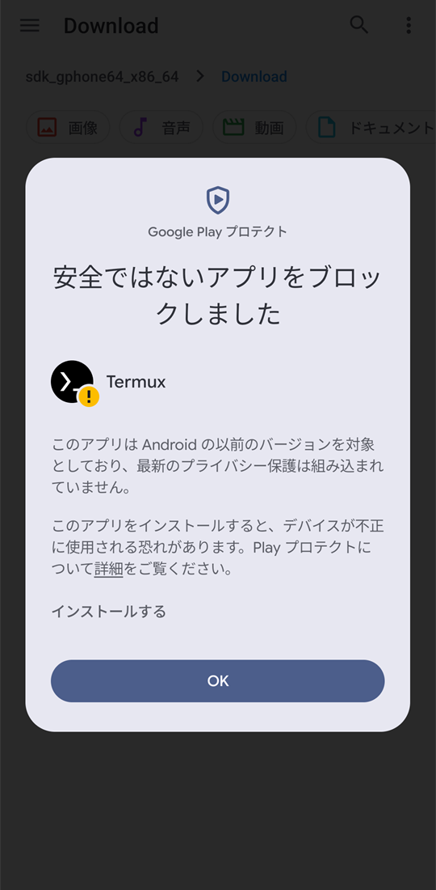

1. Termux を開き、パッケージを更新する。

   ```bash
   pkg upgrade -y
   ```

   - 「通知の送信を Termux に許可しますか？」では「許可」を押す
   - 設定ファイルの扱い（`*** openssl.cnf (Y/I/N/O/D/Z) [default=N] ?` など）を何回か聞かれる。どれも Enter（既定の N）を押す
   - **次の手順は、更新が終わって `$` に戻ってから貼る**（続けて貼ると、設定ファイルの扱いへの答えとして読まれる）

#### Termux: 基本の設定

- 共有のストレージ、キーの帯、HackGen Console NF のフォントを設定する
- 前提: [Termux](#termux)を通してある
- 実行場所: スマートフォンの Termux（bash）と Android の画面
- 画面は Android のエミュレーター（x86_64、Android 17、Termux v0.118.3）で撮った。画面内の値は試験用

1. Termux で、共有のストレージへのアクセスを許可する。

   ```bash
   termux-setup-storage
   ```

   - 「このデバイス内の写真、動画、音楽、音声などへのアクセスを Termux に許可しますか？」では「許可」を押す
   - **次の手順は、許可して Termux の画面に戻ってから貼る**

1. Termux で、キーの帯の設定を足す。

   ```bash
   mkdir -p ~/.termux
   if grep -Eq '^[[:space:]]*extra-keys[[:space:]]*=' ~/.termux/termux.properties 2>/dev/null; then
     echo '中断: 有効な extra-keys の行がすでにある。既存の設定を確かめる' >&2
   else
     printf "\nextra-keys = [['ESC','|','/','-','HOME','UP','END','PGUP'], ['TAB','CTRL','ALT','~','LEFT','DOWN','RIGHT','PGDN']]\n" >> ~/.termux/termux.properties
     printf '\n\033[7m 確認 \033[0m\n'
     grep -E '^[[:space:]]*extra-keys[[:space:]]*=' ~/.termux/termux.properties
   fi
   ```

   - `extra-keys =` で始まる行が 1 行出ればよい
   - `中断:` が出たら、既存の行を確かめ、この項のキーの並びにするなら手で書き換える

1. Termux で、HackGen Console NF 2.10.0 の指紋を確かめてフォントを置く。

   ```bash
   pkg install -y curl unzip &&
   curl -fL https://github.com/yuru7/HackGen/releases/download/v2.10.0/HackGen_NF_v2.10.0.zip -o "$TMPDIR/HackGen_NF_v2.10.0.zip" && {
     printf '\n\033[7m 確認 \033[0m\n'
     if printf '%s  %s\n' 'f8abd483d5edfad88a78ed511978f43c83b43c48e364aa29ebe4a68217474428' "$TMPDIR/HackGen_NF_v2.10.0.zip" | sha256sum -c -; then
       mkdir -p ~/.termux &&
       unzip -p "$TMPDIR/HackGen_NF_v2.10.0.zip" HackGen_NF_v2.10.0/HackGenConsoleNF-Regular.ttf > ~/.termux/font.ttf &&
       rm -f "$TMPDIR/HackGen_NF_v2.10.0.zip" &&
       ls -l ~/.termux/font.ttf
     else
       echo '中断: SHA-256 が一致しない。フォントは置かない' >&2
     fi
   }
   ```

   - `…/HackGen_NF_v2.10.0.zip: OK` と、サイズが 0 でない `font.ttf` の行が出ればよい
   - `FAILED` や `中断:` が出たら、この項の手順 4 へ進まない

1. Termux で、設定とフォントを読み直す。

   ```bash
   termux-reload-settings
   ```

   - 何も出ずに `$` に戻ればよい。キーの帯とフォントは、この項の手順 5 で確かめる

1. Termux の画面で、キーの帯とフォントの記号を確かめる。

   - キーの帯が 2 段 8 列になり、`ESC`・`CTRL`・矢印・`|`・`~` が並んでいればよい
   - [Termux のシェル: シェルのツールを入れる](#termux-のシェル-シェルのツールを入れる)を通したときは、プロンプトや `eza --icons` の記号が四角に化けないことも確かめる
   - 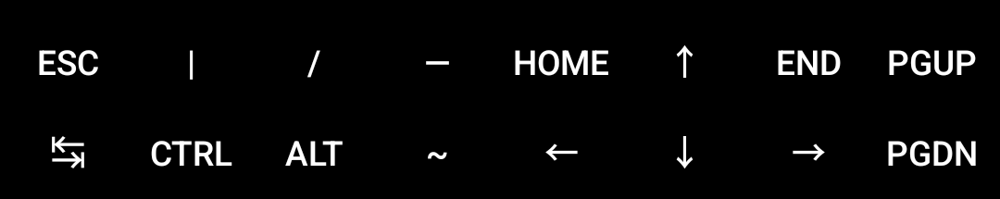

#### Termux: Termux:API を入れる

- Termux:API を入れ、Android のクリップボードと文字をやり取りする
- 前提: [Termux](#termux)を通してある
- 実行場所: スマートフォンの Android の画面と、前に出した Termux（bash）

1. スマートフォンで、GitHub のリリースから Termux:API の APK を入れる。

   - [termux-api のリリース](https://github.com/termux/termux-api/releases)の `termux-api-app_v<版>+github.debug.apk` をダウンロードする
   - APK の入れ方は、[Termux](#termux)の手順 1 と同じ
   - F-Droid の Termux を使っているときは、F-Droid の Termux:API を入れる
   - **次の手順は、インストールが終わって Termux の画面に戻ってから貼る**

1. Termux を前に出し、コマンドを入れてクリップボードの往復を確かめる。

   ```bash
   pkg install -y termux-api &&
   printf '%s' 'termux-clipboard-test' | termux-clipboard-set
   printf '\n\033[7m 確認 \033[0m\n'
   printf '%s\n' "$(termux-clipboard-get)"
   ```

   - `termux-clipboard-test` と出ればよい
   - クリップボードを読むときは Termux を前に出す。空なら、ほかのアプリから Termux に戻って貼り直す

#### Termux: 強制終了されたとき

- `[Process completed (signal 9) - press Enter]` が出て Termux のプロセスが止まったときだけ、Android の設定を変える
- 前提: [Termux](#termux)を通してある
- 実行場所: スマートフォンの Android の設定

1. Android の設定で、Android のバージョンを確かめる。

   - 設定の「デバイス情報」（エミュレーターでは「エミュレートされたデバイスについて」）で Android のバージョンを確かめる
   - Android 14 以降なら、この項の手順 2 へ進む
   - Android 12・12L・13 はこの項の手順 2 を飛ばし、[補足](reference/termux.md#termux--termux-強制終了されたとき--手順-12-補足-android-の設定)の方法を使う

1. Android 14 以降のときだけ、開発者向けオプションで子プロセスの制限を無効化する。

   - 「開発者向けオプション」が無いときは、設定の「デバイス情報」のいちばん下の「ビルド番号」を 7 回押す
   - 設定 →「システム」→ いちばん下の「開発者向けオプション」→「子プロセスの制限を無効化」をオンにする
   - 「子プロセスの制限を無効化」がオンになればよい
   - 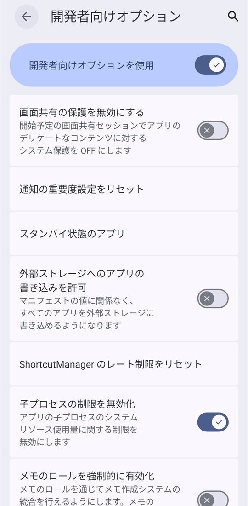

#### Termux: 更新

- Termux のパッケージと、Termux・Termux:API の APK を更新する
- 前提: [Termux](#termux)を通してある
- 実行場所: スマートフォンの Termux（bash）と Android の画面

1. Termux で、パッケージを更新する。

   ```bash
   pkg upgrade -y
   ```

   - 設定ファイルの扱いを聞かれたら Enter を押す
   - **次の手順は、更新が終わって `$` に戻ってから行う**

1. Termux:API を入れていて新しい版が出ているときは、スマートフォンで APK を入れ直す。

   - [termux-api のリリース](https://github.com/termux/termux-api/releases)から `termux-api-app_v<版>+github.debug.apk` をダウンロードして開く
   - F-Droid の Termux を使っているときは、F-Droid の Termux:API を更新する
   - APK の開き方は、[Termux](#termux)の手順 1 と同じ
   - 「このアプリを更新しますか？」→「更新」を押し、「アプリを更新しました」と出ればよい

1. Termux の新しい版が出ているときは、スマートフォンで APK を入れ直す。

   - GitHub の Termux は、[termux-app のリリース](https://github.com/termux/termux-app/releases)から APK をダウンロードして開く
   - F-Droid の Termux は、F-Droid で更新する
   - APK の開き方は、[Termux](#termux)の手順 1 と同じ
   - 更新すると、開いている Termux のセッションと、その中で動かしているもの（sshd・Neovim など）が止まる。作業を閉じてから行う
   - 「このアプリを更新しますか？」→「更新」を押し、「アプリを更新しました」と出ればよい
   - Termux を開き直すと、新しいセッションが開く。設定とパッケージは残る

---

### Termux の Firefox

- Android のスマートフォンで、Termux のパッケージの PC 版（Linux 向け）の Firefox を、Termux:X11 の画面で使う
- 前提: [Termux](#termux)を通してある（Android 8 以降。空きが 2 GB ほど要る）
- 実行場所: スマートフォン。コマンドは Termux の画面に貼る
- [検証記録](https://github.com/ryo-aoki-pc/setup-notes-verification/blob/main/docs/verification/termux-firefox.md)・[参考資料](reference/termux-firefox.md)・[注意点](extra/termux-firefox.md)
- 画面は Android のエミュレーター（x86_64、Android 17）で撮った。画面内の値は試験用

> [!WARNING]
> Termux の Firefox は、サンドボックスを外してビルドされている（[補足](reference/termux-firefox.md#termux-の-firefox--手順-2-補足-サンドボックスと更新)）。知らないサイトの普段の閲覧には使わず、自分のサイトの確かめなどに使う。

1. スマートフォンで、GitHub のリリースから Termux:X11 の APK を入れる。

   - [nightly](https://github.com/termux/termux-x11/releases/tag/nightly) の `termux-x11-universal-sharedUid-debug.apk` をダウンロードする
   - F-Droid の Termux を使っているときは、sharedUid の付かない `termux-x11-universal-debug.apk` にする
   - APK の入れ方は、[Termux](#termux)の手順 1 と同じ
   - 「アプリをインストールしました」と出ればよい

1. Termux で、Firefox・Termux:X11 のコマンド・dwm を入れる。

   ```bash
   pkg install -y x11-repo && pkg install -y termux-x11-nightly firefox dwm
   ```

   - 数分かかる。最後に `Setting up firefox (<版>)` などが出て、`$` に戻ればよい

1. Termux で、Firefox を起動する。

   ```bash
   termux-x11 :0 -xstartup "sh -c 'dwm & MOZ_USE_XINPUT2=1 exec firefox'" >/dev/null 2>&1 &
   sleep 3; am start -n com.termux.x11/.MainActivity
   ```

   - Termux:X11 の画面が前に出て、Firefox の「Welcome to Firefox」が開く

1. Termux:X11 の設定で、タッチの方式を Direct touch にする。

   - Termux:X11 の通知 →「Preferences」→「Pointer」→「Touchscreen input mode」→「Direct touch」を選ぶ
   - 戻るボタンで Termux:X11 の画面に戻る
   - 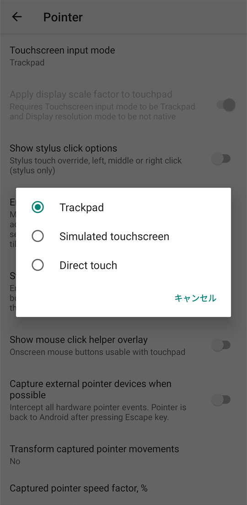

1. Termux:X11 の画面で、Firefox の初めての起動を確かめる。

   - 「Welcome to Firefox」の画面が 5 枚続く。「Skip this step」を押して進め、最後の画面で「Start browsing」を押す
   - 「New Tab」が開けばよい
   - 文字が小さいときは、[Termux の Firefox: 画面の倍率とタッチ](#termux-の-firefox-画面の倍率とタッチ)を通す
   - 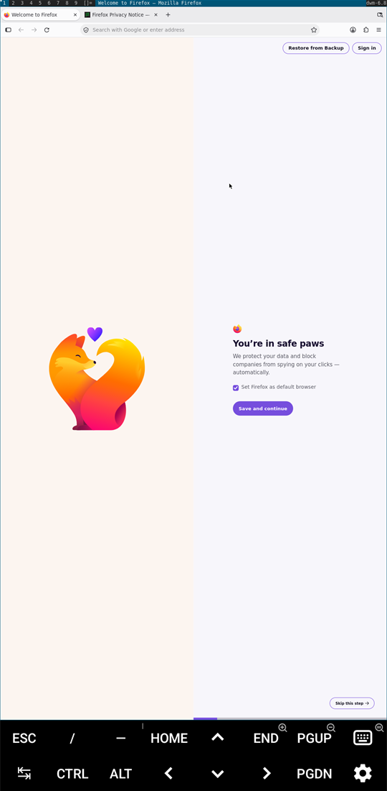

#### Termux の Firefox: 起動と終了

- Firefox を起動し、メニューから終了する
- 前提: [Termux の Firefox](#termux-の-firefox)を通してある
- 実行場所: スマートフォンの Termux と Termux:X11

1. Termux で、Firefox を起動する。

   ```bash
   termux-x11 :0 -xstartup "sh -c 'dwm & MOZ_USE_XINPUT2=1 exec firefox'" >/dev/null 2>&1 &
   sleep 3; am start -n com.termux.x11/.MainActivity
   ```

   - Termux:X11 の画面が前に出て、Firefox が開く
   - 「Make Firefox your default browser?」が出たら「Not now」を押す
   - ページは 1 本指でなぞってスクロールする（[Termux の Firefox: 画面の倍率とタッチ](#termux-の-firefox-画面の倍率とタッチ)の手順 4）

1. Firefox のメニューで、Firefox を終了する。

   - 右上の「≡」→ いちばん下の「Exit（Ctrl+Q）」を押す
   - Termux:X11 の画面が「Not connected」になればよい
   - 終了にはメニューの「Exit」を使い、`pkill` で止めない
   - 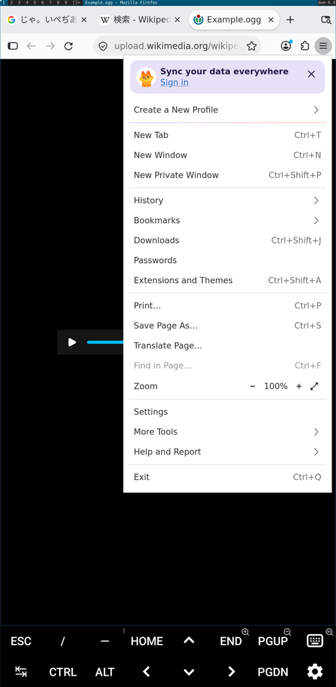

#### Termux の Firefox: ホーム画面のアイコンで起動する

- ホーム画面のアイコンから、PC 版の Firefox を倍率 2 倍で起動する。`user.js` に倍率を設定してあるときは、そちらが優先される
- 前提: [Termux の Firefox](#termux-の-firefox)を通してある
- 実行場所: スマートフォンの Termux・Android の設定・ホーム画面
- 画面は Android のエミュレーター（x86_64、Android 17、Termux:Widget v0.15.0）で撮った。画面内の値は試験用

> [!WARNING]
> この項の手順 3 で許可する「他のアプリの上に重ねて表示」は、Termux がほかのアプリの画面に重ねて表示できるようになる権限。要らなくなったら、同じ画面でオフに戻す（[補足](reference/termux-firefox.md#termux-の-firefox-ホーム画面のアイコンで起動する--手順-3-補足-裏からの画面の起動と権限)）。

1. スマートフォンで、GitHub のリリースから Termux:Widget の APK を入れる。

   - [termux-widget のリリース](https://github.com/termux/termux-widget/releases)の `termux-widget-app_v<版>+github.debug.apk` をダウンロードする
   - F-Droid の Termux を使っているときは、F-Droid の Termux:Widget を入れる
   - APK の入れ方は、[Termux](#termux)の手順 1 と同じ

1. Termux で、起動のスクリプトとアイコンを置く。

   ```bash
   mkdir -p ~/.shortcuts/tasks ~/.shortcuts/icons
   cat > ~/.shortcuts/tasks/Firefox <<'EOF'
   #!/data/data/com.termux/files/usr/bin/sh
   # ホーム画面のアイコンから、PC 版の Firefox を倍率 2 倍で起動する（setup-notes の docs/android.md）
   if ! pgrep -f 'termux-x11 com.termux.x11 :0' >/dev/null; then
     termux-x11 :0 -xstartup "sh -c 'dwm & MOZ_USE_XINPUT2=1 GDK_SCALE=2 exec firefox'" >/dev/null 2>&1 &
     sleep 3
   fi
   am start -n com.termux.x11/.MainActivity >/dev/null
   EOF
   cp "$PREFIX/share/icons/hicolor/128x128/apps/firefox.png" ~/.shortcuts/icons/Firefox.png
   chmod 700 ~/.shortcuts ~/.shortcuts/tasks ~/.shortcuts/tasks/Firefox
   chmod -R a-x,u=rwX,go-rwx ~/.shortcuts/icons
   printf '\n\033[7m 確認 \033[0m\n'
   ls -l ~/.shortcuts/tasks ~/.shortcuts/icons
   ```

   - `~/.shortcuts/tasks` の `Firefox` が `-rwx------` ならよい
   - `~/.shortcuts/icons` の `Firefox.png` が `-rw-------` ならよい

1. Android の設定で、Termux に「他のアプリの上に重ねて表示」を許可する。

   - 設定 →「アプリ」→「特別なアプリアクセス」→「他のアプリの上に重ねて表示」→「Termux」→「他のアプリの上に重ねて表示できるようにする」をオンにする
   - 「アプリはアクセスを拒否されました」が出たら「閉じる」を押し、設定 →「アプリ」→「Termux」（アプリ情報）→ 右上の「︙」→「制限付き設定を許可」を押す
   - 「制限付き設定を許可」を押した後は、もう一度「他のアプリの上に重ねて表示できるようにする」をオンにする。画面ロックの解除を求められたら解除する
   - 「他のアプリの上に重ねて表示できるようにする」がオンならよい
   - 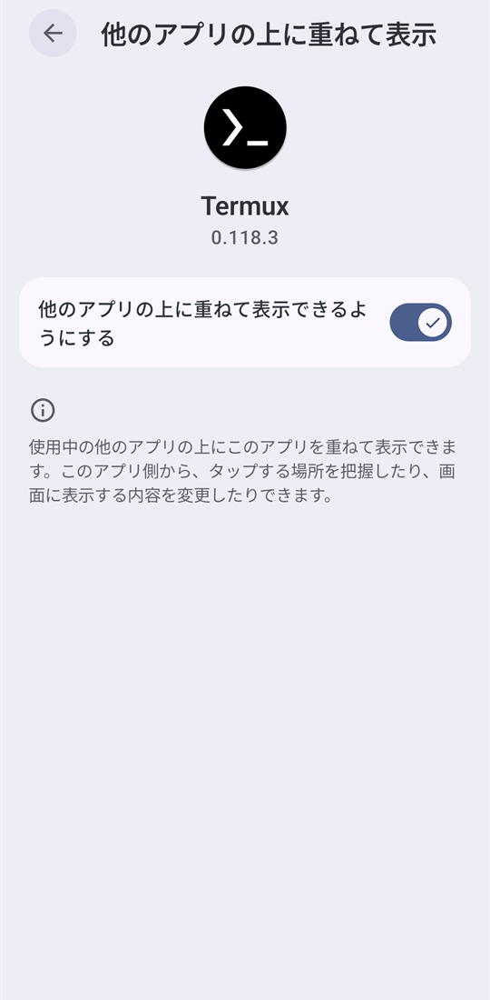

1. ホーム画面に、Firefox のショートカットを置く。

   - ホーム画面の何も無い所を長押し →「ウィジェット」→ 一覧の「Termux:Widget」の右の矢印を押す
   - 「Termux shortcut」（1 × 1）→「Termux shortcutウィジェットを追加」を押す
   - スクリプトの選択の画面で「tasks/」→「Firefox」を押す
   - Firefox のアイコンと「Firefox 1 × 1」が出たら「ホーム画面に追加」→「ホーム画面に追加」を押す
   - Firefox のロゴに Termux の小さな印が付いた「Firefox」のアイコンがホーム画面にできればよい
   - 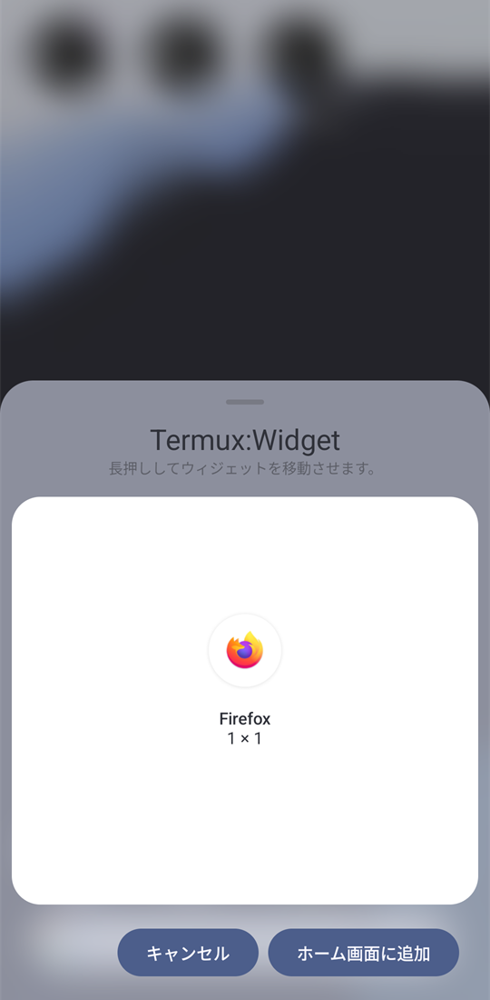

1. ホーム画面の Firefox のアイコンを押し、起動を確認する。

   - Firefox を閉じた状態で押す。Termux:X11 の画面に倍率 2 倍の Firefox の「New Tab」が出ればよい（`user.js` に倍率があれば、その値になる）
   - Firefox が既に開いているときは、Termux:X11 の画面が前に出ればよい
   - Termux:X11 の画面が出ないときは、この項の手順 3 の許可を確かめる
   - 終了は、[Termux の Firefox: 起動と終了](#termux-の-firefox-起動と終了)の手順 2 のメニューの「Exit」を使う
   - 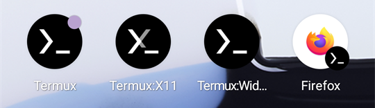

#### Termux の Firefox: 画面の倍率とタッチ

- Firefox の文字の大きさを設定し、タッチとページのスクロールの操作を確かめる
- 前提: [Termux の Firefox](#termux-の-firefox)を通してある
- 実行場所: スマートフォンの Termux と Termux:X11
- この項の手順 2 は、[Termux の Firefox: 起動と終了](#termux-の-firefox-起動と終了)の手順 2 で Firefox を閉じてから貼る

1. Termux で、変数を設定する。

   ```bash
   FF_SCALE='2.0'
   printf '\n\033[7m 確認 \033[0m\n'
   printf 'FF_SCALE=%s\n' "${FF_SCALE}"
   ```

   - `FF_SCALE=2.0` と出ればよい。倍率を変えるときは、この項の手順 1 の値を変える

1. Firefox を閉じてから、Termux で倍率と既定のブラウザの確認を設定する。

   ```bash
   if [ -z "${FF_SCALE}" ]; then echo '中断: FF_SCALE が空のまま' >&2
   elif pgrep -x firefox >/dev/null; then echo '中断: Firefox が開いている。Firefox のメニューの Exit で閉じてから貼り直す' >&2
   else
     p=$(ls -d ~/.config/mozilla/firefox/*.default-default)
     if [ ! -d "$p" ]; then echo '中断: Firefox のプロファイルを 1 つに特定できない' >&2; else
       if [ -f "$p/user.js" ]; then
         sed -i -e '/^[[:space:]]*user_pref("layout\.css\.devPixelsPerPx",/d' -e '/^[[:space:]]*user_pref("browser\.shell\.checkDefaultBrowser",/d' "$p/user.js"
       fi &&
       printf 'user_pref("layout.css.devPixelsPerPx", "%s");\nuser_pref("browser.shell.checkDefaultBrowser", false);\n' "${FF_SCALE}" >> "$p/user.js"
       printf '\n\033[7m 確認 \033[0m\n'
       cat "$p/user.js"
     fi
   fi
   ```

   - `layout.css.devPixelsPerPx` と `browser.shell.checkDefaultBrowser` の行が 1 つずつ出ればよい
   - `中断:` が出たら、Firefox を閉じているかと、この項の手順 1 の値を確かめてから貼り直す

1. Termux:X11 の画面で、Firefox の大きさとタッチの操作を確かめる。

   - [Termux の Firefox: 起動と終了](#termux-の-firefox-起動と終了)の手順 1 で起動する
   - Firefox の文字が読める大きさになり、指で押した場所がクリックになればよい
   - 押した場所と違う所が押されるときは、[Termux の Firefox](#termux-の-firefox)の手順 4 でタッチの方式を Direct touch にする
   - 横向きにすると、広い幅で表示される
   - 画面の下のキーの帯の右側にあるキーボードのボタンで、Android のキーボードを出す。戻るボタンで隠す
   - 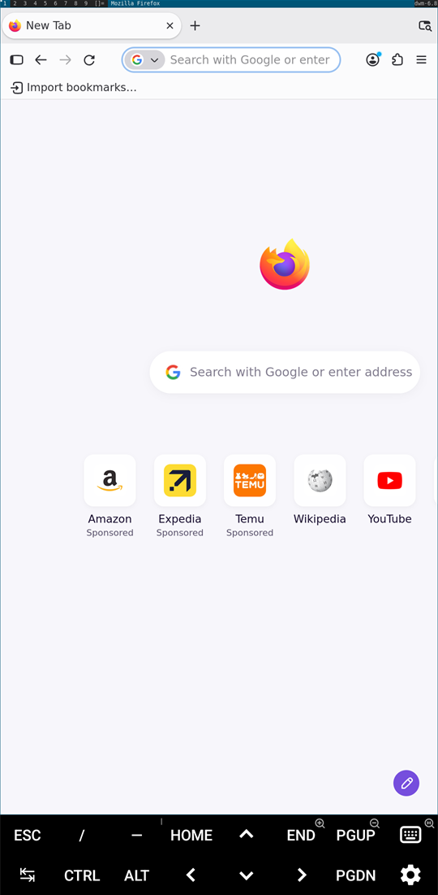

1. Termux:X11 の画面で、タッチ操作でページをスクロールする。

   - ページの上に 1 本指を置き、上へなぞるとページの下へ進み、下へなぞると上へ戻る（スマートフォンのブラウザと同じ）
   - 指を離すと、勢いで少し流れる
   - タップはクリックになり、リンクやボタンを押せる
   - キーの帯で動かすときは、先にページの本文を一度タップする
   - 画面の下のキーの帯の `PGDN` で 1 画面下へ、`PGUP` で 1 画面上へ動く
   - `END` でページのいちばん下へ、`HOME` でいちばん上へ動く
   - `MOZ_USE_XINPUT2=1` を付けずに起動した Firefox で文字が選ばれるときは、[Termux の Firefox: 起動と終了](#termux-の-firefox-起動と終了)の手順 2 で閉じ、同じ項の手順 1 で起動し直す

#### Termux の Firefox: ダークテーマにする

- Firefox の画面と、ダーク表示に対応したサイトを暗い色にする
- 前提: [Termux の Firefox](#termux-の-firefox)を通してある
- 実行場所: スマートフォンの Termux と Termux:X11
- 画面は Android のエミュレーター（x86_64、Android 17、Firefox 158.0.1）で撮った。画面内の値は試験用
- この項の手順 2 は、[Termux の Firefox: 起動と終了](#termux-の-firefox-起動と終了)の手順 2 で Firefox を閉じてから貼る

1. Termux で、変数を設定する。

   ```bash
   FF_DARK='1'
   printf '\n\033[7m 確認 \033[0m\n'
   printf 'FF_DARK=%s\n' "${FF_DARK}"
   ```

   - 暗い表示にするときは `FF_DARK='1'` のままでよい
   - `FF_DARK=1` と出ればよい

1. Firefox を閉じてから、Termux でダークテーマを設定する。

   ```bash
   if [ -z "${FF_DARK}" ]; then echo '中断: FF_DARK が空のまま' >&2
   elif pgrep -x firefox >/dev/null; then echo '中断: Firefox が開いている。Firefox のメニューの Exit で閉じてから貼り直す' >&2
   else
     p=$(ls -d ~/.config/mozilla/firefox/*.default-default)
     if [ ! -d "$p" ]; then echo '中断: Firefox のプロファイルを 1 つに特定できない' >&2; else
       if [ -f "$p/user.js" ]; then
         sed -i -e '/^[[:space:]]*user_pref("ui\.systemUsesDarkTheme",/d' "$p/user.js"
       fi &&
       printf 'user_pref("ui.systemUsesDarkTheme", %s);\n' "${FF_DARK}" >> "$p/user.js"
       printf '\n\033[7m 確認 \033[0m\n'
       grep 'ui.systemUsesDarkTheme' "$p/user.js"
     fi
   fi
   ```

   - `user_pref("ui.systemUsesDarkTheme", 1);` が 1 行出ればよい
   - `中断:` が出たら、Firefox を閉じているかと、この項の手順 1 の値を確かめてから貼り直す
   - 設定の意味は[補足](reference/termux-firefox.md#termux-の-firefox-ダークテーマにする--手順-2-補足-テーマの指定と-userjs)

1. Termux:X11 の画面で、Firefox とサイトの色を確かめる。

   - [Termux の Firefox: 起動と終了](#termux-の-firefox-起動と終了)の手順 1 か、[Termux の Firefox: ホーム画面のアイコンで起動する](#termux-の-firefox-ホーム画面のアイコンで起動する)の手順 5 で起動する
   - Firefox のツールバー・タブ・「New Tab」が暗い色になればよい
   - ダーク表示に対応したサイト（[MDN の日本語版](https://developer.mozilla.org/ja/)など）を開くと、本文まで暗い色になる。対応していないサイトは明るいまま
   - 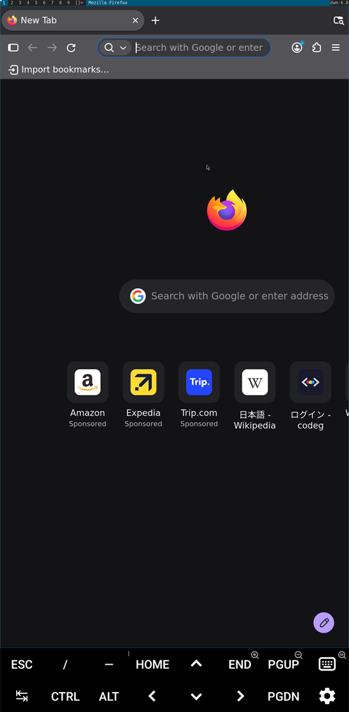

#### Termux の Firefox: 日本語の表示と入力

- 日本語のフォントとページの優先言語を設定し、Gboard で日本語を入力する
- 前提: [Termux の Firefox](#termux-の-firefox)を通してある
- 実行場所: スマートフォンの Termux と Termux:X11
- この項の手順 1 は、[Termux の Firefox: 起動と終了](#termux-の-firefox-起動と終了)の手順 2 で Firefox を閉じてから貼る

1. Firefox を閉じてから、Termux で日本語のフォントと優先言語を設定する。

   ```bash
   if pgrep -x firefox >/dev/null; then echo '中断: Firefox が開いている。Firefox のメニューの Exit で閉じてから貼り直す' >&2; else
     p=$(ls -d ~/.config/mozilla/firefox/*.default-default)
     if [ ! -d "$p" ]; then echo '中断: Firefox のプロファイルを 1 つに特定できない' >&2; else
       pkg install -y otf-noto-sans-cjk &&
       if [ -f "$p/user.js" ]; then
         sed -i -e '/^[[:space:]]*user_pref("intl\.accept_languages",/d' -e '/^[[:space:]]*user_pref("browser\.translations\.automaticallyPopup",/d' "$p/user.js"
       fi &&
       printf 'user_pref("intl.accept_languages", "ja, en-US, en");\nuser_pref("browser.translations.automaticallyPopup", false);\n' >> "$p/user.js"
       printf '\n\033[7m 確認 \033[0m\n'
       cat "$p/user.js"
     fi
   fi
   ```

   - `intl.accept_languages` と `browser.translations.automaticallyPopup` の行が 1 つずつ出ればよい
   - `中断:` が出たら、Firefox を閉じてから貼り直す。プロファイルが見つからないときは、[Termux の Firefox](#termux-の-firefox)の初めての起動まで通してあるか確かめる

1. Termux:X11 の画面で、Firefox に日本語を入力する。

   - [Termux の Firefox: 起動と終了](#termux-の-firefox-起動と終了)の手順 1 で起動する
   - キーの帯のキーボードのボタンで Gboard を出し、日本語（かな）にして、Firefox の入力欄で打って候補を選ぶ
   - 変換中の「にほんご」が入力欄に出て、候補の「日本語」を押すと「日本語」が入ればよい
   - Termux:X11 の「Preferences」→「Keyboard」→「Enforce char based input」はオフのまま使う
   - 日本語のページで翻訳の案内が出ず、日本語が優先されることも確かめる
   - 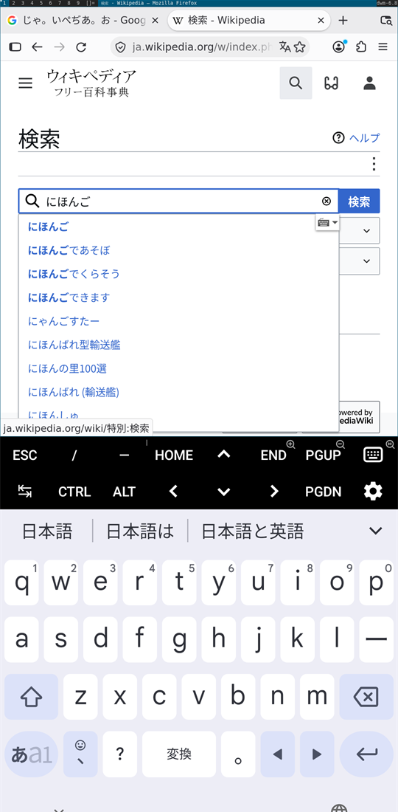

#### Termux の Firefox: 音

- Firefox が音声を再生している間の出力先を確かめる
- 前提: [Termux の Firefox](#termux-の-firefox)を通してある
- 実行場所: スマートフォンの Termux と Termux:X11

1. Termux:X11 の画面で、Firefox で音声を再生する。

   - [Termux の Firefox: 起動と終了](#termux-の-firefox-起動と終了)の手順 1 で起動する
   - Firefox で[2 分半の音声ファイル](https://upload.wikimedia.org/wikipedia/commons/9/9d/Bach_-_Cello_Suite_no._1_in_G_major%2C_BWV_1007_-_I._Pr%C3%A9lude.ogg)を開く。再生が始まらなければ、再生のボタンを押す
   - **次の手順は、再生している間に Termux に切り替えて貼る**

1. Firefox で音声を再生している間に、Termux で出力先を確かめる。

   ```bash
   pactl list short sinks
   ```

   - `OpenSL_ES_sink` の行が `RUNNING` ならよい
   - PulseAudio を手で起動する必要はない
   - `RUNNING` なのに音が聞こえないときは、[補足](reference/termux-firefox.md#termux-の-firefox-音--手順-2-補足-pulseaudio-の自動起動)の `module-aaudio-sink` を読む

#### Termux の Firefox: H.264 の動画を再生する

- H.264 の動画を再生する。Firefox は Termux の FFmpeg を読み込んで再生するので、設定の変更は要らない（[補足](reference/termux-firefox.md#termux-の-firefox-h264-の動画を再生する--手順-1-補足-ffmpeg-の読み込みと版)）
- 前提: [Termux の Firefox](#termux-の-firefox)を通してある
- 実行場所: スマートフォンの Termux と Termux:X11
- 画面は Android のエミュレーター（x86_64、Android 17、Firefox 158.0.1）で撮った。画面内の値は試験用

1. Termux で、FFmpeg が入っていることと版を確かめる。

   ```bash
   pkg install -y ffmpeg
   printf '\n\033[7m 確認 \033[0m\n'
   dpkg-query -W -f='${Package} ${Version}\n' firefox ffmpeg
   ls "$PREFIX"/lib/libavcodec.so.*
   ```

   - 「確認」の後に `ffmpeg 9.…` と `firefox 158.…` などの 2 行と、`libavcodec.so.63` などのファイルが出ればよい
   - `libavcodec.so.` の後の数字が、Firefox の読める上限（Firefox 158 では 63）以下ならよい

1. Termux:X11 の画面で、H.264 の動画を再生する。

   - [Termux の Firefox: 起動と終了](#termux-の-firefox-起動と終了)の手順 1 か、[Termux の Firefox: ホーム画面のアイコンで起動する](#termux-の-firefox-ホーム画面のアイコンで起動する)の手順 5 で起動する
   - Firefox で[MDN の学習用の動画](https://mdn.github.io/learning-area/html/multimedia-and-embedding/video-and-audio-content/rabbit320.mp4)を開く
   - 白いうさぎの画が出て、最後まで再生されればよい（`0:08 / 0:08`）
   - 再生されないときは、この項の手順 1 で `libavcodec.so` の版を確かめる
   - 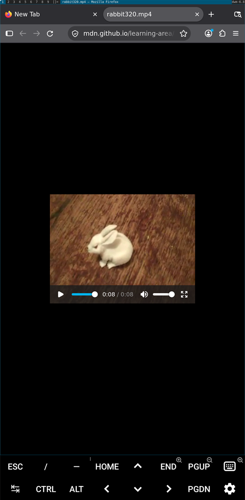

#### Termux の Firefox: ルート証明書を入れる

- Caddy のルート証明書を、Termux の Firefox のプロファイルに入れる
- 前提: [Termux の Firefox](#termux-の-firefox)を通してあり、ホストの Caddy が HTTPS と `/caddy-root.crt` を公開している
- 実行場所: スマートフォンの Termux と Termux:X11。ホストの指紋は、ホスト側の手順で表示する
- 対象は AlmaLinux 10 のホストの Caddy と、Windows 11 の Codeg 専用の Caddy
- AlmaLinux 10 のホストの指紋は、[Caddy: 端末にルート証明書を入れる](almalinux-setup.md#caddy-端末にルート証明書を入れる)の手順 1 で出して控える
- Windows 11 のホストの指紋は、[Codeg: Windows 11 で端末にルート証明書を入れる](ai-agents.md#codeg-windows-11-で端末にルート証明書を入れる)の手順 1 で出して控える
- この項の手順 3 は、[Termux の Firefox: 起動と終了](#termux-の-firefox-起動と終了)の手順 2 で Firefox を閉じてから貼る

> [!WARNING]
> この項の手順 2 で出した指紋がホストのものと同じでなければ、手順 3 で取り込まない。手順 4 でサイトの証明書の警告が出たら、警告の画面で進まない。

1. Termux で、変数を設定する（`CADDY_URL` は必ず値を入れる）。

   ```bash
   CADDY_URL=''  # ホストの HTTPS の URL を入れる
   ```

   - `https://<SERVER_IP>:<サイトのポート>` を入れる。Codeg は `https://<SERVER_IP>:3443` にする

1. Termux で、ルート証明書を取得し、名前・期限・指紋を表示する。

   ```bash
   if [ -z "${CADDY_URL}" ]; then echo '中断: CADDY_URL が空のまま' >&2; else
     pkg install -y nss-utils openssl-tool &&
     curl -sSkf -o ~/caddy-root.crt "${CADDY_URL}/caddy-root.crt" && {
       printf '\n\033[7m 確認 \033[0m\n'
       openssl x509 -in ~/caddy-root.crt -noout -subject -enddate -fingerprint -sha256
     }
   fi
   ```

   - `subject=`・`notAfter=`・`sha256 Fingerprint=` が出ればよい
   - ホスト側で控えた SHA-256 の指紋と同じなら、この項の手順 3 へ進む。違えば取り込まない
   - `curl:` で始まる行が出て「確認」が出ないときは、`CADDY_URL` とつながる道（WireGuard など）を確かめてから貼り直す

1. Firefox を閉じてから、Termux でルート証明書を取り込む。

   ```bash
   if pgrep -x firefox >/dev/null; then echo '中断: Firefox が開いている。Firefox のメニューの Exit で閉じてから貼り直す' >&2; else
     p=$(ls -d ~/.config/mozilla/firefox/*.default-default)
     n=$(openssl x509 -in ~/caddy-root.crt -noout -subject -nameopt multiline | sed -n 's/^ *commonName *= //p')
     if [ ! -d "$p" ]; then echo '中断: Firefox のプロファイルを 1 つに特定できない' >&2
     elif [ -z "$n" ]; then echo '中断: ルート証明書から名前を取れない。この項の手順 2 を貼り直す' >&2
     else
       certutil -A -d "sql:$p" -n "$n" -t 'C,,' -i ~/caddy-root.crt
       printf '\n\033[7m 確認 \033[0m\n'
       certutil -L -d "sql:$p"
     fi
   fi
   ```

   - 入れたルート証明書の名前と `C,,` が出ればよい
   - `中断:` が出たら、その内容に従って直してから貼り直す

1. Firefox を起動し、通常のタブでサイトを開いて確かめる。

   - [Termux の Firefox: 起動と終了](#termux-の-firefox-起動と終了)の手順 1 で起動する
   - 通常のタブで、この項の手順 1 の URL を開く。Codeg は `https://<SERVER_IP>:3443/api/` を開く
   - 証明書の警告が出ずにサイトが開けばよい。Codeg はログインの画面（アクセストークンの入力欄）になる
   - 12 時間以上たってから、もう一度通常のタブで開き、警告が出ないことを確かめる
   - 警告が出たら進まず、この項の手順 2 の指紋から確かめ直す

#### Termux の Firefox: 更新

- Termux:X11・Termux:Widget の APK を更新する
- 前提: [Termux の Firefox](#termux-の-firefox)を通してある
- 実行場所: スマートフォンの Android の画面
- Firefox を含むパッケージは、[Termux: 更新](#termux-更新)で上げる

1. スマートフォンで、Termux:X11 の nightly の APK を入れ直して更新する。

   - [GitHub の nightly](https://github.com/termux/termux-x11/releases/tag/nightly)から `termux-x11-universal-sharedUid-debug.apk` をダウンロードして開く
   - F-Droid の Termux を使っているときは、sharedUid の付かない `termux-x11-universal-debug.apk` にする
   - 「このアプリを更新しますか？」→「更新」を押す
   - 「アプリを更新しました」と出ればよい

1. Termux:Widget を入れているときは、スマートフォンで APK を入れ直して更新する。

   - [termux-widget のリリース](https://github.com/termux/termux-widget/releases)から `termux-widget-app_v<版>+github.debug.apk` をダウンロードして開く
   - F-Droid の Termux を使っているときは、F-Droid の Termux:Widget を入れる
   - 「このアプリを更新しますか？」→「更新」を押す
   - 「アプリを更新しました」と出ればよい

---

### Termux のシェル

- 共通の bash 設定を入れ、補完と履歴の検索を整える
- 前提: [Termux](#termux)を通してある
- 実行場所: スマートフォンの Termux（bash）
- [検証記録](https://github.com/ryo-aoki-pc/setup-notes-verification/blob/main/docs/verification/termux-shell.md)・[参考資料](reference/termux-shell.md)・[注意点](extra/termux.md)

1. Termux で、git と bash-completion を入れる。

   ```bash
   pkg install -y git bash-completion
   ```

   - エラーが出ず、プロンプトに戻ればよい
   - git の推奨パッケージの openssh も入り、termux-services の案内が出る。sshd は起動しない

1. Termux で、共通の bash 設定を入れる。

   ```bash
   printf '\n\033[7m 確認 \033[0m\n'
   git clone https://github.com/ryo-aoki-pc/bash.git ~/.config/bash &&
     bash ~/.config/bash/install.sh
   ```

   - `~/.bashrc: 設定済み（元の内容: ~/.bashrc.before-bash）` が出ればよい
   - `~/.bash_profile: 作成しない（Termux の $PREFIX/etc/profile がログインシェルで ~/.bashrc を読む）` と `完了: 端末を開き直す。…` が出ればよい
   - clone 済みで `fatal: destination path … already exists` と出たら、`git -C ~/.config/bash pull --ff-only` と `bash ~/.config/bash/install.sh` を貼る

1. Termux で、ログインシェルを開き直す。

   ```bash
   exec bash -l
   ```

   - **次の手順は、プロンプトが戻ってから貼る**（続けて貼ると、新しいシェルへの入力として読まれる）

1. Termux で、共通の bash 設定と履歴・shopt の値を確かめる。

   ```bash
   printf '\n\033[7m 確認 \033[0m\n'
   echo "${__bash_config_loaded-読まれていない}"
   printf '%s\n' "$HISTSIZE" "$HISTFILESIZE" "$HISTCONTROL"
   shopt histappend autocd cdspell dirspell globstar
   ```

   - `1`、`100000`・`100000`・`ignoreboth`、5 つの `on` が出ればよい

1. Termux で、`~/.inputrc` を書き、今のシェルにも読ませる。

   ```bash
   if [ -e ~/.inputrc ]; then
     echo '中断: ~/.inputrc がすでにある。中身を見て、この手順の set と矢印の行を手で足す' >&2
   else
     cat > ~/.inputrc <<'EOF'
   # OS の設定（Home / End / Delete、Ctrl+矢印の単語の移動など）を先に読む。この行が無いと読まれなくなる
   $include /data/data/com.termux/files/usr/etc/inputrc
   # 補完: 大文字小文字を区別しない、候補が複数なら 1 回の Tab で一覧を出す、種類と打った部分を色で示す
   set completion-ignore-case on
   set show-all-if-ambiguous on
   set colored-stats on
   set colored-completion-prefix on
   # ↑/↓: 打った文字で始まる履歴だけをさかのぼる（何も打っていなければ 1 つずつ）
   "\e[A": history-search-backward
   "\e[B": history-search-forward
   "\eOA": history-search-backward
   "\eOB": history-search-forward
   EOF
     bind -f ~/.inputrc
     printf '\n\033[7m 確認 \033[0m\n'
     bind -v | grep -E 'completion-ignore-case|show-all-if-ambiguous|colored-stats|colored-completion-prefix'
     bind -q history-search-backward
     bind -q beginning-of-line
   fi
   ```

   - `set … on` が 4 行出て、`history-search-backward` の割り当てが出ればよい
   - `beginning-of-line` に `"\e[1~"` が無ければ、`$include /data/data/com.termux/files/usr/etc/inputrc` の行を確かめる
   - `中断:` が出たら、既存の `~/.inputrc` の先頭に `$include /data/data/com.termux/files/usr/etc/inputrc` が無ければ足し、`set` と矢印の各 4 行を足して `bind -f ~/.inputrc` を貼る

#### Termux のシェル: シェルのツールを入れる

- starship・zoxide・fzf・eza・bat・tmux と、シェルスクリプトの検査・整形の道具を入れる
- 前提: [Termux のシェル](#termux-のシェル)と[Termux: 基本の設定](#termux-基本の設定)を通してある
- 実行場所: スマートフォンの Termux（bash）
- starship・bat・tmux の設定ファイルを置くときは、この項の後に[シェルと端末の「starship の設定ファイル」](shell-terminal.md#starship-の設定ファイル)・[「bat の設定ファイル」](shell-terminal.md#bat-の設定ファイル)・[「tmux の設定ファイル」](shell-terminal.md#tmux-の設定ファイル)のブロックを Termux の画面に貼る。各項の既存ファイルの確認と退避を省かない。bat の設定ファイルの場所は `/data/data/com.termux/files/home/.config/bat/config` と出る

1. Termux で、シェルの道具を入れる。

   ```bash
   pkg install -y starship zoxide fzf eza bat fd ripgrep tmux shellcheck shfmt
   ```

   - エラーが出ず、プロンプトに戻ればよい

1. Termux で、ログインシェルを開き直す。

   ```bash
   exec bash -l
   ```

   - **次の手順は、プロンプトが戻ってから貼る**（続けて貼ると、新しいシェルへの入力として読まれる）

1. Termux で、道具と共通の bash 設定が効いたことを確かめる。

   ```bash
   printf '\n\033[7m 確認 \033[0m\n'
   command -v starship zoxide fzf eza bat fd rg tmux shellcheck shfmt
   type -t z zi
   alias ll la lt
   printf '%s\n' "$MANPAGER"
   ```

   - 10 個とも `/data/data/com.termux/files/usr/bin/…` と出ればよい
   - `function` が 2 行出て、`ll`・`la`・`lt` が eza のエイリアスになり、最後に `bat -plman` が出ればよい
   - プロンプトが starship に変わり、Nerd Fonts の記号が表示されればよい

#### Termux のシェル: yazi を入れる

- yazi と自分用の `custom` の設定を入れ、Android 用のキーを確かめる
- 前提: [Termux のシェル: シェルのツールを入れる](#termux-のシェル-シェルのツールを入れる)と[Termux: 基本の設定](#termux-基本の設定)を通してある
- 実行場所: スマートフォンの Termux（bash）。既存の `~/.config/yazi` の確認と退避を省かない

1. Termux で、yazi と依存ツールを入れる。

   ```bash
   pkg install -y yazi file ffmpeg poppler jq 7zip
   ```

   - エラーが出ず、プロンプトに戻ればよい
   - yazi の推奨パッケージの chafa・imagemagick なども入る

1. yazi を終了してから、Termux で自分用の設定を clone する。

   ```bash
   if [ -e ~/.config/yazi ] || [ -L ~/.config/yazi ]; then
     echo '中断: ~/.config/yazi がすでにある。内容を確認して退避してから貼り直す' >&2
   else
     git clone -b custom https://github.com/ryo-aoki-pc/yazi.git ~/.config/yazi
   fi
   ```

   - `中断:` が出たら、既存の設定を確認して退避してから貼り直す
   - エラーが出ず、プロンプトに戻ればよい

1. Termux の画面で、yazi が読む設定の場所を確かめる。

   ```bash
   ya env
   ```

   - Config の `Init`・`Yazi`・`Keymap`・`Theme`・`VFS` の行が `/data/data/com.termux/files/home/.config/yazi/…` を指していればよい

1. Termux で、試験用のファイルを置き、yazi を開く。

   ```bash
   printf '%s\n' 'yazi のゴミ箱の試験' > "$TMPDIR/yazi-trash-check.txt"
   yazi "$TMPDIR"
   ```

   - ファイルの一覧が開けばよい

1. yazi の画面で、移動のキーとゴミ箱を確かめる。

   - `gT` で `$TMPDIR`、`gd` で `~/storage/downloads`、`g/` で `$PREFIX` へ移ればよい
   - `gT` で戻り、`yazi-trash-check.txt` を選んで `d` を押す。`Trash 1 selected file?` に `y` と答える
   - `gt` で `~/.local/share/Trash/files` へ移り、試験用のファイルがあればよい
   - `q` で終了する
   - **次の手順は、`q` で終了してから貼る**（続けて貼ると yazi への操作として食われる）

#### Termux のシェル: 更新

- 共通の bash 設定と yazi の設定を上げる
- 前提: [Termux のシェル](#termux-のシェル)を通してある。この項の手順 2 は、[Termux のシェル: yazi を入れる](#termux-のシェル-yazi-を入れる)を通したときだけ行う
- 実行場所: スマートフォンの Termux（bash）
- 道具そのものは[Termux: 更新](#termux-更新)で上げる

1. Termux で、共通の bash 設定を更新する。

   - [シェルと端末の「共通の bash 設定を更新する」の手順 1](shell-terminal.md#共通の-bash-設定を更新する)を Termux の画面で行う
   - 更新後は Termux のセッションを開き直す

1. yazi の設定を入れたときだけ、Termux で設定を更新する。

   - [AlmaLinux 10 の初期設定の「yazi の設定を更新する」](almalinux-setup.md#yazi-の設定を更新する)の手順 1〜5 を Termux の画面で行う
   - 手元の変更と分岐の確認を省かない。成功条件は同書と同じ
   - 本体の方が古ければ、[Termux: 更新](#termux-更新)で上げる

---

### Termux の Git

- Git の共通設定を書き、使い捨てのリポジトリで改行・ブランチ・push・pull を確かめる
- 前提: [Termux のシェル](#termux-のシェル)を通してある
- 実行場所: スマートフォンの Termux（bash）
- [検証記録](https://github.com/ryo-aoki-pc/setup-notes-verification/blob/main/docs/verification/termux-git.md)・[参考資料](reference/termux-git.md)・[注意点](extra/termux.md)

1. Termux で、Git の共通設定と動作の確認を行う。

   - [AlmaLinux 10 の初期設定の「Git」](almalinux-setup.md#git)の手順 1〜10 の bash のブロックを Termux の画面に貼る
   - 同書の「Git」の手順 2 は、`git version 2.56.0` のような版が出ればよい
   - ほかの成功条件は、同書のそれぞれの手順と同じ
   - 使い捨てのリポジトリの手順は、同じ Termux のセッションで行う

#### Termux の Git: git-delta を入れる

- git-delta を入れ、git の差分を色付きで表示する
- 前提: [Termux の Git](#termux-の-git)を通してある
- 実行場所: スマートフォンの Termux（bash）

1. Termux で、変数を設定する。

   ```bash
   DELTA_NAVIGATE=true       # ページャ内で n / N を「次の変更・前の変更」にする。<DELTA_NAVIGATE>
   DELTA_LINE_NUMBERS=true   # 差分の左に行番号を出す。<DELTA_LINE_NUMBERS>
   DELTA_SIDE_BY_SIDE=false  # true にすると左右 2 面に分けて表示する。<DELTA_SIDE_BY_SIDE>
   printf '\n\033[7m 確認 \033[0m\n'
   for v in DELTA_NAVIGATE DELTA_LINE_NUMBERS DELTA_SIDE_BY_SIDE; do printf '%-19s = %s\n' "$v" "${!v}"; done
   ```

   - 編集が必須の変数は無い。広い画面で左右に並べたいなら、`DELTA_SIDE_BY_SIDE=true` にする
   - 最後に値を読み戻して確かめる
   - 新しいセッションを開いたら、この項の手順 1 を貼り直す

1. Termux で、git-delta を入れる。

   ```bash
   pkg install -y git-delta
   ```

   - エラーが出ず、プロンプトに戻ればよい

1. Termux で、git のページャを設定し、読み戻す。

   ```bash
   printf '\n\033[7m 確認 \033[0m\n'
   if [ -z "${DELTA_NAVIGATE}" ] || [ -z "${DELTA_LINE_NUMBERS}" ] || [ -z "${DELTA_SIDE_BY_SIDE}" ]; then
     echo '中断: 「Termux の Git: git-delta を入れる」の手順 1 の変数が空。3 つとも設定してから貼り直す' >&2
   else
     git config --global core.pager delta &&
       git config --global interactive.diffFilter 'delta --color-only' &&
       git config --global delta.navigate "${DELTA_NAVIGATE}" &&
       git config --global delta.line-numbers "${DELTA_LINE_NUMBERS}" &&
       git config --global delta.side-by-side "${DELTA_SIDE_BY_SIDE}" &&
       git config --global merge.conflictstyle zdiff3 &&
       git config --global --get-regexp '^(core\.pager|interactive\.difffilter|delta\.(navigate|line-numbers|side-by-side)|merge\.conflictstyle)$'
   fi
   ```

   - 設定した 6 項目が出ればよい。`interactive.difffilter` は小文字で出る
   - `中断:` が出たら、この項の手順 1 を貼り直す

1. Termux で、delta の版と差分の表示を確かめる。

   ```bash
   printf '\n\033[7m 確認 \033[0m\n'
   delta --version
   dpkg-query -W git-delta
   command -v delta
   git -C ~/.config/bash show --format= | delta --paging=never | head -20
   ```

   - `delta 0.20.1` のような版と、`git-delta` のパッケージの版、`/data/data/com.termux/files/usr/bin/delta` が出ればよい
   - ファイル名のヘッダと、行ごとに背景色の付いた差分が出ればよい
   - 差分の行が出ないときは、`git -C ~/.config/bash log -1 --oneline` で最後のコミットを確かめる。差分を持たないコミットなら、この差分表示の確認は飛ばす

#### Termux の Git: GitHub CLI を入れる

- GitHub CLI（`gh`）を入れ、GitHub にログインする
- 前提: [Termux の Git](#termux-の-git)を通し、GitHub のアカウントを用意してある
- 実行場所: スマートフォンの Termux（bash）と Android のブラウザ

1. Termux で、GitHub CLI を入れる。

   ```bash
   pkg install -y gh
   ```

   - エラーが出ず、プロンプトに戻ればよい

1. Termux で、GitHub へのログインを始める。

   ```bash
   gh auth login
   ```

   - `Where do you use GitHub?` は `GitHub.com`、認証の方法は `Login with a web browser`、`What is your preferred protocol for Git operations on this host?` は `HTTPS` を選ぶ（どれも既定のまま Enter）
   - `Authenticate Git with your GitHub credentials?` は `Y` と答える
   - `! One-time code (…) copied to clipboard` と `Press Enter to open https://github.com/login/device in your browser...` が出たら、コードを控えて Enter を押す
   - トークン（`gh auth token` の出力）とワンタイムコードを、この文書や画面の記録に載せない

1. Android のブラウザで、GitHub の認証を済ませる。

   - ブラウザが開かなければ、`https://github.com/login/device` を Android のブラウザで開く
   - この項の手順 2 のワンタイムコードを入れ、画面の案内に従う
   - **次の手順は、Termux に戻って `gh auth login` が終わってから貼る**（続けて貼ると対話への入力として読まれる）

1. Termux で、GitHub にログインできたか確かめる。

   ```bash
   gh auth status
   ```

   - `github.com` のログイン済みアカウントが出ればよい
   - `You are not logged into any GitHub hosts.` と出たら、この項の手順 2・3 を通し直す

#### Termux の Git: lazygit の設定を導入する

- lazygit と自分用の設定を入れ、Git の一覧の画面を確かめる
- 前提: [Termux の Git: git-delta を入れる](#termux-の-git-git-delta-を入れる)と[Termux: 基本の設定](#termux-基本の設定)を通してある
- 実行場所: スマートフォンの Termux（bash）。この項の手順 2 の前に、既存の `~/.config/lazygit/config.yml` の確認と退避を行う

> [!CAUTION]
>
> - この項の手順 2 は既存の `~/.config/lazygit/config.yml` を置き換える
> - 残す通常ファイルがある場合は止め、別名へ退避してから、この項の手順 2 を貼る

1. Termux で、lazygit を入れる。

   ```bash
   pkg install -y lazygit
   ```

   - エラーが出ず、プロンプトに戻ればよい

1. Termux で、自分用の設定を clone してリンクする（取り戻せない）。

   ```bash
   git clone https://github.com/ryo-aoki-pc/lazygit.git ~/lazygit-config
   mkdir -p ~/.config/lazygit
   ln -sf ~/lazygit-config/config.yml ~/.config/lazygit/config.yml
   ```

   - エラーが出たら、`~/lazygit-config` の内容とリンクを確かめてから進む

1. Termux で、lazygit の版と設定の場所を確かめる。

   ```bash
   printf '\n\033[7m 確認 \033[0m\n'
   lazygit --version
   command -v lazygit
   lazygit --print-config-dir
   ls -l ~/.config/lazygit/config.yml
   ```

   - `version=0.66.2` のような版と、`/data/data/com.termux/files/usr/bin/lazygit` が出ればよい
   - 設定の場所が `/data/data/com.termux/files/home/.config/lazygit`、リンク先が `~/lazygit-config/config.yml` の絶対パスならよい

1. Termux で、共通の bash 設定の clone を lazygit で開く。

   ```bash
   (cd ~/.config/bash && lazygit)
   ```

   - ファイル・変更差分・ブランチ・コミットの一覧が出ればよい
   - `q` で終了する
   - ファイルをほかの Android のアプリで開くときの注意は、[Termux の注意点](extra/termux.md#注意点)に従う
   - **次の手順は、`q` で終了してから貼る**（続けて貼ると lazygit への操作として食われる）

#### Termux の Git: 更新

- lazygit の設定を上げる
- 前提: [Termux の Git: lazygit の設定を導入する](#termux-の-git-lazygit-の設定を導入する)を通してある
- 実行場所: スマートフォンの Termux（bash）
- Git・git-delta・GitHub CLI・lazygit は[Termux: 更新](#termux-更新)で上げる

1. Termux で、lazygit の設定を更新する。

   - [AlmaLinux 10 の初期設定の「lazygit の設定を更新する」](almalinux-setup.md#lazygit-の設定を更新する)の手順 1〜5 を Termux の画面で行う
   - 手元の変更と分岐の確認を省かない。成功条件は同書と同じ
   - 本体の方が古ければ、[Termux: 更新](#termux-更新)で上げる
   - Termux の lazygit が設定の元の版より新しい（`version=0.66.2` と `lazygit v0.66.0 …` など）ときは、そのまま使う

---

### Termux の Neovim

- Neovim と、LazyVim で使う外部コマンドを Termux のパッケージで入れる
- 前提: [Termux のシェル: シェルのツールを入れる](#termux-のシェル-シェルのツールを入れる)を通してある
- 実行場所: スマートフォンの Termux（bash）
- [検証記録](https://github.com/ryo-aoki-pc/setup-notes-verification/blob/main/docs/verification/termux-neovim.md)・[参考資料](reference/termux-neovim.md)・[注意点](extra/termux.md)

1. Termux で、Neovim と外部コマンドを入れる。

   ```bash
   pkg install -y neovim clang make tree-sitter nodejs-lts ripgrep fd lazygit curl tar gzip unzip lua-language-server stylua taplo
   ```

   - エラーが出ず、プロンプトに戻ればよい

1. Termux で、Neovim と外部コマンドの版と場所を確かめる。

   ```bash
   printf '\n\033[7m 確認 \033[0m\n'
   nvim --version | head -1
   tree-sitter --version
   node --version
   command -v nvim clang make tree-sitter node npm rg fd lazygit curl tar gzip unzip lua-language-server stylua taplo shellcheck shfmt
   ```

   - `NVIM v0.12.…`、`tree-sitter 0.27.…`、`v24.…` のような版が出ればよい
   - 18 個のコマンドが `/data/data/com.termux/files/usr/bin/…` と出ればよい

#### Termux の Neovim: md-format を入れる

- md-format を `~/md-format` に clone し、Markdown の整形に使う `mdfmt` を入れる
- 前提: [Termux の Neovim](#termux-の-neovim)を通してある
- 実行場所: スマートフォンの Termux（bash）

1. Termux で、md-format を clone して導入する。

   ```bash
   git clone https://github.com/ryo-aoki-pc/md-format.git ~/md-format &&
     node ~/md-format/scripts/setup.mjs
   ```

   - `起動役を置きました: /data/data/com.termux/files/home/.local/bin/mdfmt` と `導入済み: mdfmt` の行が出ればよい
   - `npm notice` の行（npm の新しい版の案内）は、そのままでよい
   - clone 済みなら、[Termux の Neovim: 更新](#termux-の-neovim-更新)の手順 1 で上げる
   - `ほかの導入が動いています` で止まったら、表示のプロセスが終わるまで待ち、`node ~/md-format/scripts/setup.mjs` を貼り直す

1. Termux で、md-format の導入を確かめる。

   ```bash
   node ~/md-format/scripts/setup.mjs --check
   ```

   - `導入済み: mdfmt` と版、起動コマンドの `/data/data/com.termux/files/home/.local/bin/mdfmt` が出ればよい
   - `問題: … が PATH にありません` と出たら、[Termux のシェル: 更新](#termux-のシェル-更新)の手順 1 で共通の bash 設定を上げ、`exec bash -l` で開き直してから貼り直す

#### Termux の Neovim: LazyVim の設定を導入する

- 自分用の LazyVim の設定を入れ、プラグインとパーサーを `lazy-lock.json` の版に揃える
- 前提: [Termux の Neovim: md-format を入れる](#termux-の-neovim-md-format-を入れる)と[Termux: 基本の設定](#termux-基本の設定)を通してある
- 実行場所: スマートフォンの Termux（bash）。この項の手順 1 の既存の設定とデータの退避を省かない
- この項の手順 6 は、GitLab プレビューの公式スタイルを初めて取得するときに約 785 MB をダウンロードする

1. Termux で、既存の Neovim の設定とデータがあれば退避する。

   ```bash
   for d in ~/.config/nvim ~/.local/share/nvim ~/.local/state/nvim ~/.cache/nvim; do
     [ ! -e "${d}" ] || mv -vT "${d}" "${d}.bak"
   done
   ```

   - 退避したものは `renamed '…/nvim' -> '…/nvim.bak'` と出る。何も出なければ、退避するものは無かった
   - [Termux の Neovim](#termux-の-neovim)の `nvim --version` だけでも `~/.local/state/nvim` ができ、それが退避される
   - `.bak` がすでにあって `cannot overwrite` と出たら、古い `.bak` の内容を確認して別名へ退避してから貼り直す

1. Termux で、自分用の LazyVim の設定を clone する。

   ```bash
   [ -e ~/.config/nvim/init.lua ] || git clone https://github.com/ryo-aoki-pc/LazyVimStarter.git ~/.config/nvim
   printf '\n\033[7m 確認 \033[0m\n'
   git -C ~/.config/nvim branch --show-current
   test -f ~/.config/nvim/lua/plugins/termux.lua && echo 'termux.lua: あり'
   ```

   - `custom` と `termux.lua: あり` が出ればよい
   - `termux.lua: あり` が出なければ、ここで止めて clone したブランチと版を確かめる

1. Termux で、プラグインを入れ、`lazy-lock.json` の版に揃える。

   ```bash
   ts_wait="lua pcall(require, 'mason'); local TS, want = require('nvim-treesitter'), LazyVim.opts('nvim-treesitter').ensure_installed; vim.wait(600000, function() return vim.fn.executable('tree-sitter') == 1 end, 1000); for _ = 1, 20 do if TS.update():wait(900000) and TS.install(want):wait(900000) then break end end"
   nvim --headless "+$ts_wait" +qa
   git -C ~/.config/nvim checkout -- lazy-lock.json
   nvim --headless "+Lazy! restore" "+$ts_wait" +qa
   printf '\n\033[7m 確認 \033[0m\n'
   git -C ~/.config/nvim status --short
   ```

   - プラグインと treesitter のパーサーを入れ終えて、Neovim が閉じるまで待つ（数分かかる。途中で止めない）
   - 最後の `git status --short` が何も出さなければ、`lazy-lock.json` の版に揃っている
   - `Lock file '…' appears stale` が出たら、[LazyVimStarter の注意点](https://github.com/ryo-aoki-pc/LazyVimStarter/blob/custom/docs/extra/setup.md#注意点)で鍵を消してから、この項の手順 3 を貼り直す
   - **次の手順は、プロンプトが戻ってから貼る**（最後のメッセージの行末に続けて出ることがある）

1. Termux で、試験用の Markdown を開き、Mason の導入を待つ。

   ```bash
   printf '%s\n' '#  動作確認' '' '日本語の検索を試す。' '' '' > "$TMPDIR/lazyvim-check.md"
   nvim "$TMPDIR/lazyvim-check.md"
   ```

   - `:Mason` を開き、Installed に `bash-language-server`・`json-lsp`・`markdownlint-cli2`・`yaml-language-server` の 4 つが入り、導入中のものが無くなるまで待つ（数分かかる）。`q` で閉じる
   - 導入中に `:qa` で閉じると、その導入は止まる。次に Neovim を開いたときに続きが入る
   - `:w` で保存し、見出しの `#` の後の 2 つの空白が 1 つになり、末尾の空行が消え、`Formatter failed` が出なければよい
   - `:qa` で閉じる
   - **次の手順は、`:qa` で閉じてから貼る**（続けて貼ると Neovim への入力として食われる）

1. Termux で、外部コマンドと Mason のツールを checkhealth で確かめる。

   ```bash
   printf '\n\033[7m 確認 \033[0m\n'
   ls ~/.local/share/nvim/mason/bin
   nvim --headless "+Lazy! load mason.nvim luamigemo" "+checkhealth lazyvim luamigemo" "+w! $TMPDIR/lazyvim-health.txt" +qa
   grep -E 'ERROR|WARNING' "$TMPDIR/lazyvim-health.txt"
   ```

   - `mason/bin` に `bash-language-server`・`markdownlint-cli2`・`vscode-json-language-server`・`yaml-language-server` が出ればよい
   - 最後の `grep` が何も出さなければよい
   - `ERROR` が出たら、`$TMPDIR/lazyvim-health.txt` と [LazyVimStarter の注意点](https://github.com/ryo-aoki-pc/LazyVimStarter/blob/custom/docs/extra/setup.md#注意点)を確かめてから進む

1. Termux で、GitLab プレビューの公式スタイルを取得する。

   ```bash
   nvim --headless -u NONE -i NONE -l ~/.config/nvim/tools/install_gitlab_preview.lua
   ```

   - `GitLab プレビューの公式スタイル: 導入済み` と出ればよい
   - 取得に失敗したら、通信と Node.js 22 以上を確かめて、この項の手順 6 を貼り直す
   - この手順を通せないときも、プレビューは独自のスタイルで表示できる

#### Termux の Neovim: 更新

- md-format と LazyVim のプラグインを上げる
- 前提: [Termux の Neovim: LazyVim の設定を導入する](#termux-の-neovim-lazyvim-の設定を導入する)を通してある
- 実行場所: スマートフォンの Termux（bash）
- Neovim と外部コマンドは[Termux: 更新](#termux-更新)で上げる
- この項の手順 3 は、まだ入れていない版の公式スタイルを取得するときに約 785 MB をダウンロードする

1. Termux で、md-format を更新する。

   - [AlmaLinux 10 の初期設定の「md-format を導入・更新する」の手順 2](almalinux-setup.md#md-format-を導入更新する)の更新の箇条書きに従う
   - `git -C ~/md-format pull --ff-only` と、`(`〜`)` の導入・確認のブロックを Termux の画面に貼る。成功条件は同書と同じ
   - 手元の変更で pull が止まったら、`git -C ~/md-format status` で確かめる

1. Termux で、LazyVim のプラグインを更新する。

   - [Neovim の「LazyVim の本体・外部コマンド・プラグインを更新する」の手順 2](neovim.md#lazyvim-の本体外部コマンドプラグインを更新する)を Termux の画面で行う
   - パーサーの導入が終わり、プロンプトが戻るまで待つ。`lazy-lock.json` の差分と動作の確認を省かない

1. Termux で、GitLab プレビューの公式スタイルを設定が指定する版に揃える。

   ```bash
   nvim --headless -u NONE -i NONE -l ~/.config/nvim/tools/install_gitlab_preview.lua
   ```

   - `GitLab プレビューの公式スタイル: 導入済み` と出ればよい
   - 失敗したら、通信と Node.js 22 以上を確かめて、この項の手順 3 を貼り直す

---

### Termux の SSH

- Termux から、自分のホストへ公開鍵で SSH 接続する
- 前提: [Termux](#termux)を通してあり、ホストが SSH を受け付けている
- 実行場所: スマートフォンの Termux（bash）。公開鍵の登録とホスト鍵の指紋の表示は、ホストの端末で行う
- [検証記録](https://github.com/ryo-aoki-pc/setup-notes-verification/blob/main/docs/verification/termux-ssh.md)・[参考資料](reference/termux-ssh.md)・[注意点](extra/termux-ssh.md)

1. Termux で、変数を設定する（`SSH_ALIAS` と `SSH_HOST` は必ず値を入れる）。

   ```bash
   SSH_ALIAS=''  # ~/.ssh/config に付ける別名
   ```

   ```bash
   SSH_HOST=''  # ホストの IP または名前
   ```

   ```bash
   SSH_PORT='22'
   SSH_USER=''  # ホストのログイン名を指定するときは入れる
   printf '\n\033[7m 確認 \033[0m\n'
   printf 'SSH_ALIAS=%s\nSSH_HOST=%s\nSSH_PORT=%s\nSSH_USER=%s\n' "${SSH_ALIAS}" "${SSH_HOST}" "${SSH_PORT}" "${SSH_USER}"
   ```

   - `SSH_ALIAS` と `SSH_HOST` に入れた値が出ればよい
   - ポートを変えたホストなら `SSH_PORT` を変える。ホストのログイン名が SSH の既定と違うときは `SSH_USER` を入れる

1. Termux で、OpenSSH を入れる。

   ```bash
   pkg install -y openssh
   ```

   - エラーが出ずに `$` に戻ればよい
   - [Termux のシェル](#termux-のシェル)で git と一緒に入っていれば、`openssh is already the newest version` と出る

1. Termux で、鍵が無ければ Ed25519 の鍵を作る。

   ```bash
   if [ -e ~/.ssh/id_ed25519 ] || [ -e ~/.ssh/id_ed25519.pub ]; then
     echo '鍵は作らない: ~/.ssh/id_ed25519 または公開鍵がすでにある'
   else
     install -d -m 700 ~/.ssh
     ssh-keygen -t ed25519 -f ~/.ssh/id_ed25519
   fi
   ```

   - パスフレーズを聞かれたら入力し、確認でも同じものを入力する
   - 既存の鍵があるときは作り直さない
   - **次の手順は、鍵の作成が終わって `$` に戻ってから貼る**（続けて貼ると、パスフレーズとして読まれる）

1. Termux で、ホストに登録する公開鍵を表示する。

   ```bash
   cat ~/.ssh/id_ed25519.pub
   ```

   - `ssh-ed25519` で始まる 1 行を控える。秘密鍵の `~/.ssh/id_ed25519` は送らない

1. ホストの端末で公開鍵を登録し、ホスト鍵の指紋を控える。

   - AlmaLinux 10 は[「SSH を公開鍵だけにする」](almalinux-setup.md#ssh-を公開鍵だけにする)で、この項の手順 4 の公開鍵を登録する
   - Windows 11 は[「OpenSSH サーバー」](windows-setup.md#openssh-サーバー)と[「OpenSSH サーバーに公開鍵でもログインする」](windows-setup.md#openssh-サーバーに公開鍵でもログインする)で登録する
   - AlmaLinux 10 のホストでは `ssh-keygen -lf /etc/ssh/ssh_host_ed25519_key.pub` で、SHA-256 の指紋を控える
   - Windows 11 のホストでは、管理者の Windows PowerShell 5.1 に `ssh-keygen -lf "$env:ProgramData\ssh\ssh_host_ed25519_key.pub"` を貼り、指紋を控える
   - **次の手順は、ホストでの登録と指紋の確認を終えて Termux に戻ってから貼る**

1. Termux で、`~/.ssh/config` にホストの別名を足す。

   ```bash
   if [ -z "${SSH_ALIAS}" ] || [ -z "${SSH_HOST}" ] || [ -z "${SSH_PORT}" ]; then
     echo '中断: SSH_ALIAS・SSH_HOST・SSH_PORT を設定する' >&2
   elif [ -f ~/.ssh/config ] && awk -v alias="${SSH_ALIAS}" 'tolower($1) == "host" {for (i = 2; i <= NF; i++) if ($i == alias) found = 1} END {exit !found}' ~/.ssh/config; then
     echo '中断: 同じ Host がすでにある。既存の設定を確かめる' >&2
   else
     install -d -m 700 ~/.ssh
     {
       printf '\nHost %s\n  HostName %s\n  Port %s\n' "${SSH_ALIAS}" "${SSH_HOST}" "${SSH_PORT}"
       if [ -n "${SSH_USER}" ]; then printf '  User %s\n' "${SSH_USER}"; fi
       printf '  IdentityFile ~/.ssh/id_ed25519\n  IdentitiesOnly yes\n'
     } >> ~/.ssh/config
     chmod 600 ~/.ssh/config
     printf '\n\033[7m 確認 \033[0m\n'
     ssh -G "${SSH_ALIAS}" | grep -E '^(hostname|port|user|identityfile|identitiesonly) '
   fi
   ```

   - `hostname`・`port`・`user` がホストへの接続に使う値で、`identityfile ~/.ssh/id_ed25519` と `identitiesonly yes` が出ればよい
   - `中断:` が出たら、変数か既存の `Host` を確かめてから貼り直す

1. Termux で、ホスト鍵の指紋を比べてから初めて接続する。

   ```bash
   if [ -z "${SSH_ALIAS}" ]; then echo '中断: SSH_ALIAS が空のまま' >&2; else
     ssh -o HostKeyAlgorithms=ssh-ed25519 "${SSH_ALIAS}"
   fi
   ```

   - 初めての接続で出る SHA-256 の指紋が、この項の手順 5 でホスト側に出したものと同じときだけ `yes` を入力する
   - 指紋が違えば接続せず、`Ctrl+C` で中断する
   - ホストのシェルに入れればよい。`exit` で Termux に戻る
   - **次の手順は、`exit` で Termux の `$` に戻ってから貼る**（続けて貼ると、ホストで実行される）

1. ホストに tmux があるときは、Termux からホストの tmux に入る。

   ```bash
   if [ -z "${SSH_ALIAS}" ]; then echo '中断: SSH_ALIAS が空のまま' >&2; else
     ssh -t "${SSH_ALIAS}" tmux new -A -s main
   fi
   ```

   - ホストの tmux の `main` セッションに入れればよい。`Ctrl+B` の後に `D` で離れる（Termux のキーの帯の `CTRL` を押してから `b`）
   - 離れると `[detached (from session main)]` と出て、Termux の `$` に戻る
   - ホストの AI エージェントは、[AI コーディングエージェントの手順書](ai-agents.md)に従ってホスト側で入れる

#### Termux の SSH: PC から Termux に入る

- Termux の sshd を起動し、PC から公開鍵で接続する
- 前提: [Termux の SSH](#termux-の-ssh)を通してあり、PC に SSH の鍵がある
- 実行場所: スマートフォンの Termux（bash）。この項の手順 6 は PC の端末で行う

> [!WARNING]
> この項の手順 3 の sshd は、8022 番ポートをすべてのアドレスで待ち受ける。信頼する LAN または WireGuard からだけつなぐ。この項の手順 7 で止めると、PC からの SSH 接続も切れる。

1. Termux で、PC の公開鍵を登録する（`PC_PUBKEY` は必ず値を入れる）。

   ```bash
   PC_PUBKEY=''  # PC の公開鍵（ssh-ed25519 AAAA… の 1 行）
   ```

   ```bash
   if [ -z "${PC_PUBKEY}" ]; then echo '中断: PC_PUBKEY が空のまま' >&2
   elif ! printf '%s\n' "${PC_PUBKEY}" | ssh-keygen -lf - >/dev/null; then echo '中断: PC_PUBKEY が公開鍵の形ではない' >&2
   else
     install -d -m 700 ~/.ssh
     touch ~/.ssh/authorized_keys
     chmod 600 ~/.ssh/authorized_keys
     if ! grep -qxF "${PC_PUBKEY}" ~/.ssh/authorized_keys; then
       printf '%s\n' "${PC_PUBKEY}" >> ~/.ssh/authorized_keys
     fi
     printf '\n\033[7m 確認 \033[0m\n'
     ssh-keygen -lf ~/.ssh/authorized_keys
   fi
   ```

   - PC の公開鍵の SHA-256 の指紋が出ればよい
   - `中断:` が出たら、PC の秘密鍵ではなく公開鍵の 1 行を入れて貼り直す

1. Termux で、sshd のパスワード認証を切る。

   ```bash
   mkdir -p "$PREFIX/etc/ssh/sshd_config.d"
   printf 'PasswordAuthentication no\nKbdInteractiveAuthentication no\n' > "$PREFIX/etc/ssh/sshd_config.d/50-keys-only.conf"
   chmod 600 "$PREFIX/etc/ssh/sshd_config.d/50-keys-only.conf"
   printf '\n\033[7m 確認 \033[0m\n'
   sshd -t && sshd -T | grep -iE '^(passwordauthentication|kbdinteractiveauthentication|pubkeyauthentication) '
   ```

   - `PubkeyAuthentication yes`・`PasswordAuthentication no`・`KbdInteractiveAuthentication no` が出ればよい
   - `sshd -t` が誤りを出したら、この項の手順 3 へ進まない

1. Termux で、sshd を起動する。

   ```bash
   sshd
   ```

   - エラーが出ずに `$` に戻ればよい

1. Termux で wake lock を取り、バックグラウンドでの実行を許可する。

   ```bash
   termux-wake-lock
   ```

   - 「アプリにバックグラウンドでの常時実行を許可しますか？」では「許可」を押す
   - Termux の通知が `1 session (wake lock held)` のようになればよい
   - **次の手順は、許可して Termux の画面に戻ってから貼る**

1. Termux で、スマートフォンの IP と sshd のホスト鍵の指紋を控える。

   ```bash
   printf '\n\033[7m 確認 \033[0m\n'
   ifconfig 2>/dev/null
   ssh-keygen -lf "$PREFIX/etc/ssh/ssh_host_ed25519_key.pub"
   ```

   - `wlan0` の `inet` のアドレスを控える。WireGuard でつなぐときは、WireGuard のアプリのアドレスを使う
   - ホスト鍵の `SHA256:…` の指紋を控える

1. PC の端末で、Termux に公開鍵で接続する。

   - `ssh -p 8022 <スマートフォンのIP>` を使う。ユーザー名は指定しなくてよい
   - 初めての接続で出る指紋が、この項の手順 5 の指紋と同じときだけ `yes` を入力する。違えば進まない
   - Termux のシェルに入れればよい。`exit` で PC に戻る
   - **次の手順は、PC の接続を閉じてスマートフォンの Termux に戻ってから貼る**

1. 接続を止めるときは、Termux で sshd と wake lock を止める。

   ```bash
   pkill -x sshd
   termux-wake-unlock
   ```

   - Termux の通知から `wake lock held` が消え、PC から SSH で接続できなくなればよい

#### Termux の SSH: sshd を termux-services で動かす

- sshd の起動と停止を termux-services で管理する
- 前提: [Termux の SSH: PC から Termux に入る](#termux-の-ssh-pc-から-termux-に入る)を通してある
- 実行場所: スマートフォンの Termux（bash）

> [!WARNING]
> この項の手順 3 で手動の sshd を止めると、PC からの SSH 接続が切れる。スマートフォンの Termux の画面で行う。

1. Termux で、termux-services を入れる。

   ```bash
   pkg install -y termux-services
   ```

   - エラーが出ずに `$` に戻ればよい

1. Termux で、新しいログインシェルを開く。

   ```bash
   exec bash -l
   ```

   - **次の手順は、新しいプロンプトが出てから貼る**（続けて貼ると、新しいシェルへの入力になる）

1. Termux で、手動の sshd を止めてサービスを有効にする。

   ```bash
   pkill -x sshd
   sv-enable sshd
   ```

   - エラーが出ずに `$` に戻ればよい

1. Termux で、sshd の状態とログを確かめる。

   ```bash
   printf '\n\033[7m 確認 \033[0m\n'
   sv status sshd
   tail "$PREFIX/var/log/sv/sshd/current"
   ```

   - `run: sshd: (pid …)` と、ログの `Server listening on 0.0.0.0 port 8022.`・`Server listening on :: port 8022.` が出ればよい
   - `unable to change to service directory` が出たら、この項の手順 2 でログインシェルを開き直す

1. サービスを止めるときは、Termux で sshd を無効にする。

   ```bash
   sv-disable sshd
   printf '\n\033[7m 確認 \033[0m\n'
   sv status sshd
   ```

   - `down: sshd: …` が出て、PC から SSH で接続できなくなればよい

---

### Termux の proot-distro

- proot-distro で Ubuntu を入れ、glibc が要る道具を使う環境を作る
- 前提: [Termux](#termux)を通してある
- 実行場所: スマートフォンの Termux（bash）と、その中で開く Ubuntu の root の bash
- [検証記録](https://github.com/ryo-aoki-pc/setup-notes-verification/blob/main/docs/verification/termux-proot.md)・[参考資料](reference/termux-proot.md)・[注意点](extra/termux-proot.md)

> [!WARNING]
> この用途では、Ubuntu に入るたびに `--isolated` を付ける。省くと Termux のホームや共有のストレージもつながり、Ubuntu の中から Termux の鍵まで届く。

1. Termux で、proot-distro を入れる。

   ```bash
   pkg install -y proot-distro
   ```

   - エラーが出ずに `$` に戻ればよい

1. Termux で、Ubuntu を入れる。

   ```bash
   proot-distro install ubuntu
   ```

   - `[*] Finished installation.` と `Start shell: proot-distro login ubuntu` が出て、Termux の `$` に戻ればよい

1. Termux で、ファイルを共有しない形で Ubuntu に入る。

   ```bash
   proot-distro login --isolated ubuntu
   ```

   - Ubuntu の root のプロンプト（`root@localhost:~#`）が出ればよい
   - **次の手順は、Ubuntu のプロンプトが出てから貼る**（続けて貼ると、切り替わる前の Termux で実行されるおそれがある）

1. Ubuntu の中で、パッケージを更新する。

   ```bash
   apt-get update && apt-get upgrade -y
   ```

   - `… upgraded, … newly installed, …` の行の後、`E:` の行が出ずに Ubuntu の `#` に戻ればよい
   - `debconf: unable to initialize frontend: Dialog` などの `debconf:` の行は、対話の画面が無いことの案内で、そのままでよい

1. Ubuntu の中で、Termux に戻る。

   ```bash
   exit
   ```

   - Termux の `$` に戻ればよい

#### Termux の proot-distro: 更新

- Ubuntu の中のパッケージを更新する
- 前提: [Termux の proot-distro](#termux-の-proot-distro)を通してある
- 実行場所: スマートフォンの Termux（bash）と、その中で開く Ubuntu の root の bash
- proot-distro 自体は、[Termux: 更新](#termux-更新)で上げる

1. Termux で、ファイルを共有しない形で Ubuntu に入る。

   ```bash
   proot-distro login --isolated ubuntu
   ```

   - **次の手順は、Ubuntu の `#` が出てから貼る**（続けて貼ると、切り替わる前の Termux で実行されるおそれがある）

1. Ubuntu の中で、パッケージを更新する。

   ```bash
   apt-get update && apt-get upgrade -y
   ```

   - `… upgraded, … newly installed, …` の行の後、`E:` の行が出ずに Ubuntu の `#` に戻ればよい
   - `debconf: unable to initialize frontend: Dialog` などの `debconf:` の行は、対話の画面が無いことの案内で、そのままでよい

1. Ubuntu の中で、Termux に戻る。

   ```bash
   exit
   ```

   - Termux の `$` に戻ればよい

---

### Termux の AI エージェント

- Termux のパッケージの Codex CLI を入れ、ブラウザでログインする
- 前提: [Termux](#termux)を通してある
- 実行場所: スマートフォンの Termux（bash）と Android のブラウザ
- [検証記録](https://github.com/ryo-aoki-pc/setup-notes-verification/blob/main/docs/verification/termux-ai-agents.md)・[参考資料](reference/termux-ai-agents.md)・[注意点](extra/termux-ai-agents.md)

> [!WARNING]
> Android では `codex sandbox` が `not supported on this operating system` となり、Codex が動かすコマンドは OS のサンドボックスで囲まれない。作業に必要なファイルだけを置いた場所で使う（[補足](reference/termux-ai-agents.md#termux-の-ai-エージェント--手順-1-補足-codex-cli-の導入とサンドボックス)）。

1. Termux で、Codex CLI を入れて版を確かめる。

   ```bash
   pkg install -y codex
   printf '\n\033[7m 確認 \033[0m\n'
   codex --version
   codex doctor
   ```

   - `codex-cli 0.163.0` のような版と、`Codex Doctor v… · android-…` が出ればよい
   - `linux helper` の行が `none` になる（[警告](#termux-の-ai-エージェント)のとおり、OS のサンドボックスが無い）
   - ログインの前は、`✗ auth` の `no Codex credentials were found` と、`⚠ websocket` の `401 Unauthorized` が出る。この項の手順 2〜4 でログインする
   - 空きが少ないと `⚠ disk` が、画面の幅が 80 桁より狭いと `⚠ terminal` が出る

1. Termux で、Codex CLI のデバイス認証を始める。

   ```bash
   codex login --device-auth
   ```

   - `Welcome to Codex` の後に、`https://auth.openai.com/codex/device` とワンタイムコード（15 分で切れる）が出ればよい
   - コードは文書やログに残さない。自分で始めたログインでなければ、`Ctrl+C` で止める

1. Android のブラウザで、Codex CLI にログインする。

   - この項の手順 2 で表示された URL を開き、ワンタイムコードを入力して認証する
   - **次の手順は、認証を終えて Termux の `$` に戻ってから貼る**

1. Termux で、Codex CLI のログイン状態を確かめる。

   ```bash
   codex login status
   ```

   - ログイン済みと表示されればよい
   - `Not logged in` と出たら、この項の手順 2・3 を通し直す

#### Termux の AI エージェント: proot の Ubuntu で Claude Code を使う

- proot-distro の Ubuntu に Claude Code を入れ、利用者がログインする
- 前提: [Termux の proot-distro](#termux-の-proot-distro)を通してある
- 実行場所: スマートフォンの Termux（bash）と、その中で開く Ubuntu の root の bash

> [!WARNING]
> この項では `proot-distro login --isolated ubuntu` で Ubuntu に入る。Claude Code は Ubuntu の中で root として動く。必要な作業用のリポジトリだけを Ubuntu の中に置く。

1. Termux で、ファイルを共有しない形で Ubuntu に入る。

   ```bash
   proot-distro login --isolated ubuntu
   ```

   - **次の手順は、Ubuntu の `#` が出てから貼る**（続けて貼ると、切り替わる前の Termux で実行されるおそれがある）

1. Ubuntu の中で、curl・CA 証明書・Git を入れる。

   ```bash
   apt-get update && apt-get install -y curl ca-certificates git
   ```

   - エラーが出ずに Ubuntu の `#` に戻ればよい

1. Ubuntu の中で、Claude Code を入れる。

   ```bash
   curl -fsSL https://claude.ai/install.sh | bash
   ```

   - `Claude Code successfully installed!` と版、`Location: ~/.local/bin/claude` が出ればよい
   - `~/.local/bin is not in your PATH` の案内は、この項の手順 4 で直す
   - `curl: (22) The requested URL returned error: 502` と `Download failed` が出たら、少し置いて貼り直す

1. Ubuntu の中で、Claude Code の PATH を設定して版を確かめる。

   ```bash
   if ! grep -qxF 'export PATH="$HOME/.local/bin:$PATH"' ~/.bashrc; then
     printf '\n%s\n' 'export PATH="$HOME/.local/bin:$PATH"' >> ~/.bashrc
   fi
   export PATH="$HOME/.local/bin:$PATH"
   printf '\n\033[7m 確認 \033[0m\n'
   command -v claude
   claude --version
   ```

   - `/root/.local/bin/claude` と、`2.1.308 (Claude Code)` のような版が出ればよい

1. Ubuntu の中で、Claude Code を起動してログインする。

   ```bash
   claude
   ```

   - 初めての起動では、文字の色の選択（`Choose the text style …`）が出る。選んで Enter を押すと、ログインの方法の選択（`Select login method:`）が出る
   - ログインの方法を選び、画面の案内に従って認証する。トークンやワンタイムコードを文書やログに残さない
   - 終了は `/exit` を入力する
   - **次の手順は、Claude Code を終了して Ubuntu の `#` に戻ってから貼る**（続けて貼ると、Claude Code への入力になる）

1. Ubuntu の中で、Termux に戻る。

   ```bash
   exit
   ```

   - Termux の `$` に戻ればよい

#### Termux の AI エージェント: 更新

- Codex CLI と、Ubuntu の中の Claude Code を更新する
- 前提: [Termux の AI エージェント](#termux-の-ai-エージェント)を通してある
- 実行場所: スマートフォンの Termux（bash）。Claude Code の更新は、その中で開く Ubuntu の root の bash
- Claude Code を入れているときは、[Termux の AI エージェント: proot の Ubuntu で Claude Code を使う](#termux-の-ai-エージェント-proot-の-ubuntu-で-claude-code-を使う)も通してある

1. Termux で、Codex CLI のパッケージを更新する。

   - [Termux: 更新](#termux-更新)を通す

1. Claude Code を入れているときは、Termux で Ubuntu に入る。

   ```bash
   proot-distro login --isolated ubuntu
   ```

   - **次の手順は、Ubuntu の `#` が出てから貼る**（続けて貼ると、切り替わる前の Termux で実行されるおそれがある）

1. Claude Code を入れているときは、Ubuntu の中で Claude Code を更新する。

   ```bash
   claude update
   ```

   - `Current version: …` の後に、`Claude Code is up to date (<版>)` か、新しい版に上げたことが出ればよい

1. Claude Code を入れているときは、Ubuntu の中で Termux に戻る。

   ```bash
   exit
   ```

   - Termux の `$` に戻ればよい

---
