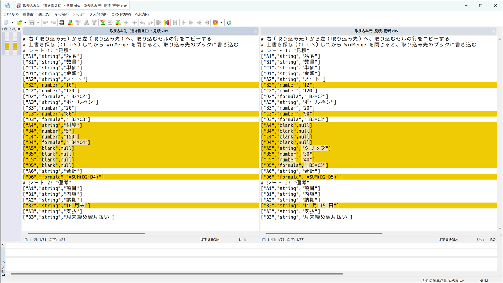
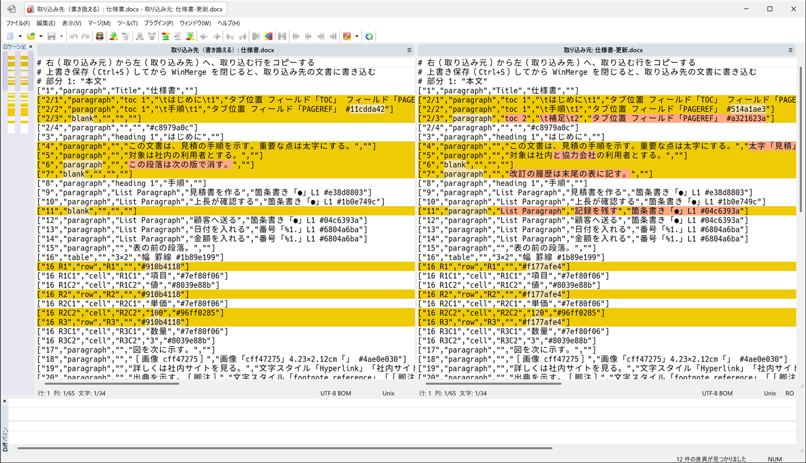

# Windows 11 のセットアップ

- 補足・注意点と検証記録は、冒頭と用途末尾の「補足と注意点」から開く

> [!IMPORTANT]
> - **この PC のデスクトップで、Administrators のユーザーが行う**。別の PC や SSH・RDP で行う操作は、各項の実行場所に従う
> - PowerShell のブロックは **PowerShell 7** に貼る（7 と貼り付けの設定は、[アプリを入れる](#アプリを入れる)の手順 6〜9）。複数行は、[「Windows Terminal で複数行を 1 つの入力として貼る」](shell-terminal.md#windows-terminal-で複数行を-1-つの入力として貼る)を通した窓に貼る。Windows PowerShell 5.1 に貼る項は、その項のリードに書く。管理者・通常の窓は、各項のリードに従う
> - Windows PowerShell 5.1 は[貼り付けの設定](#貼り付けの設定)、PowerShell 7 は[アプリを入れる](#アプリを入れる)の手順 7 より前は **Ctrl+V で貼る**。それぞれの設定後は GitHub のコピーボタンでコピーし、右クリックで貼れる

- 新しく入れた PC では、カテゴリを上から順に、要る項を選んで通す
- どの項も単独で通せる。リードの前提を先に満たす
- bash のブロックは、ブラケットペーストの効く端末（GNOME の端末・WezTerm・SSH の先）に貼り、貼った後に Enter を押す
- 貼った後は、反転表示の「確認」から後ろの出力を箇条書きで確かめる
- GitHub のコピーボタンでコピーしたブロックは末尾に改行が無いので、貼った後に Enter を押す
- 設定を更新するときは[更新](#更新)を使う
- 仮想マシン（Hyper-V・VirtualBox・VMware Workstation Pro・Windows Sandbox）は、[仮想マシンのセットアップの「Windows 11 で使う」](virtual-machines.md#windows-11-で使う)で入れる
- フォント（HackGen Console NF）・Windows Terminal・WezTerm・Git Bash と共通の bash 設定・シェルのツール・PowerShell 7 のプロファイル・PowerShell の開発の設定は、[シェルと端末のセットアップの「Windows 11 で使う」](shell-terminal.md#windows-11-で使う)で入れる
- Neovim と Samba のクライアントは、[Neovim のセットアップ](neovim.md#windows-11-で使う)と[Samba のセットアップ](samba.md#windows-11-で使う)の「Windows 11 で使う」で入れる

> [!WARNING]
> - ロックを止め、インラインの sudo を有効にすると、**PC に触れる人が管理者として操作できる**
> - Hello 以外のサインインと RDP も有効にすると、**パスワードを知る人も管理者として操作できる**
> - 人が触れる場所では、[PC 全体の設定](#pc-全体の設定)の手順 7 は行わない

<details id="この文書の補足と注意点">
  <summary>この文書の補足と注意点</summary>

**注意点**

- **管理者の PowerShell は conhost の窓で開く**: 既定の端末を Windows Terminal にしても（[表示と入力](#表示と入力)の手順 7）、管理者として開いた PowerShell は conhost の窓になる
  - Windows PowerShell 5.1 で右クリックで貼れるのは、[貼り付けの設定](#貼り付けの設定)の手順 1〜5 のプロファイルの設定による
  - PowerShell 7 では、[アプリを入れる](#アプリを入れる)の手順 7 のプロファイルの設定による

- **貼ったブロックは、Enter を押すまで動かない**: コピーボタンの中身は末尾に改行が無いため。Windows PowerShell 5.1 は[貼り付けの設定](#貼り付けの設定)の手順 1〜5、PowerShell 7 は[アプリを入れる](#アプリを入れる)の手順 7 の設定後の conhost の窓では、ブロック全体が 1 つの入力になり、Enter で 1 回で動く。Windows Terminal の窓は、[Windows Terminal で複数行を 1 つの入力として貼る](shell-terminal.md#windows-terminal-で複数行を-1-つの入力として貼る)の Enter の割り当て設定後、貼った全体が 1 つの入力になる

- **Ctrl+Enter で上に行を作る操作（`InsertLineAbove`）は使えなくなる**: 下に行を作る Shift+Ctrl+Enter（`InsertLineBelow`）と、Shift+Enter（`AddLine`）はそのまま

- **設定した版のコンソールの窓すべてに効く**: 同じユーザーなら、管理者の窓も同じプロファイルを読む。Windows PowerShell 5.1 と PowerShell 7 のプロファイルは別なので、それぞれに貼り付けの行を置く

- ツールの OS に依らない注意は、[AlmaLinux 10 のセットアップ](almalinux-setup.md)の各用途の末尾の「補足と注意点」にある。Neovim の注意は、両 OS とも [Neovim のセットアップ](neovim.md)の、HackGen Console NF・WezTerm・Windows Terminal・シェルのツールの注意は、両 OS とも [シェルと端末のセットアップ](shell-terminal.md)の各用途の末尾の「補足と注意点」にある。この文書には Windows 11 だけの注意を書く

**参照**

プライバシーと広告・表示と入力と音とストレージ・Edge の常駐の項の資料。「文書」は Microsoft の文書、「コード」はソースと定義、「広く」はコミュニティの情報。

- 文書: Policy CSP — [Privacy](https://learn.microsoft.com/en-us/windows/client-management/mdm/policy-csp-privacy)・[Experience](https://learn.microsoft.com/en-us/windows/client-management/mdm/policy-csp-experience)・[System](https://learn.microsoft.com/en-us/windows/client-management/mdm/policy-csp-system)・[Search](https://learn.microsoft.com/en-us/windows/client-management/mdm/policy-csp-search)・[Multitasking](https://learn.microsoft.com/en-us/windows/client-management/mdm/policy-csp-multitasking)・[Storage](https://learn.microsoft.com/en-us/windows/client-management/mdm/policy-csp-storage)・[ApplicationManagement](https://learn.microsoft.com/en-us/windows/client-management/mdm/policy-csp-applicationmanagement) — 採らなかったポリシーと、値が無いときの動き

- 文書: [Launch the Windows Settings app — Microsoft Learn](https://learn.microsoft.com/en-us/windows/apps/develop/launch/launch-settings) — `ms-settings:privacy`・`storagepolicies`・`easeofaccess-visualeffects`・`clipboard`

- 文書: [New-Item（5.1）— Microsoft Learn](https://learn.microsoft.com/en-us/powershell/module/microsoft.powershell.management/new-item?view=powershell-5.1) — 既にあるレジストリのキーに `-Force` を付けると空のキーになる

- 広く: [privacy.sexy の windows.yaml](https://github.com/undergroundwires/privacy.sexy/blob/master/src/application/collections/windows.yaml)・[Win10-Initial-Setup-Script](https://github.com/Disassembler0/Win10-Initial-Setup-Script/blob/master/Win10.psm1)（効果音）・[winutil の tweaks.json](https://github.com/ChrisTitusTech/winutil/blob/main/config/tweaks.json)（ギャラリーとホーム）・[stealthpuppy](https://stealthpuppy.com/windows-10-storage-sense-intune)・[cyberdrain](https://cyberdrain.com/automating-with-powershell-deploying-storagesense)（ストレージ センサー）、Ten Forums・ElevenForum・Winaero の記事

PowerToys・PowerShell 7 のプロファイル・Windows Terminal・WSL のネットワークの項の資料。「文書」「コード」「広く」の区別は上と同じ。

- 文書: [about_Profiles](https://learn.microsoft.com/en-us/powershell/module/microsoft.powershell.core/about/about_profiles?view=powershell-7.6)・[about_Execution_Policies](https://learn.microsoft.com/en-us/powershell/module/microsoft.powershell.core/about/about_execution_policies?view=powershell-7.6)・[about_PowerShell_Config](https://learn.microsoft.com/en-us/powershell/module/microsoft.powershell.core/about/about_powershell_config?view=powershell-7.6)・[about_PSReadLine](https://learn.microsoft.com/en-us/powershell/module/psreadline/about/about_psreadline?view=powershell-7.6)・[about_PSReadLine_Functions](https://learn.microsoft.com/en-us/powershell/module/psreadline/about/about_psreadline_functions?view=powershell-7.6)・[Set-PSReadLineOption](https://learn.microsoft.com/en-us/powershell/module/psreadline/set-psreadlineoption?view=powershell-7.6)・[Using predictors in PSReadLine](https://learn.microsoft.com/en-us/powershell/scripting/learn/shell/using-predictors)・[about_Update_Notifications](https://learn.microsoft.com/en-us/powershell/module/microsoft.powershell.core/about/about_update_notifications?view=powershell-7.6)・[about_Telemetry](https://learn.microsoft.com/en-us/powershell/module/microsoft.powershell.core/about/about_telemetry?view=powershell-7.6) — Microsoft Learn

- コード: [PowerShell/PowerShell](https://github.com/PowerShell/PowerShell)（`CorePsPlatform.cs`・`ConsoleHost.cs`・`build.psm1`・`src/Modules/PSGalleryModules.csproj`）・[PowerShell/PSReadLine](https://github.com/PowerShell/PSReadLine)（`KeyBindings.cs`・`History.cs`・`Cmdlets.cs`・`SamplePSReadLineProfile.ps1`）

- コード: [zoxide の templates/powershell.txt](https://github.com/ajeetdsouza/zoxide/blob/v0.10.0/templates/powershell.txt)（0.9.9 も同じ形）・[starship の src/init/starship.ps1](https://github.com/starship/starship/blob/v1.26.0/src/init/starship.ps1)、自分用の設定の [ryo-aoki-pc/wezterm](https://github.com/ryo-aoki-pc/wezterm)（`lua/shells.lua`・`shell/wezterm.ps1`）と [ryo-aoki-pc/bash](https://github.com/ryo-aoki-pc/bash)（`bashrc`）

- 文書: [Windows Terminal の settings.json の場所](https://learn.microsoft.com/en-us/windows/terminal/install#settings-json-file)・[JSON fragment extensions](https://learn.microsoft.com/en-us/windows/terminal/json-fragment-extensions)・[Profile - Appearance](https://learn.microsoft.com/en-us/windows/terminal/customize-settings/profile-appearance)・[Interaction](https://learn.microsoft.com/en-us/windows/terminal/customize-settings/interaction)・[Startup](https://learn.microsoft.com/en-us/windows/terminal/customize-settings/startup) — Microsoft Learn（interaction のページは古い名前だけ）

- コード: [microsoft/terminal](https://github.com/microsoft/terminal)（`TerminalSettingsModel/MTSMSettings.h`・`CascadiaSettingsSerialization.cpp`・`CascadiaSettings.cpp`・`userDefaults.json`・`TerminalApp/TerminalPage.cpp`・`src/host/VtIo.cpp`・`src/types/utils.cpp`、日本語の訳の `Resources.resw`）

実施環境と再実行の結果は検証記録（`docs/verification/windows-setup.md` の「付録: Windows 11 Pro の VM での導入検証（2026-10-06）」）を参照。

- 検証記録（`docs/verification/windows-setup.md`）

- 検証記録（`docs/verification/windows-setup.md` の「補足の実測」）

</details>

## 基本の設定

- 更新・貼り付け・アプリと Git for Windows の導入・PC 全体の設定・サインイン・WSL と、プライバシー・Edge

### Windows Update

- Windows Update の更新を検索・適用し、必要なら再起動する
- 前提: 無し
- 実行場所: 管理者の Windows PowerShell（5.1）。この項の手順 1 で開く

1. Windows のデスクトップで、管理者の Windows PowerShell（5.1）を開く。

   - スタートメニューで「Windows PowerShell」を探し、右クリック →「管理者として実行」。UAC の確認で「はい」
   - PowerShell 7（`pwsh`）ではなく、Windows PowerShell 5.1 にする
   - この項の手順 2〜8 はこの窓に貼る

1. 管理者であることを確かめ、今の窓だけモジュールを使えるようにする。

   ```powershell
   & {
     # PowerShell の版と権限を確認する
     $ErrorActionPreference = 'Stop'
     if ($PSVersionTable.PSVersion.Major -ne 5 -or $PSVersionTable.PSVersion.Minor -ne 1) {
       throw '中断: Windows PowerShell 5.1 で実行する'
     }
     if (-not ([Security.Principal.WindowsPrincipal][Security.Principal.WindowsIdentity]::GetCurrent()).IsInRole([Security.Principal.WindowsBuiltInRole]::Administrator)) {
       throw '中断: この項の手順 1 で管理者の Windows PowerShell を開く'
     }
     "`n$([char]27)[7m 確認 $([char]27)[0m"
     # 更新モジュールの有無を確認する
     Get-Module -ListAvailable -Name PSWindowsUpdate | Select-Object Name, Version, ModuleBase
     # 実行ポリシーと通信方式を設定する
     if ((Get-ExecutionPolicy) -notin 'RemoteSigned', 'Unrestricted', 'Bypass') {
       Set-ExecutionPolicy -ExecutionPolicy RemoteSigned -Scope Process -Force
     }
     if ((Get-ExecutionPolicy) -notin 'RemoteSigned', 'Unrestricted', 'Bypass') {
       throw '中断: 実行ポリシーによりモジュールを読み込めない'
     }
     [Net.ServicePointManager]::SecurityProtocol = [Net.ServicePointManager]::SecurityProtocol -bor [Net.SecurityProtocolType]::Tls12
     'この窓の実行ポリシー: {0}' -f (Get-ExecutionPolicy)
   }
   ```

   - PSWindowsUpdate の一覧が出たら、版と場所を控える。何も並ばなければ、この項の手順 3 で初めて入れる
   - 最後に `RemoteSigned`・`Unrestricted`・`Bypass` のいずれかが出ればよい
   - エラーが出たら進まない

1. PSWindowsUpdate が無ければ自分のユーザーに入れ、読み込む。

   ```powershell
   & {
     # 更新モジュールを準備する
     $ErrorActionPreference = 'Stop'
     if (-not (Get-Module -ListAvailable -Name PSWindowsUpdate)) {
       $gallery = Get-PSRepository -Name PSGallery
       if ($gallery.SourceLocation.TrimEnd('/') -ne 'https://www.powershellgallery.com/api/v2') {
         throw '中断: PSGallery の取得先が PowerShell Gallery ではない'
       }
       $nuget = Get-PackageProvider -ListAvailable | Where-Object { $_.Name -eq 'NuGet' -and $_.Version -ge [version]'2.8.5.201' }
       if (-not $nuget) {
         Install-PackageProvider -Name NuGet -MinimumVersion 2.8.5.201 -Scope CurrentUser -Force | Out-Null
       }
       Install-Module -Name PSWindowsUpdate -Repository PSGallery -Scope CurrentUser -Force
     }
     "`n$([char]27)[7m 確認 $([char]27)[0m"
     Import-Module -Name PSWindowsUpdate -Global -PassThru | Select-Object Name, Version, ModuleBase
   }
   ```

   - `PSWindowsUpdate` の版と場所が出ればよい
   - ダウンロードや読み込みのエラーが出たら進まない
   - この項の手順 2 で入っていなかった場合は、そのことを控える
   - **次の手順は、モジュールの読み込みが終わってから貼る**

1. 再起動待ちでないことを確かめ、通常の Windows Update を検索する。

   ```powershell
   & {
     # エラー時に処理を止める設定にする
     $ErrorActionPreference = 'Stop'
     "`n$([char]27)[7m 確認 $([char]27)[0m"
     # 再起動待ちの有無を確認する
     $rebootRequired = Get-WURebootStatus -Silent
     if ($rebootRequired -isnot [bool]) { throw '中断: 再起動待ちかを確認できない' }
     if ($rebootRequired) {
       throw '中断: 再起動が必要。この項の手順 8 を行ってから検索し直す'
     }
     # 対象の更新を検索して表示する
     $updates = @(Get-WindowsUpdate -Criteria 'IsInstalled=0 and IsHidden=0 and IsAssigned=1 and BrowseOnly=0' | ForEach-Object { $_ })
     '対象の更新: {0} 件' -f $updates.Count
     $updates | Format-Table KB, Size, Title -AutoSize
   }
   ```

   - 更新の件数と一覧を確かめる
   - `対象の更新: 0 件` なら、この項の手順 5 は飛ばす（この項の手順 6・7 で最終確認する）
   - 再起動が必要と出たら、この項の手順 5〜7 は飛ばしてこの項の手順 8 へ。検索のエラーなら進まない
   - **次の手順は、検索が終わり、更新の一覧を確かめてから貼る**

1. 対象の更新があるときだけ、ダウンロードしてインストールする。

   ```powershell
   & {
     # エラー時に処理を止める設定にする
     $ErrorActionPreference = 'Stop'
     "`n$([char]27)[7m 確認 $([char]27)[0m"
     # 再起動待ちの有無を確認する
     $rebootRequired = Get-WURebootStatus -Silent
     if ($rebootRequired -isnot [bool]) { throw '中断: 再起動待ちかを確認できない' }
     if ($rebootRequired) {
       throw '中断: 再起動が必要。この項の手順 8 を行ってから検索し直す'
     }
     # 対象の更新を適用する
     Install-WindowsUpdate -Criteria 'IsInstalled=0 and IsHidden=0 and IsAssigned=1 and BrowseOnly=0' -AcceptAll -IgnoreReboot |
       ForEach-Object {
         $_
         if ($_.Result -notin 'Accepted', 'Downloaded', 'Installed') {
           throw "中断: 更新が成功しなかった（$($_.Result)）: $($_.Title)"
         }
       }
   }
   ```

   - `Accepted`・`Downloaded` だけではインストール完了ではない
   - `Installed` になったことを確かめる。エラーや `中断:` が出たら、理由を解決するまで次へ進まない
   - **次の手順は、インストールが終わり、プロンプトが戻ってから貼る**

1. Windows Update が再起動を必要としているか確かめる。

   ```powershell
   & {
     "`n$([char]27)[7m 確認 $([char]27)[0m"
     $rebootRequired = Get-WURebootStatus -Silent -ErrorAction Stop
     if ($rebootRequired -isnot [bool]) { throw '中断: 再起動待ちかを確認できない' }
     $rebootRequired
   }
   ```

   - `True` なら、この項の手順 7 は飛ばしてこの項の手順 8 へ
   - `False` なら、この項の手順 7 へ。何も出ない場合やエラーの場合は、再起動不要とはみなさず進まない

1. 再起動が不要なときだけ、同じ条件で更新が残っていないか確かめる。

   ```powershell
   & {
     # 更新と再起動待ちを確認する
     $ErrorActionPreference = 'Stop'
     $updates = @(Get-WindowsUpdate -Criteria 'IsInstalled=0 and IsHidden=0 and IsAssigned=1 and BrowseOnly=0' | ForEach-Object { $_ })
     $rebootRequired = Get-WURebootStatus -Silent
     if ($rebootRequired -isnot [bool]) { throw '中断: 再起動待ちかを確認できない' }
     if ($rebootRequired) {
       throw '中断: 再起動が必要。この項の手順 8 を行ってから検索し直す'
     }
     "`n$([char]27)[7m 確認 $([char]27)[0m"
     '残っている対象の更新: {0} 件' -f $updates.Count
     $updates | Format-Table KB, Size, Title -AutoSize
     if ($updates.Count -gt 0) {
       Write-Warning '更新が残っている。この項の手順 5 から繰り返す'
     } else {
       'Windows Update の確認完了（対象の更新なし・再起動待ちなし）'
     }
   }
   ```

   - 完了の行が出たら、この項の手順 8 は飛ばして[Microsoft Store の更新](#microsoft-store-の更新)の手順 1 へ
   - 更新が残っていたら、この項の手順 5〜7 を繰り返す。同じ更新が失敗し続ける場合は止め、エラーを調べる
   - **次の手順は、対象の更新が無くなり、再起動待ちも無くなってから行う**

1. 再起動が必要なときだけ、作業を保存して再起動する。

   ```powershell
   Restart-Computer
   ```

   - 自分で保存してから貼る。`-Force` は付けない
   - **次の手順は、起動してサインインし、この項の手順 1〜7 をもう一度通してから行う**（新しい窓ではこの項の手順 2・3 の準備と読み込みも必要）

<details id="windows-update-の補足と注意点">
  <summary>Windows Update の補足と注意点</summary>

**[Windows Update](#windows-update)の手順 1: 先に更新する理由**

- インストールしたばかりの Windows は、インストールのメディアを作った時点の版。この後の手順には、新しい版を前提にするものがある（[PC 全体の設定](#pc-全体の設定)の手順 6 の sudo は 24H2 以降、[表示と入力](#表示と入力)の手順 5 の時計の秒など）
- この後の[WSL と再起動](#wsl-と再起動)の手順 3 の再起動より前に、Windows Update の再起動を済ませておく。途中で更新の再起動が入ると、[PC 全体の設定](#pc-全体の設定)の手順 2 から[WSL と再起動](#wsl-と再起動)の手順 2 までの設定が効く時期が読みにくくなる

**[Windows Update](#windows-update)の手順 1: 5.1 にする理由**

- PowerShell 7 を入れる前に通す項なので、Windows に含まれる Windows PowerShell 5.1 を使う
- PSWindowsUpdate は Windows PowerShell 5.1 だけで動くため、PowerShell 7 を入れた後も 5.1 で通す

**[Windows Update](#windows-update)の手順 2: 今の窓だけにする理由**

- `Process` の実行ポリシーと TLS 1.2 の追加は、この窓を閉じると無くなる。[貼り付けの設定](#貼り付けの設定)の手順 3 で控える `CurrentUser` の実行ポリシーは変えない
- 再起動したら[Windows Update](#windows-update)の手順 1・2・3 をもう一度通す。モジュールのファイルは残るが、新しい窓では読み込み直す必要がある
- グループ ポリシーによる制限は、この手順では変えない

**[Windows Update](#windows-update)の手順 4: 更新の対象**

- Windows Update Agent の条件で、未導入（`IsInstalled=0`）・非表示でない（`IsHidden=0`）・自動更新の配信対象（`IsAssigned=1`）・オプションでない（`BrowseOnly=0`）ものに絞る
- オプションのドライバーやプレビュー更新は含めない。通常の自動配信に含まれるドライバーは対象になる
- 更新名の「Preview」「プレビュー」の文字では除外しないので、Windows の表示言語には依存しない
- 更新の取得先はこの PC の既定のまま。`-MicrosoftUpdate` による対象の拡大や、WSUS・Windows Update のポリシーの変更は行わない
- この手順はダウンロードとインストールを行わない

**[Windows Update](#windows-update)の手順 4・7: 設定と確認方法の根拠**

- PSWindowsUpdate 2.2.1.5 は複数件の結果を 1 つの `Collection` として返す場合がある。`ForEach-Object { $_ }` で各更新を展開してから件数を数える。更新対象の Criteria と実際の適用コマンドは変えない。

**[Windows Update](#windows-update)の手順 5: 自動では再起動しない**

- `-AcceptAll` は対象の更新を承認する。検索条件は[Windows Update](#windows-update)の手順 4 と同じで、オプションの更新は増やさない
- `-IgnoreReboot` は、必要になっても再起動せず、再起動するかを聞く対話も出さない（PSWindowsUpdate のヘルプ）
- `-AutoReboot`・`-RecurseCycle` は使わない。再起動と再検索は[Windows Update](#windows-update)の手順 8 の後に自分で行い、再開用のタスクも作らない

**[Windows Update](#windows-update)の手順 5: Result の段階**

- `Result` は、受け付け・ダウンロード・インストールの段階ごとに出る

**参照**

- 検証記録（`docs/verification/windows-setup.md`）

</details>

---

### Microsoft Store の更新

- Store CLI を用意し、Microsoft Store のアプリを更新する
- 前提: 無し
- 実行場所: 管理者ではない Windows PowerShell（5.1）。この項の手順 1 で開く

1. Windows のデスクトップで、管理者ではない Windows PowerShell（5.1）を開く。

   - スタートメニューで「Windows PowerShell」を探し、クリックして開く（右クリックの「管理者として実行」にはしない）
   - PowerShell 7（`pwsh`）ではなく、Windows PowerShell 5.1 にする
   - Windows Terminal の中に開いた窓に複数行のブロックを貼ると、「複数の行を含むテキストを貼り付けようとしています」の警告が出る。「強制的に貼り付け」を押す

1. 管理者ではないことと、Store CLI・winget の有無を確かめる。

   ```powershell
   & {
     # PowerShell の版と権限を確認する
     $ErrorActionPreference = 'Stop'
     if ($PSVersionTable.PSVersion.Major -ne 5 -or $PSVersionTable.PSVersion.Minor -ne 1) {
       throw '中断: Windows PowerShell 5.1 で実行する'
     }
     if (([Security.Principal.WindowsPrincipal][Security.Principal.WindowsIdentity]::GetCurrent()).IsInRole([Security.Principal.WindowsBuiltInRole]::Administrator)) {
       throw '中断: この項の手順 1 で管理者ではない窓を開く'
     }
     "`n$([char]27)[7m 確認 $([char]27)[0m"
     # Microsoft Store の版を確認する
     Get-AppxPackage -Name Microsoft.WindowsStore | Select-Object Name, Version
     # Store CLI と winget の場所を確認する
     foreach ($name in 'store.exe', 'winget.exe') {
       $command = Get-Command -Name $name -ErrorAction SilentlyContinue
       if ($command) { $command | Select-Object Name, Source } else { Write-Warning "見つからない: $name" }
     }
   }
   ```

   - `winget.exe` に場所が出れば、この項の手順 3 は飛ばす
   - `store.exe` があれば、この項の手順 4 はいったん飛ばしてこの項の手順 5 で一括更新に対応しているか確かめる
   - `store.exe` が無ければ、この項の手順 3（winget が無い場合だけ）・4 で準備する

1. winget が無いときだけ、このユーザーにアプリ インストーラーを登録する。

   ```powershell
   & {
     # App Installer を登録する
     $ErrorActionPreference = 'Stop'
     Add-AppxPackage -RegisterByFamilyName -MainPackage Microsoft.DesktopAppInstaller_8wekyb3d8bbwe
     "`n$([char]27)[7m 確認 $([char]27)[0m"
     Get-Command -Name winget.exe | Select-Object Name, Source
     winget.exe --version
     if ($LASTEXITCODE -ne 0) { throw "中断: winget の確認に失敗（終了コード $LASTEXITCODE）" }
   }
   ```

   - `winget.exe` の場所と版が出ればよい
   - アプリ インストーラー自体が無い場合や、登録が失敗した場合は止める

1. Store CLI が無いか一括更新に非対応のときだけ、Store 本体を更新する。

   ```powershell
   & {
     # エラー時に処理を止める設定にする
     $ErrorActionPreference = 'Stop'
     "`n$([char]27)[7m 確認 $([char]27)[0m"
     foreach ($id in '9NBLGGH4NNS1', '9WZDNCRFJBMP') {
       winget.exe upgrade --exact --id $id --source msstore --include-unknown --accept-source-agreements --accept-package-agreements --disable-interactivity
       if ($LASTEXITCODE -notin 0, -1978335189) {
         throw "中断: $id の更新に失敗（終了コード $LASTEXITCODE）"
       }
     }
   }
   ```

   - 更新が無い旨の表示なら、そのアプリは何も変えない
   - 終わったらこの項の手順 5 へ。まだ CLI が使えない場合は止める
   - **次の手順は、両方の更新が終わり、プロンプトが戻ってから貼る**

1. Store CLI が一括更新に対応していることを確かめ、更新を検索する。

   ```powershell
   & {
     # Store CLI の一括更新に対応するか確認する
     $ErrorActionPreference = 'Stop'
     if (-not (Get-Command -Name store.exe -ErrorAction SilentlyContinue)) {
       throw '中断: Store CLI が無い。この項の手順 4 で準備してから再確認する'
     }
     $help = store.exe updates --help
     if ($LASTEXITCODE -ne 0 -or ($help -join "`n") -notmatch '--apply\b') {
       throw '中断: Store CLI の一括更新を確認できない。この項の手順 4 の後も同じなら進まない'
     }
     "`n$([char]27)[7m 確認 $([char]27)[0m"
     store.exe updates
     if ($LASTEXITCODE -ne 0) { throw "中断: Store の検索に失敗（終了コード $LASTEXITCODE）" }
   }
   ```

   - CLI が出す更新の一覧を確かめる。エラーが出たら進まない
   - 更新が無いと明示された場合だけ、この項の手順 6 は飛ばす
   - **次の手順は、検索が終わり、更新の一覧を確かめてから貼る**

1. Store の更新があるときだけ、すべての更新を適用する。

   ```powershell
   & {
     # エラー時に処理を止める設定にする
     $ErrorActionPreference = 'Stop'
     "`n$([char]27)[7m 確認 $([char]27)[0m"
     store.exe updates --apply
     if ($LASTEXITCODE -ne 0) { throw "中断: Store の更新に失敗（終了コード $LASTEXITCODE）" }
   }
   ```

   - エラーや適用できないアプリが出たら進まない。使用中のアプリが原因なら、作業を保存してそのアプリを閉じてから、この手順を貼り直す
   - **次の手順は、更新処理が終わり、プロンプトが戻ってから貼る**（コマンドの終了だけで更新完了とはみなさない）

1. Store の更新が残っていないかと、必要なアプリの状態を確かめる。

   ```powershell
   & {
     "`n$([char]27)[7m 確認 $([char]27)[0m"
     # Store の更新を再検索する
     $ErrorActionPreference = 'Stop'
     store.exe updates
     if ($LASTEXITCODE -ne 0) { throw "中断: Store の再検索に失敗（終了コード $LASTEXITCODE）" }
     # App Installer と端末の状態を確認する
     foreach ($name in 'Microsoft.DesktopAppInstaller', 'Microsoft.WindowsTerminal') {
       $package = Get-AppxPackage -Name $name
       if (-not $package) { throw "中断: 必要なアプリが無い: $name" }
       $package | Select-Object Name, Version, Status
       if ($package.Status -ne 'Ok') { throw "中断: アプリの状態を確認する: $name" }
     }
     # winget の版を確認する
     winget.exe --version
     if ($LASTEXITCODE -ne 0) { throw "中断: winget の確認に失敗（終了コード $LASTEXITCODE）" }
   }
   ```

   - Store CLI が更新なしを明示し、2 つのアプリの `Status` が `Ok` で、winget の版が出ることを確かめる
   - 更新が残っていたらこの項の手順 6・7 を繰り返す。進行中・失敗の表示や、結果を判定できない場合は次へ進まない
   - 更新で窓が閉じた場合は、この項の手順 1 で通常の PowerShell を開き直してからこの項の手順 5〜7 で確認する
   - **次の手順は、Store の更新がすべて終わってから貼る**

<details id="microsoft-store-の更新-の補足と注意点">
  <summary>Microsoft Store の更新 の補足と注意点</summary>

**[Microsoft Store の更新](#microsoft-store-の更新)の手順 1: 5.1 にする理由**

- PowerShell 7 を入れる前に通す項なので、Windows に含まれる Windows PowerShell 5.1 を使う
- 実行ポリシーとプロファイルは、5.1 と 7 で別々に持つ

**[Microsoft Store の更新](#microsoft-store-の更新)の手順 3: インストール直後の winget**

- Microsoft の WinGet の文書は、初回サインイン後に Store が非同期で登録するため、まだ使えない場合にこの `Add-AppxPackage` を挙げている
- この文書は、アプリ インストーラーと Microsoft Store が含まれる Windows 11 を前提にする。これらを削ったイメージの復旧は扱わない

**[Microsoft Store の更新](#microsoft-store-の更新)の手順 4: CLI を使えるようにする準備だけを winget で行う**

- 製品 ID はアプリ インストーラーが `9NBLGGH4NNS1`、Microsoft Store が `9WZDNCRFJBMP`。`--exact` と `--source msstore` で、この 2 つだけを対象にする
- Store の配布情報は版が `Unknown` の場合があるので `--include-unknown` を付ける。`winget upgrade --all` に置き換えない
- `-1978335189`（`0x8A15002B`）は、winget の `UPDATE_NOT_APPLICABLE`（適用する更新が無い）。それ以外の失敗では中断する
- アプリ インストーラー、Microsoft Store の順に更新する

**[Microsoft Store の更新](#microsoft-store-の更新)の手順 6: 対象**

- 名前や発行元のフィルターは付けず、すべての Store アプリを対象にする

**参照**

- 検証記録（`docs/verification/windows-setup.md`）

</details>

---

### 貼り付けの設定

- 複数行を元の順に貼れるように、Ctrl+Enter とプロファイルを設定する
- 前提: [Microsoft Store の更新](#microsoft-store-の更新)でアプリ インストーラーと winget を用意してある
- 実行場所: 管理者ではない Windows PowerShell（5.1）。この項の手順 1 で開く

1. 管理者ではない Windows PowerShell（5.1）を開く。

   - スタートメニューで「Windows PowerShell」を探し、クリックして開く（「管理者として実行」にはしない）
   - 窓の名前に「管理者:」が付いていないことを確かめる

1. 今の窓だけ、Ctrl+Enter を「行を足す」にする。

   ```powershell
   Set-PSReadLineKeyHandler -Chord Ctrl+Enter -Function AddLine
   ```

   - 何も出なければよい

1. 管理者ではないことと、今の状態を確かめる。

   ```powershell
   "`n$([char]27)[7m 確認 $([char]27)[0m"
   # 環境と既存の設定を確認する
   $sm = (Get-ItemProperty -Path 'HKLM:\SYSTEM\CurrentControlSet\Control\Keyboard Layout' -ErrorAction SilentlyContinue).'Scancode Map'
   [pscustomobject]@{
     PowerShell    = $PSVersionTable.PSVersion.ToString()
     Admin         = ([Security.Principal.WindowsPrincipal][Security.Principal.WindowsIdentity]::GetCurrent()).IsInRole([Security.Principal.WindowsBuiltInRole]::Administrator)
     Winget        = (Get-Command winget -ErrorAction SilentlyContinue).Source
     Scoop         = (Get-Command scoop -ErrorAction SilentlyContinue).Source
     Git           = (Get-Command git -ErrorAction SilentlyContinue).Source
     ClassicMenu   = Test-Path -LiteralPath 'HKCU:\Software\Classes\CLSID\{86ca1aa0-34aa-4e8b-a509-50c905bae2a2}'
     ScancodeMap   = if ($sm) { ($sm | ForEach-Object { '{0:X2}' -f $_ }) -join ' ' } else { '' }
     Profile       = $PROFILE
     ProfileExists = Test-Path -LiteralPath $PROFILE
   } | Format-List
   # 実行ポリシーを確認する
   Get-ExecutionPolicy -List | Format-Table -AutoSize
   '実行ポリシー: {0}' -f (Get-ExecutionPolicy)
   ```

   - `PowerShell : 5.1.…` と `Admin : False` が出ればよい。`7.…` か `True` なら、窓を閉じてこの項の手順 1 から
   - `Winget` に `…\WindowsApps\winget.exe` の場所が出ればよい。空なら、[Microsoft Store の更新](#microsoft-store-の更新)の手順 2〜7 でアプリ インストーラーの登録と更新を確かめてから
   - `ScancodeMap` が空でなければ控える。[サインイン・検索・キーボード](#サインイン検索キーボード)の手順 5 は、別の割り当てがあれば止まる
   - `Scoop` に場所が出たら、scoop はもう入っている
   - `CurrentUser` の値（未設定なら `Undefined`）を控える

1. スクリプトの実行ポリシーを RemoteSigned にする。

   ```powershell
   # 実行ポリシーを設定する
   if ((Get-ExecutionPolicy) -notin 'RemoteSigned', 'Unrestricted', 'Bypass') { Set-ExecutionPolicy -ExecutionPolicy RemoteSigned -Scope CurrentUser -Force }
   "`n$([char]27)[7m 確認 $([char]27)[0m"
   Get-ExecutionPolicy
   ```

   - `RemoteSigned`（もとから `Unrestricted` か `Bypass` だった PC では、その値）が出ればよい
   - 上書きのエラーが出て別の値になる PC では、scoop とこの項の手順 5 のプロファイルは使えない。ほかの手順書は Ctrl+V で貼る

1. プロファイルに、この項の手順 2 と同じ 1 行を足す。

   ```powershell
   & {
     # プロファイルと貼り付け設定を準備する
     $line = 'Set-PSReadLineKeyHandler -Chord Ctrl+Enter -Function AddLine  # windows-setup.md'
     if (-not (Test-Path -LiteralPath $PROFILE)) { New-Item -ItemType File -Path $PROFILE -Force | Out-Null }
     $text = Get-Content -LiteralPath $PROFILE -Raw
     "`n$([char]27)[7m 確認 $([char]27)[0m"
     if ($text -and $text.Contains($line)) { "すでにある: $PROFILE" } else {
       if ($text -and -not $text.EndsWith("`n")) { $line = "`r`n" + $line }
       Add-Content -LiteralPath $PROFILE -Value $line
       "足した: $PROFILE"
     }
     Get-Content -LiteralPath $PROFILE
   }
   ```

   - `足した:` とプロファイルのパス、足した行が出ればよい
   - プロファイルにほかの行があれば、それも出る
   - 追加済みなら `すでにある:` と出て、重複しない

<details id="貼り付けの設定-の補足と注意点">
  <summary>貼り付けの設定 の補足と注意点</summary>

**[貼り付けの設定](#貼り付けの設定)の手順 1: 5.1 にする理由**

- PowerShell 7 を入れる前に通す項なので、Windows に含まれる Windows PowerShell 5.1 を使う。7 の貼り付けの設定は[アプリを入れる](#アプリを入れる)の手順 7 で別に足す

**[貼り付けの設定](#貼り付けの設定)の手順 2**

- この窓を閉じるまで効く

**[貼り付けの設定](#貼り付けの設定)の手順 2: 行を足す理由**

- [貼り付けの設定](#貼り付けの設定)の手順 3 から後の複数行のブロックを、この窓に右クリックで貼れるようにするため

**[貼り付けの設定](#貼り付けの設定)の手順 3: 見ているもの**

- `Admin` は、この PowerShell が管理者の権限で動いているか（UAC で昇格しているか）。Administrators の一員でも、普通に開いた PowerShell は `False` になる
- `ClassicMenu` は、[表示と入力](#表示と入力)の手順 3 で作るキー（`HKCU:\Software\Classes\CLSID\{86ca1aa0-…}`）があるか
- `ScancodeMap` は、[サインイン・検索・キーボード](#サインイン検索キーボード)の手順 5 で書く値（`HKLM:\SYSTEM\CurrentControlSet\Control\Keyboard Layout` の `Scancode Map`）を 16 進で並べたもの。読むだけなら管理者は要らない
- `$PROFILE` は、このユーザーの、Windows PowerShell のコンソールのプロファイル（`Microsoft.PowerShell_profile.ps1`）。管理者で開いた窓も、同じユーザーなら同じファイルを読む。PowerShell 7・PowerShell ISE・VS Code は別のファイルを読む（about_Profiles）。OneDrive でドキュメントをバックアップしていると、`OneDrive` の下のパスになる
- `Get-ExecutionPolicy -List` は、範囲（`MachinePolicy`・`UserPolicy`・`Process`・`CurrentUser`・`LocalMachine`）ごとの実行ポリシー。上の範囲ほど優先される。`MachinePolicy` か `UserPolicy` が `Undefined` でなければ、グループ ポリシーで決まっていて、[貼り付けの設定](#貼り付けの設定)の手順 4 では変えられない
- プロファイルもスクリプト（`.ps1`）なので、実行ポリシーが `Restricted` だと読まれない（Microsoft の about_Execution_Policies。`Restricted` は Windows のクライアントの既定）
- `Git` は、Git for Windows がもうあるか（無ければ空。この文書の後に [Git for Windows](#git-for-windows) で入れる）
- `ProfileExists : False` なら、[貼り付けの設定](#貼り付けの設定)の手順 5 で作る
- `実行ポリシー:` が `RemoteSigned`・`Unrestricted`・`Bypass` のどれかなら、[貼り付けの設定](#貼り付けの設定)の手順 4 は何も変えない。Windows 11 の既定は `Restricted`（一覧はどれも `Undefined`）で、このままではプロファイルも scoop も動かない

**[貼り付けの設定](#貼り付けの設定)の手順 4: 何も書かないとき**

- 今の値が `RemoteSigned`・`Unrestricted`・`Bypass` のどれかなら、何も書かない

**[貼り付けの設定](#貼り付けの設定)の手順 5**

- OneDrive のバックアップ対象なら、プロファイルのパスは OneDrive の下

**[貼り付けの設定](#貼り付けの設定)の手順 5: ほかの行と、この行を読む窓**

- プロファイルにほかの行があれば、そのまま残る
- これより後に開く Windows PowerShell 5.1 の窓は、この行を読む。PowerShell 7 は[アプリを入れる](#アプリを入れる)の手順 7 で別のプロファイルに書く行を読む

**参照**

- 検証記録（`docs/verification/windows-setup.md`）

</details>

---

### アプリを入れる

- scoop・UniGet UI・PowerToys・PowerShell 7 を入れ、7 の貼り付けの設定を足す
- 前提: [Microsoft Store の更新](#microsoft-store-の更新)と[貼り付けの設定](#貼り付けの設定)を通してある
- 実行場所: 管理者ではない Windows PowerShell（5.1）。この項の手順 1 で開く。この項の手順 9 は、この項の手順 8 で開く PowerShell 7

1. 管理者ではない Windows PowerShell（5.1）を開く。

   - スタートメニューで「Windows PowerShell」を探し、クリックして開く（「管理者として実行」にはしない）
   - 窓の名前に「管理者:」が付いていないことを確かめる

1. scoop を入れる。

   ```powershell
   Invoke-RestMethod -Uri https://get.scoop.sh | Invoke-Expression
   ```

   - 最後に `Scoop was installed successfully!` が出ればよい
   - `Running the installer as administrator is disabled by default` が出たら、管理者の PowerShell に貼っている。閉じてこの項の手順 1 から
   - `Scoop is already installed` が出たら、もう入っている（何も変えずに終わる）。この項の手順 3 へ進む
   - `'C:\Users\<WIN_USER>\scoop' exists and is not empty` が出たら中断する。既存の scoop の状態と保存したデータを確かめる

1. scoop が入ったことを確かめる。

   ```powershell
   "`n$([char]27)[7m 確認 $([char]27)[0m"
   # scoop の版とバケットを確認する
   scoop --version
   scoop bucket list
   # shims のパスを確認する
   [Environment]::GetEnvironmentVariable('Path', 'User') -split ';' | Where-Object { $_ -like '*\scoop\shims' }
   ```

   - `Current Scoop version:` の次に版と公開日が出ればよい
   - `scoop bucket list` に `main` の行が出る
   - 最後に `C:\Users\<WIN_USER>\scoop\shims` が出る

1. UniGet UI（winget）と、その scoop の検索に使う scoop-search を入れる。

   ```powershell
   "`n$([char]27)[7m 確認 $([char]27)[0m"
   # scoop-search を導入する
   scoop install scoop-search
   # UniGet UI を導入して確認する
   winget install --exact --id Devolutions.UniGetUI --source winget --scope user --accept-source-agreements --accept-package-agreements
   winget list --exact --id Devolutions.UniGetUI --source winget
   ```

   - `scoop-search` が `was installed successfully!` になればよい
   - UAC が出たら製品名と発行元を確かめて許可する。Visual C++ ランタイムの発行元は Microsoft Corporation
   - 最後の表に `UniGetUI` と `Devolutions.UniGetUI` の行が出ればよい

1. PowerToys を、自分のユーザーに入れる。

   ```powershell
   # PowerToys を導入する
   winget install --exact --id Microsoft.PowerToys --source winget --scope user --accept-source-agreements --accept-package-agreements
   "`n$([char]27)[7m 確認 $([char]27)[0m"
   winget list --exact --id Microsoft.PowerToys --source winget
   ```

   - 最後の表に `PowerToys` と `Microsoft.PowerToys` の行が出ればよい
   - 管理者の確認（UAC）は出ないはず

1. PowerShell 7 を、自分のユーザーに入れる。

   ```powershell
   # PowerShell 7 を導入する
   winget install --exact --id Microsoft.PowerShell --source winget --accept-source-agreements --accept-package-agreements
   "`n$([char]27)[7m 確認 $([char]27)[0m"
   winget list --exact --id Microsoft.PowerShell --source winget
   ```

   - 最後の表に `PowerShell` と `Microsoft.PowerShell` の行が出ればよい
   - 管理者の確認（UAC）は出ないはず

1. PowerShell 7 のプロファイルに、貼り付けの行を足す。

   ```powershell
   & {
     # PowerShell 7 のプロファイルを準備する
     $p = Join-Path ([Environment]::GetFolderPath('MyDocuments')) 'PowerShell\Microsoft.PowerShell_profile.ps1'
     $line = 'if (Get-Module -Name PSReadLine) { Set-PSReadLineKeyHandler -Chord Ctrl+Enter -Function AddLine }  # windows-setup.md'
     if (-not (Test-Path -LiteralPath $p)) { New-Item -ItemType File -Path $p -Force -ErrorAction Stop | Out-Null }
     $text = Get-Content -LiteralPath $p -Raw
     "`n$([char]27)[7m 確認 $([char]27)[0m"
     if ($text -and $text.Contains($line)) { "すでにある: $line" } else {
       $add = $line
       if ($text -and -not $text.EndsWith("`n")) { $add = "`r`n" + $line }
       Add-Content -LiteralPath $p -Value $add -ErrorAction Stop
       "足した: $line"
     }
     "--- $p"
     Get-Content -LiteralPath $p
   }
   ```

   - `足した:` か `すでにある:` が出て、最後にプロファイルの中身が出ればよい

1. スタートメニューから、管理者ではない PowerShell 7 を開く。

   - スタートメニューで「PowerShell」を探し、クリックして開く（「Windows PowerShell」ではない。「管理者として実行」にはしない）
   - 一覧の名前は「PowerShell」。検索の最も一致する候補に「Windows PowerShell」が出ることがあるので、名前で選ぶ
   - 「PowerShell」が無ければ、この項の手順 6 を確かめる
   - 窓の名前に「管理者:」が付いていないことを確かめる
   - **次の手順は、新しく開いた PowerShell 7 の窓に貼る**

1. PowerShell 7 で、版・Ctrl+Enter の割り当て・実行ポリシーを確かめる。

   ```powershell
   "`n$([char]27)[7m 確認 $([char]27)[0m"
   # PowerShell の版を確認する
   $PSVersionTable.PSVersion.ToString()
   # Ctrl+Enter の割り当てを確認する
   Get-PSReadLineKeyHandler -Bound | Where-Object Key -eq 'Ctrl+Enter' | Format-Table Key, Function -AutoSize
   # 実行ポリシーを確認する
   Get-ExecutionPolicy
   ```

   - 版が `7.` で始まればよい。`5.1.` なら、「Windows PowerShell」を開いている。閉じて、この項の手順 8 から
   - `Ctrl+Enter` の `Function` が `AddLine` ならよい。`InsertLineAbove` なら、この項の手順 7 を確かめ、新しい窓で開き直す
   - 実行ポリシーが `RemoteSigned`（`Unrestricted`・`Bypass` でもよい）ならよい。`Restricted` などでプロファイルを読めないときは、[shell-terminal.md の「PowerShell 7 のプロファイルを設定する」の手順 4・5](shell-terminal.md#powershell-7-のプロファイルを設定する)で確かめる

<details id="アプリを入れる-の補足と注意点">
  <summary>アプリを入れる の補足と注意点</summary>

**注意点**

- **PowerShell 7 で scoop を使うとき**: 実行ポリシーは Windows PowerShell 5.1 とは別に持つ。UniGet UI は、PowerShell 7 があればそれで scoop を動かす（`-ExecutionPolicy Bypass` 付き）

- **PowerShell 7 のプロファイルは別**: PowerShell 7 のプロファイルには、[アプリを入れる](#アプリを入れる)の手順 7 で貼り付けの行を書く
  - PowerShell 7 は `Documents\PowerShell\Microsoft.PowerShell_profile.ps1` を読む。この文書の PowerShell のブロックは PowerShell 7 に貼る。Windows PowerShell 5.1 に貼る項は、その項のリードに書く
  - 履歴検索や zoxide・starship の設定も足すなら、[PowerShell 7 のプロファイルを設定する](shell-terminal.md#powershell-7-のプロファイルを設定する)

- **scoop のアプリは自分のユーザーだけ**: `~\scoop` に入るので、ほかのユーザーには見えない。scoop の `--global` は管理者が要り、本書では使わない

**[アプリを入れる](#アプリを入れる)の手順 1: 5.1 にする理由**

- [アプリを入れる](#アプリを入れる)の手順 1〜7 は、PowerShell 7 を入れて貼り付けの設定を足すまでの操作なので、Windows PowerShell 5.1 で通す。[アプリを入れる](#アプリを入れる)の手順 8 で PowerShell 7 を開き、[アプリを入れる](#アプリを入れる)の手順 9 を 7 に貼る

**[アプリを入れる](#アプリを入れる)の手順 2: インストーラのすること**

- `https://get.scoop.sh` は、公式のインストーラ（`https://raw.githubusercontent.com/scoopinstaller/install/master/install.ps1`）へ飛ぶ。`Invoke-Expression` で、取ったスクリプトをそのまま動かす（公式の README の方法）
- 中身を読んでから動かすなら、`Invoke-RestMethod -Uri https://get.scoop.sh -OutFile install.ps1` で保存して読み、`.\install.ps1` で動かす（同じ README の方法）。インストーラに Authenticode の署名は無い
- インストーラは、PowerShell 5 以上・管理者でないこと・実行ポリシー・scoop がまだ無いことを確かめてから入れる
- 入るもの
  - `~\scoop\apps\scoop\current`（scoop 本体）・`~\scoop\buckets\main`（main のバケット）・`~\scoop\shims`（コマンドの入口）
  - ユーザーの環境変数 `PATH` の先頭に `~\scoop\shims` を足す。変えたことを Windows 全体に知らせる（`WM_SETTINGCHANGE`）ので、この後にスタートメニューから起動したアプリにも届く
  - 設定のファイル `~\.config\scoop\config.json`
- git があれば、本体と main のバケットを `git clone` で取る。無ければ zip で取る
- git の無い PC では、`scoop update` が `Scoop uses Git to update itself. Run 'scoop install git' and try again.` で止まる。この文書の後に [Git for Windows](#git-for-windows) で Git for Windows を入れれば、`scoop update` は scoop 本体と main のバケットを git の形に直して上げる（scoop 0.6.0 の `libexec/scoop-update.ps1`。scoop の `git` は入れない）。検証記録（`docs/verification/windows-setup.md` の「選択した方針」）
- 管理者で入れる方法（インストーラの `-RunAsAdmin`）は、公式の README が安全のために既定で止めているので、使わない

**[アプリを入れる](#アプリを入れる)の手順 3: 版**

- `Current Scoop version:` の次の版は、実行した日の最新

**[アプリを入れる](#アプリを入れる)の手順 4**

- `scoop install scoop-search` の最後に `'scoop-search' (2.1.0) was installed successfully!` の形の行が出る

**[アプリを入れる](#アプリを入れる)の手順 4: winget のハッシュの確認と、版とショートカット**

- winget はインストーラのハッシュを確かめてから入れる
- 最後の表の版は、実行した日の最新
- デスクトップに UniGetUI のショートカットができる（[サインイン・検索・キーボード](#サインイン検索キーボード)の手順 4 で消す）

**[アプリを入れる](#アプリを入れる)の手順 4: 設定と確認方法の根拠**

- UniGet UI のユーザー向け [winget 定義](https://github.com/microsoft/winget-pkgs/blob/master/manifests/d/Devolutions/UniGetUI/2026.3.0/Devolutions.UniGetUI.installer.yaml)も `elevatesSelf` で、[インストーラー](https://github.com/Devolutions/UniGetUI/blob/v2026.3.0/InstallerExtras/CodeDependencies.iss)は Visual C++ Runtime などを必要に応じて導入する。共有 DLL の導入には[管理者権限が必要](https://learn.microsoft.com/en-us/cpp/windows/choosing-a-deployment-method?view=msvc-170)なため、ユーザー領域への導入でも管理者確認が出る場合がある。

**[アプリを入れる](#アプリを入れる)の手順 4〜6: 設定と確認方法の根拠**

- 確認の [`winget list`](https://learn.microsoft.com/en-us/windows/package-manager/winget/list) も `--source winget` で導入元に絞る。source 未指定では `msstore` の初回の規約と地域情報の同意待ちになる場合がある。

**[アプリを入れる](#アプリを入れる)の手順 5: 入れ方と入る場所**

- winget の定義（`Microsoft.PowerToys` 0.101.2362.0）には、自分のユーザーに入れるインストーラ（`PowerToysUserSetup-<版>-x64.exe`。管理者の確認の指定が無い）と、PC 全体に入れるインストーラ（`PowerToysSetup-<版>-x64.exe`。`elevatesSelf`）がある。`--scope user` を付けて、自分のユーザーのほうを選ばせる
- インストーラの形式は WiX の Burn で、winget は `/quiet /norestart` を渡す
- 入る場所は、Microsoft の情報どうしで食い違う
  - Install PowerToys のページは、自分のユーザーなら `%USERPROFILE%\AppData\Local\Programs` の下と書く（下のフォルダーの名前は書かれていない）
  - インストーラのソース（`installer/PowerToysSetupVNext/Common.wxi` の `DefaultInstallDir` と `Product.wxs`）と、DSC・Peek のページは `%LOCALAPPDATA%\PowerToys`
  - そのため、[PowerToys のユーティリティを絞る](#powertoys-のユーティリティを絞る)は、場所を決め打ちせず、動いている PowerToys から取る
- PowerToys のいくつかの機能は、PowerToys を管理者として動かしていないと、管理者の窓には効かない（PowerToys の設定の「常に管理者として実行」）
- WebView2 のランタイムが無ければ一緒に入れる（Windows 11 には最初からある）

**[アプリを入れる](#アプリを入れる)の手順 5: 版と、Caps Lock を変える所**

- 最後の表の版は、実行した日の最新
- Caps Lock は、PowerToys の Keyboard Manager ではなく、[サインイン・検索・キーボード](#サインイン検索キーボード)の手順 5 の Scancode Map で変える（`docs/verification/windows-setup.md` の「選択した方針」）

**[アプリを入れる](#アプリを入れる)の手順 6: MSIX と MSI**

- Microsoft の文書は、winget のパッケージは 7.6.0 から既定で MSIX を入れると書いている。winget の定義（`Microsoft.PowerShell` 7.6.6.0）も、MSIX（自分のユーザー）を先に、MSI（PC 全体。`elevatesSelf`）を後に並べている
- MSIX は自分のユーザーだけに入り、更新は winget かストアで行う。PC 全体の実行ポリシーやリモートの受け口は設定できない（Microsoft の文書）。このリポジトリの使い方では足りる
  - Store 版の PowerShell 7 の実行ポリシーの既定は `RemoteSigned`
- PC 全体の MSI（`$Env:ProgramFiles\PowerShell\7`、Microsoft Update で更新）にするなら `--installer-type wix` を付ける。ただし Microsoft の文書では、7.7.0 から MSI は無くなる
- PowerShell 7.6.6 の PSReadLine 2.4.5 も、Ctrl+Enter は `InsertLineAbove`。[アプリを入れる](#アプリを入れる)の手順 7 で、PowerShell 7 のプロファイルにも `AddLine` の行を書く（この折りたたみの「注意点」）
- winget の既定の範囲: 設定（`settings.json`）の `installBehavior.preferences.scope` は、書かなくても `user`（winget の `UserSettings.h`）で、user のインストーラが無ければ machine を選ぶ。そのため、範囲を変える設定は足さない
  - PowerShell 7 の MSIX（範囲の宣言が無い）と MSI（machine）は、どちらも user に当たらない。インストーラの種類の順（MSIX が MSI より先）で MSIX が選ばれる
  - `installBehavior.requirements.scope` は絞り込みで、machine だけのパッケージと、範囲を宣言しないインストーラ（MSIX・Store・持ち運び版・フォントを除く）が外れるので書かない。UniGet UI のスコープも「デフォルト」のまま（「ユーザー | ローカル」は `--scope user` を付ける）
- 管理者の確認（UAC）が出ないのは、MSIX のパッケージで、自分のユーザーに入るため

**[アプリを入れる](#アプリを入れる)の手順 6: 版とスタートメニュー**

- 最後の表の版は、実行した日の最新
- スタートメニューの一覧の名前は「PowerShell」（7 は付かない）

**[アプリを入れる](#アプリを入れる)の手順 7**

- プロファイルは `C:\Users\<WIN_USER>\Documents\PowerShell\Microsoft.PowerShell_profile.ps1`（OneDrive でドキュメントをバックアップしていると、`OneDrive` の下）

- 何度貼ってもよい

**[アプリを入れる](#アプリを入れる)の手順 7: 7 のプロファイルに足す行**

- 管理者の PowerShell は conhost の窓で開き、右クリックの貼り付けは LF を Ctrl+Enter として送る。PowerShell 7.6 の PSReadLine 2.4.5 も Ctrl+Enter が `InsertLineAbove` なので、`AddLine` の行が無いと複数行が逆順に貼られる
- 足す行は、[PowerShell 7 のプロファイルを設定する](shell-terminal.md#powershell-7-のプロファイルを設定する)の手順 2 の 1 行目と同じで、印も `# windows-setup.md`。後で同じ項を通すと、この行は `すでにある:` になる
- Windows PowerShell 5.1 の窓から書くので、`$PROFILE`（5.1 のもの）ではなく PowerShell 7 のパスを明示する
- Windows PowerShell 5.1 の `Add-Content` は ANSI で書くが、足す行は ASCII だけなので、PowerShell 7 でも同じに読む
- `Get-Module -Name PSReadLine` の条件は、PSReadLine を読まない窓（`-NonInteractive` など）で止めないため

**参照**

- 文書: [winget settings](https://learn.microsoft.com/en-us/windows/package-manager/winget/settings)（Microsoft Learn）と、コードの [microsoft/winget-cli](https://github.com/microsoft/winget-cli)（`doc/Settings.md`・`src/AppInstallerCommonCore/Public/winget/UserSettings.h`・`Manifest/ManifestComparator.cpp`）、[Devolutions/UniGetUI](https://github.com/Devolutions/UniGetUI)（`WinGetPkgOperationHelper.cs`） — winget の既定の範囲（[アプリを入れる](#アプリを入れる)の手順 6 の補足）

- 検証記録（`docs/verification/windows-setup.md`）

</details>

---

### Git for Windows

- Git for Windows を PC 全体に入れる
- 前提: [Microsoft Store の更新](#microsoft-store-の更新)を通し、winget が使える
- 実行場所: この PC のデスクトップの管理者の PowerShell 7。この項の手順 1 で開く

1. 管理者の PowerShell 7 を開く。

   - スタートメニューで「PowerShell」を探し、右クリックして「管理者として実行」を選ぶ（「Windows PowerShell」ではない）
   - 「PowerShell」が無ければ、[アプリを入れる](#アプリを入れる)の手順 6〜9 を通す
   - ユーザーアカウント制御（UAC）の確認は「はい」

1. Git for Windows がまだ入っていないことを確かめる。

   ```powershell
   "`n$([char]27)[7m 確認 $([char]27)[0m"
   Get-Command git -All -ErrorAction SilentlyContinue | Format-Table Source
   Test-Path 'C:\Program Files\Git\bin\bash.exe'
   winget list --exact --id Git.Git --accept-source-agreements --source winget
   ```

   - 1 行目は何も出さず、`False` と、`入力条件に一致するインストール済みのパッケージが見つかりませんでした。`（英語の Windows では `No installed package found matching input criteria.`）が出ればよい
   - `False` で、1 行目に `…\AppData\Local\Programs\Git\cmd\git.exe` が出たら、管理者の権限無しで入れた Git for Windows がある。中断し、既存の導入元と設定を確かめる
   - 1 行目に scoop の `…\scoop\shims\git.exe` だけが出たら、そのまま進めてよい
   - `winget` が見つからないというエラーになったら、Microsoft Store で「アプリ インストーラー」を更新してから始める
   - `True` なら、Git for Windows はもう `C:\Program Files\Git` に入っている。この項の手順 3 は飛ばす（新しい版にするなら[Git for Windows・Firefox・WezTerm を上げる](#git-for-windowsfirefoxwezterm-を上げる)の手順 2）

1. まだ入っていなければ、winget で Git for Windows を PC 全体（`C:\Program Files\Git`）に入れる。

   ```powershell
   "`n$([char]27)[7m 確認 $([char]27)[0m"
   winget install --exact --id Git.Git --source winget --scope machine --accept-source-agreements --accept-package-agreements
   winget list --exact --id Git.Git --source winget
   ```

   - `インストールが完了しました`（英語の Windows では `Successfully installed`）と出て、`winget list` に `Git.Git` の行が出ればよい
   - この窓では `git` は見つからない。再起動後、[Git Bash と WezTerm の設定](shell-terminal.md#git-bash-と-wezterm-の設定)の手順 2 で確かめる
   - インストーラの画面は出ない（進み具合の小さな窓が出て、終わると消える）

<details id="git-for-windows-の補足と注意点">
  <summary>Git for Windows の補足と注意点</summary>

**注意点**

- **Git: Windows の PowerShell や cmd から呼ぶ git** も、同じ `global`（`C:/Users/<WIN_USER>/.gitconfig`）を読む
  - Windows 11 の PC で、Git Bash・PowerShell・cmd の `git config --global --list --show-origin` が同じファイルを示した

- **Git: Git for Windows 2.56.0 から、内部のパスが `mingw64` から `ucrt64` に変わった**（上流のリリースノート）
  - `C:\Program Files\Git\mingw64\bin\git.exe` を直接指す設定は、上げた後に見直す

**[Git for Windows](#git-for-windows)の手順 2: 確かめていること**

- Git for Windows を PC 全体に入れると、`git` は `C:\Program Files\Git\cmd\git.exe`、Git Bash は `C:\Program Files\Git\git-bash.exe`（スタートメニューの Git Bash）と `C:\Program Files\Git\bin\bash.exe`（ほかのプログラムから bash を起動する入口）になる
- 管理者の権限が無いと、インストーラは入れる先の既定を `%LOCALAPPDATA%\Programs\Git` に変える（上流の `install.iss`。画面で入れるとき）。その形では、上の 2 つのパスが無い
- `--source winget` を付けた `winget list` は、入っているアプリを winget のカタログと照合し、確認に要らない Microsoft Store のソースの初回同意を避ける
- `--accept-source-agreements` は、winget を初めて使う PC で出るソースの同意の問いに答えるため
- `…\AppData\Local\Programs\Git\cmd\git.exe` の Git for Windows を外してから始めるのは、ほかの手順書が `C:\Program Files\Git` を前提にしているため

**[Git for Windows](#git-for-windows)の手順 3: UAC**

- 管理者の窓から動かすので、UAC の確認も出ないはず

**参照**

- 検証記録（`docs/verification/windows-setup.md`）

</details>

---

### PC 全体の設定

- PC の名前・長いパス・電源・ロック・LAN の省電力を設定する
- 前提: 設定する LAN が接続されている
- 実行場所: この PC のデスクトップの管理者の PowerShell 7。この項の手順 1 で開く

- **この項の手順 6 のインラインの sudo は、同じ窓の管理者ではないプロセスからも管理者のコマンドに入力を送れる**
- **この項の手順 7 の後、PC の前にいる人は、このユーザーとしてそのまま使える**

1. 管理者の PowerShell 7 を開く。

   - スタートメニューで「PowerShell」を探し、右クリックして「管理者として実行」を選ぶ（「Windows PowerShell」ではない）
   - 「PowerShell」が無ければ、[アプリを入れる](#アプリを入れる)の手順 6〜9 を通す
   - UAC の確認で「はい」を押す
   - 開いたときにプロファイルを読めないエラーが出たら、[アプリを入れる](#アプリを入れる)の手順 9 で PowerShell 7 の実行ポリシーを確かめる

1. 変数を設定する（PC の名前を変えるなら、`PC_NAME` に値を入れる）。

   ```powershell
   $PC_NAME = ''   # この PC の新しい名前（15 文字まで。英字・数字・ハイフン）。<HOSTNAME>
   ```

   ```powershell
   $LAN_IF = (Get-NetConnectionProfile | Where-Object IPv4Connectivity -eq Internet | Select-Object -First 1).InterfaceAlias   # ほかの PC とつながる LAN の接続（自動）。<LAN_IF>
   "`n$([char]27)[7m 確認 $([char]27)[0m"
   'PC_NAME = {0}' -f $PC_NAME
   'LAN_IF  = {0}' -f $LAN_IF
   ```

   - 名前を変えないなら、空のままにしてこの項の手順 5 を飛ばす
   - `LAN_IF` は、インターネットにつながっている接続の名前（`イーサネット`、`Wi-Fi` など）。ほかの PC とつながる接続と違えば、`$LAN_IF = 'Wi-Fi'` のように直す
   - **新しい PowerShell を開いたら**、この項の手順 2 のブロックを貼り直してから先へ進む

1. 管理者であることと、プロファイルの行が効いていることと、今の値を確かめる。

   ```powershell
   "`n$([char]27)[7m 確認 $([char]27)[0m"
   # PC とネットワークの設定を確認する
   $cv = Get-ItemProperty -Path 'HKLM:\SOFTWARE\Microsoft\Windows NT\CurrentVersion'
   [pscustomobject]@{
     Admin            = ([Security.Principal.WindowsPrincipal][Security.Principal.WindowsIdentity]::GetCurrent()).IsInRole([Security.Principal.WindowsBuiltInRole]::Administrator)
     CtrlEnter        = (Get-PSReadLineKeyHandler -Bound | Where-Object Key -eq 'Ctrl+Enter').Function
     Edition          = $cv.EditionID
     Version          = '{0}（{1}.{2}）' -f $cv.DisplayVersion, $cv.CurrentBuild, $cv.UBR
     ComputerName     = $env:COMPUTERNAME
     LanCategory      = if ($LAN_IF) { (Get-NetConnectionProfile -InterfaceAlias $LAN_IF).NetworkCategory } else { '' }
     RemoteDesktop    = (Get-ItemProperty -Path 'HKLM:\SYSTEM\CurrentControlSet\Control\Terminal Server').fDenyTSConnections
     RemoteAssistance = (Get-ItemProperty -Path 'HKLM:\SYSTEM\CurrentControlSet\Control\Remote Assistance' -ErrorAction SilentlyContinue).fAllowToGetHelp
     HelloOnly        = (Get-ItemProperty -Path 'HKLM:\SOFTWARE\Microsoft\Windows NT\CurrentVersion\PasswordLess\Device' -ErrorAction SilentlyContinue).DevicePasswordLessBuildVersion
     Keyboard         = (Get-ItemProperty -Path 'HKLM:\SYSTEM\CurrentControlSet\Services\i8042prt\Parameters' -ErrorAction SilentlyContinue).'LayerDriver JPN'
     Sudo             = (Get-Command sudo -ErrorAction SilentlyContinue).Source
     Hypervisor       = (Get-CimInstance -ClassName Win32_ComputerSystem).HypervisorPresent
   } | Format-List
   # 配信の最適化の設定を確認する
   Get-DODownloadMode
   ```

   - `Admin : True` と `CtrlEnter : AddLine` が出ればよい
   - `Admin` が `False` なら、管理者ではない窓に貼っている。この項の手順 1 から
   - `CtrlEnter : InsertLineAbove` なら、[アプリを入れる](#アプリを入れる)の手順 7〜9 を通し、この項の手順 1 から
   - 次の値を控える
     - `ComputerName`（PC の名前）と `LanCategory`（LAN の種類）
     - `RemoteDesktop`（1 なら無効、0 ならもう有効）と `RemoteAssistance`（1 なら有効、0 なら無効）
     - `HelloOnly`（2 ならオン、0 ならオフ）と `Keyboard`（`kbd106.dll` なら JIS 配列）
     - 最後の行の配信の最適化のモード（`Lan` が Windows の既定）
   - `Edition` が `Core` で始まる（Home）なら、[ネットワークとリモート](#ネットワークとリモート)の手順 4 は飛ばす

1. 複数行のブロックをコピーボタンでコピーして右クリックで貼り、元の順に動くことを確かめる。

   ```powershell
   & {
     "`n$([char]27)[7m 確認 $([char]27)[0m"
     '1 行目'
     '2 行目'
     '3 行目'
   }
   ```

   - このブロックを GitHub のコピーボタンでコピーし、この項の手順 1 の窓の中で右クリックして貼る
   - 最後の `}` の行で止まるので、Enter を押す
   - `1 行目`・`2 行目`・`3 行目` の順に出ればよい

1. PC の名前を変えるときだけ、名前を変える（効くのは再起動の後）。

   ```powershell
   "`n$([char]27)[7m 確認 $([char]27)[0m"
   if (-not $PC_NAME) {
     Write-Error '中断: この項の手順 2 の $PC_NAME が空'
   } elseif ($PC_NAME -notmatch '^[A-Za-z0-9]([A-Za-z0-9-]{0,13}[A-Za-z0-9])?$' -or $PC_NAME -match '^[0-9]+$') {
     Write-Error "中断: 使えない名前（15 文字まで。英字・数字・ハイフンで、先頭と末尾は英数字。数字だけは不可）: $PC_NAME"
   } elseif ($PC_NAME -eq $env:COMPUTERNAME) {
     "すでにこの名前: $PC_NAME"
   } else {
     Rename-Computer -NewName $PC_NAME
     "再起動の後に $PC_NAME になる"
   }
   ```

   - 再起動を求める旨の警告と、`再起動の後に <HOSTNAME> になる` が出ればよい
   - 2 回目からは `すでにこの名前:` が出ればよい。ただし、再起動の前はまだ古い名前と比べる
   - 効くのは、[WSL と再起動](#wsl-と再起動)の手順 3 の再起動の後
   - 名前を変えないなら（この項の手順 2 の `PC_NAME` が空なら）、この手順は飛ばす

1. 長いパス・開発者モード・sudo（今の窓で動く形）を有効にする。

   ```powershell
   # 長いパスと開発者モードを有効にする
   $dev = 'HKLM:\SOFTWARE\Microsoft\Windows\CurrentVersion\AppModelUnlock'
   Set-ItemProperty -Path 'HKLM:\SYSTEM\CurrentControlSet\Control\FileSystem' -Name LongPathsEnabled -Type DWord -Value 1
   if (-not (Test-Path -LiteralPath $dev)) { New-Item -Path $dev | Out-Null }
   Set-ItemProperty -Path $dev -Name AllowDevelopmentWithoutDevLicense -Type DWord -Value 1
   "`n$([char]27)[7m 確認 $([char]27)[0m"
   # sudo を有効にする
   if (Get-Command sudo -ErrorAction SilentlyContinue) { sudo config --enable normal } else { 'sudo が無い（24H2 より前の Windows）' }
   # 長いパスと開発者モードを確認する
   Get-ItemProperty -Path 'HKLM:\SYSTEM\CurrentControlSet\Control\FileSystem' | Format-List LongPathsEnabled
   Get-ItemProperty -Path $dev | Format-List AllowDevelopmentWithoutDevLicense
   ```

   - `LongPathsEnabled : 1` と `AllowDevelopmentWithoutDevLicense : 1` が出ればよい
   - sudo は、今の窓で動く形（インライン）になった旨を表示する（表示言語は環境による）

1. 電源接続中の眠りと蓋の動作を止め、電源に関係なく休止状態と放置後のロックを切る。

   ```powershell
   # 電源とロックの設定を変更する
   powercfg /change standby-timeout-ac 0
   powercfg /hibernate off
   powercfg /setacvalueindex SCHEME_CURRENT SUB_BUTTONS LIDACTION 0
   powercfg /setacvalueindex SCHEME_CURRENT SUB_NONE CONSOLELOCK 0
   powercfg /setactive SCHEME_CURRENT
   Set-ItemProperty -Path 'HKCU:\Control Panel\Desktop' -Name DelayLockInterval -Type DWord -Value 0xFFFFFFFF
   "`n$([char]27)[7m 確認 $([char]27)[0m"
   foreach ($s in 'SUB_SLEEP STANDBYIDLE', 'SUB_BUTTONS LIDACTION', 'SUB_NONE CONSOLELOCK') { '{0}: {1}' -f $s, ((powercfg /qh SCHEME_CURRENT $s.Split(' ')) | Select-String -Pattern 'AC' | Select-Object -Last 1) }
   'HibernateEnabled: {0}' -f (Get-ItemProperty -Path 'HKLM:\SYSTEM\CurrentControlSet\Control\Power').HibernateEnabled
   ```

   - 3 つの行の AC の値が `0x00000000` で、`HibernateEnabled: 0` が出ればよい（`powercfg` の表示は日本語）

1. LAN のアダプターを、電力の節約のために止めないようにする。

   ```powershell
   # アダプターの省電力設定を変更する
   if (-not $LAN_IF) {
     Write-Error 'この項の手順 2 の $LAN_IF が空'
   } else {
     $pm = Get-NetAdapterPowerManagement -Name $LAN_IF
     "`n$([char]27)[7m 確認 $([char]27)[0m"
     if ($pm.AllowComputerToTurnOffDevice -eq 'Unsupported') { "このアダプターは対象外: $LAN_IF" } else {
       $pm.AllowComputerToTurnOffDevice = 'Disabled'
       $pm | Set-NetAdapterPowerManagement -NoRestart
     }
     Get-NetAdapterPowerManagement -Name $LAN_IF | Format-List Name, AllowComputerToTurnOffDevice, WakeOnMagicPacket
   }
   ```

   - `AllowComputerToTurnOffDevice : Disabled` が出ればよい
   - `このアダプターは対象外:` なら、このアダプターには設定が無い（何もしない）
   - 効くのは、[WSL と再起動](#wsl-と再起動)の手順 3 の再起動の後

<details id="pc-全体の設定-の補足と注意点">
  <summary>PC 全体の設定 の補足と注意点</summary>

**[PC 全体の設定](#pc-全体の設定)の手順 1: プロファイルの行**

- この窓は、[アプリを入れる](#アプリを入れる)の手順 7 で PowerShell 7 のプロファイルに書いた行を読む（[PC 全体の設定](#pc-全体の設定)の手順 3 で確かめる）

**[PC 全体の設定](#pc-全体の設定)の手順 2**

- 最後に値を読み戻して確かめる

- 変数はその PowerShell の中だけで有効

**[PC 全体の設定](#pc-全体の設定)の手順 2: 変数について**

- `$PC_NAME` は[PC 全体の設定](#pc-全体の設定)の手順 5（PC の名前を変える）で使う
- `$LAN_IF` は、[PC 全体の設定](#pc-全体の設定)の手順 3（今の状態）・[PC 全体の設定](#pc-全体の設定)の手順 8（アダプターの省電力）で使う。「ネットワークとリモート」は、同じ式をその項の手順 2 で取り直す
- 接続の一覧は `Get-NetConnectionProfile` で見られる

**[PC 全体の設定](#pc-全体の設定)の手順 3: 見ているもの**

- `CtrlEnter` は、この窓の PSReadLine の Ctrl+Enter の働き。[アプリを入れる](#アプリを入れる)の手順 7 のプロファイルを読んでいれば `AddLine`、読んでいなければ既定の `InsertLineAbove`
- `Edition` は `HKLM:\SOFTWARE\Microsoft\Windows NT\CurrentVersion` の `EditionID`。`Core`・`CoreN`・`CoreSingleLanguage`・`CoreCountrySpecific` が Home、`Professional` などが Pro。Microsoft の文書では、Home はリモート デスクトップでつながれる側になれない
- `Sudo` は、Windows に入っている `sudo.exe` の場所。Microsoft の文書では、sudo は 24H2 以降
- `Hypervisor` は、Windows のハイパーバイザー（Hyper-V）が動いているか。WSL 2（[WSL と再起動](#wsl-と再起動)の手順 2）・メモリ整合性・Credential Guard などで動く
- `Get-DODownloadMode` は、配信の最適化のモード（`CdnOnly`・`Lan`・`Internet` など）
- `Version` が 24H2（ビルド 26100）より前で `Sudo` が空なら、[PC 全体の設定](#pc-全体の設定)の手順 6 の sudo の行は何もしない
- `Hypervisor : True` なら、Hyper-V がもう動いている（[Windows 11 で VirtualBox を入れる](virtual-machines.md#windows-11-で-virtualbox-を入れる)の VM は、その上で動く）

**[PC 全体の設定](#pc-全体の設定)の手順 5**

- 何度貼ってもよい

**[PC 全体の設定](#pc-全体の設定)の手順 5: 名前の決まりと、確認の問いを出さないこと**

- Windows の PC の名前は 15 文字まで（NetBIOS の名前の長さ）で、使える文字は英字・数字・ハイフン。先頭は英数字で、末尾はハイフンにしない（Microsoft の文書。数字だけの名前はドメインに入れない）
- `Rename-Computer` は、15 文字を超える名前だと確認の問いで短縮されうるため、先に 15 文字までかを確かめ、指定した名前をそのまま使える場合だけ変更する
- 今と同じ名前を渡すと、`Rename-Computer` はエラー（`NewNameIsOldName`）を出すので、先に比べる
- SSH・リモート デスクトップは、この名前でこの PC を見分ける

**[PC 全体の設定](#pc-全体の設定)の手順 6: 3 つの設定**

- **長いパス**: `HKLM\SYSTEM\CurrentControlSet\Control\FileSystem` の `LongPathsEnabled` を 1 にすると、260 文字を超えるパスを、それを宣言したアプリ（マニフェストの `longPathAware`）が使える（Microsoft の文書）。エクスプローラーなど、宣言していないアプリは変わらない。プロセスが最初に使うときに読むので、効くのは[WSL と再起動](#wsl-と再起動)の手順 3 の再起動の後。Git for Windows には別に `core.longpaths` がある
- **開発者モード**: `HKLM\SOFTWARE\Microsoft\Windows\CurrentVersion\AppModelUnlock` の `AllowDevelopmentWithoutDevLicense` を 1（Microsoft の文書の `reg add` と同じ値）。管理者でなくてもシンボリック リンクを作れる（`mklink` や Git for Windows のように、作る側がその印を渡すとき）。Microsoft の文書では、レジストリで有効にしても、設定の画面で有効にしたときと違い、デバイスのポータルなどは入らない
- **sudo**: Windows 11 24H2 から Windows に入っている `sudo.exe`。`sudo config --enable` の形は 3 つ（Microsoft の文書）
  - `forceNewWindow`（既定）: 管理者のコマンドを新しい窓で動かす。Microsoft が勧める形
  - `disableInput`: 今の窓に出すが、入力を受け付けない
  - `normal`（インライン）: 今の窓で入出力する。Linux の sudo に近い。同じ窓のほかのプロセスが、管理者のプロセスを操作できるおそれがあると Microsoft は書いている
  - 利用者の選択で `normal` にした。値は `HKLM\SOFTWARE\Microsoft\Windows\CurrentVersion\Sudo` の `Enabled`（0 が無効、1〜3 が上の順。microsoft/sudo のソース）
- 3 つとも、設定の「システム」→「開発者向け」（25H2 では「システム」→「詳細設定」）でも変えられる
- 管理者ではない窓で `sudo <コマンド>` を打つと、UAC の確認の後に、同じ窓でそのコマンドが管理者の権限で動く

**[PC 全体の設定](#pc-全体の設定)の手順 7: どの設定で何が変わるか**

- `standby-timeout-ac 0`: 電源につないでいる間、放置しても眠らない（`SUB_SLEEP` の `STANDBYIDLE` を 0 にするのと同じ。Microsoft の文書）
- `/hibernate off`: 休止状態を切り、`hiberfil.sys` を消す。高速スタートアップもこのファイルを使うので、使えなくなる（ハイブリッド スリープも）
- `LIDACTION` を 0: 電源につないでいる間、蓋を閉じても何もしない（1 が眠る、2 が休止状態、3 がシャットダウン）。`/setactive SCHEME_CURRENT` で、今の電源プランに効かせる
- `CONSOLELOCK` を 0: 電源につないでいる間、眠りから戻ったときにサインインを求めない（既定は 1）。眠らないようにしても、手で眠らせたときのため
- `DelayLockInterval` を `0xFFFFFFFF`: Modern Standby（S0）の PC で、画面が消えた後のロック（設定の「アカウント」→「サインイン オプション」の「一定時間不在にした場合、もう一度サインインを求めるタイミング」）を「しない」にする。この値は Microsoft の文書に無く、広く使われているもの。S3 の PC では、画面が消えるだけではロックしない（ロックするのは、眠り・パスワード付きのスクリーン セーバー・ポリシー・動的ロック）
- Modern Standby の PC かは、`powercfg /a` に「スタンバイ (S0 低電力アイドル)」が出るかで分かる
- 画面を消す時間は変えない
- バッテリー用の電源プランの値（スリープ時間・蓋を閉じたときの動作・`CONSOLELOCK`）は変えない
- 休止状態の無効化と `DelayLockInterval` は電源接続中だけに限定されない（バッテリーのときもかかる）

**[PC 全体の設定](#pc-全体の設定)の手順 7: 設定と確認方法の根拠**

- 確認には、隠れた電源設定も表示する `/qh` を使う。設定を書き込むコマンドは変えない。

**[PC 全体の設定](#pc-全体の設定)の手順 8: デバイス マネージャーの「電力の節約のために、コンピューターでこのデバイスの電源をオフにできるようにする」**

- この手順は、デバイス マネージャーのアダプターの「電源の管理」タブの、上の項目を外すのと同じ
- `Set-NetAdapterPowerManagement` の文書にこの項目の引数は無く、`Get-NetAdapterPowerManagement` で取ったものの `AllowComputerToTurnOffDevice` を変えて渡す形は、広く使われているもの（Microsoft の文書には無い）
- `Set-NetAdapterPowerManagement` は、`-NoRestart` が無いとアダプターを起動し直す（Microsoft の文書）。SSH・リモート デスクトップでつないでいると切れるので、付ける

**参照**

- 検証記録（`docs/verification/windows-setup.md`）

</details>

---

### サインイン・検索・キーボード

- サインイン・検索・ショートカット・キー配列を設定する
- 前提: 無し
- 実行場所: この PC のデスクトップの管理者の PowerShell 7。この項の手順 1 で開く
- **この項の手順 5 で Caps Lock を左 Ctrl にすると、Caps Lock の働きは無くなる**。Caps Lock はほかのキーに割り当てない。大文字を続けて打つときは Shift を押す
- **この項の手順 5 は、すべてのユーザー・すべてのキーボードにかかる**
- **JIS 配列では、この項の手順 5 で「英数」のキーが Ctrl になる**。そのキーの IME の働き（英数への切り替え）も無くなるはず

1. 管理者の PowerShell 7 を開く。

   - スタートメニューで「PowerShell」を探し、右クリックして「管理者として実行」を選ぶ（「Windows PowerShell」ではない）
   - 「PowerShell」が無ければ、[アプリを入れる](#アプリを入れる)の手順 6〜9 を通す
   - UAC の確認で「はい」を押す。窓の名前が「管理者:」で始まる

1. 「Windows Hello サインインのみを許可する」を切る。

   ```powershell
   # Hello 以外のサインインを許可する
   $k = 'HKLM:\SOFTWARE\Microsoft\Windows NT\CurrentVersion\PasswordLess\Device'
   if (-not (Test-Path -LiteralPath $k)) { New-Item -Path $k -Force | Out-Null }
   Set-ItemProperty -Path $k -Name DevicePasswordLessBuildVersion -Type DWord -Value 0
   "`n$([char]27)[7m 確認 $([char]27)[0m"
   Get-ItemProperty -Path $k | Format-List DevicePasswordLessBuildVersion
   ```

   - `DevicePasswordLessBuildVersion : 0` が出ればよい

1. スタートの検索で、Web（Bing）の結果を出さないようにする。

   ```powershell
   # スタートの検索の提案を無効にする
   $k = 'HKCU:\Software\Policies\Microsoft\Windows\Explorer'
   if (-not (Test-Path -LiteralPath $k)) { New-Item -Path $k -Force | Out-Null }
   Set-ItemProperty -Path $k -Name DisableSearchBoxSuggestions -Type DWord -Value 1
   "`n$([char]27)[7m 確認 $([char]27)[0m"
   Get-ItemProperty -Path $k | Format-List DisableSearchBoxSuggestions
   ```

   - `DisableSearchBoxSuggestions : 1` が出ればよい
   - 効くのは、[WSL と再起動](#wsl-と再起動)の手順 3 の再起動の後

1. デスクトップの Edge と UniGet UI のショートカットを消し、Edge が作り直したら消すようにする。

   ```powershell
   # Edge のショートカット削除を設定する
   $k = 'HKLM:\SOFTWARE\Policies\Microsoft\EdgeUpdate'
   if (-not (Test-Path -LiteralPath $k)) { New-Item -Path $k -Force | Out-Null }
   Set-ItemProperty -Path $k -Name RemoveDesktopShortcutDefault -Type DWord -Value 1
   "`n$([char]27)[7m 確認 $([char]27)[0m"
   # デスクトップのショートカットを削除する
   foreach ($f in (Join-Path ([Environment]::GetFolderPath('CommonDesktopDirectory')) 'Microsoft Edge.lnk'), (Join-Path ([Environment]::GetFolderPath('Desktop')) 'UniGetUI.lnk')) {
     if (Test-Path -LiteralPath $f) { Remove-Item -LiteralPath $f; "消した: $f" } else { "無い: $f" }
   }
   # ショートカット削除の設定を確認する
   Get-ItemProperty -Path $k | Format-List RemoveDesktopShortcutDefault
   ```

   - 2 つのファイルについて `消した:` か `無い:` と、`RemoveDesktopShortcutDefault : 1` が出ればよい
   - ほかのショートカットは消さない。要らなければ手で消す

1. Caps Lock を左 Ctrl にする Scancode Map を書く。

   ```powershell
   & {
     # Caps Lock の割り当てと管理者権限を確認する
     $key = 'HKLM:\SYSTEM\CurrentControlSet\Control\Keyboard Layout'
     $want = '00 00 00 00 00 00 00 00 02 00 00 00 1D 00 3A 00 00 00 00 00'
     $admin = ([Security.Principal.WindowsPrincipal][Security.Principal.WindowsIdentity]::GetCurrent()).IsInRole([Security.Principal.WindowsBuiltInRole]::Administrator)
     if (-not $admin) { Write-Error '中断: 管理者の PowerShell ではない（「PC 全体の設定」の手順 1 から）'; return }
     $now = (Get-ItemProperty -Path $key -ErrorAction SilentlyContinue).'Scancode Map'
     $nowHex = if ($now) { ($now | ForEach-Object { '{0:X2}' -f $_ }) -join ' ' } else { '' }
     "`n$([char]27)[7m 確認 $([char]27)[0m"
     if ($nowHex -and $nowHex -ne $want) { Write-Error "中断: 別の Scancode Map がある（$nowHex）"; return }
     if (-not $nowHex) { New-ItemProperty -Path $key -Name 'Scancode Map' -PropertyType Binary -Value ([byte[]]($want -split ' ' | ForEach-Object { [Convert]::ToByte($_, 16) })) | Out-Null }
     'Scancode Map = {0}' -f ((((Get-ItemProperty -Path $key).'Scancode Map') | ForEach-Object { '{0:X2}' -f $_ }) -join ' ')
   }
   ```

   - `Scancode Map = 00 00 00 00 00 00 00 00 02 00 00 00 1D 00 3A 00 00 00 00 00` が出ればよい
   - `中断: 別の Scancode Map がある` が出たら、ほかのキーの割り当てがある（両方を使うなら、その値を手で直す。数を 1 つ増やし、終わりの印の前に `1D 00 3A 00` を足す）
   - 効くのは、[WSL と再起動](#wsl-と再起動)の手順 3 の再起動の後

1. US 配列（101/102 キー）のキーボードを使うときだけ、キーボードの種類を変える。

   ```powershell
   # キーボードを US 配列に設定する
   $k = 'HKLM:\SYSTEM\CurrentControlSet\Services\i8042prt\Parameters'
   Set-ItemProperty -Path $k -Name 'LayerDriver JPN' -Type String -Value 'kbd101.dll'
   Set-ItemProperty -Path $k -Name OverrideKeyboardIdentifier -Type String -Value 'PCAT_101KEY'
   Set-ItemProperty -Path $k -Name OverrideKeyboardType -Type DWord -Value 7
   Set-ItemProperty -Path $k -Name OverrideKeyboardSubtype -Type DWord -Value 0
   "`n$([char]27)[7m 確認 $([char]27)[0m"
   Get-ItemProperty -Path $k | Format-List 'LayerDriver JPN', OverrideKeyboardIdentifier, OverrideKeyboardType, OverrideKeyboardSubtype
   ```

   - `LayerDriver JPN : kbd101.dll`・`OverrideKeyboardIdentifier : PCAT_101KEY`・`OverrideKeyboardType : 7`・`OverrideKeyboardSubtype : 0` が出ればよい
   - JIS 配列（日本語の 106/109 キー）のキーボードなら、この手順は飛ばす
   - 効くのは、[WSL と再起動](#wsl-と再起動)の手順 3 の再起動の後。日本語の入力の切り替えは、[表示と入力](#表示と入力)の手順 8 の Ctrl+Space（または Alt+`）で行う

<details id="サインイン検索キーボード-の補足と注意点">
  <summary>サインイン・検索・キーボード の補足と注意点</summary>

**注意点**

- **リモート デスクトップと Scancode Map**: Microsoft の文書は、Scancode Map がターミナル サービスでは正しく働かないことがあると書いている

**[サインイン・検索・キーボード](#サインイン検索キーボード)の手順 2**

- サインインの画面で、PIN のほかにパスワードも選べるようになる

**[サインイン・検索・キーボード](#サインイン検索キーボード)の手順 2: この設定と、リモート デスクトップ**

- 設定の「アカウント」→「サインイン オプション」の「セキュリティ向上のため、このデバイスでは Microsoft アカウント用に Windows Hello サインインのみを許可する」。値（2 がオン、0 がオフ）は Microsoft の文書に無く、広く使われているもの
- オンだと、Microsoft アカウントのパスワードでのリモート デスクトップに入れない、という Microsoft Q&A の回答がある

**[サインイン・検索・キーボード](#サインイン検索キーボード)の手順 3: 管理者の窓で書く理由と、効き目**

- 自分のユーザーの設定（`HKCU`）だが、`HKCU\Software\Policies` の下は、管理者の権限が無いと書けない。管理者の窓も同じユーザーなので、自分の `HKCU` に書かれる
- Microsoft の文書では、このポリシーは「エクスプローラーの検索ボックスに最近の検索の項目を出さない」。スタートの検索から Web の結果が消えることは、広く報告されているもの（24H2 でも効くという報告と、効かないことがあるという報告がある）
- Windows 10 の `BingSearchEnabled` は、Windows 11 で効く根拠が見つからないので使わない

**[サインイン・検索・キーボード](#サインイン検索キーボード)の手順 5**

- 同じ値がもうあれば、何も書かずに同じ行を出す（何度貼ってもよい）

**[サインイン・検索・キーボード](#サインイン検索キーボード)の手順 5: Scancode Map の値**

Microsoft の文書（Scan code mapper for keyboards）の書式で、4 バイトずつのリトルエンディアン:

| バイト | 値 | 意味 |
|---|---|---|
| 1〜4 | `00 00 00 00` | ヘッダ（版）。0 |
| 5〜8 | `00 00 00 00` | ヘッダ（フラグ）。0 |
| 9〜12 | `02 00 00 00` | 割り当ての数（終わりの印を含む）。2 |
| 13〜16 | `1D 00 3A 00` | `0x003A001D`: Caps Lock（スキャン コード `0x3A`）を押すと、左 Ctrl（`0x1D`）として扱う |
| 17〜20 | `00 00 00 00` | 終わりの印 |

- 割り当てるのは Caps Lock だけで、左 Ctrl はそのまま（入れ替えではない）
- 書く場所は `HKLM\SYSTEM\CurrentControlSet\Control\Keyboard Layout`（`Keyboard Layouts` ではない）。PC 全体の設定なので、管理者の権限が要る
- 文書のとおり、効くのは再起動の後
- スキャン コードはキーの位置で決まるので、US 配列（[サインイン・検索・キーボード](#サインイン検索キーボード)の手順 6）でも JIS 配列でも、Caps Lock の位置のキー（`0x3A`）が Ctrl になる
- 値を 16 進の文字列で比べるのは、もう同じ値があるか（2 回目）と、ほかの割り当てがあるかを分けるため
- `中断: 別の Scancode Map がある` で止めるのは、ほかのキーの割り当てを消さないため

**[サインイン・検索・キーボード](#サインイン検索キーボード)の手順 6: キーボードの種類の値**

- 日本語の Windows は、キーボードの種類（配列のドライバー）を PC 全体で 1 つ持つ。`HKLM\SYSTEM\CurrentControlSet\Services\i8042prt\Parameters` の 4 つの値で決まり、名前は i8042prt（PS/2）だが、USB のキーボードにもかかる
- US 配列の値は、Microsoft の日本の社員のブログ（Learn に残っている「英語キーボードを快適に使う」）と同じ。設定の「時刻と言語」→「言語と地域」→「日本語」の「言語のオプション」→「キーボード レイアウト」の「英語キーボード (101/102 キー)」も、同じ値を書くと報告されている
- JIS 配列の値は、`kbd106.dll`・`PCAT_106KEY`・7・2（広く使われているもの）。[PC 全体の設定](#pc-全体の設定)の手順 3 の `Keyboard` で、元の値を控える
- [サインイン・検索・キーボード](#サインイン検索キーボード)の手順 5 の Scancode Map は、キーの位置（スキャン コード）で変えるので、US 配列でも Caps Lock の位置のキーが Ctrl になる
- US 配列には半角/全角のキーが無いので、日本語の入力の切り替えは、[表示と入力](#表示と入力)の手順 8 の Ctrl+Space で行う

**参照**

- 検証記録（`docs/verification/windows-setup.md`）

</details>

---

### WSL と再起動

- WSL の機能を有効にして、この PC を再起動する
- 前提: 無し
- 実行場所: この PC のデスクトップの管理者の PowerShell 7。この項の手順 1 で開く

- この項の手順 2 の後、VirtualBox の VM は Hyper-V の上で動く。遅ければ[Windows 11 で VirtualBox を入れる の補足と注意点](virtual-machines.md#windows-11-で-virtualbox-を入れる-の補足と注意点)の「注意点」を読む

1. 管理者の PowerShell 7 を開く。

   - スタートメニューで「PowerShell」を探し、右クリックして「管理者として実行」を選ぶ（「Windows PowerShell」ではない）
   - 「PowerShell」が無ければ、[アプリを入れる](#アプリを入れる)の手順 6〜9 を通す
   - UAC の確認で「はい」を押す。窓の名前が「管理者:」で始まる

1. WSL を使えるように、Windows の機能を入れる（ディストリビューションは再起動の後に入れる）。

   ```powershell
   wsl.exe --install --no-distribution
   ```

   - 必要な機能（仮想マシン プラットフォーム）を入れた旨と、再起動を求める旨の行が出ればよい
   - もう入っていれば、何もしない

1. 再起動する。

   ```powershell
   Restart-Computer
   ```

   - 保存していない作業があれば、先に保存する（すぐに再起動が始まる）
   - ほかのユーザーがサインインしていると、エラーで止まる。そのときは、スタートメニューの電源から再起動する
   - **次の手順は、起動してサインインしてから行う**

<details id="wsl-と再起動-の補足と注意点">
  <summary>WSL と再起動 の補足と注意点</summary>

**[WSL と再起動](#wsl-と再起動)の手順 2: 入るもの**

- Windows 11 では、`wsl --install --no-distribution` は Windows の機能「仮想マシン プラットフォーム」（`VirtualMachinePlatform`）を入れ、WSL のパッケージを入れる（WSL のソースの `WslInstall.cpp`）。WSL 1 の機能（`Microsoft-Windows-Subsystem-Linux`）は `--enable-wsl1` を付けたときだけ
- 機能を入れたときは、再起動が要る。この文書では[WSL と再起動](#wsl-と再起動)の手順 3 の再起動で済ませ、AlmaLinux 10 は[WSL の AlmaLinux 10](#wsl-の-almalinux-10)の手順 3 で入れる
- VirtualBox は、Hyper-V が動いていると、それを通して VM を動かす（NEM）。仮想マシン プラットフォームを外しても、メモリ整合性などで Hyper-V が動き続けることがある

**参照**

- 検証記録（`docs/verification/windows-setup.md`）

</details>

---

### WSL の AlmaLinux 10

- WSL に AlmaLinux 10 を入れる
- 前提: [WSL と再起動](#wsl-と再起動)で機能を入れて再起動してある。状態確認は、通した項の値だけを確かめる
- 実行場所: この PC のデスクトップの管理者ではない PowerShell 7。この項の手順 1 で開く

1. 管理者ではない PowerShell 7 を開く。

   - スタートメニューで「PowerShell」を探し、クリックして開く（「Windows PowerShell」ではない。「管理者として実行」にはしない）
   - 「PowerShell」が無ければ、[アプリを入れる](#アプリを入れる)の手順 6〜9 を通す
   - 複数行のブロックを貼ると出る警告では、「強制的に貼り付け」を押す

1. 再起動の後の状態を確かめる。

   ```powershell
   "`n$([char]27)[7m 確認 $([char]27)[0m"
   $sm = (Get-ItemProperty -Path 'HKLM:\SYSTEM\CurrentControlSet\Control\Keyboard Layout' -ErrorAction SilentlyContinue).'Scancode Map'
   [pscustomobject]@{
     ComputerName  = $env:COMPUTERNAME
     CtrlEnter     = (Get-PSReadLineKeyHandler -Bound | Where-Object Key -eq 'Ctrl+Enter').Function
     ScancodeMap   = if ($sm) { ($sm | ForEach-Object { '{0:X2}' -f $_ }) -join ' ' } else { '' }
     Keyboard      = (Get-ItemProperty -Path 'HKLM:\SYSTEM\CurrentControlSet\Services\i8042prt\Parameters' -ErrorAction SilentlyContinue).'LayerDriver JPN'
     LongPaths     = (Get-ItemProperty -Path 'HKLM:\SYSTEM\CurrentControlSet\Control\FileSystem').LongPathsEnabled
     DeveloperMode = (Get-ItemProperty -Path 'HKLM:\SOFTWARE\Microsoft\Windows\CurrentVersion\AppModelUnlock' -ErrorAction SilentlyContinue).AllowDevelopmentWithoutDevLicense
     Sudo          = (Get-ItemProperty -Path 'HKLM:\SOFTWARE\Microsoft\Windows\CurrentVersion\Sudo' -ErrorAction SilentlyContinue).Enabled
     Hibernate     = (Get-ItemProperty -Path 'HKLM:\SYSTEM\CurrentControlSet\Control\Power').HibernateEnabled
     RemoteDesktop = (Get-ItemProperty -Path 'HKLM:\SYSTEM\CurrentControlSet\Control\Terminal Server').fDenyTSConnections
     LanCategory   = (Get-NetConnectionProfile | Where-Object IPv4Connectivity -eq Internet | Select-Object -First 1).NetworkCategory
     Hypervisor    = (Get-CimInstance -ClassName Win32_ComputerSystem).HypervisorPresent
   } | Format-List
   ```

   - 次の値が出ればよい（行わなかった手順の値は、元のまま）
     - `ComputerName` が設定した名前（大文字）、`LongPaths : 1`・`DeveloperMode : 1`・`Sudo : 3`・`Hibernate : 0`（[PC 全体の設定](#pc-全体の設定)を通したとき）
     - `CtrlEnter : AddLine`（[アプリを入れる](#アプリを入れる)の手順 7〜9 を通したとき）
     - `ScancodeMap : 00 00 00 00 00 00 00 00 02 00 00 00 1D 00 3A 00 00 00 00 00`（[サインイン・検索・キーボード](#サインイン検索キーボード)を通したとき）
     - `Keyboard` は、[サインイン・検索・キーボード](#サインイン検索キーボード)の手順 6 を行ったなら `kbd101.dll`
     - `RemoteDesktop : 0`・`LanCategory : Private`（[ネットワークとリモート](#ネットワークとリモート)を通したとき。Home の `RemoteDesktop` は確かめない）
     - `Hypervisor : True`（[WSL と再起動](#wsl-と再起動)を通したとき）

1. WSL に AlmaLinux 10 を入れてユーザーを作り、WSL 2 の動作を確認する。

   ```powershell
   # WSL に AlmaLinux 10 を導入する
   $env:WSL_UTF8 = '1'
   [Console]::OutputEncoding = [Text.UTF8Encoding]::new($false)
   wsl.exe --install AlmaLinux-10
   # WSL の出力を UTF-8 に設定する
   $env:WSL_UTF8 = '1'
   [Console]::OutputEncoding = [Text.UTF8Encoding]::new($false)
   "`n$([char]27)[7m 確認 $([char]27)[0m"
   wsl.exe --list --verbose
   wsl.exe --distribution AlmaLinux-10 -- head -n 2 /etc/os-release
   ```

   - ダウンロードの後に `Enter new UNIX username:` と聞かれるので、Linux のユーザー名を入れる。続けてパスワードを 2 回入れる
   - AlmaLinux 10 のシェル（`[<ユーザー>@<HOSTNAME> ~]$`）になったら、`exit` で PowerShell に戻る
   - `AlmaLinux-10` の行の `VERSION` が `2` で、`NAME="AlmaLinux"` と `VERSION="10.…"` が出ればよい

<details id="wsl-の-almalinux-10-の補足と注意点">
  <summary>WSL の AlmaLinux 10 の補足と注意点</summary>

**[WSL の AlmaLinux 10](#wsl-の-almalinux-10)の手順 1: Windows Terminal の中に開く**

- [表示と入力](#表示と入力)の手順 7 の後なので、Windows Terminal の中に開く

**[WSL の AlmaLinux 10](#wsl-の-almalinux-10)の手順 2: Hypervisor**

- `Hypervisor : True` になるのは、[WSL と再起動](#wsl-と再起動)の手順 2 で WSL の機能を入れたため

**[WSL の AlmaLinux 10](#wsl-の-almalinux-10)の手順 3: 版と、冒頭の 2 行**

- `VERSION="10.2 …"` の版は、入れた日のイメージ
- 冒頭の 2 行は、この PowerShell セッションで WSL の出力とコンソールの読み取りを UTF-8 にそろえる（[WSL の AlmaLinux 10](#wsl-の-almalinux-10)の手順 3 も同じ）

**[WSL の AlmaLinux 10](#wsl-の-almalinux-10)の手順 3: 設定と確認方法の根拠**

- `WSL_UTF8` が出力側、`Console.OutputEncoding` がコンソールの読み取り側を指定する。Microsoft の [WSL 診断スクリプト](https://github.com/microsoft/WSL/blob/master/diagnostics/collect-wsl-logs.ps1)もこの 2 つを併用する。出力の可読性と WSL 2 の実起動の成否は別に判定する。

**参照**

- 検証記録（`docs/verification/windows-setup.md`）

</details>

---

### プライバシーと広告の表示を切る

- 自分のユーザーの広告・プライバシー・検索の設定を変える
- 前提: 無し
- 実行場所: この PC のデスクトップの管理者ではない PowerShell 7。この項の手順 1 で開く

- **ポリシー（`HKLM` や `HKCU\Software\Policies`）には書かない**

- **この項の手順 4 で「カスタム手書き入力と入力の辞書」をオフにすると、覚えた単語の一覧が消える**

1. 管理者ではない PowerShell 7 を開く。

   - スタートメニューで「PowerShell」を探し、クリックして開く（「Windows PowerShell」ではない。「管理者として実行」にはしない）
   - 「PowerShell」が無ければ、[アプリを入れる](#アプリを入れる)の手順 6〜9 を通す

1. 自分のユーザーで、プライバシーと広告の設定を切る（元の値はファイルに控える）。

   ```powershell
   & {
     # プライバシー設定の変更前の値を取得する
     $rec = Join-Path $env:LOCALAPPDATA 'setup-notes\privacy-before.csv'
     $set = @(
       @('HKCU:\Software\Microsoft\Windows\CurrentVersion\AdvertisingInfo', 'Enabled', 0),
       @('HKCU:\Control Panel\International\User Profile', 'HttpAcceptLanguageOptOut', 1),
       @('HKCU:\Software\Microsoft\Windows\CurrentVersion\Privacy', 'TailoredExperiencesWithDiagnosticDataEnabled', 0),
       @('HKCU:\Software\Microsoft\Input\TIPC', 'Enabled', 0),
       @('HKCU:\Software\Microsoft\Siuf\Rules', 'NumberOfSIUFInPeriod', 0),
       @('HKCU:\Software\Microsoft\Siuf\Rules', 'PeriodInNanoSeconds', 0),
       @('HKCU:\Software\Microsoft\Speech_OneCore\Settings\OnlineSpeechPrivacy', 'HasAccepted', 0),
       @('HKCU:\Software\Microsoft\Windows\CurrentVersion\SearchSettings', 'IsMSACloudSearchEnabled', 0),
       @('HKCU:\Software\Microsoft\Windows\CurrentVersion\SearchSettings', 'IsAADCloudSearchEnabled', 0),
       @('HKCU:\Software\Microsoft\Windows\CurrentVersion\SearchSettings', 'IsDeviceSearchHistoryEnabled', 0),
       @('HKCU:\Software\Microsoft\Windows\CurrentVersion\Explorer\Advanced', 'ShowSyncProviderNotifications', 0)
     )
     $old = foreach ($s in $set) { $key = Get-Item -LiteralPath $s[0] -ErrorAction SilentlyContinue; [pscustomobject]@{ Path = $s[0]; Name = $s[1]; Value = [string](Get-ItemProperty -LiteralPath $s[0] -ErrorAction SilentlyContinue).($s[1]); Kind = $(if ($key -and ($key.GetValueNames() -contains $s[1])) { [string]$key.GetValueKind($s[1]) } else { '' }) } }
     "`n$([char]27)[7m 確認 $([char]27)[0m"
     # 変更前の値を保存する
     if (Test-Path -LiteralPath $rec) { "控えはもうある（書き換えない）: $rec" } else {
       New-Item -ItemType Directory -Path (Split-Path -Path $rec) -Force | Out-Null
       $old | Export-Csv -LiteralPath $rec -NoTypeInformation -Encoding utf8BOM
       "控えた: $rec"
     }
     # プライバシーと広告の設定を変更する
     for ($i = 0; $i -lt $set.Count; $i++) {
       $p, $n, $v = $set[$i]
       if (-not (Test-Path -LiteralPath $p)) { New-Item -Path $p -Force | Out-Null }
       Set-ItemProperty -LiteralPath $p -Name $n -Type DWord -Value $v
       '{0}\{1}: {2} -> {3}' -f (Split-Path -Path $p -Leaf), $n, $old[$i].Value, (Get-ItemProperty -LiteralPath $p).$n
     }
   }
   ```

   - `控えた:` か `控えはもうある` と 11 行が出て、`->` の右がすべて `0`（`HttpAcceptLanguageOptOut` だけ `1`）ならよい
   - `IsDeviceSearchHistoryEnabled` は、0 と 1 のどちらがオフかで資料が食い違う。この項の手順 4 の画面で確かめる

1. サインアウトして、同じユーザーでサインインし直す。

   - スタートメニューのユーザーのアイコンから「サインアウト」を選ぶ（スタートメニューの電源から再起動してもよい）
   - **次の手順は、サインインし、この項の手順 1 と同じ方法で管理者ではない窓を開いてから貼る**

1. 設定の「プライバシーとセキュリティ」を開き、切り替えを確かめ、残りを画面で切る。

   ```powershell
   Start-Process 'ms-settings:privacy'
   ```

   - 「全般」（新しいビルドでは「おすすめとオファー」）で、広告 ID と言語リストの切り替えがオフ。「設定アプリで通知を表示する」があれば、オフにする
   - 「音声認識」で、「オンライン音声認識」がオフ
   - 「手書き入力と入力の個人用設定」で、「カスタム手書き入力と入力の辞書」をオフにする
   - 「診断とフィードバック」で、「オプションの診断データを送信する」がオンなら、オフにする。「手書き入力と入力の改善」と「カスタマイズされたエクスペリエンス」がオフ、「フィードバックの頻度」が「しない」
   - 新しいビルドでは、「カスタマイズされたエクスペリエンス」は「パーソナライズされたオファー」の名前で別のページにある
   - 「検索のアクセス許可」で、「クラウドのコンテンツ検索」の 2 つと「このデバイスの検索履歴」がオフ。「検索のハイライトを表示する」は、[サインイン・検索・キーボード](#サインイン検索キーボード)の手順 3 の値で灰色になっている
   - この項の手順 2 で書いた項目がオンのまま出ていたら、その画面でオフにする

<details id="プライバシーと広告の表示を切る-の補足と注意点">
  <summary>プライバシーと広告の表示を切る の補足と注意点</summary>

**[プライバシーと広告の表示を切る](#プライバシーと広告の表示を切る)のリード**

- **[プライバシーと広告の表示を切る](#プライバシーと広告の表示を切る)の手順 3 でサインアウトしてサインインし直し、[プライバシーと広告の表示を切る](#プライバシーと広告の表示を切る)の手順 4 は設定の画面で行う**

- 値の多くは Microsoft の文書に無く、広く使われているもの（[この文書の補足と注意点](#この文書の補足と注意点)の「参照」・検証記録）

- ポリシーを置くと、設定の画面の切り替えが灰色になり、「組織によって管理」の表示が出るため

**[プライバシーと広告の表示を切る](#プライバシーと広告の表示を切る)の手順 2**

- `->` の左は元の値（空なら値が無かった）。初めて貼ったときに `%LOCALAPPDATA%\setup-notes\privacy-before.csv` に控え、2 回目からは書き換えない

- 多くは、[プライバシーと広告の表示を切る](#プライバシーと広告の表示を切る)の手順 3 でサインインし直した後に効く

- 出力の例は `AdvertisingInfo\Enabled: 1 -> 0`

**[プライバシーと広告の表示を切る](#プライバシーと広告の表示を切る)の手順 2: 値と画面の対応**

出典の「文書」は Microsoft の文書（Microsoft Learn・サポートの記事）、「広く」はコミュニティで広く使われている情報（privacy.sexy・Ten Forums・ElevenForum・Winaero など）。値は `HKCU` の DWORD。

| 値 | 書く値 | 設定の画面 | 出典 |
|---|---|---|---|
| `Software\Microsoft\Windows\CurrentVersion\AdvertisingInfo` の `Enabled` | 0 | 「プライバシーとセキュリティ」→「全般」の広告 ID | 広く（Windows の移行マニフェストがユーザーごとの値として扱う。Microsoft Learn は `HKLM` の同じ名前の値を書く） |
| `Control Panel\International\User Profile` の `HttpAcceptLanguageOptOut` | 1 | 同じページの言語リスト | 文書（Manage connections の 18.1） |
| `Software\Microsoft\Windows\CurrentVersion\Privacy` の `TailoredExperiencesWithDiagnosticDataEnabled` | 0 | 「診断とフィードバック」の「カスタマイズされたエクスペリエンス」（新しいビルドでは「パーソナライズされたオファー」） | 広く（移行マニフェストに値がある） |
| `Software\Microsoft\Input\TIPC` の `Enabled` | 0 | 「診断とフィードバック」の「手書き入力と入力の改善」 | 広く |
| `Software\Microsoft\Siuf\Rules` の `NumberOfSIUFInPeriod`・`PeriodInNanoSeconds` | 0・0 | 「フィードバックの頻度」の「しない」 | 文書（18.16。「自動」は 2 つとも消す） |
| `Software\Microsoft\Speech_OneCore\Settings\OnlineSpeechPrivacy` の `HasAccepted` | 0 | 「音声認識」の「オンライン音声認識」 | 文書（18.6） |
| `Software\Microsoft\Windows\CurrentVersion\SearchSettings` の `IsMSACloudSearchEnabled`・`IsAADCloudSearchEnabled` | 0 | 「検索のアクセス許可」の「クラウドのコンテンツ検索」 | 広く |
| 同じキーの `IsDeviceSearchHistoryEnabled` | 0 | 「検索のアクセス許可」の「このデバイスの検索履歴」 | 広く（Ten Forums は 0 がオフ。privacy.sexy は逆に 1 を書く） |
| `Software\Microsoft\Windows\CurrentVersion\Explorer\Advanced` の `ShowSyncProviderNotifications` | 0 | フォルダー オプションの「表示」の、同期プロバイダーの通知 | 広く |

- 既定では、`HttpAcceptLanguageOptOut`・`Siuf\Rules` の 2 つ・`HasAccepted`・`SearchSettings` の 3 つ・`ShowSyncProviderNotifications` は値が無い（広く）。`AdvertisingInfo\Enabled`・`TailoredExperiences…`・`TIPC\Enabled` は、OOBE の選び方で 1 か 0
- キーが無いときだけ `New-Item -Force` で作る。PowerShell 5.1 の `New-Item` の文書のとおり、既にあるレジストリのキーに `-Force` を付けると、値の無い空のキーで上書きされる
- CSV は PowerShell 7 の `-Encoding utf8BOM` で書き、Windows PowerShell 5.1 でも文字コードを見分けられる BOM 付きの UTF-8 にする
- 元の値と型（DWORD か QWORD）を `%LOCALAPPDATA%\setup-notes\privacy-before.csv` に控える。初めて貼ったときだけ作るので、2 回目に貼っても元の値は失われない
- 「フィードバックの頻度」を「1 日 1 回」などにしていると、`PeriodInNanoSeconds` は 864000000000 などの 32 ビットに収まらない数になる（18.16）。型は QWORD のはず（推測。文書は REG_DWORD と書く）なので、型も控える
- 広告 ID を切っても、広告の数は減らない。オンに戻すと、ID は作り直される（サポートの記事）
- 画面の名前が変わった後のビルド（「全般」→「おすすめとオファー」、「カスタマイズされたエクスペリエンス」→「パーソナライズされたオファー」）でも同じ値を使うかは、資料では確かめられなかった。日本語の表記も、「おすすめとオファー」と「推奨事項 & オファー」で割れている

**[プライバシーと広告の表示を切る](#プライバシーと広告の表示を切る)の手順 4: 画面で行うもの**

- 「カスタム手書き入力と入力の辞書」: レジストリの値を書いても、既にある辞書は消えない（広く）
- 「オプションの診断データを送信する」: 画面が書く値は資料が無い。ポリシー（`AllowTelemetry`）は画面を灰色にするので使わない。Windows 10 1903 以降の既定は「必須」だけ（文書）。Rufus の「データ収集を無効化」で入れた PC は、既に切れている見込み（確かめていない）
- 「設定アプリで通知を表示する」: 値（`SystemSettings\AccountNotifications` の `EnableAccountNotifications`）の資料は ElevenForum などだけ（広く）。24H2・25H2 の画面にあるかも確かめていない。[表示と入力](#表示と入力)の手順 4 の `Start_AccountNotifications`（スタートのアカウントの通知）とは別
- 「検索のハイライトを表示する」: [サインイン・検索・キーボード](#サインイン検索キーボード)の手順 3 の `DisableSearchBoxSuggestions` で灰色になる（Microsoft Q&A の回答）。ポリシー（`EnableDynamicContentInWSB`）は管理者の窓が要り、同じく灰色にする
- [プライバシーと広告の表示を切る](#プライバシーと広告の表示を切る)の手順 2 の値が画面でオンのまま出たら、その画面でオフにすれば、画面が値を書き直す

**選択した方針**

| 項目 | 採った方法 | 採らなかった方法と理由 |
|---|---|---|
| 広告 ID・カスタマイズされたエクスペリエンス | 自分のユーザーの値（`HKCU`） | ポリシー（`DisabledByGroupPolicy`・`DisableTailoredExperiencesWithDiagnosticData`）: 設定の画面が灰色になり、「組織によって管理」の表示が出る。広告 ID のポリシーは全ユーザーにかかる |
| 診断データ | 画面で確かめ、オプションがオンのときだけ切る | `AllowTelemetry` のポリシー: 画面を灰色にする。0（オフ）は Enterprise・Education・Server だけ |
| 辞書・設定アプリの通知 | 画面で切る | レジストリ: 辞書は既にある分が消えない。通知の値は資料が少ない |
| アクティビティの履歴 | 入れない | 送信は KB5034204（2024-01）で廃止され、履歴はこの PC にだけ残る。24H2 以降は画面が無いと広く報告されていて、止めるのは `HKLM` のポリシー（`PublishUserActivities` など）だけ |
| Recall | 入れない | Copilot+ PC だけの機能で、管理されていない PC では、利用者が同意するまでスナップショットを保存しない（文書） |
| アプリの起動の追跡（`Start_TrackProgs`） | 入れない | 文書（18.1）にある値だが、スタートの「よく使う」と、Win+R・アドレス バーのアプリの履歴も消えると広く言われる（2025 年の新しいスタートでの働きは確かめていない） |
| ロック画面のトリビアとヒント | 入れない | 背景が Windows スポットライトの間は切れない（チェックが出ない。広く）。スポットライトを止めるポリシーは Enterprise・Education だけ（文書） |
| モバイル デバイスの提案・共有のおすすめのアプリ・スタートの閲覧履歴のサイト・Edge のおすすめ | 入れない | 資料が少ないか、管理者のポリシーで Pro では効かないものがある |
| 位置情報 | 入れない | 文書にあるのは `HKLM` のポリシーだけで、「組織によって管理」の表示が出る |
| 変更前の値の控え | 元の値をファイルに保存する | 既定の値だけを前提にする: Rufus で入れた PC などでは、元が 0 のことがある |

**参照**

- 文書: [Manage connections from Windows operating system components to Microsoft services — Microsoft Learn](https://learn.microsoft.com/en-us/windows/privacy/manage-connections-from-windows-operating-system-components-to-microsoft-services) — 18.1（広告 ID・言語リスト・`Start_TrackProgs`）、18.6（オンライン音声認識）、18.16（フィードバックの頻度）、18.21（手書き入力）、18.22（アクティビティの履歴）

- 文書: [Manage Recall — Microsoft Learn](https://learn.microsoft.com/en-us/windows/client-management/manage-recall)・[Windows spotlight — Microsoft Learn](https://learn.microsoft.com/en-us/windows/configuration/windows-spotlight/)・[Windows activity history and your privacy — Microsoft Support](https://support.microsoft.com/en-us/windows/windows-activity-history-and-your-privacy-2b279964-44ec-8c2f-e0c2-6779b07d2cbd) — 入れなかった項目

- 文書: [Diagnostics, feedback, and privacy in Windows](https://support.microsoft.com/en-us/windows/diagnostics-feedback-and-privacy-in-windows-28808a2b-a31b-dd73-dcd3-4559a5199319)・[Speech, voice activation, inking, typing, and privacy](https://support.microsoft.com/en-us/windows/privacy/speech-voice-activation-inking-typing-and-privacy)・[Windows Search and privacy](https://support.microsoft.com/en-us/windows/windows-search-and-privacy-99fb8251-7260-1cd6-1bbb-15c2370eb168) — Microsoft Support。画面の項目と、辞書が消えること

- 検証記録（`docs/verification/windows-setup.md`）

</details>

---

### Edge の常駐をポリシーで止める

- Edge のスタートアップ ブーストとバックグラウンドの実行を切る
- 前提: 無し
- 実行場所: この PC のデスクトップの管理者の PowerShell 7。この項の手順 1 で開く

- **この項の手順 2 のポリシーを置くと、Edge に「組織によって管理されている」旨が出て、Edge の設定の 2 つの切り替えが灰色になる**。出したくないなら、この項の手順 2 の代わりにこの項の手順 3（画面だけで切る）を行う

1. 管理者の PowerShell 7 を開く。

   - スタートメニューで「PowerShell」を探し、右クリックして「管理者として実行」を選ぶ（「Windows PowerShell」ではない）
   - 「PowerShell」が無ければ、[アプリを入れる](#アプリを入れる)の手順 6〜9 を通す
   - UAC の確認で「はい」を押す

1. Edge のスタートアップ ブーストとバックグラウンドの実行を、ポリシーで切る。

   ```powershell
   # Edge の常駐を無効にする
   $k = 'HKLM:\SOFTWARE\Policies\Microsoft\Edge'
   if (-not (Test-Path -LiteralPath $k)) { New-Item -Path $k -Force | Out-Null }
   Set-ItemProperty -Path $k -Name StartupBoostEnabled -Type DWord -Value 0
   Set-ItemProperty -Path $k -Name BackgroundModeEnabled -Type DWord -Value 0
   "`n$([char]27)[7m 確認 $([char]27)[0m"
   Get-ItemProperty -Path $k | Format-List StartupBoostEnabled, BackgroundModeEnabled
   ```

   - `StartupBoostEnabled : 0` と `BackgroundModeEnabled : 0` が出ればよい
   - 開いている Edge には、開き直すか、`edge://policy` の「ポリシーの再読み込み」で効く

1. （この項の手順 2 の代わりに）管理の表示を出したくないときは、Edge の設定の画面で 2 つを切る。

   - Edge のアドレス バーに `edge://settings/system` を入れて開く（「設定」→「システムとパフォーマンス」→「システム」）
   - 「スタートアップ ブースト」をオフにする
   - 「Microsoft Edge が終了してもバックグラウンドの拡張機能およびアプリの実行を続行する」をオフにする

1. Edge で、2 つが切れていることを確かめる。

   - `edge://settings/system` で、2 つがオフになっている（この項の手順 2 を行ったなら、灰色で変えられない）
   - この項の手順 2 を行ったなら、`edge://policy` に `StartupBoostEnabled` と `BackgroundModeEnabled` が、値 `false`・状態 `OK` で出る
   - Edge の窓をすべて閉じると、通知領域に Edge のアイコンが残らない
   - サインインし直した後も `msedge.exe` が見えることがある

<details id="edge-の常駐をポリシーで止める-の補足と注意点">
  <summary>Edge の常駐をポリシーで止める の補足と注意点</summary>

**注意点**

- **Edge に「組織によって管理」と出る**: [Edge の常駐をポリシーで止める](#edge-の常駐をポリシーで止める)の手順 2 のポリシーで出る。[サインイン・検索・キーボード](#サインイン検索キーボード)の手順 4 の `EdgeUpdate` だけで出るかは、確かめていない

**[Edge の常駐をポリシーで止める](#edge-の常駐をポリシーで止める)のリード**

- [サインイン・検索・キーボード](#サインイン検索キーボード)の手順 4 の Edge Update のポリシー（`EdgeUpdate` のキー）とは別のキー（`Edge`）に書く

- **[Edge の常駐をポリシーで止める](#edge-の常駐をポリシーで止める)の手順 3・4 は Edge の画面で行う**

**[Edge の常駐をポリシーで止める](#edge-の常駐をポリシーで止める)の手順 2**

- [自動起動と標準アプリ](#自動起動と標準アプリ)の手順 2 で止めた `MicrosoftEdgeAutoLaunch_*` の行は、無くなることがある（[自動起動と標準アプリ](#自動起動と標準アプリ)の手順 2 は、無いものを飛ばす）

**[Edge の常駐をポリシーで止める](#edge-の常駐をポリシーで止める)の手順 2: 2 つのポリシー**

- `StartupBoostEnabled`（Edge 88 から）と `BackgroundModeEnabled`（Edge 77 から）。どちらも REG_DWORD のブールで、必須にも推奨にもでき、Dynamic Policy Refresh が Yes（開き直さずに読み直せる）、Per Profile が No（文書。Microsoft Edge のポリシーの文書）
- スタートアップ ブーストは、サインインのときに Edge を裏で起動しておく。4 GB を超えるメモリ（または 1 GB を超え、新しいディスク）で、Edge を数日おきに使う PC では、Edge が自分でオンにする（サポートの記事）
- バックグラウンドの実行が残ると、スタートアップ ブーストの扱いと関係なく、窓を閉じても Edge が終わらないことがある（文書）。そのため 2 つを組で切る
- [自動起動と標準アプリ](#自動起動と標準アプリ)の手順 2 の `Run` の `MicrosoftEdgeAutoLaunch_<文字列>` は、Chromium のサインインのときの起動の仕組み（バックグラウンドの実行で使う）が書く（Chromium のコード）。ポリシーを置いた後に値が消えるかは確かめていない
- Edge Update の、サインインのときのコマンド（`on-logon-startup-boost`・`on-logon-autolaunch`）でも、Edge が起動することがある（広く）。文書に無いので変えない
- 必須のポリシー（`HKLM\SOFTWARE\Policies\Microsoft\Edge`）を置くと、Edge は組織が管理している旨を出し、その切り替えを灰色にする（表示の日本語の文言は広く）
- [サインイン・検索・キーボード](#サインイン検索キーボード)の手順 4 の `RemoveDesktopShortcutDefault` は `HKLM\SOFTWARE\Policies\Microsoft\EdgeUpdate`（Edge Update が読む）で、別のキー
- `Edge` のキーが無いときだけ作る（既にあるキーを `New-Item -Force` で作り直すと、ほかの Edge のポリシーが消える）
- ドメイン参加か MDM の登録が要るポリシーには、その旨の注記がある。2 つのポリシーの文書には無いので、家庭の PC でも効くはず（確かめていない）

**選択した方針**

| 経路 | 状況 | 採否 |
|---|---|---|
| **`HKLM` の必須のポリシー** | [サインイン・検索・キーボード](#サインイン検索キーボード)の手順 4 と同じ `HKLM`。効き目がはっきりし、`edge://policy` で確かめられる。管理の表示が出て、切り替えが灰色になる | **採用** |
| 推奨のポリシー（`Edge\Recommended`） | 利用者が一度でも切り替えていると効かない（文書）。管理の表示が出るかは資料が無い | 不採用 |
| `HKCU` のポリシー | 書くのに管理者が要るのは同じ。両方あると `HKLM` が勝つ（Chromium の文書） | 不採用 |
| Edge の設定の画面 | 管理の表示は出ない。Edge が自分でオンに戻すことがあるかは、資料が無い | 代わりの手順（[Edge の常駐をポリシーで止める](#edge-の常駐をポリシーで止める)の手順 3） |
| 旧 Edge の `AllowPrelaunch` など | EdgeHTML の Edge のポリシーで、今の Edge には効かない | 不採用 |

**参照**

- 文書: [StartupBoostEnabled](https://learn.microsoft.com/en-us/deployedge/microsoft-edge-policies/startupboostenabled)・[BackgroundModeEnabled](https://learn.microsoft.com/en-us/deployedge/microsoft-edge-policies/backgroundmodeenabled)・[Configure Microsoft Edge](https://learn.microsoft.com/en-us/deployedge/configure-microsoft-edge)（Microsoft Learn）と [Get help with startup boost — Microsoft Support](https://support.microsoft.com/en-us/topic/get-help-with-startup-boost-ebef73ed-5c72-462f-8726-512782c5e442)

- 検証記録（`docs/verification/windows-setup.md`）

</details>

---

## デスクトップ

- エクスプローラー・表示・入力・音・ストレージ、自動起動と標準アプリ、クリップボード、PowerToys、ホットキーと、再起動の後の確認。フォント（HackGen Console NF）と Windows Terminal は、[シェルと端末のセットアップの「Windows 11 で使う」](shell-terminal.md#windows-11-で使う)で整える

### 表示と入力

- エクスプローラー・タスクバー・テーマ・既定の端末・IME を設定する
- 前提: Windows Terminal が入っている（[Microsoft Store の更新](#microsoft-store-の更新)で更新する）
- 実行場所: この PC のデスクトップの管理者ではない PowerShell 7。この項の手順 1 で開く
- **この項の手順 8 で Ctrl+Space を IME に割り当てると、アプリでは使えなくなるはず**。PowerShell（PSReadLine の `MenuComplete`）・VS Code・Excel などにもかかる

1. 管理者ではない PowerShell 7 を開く。

   - スタートメニューで「PowerShell」を探し、クリックして開く（「Windows PowerShell」ではない。「管理者として実行」にはしない）
   - 「PowerShell」が無ければ、[アプリを入れる](#アプリを入れる)の手順 6〜9 を通す
   - 窓の名前に「管理者:」が付いていないことを確かめる

1. エクスプローラーで、拡張子と隠しファイルを表示し、「PC」で開き、最近使ったものを出さないようにする。

   ```powershell
   # エクスプローラーの表示を設定する
   $adv = 'HKCU:\Software\Microsoft\Windows\CurrentVersion\Explorer\Advanced'
   $exp = 'HKCU:\Software\Microsoft\Windows\CurrentVersion\Explorer'
   Set-ItemProperty -Path $adv -Name HideFileExt -Type DWord -Value 0
   Set-ItemProperty -Path $adv -Name Hidden -Type DWord -Value 1
   Set-ItemProperty -Path $adv -Name LaunchTo -Type DWord -Value 1
   Set-ItemProperty -Path $adv -Name Start_TrackDocs -Type DWord -Value 0
   Set-ItemProperty -Path $exp -Name ShowRecent -Type DWord -Value 0
   Set-ItemProperty -Path $exp -Name ShowFrequent -Type DWord -Value 0
   "`n$([char]27)[7m 確認 $([char]27)[0m"
   Get-ItemProperty -Path $adv | Format-List HideFileExt, Hidden, LaunchTo, Start_TrackDocs
   Get-ItemProperty -Path $exp | Format-List ShowRecent, ShowFrequent
   ```

   - `HideFileExt : 0`・`Hidden : 1`・`LaunchTo : 1`・`Start_TrackDocs : 0`・`ShowRecent : 0`・`ShowFrequent : 0` が出ればよい
   - 開いているエクスプローラーの窓には、開き直すか[WSL と再起動](#wsl-と再起動)の手順 3 の再起動の後に効く

1. 自分のユーザーで、旧形式のコンテキストメニューを出すようにする。

   ```powershell
   "`n$([char]27)[7m 確認 $([char]27)[0m"
   reg.exe add 'HKCU\Software\Classes\CLSID\{86ca1aa0-34aa-4e8b-a509-50c905bae2a2}\InprocServer32' /f /ve
   reg.exe query 'HKCU\Software\Classes\CLSID\{86ca1aa0-34aa-4e8b-a509-50c905bae2a2}\InprocServer32' /ve
   ```

   - `reg.exe add` が成功の 1 行を出し、`reg.exe query` に `(既定)`（英語の表示では `(Default)`）と `REG_SZ` の行が出ればよい（値は空）
   - エクスプローラーに効くのは、[WSL と再起動](#wsl-と再起動)の手順 3 の再起動の後

1. スタートと設定の、おすすめ・提案・ヒントを切る。

   ```powershell
   # スタートと Windows の提案を無効にする
   $adv = 'HKCU:\Software\Microsoft\Windows\CurrentVersion\Explorer\Advanced'
   $cdm = 'HKCU:\Software\Microsoft\Windows\CurrentVersion\ContentDeliveryManager'
   $upe = 'HKCU:\Software\Microsoft\Windows\CurrentVersion\UserProfileEngagement'
   Set-ItemProperty -Path $adv -Name Start_IrisRecommendations -Type DWord -Value 0
   Set-ItemProperty -Path $adv -Name Start_AccountNotifications -Type DWord -Value 0
   foreach ($n in 'SubscribedContent-338393Enabled', 'SubscribedContent-353694Enabled', 'SubscribedContent-353696Enabled', 'SubscribedContent-338389Enabled', 'SubscribedContent-310093Enabled', 'SubscribedContent-338388Enabled', 'SystemPaneSuggestionsEnabled', 'SilentInstalledAppsEnabled') { Set-ItemProperty -Path $cdm -Name $n -Type DWord -Value 0 }
   if (-not (Test-Path -LiteralPath $upe)) { New-Item -Path $upe | Out-Null }
   Set-ItemProperty -Path $upe -Name ScoobeSystemSettingEnabled -Type DWord -Value 0
   "`n$([char]27)[7m 確認 $([char]27)[0m"
   Get-ItemProperty -Path $adv | Format-List Start_IrisRecommendations, Start_AccountNotifications
   Get-ItemProperty -Path $cdm | Format-List SubscribedContent-338393Enabled, SubscribedContent-353694Enabled, SubscribedContent-353696Enabled, SubscribedContent-338389Enabled, SubscribedContent-310093Enabled, SubscribedContent-338388Enabled, SystemPaneSuggestionsEnabled, SilentInstalledAppsEnabled
   Get-ItemProperty -Path $upe | Format-List ScoobeSystemSettingEnabled
   ```

   - 並んだ値がすべて `0` ならよい
   - [自動起動と標準アプリ](#自動起動と標準アプリ)の手順 3 より前に貼る

1. タスクバーを左に寄せ、タスク ビューと検索のボタンを消し、時計に秒を出す。

   ```powershell
   # タスクバーの表示を設定する
   $adv = 'HKCU:\Software\Microsoft\Windows\CurrentVersion\Explorer\Advanced'
   Set-ItemProperty -Path $adv -Name TaskbarAl -Type DWord -Value 0
   Set-ItemProperty -Path $adv -Name ShowTaskViewButton -Type DWord -Value 0
   Set-ItemProperty -Path $adv -Name ShowSecondsInSystemClock -Type DWord -Value 1
   Set-ItemProperty -Path 'HKCU:\Software\Microsoft\Windows\CurrentVersion\Search' -Name SearchboxTaskbarMode -Type DWord -Value 0
   "`n$([char]27)[7m 確認 $([char]27)[0m"
   Get-ItemProperty -Path $adv | Format-List TaskbarAl, ShowTaskViewButton, ShowSecondsInSystemClock
   Get-ItemProperty -Path 'HKCU:\Software\Microsoft\Windows\CurrentVersion\Search' | Format-List SearchboxTaskbarMode
   ```

   - `TaskbarAl : 0`・`ShowTaskViewButton : 0`・`ShowSecondsInSystemClock : 1`・`SearchboxTaskbarMode : 0` が出ればよい
   - タスクバーには、すぐか、[WSL と再起動](#wsl-と再起動)の手順 3 の再起動の後に効く

1. ダークモードにする。

   ```powershell
   # Windows とアプリをダークモードに設定する
   $p = 'HKCU:\Software\Microsoft\Windows\CurrentVersion\Themes\Personalize'
   Set-ItemProperty -Path $p -Name AppsUseLightTheme -Type DWord -Value 0
   Set-ItemProperty -Path $p -Name SystemUsesLightTheme -Type DWord -Value 0
   "`n$([char]27)[7m 確認 $([char]27)[0m"
   Get-ItemProperty -Path $p | Format-List AppsUseLightTheme, SystemUsesLightTheme
   ```

   - `AppsUseLightTheme : 0` と `SystemUsesLightTheme : 0` が出ればよい
   - 動いているアプリとタスクバーには、[WSL と再起動](#wsl-と再起動)の手順 3 の再起動の後に効く

1. 既定の端末を Windows Terminal にする。

   ```powershell
   # 既定の端末を Windows Terminal に設定する
   $p = 'HKCU:\Console\%%Startup'
   if (-not (Test-Path -LiteralPath $p)) { New-Item -Path $p | Out-Null }
   Set-ItemProperty -LiteralPath $p -Name DelegationConsole -Type String -Value '{2EACA947-7F5F-4CFA-BA87-8F7FBEEFBE69}'
   Set-ItemProperty -LiteralPath $p -Name DelegationTerminal -Type String -Value '{E12CFF52-A866-4C77-9A90-F570A7AA2C6B}'
   "`n$([char]27)[7m 確認 $([char]27)[0m"
   Get-ItemProperty -LiteralPath $p | Format-List DelegationConsole, DelegationTerminal
   ```

   - `DelegationConsole : {2EACA947-…}` と `DelegationTerminal : {E12CFF52-…}` が出ればよい
   - 次に起動したコンソールのアプリから効く
   - **注意**: 管理者の PowerShell は conhost で開く。右クリックで貼るには、5.1 は[貼り付けの設定](#貼り付けの設定)の手順 5、7 は[アプリを入れる](#アプリを入れる)の手順 7 が必要

1. Microsoft IME の設定を開き、Ctrl+Space で IME をオン・オフするようにする。

   ```powershell
   Start-Process 'ms-settings:regionlanguage-jpnime'
   ```

   - 設定の Microsoft IME の画面が開く。「キーとタッチのカスタマイズ」を開き、「キーの割り当て」をオンにして、「Ctrl + Space」を「IME-オン/オフ」にする
   - 「以前のバージョンの Microsoft IME を使う」がオンだと、この項目は出ない
   - 効くのは、次に IME を使う窓から（確かめるのは[再起動の後に確かめる](#再起動の後に確かめる)の手順 1）
   - 割り当てたら、設定を閉じる

<details id="表示と入力-の補足と注意点">
  <summary>表示と入力 の補足と注意点</summary>

**注意点**

- PowerShell 7 では、`MenuComplete` を Tab に割り当てられる（[PowerShell 7 のプロファイルを設定する](shell-terminal.md#powershell-7-のプロファイルを設定する)の手順 3）

- **サポート外の設定**: 旧形式のコンテキストメニュー（[表示と入力](#表示と入力)の手順 3）は Microsoft が説明していない設定で、Windows の更新で効かなくなることがある。そのときは、[貼り付けの設定](#貼り付けの設定)の手順 3 の `ClassicMenu` と[表示と入力](#表示と入力)の手順 3 の `reg.exe query` で、設定が残っているかを見る。[表示と入力](#表示と入力)の手順 2・4 と[自動起動と標準アプリ](#自動起動と標準アプリ)の手順 2 の値の多くも、Microsoft の文書には値が書かれておらず、広く使われているもの

**[表示と入力](#表示と入力)の手順 4: 貼る順と、Web の結果**

- [自動起動と標準アプリ](#自動起動と標準アプリ)の手順 3 より前に貼るのは、外したアプリが戻らないようにするため（`SilentInstalledAppsEnabled`）
- スタートの検索の Web（Bing）の結果は、管理者の権限が要るので、[サインイン・検索・キーボード](#サインイン検索キーボード)の手順 3 で切る

**[表示と入力](#表示と入力)の手順 5: ウィジェットのボタン**

- ウィジェットのボタンは、[自動起動と標準アプリ](#自動起動と標準アプリ)の手順 4 でウィジェットを外すと消える（この手順では書けない）

**[表示と入力](#表示と入力)の手順 6: 値の意味**

- `AppsUseLightTheme` はアプリ、`SystemUsesLightTheme` はタスクバー・スタート・通知の色。0 で濃色、1 で淡色（Windows 11 の既定）
- Microsoft の DSC のリソース（`Microsoft.Windows.Settings`）も同じ 2 つを書き、すぐに効かせるために `WM_SETTINGCHANGE`（`ImmersiveColorSet`）を全部の窓に送る。本書は、[WSL と再起動](#wsl-と再起動)の手順 3 で再起動するので送らない
- 設定の「個人用設定」→「色」から変えると、すぐに効く

**[表示と入力](#表示と入力)の手順 7: 値と、管理者の窓が conhost になる理由**

- 値は、Windows Terminal の文書（グループ ポリシーの「既定のターミナル アプリケーション」）にある GUID。Windows Terminal は `DelegationConsole` が `{2EACA947-7F5F-4CFA-BA87-8F7FBEEFBE69}`、`DelegationTerminal` が `{E12CFF52-A866-4C77-9A90-F570A7AA2C6B}`
- Windows 11 22H2 以降の既定は「Windows に任せる」（2 つとも `{00000000-0000-0000-0000-000000000000}`）で、Windows Terminal が入っていればそれを使う（Microsoft のサポートの記事）。この手順は、それを Windows Terminal に決める
- 管理者として起動したコンソールは、既定の端末に引き渡されず、conhost で開く。Windows Terminal の課題（microsoft/terminal の #13392。「管理者のコマンド ラインの受け手として登録できる端末は無く、COM の側の対応が要る」）が開いたまま。管理者の Windows Terminal は、Win+X の「ターミナル (管理者)」で開ける
- 設定の「システム」→「開発者向け」→「ターミナル」と、Windows Terminal の設定の「スタートアップ」→「既定のターミナル アプリケーション」でも変えられる

**参照**

- 検証記録（`docs/verification/windows-setup.md`）

</details>

---

### 表示・入力・音・ストレージを変える

- 自分のユーザーの設定で、次のものを変える
  - 誤って押しやすいキー: 固定キー・フィルター キー・切り替えキーのショートカット、入力言語とキー配列の切り替え（Alt+Shift・Ctrl+Shift）
  - 窓とエクスプローラー: Alt+Tab の Edge のタブ、タイトル バーのシェイク、左の一覧のギャラリーとホーム、タスクバーの「タスクの終了」
  - アニメーション効果、効果音と起動音、ストレージ センサー
- 項目は独立しているので、要らない手順は飛ばしてよい（[表示・入力・音・ストレージを控えて変える](#表示入力音ストレージを控えて変える)の手順 1・2・13・14 は飛ばさない）
- **ストレージ センサーは、一時ファイルとごみ箱に 30 日を超えて置いたファイルを毎月消す（取り戻せない）**
  - ごみ箱を置き場に使うなら、[表示・入力・音・ストレージを控えて変える](#表示入力音ストレージを控えて変える)の手順 11・12 を飛ばすか、同じ項の手順 12 でごみ箱を「許可しない」にする

#### 表示・入力・音・ストレージを控えて変える

- キーの切り替え・表示・効果音・ストレージ センサーの値を控えて変える
- 前提: 無し
- 実行場所: この PC のデスクトップの管理者ではない PowerShell 7。この項の手順 1 で開く
- **この項の手順 7 で有効にする「タスクの終了」を使うと、アプリの保存していない内容が失われる**

1. 管理者ではない PowerShell 7 を開く。

   - スタートメニューで「PowerShell」を探し、クリックして開く（「Windows PowerShell」ではない。「管理者として実行」にはしない）
   - 「PowerShell」が無ければ、[アプリを入れる](#アプリを入れる)の手順 6〜9 を通す

1. 今の値を表示し、ファイルに控える。

   ```powershell
   & {
     # 表示と入力の変更前の値を取得する
     $rec = Join-Path $env:LOCALAPPDATA 'setup-notes\display-before.csv'
     $acc = 'HKCU:\Control Panel\Accessibility'
     $tog = 'HKCU:\Keyboard Layout\Toggle'
     $adv = 'HKCU:\Software\Microsoft\Windows\CurrentVersion\Explorer\Advanced'
     $cls = 'HKCU:\Software\Classes\CLSID'
     $now = [ordered]@{
       'StickyKeys'                             = (Get-ItemProperty -LiteralPath "$acc\StickyKeys" -ErrorAction SilentlyContinue).Flags
       'Keyboard Response'                      = (Get-ItemProperty -LiteralPath "$acc\Keyboard Response" -ErrorAction SilentlyContinue).Flags
       'ToggleKeys'                             = (Get-ItemProperty -LiteralPath "$acc\ToggleKeys" -ErrorAction SilentlyContinue).Flags
       'Hotkey'                                 = (Get-ItemProperty -LiteralPath $tog -ErrorAction SilentlyContinue).'Hotkey'
       'Language Hotkey'                        = (Get-ItemProperty -LiteralPath $tog -ErrorAction SilentlyContinue).'Language Hotkey'
       'Layout Hotkey'                          = (Get-ItemProperty -LiteralPath $tog -ErrorAction SilentlyContinue).'Layout Hotkey'
       'MultiTaskingAltTabFilter'               = (Get-ItemProperty -LiteralPath $adv).MultiTaskingAltTabFilter
       'DisallowShaking'                        = (Get-ItemProperty -LiteralPath $adv).DisallowShaking
       '{e88865ea-0e1c-4e20-9aa6-edcd0212c87c}' = Test-Path -LiteralPath "$cls\{e88865ea-0e1c-4e20-9aa6-edcd0212c87c}"
       '{f874310e-b6b7-47dc-bc84-b9e6b38f5903}' = Test-Path -LiteralPath "$cls\{f874310e-b6b7-47dc-bc84-b9e6b38f5903}"
       'TaskbarEndTask'                         = (Get-ItemProperty -LiteralPath "$adv\TaskbarDeveloperSettings" -ErrorAction SilentlyContinue).TaskbarEndTask
       'MinAnimate'                             = (Get-ItemProperty -LiteralPath 'HKCU:\Control Panel\Desktop\WindowMetrics' -ErrorAction SilentlyContinue).MinAnimate
       'SoundScheme'                            = (Get-ItemProperty -LiteralPath 'HKCU:\AppEvents\Schemes' -ErrorAction SilentlyContinue).'(default)'
     }
     $rows = foreach ($n in $now.Keys) { [pscustomobject]@{ Name = $n; Value = [string]$now[$n] } }
     "`n$([char]27)[7m 確認 $([char]27)[0m"
     if (Test-Path -LiteralPath $rec) { "控えはもうある（書き換えない）: $rec" } else {
       New-Item -ItemType Directory -Path (Split-Path -Path $rec) -Force | Out-Null
       $rows | Export-Csv -LiteralPath $rec -NoTypeInformation -Encoding utf8BOM
       "控えた: $rec"
     }
     $rows | Format-Table -AutoSize
   }
   ```

   - `控えた:` か `控えはもうある` と、`Name`・`Value` の 13 行が出ればよい。値が無いものは空

1. 固定キー・フィルター キー・切り替えキーのショートカットを切る。

   ```powershell
   "`n$([char]27)[7m 確認 $([char]27)[0m"
   foreach ($k in 'StickyKeys', 'Keyboard Response', 'ToggleKeys') {
     $p = "HKCU:\Control Panel\Accessibility\$k"
     $v = (Get-ItemProperty -LiteralPath $p -ErrorAction SilentlyContinue).Flags
     if ($null -eq $v -or $v -notmatch '^[0-9]+$') { "無い: $k" } else {
       Set-ItemProperty -LiteralPath $p -Name Flags -Type String -Value ([string]([int]$v -band (-bnot 4)))
       '{0}: {1} -> {2}' -f $k, $v, (Get-ItemProperty -LiteralPath $p).Flags
     }
   }
   ```

   - `StickyKeys`・`Keyboard Response`・`ToggleKeys` の変更前後の数が出ればよい
   - `無い:` が出たキーには、何も書かない
   - 効くのは、この項の手順 13 でサインインし直した後
   - **注意**: サインインし直すまで、設定の「アクセシビリティ」→「キーボード」を開かない（今の値で書き戻されることがある）
   - 右の数は、左の数から `0x4` のビットだけを落とした値ならよい

1. 入力言語とキー配列を切り替えるキー（Alt+Shift・Ctrl+Shift）を切る。

   ```powershell
   & {
     # 入力言語の切り替えの設定先を準備する
     $t = 'HKCU:\Keyboard Layout\Toggle'
     if (-not (Test-Path -LiteralPath $t)) { New-Item -Path $t -Force | Out-Null }
     "`n$([char]27)[7m 確認 $([char]27)[0m"
     foreach ($n in 'Hotkey', 'Language Hotkey', 'Layout Hotkey') {
       $old = (Get-ItemProperty -LiteralPath $t).$n
       Set-ItemProperty -LiteralPath $t -Name $n -Type String -Value '3'
       '{0}: {1} -> {2}' -f $n, $old, (Get-ItemProperty -LiteralPath $t).$n
     }
   }
   ```

   - 3 行とも `->` の右が `3`（割り当てなし）ならよい
   - 効くのは、この項の手順 13 でサインインし直した後

1. Alt+Tab に Edge のタブを出さず、タイトル バーのシェイクを切る。

   ```powershell
   # Alt+Tab とウィンドウシェイクの設定を変更する
   $adv = 'HKCU:\Software\Microsoft\Windows\CurrentVersion\Explorer\Advanced'
   Set-ItemProperty -Path $adv -Name MultiTaskingAltTabFilter -Type DWord -Value 3
   Set-ItemProperty -Path $adv -Name DisallowShaking -Type DWord -Value 1
   "`n$([char]27)[7m 確認 $([char]27)[0m"
   Get-ItemProperty -Path $adv | Format-List MultiTaskingAltTabFilter, DisallowShaking
   ```

   - `MultiTaskingAltTabFilter : 3` と `DisallowShaking : 1` が出ればよい
   - 効くのは、この項の手順 13 でサインインし直した後

1. エクスプローラーの左の一覧から、ギャラリーとホームを消す。

   ```powershell
   "`n$([char]27)[7m 確認 $([char]27)[0m"
   foreach ($g in '{e88865ea-0e1c-4e20-9aa6-edcd0212c87c}', '{f874310e-b6b7-47dc-bc84-b9e6b38f5903}') {
     '既にあった {0}: {1}' -f $g, (Test-Path -LiteralPath "HKCU:\Software\Classes\CLSID\$g")
     reg.exe add "HKCU\Software\Classes\CLSID\$g" /v System.IsPinnedToNameSpaceTree /t REG_DWORD /d 0 /f
     reg.exe query "HKCU\Software\Classes\CLSID\$g" /v System.IsPinnedToNameSpaceTree
   }
   ```

   - キーごと（`{e88865ea-…}` がギャラリー、`{f874310e-…}` がホーム）に、`既にあった` の行と、成功の 1 行と、`System.IsPinnedToNameSpaceTree    REG_DWORD    0x0` が出ればよい
   - 効くのは、エクスプローラーの窓をすべて閉じて開き直した後

1. タスクバーのアプリの右クリックに「タスクの終了」を出す。

   ```powershell
   # タスクバーからのタスクの終了を有効にする
   $k = 'HKCU:\Software\Microsoft\Windows\CurrentVersion\Explorer\Advanced\TaskbarDeveloperSettings'
   if (-not (Test-Path -LiteralPath $k)) { New-Item -Path $k -Force | Out-Null }
   Set-ItemProperty -LiteralPath $k -Name TaskbarEndTask -Type DWord -Value 1
   "`n$([char]27)[7m 確認 $([char]27)[0m"
   Get-ItemProperty -LiteralPath $k | Format-List TaskbarEndTask
   ```

   - `TaskbarEndTask : 1` が出ればよい

1. アニメーション効果（最小化・最大化のアニメーションも）を切る。

   ```powershell
   & {
     # アニメーション設定の操作を定義する
     Add-Type -Namespace SetupNotes -Name Spi -MemberDefinition @'
   [StructLayout(LayoutKind.Sequential)] public struct ANIMATIONINFO { public uint cbSize; public int iMinAnimate; }
   [DllImport("user32.dll", SetLastError = true)] public static extern bool SystemParametersInfo(uint uiAction, uint uiParam, IntPtr pvParam, uint fWinIni);
   [DllImport("user32.dll", SetLastError = true)] public static extern bool SystemParametersInfo(uint uiAction, uint uiParam, ref int pvParam, uint fWinIni);
   [DllImport("user32.dll", SetLastError = true)] public static extern bool SystemParametersInfo(uint uiAction, uint uiParam, ref ANIMATIONINFO pvParam, uint fWinIni);
   '@
     # アニメーションを無効にする
     $f = 3   # SPIF_UPDATEINIFILE (1) + SPIF_SENDCHANGE (2)
     [void][SetupNotes.Spi]::SystemParametersInfo(0x1043, 0, [IntPtr]::Zero, $f)   # SPI_SETCLIENTAREAANIMATION: FALSE
     $ai = New-Object 'SetupNotes.Spi+ANIMATIONINFO'
     $ai.cbSize = 8
     $ai.iMinAnimate = 0
     [void][SetupNotes.Spi]::SystemParametersInfo(0x0049, 8, [ref]$ai, $f)   # SPI_SETANIMATION
     # アニメーション設定を取得する
     $on = 1
     [void][SetupNotes.Spi]::SystemParametersInfo(0x1042, 0, [ref]$on, 0)   # SPI_GETCLIENTAREAANIMATION
     "`n$([char]27)[7m 確認 $([char]27)[0m"
     'ClientAreaAnimation : {0}' -f $on
     'MinAnimate          : {0}' -f (Get-ItemProperty -LiteralPath 'HKCU:\Control Panel\Desktop\WindowMetrics').MinAnimate
   }
   ```

   - `ClientAreaAnimation : 0` と `MinAnimate : 0` が出ればよい

1. 効果音を「サウンドなし」にする（今の設定はファイルに控える）。

   ```powershell
   & {
     # システムサウンドの保存先を設定する
     $bak = Join-Path $env:LOCALAPPDATA 'setup-notes\appevents.reg'
     "`n$([char]27)[7m 確認 $([char]27)[0m"
     # システムサウンドの設定を保存する
     if (Test-Path -LiteralPath $bak) { "控えはもうある（書き換えない）: $bak" } else {
       New-Item -ItemType Directory -Path (Split-Path -Path $bak) -Force | Out-Null
       reg.exe export 'HKCU\AppEvents' $bak /y
     }
     if (-not (Test-Path -LiteralPath $bak)) { Write-Error "中断: 控えを作れなかった: $bak"; return }
     # システムサウンドを無効にして確認する
     $n = 0
     Get-ChildItem -Path 'HKCU:\AppEvents\Schemes\Apps\*\*' | ForEach-Object {
       $cur = Join-Path $_.PSPath '.Current'
       if (Test-Path -LiteralPath $cur) { Set-ItemProperty -LiteralPath $cur -Name '(default)' -Type String -Value ''; $n++ }
     }
     Set-ItemProperty -Path 'HKCU:\AppEvents\Schemes' -Name '(default)' -Type String -Value '.None'
     'Scheme : {0}' -f (Get-ItemProperty -Path 'HKCU:\AppEvents\Schemes').'(default)'
     '空にしたイベント : {0}' -f $n
   }
   ```

   - 控えを作った成功の 1 行（2 回目からは `控えはもうある`）と、`Scheme : .None` と、空にしたイベントの数（1 以上）が出ればよい
   - 次に鳴る音から効く

1. 起動音も消すときだけ、サウンドの画面を開き、起動音を切る。

   ```powershell
   control.exe 'mmsys.cpl,,2'
   ```

   - 「サウンド」のタブが開く。「Windows スタートアップのサウンドを再生する」のチェックを外し、「OK」を押す
   - 管理者の確認（UAC）が出ることがある
   - 同じタブの「サウンド設定」が「サウンドなし」になっていれば、この項の手順 9 が効いている
   - **次の手順は、サウンドの画面を閉じてから貼る**

1. ストレージ センサーをオンにし、一時ファイルと古いごみ箱を毎月消すようにする（取り戻せない）。

   ```powershell
   & {
     # ストレージセンサーの設定値を準備する
     $k = 'HKCU:\Software\Microsoft\Windows\CurrentVersion\StorageSense\Parameters\StoragePolicy'
     $set = [ordered]@{ '01' = 1; '04' = 1; '08' = 1; '256' = 30; '32' = 0; '512' = 0; '2048' = 30 }
     if (-not (Test-Path -LiteralPath $k)) { New-Item -Path $k -Force | Out-Null }
     "`n$([char]27)[7m 確認 $([char]27)[0m"
     foreach ($n in $set.Keys) {
       $old = (Get-ItemProperty -LiteralPath $k).$n
       Set-ItemProperty -LiteralPath $k -Name $n -Type DWord -Value $set[$n]
       '{0}: {1} -> {2}' -f $n, $old, (Get-ItemProperty -LiteralPath $k).$n
     }
   }
   ```

   - 7 行が出て、`->` の右が `01`・`04`・`08` は `1`、`256` と `2048` は `30`、`32` と `512` は `0` ならよい
   - `->` の左（元の値）を控える。空なら値が無かった
   - ダウンロード フォルダーは消さない
   - **注意**: OneDrive にサインインしているなら、30 日開かないファイルがオンラインだけになりうる。この項の手順 12 で外す

1. この項の手順 11 を行ったときだけ、ストレージ センサーの画面で値を確かめ、OneDrive を外す。

   ```powershell
   Start-Process 'ms-settings:storagepolicies'
   ```

   - 「ユーザー コンテンツの自動クリーンアップ」がオン、「ストレージ センサーを実行するタイミング」が「毎月」、ごみ箱が「30 日」、ダウンロード フォルダーが「許可しない」ならよい
   - 「ローカルで利用可能なクラウド コンテンツ」に OneDrive があれば、「許可しない」にする
   - ごみ箱を置き場に使っているなら、ごみ箱を「許可しない」にする
   - 値が出ていなければ、この項の手順 13 でサインインし直した後に、もう一度開いて確かめる
   - **次の手順は、設定を閉じてから行う**

1. サインアウトして、同じユーザーでサインインし直す。

   - スタートメニューのユーザーのアイコンから「サインアウト」を選ぶ（スタートメニューの電源から再起動してもよい）
   - **次の手順は、サインインし、この項の手順 1 と同じ方法で管理者ではない窓を開いてから貼る**

1. 設定の視覚効果の画面を開き、変わったことを確かめる。

   ```powershell
   Start-Process 'ms-settings:easeofaccess-visualeffects'
   ```

   - 「アニメーション効果」がオフ。オンと出たら、この画面でオフにする
   - Shift を 5 回押しても、固定キー機能をオンにするかを聞く窓が出ない
   - Alt+Shift・Ctrl+Shift を押して離しても、タスクバーの言語の表示が変わらない
   - Edge でタブを 2 つ以上開いて Alt+Tab を押すと、Edge は窓ごとに 1 つだけ並ぶ
   - エクスプローラーの左の一覧に「ギャラリー」と「ホーム」が無い（「すべてのフォルダーを表示」がオフのとき）
   - タスクバーのアプリを右クリックすると「タスクの終了」がある
   - エラーや通知の効果音が鳴らない
   - 行わなかった手順のものは、元のまま

<details id="表示入力音ストレージを変える-の補足と注意点">
  <summary>表示・入力・音・ストレージを変える の補足と注意点</summary>

**注意点**

- **ほかの項にもサポート外の設定がある**: ギャラリーとホームを消す値（[表示・入力・音・ストレージを控えて変える](#表示入力音ストレージを控えて変える)の手順 6）は、[表示と入力](#表示と入力)の手順 3 と同じく Microsoft が説明していない方法で、更新で効かなくなることがある。任意節のほかの値の多くも、Microsoft の文書には無く、広く使われているもの

**[表示・入力・音・ストレージを変える](#表示入力音ストレージを変える)のリード**

- [表示・入力・音・ストレージを控えて変える](#表示入力音ストレージを控えて変える)の手順 10・12・14 は**画面で行い**、[表示・入力・音・ストレージを控えて変える](#表示入力音ストレージを控えて変える)の手順 13 で**サインアウトしてサインインし直す**

**[表示・入力・音・ストレージを控えて変える](#表示入力音ストレージを控えて変える)の手順 2**

- 控えは `%LOCALAPPDATA%\setup-notes\display-before.csv`。初めて貼ったときだけ作り、2 回目からは書き換えない

**[表示・入力・音・ストレージを控えて変える](#表示入力音ストレージを控えて変える)の手順 2: 控えのファイル**

- CSV は PowerShell 7 の `-Encoding utf8BOM` で書き、Windows PowerShell 5.1 でも文字コードを見分けられる BOM 付きの UTF-8 にする
- `%LOCALAPPDATA%\setup-notes\display-before.csv` に、この節で変える値の、変える前の値を `Name`・`Value` の 2 列で書く。初めて貼ったときだけ作り、2 回目からは書き換えない（機能の更新の後に貼り直しても、元の値が残る）
- 固定キーなどの `Flags`・`MinAnimate`・効果音のスキームは、確かめるために並べるだけ
- 読者が値を控えて手で入れる形にしなかったのは、値が多く、打ち間違えやすいため
- `{e88865ea-…}`（ギャラリー）と `{f874310e-…}`（ホーム）は、自分のユーザーにキーが既にあったか（ふつうは `False`）

**[表示・入力・音・ストレージを控えて変える](#表示入力音ストレージを控えて変える)の手順 3**

- `StickyKeys: 510 -> 506`・`Keyboard Response: 126 -> 122`・`ToggleKeys: 62 -> 58` の形。左の数は PC で違うことがある

**[表示・入力・音・ストレージを控えて変える](#表示入力音ストレージを控えて変える)の手順 3: Flags のビット**

- `HKCU\Control Panel\Accessibility` の `StickyKeys`・`Keyboard Response`・`ToggleKeys` の `Flags`（REG_SZ の 10 進の数）。0x4 のビット（`SKF_HOTKEYACTIVE`・`FKF_HOTKEYACTIVE`・`TKF_HOTKEYACTIVE`）が、ショートカットで機能をオンにできるかを決める（文書。`STICKYKEYS`・`FILTERKEYS`・`TOGGLEKEYS` の構造体）
- 既定の 510 と、ショートカットを切った 506 は、Microsoft の 2007 年の Windows XP Embedded のブログ（文書。Windows 11 の既定かは確かめていない。広くも 510 とする）。126 → 122 と 62 → 58 は広く
- 既定の値に頼らず、今の値から 0x4 だけを落とすので、ほかのビットは変えない
- 型は REG_SZ のままにする（DWORD で書く例があるが誤り）。値が無いか数でないときは書かない（0 を書くと、機能を使える印 0x2 まで落ちる）
- レジストリに書いただけでは、今のサインインには効かない（サインインし直した後に読む）。その間に設定の画面で切り替えると、メモリの値で書き戻されうる（推測）
- 切り替えキー（Num Lock の長押し）の秒数は、構造体の文書は 8 秒、サポートの記事は 5 秒と書いていて食い違う
- 同じ値は、Microsoft の DSC のリソース（`microsoft/winget-dsc` の `Microsoft.Windows.Setting.Accessibility`）も読み書きする（コード）
- 切るのは、Shift を 5 回・右 Shift の長押し・Num Lock の長押しで機能をオンにするショートカットだけ。機能そのものはオフのまま

**[表示・入力・音・ストレージを控えて変える](#表示入力音ストレージを控えて変える)の手順 4: 切り替えのキーの値**

- `HKCU\Keyboard Layout\Toggle` の 3 つの値（REG_SZ）。`1` が Alt+Shift、`2` が Ctrl+Shift、`3` が割り当てなし（文書。SystemParametersInfo の `SPI_SETLANGTOGGLE`）
- `Language Hotkey` が入力言語の切り替え、`Layout Hotkey` が同じ言語の中のキー配列の切り替え、`Hotkey` は古い名前で `Language Hotkey` と同じ値（ReactOS の input.cpl のコード。値の名前は Microsoft の文書に無い）
- 既定は広く `1`・`1`・`2` とされる（日本語版の値は確かめていない）。キーが無いユーザーもあるので、[表示・入力・音・ストレージを控えて変える](#表示入力音ストレージを控えて変える)の手順 2 で控える
- 日本語の IME だけの PC では、ふだんは切り替える先が無い。タスクバーに「英語 (米国)」が勝手に出たときや、後で英語の配列を足したときに、Ctrl+Shift・Alt+Shift を押して離すだけで切り替わるのを防ぐ。WezTerm の自分用の設定は、Ctrl+Shift の組み合わせを多く使う
- Win+Space（入力言語とキー配列を順に切り替える）は、この値では消えない（サポートの記事）。誤って切り替わったときに戻す手段として残る
- 文書では、値を書いてから `SPI_SETLANGTOGGLE` を呼ぶと読み直す。この節では呼ばず、サインインし直して効かせる
- 半角/全角と、[表示と入力](#表示と入力)の手順 8 の Ctrl+Space（IME のオン・オフ）には関係しない
- タスクバーに「英語 (米国)」のキーボードが勝手に出るのは、この設定では防げない（言語の一覧から消す）

**[表示・入力・音・ストレージを控えて変える](#表示入力音ストレージを控えて変える)の手順 5: Alt+Tab とシェイクの値**

- `Explorer\Advanced` の `MultiTaskingAltTabFilter`: 0 がすべて（今は最新の 20 個）、1 が 5 個、2 が 3 個、3 が窓だけ（広く。Winaero・ElevenForum）。値が無いときの既定は、資料で 3 個と 5 個に割れる
- 同じことをするポリシー（`BrowserAltTabBlowout`）は文書にあるが、番号が 1 つずれ（4 が窓だけ）、preview の扱いで、Alt+Tab にだけ効く。ユーザーの値は、スナップの候補にも効く
- `DisallowShaking` が 1 でシェイクを切る。build 21286 から既定で切れている（Windows Insider のブログ）。1 がオフの意味は広く。日本語の画面の名前は「タイトル バー ウィンドウのシェイク」（広く）
- Alt+Tab とスナップの候補に、Edge のタブを出さず、窓だけを並べる（設定の「システム」→「マルチタスク」の「タブを表示しない」）

**[表示・入力・音・ストレージを控えて変える](#表示入力音ストレージを控えて変える)の手順 6**

- 左の一覧を右クリックして「すべてのフォルダーを表示」をオンにすると、どちらも出る

**[表示・入力・音・ストレージを控えて変える](#表示入力音ストレージを控えて変える)の手順 6: ギャラリーとホームを消す仕組み**

- `System.IsPinnedToNameSpaceTree` が 0 だと、その名前空間の拡張を消さずに、ナビゲーション ウィンドウに既定では出さない。「すべてのフォルダーを表示」で出る（文書。Integrate a Cloud Storage Provider）
- `HKCR` は `HKLM\SOFTWARE\Classes` と `HKCU\Software\Classes` を合わせた見え方で、両方にあるキーは合わさり、`HKCU` の値が勝つ（文書。Merged View of HKEY_CLASSES_ROOT の例）
- ギャラリーの CLSID `{e88865ea-…}` とホームの `{f874310e-…}` は広く（winutil・WinSetView・winscript など）。[表示と入力](#表示と入力)の手順 3 と同じく、Microsoft が説明していない使い方
- `HKCU\Software\Classes\CLSID` は WOW64 でリダイレクトされる（文書）ので、32 ビットの PowerShell から書くと別の場所に入る。32 ビットのアプリのファイルを開く画面には、残ることがある（推測）
- 2024 年 6 月の更新の後に効かなくなったという報告と、25H2 に上げた後にホームが戻ったという報告が 1 件ずつある（広く。確かめていない）
- 2 つを 1 つの手順にしたのは、同じ値・同じ仕組みで、確かめ方も同じため。[表示と入力](#表示と入力)の手順 2 の `LaunchTo` = 1 で、エクスプローラーを開いたときも「PC」になる

**[表示・入力・音・ストレージを控えて変える](#表示入力音ストレージを控えて変える)の手順 7: タスクの終了**

- `Explorer\Advanced\TaskbarDeveloperSettings` の `TaskbarEndTask` = 1。Microsoft の WindowsDeveloperConfig の設定スクリプトが、同じキーと値を書く（コード）
- 機能は KB5031455（2023-10、22621.2506・22631.2506）で足された（文書）。25H2 以降は「開発者向け」のページが「詳細設定」に変わった（文書。Windows の詳細設定）
- 開発者モード（[PC 全体の設定](#pc-全体の設定)の手順 6）は要らない
- 設定の画面では、24H2 は「システム」→「開発者向け」、25H2 以降は「システム」→「詳細設定」の「タスクの終了」

**[表示・入力・音・ストレージを控えて変える](#表示入力音ストレージを控えて変える)の手順 8**

- すぐに効く（開いているアプリの一部は、起動し直した後）

**[表示・入力・音・ストレージを控えて変える](#表示入力音ストレージを控えて変える)の手順 8: UserPreferencesMask ではなく SystemParametersInfo を使う理由**

- 設定の「アニメーション効果」は、アプリには `SPI_GETCLIENTAREAANIMATION`（0x1042）として見える（MDN の `prefers-reduced-motion` の説明と、Chromium の `animation_win.cc`）。値は `HKCU\Control Panel\Desktop` の `UserPreferencesMask`（8 バイトの REG_BINARY）の 5 バイト目の 0x02 のビット（Wine の `sysparams.c`）
- `UserPreferencesMask` は、メニューのフェード・ClearType など多くのビットを 1 つの値に詰めている。丸ごと書く例（Microsoft Q&A の回答など）は、ほかのビットまで変える
- `SystemParametersInfo` に `SPIF_UPDATEINIFILE`（1）と `SPIF_SENDCHANGE`（2）を付けて書かせると、そのビットだけを変えてプロファイルに残し、開いている窓に知らせる（文書）
- 最小化・最大化のアニメーションは `SPI_SETANIMATION`（0x0049）の `ANIMATIONINFO` の `iMinAnimate` で、`HKCU\Control Panel\Desktop\WindowMetrics` の `MinAnimate`（REG_SZ、既定 `1`）に入る（文書）
- `Add-Type` で `user32.dll` の `SystemParametersInfo` をその場でコンパイルして呼ぶ。同じ定義なら、同じ窓で貼り直しても止まらない。制約付き言語モードの PC では使えない
- 設定の画面がほかに何を書くか（メニュー・コンボ ボックスのアニメーションのビットなど）は、文書に無い。この手順では変えない
- 切ると、Firefox・Chromium は Web ページに `prefers-reduced-motion: reduce` を返す
- 設定の「アクセシビリティ」→「視覚効果」の「アニメーション効果」に当たる（[表示・入力・音・ストレージを控えて変える](#表示入力音ストレージを控えて変える)の手順 14 で確かめる）

**[表示・入力・音・ストレージを控えて変える](#表示入力音ストレージを控えて変える)の手順 9**

- 控えは `%LOCALAPPDATA%\setup-notes\appevents.reg`。初めて貼ったときだけ作り、2 回目からは書き換えない

- 後から入れたアプリが足したイベントには、音が入る。気になれば、この手順を貼り直す

**[表示・入力・音・ストレージを控えて変える](#表示入力音ストレージを控えて変える)の手順 9: 効果音の控えとスキーム**

- サウンドの画面でスキームを選ぶと、`HKCU\AppEvents\Schemes` の既定の値にスキームの名前（「サウンドなし」は `.None`、「Windows 標準」は `.Default`）を書き、`Schemes\Apps\<アプリ>\<イベント>` ごとに、そのスキームの音を `.Current` に写す。`.None` には音が無いので、`.Current` を空にするのと同じ（古い Microsoft の文書・Scripting Guy の記事と、広く使われているスクリプト）
- 先に `reg.exe export` で `HKCU\AppEvents` を丸ごと控えるのは、イベントごとの元の音を、`.Default` が無いものやアプリが自分で書いたものも含めて戻すため。画面で「Windows 標準」に戻すと、`.Default` が無いイベントは空のまま残る
- 控えは初めて貼ったときだけ作る。2 回目に貼っても、「サウンドなし」にした後の状態で上書きしない
- 設定の「システム」→「通知」の「通知で音を鳴らす」と、起動音（[表示・入力・音・ストレージを控えて変える](#表示入力音ストレージを控えて変える)の手順 10）は別の設定

**[表示・入力・音・ストレージを控えて変える](#表示入力音ストレージを控えて変える)の手順 10: 起動音をレジストリで変えない理由**

- 起動音はサインインの前に鳴るので、ユーザーごとではなく PC 全体の設定（`HKLM`）
- レジストリの値は、資料どうしで食い違う（`BootAnimation` の `DisableStartupSound` と `EditionOverrides` の `UserSetting_DisableStartupSound`。多くは 1 が鳴らさない側だが、Winaero は別の値を書く。どれも広く）。ポリシー（「Windows スタートアップのサウンドをオフにする」）は Policy CSP の一覧に無い
- そのため、サウンドの画面のチェックで行う。`control.exe mmsys.cpl,,2` は、サウンドの画面を「サウンド」のタブで開く（広く）。PowerShell ではカンマが配列の区切りになるので、引数を引用符で囲む
- [PC 全体の設定](#pc-全体の設定)の手順 7 で休止状態を切った（高速スタートアップも無くなる）ので、起動のたびに鳴るはず（推測）

**[表示・入力・音・ストレージを控えて変える](#表示入力音ストレージを控えて変える)の手順 11: ストレージ センサーの値**

`HKCU\Software\Microsoft\Windows\CurrentVersion\StorageSense\Parameters\StoragePolicy` の DWORD:

| 値 | 書く値 | 意味 |
|---|---|---|
| `01` | 1 | ストレージ センサー（ユーザー コンテンツの自動クリーンアップ）をオン |
| `04` | 1 | 一時ファイルを消す |
| `08` | 1 | ごみ箱を消す（`256` と組） |
| `256` | 30 | ごみ箱に移してから消すまでの日数（0 が許可しない・1・14・30・60） |
| `32` | 0 | ダウンロード フォルダーを消さない（`512` と組） |
| `512` | 0 | ダウンロード フォルダーの日数（0 が許可しない） |
| `2048` | 30 | 実行のタイミング（0 が空きが少ないとき・1 が毎日・7 が毎週・30 が毎月） |

- 値の名前と意味は広く（stealthpuppy・cyberdrain のスクリプトなど）。Microsoft の文書にあるのは `01` だけ（Azure Virtual Desktop の文書。`HKLM` の同じ形のパス）。値が無いときの動き（オフで、空きが少ないとオンになることがある。一時ファイルは消し、ごみ箱は 30 日、ダウンロードは消さない）は、Policy CSP の Storage の文書
- `04` の向きは、stealthpuppy の表だけが逆に書いている（同じ記事のスクリプトは 1 で消す）
- 掃除の本体は `StorageSensor\Parameters\StorageSensorV2` を読み、`StoragePolicy` は画面の表示だけ、という Microsoft Q&A の回答（社員ではない）があるが、出典が無い。書いた値で掃除が動くかは確かめていない
- 動くのはシステムのドライブだけで、サインインしてオンラインの状態が 10 分以上続いたとき（サポートの記事）
- 22H2 以降の既定では、OneDrive のファイルは 30 日開かないとオンラインだけになる（サポートの記事）。OneDrive のアカウントごとの値（`StoragePolicy` の下の `OneDrive!…` のサブキー）は、名前がアカウントで変わり、資料も少ないので、画面で外す（[表示・入力・音・ストレージを控えて変える](#表示入力音ストレージを控えて変える)の手順 12）
- キーが無いときだけ作る。既にあるキーを作り直すと、OneDrive のサブキーなども消える
- PC 全体のポリシー（`HKLM\SOFTWARE\Policies\Microsoft\Windows\StorageSense` の `AllowStorageSenseGlobal`）があると、そちらが勝つ

**選択した方針**

| 項目 | 採った方法 | 採らなかった方法と理由 |
|---|---|---|
| 透明効果 | 変えない | `EnableTransparency` を 0 にすると、WezTerm の自分用の設定のアクリルの背景（`win32_system_backdrop = "Acrylic"`）も単色になるはず（WinUI の文書が、透明効果を切るとアクリルが単色になると書く）。利用者はアクリルを使い続ける |
| Xbox Game Bar と録画 | 入れない | Win+G を止めるサポートされた値が無い。Game Bar のアプリを外すと、ゲームを開くたびに `ms-gamingoverlay` の窓が出たという報告がある（Microsoft Q&A の質問。広く）。バックグラウンドの録画は既定でオフ。録画を止めるポリシー（`AllowGameDVR`）の CSP の注は "The policy is only enforced in Windows 10 for desktop." で、Windows 11 で効くかは書いていない（確かめていない） |
| アニメーション効果 | `SystemParametersInfo` | `UserPreferencesMask` を丸ごと書く: ほかのビットも変わる |
| 起動音 | 画面のチェック | レジストリ: 資料どうしで値の意味が食い違う |
| 効果音 | `.Current` を空にし、スキームを `.None` にする（先に `.reg` で控える） | 画面だけ: 戻すときに、元の音を全部は戻せない |
| ギャラリーとホーム | 自分のユーザーの CLSID の上書き | PC 全体の `NameSpace` を消す: 管理者が要り、ほかのユーザーにもかかる |
| ストレージ センサー | 自分のユーザーの値（ダウンロードは消さない） | ポリシー（`AllowStorageSenseGlobal`）: 設定の画面が灰色になる |
| マウス キー・ハイ コントラスト・ナレーターのショートカット | 入れない | 3 つのキーを同時に押すので誤って押しにくく、値は広くだけ |

**参照**

- 文書: [STICKYKEYS](https://learn.microsoft.com/en-us/windows/win32/api/winuser/ns-winuser-stickykeys)・[FILTERKEYS](https://learn.microsoft.com/en-us/windows/win32/api/winuser/ns-winuser-filterkeys)・[TOGGLEKEYS](https://learn.microsoft.com/en-us/windows/win32/api/winuser/ns-winuser-togglekeys)（Microsoft Learn）と [StickyKeys（Windows Embedded のブログ、2007 年）](https://learn.microsoft.com/en-us/archive/blogs/embedded/stickykeys) — `Flags` のビットと既定の 510

- 文書: [Windows keyboard shortcuts for accessibility](https://support.microsoft.com/en-us/windows/windows-keyboard-shortcuts-for-accessibility-021bcb62-45c8-e4ef-1e4f-41b8c1fc87fd)・[Keyboard shortcuts in Windows](https://support.microsoft.com/en-us/windows/keyboard-shortcuts-in-windows-dcc61a57-8ff0-cffe-9796-cb9706c75eec) — Microsoft Support。Win+Space・Ctrl+Shift+V・Win+V

- 文書: [SystemParametersInfo](https://learn.microsoft.com/en-us/windows/win32/api/winuser/nf-winuser-systemparametersinfow)・[ANIMATIONINFO](https://learn.microsoft.com/en-us/windows/win32/api/winuser/ns-winuser-animationinfo) — Microsoft Learn。`SPI_SETLANGTOGGLE`・`SPI_SETCLIENTAREAANIMATION`・`SPI_SETANIMATION`

- 文書: [Integrate a Cloud Storage Provider](https://learn.microsoft.com/en-us/windows/win32/shell/integrate-cloud-storage)・[Merged View of HKEY_CLASSES_ROOT](https://learn.microsoft.com/en-us/windows/win32/sysinfo/merged-view-of-hkey-classes-root)・[Registry Keys Affected by WOW64](https://learn.microsoft.com/en-us/windows/win32/winprog64/shared-registry-keys) — Microsoft Learn。`System.IsPinnedToNameSpaceTree` と `HKCU` の上書き

- 文書: [Windows でマルチタスクを行う方法 — Microsoft サポート](https://support.microsoft.com/ja-jp/windows/how-to-multitask-in-windows-b4fa0333-98f8-ef43-e25c-06d4fb1d6960)・[Windows 10 Insider Preview Build 21286](https://blogs.windows.com/windows-insider/2021/01/06/announcing-windows-10-insider-preview-build-21286/) — Alt+Tab のタブとシェイク

- 文書: [KB5031455](https://support.microsoft.com/en-us/topic/october-31-2023-kb5031455-os-builds-22621-2506-and-22631-2506-preview-6513c5ec-c5a2-4aaf-97f5-44c13d29e0d4)・[Windows の詳細設定 — Microsoft Learn](https://learn.microsoft.com/en-us/windows/advanced-settings/) — タスクの終了

- 文書: [Manage drive space with Storage Sense — Microsoft Support](https://support.microsoft.com/en-us/windows/manage-drive-space-with-storage-sense-654f6ada-7bfc-45e5-966b-e24aded96ad5)・[Prepare and customize a VHD image of Azure Virtual Desktop — Microsoft Learn](https://learn.microsoft.com/en-us/azure/virtual-desktop/set-up-customize-master-image) — ストレージ センサーの動きと `01`

- 文書: [Materials — Microsoft Learn](https://learn.microsoft.com/en-us/windows/apps/develop/ui/materials) — 透明効果を切るとアクリルが単色になる

- コード: [microsoft/winget-dsc](https://github.com/microsoft/winget-dsc)（`Microsoft.Windows.Setting.Accessibility`）・[microsoft/WindowsDeveloperConfig](https://github.com/microsoft/WindowsDeveloperConfig)（`TaskbarEndTask`）

- コード: [ReactOS の input.cpl](https://github.com/reactos/reactos/blob/master/dll/cpl/input/key_settings_dialog.c)・[Wine の sysparams.c](https://github.com/wine-mirror/wine/blob/master/dlls/win32u/sysparams.c)・[Chromium の animation_win.cc](https://chromium.googlesource.com/chromium/src/+/HEAD/ui/gfx/animation/animation_win.cc)・[Chromium の auto_launch_util.cc](https://chromium.googlesource.com/chromium/src/+/main/chrome/installer/util/auto_launch_util.cc)、[MDN の prefers-reduced-motion](https://developer.mozilla.org/en-US/docs/Web/CSS/@media/prefers-reduced-motion)

- 検証記録（`docs/verification/windows-setup.md`）

</details>

---

### 自動起動と標準アプリ

- 不要な自動起動・標準アプリ・ウィジェットを外す
- 前提: [表示と入力](#表示と入力)を通してある
- 実行場所: この PC のデスクトップの管理者ではない PowerShell 7。この項の手順 1 で開く

1. 管理者ではない PowerShell 7 を開く。

   - スタートメニューで「PowerShell」を探し、クリックして開く（「Windows PowerShell」ではない。「管理者として実行」にはしない）
   - 「PowerShell」が無ければ、[アプリを入れる](#アプリを入れる)の手順 6〜9 を通す
   - 窓の名前に「管理者:」が付いていないことを確かめる

1. 自動で起動するアプリのうち、OneDrive・Edge・Teams を止める。

   ```powershell
   & {
     # 自動起動を止めるアプリを取得する
     $run = 'HKCU:\Software\Microsoft\Windows\CurrentVersion\Run'
     $ok = 'HKCU:\Software\Microsoft\Windows\CurrentVersion\Explorer\StartupApproved\Run'
     if (-not (Test-Path -LiteralPath $ok)) { New-Item -Path $ok -Force | Out-Null }
     $names = (Get-Item -LiteralPath $run).Property | Where-Object { $_ -eq 'OneDrive' -or $_ -eq 'OneDriveSetup' -or $_ -like 'MicrosoftEdgeAutoLaunch_*' }
     "`n$([char]27)[7m 確認 $([char]27)[0m"
     # OneDrive と Edge の自動起動を無効にする
     foreach ($n in $names) {
       Set-ItemProperty -LiteralPath $ok -Name $n -Type Binary -Value ([byte[]](3, 0, 0, 0) + [BitConverter]::GetBytes((Get-Date).ToFileTime()))
       "止めた: $n"
     }
     # Teams の自動起動を無効にする
     $teams = 'HKCU:\Software\Classes\Local Settings\Software\Microsoft\Windows\CurrentVersion\AppModel\SystemAppData\MSTeams_8wekyb3d8bbwe\TeamsTfwStartupTask'
     if (Test-Path -LiteralPath $teams) { Set-ItemProperty -LiteralPath $teams -Name State -Type DWord -Value 1; '止めた: Teams' }
     # 自動起動の設定を確認する
     (Get-Item -LiteralPath $run).Property | ForEach-Object { $b = (Get-ItemProperty -LiteralPath $ok -ErrorAction SilentlyContinue).$_; '{0}: {1}' -f $_, $(if ($b -and $b[0] -ne 2) { '止めている' } else { '起動する' }) }
   }
   ```

   - `止めた: OneDrive` などと、`Run` にあるアプリごとに `止めている` か `起動する` が出ればよい
   - 無いものは何もしない（Edge の行は、Edge の設定によっては無い）
   - `WingetUI: 起動する` は UniGet UI。止めるなら、タスク マネージャーの「スタートアップ アプリ」で無効にする
   - 効くのは、次のサインインから

1. 要らない標準アプリを、自分のユーザーから外す。

   ```powershell
   "`n$([char]27)[7m 確認 $([char]27)[0m"
   foreach ($n in 'Clipchamp.Clipchamp', 'Microsoft.BingNews', 'Microsoft.BingWeather', 'Microsoft.MicrosoftSolitaireCollection', 'Microsoft.MicrosoftOfficeHub', 'Microsoft.Todos', 'Microsoft.WindowsFeedbackHub', 'Microsoft.GetHelp', 'Microsoft.OutlookForWindows', 'MSTeams', 'Microsoft.PowerAutomateDesktop') {
     $p = Get-AppxPackage -Name $n
     if ($p) { $p | Remove-AppxPackage; "外した: $n" } else { "無い: $n" }
   }
   ```

   - 11 個のアプリごとに `外した:` か `無い:` が出ればよい
   - 赤い字のエラーが出たアプリは、外せなかった（動いていれば閉じて貼り直す）

1. ウィジェット（Windows Web Experience Pack）を外す。

   ```powershell
   # ウィジェットのパッケージを取得する
   $p = Get-AppxPackage -Name MicrosoftWindows.Client.WebExperience
   "`n$([char]27)[7m 確認 $([char]27)[0m"
   if ($p) { $p | Remove-AppxPackage; '外した: MicrosoftWindows.Client.WebExperience' } else { '無い: MicrosoftWindows.Client.WebExperience' }
   ```

   - `外した:` か `無い:` が出ればよい
   - タスクバーのウィジェットのボタンと、設定のウィジェットの切り替えが消える（[WSL と再起動](#wsl-と再起動)の手順 3 の再起動の後に確かめる）

<details id="自動起動と標準アプリ-の補足と注意点">
  <summary>自動起動と標準アプリ の補足と注意点</summary>

**注意点**

- **外したアプリと提案は、機能の更新で戻ることがある**: 自分のユーザーから外したアプリ（[自動起動と標準アプリ](#自動起動と標準アプリ)の手順 3・4）は、PC に置かれた元が残るので、Windows の大きな更新の後に戻ってくることがある。[表示と入力](#表示と入力)の手順 4 と[自動起動と標準アプリ](#自動起動と標準アプリ)の手順 1〜4 を貼り直す

**[自動起動と標準アプリ](#自動起動と標準アプリ)の手順 2: タスク マネージャーと同じ所に書く**

- タスク マネージャーの「スタートアップ アプリ」と設定の「アプリ」→「スタートアップ」は、`Run` の値を消さずに、`Explorer\StartupApproved\Run` に同じ名前の値（バイナリ）を書く。先頭の 1 バイトが 2 なら起動し、3（と、止めた日時の 8 バイト）なら止める。Microsoft の文書には無いが、広く知られた形（UniGet UI のインストーラも同じ所に書く）
- OneDrive の値の名前は `OneDrive`、Edge は `MicrosoftEdgeAutoLaunch_<文字列>`。OneDrive は OneDrive の設定の「Windows にサインインしたときに OneDrive を自動的に開始する」でも止められる
- Teams（新しい Teams。[自動起動と標準アプリ](#自動起動と標準アプリ)の手順 3 で外す）はパッケージのアプリで、起動のタスク `TeamsTfwStartupTask` の `State` を 1（「ユーザーが無効にした」）にする。値の意味は Microsoft の文書（`StartupTaskState`）にある
- 自動起動の項目は削除せず、停止する
- 初回導入用の `OneDriveSetup` の項目も、残っていれば止める。実行ファイルがある場合は初回インストールも延期される
- UniGet UI（`WingetUI`）は、更新を知らせるために起動する

**[自動起動と標準アプリ](#自動起動と標準アプリ)の手順 2: 設定と確認方法の根拠**

- `OneDriveSetup` は初回導入の項目で、対象へ正確な名前を追加した。`Run` の値・実行ファイルを削除せず、`RunOnce` と Active Setup も変えない。[Run と RunOnce](https://learn.microsoft.com/en-us/windows/win32/setupapi/run-and-runonce-registry-keys)と [OneDriveSetup を初回導入に使う例](https://learn.microsoft.com/en-us/troubleshoot/sharepoint/lists-and-libraries/cannot-open-onedrive-on-images-using-sysprep)を参照（後者は Windows 10 の Sysprep の例）。実アプリの次回起動の確認とは分けて扱う。

**[自動起動と標準アプリ](#自動起動と標準アプリ)の手順 3: 外さないもの**

- Copilot（`Microsoft.Copilot`）は外さない。`Microsoft.MicrosoftOfficeHub` はストアの名前が「Microsoft 365 Copilot」になった別のアプリ（Office の入口）

**[自動起動と標準アプリ](#自動起動と標準アプリ)の手順 4: ウィジェットを外すこと**

- ウィジェットの本体は、ストアのアプリ「Windows Web Experience Pack」（`MicrosoftWindows.Client.WebExperience`、ストアの ID は `9MSSGKG348SP`）。外すとボタンも消えると広く報告されている（Microsoft の文書には無い）
- ボタンだけを消す値（`TaskbarDa`）は、PowerShell からは書けない（[表示と入力](#表示と入力)の手順 5 の補足）
- Microsoft が説明している止め方は、管理者のポリシー（「ウィジェットを許可する」）。本書では使わない

**参照**

- 検証記録（`docs/verification/windows-setup.md`）

</details>

---

### PowerToys のユーティリティを絞る

- PowerToys の使わないユーティリティを、設定ファイルで切る
- 前提: [アプリを入れる](#アプリを入れる)で PowerToys を入れてある
- 実行場所: この PC のデスクトップの管理者ではない PowerShell 7。この項の手順 1 で開く

- 切るユーティリティは好みで選ぶ。この項の手順 2 の `$PT_OFF` は案
- 「起動時に実行」はオン、「常に管理者として実行」はオフのまま変えない。自動の更新の取得も変えない
- Keyboard Manager は使わない（既定でオフ。Caps Lock は[サインイン・検索・キーボード](#サインイン検索キーボード)の手順 5 で変える）

1. 管理者ではない PowerShell 7 を開く。

   - スタートメニューで「PowerShell」を探し、クリックして開く（「Windows PowerShell」ではない。「管理者として実行」にはしない）
   - 「PowerShell」が無ければ、[アプリを入れる](#アプリを入れる)の手順 6〜9 を通す

1. 変数を設定する。

   ```powershell
   $PT_OFF = 'FindMyMouse', 'MouseHighlighter', 'FancyZones', 'ColorPicker', 'Measure Tool', 'Awake'   # 切るユーティリティ（設定ファイルの名前）
   $PT_EXE = @((Get-Process -Name PowerToys -ErrorAction SilentlyContinue).Path) + "$env:LOCALAPPDATA\PowerToys\PowerToys.exe", "$env:LOCALAPPDATA\Programs\PowerToys\PowerToys.exe" | Where-Object { $_ -and (Test-Path -LiteralPath $_) } | Select-Object -First 1   # PowerToys.exe の場所（自動）
   "`n$([char]27)[7m 確認 $([char]27)[0m"
   'PT_OFF = {0}' -f ($PT_OFF -join ', ')
   'PT_EXE = {0}' -f $PT_EXE
   ```

   - `PT_OFF` に指定した名前、`PT_EXE` に `PowerToys.exe` のパスが出ればよい
   - `PT_EXE` が空なら、PowerToys が見つからない。[アプリを入れる](#アプリを入れる)の手順 5 を確かめる
   - `$PT_OFF` の名前は、設定ファイルの名前（空白を含むものがある）。変えるなら、この項の手順 3 の表の `Name` から選ぶ
   - 新しい窓を開いたら、このブロックを貼り直す

1. 今のユーティリティの有効・無効と、自動の起動を確かめる。

   ```powershell
   & {
     "`n$([char]27)[7m 確認 $([char]27)[0m"
     # PowerToys の設定を確認する
     $path = Join-Path $env:LOCALAPPDATA 'Microsoft\PowerToys\settings.json'
     if (-not (Test-Path -LiteralPath $path)) { Write-Error "中断: 設定ファイルが無い: $path"; return }
     $s = [IO.File]::ReadAllText($path) | ConvertFrom-Json
     $s.enabled.PSObject.Properties | ForEach-Object { [pscustomobject]@{ Name = $_.Name; Enabled = $_.Value; Off = $PT_OFF -contains $_.Name } } | Format-Table -AutoSize
     foreach ($n in $PT_OFF) { if (-not $s.enabled.PSObject.Properties[$n]) { "無い名前: $n" } }
     'startup: {0} / run_elevated: {1}' -f $s.startup, $s.run_elevated
     # PowerToys のタスクを確認する
     Get-ScheduledTask -TaskPath '\PowerToys\' -ErrorAction SilentlyContinue | Format-Table TaskName, State
   }
   ```

   - ユーティリティごとの `Name`・`Enabled`・`Off`（`$PT_OFF` にあるか）の表と、`startup: True / run_elevated: False` と、`Autorun for <WIN_USER>` の行が出ればよい
   - `無い名前:` が出たら、その名前は今の版の設定ファイルに無い（版で名前が変わる）。この項の手順 2 の `$PT_OFF` を表の名前に直して貼り直す
   - `startup: False`、Autorun の行が無い、または `run_elevated: True` なら、PowerToys の「全般」で自動起動をオン・管理者起動をオフに戻す
   - `中断: 設定ファイルが無い` が出たら、PowerToys を 1 度起動してから貼り直す

1. 通知領域の PowerToys を右クリックし、「終了」で閉じる。

   - 通知領域（「^」の中のことがある）の PowerToys のアイコンを右クリックし、「終了」を選ぶ。PowerToys の設定の窓も閉じる
   - **次の手順は、アイコンが消えてから貼る**

1. 設定ファイルで `$PT_OFF` のユーティリティを切り、PowerToys を起動し直す。

   ```powershell
   & {
     # PowerToys の設定と控えの場所を設定する
     $path = Join-Path $env:LOCALAPPDATA 'Microsoft\PowerToys\settings.json'
     $bak = "$path.windows-setup.bak"
     "`n$([char]27)[7m 確認 $([char]27)[0m"
     # PowerToys の停止と設定を確認する
     if (Get-Process -Name PowerToys, PowerToys.Settings -ErrorAction SilentlyContinue) { Write-Error '中断: PowerToys が動いている。この項の手順 4 で終了してから貼り直す'; return }
     if (-not $PT_EXE) { Write-Error '中断: $PT_EXE が空。スタートメニューから PowerToys を起動し、この項の手順 2 を貼り直してから、この項の手順 4 に戻る'; return }
     try { $s = [IO.File]::ReadAllText($path) | ConvertFrom-Json -ErrorAction Stop } catch { Write-Error "中断: 設定ファイルを読めない: $path"; return }
     if (-not $s.PSObject.Properties['enabled']) { Write-Error "中断: 設定ファイルに enabled が無い: $path"; return }
     $miss = @($PT_OFF | Where-Object { -not $s.enabled.PSObject.Properties[$_] })
     if ($miss.Count) { Write-Error "中断: 設定ファイルに無い名前: $($miss -join ', ')"; return }
     # 設定ファイルを保存する
     if (Test-Path -LiteralPath $bak) { "控えはもうある（書き換えない）: $bak" } else { Copy-Item -LiteralPath $path -Destination $bak -ErrorAction Stop; "控えた: $bak" }
     # 指定したユーティリティを無効にして確認する
     foreach ($n in $PT_OFF) { $s.enabled.PSObject.Properties[$n].Value = $false }
     [IO.File]::WriteAllText($path, ($s | ConvertTo-Json -Depth 100), (New-Object System.Text.UTF8Encoding $false))
     $r = [IO.File]::ReadAllText($path) | ConvertFrom-Json
     foreach ($n in $PT_OFF) { '{0}: {1}' -f $n, $r.enabled.$n }
     # PowerToys を起動する
     Start-Process -FilePath $PT_EXE
   }
   ```

   - `控えた:`（2 回目からは `控えはもうある`）と、`False` の行が `$PT_OFF` の数だけ出て、通知領域に PowerToys のアイコンが戻ればよい
   - `中断: PowerToys が動いている` が出たら、この項の手順 4 に戻る（設定の窓が残っていても止まる）

1. PowerToys の設定の画面で、切ったユーティリティがオフになっていることを確かめる。

   - 通知領域の PowerToys のアイコンを右クリックし、「設定」で設定の窓を開く（ダブルクリックでも開く。1 回のクリックで開くのはクイック アクセス）
   - 「ダッシュボード」で、`$PT_OFF` のユーティリティがオフ、残したものがオンになっている
   - 同じことは、ユーティリティごとのスイッチでもできる（すぐに効く）
   - Peek は「Space で開く」をオンのままにする
   - Find My Mouse を使うなら、起動の方法を「マウスを振る」にする
   - Command Not Found の「インストール」を押すと、PowerShell 7 のプロファイルに行が足される（[PowerShell 7 のプロファイルを設定する](shell-terminal.md#powershell-7-のプロファイルを設定する)の印は付かない）
   - 見終わったら、設定の窓を閉じる

<details id="powertoys-のユーティリティを絞る-の補足と注意点">
  <summary>PowerToys のユーティリティを絞る の補足と注意点</summary>

**[PowerToys のユーティリティを絞る](#powertoys-のユーティリティを絞る)のリード**

- **[PowerToys のユーティリティを絞る](#powertoys-のユーティリティを絞る)の手順 4 は通知領域で PowerToys を終了し、[PowerToys のユーティリティを絞る](#powertoys-のユーティリティを絞る)の手順 6 は PowerToys の設定の画面で行う**

- PowerToys は起動のときにだけ設定ファイルを読むので、終了してから書き、起動し直す

- 残すユーティリティの案は、この折りたたみの「PowerToys のユーティリティを絞るの手順 2: 入る場所と、切るユーティリティの案」にある

**[PowerToys のユーティリティを絞る](#powertoys-のユーティリティを絞る)の手順 2**

- 表示の例は `PT_OFF = FindMyMouse, …` と `PT_EXE = C:\Users\<WIN_USER>\AppData\Local\PowerToys\PowerToys.exe`

**[PowerToys のユーティリティを絞る](#powertoys-のユーティリティを絞る)の手順 2: 入る場所と、切るユーティリティの案**

- 入る場所は、Microsoft の情報どうしで食い違う（[アプリを入れる の補足と注意点](#アプリを入れる-の補足と注意点)の「アプリを入れるの手順 5: 入れ方と入る場所」）。決め打ちせず、動いている PowerToys のプロセスの場所を取り、無ければ `%LOCALAPPDATA%\PowerToys` と `%LOCALAPPDATA%\Programs\PowerToys` のうち、あるものにする
- 設定ファイルの `enabled` の名前は、設定の画面のコード（`EnabledModules.cs`）の JSON の名前。`Measure Tool`・`File Locksmith`・`Image Resizer` などは空白を含む。DSC の文書の App の例の名前（`MeasureTool`・`PowerOCR` など）とは違う
- 既定で有効なもの（main のソース）: FancyZones・Image Resizer・File Explorer Preview・PowerRename・ColorPicker・Awake・FindMyMouse・MouseHighlighter・AlwaysOnTop・Measure Tool・File Locksmith・Peek・CmdNotFound・CmdPal。ほかは既定で無効。0.101.2362.0 で同じかは、[PowerToys のユーティリティを絞る](#powertoys-のユーティリティを絞る)の手順 3 の表で確かめる
- `$PT_OFF` の案（利用者の好みで変えてよい）
  - FindMyMouse: 既定は左 Ctrl を 2 回で出る。[サインイン・検索・キーボード](#サインイン検索キーボード)の手順 5 で Caps Lock を左 Ctrl にしたので、Caps Lock を 2 回押しても出る
  - MouseHighlighter（Win+Shift+H）・ColorPicker（Win+Shift+C）・Measure Tool: 使わないなら、Win のキーの割り当てを空ける
  - FancyZones: Windows のスナップで足りるなら要らない
  - Awake: [PC 全体の設定](#pc-全体の設定)の手順 7 で、電源接続中は眠らないようにした。既定のモードは何もしない
- 残す案: Always On Top（Win+Ctrl+T）・コマンド パレット（Win+Alt+Space）・PowerRename・File Locksmith・Peek・エクスプローラーのプレビュー・Image Resizer。Text Extractor（Win+Shift+T。画面の文字を読み取ってコピーする）は既定で無効で、使うなら画面でオンにする
- LightSwitch（既定で無効）は、時刻で明暗を切り替えるので、[表示と入力](#表示と入力)の手順 6 のダークモードとぶつかる。オンにしない
- WezTerm の自分用の設定は Win のキーを使わないので、PowerToys の Win+ のショートカットとはぶつからない

**[PowerToys のユーティリティを絞る](#powertoys-のユーティリティを絞る)の手順 5**

- 控えは `%LOCALAPPDATA%\Microsoft\PowerToys\settings.json.windows-setup.bak`。控えが無いときだけ作る

- `False` の行の例は `FindMyMouse: False`

**[PowerToys のユーティリティを絞る](#powertoys-のユーティリティを絞る)の手順 5: 設定ファイルを書く順と、変えない設定**

- PowerToys のランナー（`PowerToys.exe`）は、起動のときに `%LOCALAPPDATA%\Microsoft\PowerToys\settings.json` を読んで当てはめ、ファイルを見張らない（`src/runner/main.cpp`）。そのため、終了してから書き、起動し直す。ランナーは、`enabled` のうち自分の一覧にある名前だけを使い、無い名前は黙って飛ばす（`general_settings.cpp`）ので、[PowerToys のユーティリティを絞る](#powertoys-のユーティリティを絞る)の手順 3・5 で名前を確かめる
- 設定ファイルを直接書く方法は、Microsoft の文書には無い
- Windows PowerShell 5.1 の `ConvertTo-Json` は、`-Depth` の既定が 2 で、深い入れ子が文字列に潰れるので、`-Depth 100` を付ける。`Set-Content` は ANSI か BOM 付きで書くので、`[IO.File]::WriteAllText` で BOM の無い UTF-8 にする
- 控えは、控えが無いときだけ作る（2 回目に貼っても、元の設定が残る）
- `enabled` は、今ある名前のプロパティの値を書き換える。`Add-Member -Force` で足し直すと、名前が `$PT_OFF` の綴りになり、大文字と小文字が違うと、ランナーが読まないおそれがある
- 「起動時に実行」（`startup`）は、ランナーがタスク スケジューラの `\PowerToys\Autorun for <ユーザー>` を作る。キーが無ければ作る（既定で有効）
- 「常に管理者として実行」（`run_elevated`）をオンにすると、そのタスクが最上位の特権で動く。Microsoft の文書は、管理者の窓で要るときだけ「管理者として再起動」するよう勧める。管理者の窓で効かないのは、Always On Top・FancyZones・File Locksmith（昇格したプロセスを止める）など
- 自動の更新の取得（`download_updates_automatically`）は、Administrators の一員なら既定で有効。winget と UniGet UI でも上がるが、二重でも壊れないので変えない
- 書くのは `enabled` の値だけで、ほかの設定は変えない

**[PowerToys のユーティリティを絞る](#powertoys-のユーティリティを絞る)の手順 6: Peek・Find My Mouse・Command Not Found**

- Peek の起動のキーの既定は Ctrl+Space だが、「Space で開く」（`EnableSpaceToActivate`）が既定でオンの間は Space だけになる（0.95 から。`PeekProperties.cs`・`dllmain.cpp`）。オフにすると Ctrl+Space に戻り、[表示と入力](#表示と入力)の手順 8 の IME とぶつかる。0.95 より前の設定を引き継いだ PC も同じ
- Find My Mouse の起動の方法は、設定ファイル（`FindMyMouse\settings.json`）の `activation_method`（0 が左 Ctrl を 2 回、1 が右 Ctrl を 2 回、2 が振る、3 がショートカット）と `include_win_key`（Windows キーを押しているときだけ。0 と 1 のときだけ画面に出る）。この節では画面で変える
- Command Not Found は、有効の印があっても、画面で「インストール」を押すまで何もしない。押すと、PowerShell 7 のプロファイルに行を足す（Microsoft の文書）
- 通知領域のアイコンを 1 回クリックすると、クイック アクセス（`enable_quick_access` が既定で true）が開く。設定の窓は、右クリックのメニューの「設定」か、ダブルクリックで開く（`src/runner/tray_icon.cpp`）
- 画面の日本語の文言（「終了」「設定」「ダッシュボード」「Space で開く」「マウスを振る」など）は、英語の文言から書き、確かめていない

**選択した方針**

| 経路 | 状況 | 採否 |
|---|---|---|
| **設定ファイル（`settings.json` の `enabled`）を、終了してから書く** | 管理者が要らず、控えから戻せる。書き方は Microsoft の文書に無い | **採用** |
| 設定の画面のスイッチ | すぐに効く。台数が少なければ足りる | [PowerToys のユーティリティを絞る](#powertoys-のユーティリティを絞る)の手順 6 で確かめに使う |
| `PowerToys.DSC.exe`（DSC v3。0.95 から同梱） | Windows PowerShell 5.1 から JSON の文字列を渡すと、中の `"` が落ちる（`$PSNativeCommandArgumentPassing` は 7.3 から）。動いている PowerToys に伝わるかは確かめていない | 不採用 |
| `winget configure`（PSDSC の `Microsoft.PowerToys.Configure` か dscv3） | PowerShell 7.2 以上と PowerShell Gallery のモジュールが要る | 不採用（1 台の個人の設定には大げさ） |
| Keyboard Manager で Caps Lock を変える | [サインイン・検索・キーボード](#サインイン検索キーボード)の手順 5 の Scancode Map を採った（`docs/verification/windows-setup.md` の「選択した方針」） | 不採用 |
| 「常に管理者として実行」 | 管理者の窓でも効く機能が増えるが、自動の起動のタスクが最上位の特権で動く | 不採用（要るときだけ「管理者として再起動」） |

**参照**

- 文書: [Install PowerToys](https://learn.microsoft.com/en-us/windows/powertoys/install)・[PowerToys の DSC（Microsoft.PowerToys DSC v3）](https://learn.microsoft.com/en-us/windows/powertoys/dsc-configure/microsoft-dsc)・[PSDSC](https://learn.microsoft.com/en-us/windows/powertoys/dsc-configure/psdsc)・[Running as administrator](https://learn.microsoft.com/en-us/windows/powertoys/administrator)・[Peek](https://learn.microsoft.com/en-us/windows/powertoys/peek)・[Mouse utilities](https://learn.microsoft.com/en-us/windows/powertoys/mouse-utilities)・[Command Not Found](https://learn.microsoft.com/en-us/windows/powertoys/cmd-not-found) — Microsoft Learn。入る場所の食い違い、DSC、管理者で動かすこと、Peek の Space、Find My Mouse、プロファイルへの追記

- コード: [microsoft/PowerToys](https://github.com/microsoft/PowerToys)（`src/runner/main.cpp`・`general_settings.cpp`・`auto_start_helper.cpp`、`src/common/SettingsAPI/settings_helpers.cpp`、`src/settings-ui/Settings.UI.Library/EnabledModules.cs`・`PeekProperties.cs`・`FindMyMouseProperties.cs`、`src/modules/peek/peek/dllmain.cpp`、`installer/PowerToysSetupVNext/Common.wxi`・`Product.wxs`、`doc/dsc/modules/App.md`）

- 検証記録（`docs/verification/windows-setup.md`）

</details>

---

### Windows のホットキー競合

- 問題が起きるキーを使っているアプリを調べる
- 前提: [初回準備](#windows-のホットキー競合-初回準備)で Hotkey Screener を展開してある
- 実行場所: 問題が起きるユーザー・ログインセッションのデスクトップ（Hotkey Screener）

- 問題が起きる Windows 11 のユーザー・ログインセッションで実施する
- 検出時には対象キーが実際に入力され、対応する操作が実行されることもある。先に作業を保存する

- 調べるキーだけ検出する。複数の操作を実行する `Detect All` は使わない

1. Hotkey Screener を起動する。

   - 展開先または配置先の `hkscr64.exe` を開く
   - 問題が起きているアプリと、普段使う常駐アプリを起動した状態で行う
   - アプリの起動・終了後に一覧を更新するときは `Refresh` を押す

1. 一覧から調べたいキーの行を選択する。

   - `Key Combination` 列で、Ctrl・Alt・Shift・Win と通常キーの組み合わせを照合する
   - 一覧は通常キーごとにまとまっている。スクロールして該当するキーを探す
   - キーが見つからない場合は `Refresh` で更新し、それでも無ければ[使用アプリが分からない場合の切り分け](#windows-のホットキー競合-使用アプリが分からない場合の切り分け)へ進む

1. 対象行の使用アプリ検出を実行する。

   - `Application` 列の `Click to detect application` をクリックする
   - 検出中は別のキーを押さず、結果が表示されるまで待つ
   - `Restart as Administrator?` が出た場合は、必要な権限を確認して自分で承認する。権限を使えない環境では管理者へ相談する
   - 権限要求が頻発する場合は、[Program Files への配置](#windows-のホットキー競合-権限要求を減らすために-program-files-へ配置する)を行う

1. 表示された使用アプリを確認する。

   - 対象行の `Application` 列に出た実行ファイル名と PID を控える
   - 名前だけで分からなければ、[切り分けの手順 4](#windows-のホットキー競合-使用アプリが分からない場合の切り分け)で PID と実行パスを照合する
   - 使用アプリが表示されない場合は切り分けへ進む。「未使用」とは判断しない
   - 表示はキーに応答したアプリの情報。元の問題の原因かどうかは次の設定変更で確認する

1. 使用アプリのホットキー設定を変更して動作を確認する。

   - 使用アプリの「ホットキー」「ショートカット」などの設定を開き、変更前のキーと有効状態を控える
   - 対象キーの変更または無効化を行い、元のアプリで問題の操作を同じ条件で試す
   - アプリが再起動を要求する場合は、作業を保存してそのアプリを通常の方法で開き直す
   - 解消しなければ変更を戻し、切り分けへ進む。設定は一度に 1 つだけ変更する
   - 解消した場合は、変更が保存され、通常起動でも必要な操作が動くことを確認する

1. 結果を控えて Hotkey Screener を終了する。

   - 日時、キー、検出されたアプリ、変更前後の設定、実操作の結果を記録する
   - 検出できなかった条件と、元に戻した設定も残す
   - `Command → Exit` またはウィンドウ右上の閉じるボタンで終了する
   - 書き方は検証記録（`docs/verification/windows-hotkey-conflict.md`）を参照する

#### Windows のホットキー競合: 初回準備

- Hotkey Screener の ZIP を取得・展開し、署名を確かめる
- 前提: 無し
- 実行場所: Windows のブラウザ・エクスプローラー

- ZIP の取得と展開は初回だけ行う。更新する場合はツールを終了してから行う

- 権限要求が頻発する場合は、[Program Files への配置](#windows-のホットキー競合-権限要求を減らすために-program-files-へ配置する)も行う

1. 公式サイトから Hotkey Screener の ZIP をダウンロードする。

   - [Hotkey Screener の公式ページ](https://www.ntwind.com/freeware/hotkey-screener.html)を開き、ダウンロードリンクから `HotkeyScreener.zip` を保存する
   - 保存先はダウンロードフォルダーなど、自分で書き込める場所にする

1. ZIP の全ファイルを同じフォルダーへ展開する。

   - ZIP を右クリックして「すべて展開」を選ぶ
   - EXE と DLL を一緒に残す。ZIP 内から直接 EXE を開かない
   - 検証版には `hkscr.exe`・`hkscr64.exe`・`hkscr.dll`・`hkscr64.dll`・`ReadMe.txt` が含まれる

1. 実行ファイルのデジタル署名を確認する。

   - EXE の「プロパティ → デジタル署名」で NTWIND LLC の署名を確認する
   - Windows 11 では 64 ビット版の `hkscr64.exe` を使う
   - [Windows のホットキー競合](#windows-のホットキー競合)の手順 1へ進む

#### Windows のホットキー競合: 権限要求を減らすために Program Files へ配置する

- 展開した Hotkey Screener を Program Files に配置する
- 前提: [初回準備](#windows-のホットキー競合-初回準備)で展開し、署名を確かめてある
- 実行場所: Windows のエクスプローラー。コピー時に権限確認が出たら承認する

- 検出時の権限要求が頻発する場合だけ行う
- フォルダー作成・コピーで Windows の権限確認が出たら、自分で内容を確認して承認する
- 管理された PC で配置権限がない場合は管理者へ相談する。Windows の保護設定は変更しない

1. 起動中の Hotkey Screener を終了する。

   - `Command → Exit` または閉じるボタンで終了する

1. Program Files の下に配置先フォルダーを作成する。

   - エクスプローラーで `C:\Program Files` を開き、`Hotkey Screener` フォルダーを作る
   - Windows が別ドライブにある場合は、その環境の `%ProgramFiles%` を使う

1. 展開した EXE と DLL を配置先へコピーする。

   - `hkscr.exe`・`hkscr64.exe`・`hkscr.dll`・`hkscr64.dll` をすべて同じフォルダーへコピーする
   - コピー先は `C:\Program Files\Hotkey Screener`。元の展開先にあるファイルも残せる

1. 配置先の実行ファイルから起動し直す。

   - `C:\Program Files\Hotkey Screener\hkscr64.exe` を開く
   - [Windows のホットキー競合](#windows-のホットキー競合)の手順 2へ戻り、対象キーだけ検出する

#### Windows のホットキー競合: 使用アプリが分からない場合の切り分け

- 入力条件と候補アプリを一つずつ変えて、ホットキーの問題を切り分ける
- 前提: [Windows のホットキー競合](#windows-のホットキー競合)で検出を試してある
- 実行場所: この PC のデスクトップの管理者ではない PowerShell 7 と、問題が起きるユーザー・ログインセッションのデスクトップ。この項の手順 1 で開く

- 対象キーが一覧にない場合、検出でアプリが表示されない場合、設定変更で解消しない場合に行う

1. 管理者ではない PowerShell 7 を開く。

   - スタートメニューで「PowerShell」を探し、クリックして開く（「Windows PowerShell」ではない。「管理者として実行」にはしない）
   - 「PowerShell」が無ければ、[アプリを入れる](#アプリを入れる)の手順 6〜9 を通す
   - 窓の名前に「管理者:」が付いていないことを確かめる

1. 対象キーと、メニューからの操作結果を記録する。

   - キー、対象アプリ、期待する動作、実際の動作を控える
   - メニューやコマンドパレットから同じ機能を実行する
   - メニューからも動かない場合は、機能・設定・アプリのエラーを先に調べる

1. キー割り当てとフォーカスを確認する。

   - 対象アプリの設定で、キー・操作・有効な画面やモードを確認する
   - 入力領域をクリックしてから、対象キーと正常な比較用キーを試す
   - アプリが入力ログ機能を持つ場合は、押下・解放・実行された操作を確認する
   - 押下が届かないことだけで、使用アプリ名は特定できない

1. IME と接続条件を変えて結果を比較する。

   - IME のオン・オフ、入力モード、キーボードレイアウトを控えてから 1 条件ずつ試す
   - リモート接続中なら、接続元・接続先とキーの転送設定を確認する
   - 可能なら PC の画面とキーボードでも比較し、試験後は入力条件を元に戻す

1. Windows で実行中のアプリを一覧にする。

   ```powershell
   "`n$([char]27)[7m 確認 $([char]27)[0m"
   Get-CimInstance Win32_Process |
       Sort-Object Name, ProcessId |
       Select-Object Name, ProcessId, SessionId, ExecutablePath |
       Format-Table -AutoSize -Wrap
   ```

   - 名前・PID・実行パスから、タスクトレイの常駐アプリと照合する
   - 画面録画、オーバーレイ、クリップボード管理、キー変更、リモート接続のアプリを確認する
   - 実行パスが空のプロセスもある。空という理由だけで除外しない
   - 実行中というだけでは原因を確定しない。共有する出力ではユーザー名などを伏せる

1. 候補アプリ 1 つのホットキーを無効化する。

   - 設定画面で対象キー、対応する操作、有効状態を確認して控える
   - アプリにフォーカスがある間だけのキーか、ほかのアプリ上でも使うキーかを区別する
   - 対象キーの設定だけ無効化する。設定が無ければ作業を保存してアプリを通常終了する
   - ドライバーやシステムサービスの停止、候補の一括終了は行わない

1. 同じ条件で問題の操作を確認する。

   - 解消しなければ候補の設定を元に戻し、終了した候補を通常起動してから、この項の手順 6 で次の候補を調べる
   - 解消した場合は[Windows のホットキー競合](#windows-のホットキー競合)の手順 5 で必要な設定と保存状態を確認し、同じ項の手順 6 で結果を残して終了する
   - 特定できない場合は、[ホットキーの登録可否を確認する](#windows-のホットキー競合-ホットキーの登録可否を確認する)も使い、試した入力条件・候補・ログを追加調査用に残す

#### Windows のホットキー競合: ホットキーの登録可否を確認する

- 対象キーを一時登録して、登録できるかを確かめる
- 前提: [使用アプリが分からない場合の切り分け](#windows-のホットキー競合-使用アプリが分からない場合の切り分け)で対象キーを絞ってある
- 実行場所: この PC のデスクトップの、問題が起きるユーザー・ログインセッションの新しい管理者ではない PowerShell 7。この項の手順 1 で開く

- アプリ名を返す試験ではない。登録成功でも、IME や入力フックによる処理は除外できない

- 試験中だけ対象キーを一時登録し、直ちに解除する。コードの実行中は対象キーを押さない

1. 管理者ではない PowerShell 7 を開く。

   - スタートメニューで「PowerShell」を探し、クリックして開く（「Windows PowerShell」ではない。「管理者として実行」にはしない）
   - 「PowerShell」が無ければ、[アプリを入れる](#アプリを入れる)の手順 6〜9 を通す
   - 窓の名前に「管理者:」が付いていないことを確かめる

1. 試験する修飾キーと仮想キーコードを設定する。

   ```powershell
   $taskHotkeyModifiers = 0x0001 -bor 0x0002 -bor 0x0004
   ```

   ```powershell
   $taskHotkeyVirtualKey = 0x79
   "`n$([char]27)[7m 確認 $([char]27)[0m"
   'Modifiers=0x{0:X}; VirtualKey=0x{1:X}' -f $taskHotkeyModifiers, $taskHotkeyVirtualKey
   ```

   - 例は Ctrl+Alt+Shift+F10。対象キーに合わせて両方の値を変える。Alt は `0x0001`、Ctrl は `0x0002`、Shift は `0x0004`、Windows は `0x0008` を `-bor` で結ぶ
   - A〜Z は `0x41`〜`0x5A`、0〜9 は `0x30`〜`0x39`。ほかのキーは[公式の仮想キー一覧](https://learn.microsoft.com/en-us/windows/win32/inputdev/virtual-key-codes)で調べる
   - 例のままなら `Modifiers=0x7; VirtualKey=0x79` が出る。変えた場合は、指定した修飾キーと通常キーの値になっていること

1. 同じスレッドで登録・解除する診断コードを読み込む。

   ```powershell
   # ホットキーの登録可否を調べる操作を定義する
   if (-not ('HotkeyAvailabilityProbe' -as [type])) {
       Add-Type -TypeDefinition @'
   using System;
   using System.ComponentModel;
   using System.Runtime.InteropServices;
   using System.Threading;

   public static class HotkeyAvailabilityProbe {
       [DllImport("user32.dll", SetLastError = true)]
       [return: MarshalAs(UnmanagedType.Bool)]
       private static extern bool RegisterHotKey(IntPtr hwnd, int id, uint mods, uint vk);

       [DllImport("user32.dll", SetLastError = true)]
       [return: MarshalAs(UnmanagedType.Bool)]
       private static extern bool UnregisterHotKey(IntPtr hwnd, int id);

       // -1 は登録成功・解除済み。それ以外は登録失敗のエラー番号。
       public static int Test(uint modifiers, uint virtualKey) {
           int result = 0;
           int releaseError = 0;
           bool releaseFailed = false;
           Exception failure = null;
           Thread thread = new Thread(delegate() {
               bool registered = false;
               try {
                   registered = RegisterHotKey(IntPtr.Zero, 1, modifiers, virtualKey);
                   result = registered ? -1 : Marshal.GetLastWin32Error();
               } catch (Exception ex) {
                   failure = ex;
               } finally {
                   if (registered && !UnregisterHotKey(IntPtr.Zero, 1)) {
                       releaseError = Marshal.GetLastWin32Error();
                       releaseFailed = true;
                   }
               }
           });
           thread.Start();
           thread.Join();
           if (failure != null) {
               throw new InvalidOperationException("Hotkey probe failed", failure);
           }
           if (releaseFailed) {
               throw new Win32Exception(releaseError, "Hotkey cleanup failed");
           }
           return result;
       }
   }
   '@
   }
   ```

   - エラーが出た場合は次の手順を実行せず、PowerShell を閉じてコードを確認する

1. 対象キーの登録可否を確認する。

   ```powershell
   # ホットキーの登録可否を試験する
   $taskHotkeyResult = [HotkeyAvailabilityProbe]::Test($taskHotkeyModifiers, $taskHotkeyVirtualKey)
   "`n$([char]27)[7m 確認 $([char]27)[0m"
   switch ($taskHotkeyResult) {
       -1 { '登録可能。試験用の登録は解除済み。入力フックや IME は別途確認する。' }
       1409 { '既に登録済み。使用アプリ名はこの結果からは分からない。' }
       default { '登録失敗。エラー番号: {0}。1409 以外を競合と断定しない。' -f $taskHotkeyResult }
   }
   ```

   - 1409 なら、候補アプリ 1 つの無効化前後で同じ試験と実操作を比較する
   - `Hotkey cleanup failed` などの例外が出た場合は成功扱いにせず、この PowerShell を閉じる
   - [使用アプリが分からない場合の切り分け](#windows-のホットキー競合-使用アプリが分からない場合の切り分け)の手順 6へ戻り、アプリ設定と実操作で候補を絞る

<details id="windows-のホットキー競合-の補足と注意点">
  <summary>Windows のホットキー競合 の補足と注意点</summary>

**[Windows のホットキー競合](#windows-のホットキー競合)の手順 1・2: 登録一覧に載るホットキー**

- Hotkey Screener の公式説明では、`RegisterHotKey` で登録されたシステム全体のホットキーを列挙する
- アプリ内だけで使うキー割り当てや、入力フックで処理するキーを網羅する一覧ではない
- 対象の組み合わせが一覧に無くても、そのキーを使うアプリが無いとは判断しない

| キーを処理する仕組み | 調べる範囲 |
| --- | --- |
| `RegisterHotKey` による登録 | Hotkey Screener の登録一覧と、対象キーの検出結果 |
| アプリ内のキー割り当て | 対象アプリの設定、フォーカス、操作モード |
| キーボードフックなどの入力処理 | 常駐アプリの機能と、入力条件をそろえた変更前後の動作 |

- `RegisterHotKey` の資料は、ホットキーをシステム全体の登録として定義している（[Microsoft Learn](https://learn.microsoft.com/en-us/windows/win32/api/winuser/nf-winuser-registerhotkey)）
- 主手順で調べるのは、登録一覧にある対象キーに反応したアプリ。すべての入力処理の所有者を列挙した結果として扱わない

**[Windows のホットキー競合](#windows-のホットキー競合)の手順 3: Detect application の検出方式**

- 検証した画面の `Application` 列にある `Click to detect application` が、公式説明の `Detect application` に当たる操作
- 公式説明では、グローバルなメッセージフックの DLL を使い、選んだホットキーの入力を模擬して、そのイベントを待つ（[Hotkey Screener](https://www.ntwind.com/freeware/hotkey-screener.html)）
- 検出は登録情報だけを読む操作ではない
- 公式は 32 bit・64 bit、通常権限・管理者権限のプロセスへの対応を説明している。個々の環境での検出成否は検証記録で管理する

**[Windows のホットキー競合](#windows-のホットキー競合)の手順 4: 使用アプリの情報と Windows の通知**

- `RegisterHotKey` で登録したキーが押されると、Windows は登録先へ `WM_HOTKEY` を投稿する
- `WM_HOTKEY` の `wParam` はホットキーの識別子、`lParam` は修飾キーと仮想キーコードを表す。メッセージのパラメーターに使用アプリ名や PID が入っているわけではない（[WM_HOTKEY](https://learn.microsoft.com/en-us/windows/win32/inputdev/wm-hotkey)）
- 登録先のウィンドウハンドルが分かる場合は、`GetWindowThreadProcessId` でそのウィンドウを作成したスレッドとプロセスの ID を取得できる。この関数はキーの組み合わせから所有アプリを検索するものではない（[Microsoft Learn](https://learn.microsoft.com/en-us/windows/win32/api/winuser/nf-winuser-getwindowthreadprocessid)）
- `RegisterHotKey` の `hWnd` が `NULL` なら、通知先は登録したスレッドのメッセージキューになる。特定のウィンドウを経由しない登録もある
- Hotkey Screener が `hWnd = NULL` の登録をどこまで検出するかは、公式ページに明示されていない。今回確認した登録方式は検証記録に残し、全種類の登録への対応を保証しない
- 表示されたアプリ名と PID を実行中のプロセスと照合する。同名の実行ファイルが複数ある場合も、名前だけで同じプロセスと判断しない
- 検出結果はアプリを調べる手がかりとして使い、そのアプリの対象キーの設定と変更後の動作を照合する

**[Windows のホットキー競合](#windows-のホットキー競合)の手順 5: 設定を一つずつ変える理由**

- 検出したアプリの同じキーを解除または変更し、変更前と同じウィンドウ・入力方式・キー操作で比較する
- 複数のアプリをまとめて止めると、どの変更で競合が解消したか分からなくなる
- 設定変更で改善しなかった場合は元に戻す。アプリを終了して比較した場合は、通常起動してから次の候補へ進む
- 設定画面に同じキーがあるだけでは、その時点で取り込んでいることまでは確定しない。設定の一致、検出結果、変更後の実操作を区別して記録する
- 解消した競合を記録するために、問題の設定を再び有効にすることは必須にしない

**[Windows のホットキー競合](#windows-のホットキー競合)の手順 6: 記録と診断ツールの終了**

- 対象キー、検出したアプリ情報、変更前後の設定、実操作の結果を残す。未検出の状態と、登録一覧に無い状態は分けて書く
- 調査したユーザー・ログインセッションや入力方式が違えば結果も変わり得るため、比較した条件を残す
- Hotkey Screener の終了時に、検出用 DLL が各プロセスから直ちに解放されるかは公式ページに明示されていない
- ツールの終了確認と、DLL の解放確認は同じではない。終了だけで DLL の解放まで確認したと記録しない
- 共有する記録では、ユーザー名などを含む実行パスの固有部分を伏せる

**[Windows のホットキー競合: 初回準備](#windows-のホットキー競合-初回準備)の手順 1〜3: 配布と署名**

- 公式の配布は ZIP。展開して使う形を既定の経路にする（[Hotkey Screener](https://www.ntwind.com/freeware/hotkey-screener.html)）
- NTWind は、2007 年 3 月 1 日以降の新しい公開版にデジタル署名を付ける方針を説明している。配布方針と、取得したファイルの署名が有効であることは別に確認する（[Digital Signatures](https://www.ntwind.com/software/digital-signatures.html)）
- ソース公開や検出用 DLL の内部実装は確認できていない。公式に明示されていない動作は、対応済みと推測して記載しない

**[Windows のホットキー競合: 権限要求を減らすために Program Files へ配置する](#windows-のホットキー競合-権限要求を減らすために-program-files-へ配置する)の手順 1〜4: UIAccess の配置**

- 公式は、管理者権限を求めるメッセージが頻発する場合に、EXE と DLL を `%ProgramFiles%` 配下へコピーして、その場所から再起動するよう案内している
- この配置は公式の UIAccess の案内に対応する。初回から必須の配置として扱わず、権限要求が頻発した場合の対処にする
- 配置先からの起動と権限要求の結果は、実際に配置した環境で確認する。通常の展開先での検出成功を、Program Files 配置の検証結果に含めない

**[Windows のホットキー競合: 使用アプリが分からない場合の切り分け](#windows-のホットキー競合-使用アプリが分からない場合の切り分け)のリード**

- 表示がない理由と、入力フック・アプリ内ショートカットの検出範囲はこの折りたたみの「参照」を参照する

**[Windows のホットキー競合: 使用アプリが分からない場合の切り分け](#windows-のホットキー競合-使用アプリが分からない場合の切り分け)の手順 1〜7: 登録と入力フックを分ける**

- Hotkey Screener の公式説明には、あるアプリが登録したキーを、別のアプリが低レベルキーボードフックや raw input で抑止するため、検出できない場合がある
- `WH_KEYBOARD_LL` のフックは `RegisterHotKey` と別の仕組み。フックが非ゼロを返すと、キーを後続のフックや対象ウィンドウへ渡さないことができる（[LowLevelKeyboardProc](https://learn.microsoft.com/en-us/previous-versions/windows/desktop/legacy/ms644985(v=vs.85))）
- ツールがメッセージフックを使うことは、入力を抑止した低レベルフックの所有アプリまで調べられることを意味しない
- 一覧に対象キーが無い場合と、一覧にはあるが検出結果が表示されない場合は区別する。どちらも「使用アプリ無し」の証明にはしない
- 対象アプリのメニューからの動作、入力方式、フォーカス、接続方法をそろえ、常駐アプリの設定を一つずつ比較する
- 入力ログにキーの押下が無い場合も、そのログだけで特定アプリを原因と決めない

**[Windows のホットキー競合: ホットキーの登録可否を確認する](#windows-のホットキー競合-ホットキーの登録可否を確認する)の手順 3・4: 同じスレッドで解除する理由**

- `hWnd = NULL` で登録したホットキーは呼び出したスレッドに属する。`UnregisterHotKey` は呼び出しスレッドが登録したホットキーを解除する（[RegisterHotKey](https://learn.microsoft.com/en-us/windows/win32/api/winuser/nf-winuser-registerhotkey)、[UnregisterHotKey](https://learn.microsoft.com/en-us/windows/win32/api/winuser/nf-winuser-unregisterhotkey)）
- PowerShell から登録と解除を別々に呼ぶ構成にせず、同じスレッド内で登録、エラー取得、解除まで完了する構成にする
- 登録失敗のエラーはその直後に取得する。成功時の古いエラー値を今回の結果として使わない
- 解除するのは、試験自身が登録に成功した場合だけ。競合で登録に失敗したときに、既存アプリの登録を解除しようとしない
- 解除の成否も確認する。解除失敗を登録可能の正常結果に含めず、診断用 PowerShell を閉じてから対象アプリの確認へ進む

**[Windows のホットキー競合: ホットキーの登録可否を確認する](#windows-のホットキー競合-ホットキーの登録可否を確認する)の手順 4: RegisterHotKey で分かる範囲**

| 試験結果 | 分かること | この結果だけでは分からないこと |
| --- | --- | --- |
| 登録成功 | その実行環境と時点で登録が成功した | 入力フックの有無、対象アプリへ実入力が届くこと、アプリ内の割り当ての正しさ |
| 登録失敗・エラー 1409 | 対象ホットキーが既に登録されている | 既存登録の使用アプリや PID |
| 登録失敗・それ以外のエラー | 指定した登録試験が失敗した | 別アプリとの競合が原因かどうか |

- エラー 1409 は `ERROR_HOTKEY_ALREADY_REGISTERED`（[System Error Codes](https://learn.microsoft.com/en-us/windows/win32/debug/system-error-codes--1300-1699-)）
- `RegisterHotKey` の戻り値は成否で、既存の登録先のウィンドウ、スレッド、PID を返す引数や戻り値は無い
- 登録成功を「誰もこのキーを使っていない」と言い換えない。OS の一部の既定ホットキーは、アプリが前面にある条件で上書きできることも資料に記載されている
- 登録試験は対象キーの入力を模擬しない。実入力と対象アプリの動作は別に確認する
- この試験は一瞬でもシステム全体のホットキーを登録するため、完全な読み取り専用操作ではない。対象の一組だけを短時間登録して、すぐ解除する補助として使う

**選択した方針**

- 対象キーの使用アプリを調べる主手順は、Hotkey Screener の登録一覧から対象を選んで検出する形にする
- 初回のダウンロード・展開と、繰り返す調査操作を分ける。通常は ZIP を展開して起動し、Program Files 配置は権限要求が頻発した場合の対処にする
- 検出したアプリのキー設定と、変更後の実操作を合わせて判断する
- 一覧に無いキーや未検出の状態は、一般的な入力の切り分けへ進む分岐として残す
- PowerShell の登録可否試験は任意の補助にする。使用アプリを取得する機能ではなく、入力フックなども検出できないため
- ツールの実機での確認範囲は検証記録へ分け、公式説明だけで実機検証済みにしない

**参照**

- [Hotkey Screener — NTWind Software](https://www.ntwind.com/freeware/hotkey-screener.html)（登録一覧、検出方式、Windows 対応、権限、未検出の条件）
- [Digital Signatures — NTWind Software](https://www.ntwind.com/software/digital-signatures.html)（配布するソフトの署名方針）
- [RegisterHotKey — Microsoft Learn](https://learn.microsoft.com/en-us/windows/win32/api/winuser/nf-winuser-registerhotkey)（システム全体の登録、成否、スレッドへの所属、OS の既定ホットキー）
- [WM_HOTKEY — Microsoft Learn](https://learn.microsoft.com/en-us/windows/win32/inputdev/wm-hotkey)（通知先、識別子、修飾キー、仮想キーコード）
- [GetWindowThreadProcessId — Microsoft Learn](https://learn.microsoft.com/en-us/windows/win32/api/winuser/nf-winuser-getwindowthreadprocessid)（指定したウィンドウの作成元スレッドとプロセス）
- [UnregisterHotKey — Microsoft Learn](https://learn.microsoft.com/en-us/windows/win32/api/winuser/nf-winuser-unregisterhotkey)（呼び出しスレッドが登録したホットキーの解除）
- [System Error Codes (1300–1699) — Microsoft Learn](https://learn.microsoft.com/en-us/windows/win32/debug/system-error-codes--1300-1699-)（1409）
- [LowLevelKeyboardProc — Microsoft Learn](https://learn.microsoft.com/en-us/previous-versions/windows/desktop/legacy/ms644985(v=vs.85))（低レベルフックによる入力の抑止）

- 検証記録（`docs/verification/windows-hotkey-conflict.md`）

</details>

---

### 再起動の後に確かめる

- 通した項の設定が再起動後にも効いていることを画面で確かめる
- 前提: [サインイン・検索・キーボード](#サインイン検索キーボード)・[表示と入力](#表示と入力)・[自動起動と標準アプリ](#自動起動と標準アプリ)・[アプリを入れる](#アプリを入れる)・[HackGen Console NF](shell-terminal.md#windows-11-で-hackgen-console-nf-を入れる)のうち、確かめたい項を通し、再起動してサインインしてある
- 実行場所: この PC のデスクトップ（メモ帳・エクスプローラー・設定・UniGet UI）

1. キーボードで、Caps Lock・Ctrl+Space・配列を確かめる。

   - メモ帳を開いて何か打ち、Caps Lock を押したまま A を押すと、全部が選ばれる（Ctrl+A）（[サインイン・検索・キーボード](#サインイン検索キーボード)を通したとき）
   - Caps Lock だけを押しても、Caps Lock のランプは点かず、大文字にもならない（[サインイン・検索・キーボード](#サインイン検索キーボード)を通したとき）
   - 日本語の配列（JIS）のキーボードでは、「英数」（Caps Lock）のキーが Ctrl になる（[サインイン・検索・キーボード](#サインイン検索キーボード)を通したとき）
   - Ctrl+Space を押すたびに、IME のオンとオフが入れ替わる（タスクバーの「あ」と「A」）（[表示と入力](#表示と入力)を通したとき）
   - [サインイン・検索・キーボード](#サインイン検索キーボード)の手順 6 を行ったなら、記号が US 配列の位置で出る（Shift+2 で `@`）

1. エクスプローラー・タスクバー・スタートが変わったことを確かめる。

   - ファイルかデスクトップを右クリックすると、「その他のオプションを確認」を選ばなくても、「送る」「プロパティ」などの並ぶ旧形式のメニューが出る（[表示と入力](#表示と入力)を通したとき）
   - エクスプローラーを開くと「PC」が出て、ファイル名に拡張子が付き、隠しファイルも見える（[表示と入力](#表示と入力)を通したとき）
   - タスクバーのアイコンが左に寄り、タスク ビュー・検索のボタンが無く、時計に秒が出る。全体が濃い色になっている（[表示と入力](#表示と入力)を通したとき）
   - タスクバーにウィジェットのボタンが無い（[自動起動と標準アプリ](#自動起動と標準アプリ)を通したとき）
   - スタートを開いて文字を打っても、Web（Bing）の結果が出ない（[サインイン・検索・キーボード](#サインイン検索キーボード)を通したとき）
   - デスクトップに Edge と UniGet UI のショートカットが無い（[サインイン・検索・キーボード](#サインイン検索キーボード)を通したとき）

1. タスクバーとスタートの、要らないピン留めを外す。

   - タスクバーのアイコン（Microsoft Edge・Microsoft Store など）を右クリックし、「タスクバーからピン留めを外す」
   - スタートを開き、ピン留めされたアプリを右クリックし、「スタートからピン留めを外す」
   - Copilot は外さない。使うアプリは残す

1. [アプリを入れる](#アプリを入れる)を通したときだけ、UniGet UI を起動し、WinGet と Scoop が使えることを確かめる。

   - スタートメニューで「UniGetUI」を探して開く
   - 初回は、使い方の案内や設定の問いが出ることがある。読んで進める
   - 左の「パッケージマネージャー」で、WinGet と Scoop が有効で「利用可能」になっていることを確かめる（版は、それぞれの「バージョンを表示」で出る）（[アプリを入れる](#アプリを入れる)を通したとき）
   - 「インストール済みのパッケージ」に、[アプリを入れる](#アプリを入れる)の手順 4 で scoop で入れた `scoop-search` と、winget の `UniGetUI` などが出る（[アプリを入れる](#アプリを入れる)を通したとき）

1. [HackGen Console NF](shell-terminal.md#windows-11-で-hackgen-console-nf-を入れる)を通したときだけ、フォントの一覧で、HackGen Console NF が出ることを確かめる。

   - 設定 → 個人用設定 → フォント を開き、「HackGen」で探すと、`HackGen Console NF` と `HackGen35 Console NF` が出る（どちらも「2 フォント フェイス」）（[HackGen Console NF](shell-terminal.md#windows-11-で-hackgen-console-nf-を入れる)を通したとき）
   - ライセンス認証していない Windows では、フォントの画面の検索欄が使えないことがある。そのときは一覧をスクロールして探す
   - メモ帳のフォントの一覧に出ても同じ
   - 端末のフォントにするなら、アプリの設定にファミリー名 `HackGen Console NF` を書く（WezTerm は `config.font = wezterm.font 'HackGen Console NF'`。自分用の設定（`ryo-aoki-pc/wezterm`）は、もうこのフォントを使う）

<details id="再起動の後に確かめる-の補足と注意点">
  <summary>再起動の後に確かめる の補足と注意点</summary>

**[再起動の後に確かめる](#再起動の後に確かめる)の手順 2: Web の結果が出たとき**

- スタートの検索に Web（Bing）の結果が出たら、検証記録と、[サインイン・検索・キーボード](#サインイン検索キーボード)の手順 3 の補足を見る

**[再起動の後に確かめる](#再起動の後に確かめる)の手順 3: コマンドで外さない理由**

- 自分のユーザーのピン留めを外す、サポートされたコマンドは無い。Microsoft の文書にある方法は、どれもポリシー（`ConfigureStartPins` やタスクバーのレイアウトの XML）か、新しいユーザーにだけかかるファイル
- タスクバーの設定（`Taskband`）やスタートのファイル（`start2.bin`）を消す方法は、Microsoft の説明が無く、形も決まっていないので採らない
- Copilot を外さないのは、利用者の選択

**参照**

- 検証記録（`docs/verification/windows-setup.md`）

</details>

---

## ネットワークとリモート操作

- LAN とリモート デスクトップ、WSL のネットワーク、RDP の切断

### ネットワークとリモート

- LAN をプライベートにし、RDP・ping・配信の最適化を設定する
- 前提: 設定する LAN が接続されている
- 実行場所: この PC のデスクトップの管理者の PowerShell 7。この項の手順 1 で開く

1. 管理者の PowerShell 7 を開く。

   - スタートメニューで「PowerShell」を探し、右クリックして「管理者として実行」を選ぶ（「Windows PowerShell」ではない）
   - 「PowerShell」が無ければ、[アプリを入れる](#アプリを入れる)の手順 6〜9 を通す
   - UAC の確認で「はい」を押す。窓の名前が「管理者:」で始まる

1. 変数を設定する。

   ```powershell
   $LAN_IF = (Get-NetConnectionProfile | Where-Object IPv4Connectivity -eq Internet | Select-Object -First 1).InterfaceAlias   # ほかの PC とつながる LAN の接続（自動）。<LAN_IF>
   "`n$([char]27)[7m 確認 $([char]27)[0m"
   'LAN_IF = {0}' -f $LAN_IF
   ```

   - `LAN_IF` が空か対象の LAN と違えば、`$LAN_IF = 'イーサネット'` のように接続名を入れる
   - **新しい PowerShell を開いたら**、この項の手順 2 を貼り直してから先へ進む

1. LAN の接続をプライベートにする。

   ```powershell
   # LAN のネットワークをプライベートに設定する
   if (-not $LAN_IF) {
     Write-Error '中断: この項の手順 2 の $LAN_IF が空'
   } else {
     Set-NetConnectionProfile -InterfaceAlias $LAN_IF -NetworkCategory Private
     "`n$([char]27)[7m 確認 $([char]27)[0m"
     Get-NetConnectionProfile -InterfaceAlias $LAN_IF | Format-Table InterfaceAlias, NetworkCategory
   }
   ```

   - `<LAN_IF>  Private` が出ればよい
   - **注意**: プライベート向けのほかの許可の規則（ネットワーク探索など）も、この LAN で効くようになる

1. Pro 以上のときだけ、リモート デスクトップを有効にし、受け付けるのをプライベートの LAN に絞る。

   ```powershell
   # リモート デスクトップを有効にする
   $ed = (Get-ItemProperty -Path 'HKLM:\SOFTWARE\Microsoft\Windows NT\CurrentVersion').EditionID
   if ($ed -like 'Core*') { Write-Error "中断: Home（$ed）は、リモート デスクトップでつながれる側になれない" } else {
     Set-ItemProperty -Path 'HKLM:\SYSTEM\CurrentControlSet\Control\Terminal Server' -Name fDenyTSConnections -Type DWord -Value 0
     Set-ItemProperty -Path 'HKLM:\SYSTEM\CurrentControlSet\Control\Terminal Server\WinStations\RDP-Tcp' -Name UserAuthentication -Type DWord -Value 1
     Set-NetFirewallRule -Group '@FirewallAPI.dll,-28752' -Enabled True -Profile Private
     "`n$([char]27)[7m 確認 $([char]27)[0m"
     Get-NetFirewallRule -Group '@FirewallAPI.dll,-28752' | Format-Table Name, Enabled, Profile, Direction, Action
   }
   ```

   - `RemoteDesktop-UserMode-In-TCP` などの行が `True  Private  Inbound  Allow` で出ればよい
   - Home なら、この手順は飛ばす（ブロック自身もエディションを調べ、`中断:` で止まる）

1. リモート アシスタンスを切る。

   ```powershell
   # リモート アシスタンスを無効にする
   Set-ItemProperty -Path 'HKLM:\SYSTEM\CurrentControlSet\Control\Remote Assistance' -Name fAllowToGetHelp -Type DWord -Value 0
   "`n$([char]27)[7m 確認 $([char]27)[0m"
   Set-NetFirewallRule -Group '@FirewallAPI.dll,-33002' -Enabled False
   Get-ItemProperty -Path 'HKLM:\SYSTEM\CurrentControlSet\Control\Remote Assistance' | Format-List fAllowToGetHelp
   Get-NetFirewallRule -Group '@FirewallAPI.dll,-33002' | Format-Table Name, Enabled, Profile
   ```

   - `fAllowToGetHelp : 0` と、リモート アシスタンスの規則が `False` で並べばよい
   - `Set-NetFirewallRule` が規則が見つからない旨のエラーを出したら、グループの ID が違う

1. プライベートの LAN からの ping（ICMP のエコー要求）に応える規則を作る。

   ```powershell
   # ping を許可する規則を作成する
   $g = 'Ping (setup-notes)'
   Remove-NetFirewallRule -Group $g -ErrorAction SilentlyContinue
   New-NetFirewallRule -Name 'Ping-ICMPv4-In-setup-notes' -DisplayName 'Ping (ICMPv4 エコー要求)' -Group $g -Direction Inbound -Action Allow -Profile Private -Protocol ICMPv4 -IcmpType 8 | Out-Null
   New-NetFirewallRule -Name 'Ping-ICMPv6-In-setup-notes' -DisplayName 'Ping (ICMPv6 エコー要求)' -Group $g -Direction Inbound -Action Allow -Profile Private -Protocol ICMPv6 -IcmpType 128 | Out-Null
   "`n$([char]27)[7m 確認 $([char]27)[0m"
   Get-NetFirewallRule -Group $g | Format-Table Name, Enabled, Profile, Direction, Action
   ```

   - 2 つの規則が `True  Private  Inbound  Allow` で出ればよい
   - 何度貼ってもよい
   - LAN の別の PC から、この PC の IP アドレスへ ping が通るようになる

1. 配信の最適化を、LAN の PC とだけ共有するようにする。

   ```powershell
   # 配信の最適化を LAN 内に設定する
   Set-DODownloadMode -DownloadMode Lan
   "`n$([char]27)[7m 確認 $([char]27)[0m"
   Get-DODownloadMode
   ```

   - `Lan` が出ればよい

<details id="ネットワークとリモート-の補足と注意点">
  <summary>ネットワークとリモート の補足と注意点</summary>

**[ネットワークとリモート](#ネットワークとリモート)の手順 3: もとからプライベートのときと、前提にする手順**

- 既にプライベートなら、何も変わらない
- [ネットワークとリモート](#ネットワークとリモート)の手順 4〜6 は、この LAN がプライベートであることを前提にする

**[ネットワークとリモート](#ネットワークとリモート)の手順 4: つなぐときのユーザーと、前提にする手順書**

- つなぐのは、この PC にサインインするのと同じユーザーとパスワード（Microsoft アカウントなら、そのアカウントのパスワード。[サインイン・検索・キーボード](#サインイン検索キーボード)の手順 2 も）
- [RDP をロックせずに切断](#rdp-をロックせずに切断)は、この手順を前提にする

**[ネットワークとリモート](#ネットワークとリモート)の手順 5: リモート アシスタンス**

- リモート アシスタンス（Windows の「クイック アシスト」とは別）は、ほかの人を招いて画面を見せる古い仕組み。システムのプロパティの「リモート」タブの「このコンピューターへのリモート アシスタンス接続を許可する」が `fAllowToGetHelp`
- グループの ID `@FirewallAPI.dll,-33002` は、Microsoft の文書には無い（Windows の `racpldlg.dll` の文字列にある）。違っていたら、`Get-NetFirewallRule | Sort-Object Group -Unique | Format-Table DisplayGroup, Group` で「リモート アシスタンス」の行の `Group` を見る
- Microsoft の無人インストールの文書は、`fAllowToGetHelp` の既定を無効と書いているが、店頭の Windows では有効なことが多いと報告されている。[PC 全体の設定](#pc-全体の設定)の手順 3 の `RemoteAssistance` で、元の値を控える

**[ネットワークとリモート](#ネットワークとリモート)の手順 6: 自分で規則を作る理由**

- Windows の既定では、ping（ICMPv4 の種類 8、ICMPv6 の種類 128）に応えない。組み込みの規則（「ファイルとプリンターの共有 (エコー要求 - ICMPv4 受信)」など）は無効で、「ファイルとプリンターの共有」の設定と一緒に変わる
- その規則を使わず、名前とグループ（`Ping (setup-notes)`）の決まった規則を作る。ほかの設定とぶつからず、消すときも分かる
- 接続元は絞らない（`Any`）。プロファイルで決まるので、プライベートの LAN を通って届く、別のサブネットからの ping にも応える
- 何度貼ってもよいのは、規則を消してから作り直すため

**[ネットワークとリモート](#ネットワークとリモート)の手順 7: 配信の最適化**

- 配信の最適化は、Windows Update とストアのアプリのファイルを、ほかの PC と分け合う仕組み。設定の「Windows Update」→「詳細オプション」→「配信の最適化」の「他のデバイスからのダウンロードを許可する」と同じ
- `Lan` は同じ NAT の後ろ（同じ LAN）の PC とだけ、`Internet` はインターネットの PC とも、`CdnOnly` は分け合わない。Microsoft の文書の既定は `Lan`（ポリシーの文書は 0 = HTTP だけと書いていて、文書の間で食い違う）
- `Set-DODownloadMode` は設定の画面と同じことをする（Microsoft の文書）。グループ ポリシーで決まっていると、そちらが優先される
- Windows の既定も `Lan` なので、[PC 全体の設定](#pc-全体の設定)の手順 3 で `Lan` だったなら何も変わらない

**参照**

- 検証記録（`docs/verification/windows-setup.md`）

</details>

---

### WSL のネットワークをミラーにする

- WSL 2 のネットワークを、Windows と同じ IP を使うミラーに変える
- 前提: [WSL と再起動](#wsl-と再起動)と[WSL の AlmaLinux 10](#wsl-の-almalinux-10)で WSL 2 の AlmaLinux 10 を導入済み
- 実行場所: この PC のデスクトップの管理者ではない PowerShell 7。この項の手順 1 で開く

- **この項の手順 4・6 の `wsl.exe --shutdown` は、動いているディストリビューションをすべて止める**（WezTerm の WSL のタブも切れる）。WSL の中の作業を保存してから貼る
- ミラーにして変わること
  - WSL からこの PC の Windows のサーバーには、`127.0.0.1` でつなぐ（`::1` は使えない。LAN の IP あてはつながらないはず）
  - Windows が使っているポートは、WSL の中では使えない
  - Docker のポートの公開と、一部の VPN には、既知の問題がある（[WSL のネットワークをミラーにする の補足と注意点](#wsl-のネットワークをミラーにする-の補足と注意点)の「選択した方針」）

- **この項の手順 5 は、控えた後に設定の画面などで変えた値も、控えたときに戻す**

1. 管理者ではない PowerShell 7 を開く。

   - スタートメニューで「PowerShell」を探し、クリックして開く（「Windows PowerShell」ではない。「管理者として実行」にはしない）
   - 「PowerShell」が無ければ、[アプリを入れる](#アプリを入れる)の手順 6〜9 を通す

1. 今の `.wslconfig` と、WSL の版と、動いているディストリビューションを確かめる。

   ```powershell
   & {
     "`n$([char]27)[7m 確認 $([char]27)[0m"
     # WSL の設定ファイルを確認する
     $env:WSL_UTF8 = '1'
     $p = Join-Path $env:USERPROFILE '.wslconfig'
     if (Test-Path -LiteralPath $p) { "--- $p"; [IO.File]::ReadAllText($p) } else { "無い: $p" }
     # WSL の版と実行中の構成を確認する
     wsl.exe --version
     wsl.exe --list --running
   }
   ```

   - `無い:` か、`.wslconfig` の中身が出る
   - `wsl.exe --version` が、WSL の版（`2.…` の形）を出せばよい
   - 最後に、動いているディストリビューションが出る（無ければ、無い旨の行）
   - 中身の `[wsl2]` に `networkingMode=mirrored` があれば、もうミラー。この項の手順 3 は飛ばす

1. ミラーになっていないときだけ、`.wslconfig` に、ネットワークをミラーにする行を書く（ファイルがあれば控える）。

   ```powershell
   & {
     # WSL の設定ファイルと文字コードを準備する
     $path = Join-Path $env:USERPROFILE '.wslconfig'
     $bak = "$path.windows-setup.bak"
     $enc = New-Object System.Text.UTF8Encoding $false
     "`n$([char]27)[7m 確認 $([char]27)[0m"
     if (-not (Test-Path -LiteralPath $path)) {
       [IO.File]::WriteAllText($path, "[wsl2]`r`nnetworkingMode=mirrored`r`n", $enc)
       "作った: $path"
     } else {
       $text = [IO.File]::ReadAllText($path)
       if ($text -match '(?im)^[ \t]*networkingMode[ \t]*=') { Write-Error "中断: networkingMode の行がもうある。手で直すか、設定の画面で変える: $path"; return }
       if (Test-Path -LiteralPath $bak) { "控えはもうある（書き換えない）: $bak" } else { Copy-Item -LiteralPath $path -Destination $bak -ErrorAction Stop; "控えた: $bak" }
       $nl = if ($text.Contains("`n") -and -not $text.Contains("`r`n")) { "`n" } else { "`r`n" }
       $re = [regex]'(?im)^([ \t]*\[wsl2\][ \t]*)(?=\r?$)'
       if ($re.IsMatch($text)) { $text = $re.Replace($text, '$1' + $nl + 'networkingMode=mirrored', 1) } else {
         if ($text -and -not $text.EndsWith("`n")) { $text += $nl }
         $text += '[wsl2]' + $nl + 'networkingMode=mirrored' + $nl
       }
       [IO.File]::WriteAllText($path, $text, $enc)
       "足した: $path"
     }
     [IO.File]::ReadAllText($path)
   }
   ```

   - `作った:` か `足した:` の行（ファイルがあったときは、その前に `控えた:`）と、`[wsl2]` の次の行が `networkingMode=mirrored` の中身が出ればよい
   - 控えは `%USERPROFILE%\.wslconfig.windows-setup.bak`。ファイルがあって、控えが無いときだけ作る（この項の手順 5 で使い、戻すと消える）
   - `中断: networkingMode の行がもうある` が出たら、何も書いていない。その行を手で `networkingMode=mirrored` にするか、設定の画面で変える
   - 効くのは、この項の手順 4 で WSL を止めた後

1. WSL を止めて、ミラーで動くことを確かめる。

   ```powershell
   # WSL を停止する
   wsl.exe --shutdown
   "`n$([char]27)[7m 確認 $([char]27)[0m"
   wsl.exe --distribution AlmaLinux-10 -- wslinfo --networking-mode
   ```

   - `mirrored` が出ればよい
   - `ミラー化されたネットワーク モードはサポートされていません` の行が出て `nat` なら、この PC ではミラーを使えない（理由はその行に出る）。この項の手順 5・6 で戻す
   - その行が無く `nat` なら、`.wslconfig` が読まれていない（この項の手順 2 で中身を確かめる）
   - `wslinfo` が無い旨が出たら、`wsl.exe --distribution AlmaLinux-10 -- ip -4 -br addr` の IP が、Windows の LAN の IP（`ipconfig`）と同じならミラー
   - WezTerm の WSL のタブは切れているので、開き直す

1. この PC でミラーを使えなかったときだけ、`.wslconfig` を元に戻す。

   ```powershell
   & {
     # WSL の設定ファイルと控えの場所を設定する
     $path = Join-Path $env:USERPROFILE '.wslconfig'
     $bak = "$path.windows-setup.bak"
     "`n$([char]27)[7m 確認 $([char]27)[0m"
     if (Test-Path -LiteralPath $bak) {
       Move-Item -LiteralPath $bak -Destination $path -Force -ErrorAction Stop
       "控えから戻した: $path"
     } elseif (-not (Test-Path -LiteralPath $path)) {
       "無い: $path"
     } elseif ([IO.File]::ReadAllText($path) -eq "[wsl2]`r`nnetworkingMode=mirrored`r`n") {
       Remove-Item -LiteralPath $path -ErrorAction Stop
       "消した: $path"
     } else {
       Write-Error "中断: この項で作った形ではない。networkingMode の行を手で消す: $path"
     }
   }
   ```

   - `控えから戻した:`（ファイルがあったとき）か `消した:`（この項で作ったとき）が出ればよい
   - `中断:` が出たら、`.wslconfig` をメモ帳で開き、`networkingMode=mirrored` の行を消して保存する
   - 効くのは、この項の手順 6 で WSL を止めた後

1. この PC でミラーを使えなかったときだけ、WSL を止めて、NAT に戻ったことを確かめる。

   ```powershell
   # WSL を停止する
   wsl.exe --shutdown
   "`n$([char]27)[7m 確認 $([char]27)[0m"
   wsl.exe --distribution AlmaLinux-10 -- wslinfo --networking-mode
   ```

   - `nat` が出ればよい
   - WSL から Windows のサーバーには、また LAN の IP あてにつなぐ

<details id="wsl-のネットワークをミラーにする-の補足と注意点">
  <summary>WSL のネットワークをミラーにする の補足と注意点</summary>

**[WSL のネットワークをミラーにする](#wsl-のネットワークをミラーにする)の手順 2**

- [WSL のネットワークをミラーにする](#wsl-のネットワークをミラーにする)の手順 4 で、動いているディストリビューションを止める

**[WSL のネットワークをミラーにする](#wsl-のネットワークをミラーにする)の手順 3: `.wslconfig`**

- `%USERPROFILE%\.wslconfig` の `[wsl2]` の `networkingMode`。既定は `nat`（2.3.25 からは、NAT に失敗すると Consomme）。`[experimental]` の `networkingMode` も、互換のために読む（`WslCoreConfig.cpp`）
- Windows 11 22H2 以上が要る（対象の 24H2・25H2 は満たす）
- 「Linux 用 Windows サブシステム設定」の画面も同じファイルに書く。そのため、ファイルがあれば上書きせず、控えてから `[wsl2]` の見出しの次に 1 行足す（見出しが無ければ末尾に足す。改行はファイルに合わせる）。`networkingMode` の行が既にあれば止める
- BOM の無い UTF-8 で書く
- `localhostForwarding` は、ミラーでは無視される
- 効くのは `wsl.exe --shutdown` の後。シェルを閉じるだけでは、VM が既定でおよそ 60 秒（`vmIdleTimeout`）残る
- 書かないもの
  - `dnsTunneling`・`firewall`・`autoProxy`: どれも既定で true（Windows 11 22H2 以上）。ミラーでは `firewall=false` を書いても、Hyper-V のファイアウォールは有効になる
  - メモリ・プロセッサ・スワップ: 既定は RAM の 50%・全論理プロセッサ・RAM の 25%。VirtualBox と RAM を分けたいときだけ `memory` を絞る
  - `[experimental]` の `autoMemoryReclaim`（既定 `dropCache`）・`sparseVhd`（新しく作る VHD にだけ効く）
  - `[experimental]` の `hostAddressLoopback`（既定 false）: true にすると、WSL からこの PC の LAN の IP あてでも Windows につながる（IPv4 だけ）。`127.0.0.1` で足りる
  - `[experimental]` の `ignoredPorts`: Windows が使っているポートでも Linux に bind させる。WSL の中で sshd を動かす手順は、このリポジトリに無い

**[WSL のネットワークをミラーにする](#wsl-のネットワークをミラーにする)の手順 4・5: 確かめ方**

- `wslinfo --networking-mode` は、WSL が各ディストリビューションに置くコマンド。AlmaLinux 10 のイメージで使えるかは確かめていない。無ければ、WSL の中の IP と Windows の IP を比べる（ミラーでは同じ IP になる）
- ミラーを使えないとき、WSL は NAT に戻し、`wsl.exe` が理由の行（`ミラー化されたネットワーク モードはサポートされていません: …`）を出す（`Resources.resw` の `MessageMirroredNetworkingNotSupportedReason`）
  - `wslinfo --networking-mode` は、そのときも `nat` を出す（`wslinfo.cpp`）

**選択した方針**

- **ミラーにする理由**: WSL と Windows が `127.0.0.1` で互いにつながり、IPv6・マルチキャスト（mDNS）・VPN との相性がよく、LAN から WSL に直接届く（Microsoft の文書）
- **既知の問題**（Microsoft の文書。troubleshooting）
  - Docker の `-p` のポートの公開（`ignoredPorts` で避ける）、OpenVPN 2.6.501 などの一部の VPN
  - UDP 68・TCP 135/1900/2869/5004/3702/5357/5358 は、WSL に届かない
  - WSL が `accept_local`・`route_localnet`・`rp_filter` などの sysctl を自分で設定する
  - Global Secure Access のクライアントの PC では、`dnsTunneling=false` か NAT に戻す
- **LAN から WSL の中のサーバーへの受信は開けない**: ミラーでは、Hyper-V のファイアウォールが受信を絞る。開けるなら、管理者で `New-NetFirewallHyperVRule … -VMCreatorId '{40E0AC32-46A5-438A-A0B2-2B479E8F2E90}' -Protocol TCP -LocalPorts <ポート> -Profiles Private` にする（`-Profiles` の既定は Any なので、[ネットワークとリモート](#ネットワークとリモート)の手順 4・6 と同じくプライベートに絞る）。全部を開ける `Set-NetFirewallHyperVVMSetting -DefaultInboundAction Allow` は使わない
- **ファイルに書く**: Microsoft の文書は「Linux 用 Windows サブシステム設定」の画面を勧めるが、貼って確かめられるようにファイルに書く。画面も同じファイルに書く
- [VirtualBox の bootc ゲスト: ホストオンリーアダプターだけの VM でビルドする](virtual-machines.md#virtualbox-の-bootc-ゲスト-ホストオンリーアダプターだけの-vm-でビルドする)の、WSL からホストオンリーのネットワークの VM に届いた記録は NAT のときのもの。ミラーでは確かめていない

| 項目 | 採った方法 | 採らなかった方法と理由 |
|---|---|---|
| ネットワーク | ミラー | NAT（既定）: WSL から Windows のサーバーに LAN の IP あてでつなぎ、IPv6・mDNS が使えない |
| 書くキー | `networkingMode` だけ | `dnsTunneling`・`firewall`・`autoProxy`: 既定で有効。メモリなど: 既定で足りる |
| LAN から WSL への受信 | 開けない | Hyper-V のファイアウォールの規則: 管理者が要り、WSL の中のサーバーを LAN に開ける |
| `hostAddressLoopback` | 書かない | LAN の IP あてでも Windows につながるが、`127.0.0.1` で足りる |
| 既にある `.wslconfig` | 控えてから 1 行足す（`networkingMode` があれば止める） | 上書き: 画面などで書いた値が消える |

**参照**

- 文書: [Advanced settings configuration in WSL](https://learn.microsoft.com/en-us/windows/wsl/wsl-config)・[Accessing network applications with WSL（Mirrored mode networking）](https://learn.microsoft.com/en-us/windows/wsl/networking#mirrored-mode-networking)・[Troubleshooting WSL](https://learn.microsoft.com/en-us/windows/wsl/troubleshooting)・[Hyper-V Firewall](https://learn.microsoft.com/en-us/windows/security/operating-system-security/network-security/windows-firewall/hyper-v-firewall)・[New-NetFirewallHyperVRule](https://learn.microsoft.com/en-us/powershell/module/netsecurity/new-netfirewallhypervrule) — Microsoft Learn

- コード: [microsoft/WSL](https://github.com/microsoft/WSL)（`src/windows/common/WslCoreConfig.cpp`・`WslCoreConfig.h`、日本語の訳の `localization/strings/ja-JP/Resources.resw`）

- 検証記録（`docs/verification/windows-setup.md`）

</details>

---

### RDP をロックせずに切断

- RDP のセッションをこの PC の画面へ移し、ロックせずに切断する
- 前提: [ネットワークとリモート](#ネットワークとリモート)で RDP を有効にした Windows 11 Pro 以上に、サインイン中の Administrators のユーザーで RDP 接続している
- 実行場所: この PC のデスクトップ（RDP 接続先）の管理者の PowerShell 7。この項の手順 1 で開く。切断後は接続先の PC の画面で確かめる

- この項の手順 1〜3 は RDP のセッションの中で行う。この項の手順 3 を貼ると、その場で RDP が切れる
- この項の手順 4 は、接続先の PC の画面で行う

> [!WARNING]
> - **切断した後の PC の画面はロックされない**。PC の前にいる人が、このユーザー（Administrators の一員）としてそのまま操作できる。人が触れる場所にある PC では使わない

1. RDP でつないだセッションの中で、管理者の PowerShell 7 を開く。

   - スタートメニューで「PowerShell」を探し、右クリックして「管理者として実行」を選ぶ（「Windows PowerShell」ではない）
   - 「PowerShell」が無ければ、[アプリを入れる](#アプリを入れる)の手順 6〜9 を通す
   - UAC の確認で「はい」を押す
   - ウィンドウのタイトルが「管理者:」で始まる
   - **次の手順は、このウィンドウが開いてから、そこに貼る**

1. 今のセッションが RDP であることと、その ID を確かめる。

   ```powershell
   "`n$([char]27)[7m 確認 $([char]27)[0m"
   quser
   'このセッションの ID: {0}' -f (Get-Process -Id $PID).SessionId
   ```

   - `quser` の自分の行（先頭に `>` が付く）のセッション名が `rdp-tcp#<N>` で、状態が `Active`
   - その行の ID と、最後の行の ID が同じ
   - 自分の行のセッション名が `console` なら、PC の前のセッション（RDP ではない）。この項の手順 3 は貼らない

1. セッションを PC の画面（コンソール）へ移し、RDP を切る。

   ```powershell
   tscon.exe (Get-Process -Id $PID).SessionId /dest:console
   ```

   - RDP のクライアントの窓が閉じる（クライアントが切断を知らせる）
   - 切れずに PowerShell にエラーが出たときは、管理者の PowerShell かを確かめて、この項の手順 1 からやり直す
   - **次の手順は、RDP が切れてから、接続先の PC の画面で行う**（切断後は、接続先の PC の画面でデスクトップを確かめる）

1. 接続先の PC の画面で、デスクトップに戻ったことを確かめる。

   - ロック画面ではなく、RDP で開いていたままのデスクトップが出ていればよい

#### RDP をロックせずに切断: ショートカットで切断する

- RDP をロックせずに切断するショートカットを作る
- 前提: [ネットワークとリモート](#ネットワークとリモート)で RDP を有効にした Windows 11 Pro 以上に、サインイン中の Administrators のユーザーで RDP 接続している。切断の注意は[RDP をロックせずに切断](#rdp-をロックせずに切断)を先に読む
- 実行場所: この PC のデスクトップ（RDP 接続先）の管理者ではない PowerShell 7。この項の手順 1 で開く

- **切断した後の画面はロックされない**。人が触れる場所にある PC では使わない

1. RDP でつないだセッションの中で、管理者ではない PowerShell 7 を開く。

   - スタートメニューで「PowerShell」を探し、クリックして開く（「Windows PowerShell」ではない。「管理者として実行」にはしない）
   - 「PowerShell」が無ければ、[アプリを入れる](#アプリを入れる)の手順 6〜9 を通す
   - 窓の名前に「管理者:」が付いていないことを確かめる

1. デスクトップに、管理者として実行するショートカットを作る。

   ```powershell
   & {
     # RDP の切断用ショートカットを作成する
     $lnk = Join-Path ([Environment]::GetFolderPath('Desktop')) 'RDP をロックせずに切断.lnk'
     $s = (New-Object -ComObject WScript.Shell).CreateShortcut($lnk)
     $s.TargetPath = "$env:WINDIR\System32\WindowsPowerShell\v1.0\powershell.exe"
     $s.Arguments = '-NoProfile -WindowStyle Hidden -Command "tscon.exe (Get-Process -Id $PID).SessionId /dest:console"'
     $s.IconLocation = "$env:WINDIR\System32\mstsc.exe,0"
     $s.Save()
     # ショートカットを管理者として実行する設定にする
     $b = [System.IO.File]::ReadAllBytes($lnk)
     if ($b[0] -ne 0x4C) { Write-Error "中断: $lnk がショートカットの形式でない"; return }
     $b[0x15] = $b[0x15] -bor 0x20
     [System.IO.File]::WriteAllBytes($lnk, $b)
     "`n$([char]27)[7m 確認 $([char]27)[0m"
     '{0}（管理者として実行: {1}）' -f $lnk, [bool]([System.IO.File]::ReadAllBytes($lnk)[0x15] -band 0x20)
   }
   ```

   - ショートカットのパスと `管理者として実行: True` が出ればよい
   - デスクトップに「RDP をロックせずに切断」のアイコンが出る

1. 切断するときは、RDP でつないだセッションの中で、デスクトップのショートカットをダブルクリックする。

   - UAC の確認（Windows PowerShell）で「はい」を押すと、RDP が切れる（[RDP をロックせずに切断](#rdp-をロックせずに切断)の手順 3 と同じ）
   - 切れないときは、[RDP をロックせずに切断](#rdp-をロックせずに切断)の手順 1〜3 で切って、エラーを見る
   - PC の前（コンソール）では使わない
   - 切った後の確かめ方は、[RDP をロックせずに切断](#rdp-をロックせずに切断)の手順 4 と同じ

<details id="rdp-をロックせずに切断-の補足と注意点">
  <summary>RDP をロックせずに切断 の補足と注意点</summary>

**注意点**

- PC の前で Win+L を押すとロックできる
- **次に RDP でつなぐと、PC の画面はまたロック画面になる**: セッションが RDP へ移るため。切るときは、また [RDP をロックせずに切断](#rdp-をロックせずに切断)の手順で切る
- **ふつうに切断してしまったとき**: もう 1 度 RDP でつないでから、[RDP をロックせずに切断](#rdp-をロックせずに切断)の手順で切る
- **画面の大きさ**: セッションは PC のモニターの解像度に戻るので、RDP の窓に合わせて並べた窓の位置や大きさが変わることがある
- **モニターの無い PC・蓋を閉じたノート PC**: 蓋を閉じたときの動作は Windows の電源設定に従う。事前にスリープの設定を確かめる
- **クリップボード**: SmartBear の資料は、クリップボードが空でないまま切ると、RDP のクリップボードの共有（`rdpclip.exe`）が失敗することがあると書いている

**[RDP をロックせずに切断](#rdp-をロックせずに切断)の手順 1: 管理者の PowerShell を使う理由**

検証記録（`docs/verification/windows-rdp-disconnect.md` の「実施手順 / 手順 1: 補足: 管理者の PowerShell を使う理由」）

- `tscon` で今のセッションを PC の画面（コンソール）へ移すときは、管理者として実行する（SmartBear の TestComplete の資料）
- Microsoft の `tscon` の資料は、別のセッションにつなぐには、フル コントロールか「接続」の特殊なアクセス許可が要ると書いている
- 管理者として開いた PowerShell も、RDP でつないだのと同じセッションで動く。[RDP をロックせずに切断](#rdp-をロックせずに切断)の手順 2・3 は、このプロセスのセッションの ID を使う
- 32 ビットの PowerShell では `System32` が `SysWOW64` に読み替えられ、`tscon.exe` が見つからないことがある

**[RDP をロックせずに切断](#rdp-をロックせずに切断)の手順 2: RDP でつないだときのセッション**

検証記録（`docs/verification/windows-rdp-disconnect.md` の「実施手順 / 手順 2: 補足: RDP でつないだときのセッション」）

- Windows 11 の Pro では、PC にサインインしているのと同じユーザーで RDP でつなぐと、新しいセッションは作られず、そのセッションが RDP へ移る。PC の画面はロック画面になる
- ふつうに切断する（RDP の窓を閉じる）と、セッションは `Disc`（切断）の状態で残り、PC の画面はロック画面のまま。アプリは動き続ける
- セッションの ID はつなぎ直しても変わらず、セッション名だけが `console` と `rdp-tcp#<N>` で入れ替わる（`<N>` はつなぐたびに変わる）

**[RDP をロックせずに切断](#rdp-をロックせずに切断)の手順 3: tscon がすること**

- `tscon <セッションの ID> /dest:console` は、そのセッションを `console`（PC の画面とキーボード）につなぎ、今つないでいる RDP を切る（Microsoft の `tscon` の資料の `/dest`）
- 同じユーザーのセッションなので、`/password` は要らない（資料は、別のユーザーのセッションにつなぐときに要ると書いている）
- Microsoft の資料の注意書きの「コンソールのセッションにはつなげない」は、つなぐ先のセッション（最初の引数）に `console` を指すことを言う、と読める。本書は最初の引数に今の RDP のセッションを指し、`/dest:` に `console` を指す（SmartBear の資料と同じ使い方）
- セッションの ID は、`quser` の出力を切り出さずに、この PowerShell のプロセスのセッションの ID（`Process.SessionId`。ターミナル サービスのセッションの ID）から取る。出力の列の位置に頼らないため
- PC の画面は、ロック画面を通らずにデスクトップになる。開いていたアプリはそのまま

**[RDP をロックせずに切断: ショートカットで切断する](#rdp-をロックせずに切断-ショートカットで切断する)のリード**

- UAC の確認は毎回出る。ショートカットは、管理者として実行する Windows PowerShell で `tscon` を動かす

**[RDP をロックせずに切断: ショートカットで切断する](#rdp-をロックせずに切断-ショートカットで切断する)の手順 2**

- 何度貼ってもよい

- 同じ印は、画面でも付けられる: ショートカットのプロパティの「ショートカット」タブの「詳細設定」で、「管理者として実行」にチェックを入れる

- OneDrive でデスクトップをバックアップしていると、ショートカットのパスは OneDrive の下

**[RDP をロックせずに切断: ショートカットで切断する](#rdp-をロックせずに切断-ショートカットで切断する)の手順 2: ショートカットの作り**

検証記録（`docs/verification/windows-rdp-disconnect.md` の「ショートカットで切断する / 手順 1: 補足: ショートカットの作り」）

- 動かすのは `powershell.exe -NoProfile -WindowStyle Hidden -Command "tscon.exe (Get-Process -Id $PID).SessionId /dest:console"`。[RDP をロックせずに切断](#rdp-をロックせずに切断)の手順 3 と同じコマンドを、隠した窓で動かす
- `Arguments` は単一引用符で囲み、`$PID` を、ショートカットを作る PowerShell ではなく、ショートカットが起動する PowerShell に読ませる
- `WScript.Shell` のショートカットには「管理者として実行」を付ける口が無いので、保存した `.lnk` のバイトを直す
  - `.lnk` の先頭はヘッダー（`ShellLinkHeader`。最初の 4 バイトが大きさの `0x4C`）。オフセット `0x14` からの 4 バイトが `LinkFlags` で、その `RunAsUser`（`0x00002000`）を立てる
  - リトル エンディアンなので、オフセット `0x15` のバイトの `0x20` に当たる（MS-SHLLINK）
  - Microsoft の資料は、この印を「別のユーザーとして動かす」とだけ書いている。チェック項目との対応については検証記録を参照する
- アイコンは「リモート デスクトップ接続」（`mstsc.exe`）のもの
- デスクトップの場所は `[Environment]::GetFolderPath('Desktop')` で取る（OneDrive に移したデスクトップも、この値になる）
- 何度貼っても、同じショートカットを作り直すだけ

**[RDP をロックせずに切断: ショートカットで切断する](#rdp-をロックせずに切断-ショートカットで切断する)の手順 3: 切れないとき**

- ショートカットは窓を隠して動かすので、切れないときのエラーが見えない。そのため、[RDP をロックせずに切断](#rdp-をロックせずに切断)の手順 1〜3 で切ってエラーを見る

**選択した方針**

検証記録（`docs/verification/windows-rdp-disconnect.md` の「選択した方針」）

- **`tscon` で、今のセッションを PC の画面（コンソール）へ移して切る**

  - UI の自動テストの道具（SmartBear の TestComplete など）が、テストを動かしたまま RDP を切る方法として、同じことを案内している
- **セッションの ID は、PowerShell のプロセスから取る**
  - SmartBear の資料のバッチは、`query user` の出力の 3 列目を ID として取る
  - 本書は出力の列の位置に頼らず、この PowerShell が動いているセッション（RDP でつないでいるセッション）の ID を `(Get-Process -Id $PID).SessionId` で取る
- **ショートカットは、毎回 UAC の確認が出る形にした**（利用者の選択）
  - 最上位の特権のタスクを登録し、ショートカットから `schtasks /run` で動かせば UAC の確認は出ないが、仕組みが増えるので採らなかった
- **採らなかった案**
  - ふつうの切断（RDP の窓を閉じる）: PC の画面がロック画面になる
  - サインアウト: セッションが終わり、動いていたアプリも終わる

**参照**

- [tscon — Microsoft Learn](https://learn.microsoft.com/en-us/windows-server/administration/windows-commands/tscon)（`/dest`、`/password` が要る条件、コンソールのセッションの注意書き）
- [quser — Microsoft Learn](https://learn.microsoft.com/en-us/windows-server/administration/windows-commands/quser)（列の意味、今のセッションに付く `>`）
- [Enable Remote Desktop on your PC — Microsoft Learn](https://learn.microsoft.com/en-us/windows-server/remote/remote-desktop-services/remotepc/remote-desktop-allow-access)（設定の「システム → リモート デスクトップ」、Home は RDP でつながれる側になれないこと）
- [Process.SessionId — Microsoft Learn](https://learn.microsoft.com/en-us/dotnet/api/system.diagnostics.process.sessionid)（プロセスのターミナル サービスのセッションの ID）
- MS-SHLLINK の [ShellLinkHeader](https://learn.microsoft.com/en-us/openspecs/windows_protocols/ms-shllink/c3376b21-0931-45e4-b2fc-a48ac0e60d15)・[LinkFlags](https://learn.microsoft.com/en-us/openspecs/windows_protocols/ms-shllink/ae350202-3ba9-4790-9e9e-98935f4ee5af)（`.lnk` のヘッダーと `RunAsUser`）、[SHELL_LINK_DATA_FLAGS](https://learn.microsoft.com/en-us/windows/win32/api/shlobj_core/ne-shlobj_core-shell_link_data_flags)（`SLDF_RUNAS_USER` = `0x00002000`）
- [Disconnecting From Remote Desktop While Running Automated Tests — SmartBear TestComplete](https://support.smartbear.com/testcomplete/docs/testing-with/running/via-rdp/keeping-computer-unlocked.html)（`tscon … /dest:console` を管理者として実行する、ロックされないことの注意、`rdpclip.exe`）

- 検証記録（`docs/verification/windows-rdp-disconnect.md`）

</details>

---

## SSH

- Windows の OpenSSH クライアントと、接続先の認証

### Windows の OpenSSH クライアント

- Windows と Git の ssh で同じ接続設定と鍵を使い、AlmaLinux 10 のホストにログインする
- 前提: [Git for Windows](#git-for-windows)を通してある。つなぐ先の AlmaLinux 10 のホストでは sshd が動き、そのユーザーのパスワードで SSH に入れる（[AlmaLinux 10 のセットアップ](almalinux-setup.md)の標準の Workstation）。WezTerm の起動メニューを試すときは[Git Bash と WezTerm の設定](shell-terminal.md#git-bash-と-wezterm-の設定)も通してある
- 実行場所: この PC のデスクトップの管理者ではない PowerShell 7。この項の手順 1 で開く。この項の手順 8 は AlmaLinux 10 のホストの自分のユーザーの端末（bash）
- Windows で変えるのは、自分のユーザーの `%USERPROFILE%\.ssh` だけ。ホストでは、この項の手順 9 で自分のユーザーの `~/.ssh/authorized_keys` に足す
- ssh-agent は使わない。鍵にパスフレーズを付けたら、その鍵を使うたびに聞かれる

1. Windows で、管理者ではない PowerShell 7 を開く。

   - スタートメニューで「PowerShell」を探し、クリックして開く（「Windows PowerShell」ではない。「管理者として実行」にはしない）
   - 「PowerShell」が無ければ、[アプリを入れる](#アプリを入れる)の手順 6〜9 を通す

1. 変数を設定する（`SSH_HOST` と `SSH_ALIAS` は必ず値を入れる）。

   ```powershell
   $SSH_HOST = ''                        # ← AlmaLinux 10 のホストの IP アドレスか DNS 名。<SSH_HOST>
   ```

   ```powershell
   $SSH_ALIAS = ''                       # ← ssh で打つ短い名前（英数字と - _ だけ。例 alma）。<SSH_ALIAS>
   ```

   ```powershell
   $SSH_USER = $env:USERNAME             # ホストのユーザー名（自動で Windows のユーザー名が入る。違えば直す）。<SSH_USER>
   "`n$([char]27)[7m 確認 $([char]27)[0m"
   'SSH_HOST  = {0}' -f $SSH_HOST
   'SSH_ALIAS = {0}' -f $SSH_ALIAS
   'SSH_USER  = {0}' -f $SSH_USER
   ```

   - `SSH_USER` は、AlmaLinux 10 のホストのユーザー名にする。Windows のユーザー名（`C:\Users\` の下のフォルダーの名前）と、大文字・小文字やつづりが違えば直す
   - `SSH_USER` に `root` は使わない
   - **新しい PowerShell を開いたら**、この項の手順 2 の 3 つのブロックを貼り直してから先へ進む

1. 2 つの ssh の版と `PATH` の順、鍵・config・Git の ssh の設定を確かめる。

   ```powershell
   "`n$([char]27)[7m 確認 $([char]27)[0m"
   # Windows と Git の SSH の版と場所を確認する
   & "$env:WINDIR\System32\OpenSSH\ssh.exe" -V
   & 'C:\Program Files\Git\usr\bin\ssh.exe' -V
   Get-Command ssh, ssh-keygen -All -ErrorAction SilentlyContinue | Format-Table Source
   # SSH の鍵と設定ファイルの有無を確認する
   Test-Path "$env:USERPROFILE\.ssh\id_ed25519", "$env:USERPROFILE\.ssh\id_ed25519.pub", "$env:USERPROFILE\.ssh\config"
   # Git の SSH とホームの指定を確認する
   git config --show-origin --get-all core.sshCommand
   'GIT_SSH={0} GIT_SSH_COMMAND={1} HOME={2}' -f $env:GIT_SSH, $env:GIT_SSH_COMMAND, $env:HOME
   ```

   - 1 行目に Windows の OpenSSH 9.5p2 以降の版、2 行目に Git の OpenSSH の版が出ればよい
   - 1 行目が「認識されません」のエラーなら、Windows の OpenSSH クライアントが無い。設定の「オプション機能」（`ms-settings:optionalfeatures`）で「OpenSSH クライアント」を追加してから始める（追加には管理者の承認が要る）
   - `core.sshCommand` の行は出ず、最後の行は `GIT_SSH= GIT_SSH_COMMAND= HOME=` であればよい
   - どれかに値があれば、git が別の ssh か別の `.ssh` を使う。その設定を外すまで、この項の手順 7・9 の Git の ssh の確かめは、git の動きと一致しない

1. 鍵ペアが無いときだけ、ed25519 で作る（公開鍵だけが無ければ作り直す）。

   ```powershell
   # SSH の鍵の保存先を設定する
   $k = "$env:USERPROFILE\.ssh\id_ed25519"
   "`n$([char]27)[7m 確認 $([char]27)[0m"
   if ((Test-Path -LiteralPath $k) -and (Test-Path -LiteralPath "$k.pub")) {
     "既にある: $k（この鍵を使う）"
   } elseif (Test-Path -LiteralPath $k) {
     $p = & "$env:WINDIR\System32\OpenSSH\ssh-keygen.exe" -y -f $k
     if ([string]$p -match '^ssh-ed25519 AAAA') {
       Set-Content -LiteralPath "$k.pub" -Value $p -Encoding ascii
       "公開鍵を作り直した: $k.pub"
     } else {
       Write-Error "中断: $k から ed25519 の公開鍵を作れなかった"
     }
   } else {
     New-Item -ItemType Directory -Force -Path "$env:USERPROFILE\.ssh" | Out-Null
     & "$env:WINDIR\System32\OpenSSH\ssh-keygen.exe" -t ed25519 -f $k
   }
   ```

   - 鍵の対があれば、`既にある: …` と出て何もしない
   - 秘密鍵だけがあれば、秘密鍵から公開鍵（`id_ed25519.pub`）を作り直し、`公開鍵を作り直した: …` と出る。秘密鍵にパスフレーズがあれば聞かれる
   - `中断: … 公開鍵を作れなかった` の前に `UNPROTECTED PRIVATE KEY FILE!` が出ていれば、この項の手順 5・6 で秘密鍵のアクセス権を直してから、この手順を貼り直す
   - その表示が無ければ、パスフレーズが違う。この手順を貼り直す
   - 鍵が無ければ、`Enter passphrase (empty for no passphrase):` と `Enter same passphrase again:` でパスフレーズを 2 回聞かれ、鍵の指紋が出る
   - パスフレーズを付けると、鍵を使うたびに聞かれる。空にすると聞かれないが、秘密鍵のファイルを持つ人は誰でも入れる
   - **次の手順は、パスフレーズを入力し終えてから貼る**（終わる前に貼ると、動いているコマンドへの入力になる）

1. 秘密鍵のアクセス権を確かめる。

   ```powershell
   icacls.exe "$env:USERPROFILE\.ssh\id_ed25519"
   ```

   - 出てくる主体が `NT AUTHORITY\SYSTEM`・`BUILTIN\Administrators`・自分のユーザー（`<HOSTNAME>\<WIN_USER>`）の 3 つだけならよい（`(I)` の付いた、受け継いだものでもよい）
   - ほかの主体（`Everyone`・`BUILTIN\Users`・`NT AUTHORITY\Authenticated Users` など）があれば、この項の手順 6 で直す。無ければこの項の手順 6 は飛ばす

1. ほかの主体に許可があるときだけ、秘密鍵のアクセス権を直す。

   ```powershell
   # 秘密鍵のアクセス権を設定する
   $f = "$env:USERPROFILE\.ssh\id_ed25519"
   $sid = [Security.Principal.WindowsIdentity]::GetCurrent().User.Value
   icacls.exe $f /reset
   icacls.exe $f /inheritance:r /grant:r "*${sid}:F" /grant:r '*S-1-5-18:F' /grant:r '*S-1-5-32-544:F'
   "`n$([char]27)[7m 確認 $([char]27)[0m"
   icacls.exe $f
   ```

   - 最後の `icacls` に、`NT AUTHORITY\SYSTEM:(F)`・`BUILTIN\Administrators:(F)`・`<HOSTNAME>\<WIN_USER>:(F)` の 3 行だけが出ればよい

1. `~/.ssh/config` に接続先を足し、Windows と Git の両方の ssh で読めることを確かめる。

   ```powershell
   # SSH の接続値と設定ファイルを確認する
   $f = "$env:USERPROFILE\.ssh\config"
   if (-not $SSH_HOST -or -not $SSH_ALIAS -or -not $SSH_USER) {
     Write-Error '中断: この項の手順 2 の SSH_HOST・SSH_ALIAS・SSH_USER のどれかが空のまま。値を入れて貼り直す'
   } elseif ($SSH_ALIAS -notmatch '^[A-Za-z0-9_-]+$' -or $SSH_HOST -notmatch '^[A-Za-z0-9.:_-]+$' -or $SSH_USER -notmatch '^[A-Za-z0-9._-]+$') {
     Write-Error '中断: この項の手順 2 の値は、ASCII の英数字と . : _ - だけにする（空白・ワイルドカードは使わない）'
   } elseif ((Test-Path -LiteralPath $f) -and ((([IO.File]::ReadAllBytes($f) | Select-Object -First 2) -join ',') -match '^(239,187|255,254|254,255)$')) {
     Write-Error "中断: $f の先頭に BOM がある（Git の ssh と、ssh を使う git が読めない）。BOM の無い UTF-8 で保存し直してから貼り直す"
   } elseif ((Test-Path -LiteralPath $f) -and (Select-String -LiteralPath $f -Pattern "^\s*Host(\s*=\s*|\s+)(.*\s)?$([regex]::Escape($SSH_ALIAS))(\s|$)" -Quiet)) {
     Write-Error "中断: Host $SSH_ALIAS は $f にもうある"
   } else {
     # 接続先を設定ファイルに登録する
     New-Item -ItemType Directory -Force -Path "$env:USERPROFILE\.ssh" | Out-Null
     $lines = @("# BEGIN windows-ssh-client.md $SSH_ALIAS", "Host $SSH_ALIAS", "  HostName $SSH_HOST", "  User $SSH_USER", '  IdentityFile ~/.ssh/id_ed25519', '  IdentitiesOnly yes', "# END windows-ssh-client.md $SSH_ALIAS")
     if ((Test-Path -LiteralPath $f) -and (Get-Item -LiteralPath $f).Length -gt 0 -and -not (Get-Content -LiteralPath $f -Raw).EndsWith("`n")) { $lines = @('') + $lines }
     Add-Content -LiteralPath $f -Value $lines -Encoding ascii
     "`n$([char]27)[7m 確認 $([char]27)[0m"
     & "$env:WINDIR\System32\OpenSSH\ssh.exe" -G $SSH_ALIAS | Select-String -Pattern '^(hostname|user|identityfile|identitiesonly) '
     & 'C:\Program Files\Git\usr\bin\ssh.exe' -G $SSH_ALIAS | Select-String -Pattern '^(hostname|user|identityfile|identitiesonly) '
   }
   ```

   - `user <SSH_USER>`・`hostname <SSH_HOST>`・`identitiesonly yes`・`identityfile ~/.ssh/id_ed25519` の 4 行が出ればよい
   - Windows の ssh と Git の ssh で 1 回ずつ出る。順は ssh による
   - `user` などがこの項の手順 2 の値と違えば、config の前の方の `Host *` などが先に効いている。その行を直す
   - `Bad configuration option` が出たら、前からある config に、片方の ssh が知らない設定がある（[Windows の OpenSSH クライアント の補足と注意点](#windows-の-openssh-クライアント-の補足と注意点)の「注意点」）
   - `Bad owner or permissions on …config` が出たら、config にほかの主体の書き込みの許可がある（[Windows の OpenSSH クライアント の補足と注意点](#windows-の-openssh-クライアント-の補足と注意点)の「注意点」）
   - `中断: … BOM がある` ときは、メモ帳で config を開き、「名前を付けて保存」の文字コードを「UTF-8」（BOM なし）にして保存し直す

1. AlmaLinux 10 のホストで、ホスト鍵の指紋を表示する。

   ```bash
   ssh-keygen -lf /etc/ssh/ssh_host_ed25519_key.pub
   ```

   - ホストの画面の端末か、すでにホストに入れている別の端末に貼る（`sudo` は要らない）
   - `SHA256:` の指紋と `(ED25519)` が出ればよい。この指紋を、この項の手順 9 の初回の接続で照合する
   - 同じ LAN から `ssh-keyscan` で取った指紋は、照合に使えない
   - **次の手順は、指紋を控えてから、この項の手順 2 の変数を設定した PowerShell に貼る**（次のブロックは PowerShell の構文なので、ホストの bash には貼らない）

1. 公開鍵を登録し、Windows と Git の ssh による鍵認証を確認する。

   ```powershell
   # SSH の接続先と公開鍵を確認する
   $pub = "$env:USERPROFILE\.ssh\id_ed25519.pub"
   if (-not $SSH_ALIAS) {
     Write-Error '中断: この項の手順 2 の SSH_ALIAS が空のまま。値を入れて貼り直す'
   } elseif (-not (Test-Path -LiteralPath $pub) -or [string](Get-Content -LiteralPath $pub -TotalCount 1) -notmatch '^ssh-ed25519 AAAA[0-9A-Za-z+/=]+( |$)') {
     Write-Error "中断: $pub が無いか、ed25519 の公開鍵の形でない"
   } else {
     "`n$([char]27)[7m 確認 $([char]27)[0m"
     # ホストに公開鍵を登録する
     Get-Content -LiteralPath $pub -TotalCount 1 | & "$env:WINDIR\System32\OpenSSH\ssh.exe" -o PubkeyAuthentication=no $SSH_ALIAS 'umask 077; mkdir -p ~/.ssh && if [ -s ~/.ssh/authorized_keys ] && [ $(tail -c1 ~/.ssh/authorized_keys | wc -l) -eq 0 ]; then echo >> ~/.ssh/authorized_keys; fi && tr -d ''\r'' | sed ''1s/^\xEF\xBB\xBF//'' >> ~/.ssh/authorized_keys && echo added; if type restorecon >/dev/null 2>&1; then restorecon -F ~/.ssh ~/.ssh/authorized_keys; fi'
   }
   # 公開鍵での接続を確認する
   if (-not $SSH_ALIAS) {
     Write-Error '中断: この項の手順 2 の SSH_ALIAS が空のまま。値を入れて貼り直す'
   } else {
     & "$env:WINDIR\System32\OpenSSH\ssh.exe" -o PreferredAuthentications=publickey $SSH_ALIAS 'whoami; ls -lZ ~/.ssh/authorized_keys'
     & 'C:\Program Files\Git\usr\bin\ssh.exe' -o PreferredAuthentications=publickey $SSH_ALIAS whoami
   }
   ```

   - 初回は、ED25519 の `SHA256:` の指紋を示して接続の確認を聞かれる
   - その指紋がこの項の手順 8 の指紋と同じなら `yes`、違えば `no` で止める
   - `<SSH_USER>@<SSH_HOST>'s password:` で、ホストのユーザーのパスワードを入れる
   - `added` と出ればよい
   - パスワードを聞かれずに `Permission denied` で終わるときは、ホストがパスワードでのログインを受け付けていない（[Windows の OpenSSH クライアント の補足と注意点](#windows-の-openssh-クライアント-の補足と注意点)の「注意点」）
   - パスワードを聞かれずに、`<SSH_USER>` と、`authorized_keys` の行、もう一度 `<SSH_USER>` が出ればよい
   - `authorized_keys` の行は、group と other に書き込みが無く（`-rw-------` など）、`ssh_home_t` が付いていればよい
   - 鍵にパスフレーズを付けたなら、2 回聞かれる
   - Git の ssh でホスト鍵を聞かれたら、Git の ssh が別の known_hosts を見ている（この項の手順 3 の `HOME`）
   - `Permission denied (publickey…)` なら、鍵が登録されていないか、Windows の ssh が秘密鍵を使っていない。`UNPROTECTED PRIVATE KEY FILE!` が出ていれば、この項の手順 6 で直す

1. WezTerm を自分用の設定で使うときだけ、起動メニューから接続先を開けることを確かめる。

   - 前提の WezTerm の設定を入れていなければ、この手順は飛ばす
   - WezTerm で Ctrl+Shift+R（設定の読み直し）を押してから、Ctrl+Shift+M で起動メニューを開く
   - `ssh <SSH_ALIAS>` が並び、選ぶと新しいタブでホストのシェルに入ればよい（パスフレーズを付けたなら聞かれる）

#### Windows の OpenSSH クライアント: 更新

- 更新後や config の変更後に、Windows と Git の ssh の版と設定を確かめる
- 前提: [Windows の OpenSSH クライアント](#windows-の-openssh-クライアント)を通してある
- 実行場所: この PC のデスクトップの管理者ではない PowerShell 7。この項の手順 1 で開く
- Windows の ssh は[Windows Update](#windows-update)、Git の ssh は[Git for Windows の更新](#git-for-windowsfirefoxwezterm-を上げる)の手順 2 で上がる。この項で別に上げるものは無い

1. 管理者ではない PowerShell 7 を開く。

   - スタートメニューで「PowerShell」を探し、クリックして開く（「Windows PowerShell」ではない。「管理者として実行」にはしない）
   - 「PowerShell」が無ければ、[アプリを入れる](#アプリを入れる)の手順 6〜9 を通す

1. 変数を設定する（`SSH_ALIAS` は必ず値を入れる）。

   ```powershell
   $SSH_ALIAS = ''                       # ← ssh で打つ短い名前（英数字と - _ だけ）。<SSH_ALIAS>
   ```

   ```powershell
   'SSH_ALIAS = {0}' -f $SSH_ALIAS
   ```

   - [Windows の OpenSSH クライアント](#windows-の-openssh-クライアント)の手順 2 と同じ値を入れる
   - **新しい PowerShell を開いたら**、この項の手順 2 のブロックを貼り直してから先へ進む

1. 2 つの ssh の版と、両方が config を読めることを確かめる。

   ```powershell
   "`n$([char]27)[7m 確認 $([char]27)[0m"
   if (-not $SSH_ALIAS) {
     Write-Error '中断: この項の手順 2 の SSH_ALIAS が空のまま。値を入れて貼り直す'
   } else {
     # SSH の版を確認する
     & "$env:WINDIR\System32\OpenSSH\ssh.exe" -V
     & 'C:\Program Files\Git\usr\bin\ssh.exe' -V
     # SSH の接続先を確認する
     & "$env:WINDIR\System32\OpenSSH\ssh.exe" -G $SSH_ALIAS | Select-String -Pattern '^(hostname|user) '
     & 'C:\Program Files\Git\usr\bin\ssh.exe' -G $SSH_ALIAS | Select-String -Pattern '^(hostname|user) '
   }
   ```

   - 版が 2 行と、`user <SSH_USER>`・`hostname <SSH_HOST>` が 2 組出ればよい
   - `Bad configuration option` が出たら、片方の ssh が知らない設定が config にある（[Windows の OpenSSH クライアント の補足と注意点](#windows-の-openssh-クライアント-の補足と注意点)の「注意点」）

<details id="windows-の-openssh-クライアント-の補足と注意点">
  <summary>Windows の OpenSSH クライアント の補足と注意点</summary>

**注意点**

- パスフレーズを付けた同じ鍵を GitHub にも登録しているなら、git の fetch・push のたびにもパスフレーズを聞かれる
- パスフレーズを後から付ける・変えるのは、`& "$env:WINDIR\System32\OpenSSH\ssh-keygen.exe" -p -f "$env:USERPROFILE\.ssh\id_ed25519"`
- **2 つの ssh が、同じ `%USERPROFILE%\.ssh` を使う**: Windows の ssh（PowerShell・WezTerm の起動メニュー）と Git の ssh（Git Bash・git）は、鍵・config・known_hosts を共有する
  - WSL の AlmaLinux 10 の ssh は、WSL のホームの `~/.ssh` を使う（別のもの）。WSL から入るなら、WSL の中で鍵を作る
- **config を BOM 付きや UTF-16 で保存しない**: Windows PowerShell 5.1 の `-Encoding UTF8`・`>`・`>>`・`Out-File` は、BOM 付きの UTF-8 か UTF-16 で書く
  - Windows の ssh は UTF-8 の BOM を読み飛ばすが、Git の ssh は `Bad configuration option` で止まり、ssh を使う git（GitHub への push など）も失敗する。UTF-16 は両方が読めない
  - メモ帳で書くなら、文字コードを「UTF-8」（BOM なし）にする
- **config には、両方の ssh が知っている設定だけを書く**: Windows の ssh（9.5p2）が知らない新しい設定を書くと、Windows の ssh が止まる。書いた後は、[Windows の OpenSSH クライアント: 更新](#windows-の-openssh-クライアント-更新)の手順 3 で両方を確かめる
- **ssh の設定は、最初に見つけた値が効く**: config の前の方の `Host *` などにある `User`・`IdentityFile` は、[Windows の OpenSSH クライアント](#windows-の-openssh-クライアント)の手順 7 で足した値より先に効く
- **Git の `usr\bin` が `PATH` の先にある PC**: PowerShell と WezTerm の起動メニューの `ssh` が、Git のものになる。この手順書のブロックは、どちらもフルパスで呼ぶ
- **秘密鍵のアクセス権**: Windows の ssh は、ほかの主体（Everyone・Users など）に許可のある秘密鍵を、`UNPROTECTED PRIVATE KEY FILE!` と出して使わない（[Windows の OpenSSH クライアント](#windows-の-openssh-クライアント)の手順 5・6）
- **config のアクセス権**: Windows の ssh は、ほかの主体に書き込みの許可のある config を読まず、`Bad owner or permissions on …config` で止まる
  - ほかの PC から写した config や、同期した config で起こりうる
  - [Windows の OpenSSH クライアント](#windows-の-openssh-クライアント)の手順 6 のブロックの 1 行目の `id_ed25519` を `config` に書き換えて貼り、[Windows の OpenSSH クライアント: 更新](#windows-の-openssh-クライアント-更新)の手順 3 で確かめ直す
- **ホストがパスワードでのログインを受け付けないとき**（`PasswordAuthentication no` にしたホストなど）: [Windows の OpenSSH クライアント](#windows-の-openssh-クライアント)の手順 9 は使えない。[Windows の OpenSSH クライアント](#windows-の-openssh-クライアント)の手順 9 の公開鍵の 1 行（`id_ed25519.pub` の中身）を、ホストの画面などで `~/.ssh/authorized_keys` に足す
  - [SSH を公開鍵だけにする](almalinux-setup.md#ssh-を公開鍵だけにする)を通したホストが、これに当たる。足すのは、その項の手順 1（`SSH_PUBKEY` に公開鍵の 1 行を入れる）でよい
  - その節をまだ通していないホストでは、この手順書を先に通す（[Windows の OpenSSH クライアント](#windows-の-openssh-クライアント)の手順 9 でパスワードを使う）
- **FIPS モードのホスト**: ed25519 の鍵は使えない（RHEL 10 の文書）。この手順書では扱わない

**[Windows の OpenSSH クライアント](#windows-の-openssh-クライアント)のリード**

- 鍵・config・known_hosts は `%USERPROFILE%\.ssh` に置き、Windows と Git の両方の ssh で使う

**[Windows の OpenSSH クライアント](#windows-の-openssh-クライアント)の手順 2**

- 最後に値を読み戻して確かめる

**[Windows の OpenSSH クライアント](#windows-の-openssh-クライアント)の手順 2: 変数について**

- `SSH_USER` に `root` を使わないのは、AlmaLinux 10 の既定では、root はパスワードで SSH に入れないため
- 変数はその PowerShell の中だけで有効

**[Windows の OpenSSH クライアント](#windows-の-openssh-クライアント)の手順 3**

- Windows の版の例は `OpenSSH_for_Windows_9.5p2, LibreSSL 3.8.2`、Git の版の例は `OpenSSH_10.5p1`

**[Windows の OpenSSH クライアント](#windows-の-openssh-クライアント)の手順 3: 2 つの ssh と、共有する .ssh**

- Windows 11 には、2 つの OpenSSH クライアントがある
  - Windows の OpenSSH クライアント（`C:\Windows\System32\OpenSSH\ssh.exe`。Windows のオプション機能で、Windows Update で上がる）。PowerShell で `ssh` と打ったときと、WezTerm の自分用の設定の起動メニュー（`ssh.exe` を名前で起動する）は、ふつうはこちら
  - Git for Windows に入っている ssh（`C:\Program Files\Git\usr\bin\ssh.exe`）。git が SSH でつなぐとき（`git@github.com:…` など）と、Git Bash で `ssh` と打ったときは、こちら。Git for Windows のインストーラの既定（`SSH Option=OpenSSH`、同梱の ssh を使う）のまま入れた PC の形
- どちらも `%USERPROFILE%\.ssh` を `~/.ssh` として使うので、鍵・config・known_hosts は 1 組になる
  - Windows の ssh は、ホームをユーザーのプロファイルのパスから取る（`HOME` を見ない）
  - git は、`HOME` が無ければ `%HOMEDRIVE%%HOMEPATH%`（または `%USERPROFILE%`）を `HOME` にして、Git の ssh を動かす
- そのため、`HOME` を別の場所にしていると、Git の ssh だけが別の `.ssh` を使う。git が使う ssh は、`GIT_SSH_COMMAND` → `core.sshCommand` → `GIT_SSH` → `PATH` の `ssh` の順に決まるので、[Windows の OpenSSH クライアント](#windows-の-openssh-クライアント)の手順 3 でこの 3 つも空なことを確かめる
- ブロックの中では、どちらの ssh もフルパスで呼ぶ。ユーザーの `PATH` の先頭側に Git の `usr\bin` があると、`ssh`・`ssh-keygen` が Git のものになる
- [Windows の OpenSSH クライアント](#windows-の-openssh-クライアント)の手順 3 の `Get-Command` の一覧の先頭が `C:\Windows\System32\OpenSSH\…` でなく Git の `usr\bin` なら、PowerShell と WezTerm の起動メニューの `ssh` は Git のものになる（この折りたたみの「注意点」）
- [Windows の OpenSSH クライアント](#windows-の-openssh-クライアント)の手順 3 の最後の行が `GIT_SSH= GIT_SSH_COMMAND= HOME=` なら、git は Git の ssh を使い、Windows の ssh と同じ `%USERPROFILE%\.ssh` を読む

**[Windows の OpenSSH クライアント](#windows-の-openssh-クライアント)の手順 3: 鍵と config の有無**

- `Test-Path` の 3 行は、秘密鍵・公開鍵・config が既にあるか
- 秘密鍵と公開鍵がどちらも `True` なら、その鍵を使う（[Windows の OpenSSH クライアント](#windows-の-openssh-クライアント)の手順 4 は何もしない）
- 秘密鍵だけが `True` なら、[Windows の OpenSSH クライアント](#windows-の-openssh-クライアント)の手順 4 で秘密鍵から公開鍵を作り直す

**[Windows の OpenSSH クライアント](#windows-の-openssh-クライアント)の手順 4: 鍵の種類とパスフレーズ**

- ED25519 は、Windows の ssh・Git の ssh・AlmaLinux 10 の sshd のどれも扱え、鍵が短い。Microsoft の文書も、種類を指定しないときの既定を Ed25519 としている
- パスフレーズは `ssh-keygen` に聞かせるため、`-N ''`（空のパスフレーズ）は書かない。Windows PowerShell 5.1 はネイティブのコマンドに空の文字列の引数を渡さず、`-N` の値が抜ける。PowerShell 7.3 以降は空の文字列も渡す
- パスフレーズは、秘密鍵のファイルが漏れたときの守り。ssh-agent を使わないので、付けると鍵を使うたびに聞かれる（この折りたたみの「選択した方針」）。後から付けるなら、この折りたたみの「注意点」の `ssh-keygen -p`
- 既に `id_ed25519` があれば作らない。GitHub に登録した鍵をそのまま使える。ホストごとに鍵を分ける形にはしなかった（鍵の管理が増えるため）
- 秘密鍵だけがあるとき（秘密鍵だけをほかの PC から写したときなど）は、`ssh-keygen -y` で秘密鍵から公開鍵を作り直す。`ssh-keygen -t` を流すと、上書きを聞かれる
  - 出力が `ssh-ed25519 AAAA` で始まるときだけ、`Set-Content -Encoding ascii` で `id_ed25519.pub` に書く。`>` は、Windows PowerShell 5.1 では UTF-16 で書くので使わない
  - Win32-OpenSSH の `ssh-keygen -y` は、秘密鍵を読む前にアクセス権を確かめる（`authfile.c` の `sshkey_load_private_type` が `sshkey_perm_ok` を呼ぶ）
  - 写した鍵は `Everyone` などが付いていることがあるので、そのときは[Windows の OpenSSH クライアント](#windows-の-openssh-クライアント)の手順 5・6 で直してから作り直す

**[Windows の OpenSSH クライアント](#windows-の-openssh-クライアント)の手順 5: 秘密鍵のアクセス権**

- Windows の ssh は、秘密鍵の所有者が本人・Administrators・SYSTEM（か TrustedInstaller）で、ほかの主体に許可が無いことを確かめる。合わなければ `WARNING: UNPROTECTED PRIVATE KEY FILE!` と出して、その鍵を使わない（Win32-OpenSSH のソース）
- `%USERPROFILE%` の下に作ったファイルは、プロファイルから SYSTEM・Administrators・本人の許可を受け継ぐので、そのままで合う
- Windows の `ssh-keygen` で作った秘密鍵は、受け継がない 3 つの許可になるはず（Windows では確かめていない）
  - Win32-OpenSSH v9.5.0.0 のソースでは、`authfile.c` の `sshkey_save_private_blob` が秘密鍵を `0600` で開く
  - `contrib/win32/win32compat/fileio.c` の `createFile_flags_setup` が、そのモードを `O:<本人>D:PAI(A;;FA;;;BA)(A;;FA;;;SY)(A;;<読み書き>;;;<本人>)` の SDDL にする
  - `D:PAI` は受け継ぎを切った DACL。Administrators と SYSTEM はフル コントロール、本人は読み書き（フル コントロールではない）
- ほかの PC から写した鍵や、共有のフォルダーを通した鍵は、`Everyone` などの許可が付くことがある。そのときだけ[Windows の OpenSSH クライアント](#windows-の-openssh-クライアント)の手順 6 で直す
- Git の ssh は、このアクセス権の確かめをしない。秘密鍵のアクセス権が悪いと、Windows の ssh だけが鍵を使わない

**[Windows の OpenSSH クライアント](#windows-の-openssh-クライアント)の手順 6: アクセス権の直し方**

- `icacls <鍵> /reset` で明示の許可をすべて外して受け継ぐ形に戻し、`/inheritance:r` で受け継いだ許可も外してから、`/grant:r` で本人・SYSTEM（`S-1-5-18`）・Administrators（`S-1-5-32-544`）だけにフル コントロールを付ける
- `/inheritance:r` と `/grant:r` だけでは、`Everyone` などの明示の許可が残る（`/grant:r` は、名指しした主体の許可だけを置き換える）。そのため先に `/reset` を行う
- 主体は SID で渡す（表示の言語に左右されないため）。本人の SID は `[Security.Principal.WindowsIdentity]::GetCurrent().User.Value`。`"*${sid}:F"` と波かっこで書くのは、`$sid:F` がスコープ付きの変数として読まれないため

**[Windows の OpenSSH クライアント](#windows-の-openssh-クライアント)の手順 7: config の書き方と文字コード**

- 足すのは `Host`・`HostName`・`User`・`IdentityFile`・`IdentitiesOnly` の 5 行と、前後の印の 2 行。印（`#` で始まる行）は ssh が読み飛ばす
- `IdentitiesOnly yes` で、この接続先には `IdentityFile` の鍵だけを使う（ほかの鍵を順に試さない）。`IdentityFile` は `~/.ssh/…` と `/` で書く。どちらの ssh も `~` を展開する
- 書く文字コードは `-Encoding ascii`（BOM の無い ASCII。値は ASCII の英数字と記号だけに限っている）。PowerShell 7 の `-Encoding UTF8` は BOM を付けない。Windows PowerShell 5.1 の `-Encoding UTF8` は BOM を付け、`>`・`>>`・`Out-File` は UTF-16 で書く
  - Windows の ssh は UTF-8 の BOM を読み飛ばすが（Win32-OpenSSH のソース）、Git の ssh は読み飛ばさず、`Bad configuration option` で止まる。そのため、BOM のある config には足さずに止める
  - 改行は CR LF になる。ssh は行の末尾の CR を空白として捨てる
- 同じ `Host` がもうあるかは、`Host <別名>` と `Host=<別名>` の両方の書き方で探す（ssh_config は `=` でも区切れる）。2 つ目の `Host` のブロックを足しても、ssh は最初のものを使い、足した値は効かない
- `Add-Content` は、末尾に改行の無いファイルに、改行を入れずに続けて書く。実測は検証記録（`docs/verification/windows-setup.md`）。そのため、末尾に改行が無ければ、先に空の 1 行（改行）を書く
- 確かめは、2 つの ssh の `-G`（config を読んだ結果の表示）で行う。Git の ssh のほうが BOM に厳しく、Windows の ssh（9.5p2）は新しい設定を知らないので、両方を必ず確かめる
- ssh は最初に見つけた値を使うので、config の前の方の `Host *` などにある値が、足した値より先に効く

**[Windows の OpenSSH クライアント](#windows-の-openssh-クライアント)の手順 8**

- 指紋の表示の例は `256 SHA256:<指紋> no comment (ED25519)`

**[Windows の OpenSSH クライアント](#windows-の-openssh-クライアント)の手順 8: ホスト鍵の指紋**

- 最初の接続で出る指紋を、別の経路（ホストの画面か、すでに信頼している接続）で見た指紋と照合する。照合した後は known_hosts に入り、以後は聞かれない
- AlmaLinux 10 の sshd は、最初の起動のときに ED25519・ECDSA・RSA のホスト鍵を作る。公開鍵は 0644 なので、`sudo` 無しで読める。コメントは空なので `no comment` と出る（AlmaLinux 10.2 の `sshd-keygen`）
- 初回の接続の表示は、ssh の版で少し違う（Git の 10.5p1 は `ED25519 key fingerprint is: SHA256:…`、AlmaLinux 10.2 の 9.9p1 は `ED25519 key fingerprint is SHA256:….`）。照合するのは `SHA256:` の後ろ
- 同じ LAN から `ssh-keyscan` で取った指紋を照合に使えないのは、途中で別の相手に入れ替わっていても分からないため

**[Windows の OpenSSH クライアント](#windows-の-openssh-クライアント)の手順 9**

- 初回の問いの文は `Are you sure you want to continue connecting (yes/no/[fingerprint])?`

**[Windows の OpenSSH クライアント](#windows-の-openssh-クライアント)の手順 9: 公開鍵の足し方**

- `ssh-copy-id` は使わない。Git for Windows の Git Bash には入っているはずだが（MinGit 以外）、PowerShell のブロックにそろえるため、同じことをするコマンドを 1 回の ssh で送る
  - `umask 077` で、新しく作る `~/.ssh` を 0700、`authorized_keys` を 0600 にする。sshd の `StrictModes` は、group・other に書き込みのあるものを断る（前からある `authorized_keys` のモードは変えない）
  - `authorized_keys` の末尾に改行が無ければ、先に改行を足す（`ssh-copy-id` と同じ）
  - Windows の PowerShell 7 も、文字列のパイプには CR LF を付けるので、`tr -d '\r'` で CR を捨てる。Windows PowerShell 5.1 のパイプも CR LF になる
  - 1 行目の先頭の UTF-8 の BOM は、`sed` で捨てる。プロファイルで `$OutputEncoding` を UTF-8 にした 5.1 は、BOM を付けて送るかもしれない（Windows では確かめていない）
    - BOM の付いた行は、`ssh-keygen -lf` が公開鍵と認めなかった。模擬の結果は検証記録（`docs/verification/windows-ssh-client.md` の「模擬」）にある。sshd もその行の鍵を使わないはず（sshd では確かめていない）
  - `restorecon` は、あるときだけ動かし、無くても `added` の判定に入れない（`ssh-copy-id` と同じ）。ラベルは `ssh_home_t` になる
- ホストに渡すコマンドは、単一引用符を使う今の形のまま PowerShell 7 に貼る。Windows PowerShell 5.1 はネイティブのコマンドの引数の中の二重引用符を逃がさないため、二重引用符を使わない形にしてある。PowerShell の単一引用符の文字列の中では、単一引用符を `''` と重ねて書く
- `-o PubkeyAuthentication=no` は、鍵を試さず（パスフレーズも聞かず）にパスワードへ進むため
- Windows の ssh は、ホスト鍵の問いへの答えとパスワードを、標準入力ではなくコンソールから読む（Win32-OpenSSH のソース）。そのため、標準入力で渡す公開鍵は、問いに食われない（Windows では確かめていない）
- AlmaLinux 10 の既定では、一般のユーザーはパスワードで SSH に入れ、root はパスワードでは入れない（`PermitRootLogin prohibit-password`）。ホストを固くして `PasswordAuthentication no` にしているときは、この手順は使えない（この折りたたみの「注意点」）
- 貼り直すと、同じ行がもう 1 行足される（害は無い）

**[Windows の OpenSSH クライアント](#windows-の-openssh-クライアント)の手順 9: 鍵でのログインの確かめ方**

- `-o PreferredAuthentications=publickey` は、鍵が通らなかったときにパスワードへ移らず、そこで失敗させるため
- 2 つの ssh で確かめるのは、Git の ssh が同じ鍵・config・known_hosts を使っていること（ホスト鍵を聞かれないこと）も見るため
- 鍵にパスフレーズを付けたなら 2 回聞かれるのは、`ssh` が 2 つあるため

**[Windows の OpenSSH クライアント](#windows-の-openssh-クライアント)の手順 10: WezTerm の起動メニュー**

- 自分用の設定（ryo-aoki-pc/wezterm）は、`~/.ssh/config` の `Host`（ワイルドカードを含むものと、github.com などの git のホストは除く）を、起動メニューに `ssh <Host>` として並べる。起動するのは `ssh.exe` で、パスは決めていない
- WezTerm の設定の読み直し（Ctrl+Shift+R）で、config に足した `Host` が並ぶ
- config の読み取りに失敗しても、設定の全体は落ちず、ssh の項目だけが出ない。WezTerm が BOM 付きの config を読めるかは確かめていない
- 起動メニューの ssh は、`PATH` で最初に見つかる `ssh.exe` で動く。新しい PowerShell で `(Get-Command ssh.exe).Source` が `C:\Windows\System32\OpenSSH\ssh.exe` なら、Windows のもの

**[Windows の OpenSSH クライアント: 更新](#windows-の-openssh-クライアント-更新)の手順 2**

- 最後に値を読み戻して確かめる

**選択した方針**

- **Windows だけを対象にする**（利用者の選択）。AlmaLinux 10 の SSH クライアントの手順は、この手順書には入れない
- **ssh-agent は使わない**（利用者の選択）
  - Windows の ssh-agent のサービスは既定で無効で、有効にするには管理者の権限が要る（Microsoft の文書）
  - 鍵にパスフレーズを付けたら、使うたびに聞かれる。付けなければ聞かれないが、秘密鍵のファイルを持つ人は誰でも入れる（Microsoft は空のパスフレーズを勧めていない）
- **Windows の ssh と Git の ssh をそろえる設定（`core.sshCommand` を Windows の ssh にする）はしない**
  - 初期設定の「Git」の、両 OS に同じ bash のブロックを貼る形を崩すことになり、ssh-agent を使わない限り得るものが無い
  - 代わりに、config は両方の ssh が読める書き方に限り、[Windows の OpenSSH クライアント](#windows-の-openssh-クライアント)の手順 7 と更新で両方の `-G` を確かめる
- **winget や scoop の OpenSSH（新しい版の Win32-OpenSSH）は入れない**: 3 つ目の `ssh.exe` が `PATH` に加わり、`PATH` の順によっては PowerShell と WezTerm が使う ssh が変わる（どれが動くかが分かりにくくなる）。得るのは新しい版だけ
- **鍵交換の方式は、確かめてから書く**: Windows の 9.5p2 も `sntrup761x25519-sha512@openssh.com`（耐量子のハイブリッド）を扱う。AlmaLinux 10 の既定の暗号ポリシーとの組み合わせで実際に選ばれる方式は、`ssh -v` の `kex: algorithm:` の行で測る。未確認事項は検証記録（`docs/verification/windows-ssh-client.md` の「残っている未確認事項」）
- **WSL の AlmaLinux 10 の ssh は、別のものとして扱う**: WSL のホームの `~/.ssh` は別にあり、Windows の `%USERPROFILE%\.ssh` を共有しない。WSL から入るなら、WSL の中で鍵を作る

**参照**

- [Get started with OpenSSH for Windows (Microsoft Learn)](https://learn.microsoft.com/en-us/windows-server/administration/openssh/openssh_install_firstuse)（クライアントの機能、オプション機能の画面）
- [OpenSSH key management for Windows (Microsoft Learn)](https://learn.microsoft.com/en-us/windows-server/administration/openssh/openssh_keymanagement)（Ed25519 の既定、ssh-agent のサービス、空のパスフレーズ）
- [about_Parsing (Microsoft Learn)](https://learn.microsoft.com/en-us/powershell/module/microsoft.powershell.core/about/about_parsing)（ネイティブのコマンドへの空の文字列の引数。7.3 からの変更）
- [about_Character_Encoding (PowerShell 5.1, Microsoft Learn)](https://learn.microsoft.com/en-us/powershell/module/microsoft.powershell.core/about/about_character_encoding?view=powershell-5.1)
- [PowerShell/openssh-portable の v9.5.0.0](https://github.com/PowerShell/openssh-portable/tree/v9.5.0.0)（`contrib/win32/win32compat/misc.c` の `w32_fopen_utf8`、`w32-sshfileperm.c`、`readconf.c`、`authfile.c`）
- [Using secure communications between two systems with OpenSSH — Securing networks (RHEL 10)](https://docs.redhat.com/en/documentation/red_hat_enterprise_linux/10/html/securing_networks/using-secure-communications-between-two-systems-with-openssh)（`PermitRootLogin` の既定の `prohibit-password`、FIPS モードと Ed25519）
- `man ssh_config`（`Host`、`IdentitiesOnly`、`-G`）/ `man ssh-keygen`（`-l`、`-R`、`-p`）/ `contrib/ssh-copy-id`（OpenSSH）
- [ryo-aoki-pc/wezterm](https://github.com/ryo-aoki-pc/wezterm)（`lua/shells.lua` の `ssh_entries()` と README の「SSH ホスト」）

- 検証記録（`docs/verification/windows-ssh-client.md`）

</details>

---

## Git と開発の道具

- git-delta・GitHub CLI・lazygit・excel-diff・yazi・mdtable・md-format（mdfmt）・md-table-sticky。Neovim（LazyVim）は、[Neovim のセットアップの「Windows 11 で使う」](neovim.md#windows-11-で使う)で入れる

### git-delta

- scoop で delta を入れ、Git の差分表示を設定する
- 前提: [アプリを入れる](#アプリを入れる)の手順 2・3 と[Git Bash と WezTerm の設定](shell-terminal.md#git-bash-と-wezterm-の設定)を通してある。Visual C++ ランタイムも[WezTerm](shell-terminal.md#windows-11-で-wezterm-を入れる)で入れてある
- 実行場所: この PC のデスクトップの管理者ではない PowerShell 7。この項の手順 1 で開く。この項の手順 4・5 は WezTerm の新しい Git Bash のタブ

1. 管理者ではない PowerShell 7 を開く。

   - スタートメニューで「PowerShell」を探し、クリックして開く（「Windows PowerShell」ではない。「管理者として実行」にはしない）
   - 「PowerShell」が無ければ、[アプリを入れる](#アプリを入れる)の手順 6〜9 を通す

1. 管理者ではないことと、scoop・git・VC++ ランタイム・ほかの delta を確かめる。

   ```powershell
   "`n$([char]27)[7m 確認 $([char]27)[0m"
   [pscustomobject]@{
     PowerShell = $PSVersionTable.PSVersion.ToString()
     Admin      = ([Security.Principal.WindowsPrincipal][Security.Principal.WindowsIdentity]::GetCurrent()).IsInRole([Security.Principal.WindowsBuiltInRole]::Administrator)
     Scoop      = (Get-Command scoop -ErrorAction SilentlyContinue).Source
     Git        = (Get-Command git -ErrorAction SilentlyContinue).Source
     VCRuntime  = Test-Path -LiteralPath "$env:WINDIR\System32\vcruntime140.dll"
     Delta      = (Get-Command delta -All -ErrorAction SilentlyContinue).Source -join ', '
   } | Format-List
   ```

   - `PowerShell : 7.…` と `Admin : False` が出ればよい。`Admin : True` なら、窓を閉じて、この項の手順 1 のとおりに開き直す
   - `Scoop` に `C:\Users\<WIN_USER>\scoop\shims\scoop.ps1` が出ればよい。空なら、先に[アプリを入れる](#アプリを入れる)の手順 2・3 で入れる
   - `Git` が `C:\Program Files\Git\cmd\git.exe` でなければ、先に [Git for Windows](#git-for-windows)
   - `VCRuntime : True` ならよい。`False` なら、先に [WezTerm](shell-terminal.md#windows-11-で-wezterm-を入れる)の手順 3 を管理者の PowerShell 7 で行い、この窓でこのブロックを貼り直す
   - ほかの場所（winget の `…\WinGet\Links\delta.exe` など）が出たら、ほかの方法で入れた delta がある。中断し、既存の導入元と設定を確かめる

1. scoop で delta を入れ、版と場所を確かめる。

   ```powershell
   "`n$([char]27)[7m 確認 $([char]27)[0m"
   scoop install delta
   delta --version
   (Get-Command delta -All).Source
   ```

   - `delta` が `was installed successfully!` になればよい
   - 導入済みなら `is already installed.` と更新の案内が出て、何も変えない
   - `delta` と入れた版が出ればよい。版が出なければ、この項の手順 2 の `VCRuntime` を確かめる
   - 最後のコマンドは、`C:\Users\<WIN_USER>\scoop\shims\delta.exe` の 1 行だけを出せばよい

1. WezTerm の新しいタブ（Git Bash）で、[AlmaLinux 10 の初期設定の「git-delta」](almalinux-setup.md#git-delta)の手順 1・3 を貼る。

   - WezTerm を起動するか、新しいタブ（既定のキーは Ctrl+Shift+T）を開く（自分用の WezTerm の設定では Git Bash が開く）
   - 同書の「git-delta」の手順 1 の 3 つの変数は、AlmaLinux 10 と同じ既定のままでよい。同じ項の手順 3 も同じタブに貼る
   - 同書の「git-delta」の手順 3 は、AlmaLinux 10 と同じく、設定した 6 項目が出ればよい（`interactive.difffilter` は小文字）
   - 同書の「git-delta」の手順 2・4 は行わない

1. 同じ Git Bash のタブで `git diff` を打ち、delta の表示になることを確かめる。

   - 変更のあるリポジトリに `cd` してから打つ。変更のあるリポジトリが無ければ、代わりに `git -C ~/.config/bash show` を打つ
   - ファイル名のヘッダと、行番号・行ごとに背景色の付いた差分が出ればよい（同書の「git-delta」の手順 4 と同じ見え方）
   - 1 画面に収まらないときは、less で止まる。`q` で閉じる
   - 素の差分（背景色の無い `+` / `-` の行）が出たら、この項の手順 4 で貼った同書の「git-delta」の手順 3 の読み戻しに `core.pager delta` があるかを確かめる
   - `git diff | head` のようにパイプに繋ぐと、AlmaLinux 10 と同じく delta を通らない
   - **ほかのブロックは、less を `q` で閉じてから貼る**（less を開いたまま貼ると、less への入力になる）

<details id="git-delta-の補足と注意点">
  <summary>git-delta の補足と注意点</summary>

**注意点**

- **git-delta: Windows 11 の PowerShell と cmd で打つ git も、delta を通る**: `~/.gitconfig` は Git Bash と同じファイル
  - PowerShell の `git`（`C:\Program Files\Git\cmd\git.exe`）は、Git の `usr\bin` を PATH の先頭に足してから git を動かすので、delta は Git Bash と同じ Git for Windows の less をページャに使う（ソースを読んだだけ。この折りたたみの「git-delta の手順 5: ページャの less と PowerShell の git」）
  - そのため、scoop の less は入れていない。PowerShell で delta を直に動かす（`git diff | delta` など）ときは、PATH に less が無いので、ページャを使わずに出る

**[git-delta](#git-delta)の手順 2: VC++ ランタイム**

- scoop の delta は、上流の `x86_64-pc-windows-msvc` のビルドで、`delta.exe` のインポート表に `VCRUNTIME140.dll` がある（検証記録の付録（`docs/verification/windows-setup.md` の「git-delta: 付録: Windows 11 の配布物と資料の調査（2026-10-08）」））。無い PC では起動しない
- scoop の `delta.json` は VC++ ランタイムを入れない（`depends` も `suggest` も無い）。winget の `dandavison.delta` は、依存として `Microsoft.VCRedist.2015+.x64` を持つ
- 入れ方は新しく書かず、[Windows 11 で WezTerm を入れる](shell-terminal.md#windows-11-で-wezterm-を入れる)の手順 3（管理者の窓の winget。PC 全体）を指す。手順書の並びでは WezTerm を先に入れるので、ふつうはもう入っている
  - 設定の「インストールされているアプリ」では「Microsoft Visual C++ v14 Redistributable (x64)」と出る（前の版で入れた PC では「… 2015-2022 …」）
  - extras のバケットの `vcredist2022`（scoop）でも入るが、extras を足すことになり、入れるときに UAC の確認も出るので採らない
- 同じ前提は bat・Neovim・yazi にもある。eza（windows-gnu のビルド）と starship・zoxide・fd（CRT を静的にリンク）、gh（Go）には無い

**[git-delta](#git-delta)の手順 2: 確かめる値の意味**

- `Delta` が空なら、delta は入っていない。`C:\Users\<WIN_USER>\scoop\shims\delta.exe` だけなら、もう scoop で入っている（[git-delta](#git-delta)の手順 3 の `scoop install` は何も変えない）
- ほかの方法で入れた delta を外すのは、混ざらないようにするため

**[git-delta](#git-delta)の手順 3**

- 導入時の行は `'delta' (0.20.1) was installed successfully!` の形

- 版の表示は `delta 0.20.1` の形

**[git-delta](#git-delta)の手順 3: scoop の名前と版**

- scoop の名前は `delta`（Homebrew の formula の `git-delta` ではない）
- `'delta' (<版>) was installed successfully!` の版は、実行した日の最新

**[git-delta](#git-delta)の手順 4: 実施手順の手順 1・3 を Git Bash で貼る**

- [git-delta](almalinux-setup.md#git-delta)の手順 1・3 のブロックは bash と git だけを使うので、Git Bash にそのまま貼れる。PowerShell 向けに書き分けない（[Git](almalinux-setup.md#git) と同じ考え方）
- `git config --global` が書くのは `C:\Users\<WIN_USER>\.gitconfig`（Git Bash の `HOME`）。Git Bash・PowerShell 7・cmd の `git config --global --list --show-origin` が同じファイルを示すことは、Git の検証記録（`docs/verification/windows-setup.md` の「Git: 付録: Windows 11 の Git Bash での検証記録（2026-09-30）」）で確かめてある
- [git-delta](almalinux-setup.md#git-delta)の手順 2（`brew install`）と[git-delta](almalinux-setup.md#git-delta)の手順 4（`brew list` を含む）は指さない。入れることと版・場所は、[git-delta](#git-delta)の手順 3 で PowerShell から確かめる
- [git-delta](almalinux-setup.md#git-delta)の手順 3 は `merge.conflictstyle zdiff3` も書く。[Git](almalinux-setup.md#git) の手順 5 と同じ値なので、どちらを先に通してもよい（AlmaLinux 10 と同じ）
- [git-delta](almalinux-setup.md#git-delta)の手順 1 の変数はそのタブの中だけで有効なので、[git-delta](almalinux-setup.md#git-delta)の手順 3 も同じタブに貼る

**[git-delta](#git-delta)の手順 5: 変更のあるリポジトリが無いとき**

- `git -C ~/.config/bash show` が出すのは、[共通の bash 設定](../README.md#共通の-bash-設定を先に入れる)の clone の、最後のコミットの差分

**[git-delta](#git-delta)の手順 5: ページャの less と PowerShell の git**

- git は `core.pager` の `delta` を PATH から探して起動する（scoop の shim の `~\scoop\shims\delta.exe`）
- delta 0.20.1 のページャは、`delta.pager`（`--pager`）・`DELTA_PAGER`・`BAT_PAGER`・`PAGER` の順に決まり、どれも無ければ `less`。そのコマンドを PATH から探し、見つからなければ、ページャを使わずに標準出力へ書く（ソースの `src/utils/bat/output.rs` と `src/env.rs`）
- **Git Bash** では、PATH の先頭が Git の `/usr/bin` なので、delta は Git for Windows の `usr\bin\less.exe` を使う
- **PowerShell・cmd** の PATH には Git の `cmd` しか無い（Git for Windows の既定の `Path Option=Cmd`）。それでも、そこの `git.exe`（Git for Windows の git-wrapper）は、`ucrt64\bin`・`usr\bin`・`%HOME%\bin` を PATH の先頭に足してから本体の `ucrt64\bin\git.exe` を動かす（2.55 までは `mingw64\bin`。git-wrapper のソースの `setup_environment`。`cmd\git.exe` は `git.res` の版の情報だけを持ち、PATH を絞る `MINIMAL_PATH=1` の文字列のリソースが無い）。その PATH を受け継ぐ delta も、Git for Windows の less を使う
- 上流の文書は、Windows では新しい less が要り、古い `less.exe` を使うと色が崩れたり変な文字が出たりすると書いている。Git for Windows の less は MSYS2 の今の版なので、これに当たらないはず（版は確かめていない）
- **scoop の less は入れなかった**: 設計の段階では、PowerShell から git を使うときだけ scoop の less（main の `less.json`。上流の文書が勧める `jftuga/less-Windows` の配布物）を入れる任意の手順を考えた。上のとおり、git が起動する delta には、Git Bash でも PowerShell でも Git の `usr\bin` が scoop の shims より前に来るので、入れても使われない（`DELTA_PAGER` か `delta.pager` で場所を指したときと、PowerShell で delta を直に動かしたときだけ使われる）
- PowerShell で delta を直に動かす（`git diff | delta` など）と、PATH に less が無いので、delta はページャを使わずに出す（上の `output.rs` の動き）
- `delta.navigate`（[git-delta](almalinux-setup.md#git-delta)の手順 1 の `DELTA_NAVIGATE`）が `true` だと、delta は less の検索履歴の写しを `%LOCALAPPDATA%\delta\delta.lesshst` に作り、`LESSHISTFILE` で less に渡す（ソースの `src/features/navigate.rs`。Linux では `~/.local/share/delta/lesshst`）。Windows で `n` / `N` が効くかは確かめていない
- PowerShell・cmd で打つ `git diff` も、同じ `~/.gitconfig` を読んで delta を通る（[git-delta の補足と注意点](almalinux-setup.md#git-delta-の補足と注意点)の「注意点」）
- どれも、ソースを読んだだけで、Windows では確かめていない（検証記録（`docs/verification/windows-setup.md` の「git-delta: Windows 11 で使う: 検証状況の記録」））

**選択した方針**

[git-delta](#git-delta)の理由。**Windows の実機では未検証**（検証記録（`docs/verification/windows-setup.md` の「git-delta: Windows 11 で使う: 検証状況の記録」））。

- **scoop の main のバケットで入れた**（winget は採らない）
  - [README の導入の基盤](../README.md#導入の基盤)の「CLI ツールは scoop」と同じ。管理者が要らず、[更新](#更新)の `scoop update *` と UniGet UI で上がる
  - winget の `dandavison.delta` 0.20.1 も、同じ上流の zip（portable）を同じ sha256 で入れる。違うのは入れ方と上げ方と、VC++ ランタイムを依存として入れるかだけ
  - 上流の zip を手で置く形や `cargo install git-delta`（Rust が要る）は、更新が手作業になる
  - scoop の定義は x64 だけ。arm64 の Windows 11 では、scoop はこの x64 の版を入れる（Scoop のソースの `Get-SupportedArchitecture`。確かめていない）
  - 版は固定しない（`scoop hold` しない）。scoop で止めるのは、Git Bash で移動先を記録しない 0.10.0 を避ける zoxide だけ（[シェルのツールを入れる](shell-terminal.md#シェルのツールを入れる)）
- **設定は git の `~/.gitconfig` だけ**: delta は自分の設定ファイルを持たず、`[delta]` セクションを読む。`XDG_CONFIG_HOME` は関係しないので設定しない。Git Bash・PowerShell・cmd の git が同じファイルを読む（この折りたたみの「git-delta の手順 4: 実施手順の手順 1・3 を Git Bash で貼る」）
- **シェルとの組み込み方**
  - delta はどのシェルにも初期化の行が要らない。git が `core.pager` と `interactive.diffFilter` で呼ぶので、`~/.gitconfig` を書けば、どのシェルの git にも効く
  - **Git Bash が主**: WezTerm の自分用の設定の `default_prog` は Git Bash（`bash.exe -i -l`）。git の設定は Git Bash で[git-delta](almalinux-setup.md#git-delta)の手順 1・3 を貼って書く（AlmaLinux 10 と同じブロック）。共通の bash 設定（[ryo-aoki-pc/bash](https://github.com/ryo-aoki-pc/bash)）は delta を扱わず、`PAGER` なども設定しない
  - **PowerShell 7 には補完を足す**。[PowerShell 7 のプロファイルに開発の設定を足す](shell-terminal.md#powershell-7-のプロファイルに開発の設定を足す)で、`delta --generate-completion powershell` の出力を控えたファイルから読む。delta を上げた後は、[PowerShell の開発の設定を更新する](shell-terminal.md#powershell-の開発の設定を更新する)で控えを作り直す
  - **Windows PowerShell 5.1 には delta の補完を足さない**。git が読む `~/.gitconfig` の設定は、5.1 から使う git にも効く
  - **WSL の AlmaLinux 10 は Linux のホストとして扱う**。WSL の git は WSL の中の `~/.gitconfig` を読むので、[git-delta](almalinux-setup.md#git-delta)を WSL の中で通す
- **VC++ ランタイムは前提にした**: この折りたたみの「git-delta の手順 2: VC++ ランタイム」
- **scoop の less は入れない**: この折りたたみの「git-delta の手順 5: ページャの less と PowerShell の git」
- **lazygit**: 自分用の lazygit の設定（[ryo-aoki-pc/lazygit](https://github.com/ryo-aoki-pc/lazygit)）は、`git.diffRenderers` で `delta --no-gitconfig …` を呼ぶ。`~/.gitconfig` の `[delta]` を読まないので、この文書の変数は lazygit の表示に効かない。Windows の lazygit は描画のコマンドを cmd.exe で動かすので、単一引用符を使わない（その README の「Windows で使う場合」）。この文書の任意節の yaml は引用符を使わない
- **Git Bash は WezTerm のタブで確かめる**: 自分用の設定で Git Bash が開く。スタートメニューの「Git Bash」（mintty）でも同じ `~/.gitconfig` を読むはずだが、確かめていない

**参照**

- 検証記録（`docs/verification/windows-setup.md`）

</details>

---

### GitHub CLI

- scoop で GitHub CLI を入れ、GitHub にログインする
- 前提: [アプリを入れる](#アプリを入れる)の手順 2・3 と[Git Bash と WezTerm の設定](shell-terminal.md#git-bash-と-wezterm-の設定)を通してある。GitHub のアカウントがある
- 実行場所: この PC のデスクトップの管理者ではない PowerShell 7。この項の手順 1 で開く

1. 管理者ではない PowerShell 7 を開く。

   - スタートメニューで「PowerShell」を探し、クリックして開く（「Windows PowerShell」ではない。「管理者として実行」にはしない）
   - 「PowerShell」が無ければ、[アプリを入れる](#アプリを入れる)の手順 6〜9 を通す

1. 管理者ではないことと、scoop・git・Git の資格情報のヘルパー・ほかの gh を確かめる。

   ```powershell
   "`n$([char]27)[7m 確認 $([char]27)[0m"
   [pscustomobject]@{
     PowerShell = $PSVersionTable.PSVersion.ToString()
     Admin      = ([Security.Principal.WindowsPrincipal][Security.Principal.WindowsIdentity]::GetCurrent()).IsInRole([Security.Principal.WindowsBuiltInRole]::Administrator)
     Scoop      = (Get-Command scoop -ErrorAction SilentlyContinue).Source
     Git        = (Get-Command git -ErrorAction SilentlyContinue).Source
     GitCred    = $(if (Get-Command git -ErrorAction SilentlyContinue) { (git config --get-regexp '^credential\..*helper$') -join ', ' })
     Gh         = (Get-Command gh -All -ErrorAction SilentlyContinue).Source -join ', '
   } | Format-List
   ```

   - `PowerShell : 7.…` と `Admin : False` が出ればよい。`Admin : True` なら、窓を閉じて、この項の手順 1 のとおりに開き直す
   - `Scoop` に `C:\Users\<WIN_USER>\scoop\shims\scoop.ps1` が出ればよい。空なら、先に[アプリを入れる](#アプリを入れる)の手順 2・3 で入れる
   - `Git` が `C:\Program Files\Git\cmd\git.exe` でなければ、先に [Git for Windows](#git-for-windows)
   - `GitCred` が `credential.helper manager` ならよい
   - `GitCred` が空なら、この項の手順 4 の Git の認証には `Y` と答えてよい
   - ほかの場所（winget の MSI の `C:\Program Files\GitHub CLI\gh.exe` など）が出たら、ほかの方法で入れた gh がある。中断し、既存の導入元と設定を確かめる

1. scoop で gh を入れ、版と場所を確かめる。

   ```powershell
   "`n$([char]27)[7m 確認 $([char]27)[0m"
   scoop install gh
   gh --version
   (Get-Command gh -All).Source
   ```

   - `gh` が `was installed successfully!` になればよい
   - 導入済みなら `is already installed.` と更新の案内が出て、何も変えない
   - `gh version <版> (<日付>)` の形で、入れた版が出ればよい
   - 最後のコマンドは、`C:\Users\<WIN_USER>\scoop\shims\gh.exe` の 1 行だけを出せばよい

1. GitHub へのログインを始める。

   ```powershell
   gh auth login
   ```

   - 問いには、矢印キーで選んで Enter で答える
     - `Where do you use GitHub?` は `GitHub.com`
     - `What is your preferred protocol for Git operations on this host?` は `HTTPS`
     - `Authenticate Git with your GitHub credentials?` は、**`n` と打って Enter**（既定は `Y`）
     - `How would you like to authenticate GitHub CLI?` は `Login with a web browser`
   - Git の認証の問いが出なければ、gh がもう Git の資格情報のヘルパーになっている（この項の手順 2 の `GitCred`）
   - `One-time code (<コード>) copied to clipboard` の行のワンタイムコードを、この項の手順 5 のブラウザで使う
   - クリップボードに入れられなかったときは、`First copy your one-time code:` の後にコードが出る
   - `Press Enter to open https://github.com/login/device in your browser...` で Enter を押すと、既定のブラウザが開く
   - **トークン（`gh auth token` の出力）や、認証中に表示されるワンタイムコードはこの文書に載せない**

1. ブラウザで、GitHub の認証を済ませる。

   - `https://github.com/login/device` にこの項の手順 4 のワンタイムコードを入れ、画面の案内に従う
   - ブラウザが開かなければ（`Failed opening a web browser at …`）、`https://github.com/login/device` を自分でブラウザで開く
   - PowerShell に `Logged in as <GITHUB_USER>` が出れば、`gh auth login` は終わっている
   - `Authentication credentials saved in plain text` なら、トークンは `%APPDATA%\GitHub CLI\hosts.yml` に平文で入った（[GitHub CLI の補足と注意点](#github-cli-の補足と注意点)の「注意点」）
   - **次の手順は、`gh auth login` が終わってから貼る**（ブラウザで認証を済ませ、PowerShell にログイン完了が出たことを確かめる）

1. ログインできたことと、Git の資格情報のヘルパーが変わっていないことを確かめる。

   ```powershell
   "`n$([char]27)[7m 確認 $([char]27)[0m"
   # GitHub CLI の認証を確認する
   gh auth status
   # Git の資格情報ヘルパーを確認する
   git config --get-regexp '^credential\..*helper$'
   ```

   - `Logged in to github.com account <GITHUB_USER> (keyring)` の行と、`Git operations protocol: https` の行が出ればよい
   - `(keyring)` の代わりに `(C:\Users\<WIN_USER>\AppData\Roaming\GitHub CLI\hosts.yml)` が出たら、トークンは平文のファイルにある
   - `You are not logged into any GitHub hosts.` なら、ログインしていない。この項の手順 4 からやり直す
   - 最後のコマンドが、この項の手順 2 の `GitCred` と同じ行（ふつうは `credential.helper manager`）を出せばよい
   - `GitCred` が空で、Git の認証に `Y` と答えたときは、代わりに `auth git-credential` で終わる行が出る

<details id="github-cli-の補足と注意点">
  <summary>GitHub CLI の補足と注意点</summary>

**注意点**

- **GitHub CLI: Windows 11 のトークンの置き場所**: 資格情報マネージャー（Windows 資格情報の汎用資格情報）を優先し、使えない場合は `%APPDATA%\GitHub CLI\hosts.yml` に平文で保存する

- **GitHub CLI: Windows 11 では、gh と git が別々に GitHub にログインする**: git の HTTPS は、Git for Windows の Git Credential Manager が自分のサインインで行う
  - [GitHub CLI](#github-cli)の手順 4 で、Git の認証に `n` と答えるため
  - `gh auth logout`・GitHub CLI の認可の取り消し・gh を消すことは、git の HTTPS の認証に影響しない

**[GitHub CLI](#github-cli)の手順 2: 確かめる値の意味**

- `GitCred` の `credential.helper manager` は、Git for Windows のインストーラの既定の Git Credential Manager
- `GitCred` に `auth git-credential` で終わる行があれば、前に gh を Git の資格情報のヘルパーにしてある（`gh auth setup-git` など）。[GitHub CLI](#github-cli)の手順 4 で Git の認証は聞かれない
- `GitCred` が空なのは、Git の資格情報のヘルパーが無いこと。[GitHub CLI](#github-cli)の手順 4 で `Y` と答えると、gh が `~/.gitconfig` に自分をヘルパーとして書く
- `Gh` が空なら、gh は入っていない。`C:\Users\<WIN_USER>\scoop\shims\gh.exe` だけなら、もう scoop で入っている（[GitHub CLI](#github-cli)の手順 3 の `scoop install` は何も変えない）
- ほかの方法で入れた gh を外すのは、混ざらないようにするため。外してもログインと設定は残り、scoop の gh も同じ場所を読む

**[GitHub CLI](#github-cli)の手順 3**

- 導入時の行は `'gh' (2.102.0) was installed successfully!` の形

**[GitHub CLI](#github-cli)の手順 3: 版**

- `'gh' (<版>) was installed successfully!` の版は、実行した日の最新

**[GitHub CLI](#github-cli)の手順 4: Git の認証に n と答える理由**

gh 2.102.0 のソースを読んで決めた（検証記録の付録（`docs/verification/windows-setup.md` の「GitHub CLI: 付録: Windows 11 の節の資料と Linux での確認（2026-10-08）」））。**Windows では確かめていない**。

- **問いが出る条件**: `gh auth login` で HTTPS を選ぶと、github.com の Git の資格情報のヘルパーが gh でなければ、`Authenticate Git with your GitHub credentials?`（既定は Yes）を聞く
  - ヘルパーは `credential.https://github.com.helper`、無ければ `credential.helper` を、スコープを問わずに読む
  - Git for Windows は、インストーラの既定の選択で `system`（`C:\Program Files\Git\etc\gitconfig`）に `credential.helper=manager`（Git Credential Manager）を書く（Git の検証記録（`docs/verification/almalinux-setup.md` の「Git: 実施手順 / 手順 3: 補足: 設定の 3 つの場所」））。そのため、[Windows 11 のセットアップ](#windows-11-のセットアップ)の順に通した PC では、この問いが出る
- **Yes と答えたとき**（ソースからの推論）
  - ヘルパーがある（Git for Windows の既定）: `~/.gitconfig` は変えない。`git credential reject` で github.com の資格情報を消してから、`git credential approve` で gh のトークンを Git Credential Manager に入れる。以後、git の HTTPS も gh のトークン（GitHub CLI の OAuth アプリ。`workflow` の権限も付く）で GitHub につなぐ
  - ヘルパーが無い: `~/.gitconfig` の `credential.https://github.com.helper` と `credential.https://gist.github.com.helper` に、空の値（ほかのヘルパーを切る）と `!<gh の場所> auth git-credential` を書く。`gh auth setup-git` と同じ
- **No を選んだ理由**
  - git の HTTPS の認証は、Git for Windows の Git Credential Manager が自分のサインイン（Git Credential Manager の OAuth アプリ）で行う。gh と git のトークンが別になるので、`gh auth logout`・GitHub CLI の認可の取り消し・gh を消すことが、git の push に効かない
  - Yes にすると、gh のトークンが Git Credential Manager にも残る。`gh auth logout` は gh 自身の置き場所しか消さない
  - `~/.gitconfig` に gh の場所を書かない。書くと、scoop を外した後も git がその場所の gh を呼ぶ
- **Git の資格情報のヘルパーが無い PC**（[GitHub CLI](#github-cli)の手順 2 の `GitCred` が空）では、Yes でよい。git の HTTPS の認証を gh に任せることになる
- **gh が書く自分の場所**: 環境変数 `GH_PATH` が無ければ、`PATH` の上の同じ名前のファイルが自分自身（かそのシンボリックリンク）ならそれ、違えば自分の実行ファイルの場所を書く（`internal/ghcmd/cmd.go`）
  - scoop の shim（`~\scoop\shims\gh.exe`）は別の実行ファイルなので、`C:\Users\<WIN_USER>\scoop\apps\gh\current\bin\gh.exe` になるはず（推論）。`current` は scoop の更新の後も同じ場所を指す

**[GitHub CLI](#github-cli)の手順 4: ワンタイムコード**

- gh の既定では、ワンタイムコードはクリップボードにも入る

**[GitHub CLI](#github-cli)の手順 6: トークンと設定の置き場所**

ソースから（gh 2.102.0、go-gh 2.16.1、go-keyring 0.2.8）。**Windows では確かめていない**。

| もの | Windows 11 の場所 | AlmaLinux 10 の場所 |
|---|---|---|
| トークン | 資格情報マネージャーの汎用資格情報 `gh:github.com:<GITHUB_USER>` と、今のアカウントの写しの `gh:github.com:`（名前はソースからの推論） | OS の資格情報ストア |
| トークン（ストアを使えないとき） | `%APPDATA%\GitHub CLI\hosts.yml`（平文） | `~/.config/gh/hosts.yml`（平文） |
| 設定（`config.yml`・`hosts.yml`） | `%APPDATA%\GitHub CLI` | `~/.config/gh` |
| 状態・拡張機能・キャッシュ | `%LOCALAPPDATA%\GitHub CLI` | `~/.local/state/gh`・`~/.local/share/gh`・`~/.cache/gh` |

- 設定の場所は、環境変数 `GH_CONFIG_DIR`、次に `XDG_CONFIG_HOME`（`%XDG_CONFIG_HOME%\gh`）があれば、そちらが先になる（go-gh の `ConfigDir`）
- `gh auth status` の `(keyring)` は、トークンが資格情報マネージャーにあること。平文のときは `hosts.yml` の場所が出る
- Git Credential Manager が git のために置く資格情報（`git:https://github.com` の名前になるはず）は、gh の項目とは別

**選択した方針**

[GitHub CLI](#github-cli)の理由。**Windows の実機では未検証**（検証記録（`docs/verification/windows-setup.md` の「GitHub CLI: Windows 11 で使う: 検証状況の記録」））。

- **scoop の main のバケットの `gh`**: [README の導入の基盤](../README.md#導入の基盤)の「CLI ツールは scoop」に合わせた
  - 管理者の権限が要らない。[更新](#更新)の `scoop update *` でほかのツールとまとめて上がり、UniGet UI にも出る
  - winget の `GitHub.cli` は、先に並ぶのが MSI（`Scope: machine`。`C:\Program Files\GitHub CLI` に入り、UAC が出る）。同じ zip の portable もあるが、採らない
  - 上流の MSI や zip を手で入れる形は、更新が手作業になる
  - scoop は、定義の sha256（上流の `gh_<版>_checksums.txt` と同じ値）で zip を確かめる。`gh.exe` には `GitHub, Inc.` の Authenticode の署名があるが、手順では確かめない
  - 版は固定しない（`scoop hold` しない）。scoop で止めるのは、Git Bash で移動先を記録しない 0.10.0 を避ける zoxide だけ（[シェルのツールを入れる](shell-terminal.md#シェルのツールを入れる)）
- **`XDG_CONFIG_HOME` は設定しない**: 設定すると、gh の設定の場所が `%XDG_CONFIG_HOME%\gh` に変わり、設定した窓と設定していない窓で、gh が別のログインの一覧を読む
  - Git for Windows の起動スクリプト、自分用の bash 設定、WezTerm の設定は、どれも `XDG_CONFIG_HOME` を設定しない。そのため、Git Bash・PowerShell・cmd の gh は、同じ `%APPDATA%\GitHub CLI` を読む（ソースと設定を読んだだけ）
  - トークンは資格情報マネージャー（ユーザーごと）にあるので、どのシェルからも同じ
- **git の HTTPS の認証は Git Credential Manager のまま**: この折りたたみの「GitHub CLI の手順 4: Git の認証に n と答える理由」
- **シェルとの組み込み方**
  - gh はシェルの初期化が要らない。scoop の shims（ユーザーの `PATH`）にあるので、Git Bash・PowerShell・cmd のどれからでも動く
  - **Git Bash が主**: WezTerm の自分用の設定の `default_prog` は Git Bash（`bash.exe -i -l`）。共通の bash 設定（[ryo-aoki-pc/bash](https://github.com/ryo-aoki-pc/bash)）は gh を扱わない。bash の補完も入れない（足すなら bash リポジトリの変更になる）
  - **PowerShell 7 には補完を足す**: [PowerShell 7 のプロファイルに開発の設定を足す](shell-terminal.md#powershell-7-のプロファイルに開発の設定を足す)で、`gh completion -s powershell` の出力を控えたファイルから読む。gh を上げた後は、[PowerShell の開発の設定を更新する](shell-terminal.md#powershell-の開発の設定を更新する)で控えを作り直す
  - **Windows PowerShell 5.1 には gh の補完を足さない**。gh の設定とログインは、5.1 からも共通のものを使う
  - **WSL の AlmaLinux 10 は Linux のホストとして扱う**: WSL の中で[GitHub CLI](almalinux-setup.md#github-cli)を通す。設定とトークンは WSL の中にあり、Windows の gh とは別
- **Visual C++ のランタイムは要らない**: `gh.exe`（Go）のインポートは `kernel32.dll` だけ。bat・delta と違い、[Windows 11 で WezTerm を入れる](shell-terminal.md#windows-11-で-wezterm-を入れる)の手順 3 を前提にしない

**参照**

- 検証記録（`docs/verification/windows-setup.md`）

</details>

---

### lazygit

- scoop で lazygit を入れ、自分用の設定と起動を確かめる
- 前提: [アプリを入れる](#アプリを入れる)の手順 2・3・[Git Bash と WezTerm の設定](shell-terminal.md#git-bash-と-wezterm-の設定)・[git-delta](#git-delta)・[HackGen Console NF](shell-terminal.md#windows-11-で-hackgen-console-nf-を入れる)を通してある
- 実行場所: この PC のデスクトップの管理者ではない PowerShell 7。この項の手順 1 で開く

1. 管理者ではない PowerShell 7 を開く。

   - スタートメニューで「PowerShell」を探し、クリックして開く（「Windows PowerShell」ではない。「管理者として実行」にはしない）
   - 「PowerShell」が無ければ、[アプリを入れる](#アプリを入れる)の手順 6〜9 を通す

1. 管理者ではないことと、scoop・git・extras のバケット・ほかの lazygit を確かめる。

   ```powershell
   "`n$([char]27)[7m 確認 $([char]27)[0m"
   [pscustomobject]@{
     PowerShell = $PSVersionTable.PSVersion.ToString()
     Admin      = ([Security.Principal.WindowsPrincipal][Security.Principal.WindowsIdentity]::GetCurrent()).IsInRole([Security.Principal.WindowsBuiltInRole]::Administrator)
     Scoop      = (Get-Command scoop -ErrorAction SilentlyContinue).Source
     Git        = (Get-Command git -ErrorAction SilentlyContinue).Source
     Extras     = if (Get-Command scoop -ErrorAction SilentlyContinue) { [bool](scoop bucket list | Where-Object Name -eq 'extras') } else { $false }
     Lazygit    = (Get-Command lazygit -All -ErrorAction SilentlyContinue).Source -join ', '
   } | Format-List
   ```

   - `PowerShell : 7.…` と `Admin : False` が出ればよい。`True` なら、窓を閉じて、この項の手順 1 のとおりに開き直す
   - `Scoop` に `…\scoop\shims\scoop.ps1` の場所が出ればよい。空なら、先に[アプリを入れる](#アプリを入れる)の手順 2・3 で入れる
   - `Git` は `C:\Program Files\Git\cmd\git.exe` ならよい。空か違う場所なら、先に [Git for Windows](#git-for-windows)
   - ほかの場所（winget の `JesseDuffield.lazygit` など）が出たら、中断し、既存の導入元と設定を確かめる
   - `Extras : True` なら、extras のバケットはもうある（[Neovim](neovim.md#windows-11-で-neovim-を入れる)の手順 4 で足した）。この項の手順 3 は飛ばす

1. extras のバケットが無いときだけ、scoop に足す。

   ```powershell
   "`n$([char]27)[7m 確認 $([char]27)[0m"
   scoop bucket add extras
   scoop bucket list
   ```

   - `The extras bucket was added successfully.` が出て、一覧に `main` と `extras` の行が出ればよい

1. scoop で lazygit を入れる。

   ```powershell
   scoop install lazygit
   ```

   - `lazygit` が `was installed successfully!` になればよい
   - `is already installed.` なら導入済みで、何も変えない

1. 自分用の設定（[ryo-aoki-pc/lazygit](https://github.com/ryo-aoki-pc/lazygit)）を入れる。

   - [lazygit の設定を導入する](#lazygit-の設定を導入する)の全項を通す
   - `custom` と `C:\Users\<WIN_USER>\AppData\Local\lazygit` が出れば、入っている
   - lazygit を起動する（この項の手順 7）前に入れる。先に起動すると、できた状態ファイルごと `lazygit.bak` に退避される

1. 版と、設定の置き場所を確かめる。

   ```powershell
   "`n$([char]27)[7m 確認 $([char]27)[0m"
   # lazygit の版を確認する
   lazygit --version
   # 設定と実行ファイルの場所を確認する
   lazygit --print-config-dir
   (Get-Command lazygit -All).Source
   ```

   - 1 行目に `version=` と版、`os=windows, arch=amd64` を含む行が出ればよい
   - 2 行目は `C:\Users\<WIN_USER>\AppData\Local\lazygit`（[AlmaLinux 10 の初期設定の「lazygit の設定ファイル」](almalinux-setup.md#lazygit-の設定ファイル)）
   - 最後は `C:\Users\<WIN_USER>\scoop\shims\lazygit.exe` の 1 行だけならよい

1. 確かめ用の git のリポジトリで、lazygit を起動して確かめる。

   ```powershell
   # 確認用のリポジトリを作成する
   git init --quiet "$env:TEMP\lazygit-check"
   if (-not (Test-Path -LiteralPath "$env:TEMP\lazygit-check\.git")) { Write-Error '中断: 確かめ用のリポジトリ（%TEMP%\lazygit-check）を作れない' } else {
     # 確認用のリポジトリで lazygit を起動する
     Set-Location -LiteralPath "$env:TEMP\lazygit-check"
     lazygit
   }
   ```

   - `中断:` と出たら、lazygit は起動していない（git が呼べるかを、この項の手順 2 で確かめ直す）
   - 初回に `Thanks for using lazygit...` の案内が出たら Enter で閉じる
   - Status・Files・Branches・Commits などの欄が出ればよい
   - ほかのリポジトリで確かめるなら、そのフォルダーに `Set-Location` してから `lazygit` を打つ（git 管理外のフォルダーで起動すると、リポジトリを作るか聞かれる）
   - **注意**: PowerShell 7 から起動した lazygit の `e` キーは、git の `core.editor` と環境変数 `VISUAL`・`EDITOR` などが無いと `vim` で開こうとして失敗する
     - [Neovim を既定のエディタにする](neovim.md#neovim-を既定のエディタにする)で `nvim` にし、新しい窓で lazygit を起動し直す
     - Git Bash から起動したときは、共通の bash 設定が `nvim` にしてある
   - `q` で閉じる
   - `%TEMP%\lazygit-check` は、要らなければ手で消す
     - 消す前に `Set-Location ~` で出る
   - **ほかのブロックは、`q` で閉じてから貼る**（lazygit を開いたまま貼ると、lazygit への入力になる）

#### lazygit の設定を導入する

- Windows の lazygit の既存設定を退避し、自分用の設定を入れる
- 前提: [lazygit](#lazygit)の手順 1〜4 までを通し、本体を入れてある。[git-delta](#git-delta)・[HackGen Console NF](shell-terminal.md#windows-11-で-hackgen-console-nf-を入れる)も通し、Visual C++ ランタイムも[WezTerm](shell-terminal.md#windows-11-で-wezterm-を入れる)で入れてある
- 実行場所: この PC のデスクトップの管理者ではない PowerShell 7。この項の手順 1 で開く
- lazygit をすべて閉じてから始める。既存設定の確認と、この項の手順 2 の退避を省かない

1. 管理者ではない PowerShell 7 を開く。

   - スタートメニューで「PowerShell」を探し、クリックして開く（「Windows PowerShell」ではない。「管理者として実行」にはしない）
   - 「PowerShell」が無ければ、[アプリを入れる](#アプリを入れる)の手順 6〜9 を通す

1. 既存設定を退避して、設定ディレクトリへ clone する。

   ```powershell
   # lazygit の設定を退避して取得する
   $d = "$env:LOCALAPPDATA\lazygit"
   if (Test-Path -LiteralPath "$d.bak") {
     Write-Warning "$d.bak がすでにあるため中止しました。中身を確かめて片付けてから、貼り直してください"
   } else {
     if (Test-Path -LiteralPath $d) { Move-Item -LiteralPath $d -Destination "$d.bak" -ErrorAction Stop; "moved: $d -> $d.bak" }
     git clone https://github.com/ryo-aoki-pc/lazygit.git $d
     "`n$([char]27)[7m 確認 $([char]27)[0m"
     git -C $d branch --show-current
     lazygit --print-config-dir
   }
   ```

   - `.bak` が既にあるときは退避・clone をせず中断する
   - `custom` と `%LOCALAPPDATA%\lazygit` が出ればよい

#### lazygit の設定を更新する

- 自分用の lazygit の設定の clone を GitHub の `custom` に合わせる。持ち主が上流の新しい版に合わせて `custom` を載せ替えた（force push した）後も、この項で合わせる
- 前提: [lazygit の設定を導入する](#lazygit-の設定を導入する)を通してある
- 実行場所: この PC のデスクトップの管理者ではない PowerShell 7。この項の手順 1 で開く。この項の手順 2 の手元の変更の確認を省かない
- lazygit 本体は[scoop・winget・WSL を上げる](#scoopwingetwsl-を上げる)の手順 2・3 で上げる

> [!WARNING]
> この項の手順 4 では、この clone でコミットしたものは新しい `custom` に載らない（前の位置は `git -C "$env:LOCALAPPDATA\lazygit" reflog` で見られる）。

1. 管理者ではない PowerShell 7 を開く。

   - スタートメニューで「PowerShell」を探し、クリックして開く（「Windows PowerShell」ではない。「管理者として実行」にはしない）
   - 「PowerShell」が無ければ、[アプリを入れる](#アプリを入れる)の手順 6〜9 を通す

1. 手元の変更を確かめる。

   ```powershell
   "`n$([char]27)[7m 確認 $([char]27)[0m"
   git -C "$env:LOCALAPPDATA\lazygit" status --short --branch
   ```

   - 1 行目が `## custom...origin/custom` で始まればよい（`[ahead …, behind …]` が続いてもよい）
   - 2 行目から出る行（` M config.yml` など）は手元の変更。この項の手順 3 で残したまま合わせる
   - 1 行目が `## HEAD (no branch)` で、前にこの項の手順 3 を貼って止まったままなら、この項の手順 3 は飛ばし、手順 4 から貼る
   - そのほかに、1 行目が `## custom` で始まらなければ、中断する

1. GitHub の `custom` に合わせる。

   ```powershell
   "`n$([char]27)[7m 確認 $([char]27)[0m"
   git -C "$env:LOCALAPPDATA\lazygit" pull --rebase --autostash
   git -C "$env:LOCALAPPDATA\lazygit" status --short --branch
   ```

   - `Successfully rebased and updated refs/heads/custom.`・`Fast-forward`・`Already up to date.` のどれかが出て、`status` の 1 行目が `## custom...origin/custom`（`[ahead`・`[behind` が付かない）で、2 行目から `UU` の行が無ければよい
   - 書き換わった `custom` を取り込んだときは、`(forced update)` の行が出る
   - 手元の変更を退避して戻したときは、`status` の 2 行目から同じ形で残ればよい
   - `[ahead 1]` などが残ったら、この clone でコミットしたものが新しい `custom` の上に載っている
   - 1 行目が `## HEAD (no branch)` なら（`Could not apply` と出て止まった。`UU` の行も出る）、この項の手順 4 を貼る。手順 5 へ進むかは、手順 4 の `status` で決める
   - 1 行目が `## HEAD (no branch)` でなければ、この項の手順 4 は飛ばす
   - 1 行目が `## custom...origin/custom` で始まり、2 行目から `UU` で始まる行があれば（`resulted in conflicts` と出た）、この項の手順 5 を貼る。無ければ、この項の手順 5 は飛ばす

1. この項の手順 3 の `status` の 1 行目が `## HEAD (no branch)` のときだけ、手元の変更を残して rebase を取り消し、新しい `custom` に移る。

   ```powershell
   # 進行中のリベースを中止する
   git -C "$env:LOCALAPPDATA\lazygit" rebase --abort
   "`n$([char]27)[7m 確認 $([char]27)[0m"
   git -C "$env:LOCALAPPDATA\lazygit" rebase --autostash --onto origin/custom HEAD
   git -C "$env:LOCALAPPDATA\lazygit" status --short --branch
   ```

   - `Successfully rebased and updated refs/heads/custom.` と出て、`status` の 1 行目が `## custom...origin/custom`（`[ahead`・`[behind` が付かない）で、2 行目から `UU` の行が無ければよい
   - 手元の未コミットの変更は残る
   - 2 行目から `UU` で始まる行があれば、この項の手順 5 を貼る。無ければ、この項の手順 5 は飛ばす

1. この項の手順 3・4 の `status` が `## custom` で始まり `UU` の行を出したときだけ、作業ツリーを新しい設定に戻す。

   ```powershell
   # 作業ツリーの変更を破棄する
   git -C "$env:LOCALAPPDATA\lazygit" reset -q --hard
   "`n$([char]27)[7m 確認 $([char]27)[0m"
   # 設定リポジトリの状態を確認する
   git -C "$env:LOCALAPPDATA\lazygit" status --short --branch
   # 退避した変更を確認する
   git --no-pager -C "$env:LOCALAPPDATA\lazygit" stash show -p
   ```

   - `status` が `## custom...origin/custom` の 1 行だけになり、その後ろに手元の変更の差分が出ればよい
   - 手元の変更は、ぶつからなかったファイルの分も作業ツリーから消え、stash にだけ残っている。要るものをエディタで書き直す
   - 書き直したら、`git -C "$env:LOCALAPPDATA\lazygit" stash drop` で stash を消す

1. 設定の元にした上流の版と、入っている本体の版を比べる。

   ```powershell
   "`n$([char]27)[7m 確認 $([char]27)[0m"
   # 上流の基準の版を確認する
   git --no-pager -C "$env:LOCALAPPDATA\lazygit" log -1 --format=%s origin/main
   # lazygit の版を確認する
   lazygit --version
   ```

   - 上流のデフォルト設定の版と、その次の `version=` の版が同じならよい
   - 本体の方が古ければ、[scoop・winget・WSL を上げる](#scoopwingetwsl-を上げる)の手順 2・3 で上げる

<details id="lazygit-の補足と注意点">
  <summary>lazygit の補足と注意点</summary>

**注意点**

- **lazygit: Windows 11 では、winget の lazygit（`JesseDuffield.lazygit`）と両方入れない**: どちらが使われるかが `PATH` の順で決まり、分かりにくくなる。どちらか一方にする

**[lazygit](#lazygit)の手順 2: 確かめる値の意味**

- `Lazygit` が空なら、lazygit は入っていない。`C:\Users\<WIN_USER>\scoop\shims\lazygit.exe` だけなら、もう scoop で入っている（自分用の Neovim の設定の導入でも入る）

**[lazygit](#lazygit)の手順 4**

- 導入時の行は `'lazygit' (0.66.0) was installed successfully!` の形

**[lazygit](#lazygit)の手順 4・6: 版**

- [lazygit](#lazygit)の手順 4 の `'lazygit' (<版>) was installed successfully!` と、[lazygit](#lazygit)の手順 6 の `version=` の版は、実行した日の最新

**[lazygit](#lazygit)の手順 6**

- 版の表示は `version=0.66.0, os=windows, arch=amd64` の形

**[lazygit](#lazygit)の手順 7**

- 確かめ用は空のリポジトリなので、一覧は空

**[lazygit](#lazygit)の手順 7: 新しい窓と確かめ用のリポジトリ**

- `EDITOR` を `nvim` にした後、新しい窓で lazygit を起動し直すのは、今の窓には入らないため
- `%TEMP%\lazygit-check` を消す前に `Set-Location ~` で出るのは、この窓の今のフォルダーがそこにあり、今のフォルダーのままでは使用中で消せないため

**[lazygit の設定を導入する](#lazygit-の設定を導入する)の手順 2**

- 状態ファイルも同じ場所に置くが Git の追跡対象からは除外する

**[lazygit の設定を更新する](#lazygit-の設定を更新する)の手順 3**

- 手元の変更を退避して戻したときは、`Created autostash:`・`Applied autostash.` が出る

**[lazygit の設定を更新する](#lazygit-の設定を更新する)の手順 3: force push と分岐点**

- `--ff-only` を使わない理由、fork point と reflog、`--rebase --autostash` を明示する理由は、[lazygit の補足と注意点](almalinux-setup.md#lazygit-の補足と注意点)の「lazygit の設定を更新するの手順 2: force push と分岐点」を参照する

**[lazygit の設定を更新する](#lazygit-の設定を更新する)の手順 4: 分岐点が分からないときの載せ直し**

- rebase が止まる条件と、`--onto origin/custom HEAD` でこの clone だけのコミットを載せない理由は、[lazygit の補足と注意点](almalinux-setup.md#lazygit-の補足と注意点)の「lazygit の設定を更新するの手順 3: 分岐点が分からないときの載せ直し」を参照する

**[lazygit の設定を更新する](#lazygit-の設定を更新する)の手順 5: autostash の衝突と reset の範囲**

- 終了コードと `UU` の行による判定、reset の範囲は、[lazygit の補足と注意点](almalinux-setup.md#lazygit-の補足と注意点)の「lazygit の設定を更新するの手順 4: autostash の衝突と reset の範囲」を参照する
- git 2.55.0.windows.5 は、autostash の衝突を `Your local changes are stashed, however applying them` に続く `resulted in conflicts` で知らせる
- git 2.52.0 の文言とは違うので、手順書では `status` の `UU` の行で見分ける

**[lazygit の設定を更新する](#lazygit-の設定を更新する)の手順 6**

- 比べる表示の例は、`lazygit v0.66.0 のデフォルト設定に更新` と `version=0.66.0`

**[lazygit の設定を更新する](#lazygit-の設定を更新する)の手順 6: Windows PowerShell 5.1 のコンソールの表示**

- 版の読み方と `--no-pager` の理由は、[lazygit の補足と注意点](almalinux-setup.md#lazygit-の補足と注意点)の「lazygit の設定を更新するの手順 5: 版の表示と pager」を参照する
- Windows PowerShell 5.1 のコンソール（コードページ shift_jis）でも、日本語のコミットの題は正しく表示された。Git for Windows がコンソールへ直接書くため

**選択した方針**

[lazygit](#lazygit)の理由。**Windows 実機では未検証**（検証記録（`docs/verification/windows-setup.md` の「lazygit: Windows 11 で使う: 検証状況の記録」））。

- **scoop の extras の `lazygit`**（main のバケットには無い）
  - extras のバケットを足すのに git が要る（Git for Windows）。extras は、ほかのアプリ（`vcredist2022`・`neovide` など）も使う
  - lazygit は Go の 1 つの実行ファイルなので、VC++ のランタイムは要らない（自分用の設定が使う delta は要る。[git-delta](#git-delta)の手順 2 で確かめる）
  - winget の `JesseDuffield.lazygit` と両方あると、`PATH` の順でどちらかが使われ、分かりにくい。[lazygit](#lazygit)の手順 2 で見つけたら、外してから始める
- **設定の置き場所は `%LOCALAPPDATA%\lazygit`**
  - lazygit 0.66.0 の Config.md の Windows の既定の場所。`%APPDATA%\lazygit\config.yml` も探す（adrg/xdg の Windows の `XDG_CONFIG_DIRS` は `%ProgramData%` と `%APPDATA%`）
  - `XDG_CONFIG_HOME` は設定しない（[Windows 11 で Neovim を入れる の補足と注意点](neovim.md#windows-11-で-neovim-を入れる-の補足と注意点)の「選択した方針」）
- **自分用の設定**: `%LOCALAPPDATA%\lazygit` に直接 clone する（シンボリックリンクには、開発者モードか管理者の権限が要るため）。状態ファイル `state.yml` は、そのリポジトリの `.gitignore` で除いてある
- **確かめの起動は `%TEMP%\lazygit-check` の空のリポジトリで行う**
  - 読者のリポジトリの場所を決め打ちできないため。git 管理外で起動すると、リポジトリを作るか聞かれる
  - `git init` が失敗したまま起動すると、元のフォルダーでリポジトリを作るか聞かれるので、`.git` ができたことを確かめてから起動する
- **`e` キーのエディタ**: PowerShell 7 から起動したときは、ユーザーの環境変数 `EDITOR` で決まる（[Windows 11 で Neovim を入れる の補足と注意点](neovim.md#windows-11-で-neovim-を入れる-の補足と注意点)の「選択した方針」）。自分用の設定は `os.editInTerminal` を `true` にした（`false` を明示すると、lazygit 0.66.0 ではプリセットより優先され、端末のエディタに端末が渡らない。ryo-aoki-pc/lazygit#10）

**参照**

- 検証記録（`docs/verification/windows-setup.md`）

</details>

---

### excel-diff

- Excel のブックと Word の文書の差分表示・部分ステージ・2 つのファイルの取り込みに使う道具（[excel-diff](https://github.com/ryo-aoki-pc/excel-diff)）

#### excel-diff を導入・更新する

- Excel のブックと Word の文書の差分をテキストで出す textconv と、`git excel-stage`・`git excel-merge`・`git word-stage`・`git word-merge` を Git 全体に入れ、導入状態を確かめる
- 前提: [Git for Windows](#git-for-windows)と[アプリを入れる](#アプリを入れる)の手順 2・3 を通してある。部分ステージと lazygit での取り込みには lazygit 0.66.0 以上・delta 0.20.1 以上が要る
- 実行場所: この PC のデスクトップの管理者ではない PowerShell 7。この項の手順 1 で開く
- Python 3.9 以上が要る。この項の手順 2 で、無ければ scoop で入れる
- WinMerge での取り込みには WinMerge が要る。[WinMerge で 2 つの Excel のセルの変更を取り込む](#winmerge-で-2-つの-excel-のセルの変更を取り込む)の手順 2 か、[WinMerge で 2 つの Word の変更を取り込む](#winmerge-で-2-つの-word-の変更を取り込む)の手順 3 で、無ければ入れる
- 更新時は `git -C "$env:USERPROFILE\excel-diff" status` で既存の変更を確かめてから進む

1. 管理者ではない PowerShell 7 を開く。

   - スタートメニューで「PowerShell」を探し、クリックして開く（「Windows PowerShell」ではない。「管理者として実行」にはしない）
   - 「PowerShell」が無ければ、[アプリを入れる](#アプリを入れる)の手順 6〜9 を通す

1. Python が無ければ scoop で入れ、版を確かめる。

   ```powershell
   # Python を導入する
   if (-not (Get-Command python -ErrorAction SilentlyContinue)) { scoop install python }
   "`n$([char]27)[7m 確認 $([char]27)[0m"
   python --version
   ```

   - `Python 3.9` 以上の版が出ればよい
   - 3.9 より古い版やエラーが出たら、その Python を更新してから貼り直す

1. リポジトリを clone し、導入して確かめる。

   ```powershell
   # excel-diff のリポジトリを取得する
   git clone https://github.com/ryo-aoki-pc/excel-diff.git "$env:USERPROFILE\excel-diff"
   & {
     # excel-diff の導入と確認を実行する
     Push-Location -LiteralPath "$env:USERPROFILE\excel-diff" -ErrorAction Stop
     try {
       "`n$([char]27)[7m 確認 $([char]27)[0m"
       python scripts/setup-excel-diff.py
       python scripts/setup-excel-diff.py --check
     } finally {
       Pop-Location
     }
   }
   ```

   - 導入時に `Excel・Word の差分と部分ステージをグローバルに設定しました。`、確認時に `Excel・Word の差分と部分ステージの設定を確認しました。` が出ればよい
   - その後ろに `変換スクリプト:`・`部分ステージ: … (git excel-stage / git word-stage)`・`取り込み: git excel-merge / git word-merge`・`attributes:` の行が出ればよい
   - 同期したリポジトリでも端末ごとに一度実施し、スクリプトを更新したら再実行する（[excel-diff の補足と注意点](#excel-diff-の補足と注意点)の「excel-diff を導入・更新するの手順 3: スクリプトを更新した後に導入し直す理由」）
   - 更新時は `git -C "$env:USERPROFILE\excel-diff" pull --ff-only` を実行し、この項の手順 3 の `& { ... }` 部分（導入・確認）を貼り直す。`git clone` は再実行しない

#### lazygit で Excel の差分を確かめる

- 対象の Git リポジトリの Excel の属性と差分を確かめる
- 前提: [excel-diff を導入・更新する](#excel-diff-を導入更新する)を通してある。対象の Excel が Git のリポジトリにある
- 実行場所: この PC のデスクトップの管理者ではない PowerShell 7。この項の手順 1 で開く
- 例の `売上表.xlsx` は実際のファイル名に置き換える
- 表示する内容は[Excel 差分の仕様](https://github.com/ryo-aoki-pc/excel-diff/blob/main/docs/reference/readme.md#表示する内容)、属性の優先順位と制限は[注意点](https://github.com/ryo-aoki-pc/excel-diff/blob/main/docs/extra/readme.md#注意点)を参照する

> [!CAUTION]
> - **通常の Excel 差分は閲覧用。`Enter` から行・ハンクをステージ・破棄しない**。既存の Excel にテキストのパッチは適用できず、新規ファイルでは Excel の代わりに変換後のテキストをステージする場合がある
> - `diff.excel.binary=true` はバイナリ扱いを保つだけで、これらの操作を禁止しない
> - 全体をステージするならファイル一覧で `Space`、部分ステージは[lazygit で Excel のセル変更を部分ステージする](#lazygit-で-excel-のセル変更を部分ステージする)の `E` を使う

1. 管理者ではない PowerShell 7 を開く。

   - スタートメニューで「PowerShell」を探し、クリックして開く（「Windows PowerShell」ではない。「管理者として実行」にはしない）
   - 「PowerShell」が無ければ、[アプリを入れる](#アプリを入れる)の手順 6〜9 を通す

1. 作業場所の変数を設定する（`EXCEL_REPO` は必ず値を入れる）。

   ```powershell
   $EXCEL_REPO = ''                     # ← 対象の Excel がある Git のリポジトリの絶対パス。<EXCEL_REPO>
   ```

   ```powershell
   'EXCEL_REPO = {0}' -f $EXCEL_REPO
   ```

   - 最後に値を読み戻して確かめる
   - **新しい PowerShell を開いたら**、この項の手順 2 を貼り直してから先へ進む

1. 対象のリポジトリへ移る。

   ```powershell
   & {
     # Excel のリポジトリに移動する
     if (-not $EXCEL_REPO) { Write-Error '中断: この項の手順 2 の EXCEL_REPO が空のまま'; return }
     Set-Location -LiteralPath $EXCEL_REPO -ErrorAction Stop
     "`n$([char]27)[7m 確認 $([char]27)[0m"
     git rev-parse --show-toplevel
   }
   ```

   - 対象のリポジトリの場所が出ればよい。エラーが出たら先へ進まず、この項の手順 2 の場所を確かめる

1. Excel の属性と、作業中・ステージ済みの差分を確かめる。

   ```powershell
   "`n$([char]27)[7m 確認 $([char]27)[0m"
   # Excel の差分属性を確認する
   git check-attr diff -- "売上表.xlsx"
   # Excel の作業ツリーとステージの差分を確認する
   git diff -- "売上表.xlsx"
   git diff --cached -- "売上表.xlsx"
   ```

   - `売上表.xlsx: diff: excel` と、差分に `Sheet:`・セル番地が出ればよい
   - 日本語のファイル名が引用符と 8 進数で出ても、同じファイル
   - lazygit を開き直してファイルを選ぶと、同じ差分を delta で表示する。`|` で内蔵表示にしても同じテキスト差分になる
   - `unset` や別のドライバーなら、そのリポジトリの `.gitattributes`・`.git/info/attributes` の Excel 用の属性を確かめる
   - そのリポジトリだけに適用するなら、`.git/info/attributes` に `*.[xX][lL][sS][xX] diff=excel` を足す

#### lazygit で Excel のセル変更を部分ステージする

- 対象の Git リポジトリで、Excel の値・通常の数式・セルの書式の変更を専用画面から部分ステージする
- 前提: [excel-diff を導入・更新する](#excel-diff-を導入更新する)を通してある。対象は HEAD と index の両方にある既存 `.xlsx` / `.xlsm` / `.xltx` / `.xltm` / `.xlam` / `.xlsb`。新規ファイルは全体をコミットしてある
- 実行場所: この PC のデスクトップの管理者ではない PowerShell 7。この項の手順 1 で開く。その窓から起動する lazygit の画面も使う
- 例の `売上表.xlsx` は実際のファイル名に置き換える

1. 管理者ではない PowerShell 7 を開く。

   - スタートメニューで「PowerShell」を探し、クリックして開く（「Windows PowerShell」ではない。「管理者として実行」にはしない）
   - 「PowerShell」が無ければ、[アプリを入れる](#アプリを入れる)の手順 6〜9 を通す

1. 作業場所の変数を設定する（`EXCEL_REPO` は必ず値を入れる）。

   ```powershell
   $EXCEL_REPO = ''                     # ← 対象の Excel がある Git のリポジトリの絶対パス。<EXCEL_REPO>
   ```

   ```powershell
   'EXCEL_REPO = {0}' -f $EXCEL_REPO
   ```

   - 最後に値を読み戻して確かめる
   - **新しい PowerShell を開いたら**、この項の手順 2 を貼り直してから先へ進む

1. 対象のリポジトリへ移り、lazygit を起動する。

   ```powershell
   & {
     # Excel のリポジトリで lazygit を起動する
     if (-not $EXCEL_REPO) { Write-Error '中断: この項の手順 2 の EXCEL_REPO が空のまま'; return }
     Set-Location -LiteralPath $EXCEL_REPO -ErrorAction Stop
     lazygit
   }
   ```

   - lazygit のファイル一覧が開けばよい
   - **次の手順は、lazygit の画面で行う**

1. lazygit のファイル一覧で対象を選び、`E` を押す。

   - 端末から開くなら `git excel-stage -- "売上表.xlsx"`。実際のファイル名に置き換える
   - 専用画面が開くまで待つ。大きいブックでは「Excel を読み込んでいます」と出る

1. 専用画面で `Enter` → `Space` を押してハンクを選ぶ。

   - 左右の矢印で移動し、ステージ済み差分を確認する
   - 値・通常の数式は `.cells.txt`、セルの書式（表示形式・フォント・塗りつぶし・罫線・配置・保護・セルのスタイル）は `.formats.txt` のハンクで選ぶ。同じセルの値と書式は別々に選べる。置換は削除・追加の両方を選ぶ
   - 行の高さ・列の幅・条件付き書式・画像・マクロ・行列の挿入や移動を反映する場合は、元のファイル一覧で全体をステージする
   - 対応できない変更は index を変更せず中断する。[対応条件と制限](https://github.com/ryo-aoki-pc/excel-diff/blob/main/docs/extra/readme.md)を確認する

1. 選択を確認して専用画面の `X` で適用し、`q` で戻る。

   - `X` の前に `q` で閉じれば選択を取り消す
   - 作業中の Excel は変えず、選ばなかったセルの書式と、画像・マクロは index 側のものを保持する
   - 開いた後に対象の index・作業ファイルが変わった場合は中断する。閉じて `E` から開き直す
   - 選んだ文字列セルのふりがなは引き継がない。未選択のセルは保持する
   - 値・数式を選んだときは、次に Excel で開いたときに再計算する。スクリプトはマクロ・外部リンク更新・数式再計算を実行しない
   - 専用画面から戻ったら、lazygit でも `q` を押して閉じる
   - **ほかのブロックは、lazygit を閉じて PowerShell に戻ってから貼る**（lazygit を開いたまま貼ると、lazygit への入力になる）

#### lazygit で大きな Excel の変換を待つ

- 大きい Excel の全セルの変換を待ち、差分を表示する
- 前提: [excel-diff を導入・更新する](#excel-diff-を導入更新する)を通してある。対象の Excel が Git のリポジトリにある
- 実行場所: この PC のデスクトップの管理者ではない PowerShell 7。この項の手順 1 で開く
- 例の `売上表.xlsx` は実際のファイル名に置き換える
- lazygit で変換中のブックは、完了後にファイルを選び直すか `R` で表示する

1. 管理者ではない PowerShell 7 を開く。

   - スタートメニューで「PowerShell」を探し、クリックして開く（「Windows PowerShell」ではない。「管理者として実行」にはしない）
   - 「PowerShell」が無ければ、[アプリを入れる](#アプリを入れる)の手順 6〜9 を通す

1. 作業場所の変数を設定する（`EXCEL_REPO` は必ず値を入れる）。

   ```powershell
   $EXCEL_REPO = ''                     # ← 対象の Excel がある Git のリポジトリの絶対パス。<EXCEL_REPO>
   ```

   ```powershell
   'EXCEL_REPO = {0}' -f $EXCEL_REPO
   ```

   - 最後に値を読み戻して確かめる
   - **新しい PowerShell を開いたら**、この項の手順 2 を貼り直してから先へ進む

1. 対象のリポジトリへ移る。

   ```powershell
   & {
     # Excel のリポジトリに移動する
     if (-not $EXCEL_REPO) { Write-Error '中断: この項の手順 2 の EXCEL_REPO が空のまま'; return }
     Set-Location -LiteralPath $EXCEL_REPO -ErrorAction Stop
     "`n$([char]27)[7m 確認 $([char]27)[0m"
     git rev-parse --show-toplevel
   }
   ```

   - 対象のリポジトリの場所が出ればよい。エラーが出たら先へ進まず、この項の手順 2 の場所を確かめる

1. 全セルの変換を待って差分を表示する。

   ```powershell
   $env:EXCEL_TEXTCONV_TIMEOUT = "0"; git diff -- "売上表.xlsx"
   ```

   - 環境変数は同じ窓に残る。戻すときは `Remove-Item Env:EXCEL_TEXTCONV_TIMEOUT` を実行する

#### WinMerge で 2 つの Excel のセルの変更を取り込む

- 2 つのブックを比べ、取り込み元のセルの値・通常の数式・セルの書式を選んで取り込み先へ書き込む
- 前提: [excel-diff を導入・更新する](#excel-diff-を導入更新する)を通してある。WinMerge が要る。この項の手順 2 で、無ければ入れる
- 実行場所: この PC のデスクトップの管理者ではない PowerShell 7。この項の手順 1 で開く。WinMerge の操作も、この PC のデスクトップで行う
- 書き換えるのは最初に指定する取り込み先。`.bak` は作らない。取り込み先を Excel などで開いていたら、始める前に閉じておく
- 対象は両方とも `.xlsx` / `.xlsm` / `.xltx` / `.xltm` / `.xlam` / `.xlsb` で、シートの構成が同じブック
- xlsb 同士、または xlsx 系（`.xlsx` / `.xlsm` / `.xltx` / `.xltm` / `.xlam`）同士を指定する
- 対応条件と制限は excel-diff の[注意点](https://github.com/ryo-aoki-pc/excel-diff/blob/main/docs/extra/readme.md#注意点)を参照する

1. 管理者ではない PowerShell 7 を開く。

   - スタートメニューで「PowerShell」を探し、クリックして開く（「Windows PowerShell」ではない。「管理者として実行」にはしない）
   - 「PowerShell」が無ければ、[アプリを入れる](#アプリを入れる)の手順 6〜9 を通す

1. WinMerge が無ければ winget で入れ、版を確かめる。

   ```powershell
   # WinMerge を導入する
   winget list --id WinMerge.WinMerge --exact --accept-source-agreements
   if ($LASTEXITCODE -ne 0) {
     winget install --exact --id WinMerge.WinMerge --source winget --scope user --accept-source-agreements --accept-package-agreements
   }
   "`n$([char]27)[7m 確認 $([char]27)[0m"
   winget list --id WinMerge.WinMerge --exact
   ```

   - `WinMerge.WinMerge` と版が出ればよい
   - 導入に失敗したり、最後の一覧に出なかったりしたら、先へ進まず winget の表示を確かめる

1. 変数を設定する（`EXCEL_TARGET`・`EXCEL_SOURCE` は必ず値を入れる）。

   ```powershell
   $EXCEL_TARGET = ''                   # ← 取り込み先（書き換えるブック）の絶対パス。<EXCEL_TARGET>
   ```

   ```powershell
   $EXCEL_SOURCE = ''                   # ← 取り込み元のブックの絶対パス。<EXCEL_SOURCE>
   ```

   ```powershell
   "`n$([char]27)[7m 確認 $([char]27)[0m"
   'EXCEL_TARGET = {0}' -f $EXCEL_TARGET
   'EXCEL_SOURCE = {0}' -f $EXCEL_SOURCE
   ```

   - 最後に値を読み戻し、取り込み先と取り込み元が意図した絶対パスか確かめる
   - **新しい PowerShell を開いたら**、この項の手順 3 を貼り直してから先へ進む

1. 取り込み先と取り込み元を指定し、WinMerge を開く。

   ```powershell
   & {
     # Excel のブックの比較と取り込みを開始する
     if (-not $EXCEL_TARGET -or -not $EXCEL_SOURCE) { Write-Error '中断: この項の手順 3 の EXCEL_TARGET・EXCEL_SOURCE が空のまま'; return }
     git excel-merge -- $EXCEL_TARGET $EXCEL_SOURCE
   }
   ```

   - `書き換えるファイル: …`・`取り込み元: …` のパスを確かめる。端末は WinMerge を閉じるまで待つ
   - `取り込めない違い（N セル）: …` が出たら、そのセルは選べない。リードの注意点を確かめる
   - `差分がありません。取り込み先は変えていません。` か `取り込める差分がありません（取り込めない違い N セル）。取り込み先は変えていません。` なら画面は開かずに終わる
   - lazygit の専用画面で選ぶときは、この項の手順 4 のコマンドの `--` の前に `--tool lazygit` を付ける。lazygit 0.66.0 以上・delta 0.20.1 以上が要る
   - 専用画面では `Enter` → `Space` でハンクを選び、`X` で書き込み、`q` で閉じる。値・数式は `.cells.txt`、セルの書式は `.formats.txt` で選ぶ。置換は削除・追加の両方を選ぶ。`X` の前に `q` なら取り消す
   - lazygit の専用画面で取り込んだら、この項の手順 5 は飛ばす
   - WinMerge が開いたら、**次の手順は、WinMerge の画面で行う**

1. WinMerge で取り込む行を右から左へコピーし、上書き保存して窓を閉じる。

   - 左が取り込み先、右が取り込み元。「マージ」メニューの「次の差異」（`Alt+↓`）で移り、取り込む行を「左側にコピー」（`Alt+←`）する
   - セルの書式の違いは、各シートの値の行の後ろの `# 書式 シート N: …` の見出しの下に出る。書式の行も、取り込むものを右から左へコピーする。同じセルの値と書式は別々にコピーできる
   - 違いを全部取り込むときは、「マージ」メニューの「すべてを左側にコピー」を選び、`本当にすべての差異を他のファイルにコピーしますか?` に「はい」、`選択されたファイルは同一です。` に「OK」を押す。取り込めない違いのセルは、取り込み先の値・書式のまま残る
   - 左の見出しの行・書式の行の間の空行・値を手で書き換えない
   - 上書き保存（`Ctrl+S`）してから WinMerge の窓を閉じる。保存せずに閉じれば取り込み先は変わらない
   - 閉じると端末に `N セルを取り込み先へ書き込みました: …` が出ればよい。書式も取り込んだときは `値 N セル・書式 M セルを取り込み先へ書き込みました: …`（書式だけなら `書式 M セルを…`）と出る
   - 何も選ばなければ `取り込むセルが選ばれていません。取り込み先は変えていません。` と出る
   - `Excel の取り込みに失敗しました: …` で止まったら、表示された理由を確かめる
   - `WinMerge を開き直して直しますか [y/N]:` と聞かれたら、直す場合は `y`、中止する場合は `N` か Enter を押す
   - `取り込み先を閉じてから Enter で再試行します（q で中止）:` と聞かれたら、Excel などを閉じて Enter、取り消すなら `q` を押す
   - 

#### lazygit で Word の差分を確かめる

- 対象の Git リポジトリの Word の属性と差分を確かめる
- 前提: [excel-diff を導入・更新する](#excel-diff-を導入更新する)を通してある。対象の Word が Git のリポジトリにある
- 実行場所: この PC のデスクトップの管理者ではない PowerShell 7。この項の手順 1 で開く
- 例の `仕様書.docx` は実際のファイル名に置き換える
- 対象は Transitional の OOXML の `.docx` / `.docm` / `.dotx` / `.dotm`。暗号化・`.doc`・Strict は表示しない
- 表示する内容は[Word の表示の仕様](https://github.com/ryo-aoki-pc/excel-diff/blob/main/docs/reference/readme.md#word-の表示)、属性の優先順位は[注意点](https://github.com/ryo-aoki-pc/excel-diff/blob/main/docs/extra/readme.md#注意点)、Word の制限は[Word の注意点](https://github.com/ryo-aoki-pc/excel-diff/blob/main/docs/extra/readme.md#word-の注意点)を参照する

> [!CAUTION]
> - **通常の Word 差分は閲覧用。`Enter` から行・ハンクをステージ・破棄しない**。既存の Word にテキストのパッチは適用できず、新規ファイルでは Word の代わりに変換後のテキストをステージする場合がある
> - `diff.word.binary=true` はバイナリ扱いを保つだけで、これらの操作を禁止しない
> - 全体をステージするならファイル一覧で `Space`、部分ステージは[lazygit で Word の変更を部分ステージする](#lazygit-で-word-の変更を部分ステージする)の `E` を使う

1. 管理者ではない PowerShell 7 を開く。

   - スタートメニューで「PowerShell」を探し、クリックして開く（「Windows PowerShell」ではない。「管理者として実行」にはしない）
   - 「PowerShell」が無ければ、[アプリを入れる](#アプリを入れる)の手順 6〜9 を通す

1. 作業場所の変数を設定する（`WORD_REPO` は必ず値を入れる）。

   ```powershell
   $WORD_REPO = ''                     # ← 対象の Word がある Git のリポジトリの絶対パス。<WORD_REPO>
   ```

   ```powershell
   'WORD_REPO = {0}' -f $WORD_REPO
   ```

   - 最後に値を読み戻して確かめる
   - **新しい PowerShell を開いたら**、この項の手順 2 を貼り直してから先へ進む

1. 対象のリポジトリへ移る。

   ```powershell
   & {
     # Word のリポジトリに移動する
     if (-not $WORD_REPO) { Write-Error '中断: この項の手順 2 の WORD_REPO が空のまま'; return }
     Set-Location -LiteralPath $WORD_REPO -ErrorAction Stop
     "`n$([char]27)[7m 確認 $([char]27)[0m"
     git rev-parse --show-toplevel
   }
   ```

   - 対象のリポジトリの場所が出ればよい。エラーが出たら先へ進まず、この項の手順 2 の場所を確かめる

1. Word の属性と、作業中・ステージ済みの差分を確かめる。

   ```powershell
   "`n$([char]27)[7m 確認 $([char]27)[0m"
   # Word の差分属性を確認する
   git check-attr diff -- "仕様書.docx"
   # Word の作業ツリーとステージの差分を確認する
   git diff -- "仕様書.docx"
   git diff --cached -- "仕様書.docx"
   ```

   - `仕様書.docx: diff: word` と、差分に `# 本文` と段落の行が出ればよい
   - 日本語のファイル名が引用符と 8 進数で出ても、同じファイル
   - lazygit を開き直してファイルを選ぶと、同じ差分を delta で表示する。`|` で内蔵表示にしても同じテキスト差分になる
   - `unset` や別のドライバーなら、そのリポジトリの `.gitattributes`・`.git/info/attributes` の Word 用の属性を確かめる
   - そのリポジトリだけに適用するなら、`.git/info/attributes` に `*.[dD][oO][cC][xX] diff=word` を足す
   - 大きい文書の変換を待つなら、[lazygit で大きな Excel の変換を待つ](#lazygit-で大きな-excel-の変換を待つ)と同じ環境変数 `EXCEL_TEXTCONV_TIMEOUT` を使い、ファイル名を対象の Word に置き換える

#### lazygit で Word の変更を部分ステージする

- 対象の Git リポジトリで、Word の段落・表・書式などの変更を専用画面から部分ステージする
- 前提: [excel-diff を導入・更新する](#excel-diff-を導入更新する)を通してある。対象は HEAD と index の両方にある既存 `.docx` / `.docm` / `.dotx` / `.dotm`。新規ファイルは全体をコミットしてある
- 実行場所: この PC のデスクトップの管理者ではない PowerShell 7。この項の手順 1 で開く。その窓から起動する lazygit の画面も使う
- 例の `仕様書.docx` は実際のファイル名に置き換える
- 対象は Transitional の OOXML。暗号化・`.doc`・Strict・電子署名付きの文書は部分ステージしない
- 選べる単位と選べない違いは excel-diff の[Word の部分ステージ](https://github.com/ryo-aoki-pc/excel-diff/blob/main/docs/reference/readme.md#word-の部分ステージ)、制限は[Word の注意点](https://github.com/ryo-aoki-pc/excel-diff/blob/main/docs/extra/readme.md#word-の注意点)を参照する

1. 管理者ではない PowerShell 7 を開く。

   - スタートメニューで「PowerShell」を探し、クリックして開く（「Windows PowerShell」ではない。「管理者として実行」にはしない）
   - 「PowerShell」が無ければ、[アプリを入れる](#アプリを入れる)の手順 6〜9 を通す

1. 作業場所の変数を設定する（`WORD_REPO` は必ず値を入れる）。

   ```powershell
   $WORD_REPO = ''                     # ← 対象の Word がある Git のリポジトリの絶対パス。<WORD_REPO>
   ```

   ```powershell
   'WORD_REPO = {0}' -f $WORD_REPO
   ```

   - 最後に値を読み戻して確かめる
   - **新しい PowerShell を開いたら**、この項の手順 2 を貼り直してから先へ進む

1. 対象のリポジトリへ移り、lazygit を起動する。

   ```powershell
   & {
     # Word のリポジトリで lazygit を起動する
     if (-not $WORD_REPO) { Write-Error '中断: この項の手順 2 の WORD_REPO が空のまま'; return }
     Set-Location -LiteralPath $WORD_REPO -ErrorAction Stop
     lazygit
   }
   ```

   - lazygit のファイル一覧が開けばよい
   - **次の手順は、lazygit の画面で行う**

1. lazygit のファイル一覧で対象を選び、`E` を押す。

   - 端末から開くなら `git word-stage -- "仕様書.docx"`。実際のファイル名に置き換える
   - 「Word を読み込んでいます。大きい文書では選択画面が開くまで時間がかかります。」が出たら、専用画面が開くまで待つ

1. 専用画面で対象の部分を選び、`Enter` → `Space` を押してハンクを選ぶ。

   - ファイル一覧の `001-本文.word.txt` などから、対象の部分を選ぶ
   - 左右の矢印で移動し、ステージ済み差分を確認する
   - 段落・表・セクションの設定・ヘッダーとフッターの段落を選べる。置換は削除・追加の両方を選ぶ
   - 形が同じ表は、表の形・行・セルごとに選ぶ。行の追加などで形が変わった表と、目次など段落をまたぐフィールドは、まとまりの変更行をすべて選ぶ
   - 太字や色などの書式だけを反映するなら、書式の目印が異なる行を選ぶ
   - 「このまとまりの変更行をすべて選んでください。」で止まったら、そのまとまりの変更行をすべて選ぶ
   - コメント、脚注・文末脚注の参照、グラフ・図形など選べない違いは、元のファイル一覧で全体をステージする
   - 「段落単位で反映できません」で止まったら、表示された理由を確かめる。index は変わらない

1. 選択を確認して専用画面の `X` で適用し、`q` で戻る。

   - 「N か所の変更を Word のままステージしました。q で元の画面へ戻ってください。」が出ればよい
   - 目次などを選ぶと「目次などの参照先に合わせて、表示が同じ N か所を取り込み元のものにしました。」も出ることがある。表示が同じ段落を取り込み元のものにしただけで、文字は変わらない
   - `X` の前に `q` で閉じれば選択を取り消す
   - 作業中の Word は変えない
   - 「変更が選択されていません。Enter・Space でハンクを選び、X で反映してください。」が出たら、ハンクを選んで `X` を押す
   - 開いた後に対象の index・作業ファイルが変わった場合は中断する。閉じて `E` から開き直す
   - 目次・相互参照・文書内リンクの参照先が無くなると表示されたら、参照先の段落の変更も選ぶ
   - 専用画面から戻ったら、lazygit でも `q` を押して閉じる
   - **ほかのブロックは、lazygit を閉じて PowerShell に戻ってから貼る**（lazygit を開いたまま貼ると、lazygit への入力になる）

#### WinMerge で 2 つの Word の変更を取り込む

- 2 つの文書を比べ、取り込み元の段落・表・書式などの変更を選んで取り込み先へ書き込む
- 前提: [excel-diff を導入・更新する](#excel-diff-を導入更新する)を通してある。WinMerge が要る。この項の手順 3 で、無ければ入れる
- 実行場所: この PC のデスクトップの管理者ではない PowerShell 7。この項の手順 1 で開く。WinMerge の操作も、この PC のデスクトップで行う
- 書き換えるのは最初に指定する取り込み先。`.bak` は作らない。取り込み先を Word などで開いていたら、始める前に閉じておく
- 対象は両方とも Transitional の OOXML の `.docx` / `.docm` / `.dotx` / `.dotm`。暗号化・`.doc`・Strict・電子署名付きの文書は取り込まない。対応条件と制限は excel-diff の[Word の注意点](https://github.com/ryo-aoki-pc/excel-diff/blob/main/docs/extra/readme.md#word-の注意点)を参照する

1. 管理者ではない PowerShell 7 を開く。

   - スタートメニューで「PowerShell」を探し、クリックして開く（「Windows PowerShell」ではない。「管理者として実行」にはしない）
   - 「PowerShell」が無ければ、[アプリを入れる](#アプリを入れる)の手順 6〜9 を通す

1. 変数を設定する（`WORD_TARGET`・`WORD_SOURCE` は必ず値を入れる）。

   ```powershell
   $WORD_TARGET = ''                   # ← 取り込み先（書き換える文書。例: 仕様書.docx）の絶対パス。<WORD_TARGET>
   ```

   ```powershell
   $WORD_SOURCE = ''                   # ← 取り込み元の文書（例: 仕様書-更新.docx）の絶対パス。<WORD_SOURCE>
   ```

   ```powershell
   "`n$([char]27)[7m 確認 $([char]27)[0m"
   'WORD_TARGET = {0}' -f $WORD_TARGET
   'WORD_SOURCE = {0}' -f $WORD_SOURCE
   ```

   - 最後に値を読み戻し、取り込み先と取り込み元が意図した絶対パスか確かめる
   - **新しい PowerShell を開いたら**、この項の手順 2 を貼り直してから先へ進む

1. WinMerge が無ければ winget で入れ、版を確かめる。

   ```powershell
   # WinMerge を導入する
   winget list --id WinMerge.WinMerge --exact --accept-source-agreements
   if ($LASTEXITCODE -ne 0) {
     winget install --exact --id WinMerge.WinMerge --source winget --scope user --accept-source-agreements --accept-package-agreements
   }
   "`n$([char]27)[7m 確認 $([char]27)[0m"
   winget list --id WinMerge.WinMerge --exact
   ```

   - `WinMerge.WinMerge` と版が出ればよい
   - 導入に失敗したり、最後の一覧に出なかったりしたら、先へ進まず winget の表示を確かめる

1. 取り込み先と取り込み元を指定し、WinMerge を開く。

   ```powershell
   & {
     # 取り込む Word 文書の指定を確認する
     if (-not $WORD_TARGET -or -not $WORD_SOURCE) { Write-Error '中断: この項の手順 2 の WORD_TARGET・WORD_SOURCE が空のまま'; return }
     "`n$([char]27)[7m 確認 $([char]27)[0m"
     git word-merge -- $WORD_TARGET $WORD_SOURCE
   }
   ```

   - `書き換えるファイル: …`・`取り込み元: …` のパスを確かめる。端末は WinMerge を閉じるまで待つ
   - `Word を読み込んでいます。大きい文書では画面が開くまで時間がかかります。` が出たら、画面が開くまで待つ
   - `取り込めない違い（N か所）: …` が出たら、その違いは選べない。コメント、脚注・文末脚注の参照、グラフ・図形などの違いがあるなら、その表示を確かめる
   - `差分がありません。取り込み先は変えていません。` か `取り込める差分がありません（取り込めない違い N か所）。取り込み先は変えていません。` なら画面は開かずに終わる。この項の手順 5 は飛ばす
   - lazygit の専用画面で選ぶときは、この項の手順 4 のコマンドの `--` の前に `--tool lazygit` を付ける。lazygit 0.66.0 以上・delta 0.20.1 以上が要る
   - 専用画面では `Enter` → `Space` でハンクを選び、`X` で書き込み、`q` で閉じる。置換は削除・追加の両方を選ぶ。`X` の前に `q` なら取り消す
   - lazygit の専用画面で取り込んだら、この項の手順 5 は飛ばす
   - WinMerge が開いたら、**次の手順は、WinMerge の画面で行う**

1. WinMerge で取り込む行を右から左へコピーし、上書き保存して窓を閉じる。

   - 左が取り込み先、右が取り込み元（読み取り専用）。「マージ」メニューの「次の差異」（`Alt+↓`）で移り、取り込む行を「左側にコピー」（`Alt+←`）する
   - 違いを全部取り込むときは、「マージ」メニューの「すべてを左側にコピー」を選び、`本当にすべての差異を他のファイルにコピーしますか?` に「はい」、`選択されたファイルは同一です。` に「OK」を押す。取り込めない違いは、取り込み先のまま残る
   - 目次や、行を足した表など、`"2/1"` のように番号に `/` が付く行のまとまりは、まとまりの違う行をすべてコピーする
   - 左の見出しの行や、段落・セルの行を手で書き換えない
   - 上書き保存（`Ctrl+S`）してから WinMerge の窓を閉じる。保存せずに閉じれば取り込み先は変わらない
   - 閉じると端末に `N か所の変更を取り込み先へ書き込みました: …` が出ればよい
   - 目次などを取り込むと、その前に `目次などの参照先に合わせて、表示が同じ N か所を取り込み元のものにしました。` も出ることがある。表示が同じ段落を取り込み元のものにしただけで、文字は変わらない
   - 何も選ばなければ `取り込む変更が選ばれていません。取り込み先は変えていません。` と出る
   - `Word の取り込みに失敗しました: …` で止まったら、表示された理由を確かめる
   - `WinMerge を開き直して直しますか [y/N]:` と聞かれたら、直す場合は `y`、中止する場合は `N` か Enter を押す
   - `取り込み先を閉じてから Enter で再試行します（q で中止）:` と聞かれたら、Word などを閉じて Enter、取り消すなら `q` を押す
   - 

<details id="excel-diff-の補足と注意点">
  <summary>excel-diff の補足と注意点</summary>

**[excel-diff を導入・更新する](#excel-diff-を導入更新する)の手順 3**

- Git 全体の textconv・alias・属性を設定し、依存はリポジトリ外の仮想環境へ入れる

- `--check` は読み取りだけの確認

- 終わると元の作業ディレクトリへ戻る

**[excel-diff を導入・更新する](#excel-diff-を導入更新する)の手順 3: スクリプトを更新した後に導入し直す理由**

- Excel の変換スクリプトを更新した後に導入し直す理由は、[excel-diff の補足と注意点](almalinux-setup.md#excel-diff-の補足と注意点)の「excel-diff を導入・更新するの手順 2: スクリプトを更新した後に導入し直す理由」を参照する

**[lazygit で Excel の差分を確かめる](#lazygit-で-excel-の差分を確かめる)の手順 4**

- Git の `core.quotePath` が既定の `true` なら、日本語のファイル名は `"\345\243\262\344\270\212\350\241\250.xlsx": diff: excel` のように出る

**[WinMerge で 2 つの Excel のセルの変更を取り込む](#winmerge-で-2-つの-excel-のセルの変更を取り込む)のリード**

- [WinMerge で 2 つの Excel のセルの変更を取り込む](#winmerge-で-2-つの-excel-のセルの変更を取り込む)の手順 5 の画像は、Windows 11 の実機の WinMerge 2.16.58.2 で撮った。ブック（`見積.xlsx`・`見積-更新.xlsx`）と値は試験用

**[lazygit で Word の差分を確かめる](#lazygit-で-word-の差分を確かめる)の手順 4**

- Git の `core.quotePath` が既定の `true` なら、日本語のファイル名は `"\344\273\225\346\247\230\346\233\270.docx": diff: word` のように出る

**[WinMerge で 2 つの Word の変更を取り込む](#winmerge-で-2-つの-word-の変更を取り込む)のリード**

- [WinMerge で 2 つの Word の変更を取り込む](#winmerge-で-2-つの-word-の変更を取り込む)の手順 5 の画像は、Windows 11 の実機の WinMerge 2.16.58.2 で撮った。文書（`仕様書.docx`・`仕様書-更新.docx`）と値は試験用

**参照**

- 検証記録（`docs/verification/windows-setup.md`）

</details>

---

### yazi

- scoop で yazi と依存ツールを入れ、自分用の設定とプレビュー・移動を確かめる
- 前提: [アプリを入れる](#アプリを入れる)の手順 2・3 と[Git Bash と WezTerm の設定](shell-terminal.md#git-bash-と-wezterm-の設定)を通してある。Visual C++ ランタイムも[WezTerm](shell-terminal.md#windows-11-で-wezterm-を入れる)で入れてある
- 実行場所: この PC のデスクトップの管理者ではない PowerShell 7。この項の手順 1 で開く。この項の手順 8・9 は WezTerm の新しい Git Bash のタブ

1. 管理者ではない PowerShell 7 を開く。

   - スタートメニューで「PowerShell」を探し、クリックして開く（「Windows PowerShell」ではない。「管理者として実行」にはしない）
   - 「PowerShell」が無ければ、[アプリを入れる](#アプリを入れる)の手順 6〜9 を通す

1. 変数を設定する。

   ```powershell
   $YAZI_EXTRAS = @('ffmpeg', '7zip', 'jq', 'poppler', 'fd', 'ripgrep', 'fzf', 'resvg', 'imagemagick')   # プレビューと検索に使う。@() にすると yazi 本体だけ
   "`n$([char]27)[7m 確認 $([char]27)[0m"
   'YAZI_EXTRAS = {0}' -f ($YAZI_EXTRAS -join ' ')
   ```

   - **編集が必須の変数は無い**
   - 最小構成にするなら、`$YAZI_EXTRAS = @()` にする
   - 減らして 1 つだけにするときも、`@('fd')` の形のままにする
   - 最後の行で値を読み戻して確かめる
   - **新しい PowerShell を開いたら**、先にこのブロックを貼り直す

1. 管理者ではないことと、scoop・`file.exe`・VC++ のランタイム・ほかの yazi・設定を確かめる。

   ```powershell
   "`n$([char]27)[7m 確認 $([char]27)[0m"
   [pscustomobject]@{
     PowerShell  = $PSVersionTable.PSVersion.ToString()
     Admin       = ([Security.Principal.WindowsPrincipal][Security.Principal.WindowsIdentity]::GetCurrent()).IsInRole([Security.Principal.WindowsBuiltInRole]::Administrator)
     Scoop       = (Get-Command scoop -ErrorAction SilentlyContinue).Source
     Git         = (Get-Command git -ErrorAction SilentlyContinue).Source
     FileExe     = Test-Path -LiteralPath 'C:\Program Files\Git\usr\bin\file.exe'
     VCRuntime   = Test-Path -LiteralPath "$env:WINDIR\System32\vcruntime140.dll"
     Yazi        = (Get-Command yazi -All -ErrorAction SilentlyContinue).Source -join ', '
     YaziFileOne = [Environment]::GetEnvironmentVariable('YAZI_FILE_ONE', 'User')
     Config      = Test-Path -LiteralPath "$env:APPDATA\yazi\config"
   } | Format-List
   ```

   - `PowerShell : 7.…`・`Admin : False`・`FileExe : True` が出ればよい。`Admin : True` なら、窓を閉じて、この項の手順 1 のとおりに開き直す（この項の手順 2 も貼り直す）
   - `Scoop` に `…\scoop\shims\scoop.ps1` の場所が出ればよい。空なら、先に[アプリを入れる](#アプリを入れる)の手順 2・3 で入れる
   - `Git` が `C:\Program Files\Git\cmd\git.exe` でないか、`FileExe : False` なら、先に [Git for Windows](#git-for-windows)
   - `VCRuntime : False` なら、[WezTerm](shell-terminal.md#windows-11-で-wezterm-を入れる)の手順 3 を管理者の PowerShell 7 で行ってから、この手順を貼り直す
   - `Yazi` は空か `C:\Users\<WIN_USER>\scoop\shims\yazi.exe` ならよい。ほかの場所なら、中断し、既存の導入元と設定を確かめる
   - `YaziFileOne` の元の値を控える。この項の手順 5 で Git for Windows の `file.exe` に上書きする

1. scoop で yazi と、プレビュー・検索に使うツールを入れる。

   ```powershell
   if ($null -eq $YAZI_EXTRAS) { Write-Error '中断: この項の手順 2 の $YAZI_EXTRAS が無い。この項の手順 2 を貼り直す' } else { scoop install yazi @YAZI_EXTRAS }
   ```

   - アプリごとに `was installed successfully!` が出ればよい。導入済みのものは `is already installed.` が出て、飛ばされる
   - `'ripgrep' suggests installing 'extras/vcredist2022'.` などの `suggests installing` の行は、入れなくてよい
   - `中断:` と出たら、何も入れていない（新しい窓では、この項の手順 2 を貼り直す。yazi 本体だけにするなら `$YAZI_EXTRAS = @()`）

1. ユーザーの環境変数 `YAZI_FILE_ONE` を Git for Windows の `file.exe` にする。

   ```powershell
   # yazi が使う file の場所を設定する
   if (-not (Test-Path -LiteralPath 'C:\Program Files\Git\usr\bin\file.exe')) { Write-Error '中断: C:\Program Files\Git\usr\bin\file.exe が無い（「Git for Windows」で入れる）' } else {
     [Environment]::SetEnvironmentVariable('YAZI_FILE_ONE', 'C:\Program Files\Git\usr\bin\file.exe', 'User')
     $env:YAZI_FILE_ONE = [Environment]::GetEnvironmentVariable('YAZI_FILE_ONE', 'User')
     "`n$([char]27)[7m 確認 $([char]27)[0m"
     'YAZI_FILE_ONE = {0}' -f $env:YAZI_FILE_ONE
   }
   ```

   - `YAZI_FILE_ONE = C:\Program Files\Git\usr\bin\file.exe` が出ればよい
   - ほかの窓は開き直してから効く（WezTerm は新しいタブから）
   - `中断:` と出たら、何も変えていない

1. 自分用の設定（[ryo-aoki-pc/yazi](https://github.com/ryo-aoki-pc/yazi)）を入れる。

   - [yazi の設定を導入する](#yazi-の設定を導入する)の全項を通す
   - `custom` が出れば、入っている
   - 本体の依存と `YAZI_FILE_ONE` はこの項で設定済み。参照先は設定リポジトリの導入・確認を行う

1. 版と、yazi から見た環境を確かめる。

   ```powershell
   "`n$([char]27)[7m 確認 $([char]27)[0m"
   # yazi と ya の版を確認する
   yazi --version
   ya --version
   # yazi の実行環境を確認する
   ya env
   ```

   - `yazi --version` と `ya --version` に同じ `Version:` が出て、yazi の `Triple` が `windows-x86_64` ならよい
   - 無出力で終わるか `VCRUNTIME140.dll` のエラーなら、VC++ ランタイムをこの項の手順 3 で確かめる
     - 窓が出たら、OK で閉じる
   - `ya env` の `Config` の各行に `C:\Users\<WIN_USER>\AppData\Roaming\yazi\config\…` が出る
     - 設定のフォルダーが無ければ、パスが見つからない旨と `os error 3` が出る
     - フォルダーはあってファイルが無い行は、ファイルが見つからない旨と `os error 2`
   - `Variables` の `YAZI_FILE_ONE` が `Some("C:\\Program Files\\Git\\usr\\bin\\file.exe")` ならよい
   - `Dependencies` の `file` に版が出て、最後の `Routine` の `` `file -bL --mime-type` `` が `text/plain` ならよい
   - `Dependencies` に、`$YAZI_EXTRAS` で入れたもの（ffmpeg・pdftoppm・magick・fzf・fd・rg・7z・resvg・jq）の版が出る

1. WezTerm で新しいタブを開く。

   - 自分用の WezTerm の設定では、新しいタブで Git Bash が開く
   - **次の手順は、開いた Git Bash のタブに貼る**（bash の構文なので、PowerShell には貼らない）

1. そのタブで `y` を確かめ、yazi を開く。

   ```bash
   printf '\n\033[7m 確認 \033[0m\n'
   type -t y
   y
   ```

   - `function` が出ればよい
   - 最後の `y` で yazi が開く。別のフォルダーへ移って `q` で閉じると、Git Bash もそのフォルダーへ移る（`Q` なら移らない）
   - **次の手順は、yazi を閉じて、この項の手順 1 の PowerShell に戻ってから貼る**（続けて貼ると、後ろの行も Git Bash で動き、PowerShell での確認にならない）

1. yazi を起動して確かめる。

   ```powershell
   yazi
   ```

   - プレビューを確かめるには、PDF・動画・画像・書庫のあるフォルダーで右のペインを見る
   - 画像のプレビューは、WezTerm（nightly）か Windows Terminal（1.22.10352.0 以降）の中で出る。conhost の窓では出ない
   - `q` で閉じる
   - **ほかのブロックは、`q` で閉じてから貼る**（yazi を開いたまま貼ると、yazi への入力になる）

#### yazi の設定を導入する

- Windows の yazi の既存設定を退避し、自分用の設定を入れる
- 前提: [yazi](#yazi)の手順 1〜5 までを通し、本体と依存ツールを入れ、`YAZI_FILE_ONE` を設定してある。Git も[Git for Windows](#git-for-windows)で入れてある
- 実行場所: この PC のデスクトップの管理者ではない PowerShell 7。この項の手順 1 で開く
- yazi をすべて閉じてから始める。既存設定の確認と、この項の手順 2 の退避を省かない

1. 管理者ではない PowerShell 7 を開く。

   - スタートメニューで「PowerShell」を探し、クリックして開く（「Windows PowerShell」ではない。「管理者として実行」にはしない）
   - 「PowerShell」が無ければ、[アプリを入れる](#アプリを入れる)の手順 6〜9 を通す

1. yazi を終了し、自分用の設定を clone する。

   ```powershell
   # yazi の設定を退避して取得する
   $dst = "$env:APPDATA\yazi\config"
   if ((Test-Path -LiteralPath $dst) -and (Test-Path -LiteralPath "$dst.bak")) {
     Write-Error "中断: $dst.bak が既にある。中身を確かめて片付けてから貼り直す"
   } else {
     if (Test-Path -LiteralPath $dst) { Move-Item -LiteralPath $dst -Destination "$dst.bak" -ErrorAction Stop }
     git clone -b custom https://github.com/ryo-aoki-pc/yazi.git $dst
     "`n$([char]27)[7m 確認 $([char]27)[0m"
     git -C $dst branch --show-current
   }
   ```

   - `custom` ブランチを使う。導入先は `%APPDATA%\yazi\config`
   - 既存設定と `.bak` が両方ある場合は何も変更せず中断する
   - `ya env` の Config で読み込む場所を確かめる

#### yazi で複数ファイルをまとめて開く

- yazi で選択した複数ファイルを、`l` / `<Enter>` でまとめて開く設定を足す
- 前提: [yazi](#yazi)と[Neovim](neovim.md#windows-11-で-neovim-を入れる)を通してある
- 実行場所: この PC のデスクトップの管理者ではない PowerShell 7。この項の手順 1 で開く。この項の手順 2・3 は Neovim、手順 4 は yazi の画面
- 既存の `init.lua` の変更を確かめ、yazi をすべて閉じてから始める
- `l` / `<Enter>` は既定でホバー中の 1 ファイルだけを開く。選択した複数ファイルをまとめて開くときだけ行う

1. 管理者ではない PowerShell 7 を開く。

   - スタートメニューで「PowerShell」を探し、クリックして開く（「Windows PowerShell」ではない。「管理者として実行」にはしない）
   - 「PowerShell」が無ければ、[アプリを入れる](#アプリを入れる)の手順 6〜9 を通す

1. yazi の `init.lua` を Neovim で開く。

   ```powershell
   nvim "$env:APPDATA\yazi\config\init.lua"
   ```

   - 既存の `init.lua` の本文が開けばよい
   - **次の手順は、Esc → `G` → `o` で末尾に行を足し、挿入モードの本文に貼る**（PowerShell には貼らない）

1. Neovim で開いた `init.lua` に、複数ファイルを開く行を足す。

   ```lua
   require("smart-enter"):setup { open_multi = true }
   ```

   - 貼り終えたら Esc を押し、`:wq` を打って Enter で保存して閉じる
   - **次の手順は、Neovim を閉じてから、この項の手順 1 の PowerShell に貼る**（Neovim を開いたまま貼ると、Neovim への入力になる）

1. yazi を起動し、選択した複数ファイルをまとめて開けるか確かめる。

   ```powershell
   yazi
   ```

   - 選択した複数ファイルが `l` / `<Enter>` でまとめて開けばよい
   - `q` で yazi を閉じる
   - **ほかのブロックは、yazi を閉じてから貼る**（yazi を開いたまま貼ると、yazi への入力になる）

#### yazi の設定を更新する

- 自分用の yazi の設定の clone を GitHub の `custom` に合わせる。持ち主が上流の新しい版に合わせて `custom` を載せ替えた（force push した）後も、この項で合わせる
- 前提: [yazi の設定を導入する](#yazi-の設定を導入する)を通してある
- 実行場所: この PC のデスクトップの管理者ではない PowerShell 7。この項の手順 1 で開く。この項の手順 2 の手元の変更の確認を省かない
- yazi 本体は[scoop・winget・WSL を上げる](#scoopwingetwsl-を上げる)の手順 2・3 で上げる

> [!WARNING]
> この項の手順 4 では、この clone でコミットしたものは新しい `custom` に載らない（前の位置は `git -C "$env:APPDATA\yazi\config" reflog` で見られる）。

1. 管理者ではない PowerShell 7 を開く。

   - スタートメニューで「PowerShell」を探し、クリックして開く（「Windows PowerShell」ではない。「管理者として実行」にはしない）
   - 「PowerShell」が無ければ、[アプリを入れる](#アプリを入れる)の手順 6〜9 を通す

1. 手元の変更を確かめる。

   ```powershell
   "`n$([char]27)[7m 確認 $([char]27)[0m"
   git -C "$env:APPDATA\yazi\config" status --short --branch
   ```

   - 1 行目が `## custom...origin/custom` で始まればよい（`[ahead …, behind …]` が続いてもよい）
   - 2 行目から出る行（` M init.lua` など）は手元の変更。この項の手順 3 で残したまま合わせる
   - 1 行目が `## HEAD (no branch)` で、前にこの項の手順 3 を貼って止まったままなら、この項の手順 3 は飛ばし、手順 4 から貼る
   - そのほかに、1 行目が `## custom` で始まらなければ、中断する

1. GitHub の `custom` に合わせる。

   ```powershell
   "`n$([char]27)[7m 確認 $([char]27)[0m"
   git -C "$env:APPDATA\yazi\config" pull --rebase --autostash
   git -C "$env:APPDATA\yazi\config" status --short --branch
   ```

   - `Successfully rebased and updated refs/heads/custom.`・`Fast-forward`・`Already up to date.` のどれかが出て、`status` の 1 行目が `## custom...origin/custom`（`[ahead`・`[behind` が付かない）で、2 行目から `UU` の行が無ければよい
   - 書き換わった `custom` を取り込んだときは、`(forced update)` の行が出る
   - 手元の変更を退避して戻したときは、`status` の 2 行目から同じ形で残ればよい
   - `[ahead 1]` などが残ったら、この clone でコミットしたものが新しい `custom` の上に載っている
   - 1 行目が `## HEAD (no branch)` なら（`Could not apply` と出て止まった。`UU` の行も出る）、この項の手順 4 を貼る。手順 5 へ進むかは、手順 4 の `status` で決める
   - 1 行目が `## HEAD (no branch)` でなければ、この項の手順 4 は飛ばす
   - 1 行目が `## custom...origin/custom` で始まり、2 行目から `UU` で始まる行があれば（`resulted in conflicts` と出た）、この項の手順 5 を貼る。無ければ、この項の手順 5 は飛ばす

1. この項の手順 3 の `status` の 1 行目が `## HEAD (no branch)` のときだけ、手元の変更を残して rebase を取り消し、新しい `custom` に移る。

   ```powershell
   # 進行中のリベースを中止する
   git -C "$env:APPDATA\yazi\config" rebase --abort
   "`n$([char]27)[7m 確認 $([char]27)[0m"
   git -C "$env:APPDATA\yazi\config" rebase --autostash --onto origin/custom HEAD
   git -C "$env:APPDATA\yazi\config" status --short --branch
   ```

   - `Successfully rebased and updated refs/heads/custom.` と出て、`status` の 1 行目が `## custom...origin/custom`（`[ahead`・`[behind` が付かない）で、2 行目から `UU` の行が無ければよい
   - 手元の未コミットの変更は残る
   - 2 行目から `UU` で始まる行があれば、この項の手順 5 を貼る。無ければ、この項の手順 5 は飛ばす

1. この項の手順 3・4 の `status` が `## custom` で始まり `UU` の行を出したときだけ、作業ツリーを新しい設定に戻す。

   ```powershell
   # 作業ツリーの変更を破棄する
   git -C "$env:APPDATA\yazi\config" reset -q --hard
   "`n$([char]27)[7m 確認 $([char]27)[0m"
   # 設定リポジトリの状態を確認する
   git -C "$env:APPDATA\yazi\config" status --short --branch
   # 退避した変更を確認する
   git --no-pager -C "$env:APPDATA\yazi\config" stash show -p
   ```

   - `status` が `## custom...origin/custom` の 1 行だけになり、その後ろに手元の変更の差分が出ればよい
   - 手元の変更は、ぶつからなかったファイルの分も作業ツリーから消え、stash にだけ残っている
   - `init.lua` の `open_multi` の行は、[yazi で複数ファイルをまとめて開く](#yazi-で複数ファイルをまとめて開く)を通し直して足す。新しい `init.lua` に同じ行が既にあれば、足さない
   - ほかの変更は、要るものをエディタで書き直す
   - 書き直したら、`git -C "$env:APPDATA\yazi\config" stash drop` で stash を消す

1. 設定の元にした上流の版と、入っている本体の版を比べる。

   ```powershell
   "`n$([char]27)[7m 確認 $([char]27)[0m"
   # 設定の基準の版を確認する
   git -C "$env:APPDATA\yazi\config" describe --tags --abbrev=0
   # yazi の版を確認する
   yazi --version
   ```

   - `upstream/v…` の版と、その後ろの `Version:` の版が同じならよい
   - 本体の方が古ければ、[scoop・winget・WSL を上げる](#scoopwingetwsl-を上げる)の手順 2・3 で上げる

<details id="yazi-の補足と注意点">
  <summary>yazi の補足と注意点</summary>

**注意点**

- **yazi: Windows 11 では、`file` を `YAZI_FILE_ONE` で渡す**: 無いと PowerShell から起動した yazi はファイルの種類が分からず、開く・プレビューの規則が効かない（[yazi](#yazi)の手順 5）。Git for Windows を外すと、同じことになる
  - PowerShell の `PATH` には `file` が無い（Git Bash には `/usr/bin/file` がある）

- **yazi: Windows 11 の画像プレビューは、端末と ConPTY に依存する**: WezTerm（nightly）か Windows Terminal（1.22.10352.0 以降）で出る。ConPTY の制約で、Linux と同じには出ないことがある

**[yazi](#yazi)の手順 2: 変数について**

- 既定は、プレビュー・検索用のツールを一緒に入れる想定になっている（どれも scoop の main のバケットにある）
- 1 つだけにするときも `@('fd')` の形のままにするのは、`'fd'` だけにすると、1 文字ずつ別の名前として scoop に渡るため

**[yazi](#yazi)の手順 3: 確かめる値の意味**

- ほかの場所の yazi を外すのは、混ざらないようにするため
- `Config : True` なら、設定がもうある（[yazi の設定ファイル](almalinux-setup.md#yazi-の設定ファイル)）

**[yazi](#yazi)の手順 4**

- scoop の `file` は入れない

- 導入時の行は `'yazi' (26.9.1) was installed successfully!` などの形

**[yazi](#yazi)の手順 4: 版と、出る行・環境変数**

- [yazi](#yazi)の手順 4 の `'yazi' (<版>) was installed successfully!` と、[yazi](#yazi)の手順 7 の `Version:` の版は、実行した日の最新
- `suggests installing` の行のものを入れなくてよいのは、VC++ のランタイムを[yazi](#yazi)の手順 3 で確かめてあるため
- imagemagick が足すユーザーの環境変数（`MAGICK_HOME` など）と `PATH` は、今の窓にも入る。ほかの開いている窓は、開き直してから効く

**[yazi](#yazi)の手順 5**

- 何度貼ってもよい

- ユーザーの環境変数は、今の窓にも入れる

**[yazi](#yazi)の手順 7**

- 版の表示は、yazi と ya が `Version: 26.9.1 (…)` の形

**[yazi](#yazi)の手順 9**

- Git Bash の `y` の確かめは、[yazi](almalinux-setup.md#yazi)の手順 4 と同じ

**[yazi](#yazi)の手順 10**

- [表示と入力](#表示と入力)の手順 7 で既定の端末を Windows Terminal にした PC では、この窓も Windows Terminal で開く

**[yazi の設定を更新する](#yazi-の設定を更新する)の手順 3**

- 手元の変更を退避して戻したときは、`Created autostash:`・`Applied autostash.` が出る

**[yazi の設定を更新する](#yazi-の設定を更新する)の手順 3: force push と分岐点**

- `--ff-only` を使わない理由、fork point と reflog、pull による上流のタグの取得は、[yazi の補足と注意点](almalinux-setup.md#yazi-の補足と注意点)の「yazi の設定を更新するの手順 2: force push と分岐点」を参照する

**[yazi の設定を更新する](#yazi-の設定を更新する)の手順 4: 分岐点が分からないときの載せ直し**

- rebase が止まる条件と、`--onto origin/custom HEAD` でこの clone だけのコミットを載せない理由は、[yazi の補足と注意点](almalinux-setup.md#yazi-の補足と注意点)の「yazi の設定を更新するの手順 3: 分岐点が分からないときの載せ直し」を参照する

**[yazi の設定を更新する](#yazi-の設定を更新する)の手順 5: autostash の衝突と reset の範囲**

- reset の範囲は、[yazi の補足と注意点](almalinux-setup.md#yazi-の補足と注意点)の「yazi の設定を更新するの手順 4: autostash の衝突と reset の範囲」を参照する
- Windows の git 2.55.0.windows.5 の文言は、[lazygit の補足と注意点](#lazygit-の補足と注意点)の「lazygit の設定を更新するの手順 5: autostash の衝突と reset の範囲」と同じ

**[yazi の設定を更新する](#yazi-の設定を更新する)の手順 6**

- 比べる表示の例は、`upstream/v26.9.1` と `Version: 26.9.1`

**選択した方針**

[yazi](#yazi)の理由。**Windows 実機では未検証**（検証記録（`docs/verification/windows-setup.md` の「yazi: Windows 11 で使う: 検証状況の記録」））。

- **scoop の main の `yazi`**: yazi の公式の文書が Windows で案内する経路の 1 つ。依存のツールも main にある
- **`$YAZI_EXTRAS` は、AlmaLinux 10 の `YAZI_EXTRAS` に合わせた**
  - 公式の文書の scoop の一覧（ffmpeg・7zip・jq・poppler・fd・ripgrep・fzf・zoxide・resvg・imagemagick）から zoxide を外した。AlmaLinux 10 の一覧にも無く、AlmaLinux 10 は [シェルのツール](shell-terminal.md#シェルのツール)の手順 1、Windows 11 は [シェルのツールを入れる](shell-terminal.md#シェルのツールを入れる)で入れる（Windows の zoxide は、Git Bash での記録の問題があるので、その節で 0.9.9 に止めてある）
  - Homebrew の `font-symbols-only-nerd-font` の代わりは、[Windows 11 で HackGen Console NF を入れる](shell-terminal.md#windows-11-で-hackgen-console-nf-を入れる)の HackGen Console NF
  - 変数が無いまま `scoop install yazi @YAZI_EXTRAS` を流すと、空の引数が 1 つ scoop に渡った（Linux の PowerShell 7.5.3 での模擬。検証記録の付録（`docs/verification/windows-setup.md` の「yazi: 付録: Windows 11 の節の資料と Linux での確認（2026-10-08）」））
    - そのため、[yazi](#yazi)の手順 4 は、[yazi](#yazi)の手順 2 を貼っていない窓では止める
- **`file` は、Git for Windows の `usr\bin\file.exe` を `YAZI_FILE_ONE` で渡す**
  - yazi の文書が勧める唯一の形。scoop・Chocolatey の `file` は Unicode のファイル名を扱えない
  - yazi は `YAZI_FILE_ONE` をシェルを通さずに起動するので、`Program Files` の空白は問題にならない
    - yazi 26.9.1 の `yazi-plugin/preset/plugins/mime-local.lua`・`file.lua` は、`Command(<YAZI_FILE_ONE の値>)` で起動する
    - Lua の `Command` は、`yazi-binding/src/process/command.rs` の `tokio::process::Command::new`（シェルを挟まない）。`ya env` も `Command::new` で動かす（`yazi-cli/src/env/env.rs`）
  - PowerShell の `PATH` には `file` が無い。Git Bash には `/usr/bin/file` があるが、PowerShell や Windows Terminal から起動したときにも同じに動くよう、ユーザーの環境変数にする
  - [yazi](#yazi)の手順 5 は、前の値を確かめずに上書きする。元の値は[yazi](#yazi)の手順 3 で控える
- **VC++ のランタイムは、Neovim と同じく「Windows 11 で WezTerm を入れる」の手順 3 を前提にする**: yazi 26.9.1 の Windows 版（msvc）の `yazi.exe`・`ya.exe` は `VCRUNTIME140.dll` を使い、scoop の `yazi` はランタイムを入れない（リリースの zip のインポート表。検証記録の付録（`docs/verification/windows-setup.md` の「yazi: 付録: Windows 11 の節の資料と Linux での確認（2026-10-08）」））
- **設定は `%APPDATA%\yazi\config`**: Windows の yazi は `XDG_CONFIG_HOME` を見ない（yazi 26.9.1 の `yazi-fs/src/xdg.rs`）。状態は `%APPDATA%\yazi\state`、キャッシュは `%LOCALAPPDATA%\yazi`。自分用の設定は、[yazi の設定を導入する](#yazi-の設定を導入する)で入れる
- **`y` は Git Bash の共通の設定だけで使う**: 手順書の PowerShell のブロックは PowerShell 7 に貼る。Windows PowerShell 5.1 に貼る項は、その項のリードに書く。PowerShell 版の `y` は足さず、WezTerm の自分用の設定は、Windows の新しいタブで Git Bash を開く
  - PowerShell 7 のプロファイル（[PowerShell 7 のプロファイルを設定する](shell-terminal.md#powershell-7-のプロファイルを設定する)）にも、`y` は足していない。その節が足すのは貼り付け・履歴の検索と zoxide・starship の行だけで、PowerShell 版の `y` はこの文書の範囲の外にした
- **ファイルを開くエディタは、自分用の設定の Neovim を前提にした**（Windows 11 で使うのリードで、先に Neovim を通すよう案内する）
  - 上流の既定（yazi 26.9.1 の `yazi-config/preset/yazi-default.toml`）の `[opener]` の `edit` は、Windows では `code %s` と `code -w %s`（VS Code）
  - `${EDITOR:-vi}` は `for = "unix"` の行だけで、Windows の yazi は `EDITOR` を見ない
  - テキスト（`text/*`）は `edit` が最初の候補なので、自分用の設定が無いと、Git Bash の `y` から開いても Enter で `code` が動く
  - 自分用の設定（`ryo-aoki-pc/yazi` の `yazi.toml`）は、Windows の `edit` を `nvim %s`（`block = true`）にしてある
- **確かめは `ya env`**: 26.9.1 には `yazi --debug` が無く、`ya env` が設定の場所・変数・依存の版・`file -bL --mime-type` の結果を出す
- **TUI の手順を節の最後にした**: Git Bash の `y` の確かめを先にし、PowerShell の `yazi` の起動を最後に置いた
  - Git Bash のタブを開くところ（コマンドの無い[yazi](#yazi)の手順 8）と、そこに貼る `type -t y` と `y`（`bash` のブロックの手順 9。Git と同じく、Git Bash には bash の構文で貼る）を分けた
  - [yazi](#yazi)の手順 9 の `y` も TUI を開くので、[yazi](#yazi)の手順 9 の最後で閉じてから PowerShell に戻る

**参照**

- 検証記録（`docs/verification/windows-setup.md`）

</details>

---

### mdtable

- GLFM の Markdown の表を、Excel のブックにして編集し、Markdown へ戻す（[md-table-excel](https://github.com/ryo-aoki-pc/md-table-excel)）

#### mdtable を導入・更新する

- Markdown と Excel を往復する mdtable を入れ、導入状態を確かめる
- 前提: [アプリを入れる](#アプリを入れる)の手順 2・3 と[Git Bash と WezTerm の設定](shell-terminal.md#git-bash-と-wezterm-の設定)を通してある
- 実行場所: この PC のデスクトップの管理者ではない PowerShell 7。この項の手順 1 で開く
- Python 3.9 以上が要る。この項の手順 2 で、無ければ scoop で入れる
- 更新時は `git -C "$env:USERPROFILE\md-table-excel" status` で既存の変更を確かめてから進む

1. 管理者ではない PowerShell 7 を開く。

   - スタートメニューで「PowerShell」を探し、クリックして開く（「Windows PowerShell」ではない。「管理者として実行」にはしない）
   - 「PowerShell」が無ければ、[アプリを入れる](#アプリを入れる)の手順 6〜9 を通す

1. Python が無ければ scoop で入れ、版を確かめる。

   ```powershell
   # Python を導入する
   if (-not (Get-Command python -ErrorAction SilentlyContinue)) { scoop install python }
   "`n$([char]27)[7m 確認 $([char]27)[0m"
   python --version
   ```

   - `Python 3.9` 以上の版が出ればよい
   - 3.9 より古い版やエラーが出たら、その Python を更新してから貼り直す

1. リポジトリを clone し、導入して確かめる。

   ```powershell
   # md-table-excel のリポジトリを取得する
   git clone https://github.com/ryo-aoki-pc/md-table-excel.git "$env:USERPROFILE\md-table-excel"
   & {
     # mdtable を導入する
     Push-Location -LiteralPath "$env:USERPROFILE\md-table-excel" -ErrorAction Stop
     try {
       python scripts/setup-mdtable.py
       "`n$([char]27)[7m 確認 $([char]27)[0m"
       python scripts/setup-mdtable.py --check
     } finally {
       Pop-Location
     }
   }
   ```

   - 起動コマンドは `%USERPROFILE%\.local\bin`。PATH に無いときは案内に従って加える
   - 更新時は `git -C "$env:USERPROFILE\md-table-excel" pull --ff-only` を実行し、この項の手順 3 の `& { ... }` 部分（導入・確認）を貼り直す。`git clone` は再実行しない

#### mdtable のブックを Excel で編集するときの注意

- セルは文字列書式（`@`）。書式を消したり「すべて貼り付け」したりすると、`1/2` が日付・`3.10` が 3.1 などに変わることがある。日付のセルがあると取り込みは止まる
- 貼り付けは「値のみ」か、セルの編集中（F2・数式バー）に行う
- オートコレクト（`(c)` → `©` など）は入力を変える。コードを書くなら Excel の [ファイル] → [オプション] で切る
- 見出し行の直下に行を挿入すると、見出しの書式が写る（HTML の表では `<th>` になる）。[挿入オプション] で「下と同じ書式を適用」を選ぶ
- [セルを結合して中央揃え] は中央揃えも付く。結合だけなら [セルを結合]
- 「テーブルとして書式設定」（Ctrl+T）は使わない
- セルの一部だけの書式（文字の色・斜体など）は書き戻さない。強調は `**` などで書く
- シート名の変更・並べ替えはよい。シートを消した表は変更なしとして扱う。足したシートは読まない
- 表から離れたセルに書いた値は無視する（警告を出す）
- フォントは、書き出す PC に HackGen Console NF が入っていればそれ、無ければ BIZ UDゴシック（`\` が `¥` に見える）。環境変数 `MDTABLE_FONT` にフォント名を入れると、そのフォントにする

#### mdtable で Markdown の表を Excel と往復する

- 自分の Markdown の表を Excel で編集し、Markdown に書き戻す
- 前提: [mdtable を導入・更新する](#mdtable-を導入更新する)を通してある。Excel が入っている。対象の Markdown を編集できる
- 実行場所: この PC のデスクトップの管理者ではない PowerShell 7。この項の手順 1 で開く。Excel の編集は、この PC のデスクトップで行う
- 例の `README.md` と `README.tables.xlsx` は、対象の文書名と対応するブック名に置き換える

> [!CAUTION]
> この項の手順 4・6 で Excel を編集する前に、[mdtable のブックを Excel で編集するときの注意](#mdtable-のブックを-excel-で編集するときの注意)を必ず読む。日付化・小数の桁落ちなどで、元の文字列を失うことがある。

1. 管理者ではない PowerShell 7 を開く。

   - スタートメニューで「PowerShell」を探し、クリックして開く（「Windows PowerShell」ではない。「管理者として実行」にはしない）
   - 「PowerShell」が無ければ、[アプリを入れる](#アプリを入れる)の手順 6〜9 を通す

1. 作業場所の変数を設定する（`MDTABLE_DIR` は必ず値を入れる）。

   ```powershell
   $MDTABLE_DIR = ''                     # ← 編集する自分の Markdown があるディレクトリの絶対パス。<MDTABLE_DIR>
   ```

   ```powershell
   'MDTABLE_DIR = {0}' -f $MDTABLE_DIR
   ```

   - 最後に値を読み戻して確かめる
   - **新しい PowerShell を開いたら**、この項の手順 2 を貼り直してから先へ進む

1. 対象の Markdown があるディレクトリへ移る。

   ```powershell
   & {
     # Markdown の作業フォルダーに移動する
     if (-not $MDTABLE_DIR) { Write-Error '中断: この項の手順 2 の MDTABLE_DIR が空のまま'; return }
     Set-Location -LiteralPath $MDTABLE_DIR -ErrorAction Stop
     "`n$([char]27)[7m 確認 $([char]27)[0m"
     Get-Location
   }
   ```

   - 対象の Markdown がある場所が出ればよい。エラーが出たら先へ進まず、この項の手順 2 の場所を確かめる

1. 表を一覧にし、Excel で開いて編集する。

   ```powershell
   # Markdown の表を一覧にして編集する
   mdtable list README.md
   mdtable edit README.md
   ```

   - `list` に表の一覧が出ればよい
   - `edit` は一時ブックを Excel で開く。保存して Excel を閉じてから Enter を押すと書き戻す
   - `--table 3` は 3 番目の表、`--table L120` は 120 行目を含む表を選ぶ
   - 書き戻せないときや Ctrl+C で止めたときはブックを残し、取り込み直すコマンドを表示する
   - **次の手順は、Excel を閉じて Enter を押し、プロンプトに戻ってから貼る**

1. ブックをファイルとして残すときだけ、Markdown から書き出す。

   ```powershell
   mdtable export README.md
   ```

   - Markdown と同じフォルダーに `README.tables.xlsx` ができる（`-o` で変更）。既存のブックは `--force` 無しでは上書きしない

1. ブックをファイルとして残すときだけ、Excel で開いて編集する。

   - エクスプローラーで `README.tables.xlsx` を開き、表を編集する
   - この項のリードから案内した、Excel で編集するときの注意に従う
   - **次の手順は、保存して Excel を閉じてから、この項の手順 1 の PowerShell に貼る**

1. ブックをファイルとして残すときだけ、取り込む前に差分を確かめる。

   ```powershell
   mdtable import README.tables.xlsx --dry-run
   ```

   - Markdown に書き戻す差分だけが出る
   - 差分が意図した内容と違えば、この項の手順 8 は貼らず、Markdown とブックを見直す
   - **次の手順は、差分を確かめてから貼る**

1. ブックをファイルとして残すときだけ、確かめた差分を Markdown に取り込む。

   ```powershell
   mdtable import README.tables.xlsx
   ```

   - ブックに記録した Markdown に書き戻す（`--md` で変更）
   - 書き出した後に Markdown の表を変えていたら、衝突として書き戻さない（`--force` を付けると、ブックの内容で Markdown を上書きする）
   - 同じブックを再度取り込むと「適用済み」になる。取り込み後はブックを消してよい

<details id="mdtable-の補足と注意点">
  <summary>mdtable の補足と注意点</summary>

**[mdtable を導入・更新する](#mdtable-を導入更新する)の手順 3**

- 依存はリポジトリ外の専用仮想環境へ入る

- `--check` は何も変更せず状態を確かめる

- 終わると元の作業ディレクトリへ戻る

**[mdtable で Markdown の表を Excel と往復する](#mdtable-で-markdown-の表を-excel-と往復する)の手順 4**

- `list` は表の番号・行・種類・大きさ・場所・直前の見出しを出す

**[mdtable で Markdown の表を Excel と往復する](#mdtable-で-markdown-の表を-excel-と往復する)の手順 8**


**参照**

- 検証記録（`docs/verification/windows-setup.md`）

</details>

---

### md-format

- GFM と GLFM の Markdown を、描画を変えずに整形する `mdfmt` コマンド（[md-format](https://github.com/ryo-aoki-pc/md-format)）。Neovim（LazyVim）の保存のときの整形も、これを使う

#### md-format を導入・更新する

- Markdown を整形する mdfmt を入れ、導入状態を確かめる
- 前提: [アプリを入れる](#アプリを入れる)の手順 2・3 を通し、同じ項の手順 9 で PowerShell 7 の実行ポリシーが `RemoteSigned`（`Unrestricted`・`Bypass` でもよい）であることを確かめてある
- 実行場所: この PC のデスクトップの管理者ではない PowerShell 7。この項の手順 1 で開く
- Node.js 22 以上が要る。この項の手順 2 で、無ければ scoop で入れる
- 更新時は `git -C "$env:USERPROFILE\md-format" status` で既存の変更を確かめてから進む

1. 管理者ではない PowerShell 7 を開く。

   - スタートメニューで「PowerShell」を探し、クリックして開く（「Windows PowerShell」ではない。「管理者として実行」にはしない）
   - 「PowerShell」が無ければ、[アプリを入れる](#アプリを入れる)の手順 6〜9 を通す

1. Node.js が無ければ scoop で入れ、版を確かめる。

   ```powershell
   # Node.js を導入する
   if (-not (Get-Command node -ErrorAction SilentlyContinue)) { scoop install nodejs-lts }
   "`n$([char]27)[7m 確認 $([char]27)[0m"
   node --version
   ```

   - `v22.` 以上の版が出ればよい
   - 22 より古い版やエラーが出たら、その Node.js を更新してから貼り直す

1. リポジトリを clone し、導入して確かめる。

   ```powershell
   # md-format のリポジトリを取得する
   git clone https://github.com/ryo-aoki-pc/md-format.git "$env:USERPROFILE\md-format"
   & {
     # mdfmt を導入する
     Push-Location -LiteralPath "$env:USERPROFILE\md-format" -ErrorAction Stop
     try {
       node scripts/setup.mjs
       "`n$([char]27)[7m 確認 $([char]27)[0m"
       node scripts/setup.mjs --check
     } finally {
       Pop-Location
     }
   }
   ```

   - 最後に `導入済み: mdfmt` と版、起動コマンドのパスが出ればよい
   - `問題:` で始まる行が出たら、その案内に従って直してから `& { ... }` 部分を貼り直す（`%USERPROFILE%\.local\bin` が PATH に無いときは、PATH に加えてから PowerShell 7 を開き直す）
   - 更新時は `git -C "$env:USERPROFILE\md-format" pull --ff-only` を実行し、この項の手順 3 の `& { ... }` 部分（導入・確認）を貼り直す。`git clone` は再実行しない
   - `導入先を入れ替えられません` で止まったら、Neovim をすべて閉じてから `& { ... }` 部分を貼り直す
   - 古い整形器の依存が残っていると、`注意:` に `%LOCALAPPDATA%\nvim-data\glfm-format` が出る。LazyVim の設定を md-format を使う版に揃えた後なら、そのフォルダーを消してよい

#### mdfmt で Markdown を整形する

- 文書を整形し、整形の要るファイルを確かめる
- 前提: [md-format を導入・更新する](#md-format-を導入更新する)を通し、`mdfmt` が PATH にある
- 実行場所: この PC のデスクトップの管理者ではない PowerShell 7。この項の手順 1 で開き、整形する文書のあるフォルダーへ移る
- 方言の既定は GLFM。GitHub 向けの文書のリポジトリでは、この項の手順 2 で GFM にする
- PowerShell では、パイプやリダイレクトで文書を渡さない（文字コードや改行が変わる）。ファイルとフォルダーを渡す
- `docs` と `README.md` は、整形するフォルダーとファイルに置き換える

1. 管理者ではない PowerShell 7 を開き、整形する文書のあるフォルダーへ移る。

   - スタートメニューで「PowerShell」を探し、クリックして開く（「Windows PowerShell」ではない。「管理者として実行」にはしない）
   - 「PowerShell」が無ければ、[アプリを入れる](#アプリを入れる)の手順 6〜9 を通す
   - `Set-Location` で、文書のリポジトリの直下へ移る

1. GitHub 向けの文書のリポジトリなら、そのリポジトリの直下で方言を GFM にする。

   ```powershell
   [IO.File]::WriteAllText("$PWD\.md-format.json", "{ `"flavor`": `"gfm`" }`n")
   ```

   - GitLab 向け（GLFM）の文書なら、この手順は行わない
   - 長い行を折りたいときは `{ "flavor": "gfm", "fixes": { "line_length": true } }` と書く（幅は markdownlint の MD013 の設定）

1. 整形の要るファイルを確かめる。

   ```powershell
   mdfmt --check docs README.md
   ```

   - 整形の要るファイルの名前が出る。何も出なければ、整形は要らない
   - `mdfmt:` で始まる行は誤り。そのファイルは変えていない

1. 整形して書き換える。

   ```powershell
   mdfmt --write docs README.md
   ```

   - 書き換えたファイルの名前が出る

<details id="md-format-の補足と注意点">
  <summary>md-format の補足と注意点</summary>

**[md-format を導入・更新する](#md-format-を導入更新する)の手順 3**

- 依存はリポジトリ外の `%LOCALAPPDATA%\md-format` へ入る

- 起動コマンドは `%USERPROFILE%\.local\bin` の `mdfmt.ps1`（PowerShell）・`mdfmt.cmd`（cmd）・`mdfmt`（Git Bash）

- `--check` は何も変更せず状態を確かめる

- 終わると元の作業ディレクトリへ戻る

**[mdfmt で Markdown を整形する](#mdfmt-で-markdown-を整形する)の手順 4**

- フォルダーは、その下の `*.md` を扱う（`.git`・`node_modules`・`.` で始まるフォルダーは除く）

**参照**

- 検証記録（`docs/verification/windows-setup.md`）

</details>

---

### md-table-sticky

- GitLab の Markdown の表で、先頭行と先頭列を固定してスクロールできるようにするブックマークレット（[md-table-sticky](https://github.com/ryo-aoki-pc/md-table-sticky)）

#### md-table-sticky のブックマークレットを登録する

- この PC の Edge（Microsoft Edge）に「GitLab の表を固定」をお気に入りとして登録する
- 前提: 無し
- 実行場所: この PC のデスクトップの Edge（Microsoft Edge）
- 新しい版が出たときも、この項で作り直す

1. Edge を開き、ブックマークレットの全文をコピーする。

   - [dist/bookmarklet.txt の Raw](https://raw.githubusercontent.com/ryo-aoki-pc/md-table-sticky/main/dist/bookmarklet.txt) を開き、Ctrl+A → Ctrl+C で全部をコピーする
   - 先頭が `javascript:` の文字列をコピーできればよい
   - ブックマークレットはアドレスバーには貼らない

1. お気に入りの管理を開き、左の「お気に入りバー」を選ぶ。

   - アドレスバーに `edge://favorites` と入れて Enter を押す
   - 「お気に入り」のページが開けばよい
   - 前の版の「GitLab の表を固定」が右の一覧にあれば、その行の右の「×」を押して消す

1. お気に入りを追加する。

   - 上の「お気に入りの追加」を押す
   - 「お気に入りの追加」の「名前」に「GitLab の表を固定」と入れ、「URL」にこの項の手順 1 でコピーした全文を貼って、「保存」を押す
   - 右の一覧に「GitLab の表を固定」が出て、その URL が `javascript:` で始まればよい
   - お気に入りバーが見えなければ、Ctrl+Shift+B で表示する

#### GitLab の表を固定して見る

- GitLab の表をスクロールし、見出しの行と先頭の列を残して読む
- 前提: [md-table-sticky のブックマークレットを登録する](#md-table-sticky-のブックマークレットを登録する)を通してある
- 実行場所: この PC のデスクトップの Edge（Microsoft Edge）
- 対象は GitLab 19.5 以降（gitlab.com と self-managed）
- GitLab 19.5.0 は `thead` のある表で、2 行目以降の見出しと見出しの結合を表示しない
- 見出しが表示されないときは、[README の「GitLab 19.5.0 の注意」](https://github.com/ryo-aoki-pc/md-table-sticky#gitlab-1950-の注意)を先に確かめる

1. Edge を開き、表のある GitLab のページを表示する。

   - ファイルの画面・Wiki・Issue などを開く
   - 対象の表が表示されればよい

1. お気に入りバーの「GitLab の表を固定」をクリックする。

   - 右下に「表の固定を有効にした（N 個の表）」か「表の固定を有効にした（N 個の表、M 個は対象外）」と出て、N が 1 以上ならよい
   - 表示が出なければ、登録したお気に入りの URL が `javascript:` で始まるか確かめる
   - 「固定できる表が見つからない」で始まる知らせが出たら、[README の「使い方」](https://github.com/ryo-aoki-pc/md-table-sticky#使い方)で対象外の表か確かめる
   - ページを読み込み直したら、この項の手順 2 からやり直す

1. GitLab で全体表示にした表では、ツールバーの「高さを制限」にチェックを入れる。

   - ツールバーの行数に「（自動・全体表示中）」か「（全体表示中）」が付いていなければ、この手順は飛ばす
   - その表の枠が画面の高さの 70% に収まればよい
   - 全体表示に戻すときは、チェックを外し、表の枠が内容に応じた高さに戻ればよい

1. 表の中を縦・横にスクロールし、固定を確かめる。

   - 見出しの行と先頭の列が残ればよい
   - Ctrl+F で表の中の文字を探し、見つかった文字が固定した行・列の下に隠れずに見えればよい
   - 固定されないときは、[README の「使い方」](https://github.com/ryo-aoki-pc/md-table-sticky#使い方)で固定する範囲と対象外の条件を確かめる

1. 固定する行・列の数を変えるときは、表のすぐ上のツールバーで選ぶ。

   - 固定する数は、「行」「列」の「−」「+」で変える
   - 選んだ数で見出しの行と先頭の列が残ればよい
   - 自動の数へ戻すときは、「自動」を押す
   - ページを読み込み直したら、選んだ数を設定し直す

1. セルを選んで固定するときは、ツールバーの「セルを選んで固定」を使う。

   - 「セルを選んで固定」を押し、表のカーソルが十字になったら、固定したい範囲のすぐ右下のセルを押す
   - 選んだセルより上の行と左の列が残ればよい
   - 結合セルをまたぐときは、手前の使える境目まで固定されればよい
   - ツールバーの行・列の数が選んだ数に変わればよい
   - 選んだセルのリンクや並べ替えが動かなければよい
   - 選ぶのをやめるときは、Esc を押すか、もう一度「セルを選んで固定」を押すか、表の外を押す
   - 自動の数へ戻すときは、「自動」を押す

1. 元に戻すときは、同じお気に入りをもう一度クリックする。

   - 右下に「表の固定を解除した」と出ればよい

#### GitLab の表の折り返しと幅を変えて見る

- GitLab の表で、列ごとの折り返し・横スクロール・行と列の強調・コンパクト表示・全幅表示を切り替える
- 前提: [md-table-sticky のブックマークレットを登録する](#md-table-sticky-のブックマークレットを登録する)を通してある
- 実行場所: この PC のデスクトップの Edge（Microsoft Edge）
- 対象は GitLab 19.5 以降（gitlab.com と self-managed）

1. Edge を開き、表のある GitLab のページでブックマークレットを実行する。

   - ファイルの画面・Wiki・Issue などを開き、お気に入りバーの「GitLab の表を固定」をクリックする
   - 右下に「表の固定を有効にした（N 個の表）」か「表の固定を有効にした（N 個の表、M 個は対象外）」と出て、N が 1 以上ならよい
   - 対象の表のすぐ上にツールバーが出ればよい
   - ツールバーと表の間に、列ごとの「折り返す」のチェックボックスが並べばよい
   - 表示が出なければ、登録したお気に入りの URL が `javascript:` で始まるか確かめる
   - ツールバーが出ないときは、[README の「使い方」](https://github.com/ryo-aoki-pc/md-table-sticky#使い方)で対象外の表か確かめる
   - 固定する行・列を選ぶ操作が無いツールバーでも、この項の手順 2〜6 を通す

1. ツールバーと表の間で、列ごとの折り返しを切り替える。

   - 長い内容のある列の真上で、「折り返す」のチェックを外し、入れ直す
   - チェックを外すと、セルの内容が 1 行で表示されればよい
   - チェックを入れると、幅に合わせて折り返されればよい
   - 狭い列で文字が見えないときは、チェックボックスにマウスを載せ、説明で列を確かめる
   - 結合セルを折り返さないときは、そのセルが覆う列のチェックをすべて外す
   - 全列をまとめて変えるときは、ツールバーの「すべて折り返す」か「すべて折り返さない」を押し、全列のチェックが切り替わって表の折り返しも変わればよい

1. 表のすぐ上のツールバーで、「横スクロール」を切り替える。

   - ツールバーの「横スクロール」にチェックを入れる
   - 折り返す列が狭くなりすぎず、枠に収まらないときは横にスクロールできればよい
   - チェックを外し、表が枠の幅に収まればよい
   - 折り返さない列だけで枠の幅を超えるときは、チェックを外しても横にスクロールして読む

1. 表のすぐ上のツールバーで、「行と列を強調」を切り替える。

   - ツールバーの「行と列を強調」にチェックを入れ、表のセルにマウスを載せる
   - マウスを合わせたセルの行と列が薄く色付けばよい
   - 結合セルでは、そのセルが覆う行と列が色付けばよい
   - マウスを表の外へ動かし、色が消えればよい
   - チェックを外し、セルにマウスを載せても色が付かなければよい

1. 表のすぐ上のツールバーで、「コンパクト」を切り替える。

   - ツールバーの「コンパクト」にチェックを入れる
   - セルの余白と文字が小さくなればよい
   - 一度に見える行・列が増えればよい
   - チェックを外し、元の余白と文字の大きさに戻ればよい

1. 表のすぐ上のツールバーで、表を全幅で表示し、元の場所に戻す。

   - 「全幅で表示」を押し、ブラウザーの幅いっぱいのパネルに表が出ればよい
   - 内容が長い表では、パネルの幅まで表が広がればよい
   - 元の場所に「この表は全幅で表示中（Esc で元に戻す）」と出ればよい
   - パネルの中でも、この項の手順 2〜5 で折り返し・横スクロール・行と列の強調・コンパクト表示を変える
   - 「行」「列」の操作がある表は、パネルの中でも[GitLab の表を固定して見る](#gitlab-の表を固定して見る)の手順 5・6 と同じく、ツールバーで固定する範囲を選ぶ
   - 「閉じる」を押すか、Esc を押すか、パネルの外の暗い背景をクリックし、表が元の場所に戻ればよい
   - セルを選ぶ状態では、Esc を 1 回押して選ぶのをやめ、もう 1 回押して全幅表示を閉じる

1. 元に戻すときは、同じお気に入りをもう一度クリックする。

   - 右下に「表の固定を解除した」と出ればよい
   - ページを読み込み直したら、この項の手順 1 から設定し直す

#### GitLab の表を検索してコピーする

- GitLab の表の中を検索し、一致したセルのある行に絞って、Excel などにコピーする
- 前提: [md-table-sticky のブックマークレットを登録する](#md-table-sticky-のブックマークレットを登録する)を通してある
- 実行場所: この PC のデスクトップの Edge（Microsoft Edge）と Excel などの貼り付け先
- 対象は GitLab 19.5 以降（gitlab.com と self-managed）

> [!WARNING]
> この項の手順 5 で表をコピーすると、今のクリップボードの中身が置き換わる

1. Edge を開き、表のある GitLab のページでブックマークレットを実行する。

   - ファイルの画面・Wiki・Issue などを開き、お気に入りバーの「GitLab の表を固定」をクリックする
   - 右下に「表の固定を有効にした（N 個の表）」か「表の固定を有効にした（N 個の表、M 個は対象外）」と出て、N が 1 以上ならよい
   - 対象の表のすぐ上にツールバーが出ればよい
   - 表示が出なければ、登録したお気に入りの URL が `javascript:` で始まるか確かめる
   - ツールバーが出ないときは、[README の「使い方」](https://github.com/ryo-aoki-pc/md-table-sticky#使い方)で対象外の表か確かめる
   - ページを読み込み直したら、この項の手順 1 からやり直す

1. 対象の表のツールバーで「検索」を押し、探す文字を入力する。

   - ツールバーの「検索」を押し、検索の行の欄に、表の中にある文字を入れる
   - ツールバーのすぐ下に検索の行が出ればよい
   - 検索の欄にフォーカスが移ればよい
   - 件数が「M / N 件」と出ればよい
   - 一致したセルが黄色になればよい
   - 今の一致のセルにオレンジ色の枠が付けばよい
   - 「0 件」と出たときは、探す文字を変える

1. 検索の行で Enter・Shift+Enter か「次」「前」を押し、前後の一致へ移る。

   - Enter か「次」で次の一致へ移ればよい
   - Shift+Enter か「前」で前の一致へ移ればよい
   - 移った先のセルにオレンジ色の枠が付けばよい
   - 移った先が固定した行・列の下に隠れずに見えればよい

1. 検索結果で行を絞り込むときは、検索の行を使う。

   - 欄に探す文字が入った状態で、「一致した行だけ表示」にチェックを入れる
   - 見出しの行と固定している行が残ればよい
   - 一致するセルのある行が残ればよい
   - 一致するセルの無い行が隠れればよい
   - 縦に結合したセルでつながる行は、まとめて残るか、まとめて隠れればよい
   - 絞り込みだけを戻すときは、チェックを外し、すべての行が戻ればよい

1. ツールバーの「コピー」を押し、右下の知らせに応じて Excel などに貼り付ける。

   - 右下に「表をコピーした（N 行 × M 列）」か「表を文字だけコピーした（N 行 × M 列）」と出ればよい
   - 「表をコピーできなかった」と出たら、貼り付けずにこの手順を中断する
   - Excel のセルを選び、Ctrl+V で貼る
   - 「表をコピーした」ときは、結合セルの結合が保たれればよい
   - 「表を文字だけコピーした」ときは、文字が行と列に分かれて貼り付けばよい
   - 貼り付けた見出しと行が、見えている表と同じ並びになればよい

1. Edge に戻り、検索を閉じる。

   - 検索の欄で Esc を押すか、検索の行の「閉じる」を押す
   - ツールバーの「検索」をもう一度押してもよい
   - 検索の行が消えればよい
   - 絞り込んでいた行がすべて戻ればよい
   - 一致したセルの黄色とオレンジ色の枠が消えればよい
   - 全幅表示中は、検索の欄で Esc を 1 回押すと検索を閉じ、もう 1 回押すと全幅表示を閉じる

1. 元に戻すときは、同じお気に入りをもう一度クリックする。

   - 右下に「表の固定を解除した」と出ればよい

<details id="md-table-sticky-の補足と注意点">
  <summary>md-table-sticky の補足と注意点</summary>

**[md-table-sticky](#md-table-sticky)のリード**

- 結合セルがあっても表を崩さずに固定する

- 列ごとにセルの折り返しを切り替え、表の横スクロール・全幅表示も選べる

- 「セルを選んで固定」で固定する範囲を選べる

- 「行と列を強調」で行と列に色を付けられる

- 「コンパクト」でセルの余白と文字を小さくできる

- GitLab で全体表示にした表は、「高さを制限」で表の枠の中に見出しの行を残して読める

- 「検索」で、その表の中だけを探せる

- 「一致した行だけ表示」で、一致するセルのある行に絞り込める

- 「コピー」で、見出しと見えている行を Excel に貼れる形でコピーできる

- 見る人はソフトウェアや拡張機能を入れず、ブラウザーにブックマークを 1 つ足す

**[GitLab の表を固定して見る](#gitlab-の表を固定して見る)の手順 3: 全体表示にした表**

- GitLab の表の下の「Show full table」は、そのブラウザーで見る全ページの表を全体表示にする
- GitLab は全体表示の選択を覚える
- 全体表示にした表の枠は縦にスクロールしない
- 全体表示中は、ページを縦にスクロールしても見出しの行は止まらない
- 「高さを制限」は、その表だけ高さを画面の 70% までにして、枠の中で見出しの行を固定する
- 「高さを制限」は、GitLab の全体表示の設定を変えない
- 「Collapse table」で全体表示をやめると、「高さを制限」は消える
- 「高さを制限」は、初めはチェックが入っていない
- 「高さを制限」の設定は保存しない

**[GitLab の表を固定して見る](#gitlab-の表を固定して見る)の手順 4: Ctrl+F で探した文字**

- 固定した行の高さと列の幅だけ、表の枠に `scroll-padding` を付ける
- ブラウザーが検索やフォーカスの移動で枠を動かすとき、固定した部分の下を見える範囲に数えない

**[GitLab の表を固定して見る](#gitlab-の表を固定して見る)の手順 5: ツールバーと固定する数**

- ツールバーの区切り（「|」）の前には、「固定 行 − N + 列 − N + 自動 セルを選んで固定」が並ぶ
- 区切りの後には、「横スクロール」「高さを制限」「行と列を強調」「コンパクト」のチェックボックスが並ぶ
- チェックボックスの後には、「すべて折り返す」「すべて折り返さない」「検索」「コピー」「全幅で表示」のボタンが並ぶ
- 「高さを制限」は、GitLab で全体表示にした表だけに出る
- 結合セルをまたぐ境目は飛ばして進む
- 進めない方向の「−」「+」は押せない
- 選んだ数は、ページを読み込み直すと自動に戻る

**[GitLab の表を検索してコピーする](#gitlab-の表を検索してコピーする)の手順 2: 検索の比べ方**

- 検索は、ツールバーのある表のセルだけを対象にする
- 全角・半角、大文字・小文字、連続する空白をそろえ、セルの文字の部分一致で比べる
- 件数の「M / N 件」の N は、一致したセルの数
- 件数の「M / N 件」の M は、今の一致の番号
- 空の欄では、件数も一致したセルの黄色も出さない
- IME の変換中は一致を取り直さない
- IME の変換中は Enter で一致を移さない

**[GitLab の表を検索してコピーする](#gitlab-の表を検索してコピーする)の手順 3: 一致をたどる順**

- 一致は行・列の順にたどり、端まで行くと反対の端へ回る

**[GitLab の表を検索してコピーする](#gitlab-の表を検索してコピーする)の手順 4: 行を残すまとまり**

- 「一致した行だけ表示」は、検索の欄が空でない間だけ行を絞り込む
- 見出し、固定している先頭の行、`thead`・`tfoot` の行は隠さない
- 縦に結合したセルを途中で切り離さないよう、`rowspan` でつながる本文の行は、まとまりのどこかのセルが一致すればまとめて残し、一致しなければまとめて隠す
- 全列を覆う 1 行の区切りは、それ自身が一致するか、次の区切りまでに残る行があれば残す
- 一致が 0 件なら、残す対象の見出しなどを除いて本文を隠す

**[GitLab の表を検索してコピーする](#gitlab-の表を検索してコピーする)の手順 5: コピーする範囲と形式**

- 見出しと見えている行をコピーする
- 絞り込み中は、残った行だけをコピーする
- 今の表の並びでコピーするので、GitLab で並べ替えた後はその順になる
- 「表をコピーした（N 行 × M 列）」は、HTML とタブ区切りの文字（TSV）の両方をコピーした知らせ
- HTML には、縦・横の結合を表す `rowspan`・`colspan` を付ける
- TSV は結合セルの左上のマスだけに値を入れ、ほかのマスは空にする
- HTML をコピーできないときは TSV だけをコピーし、「表を文字だけコピーした（N 行 × M 列）」と知らせる
- 「表をコピーできなかった」は、コピーしていないことを示す

**[GitLab の表を検索してコピーする](#gitlab-の表を検索してコピーする)の手順 6: 検索を閉じたとき**

- 検索を閉じると、検索の文字と絞り込みは空に戻る

**[GitLab の表を検索してコピーする](#gitlab-の表を検索してコピーする)の手順 7: 設定を保存しない**

- 固定する数・列の折り返し・「横スクロール」・「高さを制限」・「行と列を強調」・「コンパクト」・検索の文字・絞り込みの設定は保存しない
- ページを読み込み直すか、解除してもう一度実行すると、固定する数は自動に戻る
- ページを読み込み直すか、解除してもう一度実行すると、検索は閉じた空の状態から始める
- GitLab の保存領域には書き込まない

**参照**

- 検証記録（`repos/md-table-sticky/docs/verification/readme.md`）
- 検証記録（`docs/verification/windows-setup.md`）

</details>

---

## アプリ

- Firefox

### Firefox

- 日本語版の Firefox を PC 全体に入れ、既定のブラウザーにする
- 前提: [Microsoft Store の更新](#microsoft-store-の更新)を通し、winget が使える
- 実行場所: この PC のデスクトップの管理者の PowerShell 7。この項の手順 1 で開く。Firefox の起動と設定は、この PC のデスクトップ
- 言語パックは足さない。足すと、閉じている間の更新（Background Update）が止まる

1. 管理者の PowerShell 7 を開く。

   - スタートメニューで「PowerShell」を探し、右クリックして「管理者として実行」を選ぶ（「Windows PowerShell」ではない）
   - 「PowerShell」が無ければ、[アプリを入れる](#アプリを入れる)の手順 6〜9 を通す
   - ユーザーアカウント制御（UAC）の確認は「はい」

1. Firefox がまだ入っていないことを確かめる。

   ```powershell
   "`n$([char]27)[7m 確認 $([char]27)[0m"
   # インストーラー版の Firefox を確認する
   $arp = 'HKLM:\SOFTWARE\Microsoft\Windows\CurrentVersion\Uninstall\*', 'HKLM:\SOFTWARE\WOW6432Node\Microsoft\Windows\CurrentVersion\Uninstall\*', 'HKCU:\SOFTWARE\Microsoft\Windows\CurrentVersion\Uninstall\*'
   Get-ItemProperty -Path $arp -ErrorAction SilentlyContinue | Where-Object DisplayName -like 'Mozilla Firefox*' | Format-Table DisplayName, DisplayVersion, InstallLocation
   # Microsoft Store 版の Firefox を確認する
   Get-AppxPackage -Name 'Mozilla.MozillaFirefox' | Format-Table Name, Version
   ```

   - どちらも何も出なければ、入っていない
   - `Mozilla Firefox (x64 ja)` が `C:\Program Files\Mozilla Firefox` にあれば、この項の手順 3 をそのまま貼ってよい
   - ほかのもの（`(x64 en-US)` などのほかの言語・`(x86 ja)`・ESR・`%LOCALAPPDATA%` の下・Microsoft Store 版の `Mozilla.MozillaFirefox`）が出たら、中断し、既存の導入元と設定を確かめる

1. winget で日本語版の Firefox を PC 全体に入れ、入ったか確かめる。

   ```powershell
   # Firefox を導入する
   winget install --exact --id Mozilla.Firefox.ja --source winget --scope machine --accept-source-agreements --accept-package-agreements
   "`n$([char]27)[7m 確認 $([char]27)[0m"
   # Firefox の導入先と版を確認する
   winget list --exact --id Mozilla.Firefox.ja --source winget
   (Get-Item -LiteralPath "$env:ProgramFiles\Mozilla Firefox\firefox.exe").VersionInfo | Format-List FileName, ProductVersion
   # Firefox の更新サービスとタスクを確認する
   Get-Service -Name MozillaMaintenance | Format-Table Name, Status, StartType
   Get-ScheduledTask -TaskPath '\Mozilla\' -ErrorAction SilentlyContinue | Format-Table TaskName, State
   ```

   - `winget list` に `Mozilla Firefox (x64 ja)` と `Mozilla.Firefox.ja`、版が出ればよい
   - `FileName` が `C:\Program Files\Mozilla Firefox\firefox.exe` で、`ProductVersion` が同じ版
   - `MozillaMaintenance`（Mozilla Maintenance Service）の行が出ればよい（`Status` は `Stopped` でもよい。更新のときだけ動く）
   - タスクの一覧に `Firefox Default Browser Agent <番号>` が出る
   - `winget` が見つからないと出たら、Microsoft Store で「アプリ インストーラー」を更新してから貼り直す

1. スタートメニューから Firefox を起動し、`about:support` で日本語版の公式のビルドかを確かめる。

   - スタートメニューの「Firefox」から起動する（管理者の PowerShell からは起動しない。Firefox が管理者の権限で動いてしまう）
   - 最初の起動で、Firefox を既定のブラウザーにするかを聞かれることがある。選ぶと Windows の設定が開くので、この項の手順 5 の操作をそこで行ってよい
   - アドレスバーに `about:support` を入れ、「アプリケーション基本情報」を見る
     - 「更新チャンネル」が `release`
     - 「プログラムの実行ファイル」が `C:\Program Files\Mozilla Firefox\firefox.exe`
   - 同じページの「コーデックサポート情報」で、`H264` と `AAC` の「ソフトウェアデコーディング」が「対応」になる
     - 情報が利用できないと出たら、動画を 1 本再生してから開き直す
   - メニューやボタンが日本語で出る

1. Windows の設定で、Firefox を既定のブラウザーにする。

   - 設定（Win+I）→「アプリ」→「既定のアプリ」を開き、「アプリケーションの既定値を設定する」の一覧で「Firefox」を選ぶ（2 つ並んだときは上のもの）
   - 「Firefox を既定のブラウザーに設定する」の横の「既定値に設定」を押す（押すと横にチェックの印が出る）
   - 押した後は、同じ画面の `.htm`・`.html`・`HTTP`・`HTTPS` などの既定が Firefox になる
   - Win+R の「ファイル名を指定して実行」に `https://www.mozilla.org/ja/` を入れて Enter を押し、Firefox で開けばよい
   - Firefox の `about:preferences` →「既定のブラウザーにする」からでもよい
   - 画面の名前が異なる場合は、Windows の既定のアプリの設定から Firefox を選ぶ

<details id="firefox-の補足と注意点">
  <summary>Firefox の補足と注意点</summary>

**注意点**

- **Firefox: AAC と H.264 のために足すものは無い**: Windows の Media Foundation で復号する（この折りたたみの「Firefox の手順 4: Windows では AAC と H.264 のために何も足さない理由」）。N エディションの Windows では、Media Feature Pack が要るはず

- 管理者の権限で起動した Firefox では、プロファイルに管理者の持ち物のファイルができうる

- **Firefox: 言語パックを足さない**: 閉じている間の更新（Background Update）が止まる。別の言語にしたいなら、その言語の `Mozilla.Firefox.<言語>` を入れ直す

- **Firefox: 英語版の `Mozilla.Firefox` と同じ `ProductCode`**: winget の定義では、`Mozilla.Firefox` と言語ごとの `Mozilla.Firefox.<言語>` の `ProductCode` が同じ。言語を指定して更新する

**[Firefox](#firefox)のリード**

- Firefox は起動中に取得し、次の起動時に更新する。起動後に作られる `\Mozilla\Firefox Background Update <番号>` のタスクも、7 時間ごとに更新する

- Firefox の更新は Mozilla Maintenance Service が書き込み、UAC は出ない。日本語版に言語パックを足すと、閉じている間の更新が止まるので使わない

**[Firefox](#firefox)の手順 2: 入れたものがあるとき**

- `Mozilla Firefox (x64 ja)` が `C:\Program Files\Mozilla Firefox` で出たときも、[Firefox](#firefox)の手順 3 を貼れば、新しい版があれば上がる

**[Firefox](#firefox)の手順 3**

- `winget list` の表示は `Mozilla Firefox (x64 ja)  Mozilla.Firefox.ja  157.0` の形


**[Firefox](#firefox)の手順 3: 入れ方と版**

- winget はインストーラの sha256 を確かめてから、画面を出さずに入れる。管理者の PowerShell なので、管理者の確認（UAC）は出ない
- `winget list` に出る版は、実行した日の最新

**[Firefox](#firefox)の手順 4: Windows では AAC と H.264 のために何も足さない理由**

- この方針の検証記録（`docs/verification/windows-setup.md` の「Firefox: Windows 11 で使う / 手順 4: 補足: Windows では AAC と H.264 のために何も足さない理由」）

- Firefox の Windows 版は、H.264 を `CLSID_CMSH264DecoderMFT`、AAC を `CLSID_CMSAACDecMFT` で復号する。どちらも Windows の Media Foundation に入っている復号器（Firefox のソースの `dom/media/platforms/wmf/WMFDecoderModule.cpp`）
- 同梱の FFmpeg（`mozavcodec.dll`）のソフトウェアの復号器に、AAC と H.264 は無い（ソースの `media/ffvpx/libavcodec/codec_list.c`。あるのはほかの OS の MediaCodec を使うものだけ）
  - Linux では、そこを OS の FFmpeg で補う。そのため、AlmaLinux 10 では[Firefox](almalinux-setup.md#firefox)の手順 7〜10 が要る（[Firefox の補足と注意点](almalinux-setup.md#firefox-の補足と注意点)の「選択した方針」）
- MDN も、Firefox は AVC（H.264）と AAC を OS の復号器に頼ると書いている

- N エディションの Windows（メディアの機能が入っていない）では、Microsoft の Media Feature Pack が必要になる可能性がある

**[Firefox](#firefox)の手順 4: 言語パック**

- 日本語版なので、言語パックは要らない

**[Firefox](#firefox)の手順 5: コマンドで変えない理由**

- Windows は既定のブラウザーを、`HKCU\Software\Microsoft\Windows\Shell\Associations\UrlAssociations\<プロトコル>\UserChoice` にハッシュ付きで記録する。今の Windows 11 では、User Choice Protection Driver（UCPD）が `http`・`https` の `UserChoice` の書き換えを止める
- Firefox も、まず自分で `UserChoice` を書こうとし、できなければ Windows の設定の「既定に設定」の画面を開く（Mozilla の Set Default の文書）。そのため、本書は初めから設定の画面で行う
- 確かめを Win+R から開くのは、管理者の PowerShell から URL を開くと、Firefox が管理者の権限で起動するため

**参照**

- 検証記録（`docs/verification/windows-setup.md`）

</details>

---

## 更新

- OS・Store の更新は[Windows Update](#windows-update)（管理者）・[Microsoft Store の更新](#microsoft-store-の更新)（通常）を通す。再起動は手動で行う
- scoop・winget で入れたアプリは、入れた方法で上げる
  - zoxide は 0.9.9 に固定中。[scoop・winget・WSL を上げる](#scoopwingetwsl-を上げる)の手順 7 で修正版を確かめ、同じ項の手順 8 で上げる
- Firefox は、自分で新しい版に上がる。待たずに上げるときだけ、その手順を行う
- WezTerm は自分では更新しない
  - [Git for Windows・Firefox・WezTerm を上げる](#git-for-windowsfirefoxwezterm-を上げる)の手順 5・6 で、設定を残して `C:\Program Files\WezTerm` に上書きする
- フォントは[シェルと端末のセットアップの「HackGen Console NF を上げる」](shell-terminal.md#hackgen-console-nf-を上げる)に従い、その文書の版と sha256 を確かめて直してから入れ直す
- 共通の bash 設定は、[シェルと端末のセットアップの「Windows 11 で共通の bash 設定を更新する」](shell-terminal.md#windows-11-で共通の-bash-設定を更新する)を通して上げる
- PowerShell の開発の設定は、[シェルと端末のセットアップの「PowerShell の開発の設定を更新する」](shell-terminal.md#powershell-の開発の設定を更新する)で上げる。scoop で gh・rg・fd・delta・bat・starship を上げた後は、同じ項で補完の控えを作り直す
- 自分用の設定のうち、WezTerm・Neovim はそれぞれのリポジトリの更新で上げ、lazygit・yazi は[lazygit の設定を更新する](#lazygit-の設定を更新する)・[yazi の設定を更新する](#yazi-の設定を更新する)で合わせる
  - yazi の [README の「上流の新しい版に追従する」](https://github.com/ryo-aoki-pc/yazi#上流の新しい版に追従する)は、持ち主が 1 台で行う作業。ほかの PC の clone は[yazi の設定を更新する](#yazi-の設定を更新する)で合わせる
- excel-diff は、[excel-diff を導入・更新する](#excel-diff-を導入更新する)の更新の箇条書きで上げる
- md-table-sticky は、[md-table-sticky のブックマークレットを登録する](#md-table-sticky-のブックマークレットを登録する)で、お気に入りを作り直す
- UniGet UI の画面からも、scoop と winget のパッケージをまとめて上げられる（UniGet UI と PowerToys は、自分でも新しい版を確かめる）
- Windows の大きな更新（機能の更新）の後は、外したアプリと切った提案が戻ることがある。[表示と入力](#表示と入力)の手順 4 と[自動起動と標準アプリ](#自動起動と標準アプリ)の手順 1〜4 を貼り直す
- 機能更新後は、プライバシー・表示／入力／音／ストレージ・Edge の任意設定も確認する。設定が変わっていれば、その項の手順を貼り直す（控えは書き換えない）
- VirtualBox は[仮想マシンのセットアップの「VirtualBox: Windows 11 の更新」](virtual-machines.md#virtualbox-windows-11-の更新)
  - [SSH クライアント（Windows）](#windows-の-openssh-クライアント-更新)は「更新」、[Samba の共有のネットワーク ドライブ](samba.md#samba-クライアント-windows-11-の更新)は Samba のセットアップの「Samba クライアント: Windows 11 の更新」（どちらも、上げるものは無い）

### scoop・winget・WSL を上げる

- scoop・winget のアプリと WSL・AlmaLinux 10 を上げる
- 前提: [アプリを入れる](#アプリを入れる)・[Git for Windows](#git-for-windows)・[WSL の AlmaLinux 10](#wsl-の-almalinux-10)を通してある。zoxide を上げるときは、[シェルのツールを入れる](shell-terminal.md#シェルのツールを入れる)と[Git Bash と WezTerm の設定](shell-terminal.md#git-bash-と-wezterm-の設定)を通してある
- 実行場所: この PC のデスクトップの管理者ではない Windows PowerShell（5.1）。この項の手順 1 で開く。zoxide のリリースはブラウザ、上げた後の確認は WezTerm の Git Bash のタブ
- PSWindowsUpdate は、[Windows Update](#windows-update)を通してこの文書で入れたときだけ上げる

1. 管理者ではない Windows PowerShell（5.1）を開く。

   - スタートメニューで「Windows PowerShell」を探し、クリックして開く（右クリックの「管理者として実行」にはしない）

1. scoop とバケットを上げ、古くなったものを確かめる。

   ```powershell
   "`n$([char]27)[7m 確認 $([char]27)[0m"
   scoop update
   scoop status
   ```

   - `scoop update` は `Scoop was updated successfully!` を出す
   - git が無いと `Scoop uses Git to update itself. Run 'scoop install git' and try again.` で止まる。先に [Git for Windows](#git-for-windows)で Git for Windows を入れる
   - `scoop status` は、古いものがあれば名前と版を並べる。`Everything is ok!` なら、この項の手順 3 は飛ばす

1. 古いものがあるときだけ、scoop で入れたものを上げる。

   ```powershell
   scoop update *
   ```

   - アプリごとに `was installed successfully!` が出ればよい
   - 動いているアプリは `Running process detected, skip updating.` で飛ばされる。閉じてから貼り直す
   - **Neovim の設定やプラグインは更新に追従しない**ので、メジャー更新の後は `:checkhealth` で壊れていないか見る（自分用の設定のプラグインと外部コマンドは、[LazyVim の更新](neovim.md#windows-11-で-lazyvim-の本体外部コマンドプラグインを更新する)の全項）

1. winget で入れたものを上げる。

   ```powershell
   foreach ($id in 'Devolutions.UniGetUI', 'Microsoft.PowerToys', 'Microsoft.PowerShell', 'WinMerge.WinMerge') { winget upgrade --exact --id $id --source winget --accept-source-agreements --accept-package-agreements }
   ```

   - それぞれ、新しい版が無ければ更新が見つからない旨の行を出して何もしない
   - 動いている UniGet UI・PowerToys は、インストーラが閉じる
   - 入れていないものは、入っていない旨の行を出すだけ

1. WSL と AlmaLinux 10 を上げる。

   ```powershell
   "`n$([char]27)[7m 確認 $([char]27)[0m"
   # WSL を更新する
   wsl.exe --update
   # AlmaLinux 10 のパッケージを更新する
   wsl.exe --distribution AlmaLinux-10 --user root -- dnf -y upgrade
   ```

   - `wsl.exe --update` は、新しい版が無ければ、最新である旨を出す
   - `dnf -y upgrade` の最後に `Complete!` か `Nothing to do.` が出ればよい

1. この文書で PSWindowsUpdate を入れたときだけ、モジュールを更新する。

   ```powershell
   & {
     # モジュールの更新に使う実行環境を準備する
     $ErrorActionPreference = 'Stop'
     if ((Get-ExecutionPolicy) -notin 'RemoteSigned', 'Unrestricted', 'Bypass') {
       Set-ExecutionPolicy -ExecutionPolicy RemoteSigned -Scope Process -Force
     }
     [Net.ServicePointManager]::SecurityProtocol = [Net.ServicePointManager]::SecurityProtocol -bor [Net.SecurityProtocolType]::Tls12
     # Windows Update のモジュールを更新する
     Update-Module -Name PSWindowsUpdate -Force
     "`n$([char]27)[7m 確認 $([char]27)[0m"
     Get-InstalledModule -Name PSWindowsUpdate | Select-Object Name, Version, InstalledLocation
   }
   ```

   - モジュールの版と場所が出ればよい
   - 次の Windows Update は[Windows Update](#windows-update)の手順 1 で新しく開いた管理者の窓で行う
   - この文書の前から入っていた PSWindowsUpdate は、元の導入方法で管理する

1. zoxide を上げるときは、ブラウザで、Git Bash の記録を直した版が出たかを確かめる。

   - `https://github.com/ajeetdsouza/zoxide/releases` を開く
   - 0.10.0 より新しい版の変更点に、「Bash/Zsh: fix `z` failing on Cygwin/MSYS2」で始まる行があれば、直った版が出ている
   - 無ければ、この項の手順 8 は飛ばす（0.9.9 のまま使う）
   - **次の手順は、管理者ではない Windows PowerShell（5.1）に貼る**

1. Git Bash の記録を直した版が出ているときだけ、zoxide を止めるのをやめて上げる。

   ```powershell
   & {
     # バケットを更新して zoxide の版を取得する
     scoop update
     $v = (Get-Content -LiteralPath "$env:USERPROFILE\scoop\buckets\main\bucket\zoxide.json" -Raw | ConvertFrom-Json).version
     "`n$([char]27)[7m 確認 $([char]27)[0m"
     # zoxide の版を確認する
     if ($v -notmatch '^\d+\.\d+\.\d+$' -or [version]$v -le [version]'0.10.0') { Write-Error "中断: scoop の main のバケットの zoxide はまだ $v。日を置いて、この項の手順 7 から"; return }
     # zoxide の固定を解除して更新する
     scoop unhold zoxide
     scoop update zoxide --force
     zoxide --version
   }
   ```

   - `zoxide is no longer held and can be updated again.` と、`'zoxide' (<版>) was installed successfully!` が出て、最後に新しい版が出ればよい
   - `中断:` が出たら、Releases に出た版が、まだ scoop の main のバケットに入っていない。zoxide は何も変えていない（0.9.9 に止めたまま）
   - `Running process detected, skip updating.` が出たら、上がっていない。Git Bash で開いている `zi` の一覧などを閉じてから、このブロックを貼り直す
   - WezTerm の新しいタブで、[シェルと端末のセットアップの「シェルのツール」](shell-terminal.md#シェルのツール)の手順 9・10 を貼って確かめ直す（Windows との違いは、同じ文書の[「シェルのツールを入れる」](shell-terminal.md#シェルのツールを入れる)の手順 7 の箇条書き）

<details id="scoopwingetwsl-を上げる-の補足と注意点">
  <summary>scoop・winget・WSL を上げる の補足と注意点</summary>

**[scoop・winget・WSL を上げる](#scoopwingetwsl-を上げる)のリード**

- 上げても、git の設定（`~/.gitconfig`）と gh のログイン（資格情報マネージャーと `%APPDATA%\GitHub CLI`）は変わらない

**[scoop・winget・WSL を上げる](#scoopwingetwsl-を上げる)の手順 1: 5.1 にする理由**

- [scoop・winget・WSL を上げる](#scoopwingetwsl-を上げる)の手順 4 の更新の対象に PowerShell 7 自身（`Microsoft.PowerShell`）があるので、更新される 7 の窓からは動かさない
- [scoop・winget・WSL を上げる](#scoopwingetwsl-を上げる)の手順 6 で案内する Windows Update の PSWindowsUpdate は Windows PowerShell 5.1 だけで動く

**[scoop・winget・WSL を上げる](#scoopwingetwsl-を上げる)の手順 3**

- アプリごとに `'<名前>' (<版>) was installed successfully!` の形で出る

**[scoop・winget・WSL を上げる](#scoopwingetwsl-を上げる)の手順 5: wsl.exe --update**

- `wsl.exe --update` は WSL のパッケージ（とカーネル）を上げる

**[scoop・winget・WSL を上げる](#scoopwingetwsl-を上げる)の手順 6: Windows の更新と、新しい窓**

- Windows の更新は、このコマンドでは行わない
- 新しく開いた管理者の窓で Windows Update を行うのは、読み込み済みの窓では古いモジュールが残るため

**[scoop・winget・WSL を上げる](#scoopwingetwsl-を上げる)の手順 8: zoxide を上げた後の更新**

- これより後は、[scoop・winget・WSL を上げる](#scoopwingetwsl-を上げる)の手順 2・3 で、ほかのツールと一緒に上がる

**参照**

- 検証記録（`docs/verification/windows-setup.md`）

</details>

---

### Git for Windows・Firefox・WezTerm を上げる

- Git for Windows・Firefox・WezTerm を、設定を残して上げる
- 前提: [Git for Windows](#git-for-windows)・[Firefox](#firefox)・[WezTerm](shell-terminal.md#windows-11-で-wezterm-を入れる)・[Git Bash と WezTerm の設定](shell-terminal.md#git-bash-と-wezterm-の設定)を通してある
- 実行場所: この PC のデスクトップの管理者の PowerShell 7。この項の手順 1 で開く。Git の設定の確認は、WezTerm の新しい Git Bash のタブ

1. 管理者の PowerShell 7 を開く。

   - スタートメニューで「PowerShell」を探し、右クリックして「管理者として実行」を選ぶ（「Windows PowerShell」ではない）
   - 「PowerShell」が無ければ、[アプリを入れる](#アプリを入れる)の手順 6〜9 を通す
   - UAC の確認で「はい」を押す

1. Git Bash と WezTerm を閉じてから、winget で Git for Windows を上げる。

   ```powershell
   "`n$([char]27)[7m 確認 $([char]27)[0m"
   winget upgrade --exact --id Git.Git --source winget --accept-source-agreements --accept-package-agreements
   winget list --exact --id Git.Git --source winget
   ```

   - 上がったら `インストールが完了しました` と出て、`winget list` の `Git.Git` の版が新しくなる
   - 新しい版が無ければ、`利用可能なアップグレードが見つかりませんでした。`（英語の Windows では `No available upgrade found.`）と出る
   - 上げた後は、WezTerm の新しい Git Bash のタブを開き、[AlmaLinux 10 の初期設定の「Git」](almalinux-setup.md#git)の手順 6 を貼り直す（`pull.ff` が `only` なら同じ項の手順 7 も）

1. Firefox の今の版と、winget に新しい版があるかを確かめる。

   ```powershell
   "`n$([char]27)[7m 確認 $([char]27)[0m"
   (Get-Item -LiteralPath "$env:ProgramFiles\Mozilla Firefox\firefox.exe").VersionInfo.ProductVersion
   winget list --exact --id Mozilla.Firefox.ja --source winget --upgrade-available
   ```

   - 1 行目が今の版
   - winget に新しい版があれば、`Mozilla.Firefox.ja` の行に今の版と新しい版が並ぶ
   - 行が出ずに、見つからない旨が出たら、新しい版は無い。この項の手順 4 は飛ばす

1. Firefox の新しい版があるときだけ、Firefox をすべて閉じてから winget で上げる。

   ```powershell
   # Firefox を更新する
   winget upgrade --exact --id Mozilla.Firefox.ja --source winget --accept-source-agreements --accept-package-agreements
   "`n$([char]27)[7m 確認 $([char]27)[0m"
   (Get-Item -LiteralPath "$env:ProgramFiles\Mozilla Firefox\firefox.exe").VersionInfo.ProductVersion
   ```

   - 最後の行が新しい版になればよい

1. WezTerm の今の版を確かめ、WezTerm が動いていないことを確かめる。

   ```powershell
   "`n$([char]27)[7m 確認 $([char]27)[0m"
   # WezTerm の版を確認する
   (Get-ItemProperty -LiteralPath 'HKLM:\SOFTWARE\Microsoft\Windows\CurrentVersion\Uninstall\{BCF6F0DA-5B9A-408D-8562-F680AE6E1EAF}_is1').DisplayVersion
   # WezTerm の実行中のプロセスを確認する
   Get-Process -Name wezterm, wezterm-gui, wezterm-mux-server -ErrorAction SilentlyContinue | Format-Table Id, ProcessName
   ```

   - 1 行目に今の版が出る
   - プロセスが出たら、その WezTerm の窓をすべて閉じる

1. [WezTerm](shell-terminal.md#windows-11-で-wezterm-を入れる)の手順 4 のブロックを貼る。

   - 最後に出る `wezterm <版>` が、この項の手順 5 の版より新しければ上がった
   - 同じ版なら、main に新しいコミットが無かった（同じ版を入れ直しただけ）

<details id="git-for-windowsfirefoxwezterm-を上げる-の補足と注意点">
  <summary>Git for Windows・Firefox・WezTerm を上げる の補足と注意点</summary>

**注意点**

- **Git: Git for Windows を上げるときは、Git の bash を使うものを閉じる**
  - Git Bash の窓、WezTerm のタブ（自分用の設定では Git Bash）など。動いていると、winget で上げてもインストーラが入れ替えずに終わるはず（この折りたたみの「Git for Windows・Firefox・WezTerm を上げるの手順 4: winget での更新」）

- **Firefox: Firefox を開いたまま `winget upgrade` しない**: 入れ替えが途中で終わることがある（[Git for Windows・Firefox・WezTerm を上げる](#git-for-windowsfirefoxwezterm-を上げる)の手順 4 の補足）

**[Git for Windows・Firefox・WezTerm を上げる](#git-for-windowsfirefoxwezterm-を上げる)のリード**

- WezTerm は自分では更新しない。nightly の新しい版が出ても知らせない（WezTerm の更新の確認が見るのは stable のリリースだけで、nightly の版の方が新しいので何も出ない）

- nightly は毎日ビルドし直される。版は main の最後のコミットで決まり、コミットの無い日は同じ版になる

**[Git for Windows・Firefox・WezTerm を上げる](#git-for-windowsfirefoxwezterm-を上げる)の手順 3: 新しい版が無いとき**

- winget に新しい版が無いのは、Firefox が自分で先に上げているからのこともある

**[Git for Windows・Firefox・WezTerm を上げる](#git-for-windowsfirefoxwezterm-を上げる)の手順 4: winget での更新**

この方針の検証記録（`docs/verification/windows-setup.md` の「Firefox: Windows 11 の更新 / 手順 2: 補足: winget での更新」）

- winget の定義の `UpgradeBehavior` は `install`。今の Firefox を消さずに、同じ場所へ新しい版のインストーラを重ねて入れる。プロファイルと既定のブラウザーの設定はそのまま
- winget が渡す `/PreventRebootRequired=true` は、使用中のファイルがあっても再起動が要る処理をしないスイッチ。Mozilla の文書は、動いている Firefox に重ねて入れるときにこれを付けると、入れ替えが途中で終わることがあると書いている
- winget の定義は、Mozilla が新しい版を出してから、winget-pkgs に定義が足されたときに上がる。Firefox 自身の更新の方が先に上がることもある

**参照**

- 検証記録（`docs/verification/windows-setup.md`）

</details>

---
